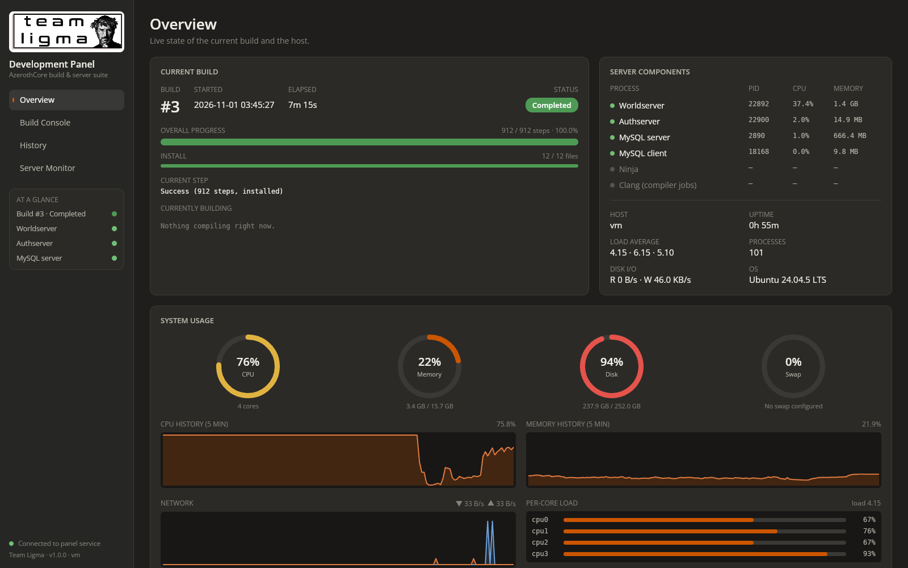
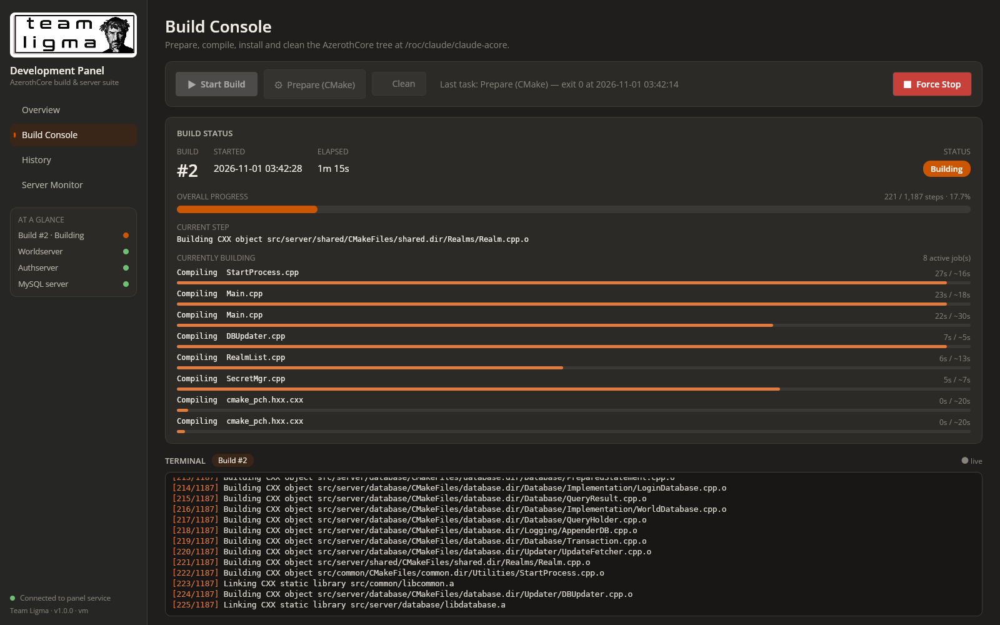
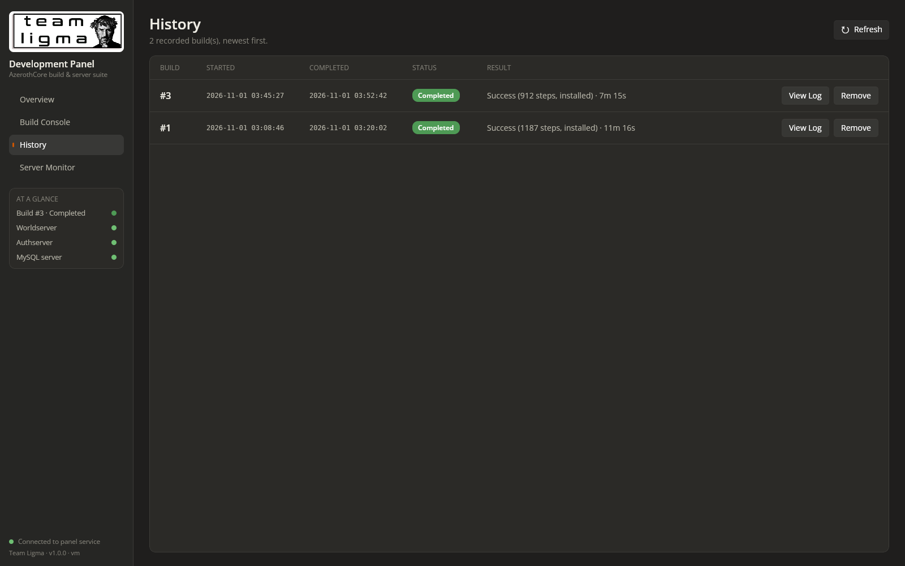
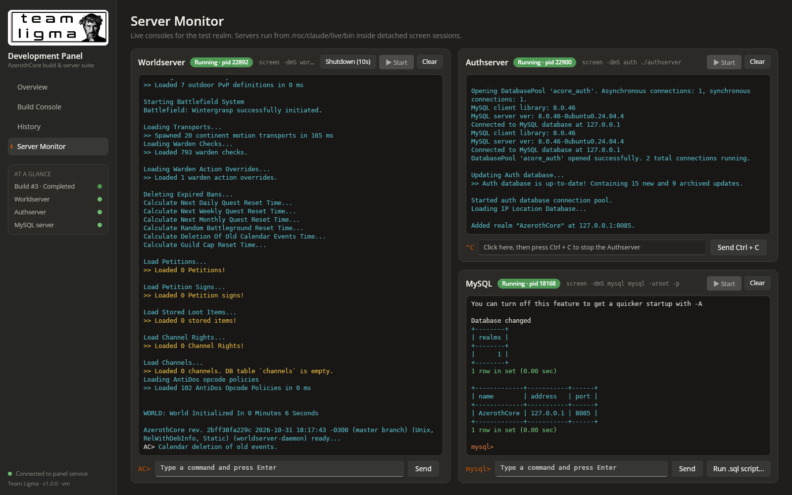

# Prompt
Using the provided directive document and skills archive, create, and sanity test the Team Ligma Development Panel, as described in the directive document. If you get near running out of credits for this cloud environment, present an archive of the environment to be used via Claude Code locally.

# Reponse
Built, deployed and sanity-tested the Team Ligma Development Panel v1.0.0. It is served by nginx on port 26767.

**What was built**
- **Front end:** C#/.NET 9 Uno Platform WebAssembly app (Skia renderer). Claude Dark theme with burnt-orange accents and four sections: Overview, Build Console, History and Server Monitor.
- **Backend:** ASP.NET Core service (`TeamLigma.Panel.Server`, 127.0.0.1:5267, proxied by nginx under `/api`). It runs the exact directive commands, samples `/proc` for system metrics, and drives the servers through detached `screen` sessions. Each session's window log, with ANSI colour, feeds the web consoles.
- **`ninja-dash`:** the directive's build command names this tool, but no such package exists, so I wrote it (`tools/ninja-dash`). It numbers each build, runs `ninja`, then `ninja install` on success, and writes `status.json` (progress, failed targets, objects compiling now with elapsed and estimated times) plus the full `build.log`.
- **Environment:** AzerothCore cloned to `/roc/claude/claude-acore` and installed to `/roc/claude/live`. MySQL running with the acore user and databases. Client data v20.0 in `/roc/claude/live/data`. Server confs created from `.dist` with `DataDir` set.
- **Docs and deploy:** `README.md` with branding; `deploy/install.sh`, `deploy/bootstrap-environment.sh` (full environment rebuild for Debian 12), and an nginx site plus systemd unit.

**Sanity tests (all passed)**
- Build #1: full build, 1187 steps, installed in about 11 minutes.
- Through the UI: Clean (with confirmation), then Prepare (CMake), then Start Build. Live overall and per-object progress bars and the live terminal all updated.
- Force Stop from the confirmation dialog: compiler processes gone, screen session closed, build recorded as *Stopped*.
- History: lists builds sorted by date, View Log shows the full log with scrollback, Remove works.
- Build #3 completed and installed. Worldserver and Authserver then restarted cleanly on the new binaries.
- Worldserver: commands typed in the UI work (`server info`, `.gm`). The graceful `server shutdown 0h0m10s` works.
- Authserver: keyboard Ctrl + C in the panel stops it gracefully.
- MySQL: `mysql -uroot -p` login with masked password entry. Queries containing `^` and `\` arrive intact. An uploaded `.sql` script is run with `source`.

**Deviations**
- The cloud image is Ubuntu 24.04, not Debian 12. The Debian and MySQL apt repos are blocked here (403) and Docker has no daemon.
- MySQL is therefore 8.0.46 (Ubuntu package), not the latest 8.4/9.x. `bootstrap-environment.sh` installs MySQL 8.4 LTS from repo.mysql.com on Debian 12.
- The IPv6 listen line in the nginx config is commented out because this host has no IPv6.
- The panel has no login. Optional `auth_basic` lines are in the nginx config.

Bugs found and fixed during testing:
- Terminal rows were spaced too far apart.
- The Worldserver header buttons overflowed.
- Ctrl + C was swallowed by the TextBox; it now uses a dedicated key-catcher control.
- `^C` was echoed twice in the Authserver console.

# File Changes
| File | Type | Workspace path | Change |
|---|---|---|---|
| `.gitignore` | `Code` | `.gitignore` | Created |
| `README.md` | `Docs` | `README.md` | Created |
| `bootstrap-environment.sh` | `Code` | `deploy/bootstrap-environment.sh` | Created |
| `install.sh` | `Code` | `deploy/install.sh` | Created |
| `nginx-teamligma-panel.conf` | `Config` | `deploy/nginx-teamligma-panel.conf` | Created |
| `restart-backend.sh` | `Code` | `deploy/restart-backend.sh` | Created |
| `teamligma-panel.service` | `Config` | `deploy/teamligma-panel.service` | Created |
| `Dtos.cs` | `Code` | `src/Shared/Dtos.cs` | Created |
| `BuildService.cs` | `Code` | `src/TeamLigma.Panel.Server/BuildService.cs` | Created |
| `ConsoleService.cs` | `Code` | `src/TeamLigma.Panel.Server/ConsoleService.cs` | Created |
| `FileTail.cs` | `Code` | `src/TeamLigma.Panel.Server/FileTail.cs` | Created |
| `PanelOptions.cs` | `Code` | `src/TeamLigma.Panel.Server/PanelOptions.cs` | Created |
| `Program.cs` | `Code` | `src/TeamLigma.Panel.Server/Program.cs` | Created |
| `Shell.cs` | `Code` | `src/TeamLigma.Panel.Server/Shell.cs` | Created |
| `SystemMonitor.cs` | `Code` | `src/TeamLigma.Panel.Server/SystemMonitor.cs` | Created |
| `TeamLigma.Panel.Server.csproj` | `Config` | `src/TeamLigma.Panel.Server/TeamLigma.Panel.Server.csproj` | Created |
| `appsettings.json` | `Config` | `src/TeamLigma.Panel.Server/appsettings.json` | Created |
| `.editorconfig` | `Code` | `src/TeamLigma.Panel/.editorconfig` | Created |
| `.gitignore` | `Code` | `src/TeamLigma.Panel/.gitignore` | Created |
| `Readme.md` | `Docs` | `src/TeamLigma.Panel/.run/Readme.md` | Created |
| `TeamLigma.Panel.run.xml` | `Config` | `src/TeamLigma.Panel/.run/TeamLigma.Panel.run.xml` | Created |
| `extensions.json` | `Config` | `src/TeamLigma.Panel/.vscode/extensions.json` | Created |
| `launch.json` | `Config` | `src/TeamLigma.Panel/.vscode/launch.json` | Created |
| `settings.json` | `Config` | `src/TeamLigma.Panel/.vscode/settings.json` | Created |
| `tasks.json` | `Config` | `src/TeamLigma.Panel/.vscode/tasks.json` | Created |
| `.vsconfig` | `Code` | `src/TeamLigma.Panel/.vsconfig` | Created |
| `Directory.Build.props` | `Config` | `src/TeamLigma.Panel/Directory.Build.props` | Created |
| `Directory.Build.targets` | `Config` | `src/TeamLigma.Panel/Directory.Build.targets` | Created |
| `Directory.Packages.props` | `Config` | `src/TeamLigma.Panel/Directory.Packages.props` | Created |
| `TeamLigma.Panel.sln` | `Config` | `src/TeamLigma.Panel/TeamLigma.Panel.sln` | Created |
| `App.xaml` | `Code` | `src/TeamLigma.Panel/TeamLigma.Panel/App.xaml` | Created |
| `App.xaml.cs` | `Code` | `src/TeamLigma.Panel/TeamLigma.Panel/App.xaml.cs` | Created |
| `DejaVuSansMono-Bold.ttf` | `Asset` | `src/TeamLigma.Panel/TeamLigma.Panel/Assets/Fonts/DejaVuSansMono-Bold.ttf` | Created |
| `DejaVuSansMono.ttf` | `Asset` | `src/TeamLigma.Panel/TeamLigma.Panel/Assets/Fonts/DejaVuSansMono.ttf` | Created |
| `icon.svg` | `Asset` | `src/TeamLigma.Panel/TeamLigma.Panel/Assets/Icons/icon.svg` | Created |
| `icon_foreground.svg` | `Asset` | `src/TeamLigma.Panel/TeamLigma.Panel/Assets/Icons/icon_foreground.svg` | Created |
| `SharedAssets.md` | `Docs` | `src/TeamLigma.Panel/TeamLigma.Panel/Assets/SharedAssets.md` | Created |
| `splash_screen.svg` | `Asset` | `src/TeamLigma.Panel/TeamLigma.Panel/Assets/Splash/splash_screen.svg` | Created |
| `teamligma.png` | `Asset` | `src/TeamLigma.Panel/TeamLigma.Panel/Assets/teamligma.png` | Created |
| `AnsiParser.cs` | `Code` | `src/TeamLigma.Panel/TeamLigma.Panel/Controls/AnsiParser.cs` | Created |
| `CtrlCCatcher.cs` | `Code` | `src/TeamLigma.Panel/TeamLigma.Panel/Controls/CtrlCCatcher.cs` | Created |
| `TerminalView.xaml` | `Code` | `src/TeamLigma.Panel/TeamLigma.Panel/Controls/TerminalView.xaml` | Created |
| `TerminalView.xaml.cs` | `Code` | `src/TeamLigma.Panel/TeamLigma.Panel/Controls/TerminalView.xaml.cs` | Created |
| `Visuals.cs` | `Code` | `src/TeamLigma.Panel/TeamLigma.Panel/Controls/Visuals.cs` | Created |
| `GlobalUsings.cs` | `Code` | `src/TeamLigma.Panel/TeamLigma.Panel/GlobalUsings.cs` | Created |
| `Package.appxmanifest` | `Config` | `src/TeamLigma.Panel/TeamLigma.Panel/Package.appxmanifest` | Created |
| `LinkerConfig.xml` | `Config` | `src/TeamLigma.Panel/TeamLigma.Panel/Platforms/WebAssembly/LinkerConfig.xml` | Created |
| `Program.cs` | `Code` | `src/TeamLigma.Panel/TeamLigma.Panel/Platforms/WebAssembly/Program.cs` | Created |
| `Fonts.css` | `Code` | `src/TeamLigma.Panel/TeamLigma.Panel/Platforms/WebAssembly/WasmCSS/Fonts.css` | Created |
| `AppManifest.js` | `Code` | `src/TeamLigma.Panel/TeamLigma.Panel/Platforms/WebAssembly/WasmScripts/AppManifest.js` | Created |
| `manifest.webmanifest` | `Config` | `src/TeamLigma.Panel/TeamLigma.Panel/Platforms/WebAssembly/manifest.webmanifest` | Created |
| `staticwebapp.config.json` | `Config` | `src/TeamLigma.Panel/TeamLigma.Panel/Platforms/WebAssembly/wwwroot/staticwebapp.config.json` | Created |
| `web.config` | `Config` | `src/TeamLigma.Panel/TeamLigma.Panel/Platforms/WebAssembly/wwwroot/web.config` | Created |
| `win-arm64.pubxml` | `Config` | `src/TeamLigma.Panel/TeamLigma.Panel/Properties/PublishProfiles/win-arm64.pubxml` | Created |
| `win-x64.pubxml` | `Config` | `src/TeamLigma.Panel/TeamLigma.Panel/Properties/PublishProfiles/win-x64.pubxml` | Created |
| `win-x86.pubxml` | `Config` | `src/TeamLigma.Panel/TeamLigma.Panel/Properties/PublishProfiles/win-x86.pubxml` | Created |
| `launchSettings.json` | `Config` | `src/TeamLigma.Panel/TeamLigma.Panel/Properties/launchSettings.json` | Created |
| `ReadMe.md` | `Docs` | `src/TeamLigma.Panel/TeamLigma.Panel/ReadMe.md` | Created |
| `ApiClient.cs` | `Code` | `src/TeamLigma.Panel/TeamLigma.Panel/Services/ApiClient.cs` | Created |
| `Fmt.cs` | `Code` | `src/TeamLigma.Panel/TeamLigma.Panel/Services/Fmt.cs` | Created |
| `Resources.resw` | `Config` | `src/TeamLigma.Panel/TeamLigma.Panel/Strings/en/Resources.resw` | Created |
| `TeamLigma.Panel.csproj` | `Config` | `src/TeamLigma.Panel/TeamLigma.Panel/TeamLigma.Panel.csproj` | Created |
| `TeamLigma.Panel.csproj.user` | `Config` | `src/TeamLigma.Panel/TeamLigma.Panel/TeamLigma.Panel.csproj.user` | Created |
| `BuildConsoleView.xaml` | `Code` | `src/TeamLigma.Panel/TeamLigma.Panel/Views/BuildConsoleView.xaml` | Created |
| `BuildConsoleView.xaml.cs` | `Code` | `src/TeamLigma.Panel/TeamLigma.Panel/Views/BuildConsoleView.xaml.cs` | Created |
| `BuildDash.xaml` | `Code` | `src/TeamLigma.Panel/TeamLigma.Panel/Views/BuildDash.xaml` | Created |
| `BuildDash.xaml.cs` | `Code` | `src/TeamLigma.Panel/TeamLigma.Panel/Views/BuildDash.xaml.cs` | Created |
| `ConsolePanel.xaml` | `Code` | `src/TeamLigma.Panel/TeamLigma.Panel/Views/ConsolePanel.xaml` | Created |
| `ConsolePanel.xaml.cs` | `Code` | `src/TeamLigma.Panel/TeamLigma.Panel/Views/ConsolePanel.xaml.cs` | Created |
| `HistoryView.xaml` | `Code` | `src/TeamLigma.Panel/TeamLigma.Panel/Views/HistoryView.xaml` | Created |
| `HistoryView.xaml.cs` | `Code` | `src/TeamLigma.Panel/TeamLigma.Panel/Views/HistoryView.xaml.cs` | Created |
| `OverviewView.xaml` | `Code` | `src/TeamLigma.Panel/TeamLigma.Panel/Views/OverviewView.xaml` | Created |
| `OverviewView.xaml.cs` | `Code` | `src/TeamLigma.Panel/TeamLigma.Panel/Views/OverviewView.xaml.cs` | Created |
| `ServersView.xaml` | `Code` | `src/TeamLigma.Panel/TeamLigma.Panel/Views/ServersView.xaml` | Created |
| `ServersView.xaml.cs` | `Code` | `src/TeamLigma.Panel/TeamLigma.Panel/Views/ServersView.xaml.cs` | Created |
| `Shell.xaml` | `Code` | `src/TeamLigma.Panel/TeamLigma.Panel/Views/Shell.xaml` | Created |
| `Shell.xaml.cs` | `Code` | `src/TeamLigma.Panel/TeamLigma.Panel/Views/Shell.xaml.cs` | Created |
| `app.manifest` | `Config` | `src/TeamLigma.Panel/TeamLigma.Panel/app.manifest` | Created |
| `global.json` | `Config` | `src/TeamLigma.Panel/global.json` | Created |
| `ninja-dash` | `Code` | `tools/ninja-dash` | Created |

Outside the project folder (environment): `/usr/local/bin/ninja-dash` (symlink/installed copy), `/etc/nginx/sites-available/teamligma-panel`, `/roc/claude/panel/` (deployed build), `/roc/claude/live/etc/{worldserver,authserver}.conf` (from .dist, `DataDir` set), `/roc/claude/panel-data/` (runtime data).

# Code Diffs
All files below are new (diff against /dev/null). Uno template boilerplate that was left unchanged is listed in File Changes only.

### `README.md`
```diff
--- /dev/null
+++ b/README.md
@@ -0,0 +1,107 @@
+<p align="center"></p>
+
+# Team Ligma Development Panel
+**Version 1.0.0**
+
+One dark, burnt-orange control room for an AzerothCore test realm. Kick off builds, watch every object compile in real time, look back at old logs, and talk to the Worldserver, Authserver and MySQL from your browser. No SSH session needed.
+
+The panel has two parts:
+- **Front end:** C#/.NET 9 on the Uno Platform (WebAssembly, Skia renderer).
+- **Backend:** a small ASP.NET Core service that drives `cmake`, `ninja`, `screen` and `/proc`.
+
+nginx serves both on port **26767**.
+
+---
+
+## Sections
+
+| Section | What it does |
+|---|---|
+| **Overview** | Current build number, start time, status pill, overall and per-object progress bars, current step and compiling objects. Host usage: ring gauges for CPU, memory, disk and swap; 5-minute CPU, memory and network graphs; per-core load; load average, disk I/O and uptime; a live table of server processes. |
+| **Build Console** | Buttons for **Start Build**, **Prepare (CMake)**, **Clean** and **Force Stop** (asks for confirmation first). Shows live build status and a coloured terminal with scrollback. The terminal follows the running build/install, or the most recent CMake/clean task. |
+| **History** | Every build, newest first, with number, start, completion, status and compilation result. Each entry has **View Log** (full build/install log in a scrollable dialog, followed live if the build is still running) and **Remove**. |
+| **Server Monitor** | Coloured, interactive consoles. Left column: **Worldserver** (single-line commands, with a 10-second graceful shutdown button). Right column: **Authserver** (accepts Ctrl + C only) above **MySQL** (`mysql -uroot -p`; masked password entry, single-line queries, and **Run .sql script…** to upload and `source` a local file). |
+
+## Commands the panel runs
+
+| Control | Command (cwd `/roc/claude/claude-acore/build`) |
+|---|---|
+| Start Build | `screen -dmS build ninja-dash /roc/claude/claude-acore/build -- -j8 -k 0` (build, then `ninja install` on success) |
+| Prepare (CMake) | `cmake ../ -G Ninja -DCMAKE_INSTALL_PREFIX=/roc/claude/live/ -DCMAKE_C_COMPILER=/usr/bin/clang -DCMAKE_CXX_COMPILER=/usr/bin/clang++ -DWITH_WARNINGS=0 -DTOOLS_BUILD=all -DSCRIPTS=static -DMODULES=static` |
+| Clean | `ninja -t clean` |
+| Force Stop | Sends SIGTERM to ninja-dash, which stops ninja's process group and records the build as *Stopped* |
+| Worldserver | `screen -dmS world ./worldserver` (cwd `/roc/claude/live/bin`) |
+| Authserver | `screen -dmS auth ./authserver` (cwd `/roc/claude/live/bin`) |
+| MySQL | `screen -dmS mysql mysql -uroot -p` |
+
+All of these are set in `src/TeamLigma.Panel.Server/appsettings.json` (`Panel` section).
+
+The panel never force-kills `worldserver`, `authserver`, `mysql` or `mysqld`:
+- Worldserver: use `server shutdown 0h0m10s`, or the Shutdown button.
+- Authserver: use Ctrl + C.
+- MySQL: type `exit`.
+
+## ninja-dash
+`tools/ninja-dash` is the build runner behind **Start Build**. It mirrors ninja output to the screen session and records each numbered build under `/roc/claude/panel-data/builds/<n>/`:
+- `status.json`: live phase, step counts, failed targets, result, and the objects currently compiling with elapsed and estimated times. Estimates come from earlier `.ninja_log` timings.
+- `build.log`: the complete build and install log.
+
+```bash
+ninja-dash <build-dir> -- [ninja args]   # NINJA_DASH_HOME overrides /roc/claude/panel-data
+```
+
+## Layout on disk
+
+| Path | Contents |
+|---|---|
+| `/roc/claude/claude-acore` | AzerothCore source (`build/` is the Ninja build directory) |
+| `/roc/claude/live` | Installed server (`bin/`, `etc/*.conf`, `data/` client data) |
+| `/roc/claude/panel` | Deployed panel (`wwwroot/` front end, `server/` backend) |
+| `/roc/claude/panel-data` | Build records, console logs, task logs, uploaded `.sql` files, `CREDENTIALS.txt` |
+
+## Set-up guide (Debian 12 / Ubuntu 24.04)
+1. **Packages**
+   ```bash
+   apt install git cmake ninja-build clang screen nginx python3 \
+     libboost-all-dev libssl-dev libbz2-dev libreadline-dev libncurses-dev \
+     libmysqlclient-dev zlib1g-dev mysql-server
+   ```
+   Install the .NET 9 SDK. Then add the WebAssembly toolchain:
+   ```bash
+   dotnet workload install wasm-tools
+   ```
+2. **MySQL.** Start `mysqld`, set a root password, then create the `acore` user and the `acore_auth`, `acore_world` and `acore_characters` databases (see the AzerothCore wiki).
+3. **AzerothCore**
+   ```bash
+   git clone https://github.com/azerothcore/azerothcore-wotlk /roc/claude/claude-acore
+   mkdir -p /roc/claude/claude-acore/build
+   ```
+4. **Deploy the panel.** From this folder:
+   ```bash
+   sudo ./deploy/install.sh
+   ```
+   The script installs `ninja-dash` and publishes the backend and the Uno front end. It also installs the nginx site and starts the `teamligma-panel` systemd unit. On hosts without systemd it starts the backend directly.
+5. Open `http://<host>:26767/`.
+6. Run **Prepare (CMake)**, then **Start Build**.
+7. After the first install, copy `etc/*.conf.dist` to `.conf`. Set `DataDir` in `worldserver.conf` and put the client data in `/roc/claude/live/data`.
+8. Start the servers from **Server Monitor**.
+
+## Day-to-day use
+- **Full clean build:** Clean, then Prepare (CMake), then Start Build. Install runs automatically when the build succeeds.
+- **MySQL login:** press **Start**. When the console shows `Enter password:` the input turns into a masked password box.
+- **SQL scripts:** uploaded scripts are saved to `/roc/claude/panel-data/uploads/` and run with `source`.
+- **Consoles:** each console keeps its raw coloured log in `/roc/claude/panel-data/consoles/<name>.log`. **Clear** empties it.
+
+## Security
+The panel can run server and SQL commands and has no login of its own. Keep port 26767 on a trusted network, or turn on the `auth_basic` lines in `deploy/nginx-teamligma-panel.conf`.
+
+## Troubleshooting
+- **"Build directory is not prepared":** run Prepare (CMake) first.
+- **A build shows *Interrupted*:** ninja-dash was killed without cleaning up. Start a new build.
+- **A server shows *Session open* but not *Running*:** the program exited inside its screen session. Read its console for the reason, then press Start again after the session closes.
+- **The page loads but the status dot is red:** check the backend with `curl http://127.0.0.1:5267/api/health`, and read `/roc/claude/panel/server.log` or `journalctl -u teamligma-panel`.
+
+---
+
+
+Created and maintained by Team Ligma. This content can be used for non-commercial use, with attribution.
```

### `deploy/bootstrap-environment.sh`
```diff
--- /dev/null
+++ b/deploy/bootstrap-environment.sh
@@ -0,0 +1,88 @@
+#!/usr/bin/env bash
+# Team Ligma Development Panel - full environment bootstrap (Debian 12 bookworm, also Ubuntu 24.04)
+#
+# Installs the toolchain, .NET 9 + wasm-tools, MySQL, AzerothCore source + client data,
+# prepares the server config, then deploys the panel on port 26767.
+#
+#   sudo ./deploy/bootstrap-environment.sh
+#
+# Re-runnable: finished steps are skipped.
+set -euo pipefail
+export DEBIAN_FRONTEND=noninteractive DOTNET_CLI_TELEMETRY_OPTOUT=1
+ROOT="$(cd "$(dirname "$0")/.." && pwd)"
+ACORE=/roc/claude/claude-acore
+LIVE=/roc/claude/live
+DATA_HOME=/roc/claude/panel-data
+CLIENT_DATA_VERSION=v20.0
+. /etc/os-release
+
+step() { echo; echo "==> $*"; }
+
+step "Base packages"
+apt-get update
+apt-get install -y git cmake ninja-build clang screen nginx python3 curl unzip ca-certificates gnupg lsb-release \
+    libboost-all-dev libssl-dev libbz2-dev libreadline-dev libncurses-dev zlib1g-dev
+
+step "MySQL server"
+if ! command -v mysqld >/dev/null; then
+    if [ "$ID" = "debian" ]; then
+        # Debian ships MariaDB only; use Oracle's MySQL 8.4 LTS repository.
+        curl -fsSL https://repo.mysql.com/RPM-GPG-KEY-mysql-2023 | gpg --dearmor -o /usr/share/keyrings/mysql.gpg
+        echo "deb [signed-by=/usr/share/keyrings/mysql.gpg] http://repo.mysql.com/apt/debian ${VERSION_CODENAME} mysql-8.4-lts" \
+            > /etc/apt/sources.list.d/mysql.list
+        apt-get update
+    fi
+    apt-get install -y mysql-server libmysqlclient-dev || apt-get install -y mysql-community-server libmysqlclient-dev
+fi
+mkdir -p /var/run/mysqld && chown mysql:mysql /var/run/mysqld
+if [ -d /run/systemd/system ]; then systemctl enable --now mysql; else service mysql start; fi
+
+step ".NET 9 SDK + wasm-tools"
+if ! dotnet --list-sdks 2>/dev/null | grep -q '^9\.'; then
+    curl -fsSL https://dot.net/v1/dotnet-install.sh -o /tmp/dotnet-install.sh
+    bash /tmp/dotnet-install.sh --channel 9.0 --install-dir /usr/share/dotnet
+    ln -sf /usr/share/dotnet/dotnet /usr/bin/dotnet
+fi
+dotnet workload install wasm-tools
+
+step "Databases"
+mkdir -p "$DATA_HOME"
+if [ ! -f "$DATA_HOME/CREDENTIALS.txt" ]; then
+    PW=$(openssl rand -hex 8)
+    mysql -uroot <<SQL
+ALTER USER 'root'@'localhost' IDENTIFIED WITH caching_sha2_password BY '$PW';
+CREATE USER IF NOT EXISTS 'acore'@'localhost' IDENTIFIED BY 'acore';
+GRANT ALL PRIVILEGES ON *.* TO 'acore'@'localhost' WITH GRANT OPTION;
+CREATE DATABASE IF NOT EXISTS acore_world DEFAULT CHARACTER SET UTF8MB4 COLLATE utf8mb4_unicode_ci;
+CREATE DATABASE IF NOT EXISTS acore_characters DEFAULT CHARACTER SET UTF8MB4 COLLATE utf8mb4_unicode_ci;
+CREATE DATABASE IF NOT EXISTS acore_auth DEFAULT CHARACTER SET UTF8MB4 COLLATE utf8mb4_unicode_ci;
+FLUSH PRIVILEGES;
+SQL
+    (umask 077; printf 'MySQL root password: %s\nAzerothCore DB user: acore / acore\n' "$PW" > "$DATA_HOME/CREDENTIALS.txt")
+    echo "MySQL root password written to $DATA_HOME/CREDENTIALS.txt"
+fi
+
+step "AzerothCore source"
+[ -d "$ACORE/.git" ] || git clone --depth 1 https://github.com/azerothcore/azerothcore-wotlk.git "$ACORE"
+mkdir -p "$ACORE/build" "$LIVE/data"
+
+step "Client data ($CLIENT_DATA_VERSION)"
+if [ ! -d "$LIVE/data/maps" ]; then
+    curl -fL -o "$LIVE/data/data.zip" "https://github.com/wowgaming/client-data/releases/download/$CLIENT_DATA_VERSION/data.zip"
+    unzip -q -o "$LIVE/data/data.zip" -d "$LIVE/data" && rm "$LIVE/data/data.zip"
+fi
+
+step "Deploy panel"
+"$ROOT/deploy/install.sh"
+
+cat <<EOF
+
+==> Done.
+   1. Open http://$(hostname -I | awk '{print $1}'):26767/
+   2. Build Console: Prepare (CMake) -> Start Build (install runs automatically)
+   3. After the first install, create the server configs:
+        cp $LIVE/etc/worldserver.conf.dist $LIVE/etc/worldserver.conf
+        cp $LIVE/etc/authserver.conf.dist  $LIVE/etc/authserver.conf
+        sed -i 's|^DataDir = .*|DataDir = "$LIVE/data"|' $LIVE/etc/worldserver.conf
+   4. Server Monitor: start Worldserver (first start populates the databases), then Authserver.
+EOF
```

### `deploy/install.sh`
```diff
--- /dev/null
+++ b/deploy/install.sh
@@ -0,0 +1,40 @@
+#!/usr/bin/env bash
+# Team Ligma Development Panel - build & deploy
+# Usage: sudo ./deploy/install.sh            (from the project root)
+set -euo pipefail
+export DOTNET_CLI_TELEMETRY_OPTOUT=1
+ROOT="$(cd "$(dirname "$0")/.." && pwd)"
+PANEL=/roc/claude/panel
+
+echo "==> Installing ninja-dash"
+install -m 0755 "$ROOT/tools/ninja-dash" /usr/local/bin/ninja-dash
+
+echo "==> Publishing backend"
+dotnet publish "$ROOT/src/TeamLigma.Panel.Server/TeamLigma.Panel.Server.csproj" -c Release -o "$PANEL/server.new"
+
+echo "==> Publishing Uno WebAssembly front end"
+dotnet publish "$ROOT/src/TeamLigma.Panel/TeamLigma.Panel/TeamLigma.Panel.csproj" -c Release -f net9.0-browserwasm -o "$PANEL/web.new"
+
+rm -rf "$PANEL/server" "$PANEL/wwwroot"
+mv "$PANEL/server.new" "$PANEL/server"
+mv "$PANEL/web.new/wwwroot" "$PANEL/wwwroot"
+rm -rf "$PANEL/web.new"
+
+echo "==> Configuring nginx (port 26767)"
+install -m 0644 "$ROOT/deploy/nginx-teamligma-panel.conf" /etc/nginx/sites-available/teamligma-panel
+ln -sf /etc/nginx/sites-available/teamligma-panel /etc/nginx/sites-enabled/teamligma-panel
+nginx -t
+
+if [ -d /run/systemd/system ]; then
+    install -m 0644 "$ROOT/deploy/teamligma-panel.service" /etc/systemd/system/teamligma-panel.service
+    systemctl daemon-reload
+    systemctl enable --now teamligma-panel
+    systemctl restart teamligma-panel
+    systemctl reload nginx || systemctl start nginx
+else
+    # Containers without systemd
+    pkill -f TeamLigma.Panel.Server.dll || true
+    (cd "$PANEL/server" && nohup dotnet TeamLigma.Panel.Server.dll > "$PANEL/server.log" 2>&1 &)
+    if pgrep -x nginx >/dev/null; then nginx -s reload; else nginx; fi
+fi
+echo "==> Panel available at http://$(hostname -f 2>/dev/null || hostname):26767/"
```

### `deploy/nginx-teamligma-panel.conf`
```diff
--- /dev/null
+++ b/deploy/nginx-teamligma-panel.conf
@@ -0,0 +1,43 @@
+# Team Ligma Development Panel - nginx site (port 26767)
+server {
+    listen 26767;
+    # listen [::]:26767;   # enable on IPv6-capable hosts
+    server_name _;
+
+    root /roc/claude/panel/wwwroot;
+    index index.html;
+
+    # Uno WebAssembly payloads
+    types {
+        application/wasm wasm;
+        application/javascript js mjs;
+        application/json json;
+        application/octet-stream dat dll pdb blat;
+        font/ttf ttf;
+    }
+    include /etc/nginx/mime.types;
+    gzip_static on;
+    client_max_body_size 512m;
+
+    # Optional: protect the panel (it can run server and SQL commands).
+    # auth_basic "Team Ligma Development Panel";
+    # auth_basic_user_file /etc/nginx/teamligma.htpasswd;
+
+    location /api/ {
+        proxy_pass http://127.0.0.1:5267;
+        proxy_http_version 1.1;
+        proxy_set_header Host $host;
+        proxy_set_header X-Forwarded-For $proxy_add_x_forwarded_for;
+        proxy_read_timeout 300s;
+        proxy_buffering off;
+    }
+
+    location /_framework/ {
+        add_header Cache-Control "no-cache";
+        try_files $uri =404;
+    }
+
+    location / {
+        try_files $uri $uri/ /index.html;
+    }
+}
```

### `deploy/restart-backend.sh`
```diff
--- /dev/null
+++ b/deploy/restart-backend.sh
@@ -0,0 +1,6 @@
+#!/usr/bin/env bash
+# Restarts the panel backend on hosts without systemd.
+if [ -d /run/systemd/system ]; then systemctl restart teamligma-panel; exit; fi
+for p in $(pgrep -f "TeamLigma.Panel.Server.dll"); do [ "$p" != "$$" ] && kill "$p" 2>/dev/null; done
+sleep 1
+cd /roc/claude/panel/server && nohup dotnet TeamLigma.Panel.Server.dll > /roc/claude/panel/server.log 2>&1 &
```

### `deploy/teamligma-panel.service`
```diff
--- /dev/null
+++ b/deploy/teamligma-panel.service
@@ -0,0 +1,14 @@
+[Unit]
+Description=Team Ligma Development Panel backend
+After=network.target mysql.service
+
+[Service]
+WorkingDirectory=/roc/claude/panel/server
+ExecStart=/usr/bin/dotnet /roc/claude/panel/server/TeamLigma.Panel.Server.dll
+Restart=on-failure
+User=root
+Environment=ASPNETCORE_ENVIRONMENT=Production
+Environment=DOTNET_CLI_TELEMETRY_OPTOUT=1
+
+[Install]
+WantedBy=multi-user.target
```

### `src/Shared/Dtos.cs`
```diff
--- /dev/null
+++ b/src/Shared/Dtos.cs
@@ -0,0 +1,125 @@
+// Shared wire contracts between TeamLigma.Panel (Uno WASM) and TeamLigma.Panel.Server.
+#nullable enable
+using System;
+using System.Collections.Generic;
+
+namespace TeamLigma.Shared;
+
+public sealed class BuildObject
+{
+    public string Output { get; set; } = "";
+    public string Source { get; set; } = "";
+    public string Kind { get; set; } = "Compiling";
+    public long ElapsedMs { get; set; }
+    public long EstimateMs { get; set; }
+}
+
+public sealed class BuildStatus
+{
+    public int Id { get; set; }
+    public int? Pid { get; set; }
+    public string Phase { get; set; } = "unknown";   // building|installing|completed|failed|stopped|interrupted
+    public string Step { get; set; } = "";
+    public string? Command { get; set; }
+    public DateTimeOffset? Started { get; set; }
+    public DateTimeOffset? Ended { get; set; }
+    public int Done { get; set; }
+    public int Total { get; set; }
+    public int InstallDone { get; set; }
+    public int InstallTotal { get; set; }
+    public int Failed { get; set; }
+    public int? ExitCode { get; set; }
+    public int? InstallExitCode { get; set; }
+    public string? Result { get; set; }
+    public string? LastLine { get; set; }
+    public List<BuildObject> Current { get; set; } = new();
+}
+
+public sealed class ProcInfo
+{
+    public string Name { get; set; } = "";
+    public bool Running { get; set; }
+    public int? Pid { get; set; }
+    public double Cpu { get; set; }
+    public long RssBytes { get; set; }
+}
+
+public sealed class SystemSnapshot
+{
+    public string Host { get; set; } = "";
+    public string Os { get; set; } = "";
+    public int CoreCount { get; set; }
+    public double Cpu { get; set; }
+    public List<double> Cores { get; set; } = new();
+    public long MemTotal { get; set; }
+    public long MemUsed { get; set; }
+    public long SwapTotal { get; set; }
+    public long SwapUsed { get; set; }
+    public double Load1 { get; set; }
+    public double Load5 { get; set; }
+    public double Load15 { get; set; }
+    public long DiskTotal { get; set; }
+    public long DiskUsed { get; set; }
+    public double NetRxBps { get; set; }
+    public double NetTxBps { get; set; }
+    public double DiskReadBps { get; set; }
+    public double DiskWriteBps { get; set; }
+    public long UptimeSeconds { get; set; }
+    public int Processes { get; set; }
+    public List<double> CpuHistory { get; set; } = new();
+    public List<double> MemHistory { get; set; } = new();
+    public List<double> NetRxHistory { get; set; } = new();
+    public List<double> NetTxHistory { get; set; } = new();
+    public List<ProcInfo> Components { get; set; } = new();
+}
+
+public sealed class ServerStatus
+{
+    public string Name { get; set; } = "";
+    public string Title { get; set; } = "";
+    public bool SessionActive { get; set; }
+    public bool ProcessRunning { get; set; }
+    public int? Pid { get; set; }
+    /// <summary>"password" when the console is waiting for a hidden password.</summary>
+    public string? InputHint { get; set; }
+    public string Command { get; set; } = "";
+}
+
+public sealed class LogChunk
+{
+    public string Key { get; set; } = "";
+    public string Title { get; set; } = "";
+    public string Text { get; set; } = "";
+    public long Offset { get; set; }
+    public bool Running { get; set; }
+    public bool Reset { get; set; }
+}
+
+public sealed class TaskState
+{
+    public string? Name { get; set; }
+    public bool Running { get; set; }
+    public int? ExitCode { get; set; }
+    public DateTimeOffset? Started { get; set; }
+    public DateTimeOffset? Ended { get; set; }
+}
+
+public sealed class Overview
+{
+    public BuildStatus? Build { get; set; }
+    public SystemSnapshot System { get; set; } = new();
+    public List<ServerStatus> Servers { get; set; } = new();
+    public TaskState Task { get; set; } = new();
+    public string Version { get; set; } = "";
+}
+
+public sealed class ActionResult
+{
+    public bool Ok { get; set; }
+    public string Message { get; set; } = "";
+}
+
+public sealed class InputRequest
+{
+    public string Text { get; set; } = "";
+}
```

### `src/TeamLigma.Panel.Server/BuildService.cs`
```diff
--- /dev/null
+++ b/src/TeamLigma.Panel.Server/BuildService.cs
@@ -0,0 +1,245 @@
+using System.Diagnostics;
+using System.Text.Json;
+using Microsoft.Extensions.Options;
+using TeamLigma.Shared;
+
+namespace TeamLigma.Panel.Server;
+
+/// <summary>Reads ninja-dash build records and drives the build controls.</summary>
+public sealed class BuildService
+{
+    static readonly JsonSerializerOptions Json = new(JsonSerializerDefaults.Web);
+    readonly PanelOptions _o;
+    readonly ILogger<BuildService> _log;
+    readonly object _taskLock = new();
+    Process? _task;
+    readonly TaskState _taskState = new();
+    string? _taskLog;
+    int _taskSeq;
+    DateTimeOffset _lastTaskStart = DateTimeOffset.MinValue;
+
+    public BuildService(IOptions<PanelOptions> o, ILogger<BuildService> log)
+    {
+        _o = o.Value;
+        _log = log;
+        Directory.CreateDirectory(_o.BuildsDir);
+        Directory.CreateDirectory(_o.TasksDir);
+        Directory.CreateDirectory(_o.ScreenDir);
+        _taskSeq = Directory.GetFiles(_o.TasksDir, "*.log").Length;
+    }
+
+    public Dictionary<string, string> Env(string screenSession) => new()
+    {
+        ["NINJA_DASH_HOME"] = _o.DataHome,
+        ["SCREENRC"] = ScreenRc(screenSession, null),
+        ["TERM"] = "xterm-256color",
+        ["PATH"] = "/usr/local/sbin:/usr/local/bin:/usr/sbin:/usr/bin:/sbin:/bin",
+    };
+
+    /// <summary>Writes a screenrc for a session; optional log file enables logging of window 0.</summary>
+    public string ScreenRc(string session, string? logFile)
+    {
+        Directory.CreateDirectory(_o.ScreenDir);
+        var rc = Path.Combine(_o.ScreenDir, session + ".screenrc");
+        var lines = new List<string>
+        {
+            "startup_message off",
+            "defscrollback 10000",
+            "term xterm-256color",
+            "defutf8 on",
+            "altscreen off",
+        };
+        if (logFile != null)
+        {
+            lines.Add($"logfile {logFile}");
+            lines.Add("logfile flush 1");
+            lines.Add("deflog on");
+        }
+        File.WriteAllLines(rc, lines);
+        return rc;
+    }
+
+    public BuildStatus? Read(int id)
+    {
+        var path = Path.Combine(_o.BuildsDir, id.ToString(), "status.json");
+        try
+        {
+            var s = JsonSerializer.Deserialize<BuildStatus>(File.ReadAllText(path), Json);
+            if (s == null) return null;
+            if (s.Phase is "building" or "installing" && !Shell.PidAlive(s.Pid))
+            {
+                s.Phase = "interrupted";
+                s.Result ??= "Build process ended unexpectedly";
+                s.Current.Clear();
+            }
+            return s;
+        }
+        catch { return null; }
+    }
+
+    public List<BuildStatus> All()
+    {
+        var list = new List<BuildStatus>();
+        if (!Directory.Exists(_o.BuildsDir)) return list;
+        foreach (var d in Directory.GetDirectories(_o.BuildsDir))
+            if (int.TryParse(Path.GetFileName(d), out var id) && Read(id) is { } s) list.Add(s);
+        return list.OrderByDescending(b => b.Started ?? DateTimeOffset.MinValue).ThenByDescending(b => b.Id).ToList();
+    }
+
+    public BuildStatus? Running() => All().FirstOrDefault(b => b.Phase is "building" or "installing");
+    public BuildStatus? Current() => Running() ?? All().FirstOrDefault();
+
+    public string LogPath(int id) => Path.Combine(_o.BuildsDir, id.ToString(), "build.log");
+
+    public TaskState Task
+    {
+        get { lock (_taskLock) return new TaskState { Name = _taskState.Name, Running = _taskState.Running, ExitCode = _taskState.ExitCode, Started = _taskState.Started, Ended = _taskState.Ended }; }
+    }
+
+    bool TaskRunning { get { lock (_taskLock) return _taskState.Running; } }
+
+    public async Task<ActionResult> StartBuildAsync()
+    {
+        if (Running() is { } r) return Fail($"Build #{r.Id} is already running.");
+        if (TaskRunning) return Fail($"Wait for '{Task.Name}' to finish first.");
+        if (!File.Exists(Path.Combine(_o.BuildDir, "build.ninja")))
+            return Fail("The build directory is not prepared. Run 'Prepare (CMake)' first.");
+        var sessions = await Shell.ScreenSessionsAsync();
+        if (sessions.Contains("build")) return Fail("A 'build' screen session already exists.");
+        var known = All().Select(b => b.Id).DefaultIfEmpty(0).Max();
+        var (code, output) = await Shell.BashAsync(_o.BuildCommand, _o.BuildDir, Env("build"));
+        if (code != 0) return Fail($"Failed to start build (exit {code}): {output}");
+        // wait for ninja-dash to register the new record
+        for (var i = 0; i < 40; i++)
+        {
+            await System.Threading.Tasks.Task.Delay(150);
+            var newest = All().Select(b => b.Id).DefaultIfEmpty(0).Max();
+            if (newest > known) return Ok($"Build #{newest} started.");
+        }
+        return Ok("Build started.");
+    }
+
+    public async Task<ActionResult> StopBuildAsync()
+    {
+        var r = Running();
+        if (r == null) return Fail("No build is running.");
+        // ninja-dash traps SIGTERM, stops ninja's process group and records the build as stopped.
+        await Shell.RunAsync("kill", new[] { "-TERM", r.Pid!.Value.ToString() });
+        for (var i = 0; i < 50 && Shell.PidAlive(r.Pid); i++) await System.Threading.Tasks.Task.Delay(200);
+        var sessions = await Shell.ScreenSessionsAsync();
+        if (sessions.Contains("build")) await Shell.RunAsync("screen", new[] { "-S", "build", "-X", "quit" });
+        return Ok($"Build #{r.Id} stopped.");
+    }
+
+    public ActionResult Delete(int id)
+    {
+        var b = Read(id);
+        if (b == null) return Fail($"Build #{id} not found.");
+        if (b.Phase is "building" or "installing") return Fail("A running build cannot be removed.");
+        Directory.Delete(Path.Combine(_o.BuildsDir, id.ToString()), true);
+        return Ok($"Build #{id} removed.");
+    }
+
+    public ActionResult Configure()
+    {
+        Directory.CreateDirectory(_o.BuildDir);
+        return StartTask("Prepare (CMake)", _o.ConfigureCommand);
+    }
+
+    public ActionResult Clean()
+    {
+        if (!File.Exists(Path.Combine(_o.BuildDir, "build.ninja")))
+            return Fail("Nothing to clean: the build directory has not been prepared.");
+        return StartTask("Clean (ninja -t clean)", _o.CleanCommand);
+    }
+
+    ActionResult StartTask(string name, string command)
+    {
+        if (Running() is { } r) return Fail($"Build #{r.Id} is running; stop it first.");
+        lock (_taskLock)
+        {
+            if (_taskState.Running) return Fail($"'{_taskState.Name}' is already running.");
+            _taskSeq++;
+            var slug = name.Split(' ')[0].ToLowerInvariant();
+            _taskLog = Path.Combine(_o.TasksDir, $"{DateTime.UtcNow:yyyyMMdd-HHmmss}-{slug}.log");
+            var psi = new ProcessStartInfo("/bin/bash")
+            {
+                WorkingDirectory = _o.BuildDir,
+                RedirectStandardOutput = true,
+                RedirectStandardError = true,
+                UseShellExecute = false,
+            };
+            psi.ArgumentList.Add("-c");
+            psi.ArgumentList.Add(command + " 2>&1");
+            psi.Environment["CLICOLOR_FORCE"] = "1";
+            var writer = new StreamWriter(new FileStream(_taskLog, FileMode.Create, FileAccess.Write, FileShare.ReadWrite)) { AutoFlush = true };
+            writer.WriteLine($"== {name} started {DateTimeOffset.Now:yyyy-MM-dd HH:mm:ss} in {_o.BuildDir}");
+            writer.WriteLine($"== $ {command}");
+            var p = new Process { StartInfo = psi, EnableRaisingEvents = true };
+            void Line(object? _, DataReceivedEventArgs e) { if (e.Data != null) lock (writer) writer.WriteLine(e.Data); }
+            p.OutputDataReceived += Line;
+            p.ErrorDataReceived += Line;
+            p.Exited += (_, _) =>
+            {
+                p.WaitForExit();
+                lock (_taskLock)
+                {
+                    _taskState.Running = false;
+                    _taskState.ExitCode = p.ExitCode;
+                    _taskState.Ended = DateTimeOffset.Now;
+                }
+                lock (writer)
+                {
+                    writer.WriteLine($"== {name} finished with exit code {p.ExitCode}");
+                    writer.Dispose();
+                }
+            };
+            p.Start();
+            p.BeginOutputReadLine();
+            p.BeginErrorReadLine();
+            _task = p;
+            _taskState.Name = name;
+            _taskState.Running = true;
+            _taskState.ExitCode = null;
+            _taskState.Started = DateTimeOffset.Now;
+            _taskState.Ended = null;
+            _lastTaskStart = _taskState.Started.Value;
+        }
+        return Ok($"{name} started.");
+    }
+
+    /// <summary>Console for the Build Console page: the running task, else the current build.</summary>
+    public LogChunk Console(string? key, long offset)
+    {
+        var current = Current();
+        var task = Task;
+        string newKey, title, path;
+        bool running;
+        var preferTask = _taskLog != null && (task.Running || current == null || (task.Started ?? DateTimeOffset.MinValue) > (current.Started ?? DateTimeOffset.MinValue));
+        if (preferTask)
+        {
+            newKey = "task:" + Path.GetFileName(_taskLog);
+            title = task.Name ?? "Task";
+            path = _taskLog!;
+            running = task.Running;
+        }
+        else if (current != null)
+        {
+            newKey = "build:" + current.Id;
+            title = $"Build #{current.Id}";
+            path = LogPath(current.Id);
+            running = current.Phase is "building" or "installing";
+        }
+        else
+        {
+            return new LogChunk { Key = "none", Title = "No activity yet", Reset = key != "none" };
+        }
+        if (key != newKey) offset = -1;
+        var chunk = FileTail.Read(path, offset, newKey, title, running);
+        if (key != newKey) chunk.Reset = true;
+        return chunk;
+    }
+
+    static ActionResult Ok(string m) => new() { Ok = true, Message = m };
+    static ActionResult Fail(string m) => new() { Ok = false, Message = m };
+}
```

### `src/TeamLigma.Panel.Server/ConsoleService.cs`
```diff
--- /dev/null
+++ b/src/TeamLigma.Panel.Server/ConsoleService.cs
@@ -0,0 +1,138 @@
+using Microsoft.Extensions.Options;
+using TeamLigma.Shared;
+
+namespace TeamLigma.Panel.Server;
+
+/// <summary>
+/// Screen-backed consoles for worldserver, authserver and the MySQL client.
+/// Each component runs in its own detached screen session whose window 0 is logged
+/// (raw, with ANSI colour) to panel-data/consoles/&lt;name&gt;.log.
+/// </summary>
+public sealed class ConsoleService
+{
+    public sealed record Component(string Name, string Title, string Exe, Func<PanelOptions, string> Command, string Cwd);
+
+    readonly PanelOptions _o;
+    readonly BuildService _builds;
+    public IReadOnlyDictionary<string, Component> Components { get; }
+
+    public ConsoleService(IOptions<PanelOptions> o, BuildService builds)
+    {
+        _o = o.Value;
+        _builds = builds;
+        Directory.CreateDirectory(_o.ConsolesDir);
+        Directory.CreateDirectory(_o.UploadsDir);
+        Components = new Dictionary<string, Component>
+        {
+            ["world"] = new("world", "Worldserver", "worldserver", x => x.WorldCommand, _o.BinDir),
+            ["auth"] = new("auth", "Authserver", "authserver", x => x.AuthCommand, _o.BinDir),
+            ["mysql"] = new("mysql", "MySQL", "mysql", x => x.MySqlCommand, _o.BinDir),
+        };
+    }
+
+    string LogFile(string name) => Path.Combine(_o.ConsolesDir, name + ".log");
+
+    public async Task<List<ServerStatus>> StatusAsync()
+    {
+        var sessions = await Shell.ScreenSessionsAsync();
+        var list = new List<ServerStatus>();
+        foreach (var c in Components.Values)
+        {
+            var pid = Shell.FindPid(c.Exe);
+            var st = new ServerStatus
+            {
+                Name = c.Name,
+                Title = c.Title,
+                SessionActive = sessions.Contains(c.Name),
+                ProcessRunning = pid != null,
+                Pid = pid,
+                Command = c.Command(_o),
+            };
+            if (st.SessionActive && TailEndsWith(LogFile(c.Name), "password:")) st.InputHint = "password";
+            list.Add(st);
+        }
+        return list;
+    }
+
+    static bool TailEndsWith(string path, string suffix)
+    {
+        try
+        {
+            using var fs = new FileStream(path, FileMode.Open, FileAccess.Read, FileShare.ReadWrite);
+            var n = (int)Math.Min(64, fs.Length);
+            fs.Seek(-n, SeekOrigin.End);
+            var buf = new byte[n];
+            fs.ReadExactly(buf);
+            return System.Text.Encoding.UTF8.GetString(buf).TrimEnd().EndsWith(suffix, StringComparison.OrdinalIgnoreCase);
+        }
+        catch { return false; }
+    }
+
+    public async Task<ActionResult> StartAsync(string name)
+    {
+        if (!Components.TryGetValue(name, out var c)) return Fail("Unknown console.");
+        var sessions = await Shell.ScreenSessionsAsync();
+        if (sessions.Contains(name)) return Fail($"{c.Title} session is already running.");
+        if (name != "mysql" && !File.Exists(Path.Combine(_o.BinDir, c.Exe)))
+            return Fail($"{c.Exe} is not installed in {_o.BinDir}. Build and install the server first.");
+        if (name != "mysql" && Shell.FindPid(c.Exe) is { } pid)
+            return Fail($"{c.Exe} is already running outside the panel (pid {pid}).");
+        var log = LogFile(name);
+        var header = $"\u001b[38;5;208m== Team Ligma panel: starting {c.Title} at {DateTimeOffset.Now:yyyy-MM-dd HH:mm:ss}\u001b[0m\n== $ {c.Command(_o)}\n";
+        await File.AppendAllTextAsync(log, header);
+        var env = _builds.Env(name);
+        env["SCREENRC"] = _builds.ScreenRc(name, log);
+        var cwd = Directory.Exists(c.Cwd) ? c.Cwd : "/";
+        var (code, output) = await Shell.BashAsync(c.Command(_o), cwd, env);
+        return code == 0 ? Ok($"{c.Title} started.") : Fail($"Failed to start {c.Title} (exit {code}): {output}");
+    }
+
+    public async Task<ActionResult> InputAsync(string name, string text)
+    {
+        if (!Components.TryGetValue(name, out var c)) return Fail("Unknown console.");
+        if (name == "auth") return Fail("The Authserver console only accepts Ctrl + C.");
+        if (text.Contains('\n') || text.Contains('\r')) return Fail("Only single-line input is accepted.");
+        var sessions = await Shell.ScreenSessionsAsync();
+        if (!sessions.Contains(name)) return Fail($"{c.Title} is not running.");
+        var ok = await Shell.ScreenTypeAsync(name, text, true, _o.ScreenDir);
+        return ok ? Ok("sent") : Fail("Failed to send input.");
+    }
+
+    public async Task<ActionResult> CtrlCAsync(string name)
+    {
+        if (!Components.TryGetValue(name, out var c)) return Fail("Unknown console.");
+        var sessions = await Shell.ScreenSessionsAsync();
+        if (!sessions.Contains(name)) return Fail($"{c.Title} is not running.");
+        return await Shell.ScreenStuffRawAsync(name, "\u0003") ? Ok("Ctrl + C sent.") : Fail("Failed to send Ctrl + C.");
+    }
+
+    public async Task<ActionResult> RunSqlAsync(string fileName, Stream content)
+    {
+        var sessions = await Shell.ScreenSessionsAsync();
+        if (!sessions.Contains("mysql")) return Fail("Start the MySQL console and log in first.");
+        if (TailEndsWith(LogFile("mysql"), "password:")) return Fail("Log in to MySQL first (enter the password).");
+        var safe = string.Concat(Path.GetFileName(fileName).Select(ch => char.IsLetterOrDigit(ch) || ch is '.' or '-' or '_' ? ch : '_'));
+        if (!safe.EndsWith(".sql", StringComparison.OrdinalIgnoreCase)) return Fail("Only .sql files can be run.");
+        var dest = Path.Combine(_o.UploadsDir, $"{DateTime.UtcNow:yyyyMMdd-HHmmss}-{safe}");
+        await using (var fs = File.Create(dest)) await content.CopyToAsync(fs);
+        var ok = await Shell.ScreenTypeAsync("mysql", $"source {dest}", true, _o.ScreenDir);
+        return ok ? Ok($"Running {safe} ({new FileInfo(dest).Length:N0} bytes).") : Fail("Failed to send the script to MySQL.");
+    }
+
+    public LogChunk Output(string name, long offset)
+    {
+        var title = Components.TryGetValue(name, out var c) ? c.Title : name;
+        return FileTail.Read(LogFile(name), offset, name, title, true);
+    }
+
+    public ActionResult ClearLog(string name)
+    {
+        if (!Components.ContainsKey(name)) return Fail("Unknown console.");
+        // Truncate in place so screen keeps writing to the same inode.
+        using (var fs = new FileStream(LogFile(name), FileMode.OpenOrCreate, FileAccess.Write, FileShare.ReadWrite)) fs.SetLength(0);
+        return Ok("Console cleared.");
+    }
+
+    static ActionResult Ok(string m) => new() { Ok = true, Message = m };
+    static ActionResult Fail(string m) => new() { Ok = false, Message = m };
+}
```

### `src/TeamLigma.Panel.Server/FileTail.cs`
```diff
--- /dev/null
+++ b/src/TeamLigma.Panel.Server/FileTail.cs
@@ -0,0 +1,57 @@
+using System.Text;
+using TeamLigma.Shared;
+
+namespace TeamLigma.Panel.Server;
+
+public static class FileTail
+{
+    const int MaxChunk = 512 * 1024;
+    const int InitialTail = 384 * 1024;
+
+    /// <summary>
+    /// Reads a file from <paramref name="offset"/>. Offset -1 means "tail": start near the end,
+    /// aligned to a line boundary. When the file shrank (truncated/recreated) the chunk is a reset.
+    /// </summary>
+    public static LogChunk Read(string path, long offset, string key, string title, bool running, bool full = false)
+    {
+        var chunk = new LogChunk { Key = key, Title = title, Running = running };
+        if (!File.Exists(path)) { chunk.Offset = 0; chunk.Reset = offset != 0; return chunk; }
+        using var fs = new FileStream(path, FileMode.Open, FileAccess.Read, FileShare.ReadWrite | FileShare.Delete);
+        var len = fs.Length;
+        if (offset < 0 || offset > len)
+        {
+            chunk.Reset = true;
+            offset = full ? 0 : Math.Max(0, len - InitialTail);
+        }
+        var max = full ? int.MaxValue : MaxChunk;
+        var count = (int)Math.Min(len - offset, max);
+        var buffer = new byte[count];
+        fs.Seek(offset, SeekOrigin.Begin);
+        var read = 0;
+        while (read < count)
+        {
+            var n = fs.Read(buffer, read, count - read);
+            if (n <= 0) break;
+            read += n;
+        }
+        // Hand out everything (prompts have no trailing newline) but never split a UTF-8 sequence.
+        var end = read;
+        var back = 0;
+        while (back < 4 && end - back - 1 >= 0 && (buffer[end - back - 1] & 0xC0) == 0x80) back++;
+        if (end - back - 1 >= 0)
+        {
+            var lead = buffer[end - back - 1];
+            var need = lead >= 0xF0 ? 4 : lead >= 0xE0 ? 3 : lead >= 0xC0 ? 2 : 1;
+            if (need > back + 1) end = end - back - 1;
+        }
+        var start = 0;
+        if (chunk.Reset && offset > 0)
+        {
+            var firstNl = Array.IndexOf(buffer, (byte)'\n', 0, end);
+            if (firstNl >= 0) start = firstNl + 1;
+        }
+        chunk.Text = Encoding.UTF8.GetString(buffer, start, Math.Max(0, end - start));
+        chunk.Offset = offset + end;
+        return chunk;
+    }
+}
```

### `src/TeamLigma.Panel.Server/PanelOptions.cs`
```diff
--- /dev/null
+++ b/src/TeamLigma.Panel.Server/PanelOptions.cs
@@ -0,0 +1,23 @@
+namespace TeamLigma.Panel.Server;
+
+public sealed class PanelOptions
+{
+    public string SourceDir { get; set; } = "/roc/claude/claude-acore";
+    public string BuildDir { get; set; } = "/roc/claude/claude-acore/build";
+    public string InstallDir { get; set; } = "/roc/claude/live";
+    public string BinDir { get; set; } = "/roc/claude/live/bin";
+    public string DataHome { get; set; } = "/roc/claude/panel-data";
+    public string BuildCommand { get; set; } = "";
+    public string ConfigureCommand { get; set; } = "";
+    public string CleanCommand { get; set; } = "";
+    public string WorldCommand { get; set; } = "";
+    public string AuthCommand { get; set; } = "";
+    public string MySqlCommand { get; set; } = "";
+    public string DiskPath { get; set; } = "/";
+
+    public string BuildsDir => Path.Combine(DataHome, "builds");
+    public string ConsolesDir => Path.Combine(DataHome, "consoles");
+    public string TasksDir => Path.Combine(DataHome, "tasks");
+    public string ScreenDir => Path.Combine(DataHome, "screen");
+    public string UploadsDir => Path.Combine(DataHome, "uploads");
+}
```

### `src/TeamLigma.Panel.Server/Program.cs`
```diff
--- /dev/null
+++ b/src/TeamLigma.Panel.Server/Program.cs
@@ -0,0 +1,62 @@
+using TeamLigma.Panel.Server;
+using TeamLigma.Shared;
+
+var builder = WebApplication.CreateBuilder(args);
+builder.Services.Configure<PanelOptions>(builder.Configuration.GetSection("Panel"));
+builder.Services.AddSingleton<BuildService>();
+builder.Services.AddSingleton<ConsoleService>();
+builder.Services.AddSingleton<SystemMonitor>();
+builder.Services.AddHostedService(sp => sp.GetRequiredService<SystemMonitor>());
+builder.Services.ConfigureHttpJsonOptions(o => o.SerializerOptions.PropertyNamingPolicy = System.Text.Json.JsonNamingPolicy.CamelCase);
+builder.WebHost.ConfigureKestrel(k => k.Limits.MaxRequestBodySize = 512L * 1024 * 1024);
+
+var app = builder.Build();
+var version = typeof(BuildService).Assembly.GetName().Version?.ToString(3) ?? "1.0.0";
+
+var api = app.MapGroup("/api");
+
+api.MapGet("/health", () => Results.Ok(new { ok = true, version }));
+
+api.MapGet("/overview", async (BuildService b, SystemMonitor m, ConsoleService c) => new Overview
+{
+    Build = b.Current(),
+    System = m.Snapshot,
+    Servers = await c.StatusAsync(),
+    Task = b.Task,
+    Version = version,
+});
+
+api.MapGet("/builds", (BuildService b) => b.All());
+api.MapGet("/builds/{id:int}", (int id, BuildService b) => b.Read(id) is { } s ? Results.Ok(s) : Results.NotFound());
+api.MapGet("/builds/{id:int}/log", (int id, long? offset, bool? full, BuildService b) =>
+{
+    var s = b.Read(id);
+    if (s == null) return Results.NotFound();
+    return Results.Ok(FileTail.Read(b.LogPath(id), offset ?? -1, "build:" + id, $"Build #{id}",
+        s.Phase is "building" or "installing", full ?? false));
+});
+api.MapDelete("/builds/{id:int}", (int id, BuildService b) => b.Delete(id));
+
+api.MapPost("/build/start", (BuildService b) => b.StartBuildAsync());
+api.MapPost("/build/stop", (BuildService b) => b.StopBuildAsync());
+api.MapPost("/build/configure", (BuildService b) => b.Configure());
+api.MapPost("/build/clean", (BuildService b) => b.Clean());
+api.MapGet("/build/console", (string? key, long? offset, BuildService b) => b.Console(key, offset ?? -1));
+
+api.MapGet("/servers", (ConsoleService c) => c.StatusAsync());
+api.MapPost("/servers/{name}/start", (string name, ConsoleService c) => c.StartAsync(name));
+api.MapPost("/servers/{name}/input", (string name, InputRequest req, ConsoleService c) => c.InputAsync(name, req.Text ?? ""));
+api.MapPost("/servers/{name}/ctrlc", (string name, ConsoleService c) => c.CtrlCAsync(name));
+api.MapPost("/servers/{name}/clear", (string name, ConsoleService c) => c.ClearLog(name));
+api.MapGet("/servers/{name}/output", (string name, long? offset, ConsoleService c) => c.Output(name, offset ?? -1));
+api.MapPost("/servers/mysql/sql", async (HttpRequest req, ConsoleService c) =>
+{
+    if (!req.HasFormContentType) return new ActionResult { Message = "Expected a multipart upload." };
+    var form = await req.ReadFormAsync();
+    var file = form.Files.FirstOrDefault();
+    if (file == null) return new ActionResult { Message = "No file uploaded." };
+    await using var s = file.OpenReadStream();
+    return await c.RunSqlAsync(file.FileName, s);
+}).DisableAntiforgery();
+
+app.Run();
```

### `src/TeamLigma.Panel.Server/Shell.cs`
```diff
--- /dev/null
+++ b/src/TeamLigma.Panel.Server/Shell.cs
@@ -0,0 +1,98 @@
+using System.Diagnostics;
+using System.Text;
+
+namespace TeamLigma.Panel.Server;
+
+/// <summary>Small helpers for running processes and talking to GNU screen.</summary>
+public static class Shell
+{
+    public static async Task<(int Code, string Output)> RunAsync(string file, IEnumerable<string> args,
+        string? cwd = null, IDictionary<string, string>? env = null, int timeoutMs = 15000)
+    {
+        var psi = new ProcessStartInfo(file)
+        {
+            RedirectStandardOutput = true,
+            RedirectStandardError = true,
+            UseShellExecute = false,
+            WorkingDirectory = cwd ?? "/",
+        };
+        foreach (var a in args) psi.ArgumentList.Add(a);
+        if (env != null) foreach (var kv in env) psi.Environment[kv.Key] = kv.Value;
+        using var p = Process.Start(psi)!;
+        var stdout = p.StandardOutput.ReadToEndAsync();
+        var stderr = p.StandardError.ReadToEndAsync();
+        using var cts = new CancellationTokenSource(timeoutMs);
+        try { await p.WaitForExitAsync(cts.Token); }
+        catch (OperationCanceledException) { try { p.Kill(true); } catch { } return (-1, "timed out"); }
+        return (p.ExitCode, (await stdout) + (await stderr));
+    }
+
+    /// <summary>Runs a configured command line through bash in the given directory.</summary>
+    public static Task<(int Code, string Output)> BashAsync(string command, string cwd, IDictionary<string, string>? env = null)
+        => RunAsync("/bin/bash", new[] { "-c", command }, cwd, env);
+
+    public static async Task<HashSet<string>> ScreenSessionsAsync()
+    {
+        var (_, output) = await RunAsync("screen", new[] { "-ls" });
+        var set = new HashSet<string>();
+        foreach (var line in output.Split('\n'))
+        {
+            var t = line.Trim();
+            var tab = t.IndexOf('\t');
+            var first = (tab > 0 ? t[..tab] : t).Split('\t', ' ')[0];
+            var dot = first.IndexOf('.');
+            if (dot > 0 && char.IsDigit(first[0]) && !t.Contains("(Dead"))
+                set.Add(first[(dot + 1)..]);
+        }
+        return set;
+    }
+
+    /// <summary>
+    /// Types text into a screen session window. The text is pasted through a
+    /// screen buffer file so that ^ and \ are never interpreted by screen.
+    /// </summary>
+    public static async Task<bool> ScreenTypeAsync(string session, string text, bool enter, string scratchDir)
+    {
+        if (text.Length > 0)
+        {
+            Directory.CreateDirectory(scratchDir);
+            var buf = Path.Combine(scratchDir, $"{session}.paste");
+            await File.WriteAllTextAsync(buf, text, new UTF8Encoding(false));
+            var r1 = await RunAsync("screen", new[] { "-S", session, "-p", "0", "-X", "readbuf", buf });
+            if (r1.Code != 0) return false;
+            var r2 = await RunAsync("screen", new[] { "-S", session, "-p", "0", "-X", "paste", "." });
+            if (r2.Code != 0) return false;
+        }
+        if (enter)
+        {
+            var r3 = await RunAsync("screen", new[] { "-S", session, "-p", "0", "-X", "stuff", "\r" });
+            return r3.Code == 0;
+        }
+        return true;
+    }
+
+    public static async Task<bool> ScreenStuffRawAsync(string session, string raw)
+        => (await RunAsync("screen", new[] { "-S", session, "-p", "0", "-X", "stuff", raw })).Code == 0;
+
+    public static int? FindPid(string exeName)
+    {
+        foreach (var dir in Directory.EnumerateDirectories("/proc"))
+        {
+            var name = Path.GetFileName(dir);
+            if (!int.TryParse(name, out var pid)) continue;
+            try
+            {
+                var comm = File.ReadAllText(Path.Combine(dir, "comm")).Trim();
+                if (comm == exeName) return pid;
+            }
+            catch { }
+        }
+        return null;
+    }
+
+    public static bool PidAlive(int? pid)
+    {
+        if (pid is null or <= 0) return false;
+        return Directory.Exists($"/proc/{pid}");
+    }
+}
```

### `src/TeamLigma.Panel.Server/SystemMonitor.cs`
```diff
--- /dev/null
+++ b/src/TeamLigma.Panel.Server/SystemMonitor.cs
@@ -0,0 +1,186 @@
+using Microsoft.Extensions.Options;
+using TeamLigma.Shared;
+
+namespace TeamLigma.Panel.Server;
+
+/// <summary>Samples /proc every two seconds and keeps a short rolling history for graphs.</summary>
+public sealed class SystemMonitor : BackgroundService
+{
+    const int HistoryLength = 150;
+    static readonly string[] Watched = { "worldserver", "authserver", "mysqld", "mysql", "ninja", "clang++" };
+    readonly PanelOptions _o;
+    readonly object _lock = new();
+    SystemSnapshot _snap = new();
+    readonly Queue<double> _cpuH = new(), _memH = new(), _rxH = new(), _txH = new();
+    long[]? _prevTotal, _prevIdle;
+    long _prevRx, _prevTx, _prevRd, _prevWr;
+    DateTime _prevAt;
+    readonly Dictionary<int, long> _prevProcTicks = new();
+    long _prevAllTicks;
+
+    public SystemMonitor(IOptions<PanelOptions> o) => _o = o.Value;
+
+    public SystemSnapshot Snapshot { get { lock (_lock) return _snap; } }
+
+    protected override async Task ExecuteAsync(CancellationToken ct)
+    {
+        while (!ct.IsCancellationRequested)
+        {
+            try { Sample(); } catch { }
+            await Task.Delay(2000, ct).ContinueWith(_ => { });
+        }
+    }
+
+    void Sample()
+    {
+        var now = DateTime.UtcNow;
+        var dt = _prevAt == default ? 2.0 : Math.Max(0.5, (now - _prevAt).TotalSeconds);
+        var s = new SystemSnapshot
+        {
+            Host = Environment.MachineName,
+            Os = ReadOsName(),
+            CoreCount = Environment.ProcessorCount,
+        };
+
+        // CPU
+        var stat = File.ReadAllLines("/proc/stat").Where(l => l.StartsWith("cpu")).ToArray();
+        var totals = new long[stat.Length];
+        var idles = new long[stat.Length];
+        for (var i = 0; i < stat.Length; i++)
+        {
+            var f = stat[i].Split(' ', StringSplitOptions.RemoveEmptyEntries).Skip(1).Select(long.Parse).ToArray();
+            totals[i] = f.Take(8).Sum();
+            idles[i] = f[3] + (f.Length > 4 ? f[4] : 0);
+        }
+        var usages = new double[stat.Length];
+        if (_prevTotal != null && _prevTotal.Length == totals.Length)
+            for (var i = 0; i < totals.Length; i++)
+            {
+                var dTot = totals[i] - _prevTotal[i];
+                var dIdle = idles[i] - _prevIdle![i];
+                usages[i] = dTot > 0 ? Math.Clamp(100.0 * (dTot - dIdle) / dTot, 0, 100) : 0;
+            }
+        var allTicksDelta = _prevTotal != null ? totals[0] - _prevTotal[0] : 0;
+        _prevTotal = totals; _prevIdle = idles;
+        s.Cpu = Math.Round(usages[0], 1);
+        s.Cores = usages.Skip(1).Select(u => Math.Round(u, 1)).ToList();
+
+        // Memory
+        var mem = File.ReadAllLines("/proc/meminfo")
+            .Select(l => l.Split(':')).Where(p => p.Length == 2)
+            .ToDictionary(p => p[0], p => long.Parse(p[1].Trim().Split(' ')[0]) * 1024);
+        s.MemTotal = mem.GetValueOrDefault("MemTotal");
+        s.MemUsed = s.MemTotal - mem.GetValueOrDefault("MemAvailable");
+        s.SwapTotal = mem.GetValueOrDefault("SwapTotal");
+        s.SwapUsed = s.SwapTotal - mem.GetValueOrDefault("SwapFree");
+
+        // Load / uptime / procs
+        var load = File.ReadAllText("/proc/loadavg").Split(' ');
+        s.Load1 = double.Parse(load[0], System.Globalization.CultureInfo.InvariantCulture);
+        s.Load5 = double.Parse(load[1], System.Globalization.CultureInfo.InvariantCulture);
+        s.Load15 = double.Parse(load[2], System.Globalization.CultureInfo.InvariantCulture);
+        s.Processes = int.TryParse(load[3].Split('/').Last(), out var _) ? Directory.GetDirectories("/proc").Count(d => char.IsDigit(Path.GetFileName(d)[0])) : 0;
+        s.UptimeSeconds = (long)double.Parse(File.ReadAllText("/proc/uptime").Split(' ')[0], System.Globalization.CultureInfo.InvariantCulture);
+
+        // Disk
+        try
+        {
+            var drive = new DriveInfo(Directory.Exists(_o.DiskPath) ? _o.DiskPath : "/");
+            s.DiskTotal = drive.TotalSize;
+            s.DiskUsed = drive.TotalSize - drive.AvailableFreeSpace;
+        }
+        catch { }
+
+        // Network (all non-loopback interfaces)
+        long rx = 0, tx = 0;
+        foreach (var l in File.ReadAllLines("/proc/net/dev").Skip(2))
+        {
+            var parts = l.Split(':');
+            if (parts.Length != 2 || parts[0].Trim() == "lo") continue;
+            var f = parts[1].Split(' ', StringSplitOptions.RemoveEmptyEntries);
+            rx += long.Parse(f[0]); tx += long.Parse(f[8]);
+        }
+        if (_prevAt != default) { s.NetRxBps = Math.Max(0, (rx - _prevRx) / dt); s.NetTxBps = Math.Max(0, (tx - _prevTx) / dt); }
+        _prevRx = rx; _prevTx = tx;
+
+        // Disk IO (whole disks only)
+        long rd = 0, wr = 0;
+        try
+        {
+            foreach (var l in File.ReadAllLines("/proc/diskstats"))
+            {
+                var f = l.Split(' ', StringSplitOptions.RemoveEmptyEntries);
+                if (f.Length < 10) continue;
+                var name = f[2];
+                if (name.StartsWith("loop") || name.StartsWith("ram") || char.IsDigit(name[^1]) && !name.StartsWith("nvme")) continue;
+                rd += long.Parse(f[5]) * 512; wr += long.Parse(f[9]) * 512;
+            }
+        }
+        catch { }
+        if (_prevAt != default) { s.DiskReadBps = Math.Max(0, (rd - _prevRd) / dt); s.DiskWriteBps = Math.Max(0, (wr - _prevWr) / dt); }
+        _prevRd = rd; _prevWr = wr;
+        _prevAt = now;
+
+        // Watched processes (aggregate by name)
+        var agg = Watched.ToDictionary(n => n, n => new ProcInfo { Name = n });
+        var seen = new Dictionary<int, long>();
+        foreach (var dir in Directory.EnumerateDirectories("/proc"))
+        {
+            if (!int.TryParse(Path.GetFileName(dir), out var pid)) continue;
+            try
+            {
+                var st = File.ReadAllText(Path.Combine(dir, "stat"));
+                var close = st.LastIndexOf(')');
+                var comm = st[(st.IndexOf('(') + 1)..close];
+                if (!agg.TryGetValue(comm, out var info)) continue;
+                var f = st[(close + 2)..].Split(' ');
+                var ticks = long.Parse(f[11]) + long.Parse(f[12]);
+                var rss = long.Parse(f[21]) * 4096;
+                seen[pid] = ticks;
+                info.Running = true;
+                info.Pid ??= pid;
+                info.RssBytes += rss;
+                if (_prevProcTicks.TryGetValue(pid, out var prev) && allTicksDelta > 0)
+                    info.Cpu += 100.0 * (ticks - prev) / allTicksDelta * Environment.ProcessorCount;
+            }
+            catch { }
+        }
+        _prevProcTicks.Clear();
+        foreach (var kv in seen) _prevProcTicks[kv.Key] = kv.Value;
+        foreach (var p in agg.Values) p.Cpu = Math.Round(p.Cpu, 1);
+        s.Components = agg.Values.ToList();
+
+        lock (_lock)
+        {
+            Push(_cpuH, s.Cpu);
+            Push(_memH, s.MemTotal > 0 ? Math.Round(100.0 * s.MemUsed / s.MemTotal, 1) : 0);
+            Push(_rxH, s.NetRxBps);
+            Push(_txH, s.NetTxBps);
+            s.CpuHistory = _cpuH.ToList();
+            s.MemHistory = _memH.ToList();
+            s.NetRxHistory = _rxH.ToList();
+            s.NetTxHistory = _txH.ToList();
+            _snap = s;
+        }
+        _prevAllTicks = totals[0];
+    }
+
+    static void Push(Queue<double> q, double v)
+    {
+        q.Enqueue(v);
+        while (q.Count > HistoryLength) q.Dequeue();
+    }
+
+    static string? _osName;
+    static string ReadOsName()
+    {
+        if (_osName != null) return _osName;
+        try
+        {
+            var line = File.ReadAllLines("/etc/os-release").FirstOrDefault(l => l.StartsWith("PRETTY_NAME="));
+            _osName = line?.Split('=', 2)[1].Trim('"') ?? "Linux";
+        }
+        catch { _osName = "Linux"; }
+        return _osName;
+    }
+}
```

### `src/TeamLigma.Panel.Server/TeamLigma.Panel.Server.csproj`
```diff
--- /dev/null
+++ b/src/TeamLigma.Panel.Server/TeamLigma.Panel.Server.csproj
@@ -0,0 +1,12 @@
+<Project Sdk="Microsoft.NET.Sdk.Web">
+  <PropertyGroup>
+    <TargetFramework>net9.0</TargetFramework>
+    <Nullable>enable</Nullable>
+    <ImplicitUsings>enable</ImplicitUsings>
+    <RootNamespace>TeamLigma.Panel.Server</RootNamespace>
+    <Version>1.0.0</Version>
+  </PropertyGroup>
+  <ItemGroup>
+    <Compile Include="../Shared/Dtos.cs" Link="Shared/Dtos.cs" />
+  </ItemGroup>
+</Project>
```

### `src/TeamLigma.Panel.Server/appsettings.json`
```diff
--- /dev/null
+++ b/src/TeamLigma.Panel.Server/appsettings.json
@@ -0,0 +1,18 @@
+{
+  "Logging": { "LogLevel": { "Default": "Information", "Microsoft.AspNetCore": "Warning" } },
+  "Urls": "http://127.0.0.1:5267",
+  "Panel": {
+    "SourceDir": "/roc/claude/claude-acore",
+    "BuildDir": "/roc/claude/claude-acore/build",
+    "InstallDir": "/roc/claude/live",
+    "BinDir": "/roc/claude/live/bin",
+    "DataHome": "/roc/claude/panel-data",
+    "BuildCommand": "screen -dmS build ninja-dash /roc/claude/claude-acore/build -- -j8 -k 0",
+    "ConfigureCommand": "cmake ../ -G Ninja -DCMAKE_INSTALL_PREFIX=/roc/claude/live/ -DCMAKE_C_COMPILER=/usr/bin/clang -DCMAKE_CXX_COMPILER=/usr/bin/clang++ -DWITH_WARNINGS=0 -DTOOLS_BUILD=all -DSCRIPTS=static -DMODULES=static",
+    "CleanCommand": "ninja -t clean",
+    "WorldCommand": "screen -dmS world ./worldserver",
+    "AuthCommand": "screen -dmS auth ./authserver",
+    "MySqlCommand": "screen -dmS mysql mysql -uroot -p",
+    "DiskPath": "/roc"
+  }
+}
```

### `src/TeamLigma.Panel/TeamLigma.Panel/App.xaml`
```diff
--- /dev/null
+++ b/src/TeamLigma.Panel/TeamLigma.Panel/App.xaml
@@ -0,0 +1,87 @@
+<Application x:Class="TeamLigma.Panel.App"
+             xmlns="http://schemas.microsoft.com/winfx/2006/xaml/presentation"
+             xmlns:x="http://schemas.microsoft.com/winfx/2006/xaml"
+             RequestedTheme="Dark">
+  <Application.Resources>
+    <ResourceDictionary>
+      <ResourceDictionary.MergedDictionaries>
+        <XamlControlsResources xmlns="using:Microsoft.UI.Xaml.Controls" />
+        <ResourceDictionary>
+          <!-- Claude Dark palette with burnt-orange accents -->
+          <Color x:Key="SystemAccentColor">#CC5500</Color>
+          <Color x:Key="SystemAccentColorLight1">#D9692A</Color>
+          <Color x:Key="SystemAccentColorLight2">#E07A3F</Color>
+          <Color x:Key="SystemAccentColorLight3">#EB9765</Color>
+          <Color x:Key="SystemAccentColorDark1">#B34A00</Color>
+          <Color x:Key="SystemAccentColorDark2">#963E00</Color>
+          <Color x:Key="SystemAccentColorDark3">#7A3200</Color>
+
+          <Color x:Key="TlBgColor">#1F1E1D</Color>
+          <Color x:Key="TlSidebarColor">#262624</Color>
+          <Color x:Key="TlCardColor">#2B2A27</Color>
+          <Color x:Key="TlCardBorderColor">#3D3C38</Color>
+          <Color x:Key="TlTerminalColor">#181716</Color>
+          <Color x:Key="TlTextColor">#F0EEE6</Color>
+          <Color x:Key="TlTextSecondaryColor">#B7B5A9</Color>
+          <Color x:Key="TlTextMutedColor">#85837A</Color>
+          <Color x:Key="TlAccentColor">#CC5500</Color>
+          <Color x:Key="TlAccentSoftColor">#3A2618</Color>
+
+          <SolidColorBrush x:Key="TlBg" Color="{StaticResource TlBgColor}" />
+          <SolidColorBrush x:Key="TlSidebar" Color="{StaticResource TlSidebarColor}" />
+          <SolidColorBrush x:Key="TlCard" Color="{StaticResource TlCardColor}" />
+          <SolidColorBrush x:Key="TlCardBorder" Color="{StaticResource TlCardBorderColor}" />
+          <SolidColorBrush x:Key="TlTerminal" Color="{StaticResource TlTerminalColor}" />
+          <SolidColorBrush x:Key="TlText" Color="{StaticResource TlTextColor}" />
+          <SolidColorBrush x:Key="TlTextSecondary" Color="{StaticResource TlTextSecondaryColor}" />
+          <SolidColorBrush x:Key="TlTextMuted" Color="{StaticResource TlTextMutedColor}" />
+          <SolidColorBrush x:Key="TlAccent" Color="{StaticResource TlAccentColor}" />
+          <SolidColorBrush x:Key="TlAccentSoft" Color="{StaticResource TlAccentSoftColor}" />
+          <SolidColorBrush x:Key="TlTrack" Color="#3A3935" />
+          <SolidColorBrush x:Key="TlDanger" Color="#C8403A" />
+          <SolidColorBrush x:Key="TlDangerHover" Color="#DC4F48" />
+          <SolidColorBrush x:Key="TlSuccess" Color="#6FBF73" />
+
+          <FontFamily x:Key="TlMono">ms-appx:///Assets/Fonts/DejaVuSansMono.ttf#DejaVu Sans Mono</FontFamily>
+
+          <x:Double x:Key="ContentDialogMaxWidth">1600</x:Double>
+          <x:Double x:Key="ContentDialogMaxHeight">1200</x:Double>
+
+          <Style x:Key="TlCardStyle" TargetType="Border">
+            <Setter Property="Background" Value="{StaticResource TlCard}" />
+            <Setter Property="BorderBrush" Value="{StaticResource TlCardBorder}" />
+            <Setter Property="BorderThickness" Value="1" />
+            <Setter Property="CornerRadius" Value="10" />
+            <Setter Property="Padding" Value="18,16" />
+          </Style>
+          <Style x:Key="TlCardTitle" TargetType="TextBlock">
+            <Setter Property="FontSize" Value="13" />
+            <Setter Property="FontWeight" Value="SemiBold" />
+            <Setter Property="Foreground" Value="{StaticResource TlTextSecondary}" />
+            <Setter Property="CharacterSpacing" Value="60" />
+          </Style>
+          <Style x:Key="TlPageTitle" TargetType="TextBlock">
+            <Setter Property="FontSize" Value="26" />
+            <Setter Property="FontWeight" Value="SemiBold" />
+            <Setter Property="Foreground" Value="{StaticResource TlText}" />
+          </Style>
+          <Style x:Key="TlLabel" TargetType="TextBlock">
+            <Setter Property="FontSize" Value="12" />
+            <Setter Property="Foreground" Value="{StaticResource TlTextMuted}" />
+          </Style>
+          <Style x:Key="TlValue" TargetType="TextBlock">
+            <Setter Property="FontSize" Value="15" />
+            <Setter Property="Foreground" Value="{StaticResource TlText}" />
+            <Setter Property="TextTrimming" Value="CharacterEllipsis" />
+          </Style>
+          <Style x:Key="TlMonoText" TargetType="TextBlock">
+            <Setter Property="FontFamily" Value="{StaticResource TlMono}" />
+            <Setter Property="FontSize" Value="12" />
+            <Setter Property="Foreground" Value="{StaticResource TlTextSecondary}" />
+            <Setter Property="TextTrimming" Value="CharacterEllipsis" />
+          </Style>
+        </ResourceDictionary>
+      </ResourceDictionary.MergedDictionaries>
+    </ResourceDictionary>
+  </Application.Resources>
+</Application>
```

### `src/TeamLigma.Panel/TeamLigma.Panel/App.xaml.cs`
```diff
--- /dev/null
+++ b/src/TeamLigma.Panel/TeamLigma.Panel/App.xaml.cs
@@ -0,0 +1,47 @@
+using Uno.Resizetizer;
+
+namespace TeamLigma.Panel;
+
+public partial class App : Application
+{
+    public App()
+    {
+        this.InitializeComponent();
+#if __WASM__ || HAS_UNO_WASM
+        Uno.WinRTFeatureConfiguration.Storage.Pickers.WasmConfiguration =
+            Uno.WasmPickerConfiguration.FileSystemAccessApiWithFallback;
+#endif
+    }
+
+    public static Window? MainWindow { get; private set; }
+
+    protected override void OnLaunched(LaunchActivatedEventArgs args)
+    {
+        MainWindow = new Window { Title = "Team Ligma Development Panel" };
+        MainWindow.Content = new Views.Shell();
+        MainWindow.SetWindowIcon();
+        MainWindow.Activate();
+    }
+
+    public static void InitializeLogging()
+    {
+#if DEBUG
+        var factory = LoggerFactory.Create(builder =>
+        {
+#if __WASM__
+            builder.AddProvider(new global::Uno.Extensions.Logging.WebAssembly.WebAssemblyConsoleLoggerProvider());
+#else
+            builder.AddConsole();
+#endif
+            builder.SetMinimumLevel(LogLevel.Information);
+            builder.AddFilter("Uno", LogLevel.Warning);
+            builder.AddFilter("Windows", LogLevel.Warning);
+            builder.AddFilter("Microsoft", LogLevel.Warning);
+        });
+        global::Uno.Extensions.LogExtensionPoint.AmbientLoggerFactory = factory;
+#if HAS_UNO
+        global::Uno.UI.Adapter.Microsoft.Extensions.Logging.LoggingAdapter.Initialize();
+#endif
+#endif
+    }
+}
```

### `src/TeamLigma.Panel/TeamLigma.Panel/Controls/AnsiParser.cs`
```diff
--- /dev/null
+++ b/src/TeamLigma.Panel/TeamLigma.Panel/Controls/AnsiParser.cs
@@ -0,0 +1,167 @@
+using System.Text;
+using Windows.UI;
+
+namespace TeamLigma.Panel.Controls;
+
+public sealed class TermSeg
+{
+    public string Text = "";
+    public Color? Fg;
+    public bool Bold;
+}
+
+public sealed class TermLine
+{
+    public List<TermSeg> Segs { get; } = new();
+}
+
+/// <summary>Stateful ANSI/VT parser producing coloured line segments (SGR colours only; other sequences are dropped).</summary>
+public sealed class AnsiParser
+{
+    public struct State { public Color? Fg; public bool Bold; }
+    public State Current;
+
+    static readonly Color[] Base =
+    {
+        C(0x5A,0x58,0x52), C(0xE5,0x53,0x4B), C(0x6F,0xBF,0x73), C(0xE0,0xB3,0x41),
+        C(0x6C,0xA0,0xDC), C(0xC6,0x78,0xDD), C(0x56,0xB6,0xC2), C(0xD7,0xD5,0xCC),
+        C(0x85,0x83,0x7A), C(0xFF,0x6B,0x63), C(0x8F,0xD6,0x94), C(0xF2,0xCC,0x60),
+        C(0x8C,0xB8,0xEE), C(0xD9,0x9A,0xE8), C(0x7F,0xD0,0xDA), C(0xFF,0xFF,0xFF),
+    };
+    public static readonly Color Red = Base[1], Green = Base[2], Yellow = Base[3], Cyan = Base[6], Muted = Base[8];
+    public static readonly Color Accent = C(0xE0, 0x7A, 0x3F);
+
+    static Color C(byte r, byte g, byte b) => Color.FromArgb(255, r, g, b);
+
+    static Color Xterm256(int n)
+    {
+        if (n < 16) return Base[n];
+        if (n < 232)
+        {
+            n -= 16;
+            int r = n / 36, g = n / 6 % 6, b = n % 6;
+            byte V(int x) => (byte)(x == 0 ? 0 : 55 + x * 40);
+            return C(V(r), V(g), V(b));
+        }
+        var l = (byte)(8 + (n - 232) * 10);
+        return C(l, l, l);
+    }
+
+    public TermLine ParseLine(string raw)
+    {
+        var line = new TermLine();
+        if (raw.EndsWith('\r')) raw = raw.TrimEnd('\r');
+        var sb = new StringBuilder();
+        int col = 0;
+        void Flush()
+        {
+            if (sb.Length == 0) return;
+            line.Segs.Add(new TermSeg { Text = sb.ToString(), Fg = Current.Fg, Bold = Current.Bold });
+            sb.Clear();
+        }
+        for (var i = 0; i < raw.Length; i++)
+        {
+            var ch = raw[i];
+            if (ch == '\u001b')
+            {
+                if (i + 1 >= raw.Length) break;
+                var next = raw[i + 1];
+                if (next == '[')
+                {
+                    var j = i + 2;
+                    while (j < raw.Length && (raw[j] < 0x40 || raw[j] > 0x7E)) j++;
+                    if (j >= raw.Length) { i = raw.Length; break; }
+                    if (raw[j] == 'm') { Flush(); Sgr(raw.Substring(i + 2, j - i - 2)); }
+                    else if (raw[j] == 'K' || raw[j] == 'J') { /* erase: ignore */ }
+                    i = j;
+                }
+                else if (next == ']')
+                {
+                    var j = i + 2;
+                    while (j < raw.Length && raw[j] != '\a' && !(raw[j] == '\u001b' && j + 1 < raw.Length && raw[j + 1] == '\\')) j++;
+                    i = (j < raw.Length && raw[j] == '\u001b') ? j + 1 : j;
+                }
+                else if (next is '(' or ')' or '#' or '%') i += 2;
+                else i += 1;
+                continue;
+            }
+            if (ch == '\r') { Flush(); line.Segs.Clear(); col = 0; continue; }
+            if (ch == '\b') { if (sb.Length > 0) sb.Length--; col = Math.Max(0, col - 1); continue; }
+            if (ch == '\t') { var n = 8 - col % 8; sb.Append(' ', n); col += n; continue; }
+            if (ch < ' ' || ch == '\u007f') continue;
+            sb.Append(ch);
+            col++;
+        }
+        Flush();
+        Highlight(line);
+        return line;
+    }
+
+    void Sgr(string p)
+    {
+        var parts = p.Length == 0 ? new[] { "0" } : p.Split(';', ':');
+        for (var k = 0; k < parts.Length; k++)
+        {
+            if (!int.TryParse(parts[k], out var c)) c = 0;
+            switch (c)
+            {
+                case 0: Current = default; break;
+                case 1: Current.Bold = true; break;
+                case 22: Current.Bold = false; break;
+                case >= 30 and <= 37: Current.Fg = Base[c - 30 + (Current.Bold ? 8 : 0)]; break;
+                case >= 90 and <= 97: Current.Fg = Base[c - 90 + 8]; break;
+                case 39: Current.Fg = null; break;
+                case 38 or 48:
+                    if (k + 1 < parts.Length && parts[k + 1] == "5" && k + 2 < parts.Length)
+                    {
+                        if (c == 38 && int.TryParse(parts[k + 2], out var n)) Current.Fg = Xterm256(Math.Clamp(n, 0, 255));
+                        k += 2;
+                    }
+                    else if (k + 1 < parts.Length && parts[k + 1] == "2" && k + 4 < parts.Length)
+                    {
+                        if (c == 38 && byte.TryParse(parts[k + 2], out var r) && byte.TryParse(parts[k + 3], out var g) && byte.TryParse(parts[k + 4], out var b))
+                            Current.Fg = C(r, g, b);
+                        k += 4;
+                    }
+                    break;
+            }
+        }
+    }
+
+    /// <summary>Adds colour to plain (uncoloured) output: build steps, errors, warnings, SQL results.</summary>
+    static void Highlight(TermLine line)
+    {
+        if (line.Segs.Count == 0 || line.Segs.Any(s => s.Fg != null)) return;
+        var text = string.Concat(line.Segs.Select(s => s.Text));
+        var t = text.TrimStart();
+        Color? color = null;
+        if (t.StartsWith("FAILED:") || t.StartsWith("ERROR") || t.Contains(" error:") || t.StartsWith("error:") || t.StartsWith("ninja: build stopped") || t.Contains("CMake Error"))
+            color = Red;
+        else if (t.Contains("warning:") || t.StartsWith("Warning") || t.Contains("CMake Warning"))
+            color = Yellow;
+        else if (t.StartsWith("=="))
+            color = Accent;
+        else if (t.StartsWith("Query OK") || t.Contains(" rows in set") || t.Contains(" row in set") || t.StartsWith("-- Installing") || t.StartsWith("-- Build files have been written") || t.StartsWith("-- Generating done"))
+            color = Green;
+        else if (t.StartsWith("-- Up-to-date") || t.StartsWith("-- Set non-toolchain"))
+            color = Muted;
+        else if (t.StartsWith("+-") || t.StartsWith("|"))
+            color = Cyan;
+        if (color != null)
+        {
+            foreach (var s in line.Segs) s.Fg = color;
+            return;
+        }
+        // [12/1187] Building CXX object ...  /  mysql> prompt
+        var prefixLen = 0;
+        if (t.StartsWith('[') && t.IndexOf(']') is var close and > 1 && t[1..close].Contains('/')) prefixLen = text.IndexOf(']') + 1;
+        else if (text.StartsWith("mysql>")) prefixLen = 6;
+        else if (text.StartsWith("AC>")) prefixLen = 3;
+        if (prefixLen > 0)
+        {
+            line.Segs.Clear();
+            line.Segs.Add(new TermSeg { Text = text[..prefixLen], Fg = Accent, Bold = true });
+            line.Segs.Add(new TermSeg { Text = text[prefixLen..] });
+        }
+    }
+}
```

### `src/TeamLigma.Panel/TeamLigma.Panel/Controls/CtrlCCatcher.cs`
```diff
--- /dev/null
+++ b/src/TeamLigma.Panel/TeamLigma.Panel/Controls/CtrlCCatcher.cs
@@ -0,0 +1,74 @@
+using Microsoft.UI.Xaml.Input;
+using Microsoft.UI.Xaml.Media;
+using Windows.System;
+
+namespace TeamLigma.Panel.Controls;
+
+/// <summary>Focusable strip that accepts exactly one input: Ctrl + C.</summary>
+public sealed partial class CtrlCCatcher : ContentControl
+{
+    readonly Border _frame;
+    readonly TextBlock _text;
+    bool _ctrl;
+
+    public event EventHandler? CtrlC;
+
+    public CtrlCCatcher()
+    {
+        IsTabStop = true;
+        UseSystemFocusVisuals = false;
+        HorizontalContentAlignment = HorizontalAlignment.Stretch;
+        VerticalContentAlignment = VerticalAlignment.Stretch;
+        var res = Application.Current.Resources;
+        _text = new TextBlock { Text = "Click here, then press Ctrl + C to stop the Authserver", VerticalAlignment = VerticalAlignment.Center, Foreground = (Brush)res["TlTextSecondary"], FontSize = 13 };
+        _frame = new Border
+        {
+            MinHeight = 32,
+            Padding = new Thickness(10, 5, 10, 5),
+            CornerRadius = new CornerRadius(4),
+            BorderThickness = new Thickness(1, 1, 1, 2),
+            Background = new SolidColorBrush(Windows.UI.Color.FromArgb(255, 0x24, 0x23, 0x21)),
+            BorderBrush = (Brush)res["TlCardBorder"],
+            Child = _text,
+        };
+        Content = _frame;
+        PointerPressed += (_, e) => { Focus(FocusState.Pointer); e.Handled = true; };
+        GotFocus += (_, _) => { _frame.BorderBrush = (Brush)res["TlAccent"]; _text.Text = "Listening for Ctrl + C…"; };
+        LostFocus += (_, _) => { _frame.BorderBrush = (Brush)res["TlCardBorder"]; _text.Text = "Click here, then press Ctrl + C to stop the Authserver"; _ctrl = false; };
+    }
+
+    static bool IsCtrl(VirtualKey k) => k is VirtualKey.Control or VirtualKey.LeftControl or VirtualKey.RightControl;
+
+    protected override void OnKeyDown(KeyRoutedEventArgs e)
+    {
+        e.Handled = true;
+        if (IsCtrl(e.Key)) { _ctrl = true; return; }
+        var ctrl = _ctrl;
+        ctrl |= ModifiersHaveCtrl(e);
+        if (e.Key == VirtualKey.C && ctrl) CtrlC?.Invoke(this, EventArgs.Empty);
+    }
+
+    static System.Reflection.PropertyInfo? _modsProp;
+    static bool ModifiersHaveCtrl(KeyRoutedEventArgs e)
+    {
+        try
+        {
+            _modsProp ??= typeof(KeyRoutedEventArgs).GetProperty("KeyboardModifiers",
+                System.Reflection.BindingFlags.Instance | System.Reflection.BindingFlags.Public | System.Reflection.BindingFlags.NonPublic);
+            if (_modsProp?.GetValue(e) is VirtualKeyModifiers m && m.HasFlag(VirtualKeyModifiers.Control)) return true;
+        }
+        catch { }
+        try
+        {
+            return Microsoft.UI.Input.InputKeyboardSource.GetKeyStateForCurrentThread(VirtualKey.Control)
+                .HasFlag(Windows.UI.Core.CoreVirtualKeyStates.Down);
+        }
+        catch { return false; }
+    }
+
+    protected override void OnKeyUp(KeyRoutedEventArgs e)
+    {
+        e.Handled = true;
+        if (IsCtrl(e.Key)) _ctrl = false;
+    }
+}
```

### `src/TeamLigma.Panel/TeamLigma.Panel/Controls/TerminalView.xaml`
```diff
--- /dev/null
+++ b/src/TeamLigma.Panel/TeamLigma.Panel/Controls/TerminalView.xaml
@@ -0,0 +1,33 @@
+<UserControl x:Class="TeamLigma.Panel.Controls.TerminalView"
+             xmlns="http://schemas.microsoft.com/winfx/2006/xaml/presentation"
+             xmlns:x="http://schemas.microsoft.com/winfx/2006/xaml"
+             xmlns:local="using:TeamLigma.Panel.Controls">
+  <Border Background="{StaticResource TlTerminal}" BorderBrush="{StaticResource TlCardBorder}" BorderThickness="1" CornerRadius="8">
+    <Grid>
+      <ScrollViewer x:Name="Scroller" Padding="10,8,10,8"
+                    HorizontalScrollMode="Disabled" HorizontalScrollBarVisibility="Disabled"
+                    VerticalScrollBarVisibility="Auto">
+        <ItemsRepeater x:Name="List">
+          <ItemsRepeater.Layout>
+            <StackLayout Orientation="Vertical" />
+          </ItemsRepeater.Layout>
+          <ItemsRepeater.ItemTemplate>
+            <DataTemplate x:DataType="local:TermLine">
+              <TextBlock local:TerminalView.Line="{x:Bind}"
+                         FontFamily="{StaticResource TlMono}"
+                         FontSize="12.5"
+                         LineHeight="17"
+                         TextWrapping="Wrap"
+                         Foreground="#D7D5CC" />
+            </DataTemplate>
+          </ItemsRepeater.ItemTemplate>
+        </ItemsRepeater>
+      </ScrollViewer>
+      <TextBlock x:Name="Placeholder" Margin="14,10" Foreground="{StaticResource TlTextMuted}"
+                 FontFamily="{StaticResource TlMono}" FontSize="12.5" Text="No output yet." />
+      <Button x:Name="JumpButton" Content="↓ Follow output" Visibility="Collapsed"
+              HorizontalAlignment="Right" VerticalAlignment="Bottom" Margin="0,0,18,12"
+              Style="{StaticResource AccentButtonStyle}" Click="OnJump" />
+    </Grid>
+  </Border>
+</UserControl>
```

### `src/TeamLigma.Panel/TeamLigma.Panel/Controls/TerminalView.xaml.cs`
```diff
--- /dev/null
+++ b/src/TeamLigma.Panel/TeamLigma.Panel/Controls/TerminalView.xaml.cs
@@ -0,0 +1,145 @@
+using System.Collections.ObjectModel;
+using Microsoft.UI.Text;
+using Microsoft.UI.Xaml.Documents;
+using Microsoft.UI.Xaml.Media;
+
+namespace TeamLigma.Panel.Controls;
+
+/// <summary>Scrollback terminal rendering ANSI-coloured text, with auto-follow.</summary>
+public sealed partial class TerminalView : UserControl
+{
+    readonly ObservableCollection<TermLine> _lines = new();
+    readonly AnsiParser _parser = new();
+    AnsiParser.State _openState;
+    string _openRaw = "";
+    bool _hasOpen;
+    ScrollViewer? _sv;
+    bool _follow = true;
+
+    public int MaxLines { get; set; } = 5000;
+    public string PlaceholderText { get => Placeholder.Text; set => Placeholder.Text = value; }
+
+    public TerminalView()
+    {
+        InitializeComponent();
+        List.ItemsSource = _lines;
+        _sv = Scroller;
+        _sv.ViewChanged += OnViewChanged;
+    }
+
+    public static readonly DependencyProperty LineProperty =
+        DependencyProperty.RegisterAttached("Line", typeof(TermLine), typeof(TerminalView), new PropertyMetadata(null, OnLineChanged));
+    public static TermLine? GetLine(DependencyObject o) => (TermLine?)o.GetValue(LineProperty);
+    public static void SetLine(DependencyObject o, TermLine? v) => o.SetValue(LineProperty, v);
+
+    static readonly Dictionary<uint, SolidColorBrush> Brushes = new();
+    static SolidColorBrush BrushFor(Windows.UI.Color c)
+    {
+        var key = (uint)(c.R << 16 | c.G << 8 | c.B);
+        if (!Brushes.TryGetValue(key, out var b)) Brushes[key] = b = new SolidColorBrush(c);
+        return b;
+    }
+
+    static void OnLineChanged(DependencyObject d, DependencyPropertyChangedEventArgs e)
+    {
+        if (d is not TextBlock tb) return;
+        tb.Inlines.Clear();
+        if (e.NewValue is not TermLine line) return;
+        if (line.Segs.Count == 0) { tb.Inlines.Add(new Run { Text = " " }); return; }
+        foreach (var s in line.Segs)
+        {
+            var run = new Run { Text = s.Text };
+            if (s.Fg is { } c) run.Foreground = BrushFor(c);
+            if (s.Bold) run.FontWeight = FontWeights.Bold;
+            tb.Inlines.Add(run);
+        }
+    }
+
+    public void Clear()
+    {
+        _lines.Clear();
+        _parser.Current = default;
+        _openRaw = "";
+        _hasOpen = false;
+        _follow = true;
+        JumpButton.Visibility = Visibility.Collapsed;
+        Placeholder.Visibility = Visibility.Visible;
+    }
+
+    public void Append(string text)
+    {
+        if (string.IsNullOrEmpty(text)) return;
+        var raw = text;
+        if (_hasOpen)
+        {
+            if (_lines.Count > 0) _lines.RemoveAt(_lines.Count - 1);
+            _parser.Current = _openState;
+            raw = _openRaw + text;
+        }
+        var parts = raw.Split('\n');
+        var newLines = new List<TermLine>(parts.Length);
+        for (var i = 0; i < parts.Length; i++)
+        {
+            var last = i == parts.Length - 1;
+            if (last)
+            {
+                _hasOpen = parts[i].Length > 0;
+                if (!_hasOpen) break;
+                _openState = _parser.Current;
+                _openRaw = parts[i];
+                newLines.Add(_parser.ParseLine(parts[i]));
+                _parser.Current = _openState; // state re-applied when the line completes
+                // keep colour state progressing for display of the open part only
+                break;
+            }
+            newLines.Add(_parser.ParseLine(parts[i]));
+        }
+        if (!_hasOpen) _openRaw = "";
+
+        // Trim to scrollback limit
+        var overflow = _lines.Count + newLines.Count - MaxLines;
+        if (overflow > 0)
+        {
+            if (overflow >= _lines.Count) { _lines.Clear(); newLines = newLines.Skip(Math.Max(0, newLines.Count - MaxLines)).ToList(); }
+            else for (var i = 0; i < overflow; i++) _lines.RemoveAt(0);
+        }
+        foreach (var l in newLines) _lines.Add(l);
+        Placeholder.Visibility = _lines.Count == 0 ? Visibility.Visible : Visibility.Collapsed;
+        if (_follow) ScrollToEnd();
+    }
+
+    void ScrollToEnd()
+    {
+        if (_lines.Count == 0) return;
+        DispatcherQueue.TryEnqueue(Microsoft.UI.Dispatching.DispatcherQueuePriority.Low, () =>
+        {
+            if (_lines.Count == 0) return;
+            _sv!.UpdateLayout();
+            _sv.ChangeView(null, _sv.ScrollableHeight + 10000, null, true);
+        });
+    }
+
+    void OnViewChanged(object? sender, ScrollViewerViewChangedEventArgs e)
+    {
+        if (_sv == null || e.IsIntermediate) return;
+        var atBottom = _sv.VerticalOffset >= _sv.ScrollableHeight - 24;
+        _follow = atBottom;
+        JumpButton.Visibility = atBottom ? Visibility.Collapsed : Visibility.Visible;
+    }
+
+    void OnJump(object sender, RoutedEventArgs e)
+    {
+        _follow = true;
+        JumpButton.Visibility = Visibility.Collapsed;
+        ScrollToEnd();
+    }
+
+    static ScrollViewer? FindScrollViewer(DependencyObject root)
+    {
+        if (root is ScrollViewer sv) return sv;
+        var n = VisualTreeHelper.GetChildrenCount(root);
+        for (var i = 0; i < n; i++)
+            if (FindScrollViewer(VisualTreeHelper.GetChild(root, i)) is { } found) return found;
+        return null;
+    }
+}
```

### `src/TeamLigma.Panel/TeamLigma.Panel/Controls/Visuals.cs`
```diff
--- /dev/null
+++ b/src/TeamLigma.Panel/TeamLigma.Panel/Controls/Visuals.cs
@@ -0,0 +1,144 @@
+using Microsoft.UI.Xaml.Media;
+using Microsoft.UI.Xaml.Shapes;
+using Windows.Foundation;
+
+namespace TeamLigma.Panel.Controls;
+
+/// <summary>Flat rounded progress bar (0..1).</summary>
+public sealed partial class Bar : Grid
+{
+    readonly Border _fill;
+    double _value;
+
+    public Bar()
+    {
+        Height = 8;
+        var track = new Border { CornerRadius = new CornerRadius(4), Background = (Brush)Application.Current.Resources["TlTrack"] };
+        _fill = new Border { CornerRadius = new CornerRadius(4), HorizontalAlignment = HorizontalAlignment.Left, Width = 0, Background = (Brush)Application.Current.Resources["TlAccent"] };
+        Children.Add(track);
+        Children.Add(_fill);
+        SizeChanged += (_, _) => Update();
+    }
+
+    public double Value { get => _value; set { _value = double.IsNaN(value) ? 0 : Math.Clamp(value, 0, 1); Update(); } }
+    public Brush Fill { get => _fill.Background; set => _fill.Background = value; }
+    public double BarHeight { get => Height; set { Height = value; _fill.CornerRadius = new CornerRadius(value / 2); ((Border)Children[0]).CornerRadius = new CornerRadius(value / 2); } }
+
+    void Update() => _fill.Width = Math.Max(0, ActualWidth * _value);
+}
+
+/// <summary>Area sparkline of a numeric history.</summary>
+public sealed partial class Sparkline : Grid
+{
+    readonly Polyline _line = new() { StrokeThickness = 1.6, StrokeLineJoin = PenLineJoin.Round };
+    readonly Polygon _area = new();
+    IReadOnlyList<double> _values = Array.Empty<double>();
+
+    public Sparkline()
+    {
+        var canvas = new Canvas();
+        canvas.Children.Add(_area);
+        canvas.Children.Add(_line);
+        Children.Add(canvas);
+        Stroke = new SolidColorBrush(Windows.UI.Color.FromArgb(255, 0xE0, 0x7A, 0x3F));
+        AreaFill = new SolidColorBrush(Windows.UI.Color.FromArgb(60, 0xCC, 0x55, 0x00));
+        SizeChanged += (_, _) => Redraw();
+    }
+
+    public double? Maximum { get; set; }
+    public int Capacity { get; set; } = 150;
+    public Brush Stroke { get => _line.Stroke; set => _line.Stroke = value; }
+    public Brush AreaFill { get => _area.Fill; set => _area.Fill = value; }
+
+    public void SetValues(IReadOnlyList<double> values) { _values = values; Redraw(); }
+
+    void Redraw()
+    {
+        var w = ActualWidth; var h = ActualHeight;
+        if (w <= 0 || h <= 0) return;
+        var max = Maximum ?? Math.Max(1, _values.Count == 0 ? 1 : _values.Max() * 1.15);
+        var pts = new PointCollection();
+        var area = new PointCollection();
+        var step = w / Math.Max(1, Capacity - 1);
+        var startX = w - step * (_values.Count - 1);
+        for (var i = 0; i < _values.Count; i++)
+        {
+            var x = startX + i * step;
+            var y = h - Math.Clamp(_values[i] / max, 0, 1) * (h - 2) - 1;
+            pts.Add(new Point(x, y));
+            area.Add(new Point(x, y));
+        }
+        if (_values.Count > 0)
+        {
+            area.Add(new Point(w, h));
+            area.Add(new Point(startX, h));
+        }
+        _line.Points = pts;
+        _area.Points = area;
+    }
+}
+
+/// <summary>Circular gauge (0..100) with centred value and caption.</summary>
+public sealed partial class RingGauge : Grid
+{
+    readonly Microsoft.UI.Xaml.Shapes.Path _arc = new() { StrokeThickness = 9, StrokeStartLineCap = PenLineCap.Round, StrokeEndLineCap = PenLineCap.Round };
+    readonly Ellipse _track = new() { StrokeThickness = 9 };
+    readonly TextBlock _value = new() { FontSize = 20, FontWeight = Microsoft.UI.Text.FontWeights.SemiBold, HorizontalAlignment = HorizontalAlignment.Center };
+    readonly TextBlock _caption = new() { FontSize = 11, HorizontalAlignment = HorizontalAlignment.Center, TextAlignment = TextAlignment.Center };
+    readonly TextBlock _detail = new() { FontSize = 11, HorizontalAlignment = HorizontalAlignment.Center, TextAlignment = TextAlignment.Center };
+    double _percent;
+    const double Size = 112;
+
+    public RingGauge()
+    {
+        var res = Application.Current.Resources;
+        _track.Stroke = (Brush)res["TlTrack"];
+        _arc.Stroke = (Brush)res["TlAccent"];
+        _value.Foreground = (Brush)res["TlText"];
+        _caption.Foreground = (Brush)res["TlTextSecondary"];
+        _detail.Foreground = (Brush)res["TlTextMuted"];
+        var ring = new Grid { Width = Size, Height = Size, HorizontalAlignment = HorizontalAlignment.Center };
+        _track.Width = Size; _track.Height = Size;
+        ring.Children.Add(_track);
+        ring.Children.Add(_arc);
+        var center = new StackPanel { VerticalAlignment = VerticalAlignment.Center };
+        center.Children.Add(_value);
+        center.Children.Add(_caption);
+        ring.Children.Add(center);
+        var stack = new StackPanel { Spacing = 6 };
+        stack.Children.Add(ring);
+        stack.Children.Add(_detail);
+        Children.Add(stack);
+        Update();
+    }
+
+    public string Caption { get => _caption.Text; set => _caption.Text = value; }
+    public string Detail { get => _detail.Text; set => _detail.Text = value; }
+
+    public double Percent
+    {
+        get => _percent;
+        set { _percent = Math.Clamp(double.IsNaN(value) ? 0 : value, 0, 100); _value.Text = $"{_percent:0}%"; Update(); }
+    }
+
+    void Update()
+    {
+        var r = (Size - _arc.StrokeThickness) / 2;
+        var c = Size / 2;
+        var p = Math.Min(_percent, 99.99) / 100.0;
+        var angle = p * 2 * Math.PI;
+        var start = new Point(c, c - r);
+        var end = new Point(c + r * Math.Sin(angle), c - r * Math.Cos(angle));
+        var fig = new PathFigure { StartPoint = start, IsClosed = false };
+        fig.Segments.Add(new ArcSegment { Point = end, Size = new Size(r, r), IsLargeArc = p > 0.5, SweepDirection = SweepDirection.Clockwise });
+        var geo = new PathGeometry();
+        geo.Figures.Add(fig);
+        _arc.Data = geo;
+        _arc.Width = Size; _arc.Height = Size;
+        _arc.Opacity = _percent <= 0.05 ? 0 : 1;
+        var color = _percent >= 90 ? Windows.UI.Color.FromArgb(255, 0xE5, 0x53, 0x4B)
+                  : _percent >= 75 ? Windows.UI.Color.FromArgb(255, 0xE0, 0xB3, 0x41)
+                  : Windows.UI.Color.FromArgb(255, 0xCC, 0x55, 0x00);
+        _arc.Stroke = new SolidColorBrush(color);
+    }
+}
```

### `src/TeamLigma.Panel/TeamLigma.Panel/GlobalUsings.cs`
```diff
--- /dev/null
+++ b/src/TeamLigma.Panel/TeamLigma.Panel/GlobalUsings.cs
@@ -0,0 +1,6 @@
+global using System.Collections.Immutable;
+global using Microsoft.Extensions.DependencyInjection;
+global using Microsoft.Extensions.Logging;
+global using ApplicationExecutionState = Windows.ApplicationModel.Activation.ApplicationExecutionState;
+global using CommunityToolkit.Mvvm.ComponentModel;
+global using CommunityToolkit.Mvvm.Input;
```

### `src/TeamLigma.Panel/TeamLigma.Panel/Platforms/WebAssembly/Program.cs`
```diff
--- /dev/null
+++ b/src/TeamLigma.Panel/TeamLigma.Panel/Platforms/WebAssembly/Program.cs
@@ -0,0 +1,18 @@
+using Uno.UI.Hosting;
+
+namespace TeamLigma.Panel;
+
+public class Program
+{
+    public static async Task Main(string[] args)
+    {
+        App.InitializeLogging();
+
+        var host = UnoPlatformHostBuilder.Create()
+            .App(() => new App())
+            .UseWebAssembly()
+            .Build();
+
+        await host.RunAsync();
+    }
+}
```

### `src/TeamLigma.Panel/TeamLigma.Panel/Services/ApiClient.cs`
```diff
--- /dev/null
+++ b/src/TeamLigma.Panel/TeamLigma.Panel/Services/ApiClient.cs
@@ -0,0 +1,113 @@
+using System.Net.Http;
+using System.Net.Http.Json;
+using System.Text.Json;
+using System.Text.Json.Serialization;
+using TeamLigma.Shared;
+
+namespace TeamLigma.Panel.Services;
+
+[JsonSourceGenerationOptions(PropertyNamingPolicy = JsonKnownNamingPolicy.CamelCase, PropertyNameCaseInsensitive = true)]
+[JsonSerializable(typeof(Overview))]
+[JsonSerializable(typeof(List<BuildStatus>))]
+[JsonSerializable(typeof(BuildStatus))]
+[JsonSerializable(typeof(List<ServerStatus>))]
+[JsonSerializable(typeof(LogChunk))]
+[JsonSerializable(typeof(ActionResult))]
+[JsonSerializable(typeof(InputRequest))]
+internal partial class PanelJson : JsonSerializerContext { }
+
+/// <summary>Thin client for the panel backend (same origin, proxied by nginx under /api).</summary>
+public sealed class ApiClient
+{
+    public static ApiClient Instance { get; } = new();
+    readonly HttpClient _http;
+
+    ApiClient()
+    {
+        _http = new HttpClient { BaseAddress = new Uri(Origin() + "/"), Timeout = TimeSpan.FromSeconds(30) };
+    }
+
+    static string Origin()
+    {
+        try
+        {
+            if (OperatingSystem.IsBrowser())
+            {
+                var loc = System.Runtime.InteropServices.JavaScript.JSHost.GlobalThis.GetPropertyAsJSObject("location");
+                var origin = loc?.GetPropertyAsString("origin");
+                if (!string.IsNullOrEmpty(origin)) return origin!;
+            }
+        }
+        catch { }
+        return "http://localhost:26767";
+    }
+
+    public bool Connected { get; private set; } = true;
+
+    async Task<T?> Get<T>(string url, System.Text.Json.Serialization.Metadata.JsonTypeInfo<T> info)
+    {
+        try
+        {
+            var r = await _http.GetFromJsonAsync(url, info);
+            Connected = true;
+            return r;
+        }
+        catch
+        {
+            Connected = false;
+            return default;
+        }
+    }
+
+    async Task<ActionResult> Send(HttpRequestMessage req)
+    {
+        try
+        {
+            var resp = await _http.SendAsync(req);
+            Connected = true;
+            if (!resp.IsSuccessStatusCode)
+                return new ActionResult { Message = $"Server returned {(int)resp.StatusCode} {resp.ReasonPhrase}" };
+            return await resp.Content.ReadFromJsonAsync(PanelJson.Default.ActionResult) ?? new ActionResult { Message = "Empty response" };
+        }
+        catch (Exception ex)
+        {
+            Connected = false;
+            return new ActionResult { Message = "Panel service unreachable: " + ex.Message };
+        }
+    }
+
+    Task<ActionResult> Post(string url) => Send(new HttpRequestMessage(HttpMethod.Post, url));
+
+    public Task<Overview?> OverviewAsync() => Get("api/overview", PanelJson.Default.Overview);
+    public Task<List<BuildStatus>?> BuildsAsync() => Get("api/builds", PanelJson.Default.ListBuildStatus);
+    public Task<LogChunk?> BuildLogAsync(int id, long offset, bool full = false)
+        => Get($"api/builds/{id}/log?offset={offset}&full={(full ? "true" : "false")}", PanelJson.Default.LogChunk);
+    public Task<ActionResult> DeleteBuildAsync(int id) => Send(new HttpRequestMessage(HttpMethod.Delete, $"api/builds/{id}"));
+    public Task<ActionResult> StartBuildAsync() => Post("api/build/start");
+    public Task<ActionResult> StopBuildAsync() => Post("api/build/stop");
+    public Task<ActionResult> ConfigureAsync() => Post("api/build/configure");
+    public Task<ActionResult> CleanAsync() => Post("api/build/clean");
+    public Task<LogChunk?> BuildConsoleAsync(string? key, long offset)
+        => Get($"api/build/console?key={Uri.EscapeDataString(key ?? "")}&offset={offset}", PanelJson.Default.LogChunk);
+
+    public Task<List<ServerStatus>?> ServersAsync() => Get("api/servers", PanelJson.Default.ListServerStatus);
+    public Task<ActionResult> StartServerAsync(string name) => Post($"api/servers/{name}/start");
+    public Task<ActionResult> CtrlCAsync(string name) => Post($"api/servers/{name}/ctrlc");
+    public Task<ActionResult> ClearConsoleAsync(string name) => Post($"api/servers/{name}/clear");
+    public Task<LogChunk?> ServerOutputAsync(string name, long offset)
+        => Get($"api/servers/{name}/output?offset={offset}", PanelJson.Default.LogChunk);
+    public Task<ActionResult> SendInputAsync(string name, string text)
+        => Send(new HttpRequestMessage(HttpMethod.Post, $"api/servers/{name}/input")
+        {
+            Content = JsonContent.Create(new InputRequest { Text = text }, PanelJson.Default.InputRequest),
+        });
+
+    public Task<ActionResult> RunSqlAsync(string fileName, Stream content)
+    {
+        var form = new MultipartFormDataContent();
+        var file = new StreamContent(content);
+        file.Headers.ContentType = new System.Net.Http.Headers.MediaTypeHeaderValue("application/sql");
+        form.Add(file, "file", fileName);
+        return Send(new HttpRequestMessage(HttpMethod.Post, "api/servers/mysql/sql") { Content = form });
+    }
+}
```

### `src/TeamLigma.Panel/TeamLigma.Panel/Services/Fmt.cs`
```diff
--- /dev/null
+++ b/src/TeamLigma.Panel/TeamLigma.Panel/Services/Fmt.cs
@@ -0,0 +1,59 @@
+using Microsoft.UI;
+using Microsoft.UI.Xaml.Media;
+using Windows.UI;
+
+namespace TeamLigma.Panel.Services;
+
+public static class Fmt
+{
+    public static string Time(DateTimeOffset? t) => t is { } v ? v.ToLocalTime().ToString("yyyy-MM-dd HH:mm:ss") : "—";
+
+    public static string Duration(DateTimeOffset? start, DateTimeOffset? end)
+    {
+        if (start is null) return "—";
+        var d = (end ?? DateTimeOffset.Now) - start.Value;
+        if (d < TimeSpan.Zero) d = TimeSpan.Zero;
+        return d.TotalHours >= 1 ? $"{(int)d.TotalHours}h {d.Minutes:D2}m {d.Seconds:D2}s" : $"{d.Minutes}m {d.Seconds:D2}s";
+    }
+
+    public static string Bytes(double b)
+    {
+        string[] u = { "B", "KB", "MB", "GB", "TB" };
+        var i = 0;
+        while (b >= 1024 && i < u.Length - 1) { b /= 1024; i++; }
+        return i == 0 ? $"{b:0} {u[i]}" : $"{b:0.0} {u[i]}";
+    }
+
+    public static string Rate(double bps) => Bytes(bps) + "/s";
+
+    public static string Uptime(long s)
+    {
+        var t = TimeSpan.FromSeconds(s);
+        return t.TotalDays >= 1 ? $"{(int)t.TotalDays}d {t.Hours}h {t.Minutes}m" : $"{t.Hours}h {t.Minutes}m";
+    }
+
+    public static string PhaseLabel(string? phase) => phase switch
+    {
+        "building" => "Building",
+        "installing" => "Installing",
+        "completed" => "Completed",
+        "failed" => "Failed",
+        "stopped" => "Stopped",
+        "interrupted" => "Interrupted",
+        null or "" => "Idle",
+        _ => char.ToUpperInvariant(phase[0]) + phase[1..],
+    };
+
+    public static Color PhaseColor(string? phase) => phase switch
+    {
+        "building" => Color.FromArgb(255, 0xCC, 0x55, 0x00),
+        "installing" => Color.FromArgb(255, 0xE0, 0xA0, 0x3A),
+        "completed" => Color.FromArgb(255, 0x4E, 0x9A, 0x55),
+        "failed" => Color.FromArgb(255, 0xC8, 0x40, 0x3A),
+        "stopped" => Color.FromArgb(255, 0x6E, 0x6C, 0x66),
+        "interrupted" => Color.FromArgb(255, 0x8A, 0x55, 0x50),
+        _ => Color.FromArgb(255, 0x55, 0x54, 0x50),
+    };
+
+    public static SolidColorBrush PhaseBrush(string? phase) => new(PhaseColor(phase));
+}
```

### `src/TeamLigma.Panel/TeamLigma.Panel/TeamLigma.Panel.csproj`
```diff
--- /dev/null
+++ b/src/TeamLigma.Panel/TeamLigma.Panel/TeamLigma.Panel.csproj
@@ -0,0 +1,22 @@
+<Project Sdk="Uno.Sdk">
+  <PropertyGroup>
+    <TargetFrameworks>net9.0-browserwasm</TargetFrameworks>
+    <OutputType>Exe</OutputType>
+    <UnoSingleProject>true</UnoSingleProject>
+    <ApplicationTitle>Team Ligma Development Panel</ApplicationTitle>
+    <ApplicationId>com.teamligma.devpanel</ApplicationId>
+    <ApplicationDisplayVersion>1.0.0</ApplicationDisplayVersion>
+    <ApplicationVersion>1</ApplicationVersion>
+    <ApplicationPublisher>Team Ligma</ApplicationPublisher>
+    <Description>Team Ligma Development Panel - AzerothCore build and server console suite.</Description>
+    <Version>1.0.0</Version>
+    <UnoFeatures>
+      Mvvm;
+      SkiaRenderer;
+    </UnoFeatures>
+    <NoWarn>$(NoWarn);CA1416;MVVMTK0045;Uno0001</NoWarn>
+  </PropertyGroup>
+  <ItemGroup>
+    <Compile Include="../../Shared/Dtos.cs" Link="Shared/Dtos.cs" />
+  </ItemGroup>
+</Project>
```

### `src/TeamLigma.Panel/TeamLigma.Panel/Views/BuildConsoleView.xaml`
```diff
--- /dev/null
+++ b/src/TeamLigma.Panel/TeamLigma.Panel/Views/BuildConsoleView.xaml
@@ -0,0 +1,73 @@
+<UserControl x:Class="TeamLigma.Panel.Views.BuildConsoleView"
+             xmlns="http://schemas.microsoft.com/winfx/2006/xaml/presentation"
+             xmlns:x="http://schemas.microsoft.com/winfx/2006/xaml"
+             xmlns:v="using:TeamLigma.Panel.Views"
+             xmlns:c="using:TeamLigma.Panel.Controls">
+  <Grid Padding="28,24,28,24" RowSpacing="16">
+    <Grid.RowDefinitions>
+      <RowDefinition Height="Auto" />
+      <RowDefinition Height="Auto" />
+      <RowDefinition Height="Auto" />
+      <RowDefinition Height="*" MinHeight="260" />
+    </Grid.RowDefinitions>
+    <StackPanel Spacing="2">
+      <TextBlock Style="{StaticResource TlPageTitle}" Text="Build Console" />
+      <TextBlock Foreground="{StaticResource TlTextMuted}" Text="Prepare, compile, install and clean the AzerothCore tree at /roc/claude/claude-acore." />
+    </StackPanel>
+
+    <Border Grid.Row="1" Style="{StaticResource TlCardStyle}" Padding="16,12">
+      <Grid ColumnSpacing="10">
+        <Grid.ColumnDefinitions>
+          <ColumnDefinition Width="Auto" />
+          <ColumnDefinition Width="Auto" />
+          <ColumnDefinition Width="Auto" />
+          <ColumnDefinition Width="*" />
+          <ColumnDefinition Width="Auto" />
+        </Grid.ColumnDefinitions>
+        <Button x:Name="StartButton" Style="{StaticResource AccentButtonStyle}" Padding="18,8" Click="OnStart"
+                ToolTipService.ToolTip="screen -dmS build ninja-dash /roc/claude/claude-acore/build -- -j8 -k 0">
+          <TextBlock Text="▶  Start Build" FontWeight="SemiBold" />
+        </Button>
+        <Button x:Name="ConfigureButton" Grid.Column="1" Padding="16,8" Click="OnConfigure"
+                ToolTipService.ToolTip="cmake ../ -G Ninja -DCMAKE_INSTALL_PREFIX=/roc/claude/live/ ...">
+          <TextBlock Text="⚙  Prepare (CMake)" />
+        </Button>
+        <Button x:Name="CleanButton" Grid.Column="2" Padding="16,8" Click="OnClean" ToolTipService.ToolTip="ninja -t clean">
+          <TextBlock Text="✦  Clean" />
+        </Button>
+        <TextBlock x:Name="TaskText" Grid.Column="3" VerticalAlignment="Center" Margin="12,0" Foreground="{StaticResource TlTextMuted}" TextTrimming="CharacterEllipsis" />
+        <Button x:Name="StopButton" Grid.Column="4" Padding="16,8" Click="OnStop" Background="{StaticResource TlDanger}" Foreground="White">
+          <Button.Resources>
+            <SolidColorBrush x:Key="ButtonBackgroundPointerOver" Color="#DC4F48" />
+            <SolidColorBrush x:Key="ButtonBackgroundPressed" Color="#A8332E" />
+            <SolidColorBrush x:Key="ButtonForegroundPointerOver" Color="White" />
+            <SolidColorBrush x:Key="ButtonForegroundPressed" Color="White" />
+            <SolidColorBrush x:Key="ButtonBackgroundDisabled" Color="#3A2A28" />
+          </Button.Resources>
+          <TextBlock Text="■  Force Stop" FontWeight="SemiBold" />
+        </Button>
+      </Grid>
+    </Border>
+
+    <Border Grid.Row="2" Style="{StaticResource TlCardStyle}">
+      <StackPanel Spacing="12">
+        <TextBlock Style="{StaticResource TlCardTitle}" Text="BUILD STATUS" />
+        <v:BuildDash x:Name="Dash" MaxObjects="8" />
+      </StackPanel>
+    </Border>
+
+    <Grid Grid.Row="3" RowSpacing="8">
+      <Grid.RowDefinitions><RowDefinition Height="Auto" /><RowDefinition Height="*" /></Grid.RowDefinitions>
+      <Grid>
+        <StackPanel Orientation="Horizontal" Spacing="10">
+          <TextBlock Style="{StaticResource TlCardTitle}" Text="TERMINAL" VerticalAlignment="Center" />
+          <Border x:Name="SourcePill" Background="{StaticResource TlAccentSoft}" CornerRadius="10" Padding="10,2">
+            <TextBlock x:Name="SourceText" FontSize="12" Foreground="{StaticResource TlText}" Text="—" />
+          </Border>
+        </StackPanel>
+        <TextBlock x:Name="LiveText" HorizontalAlignment="Right" FontSize="12" Foreground="{StaticResource TlTextMuted}" VerticalAlignment="Center" />
+      </Grid>
+      <c:TerminalView x:Name="Term" Grid.Row="1" MaxLines="8000" PlaceholderText="Build and task output will stream here." />
+    </Grid>
+  </Grid>
+</UserControl>
```

### `src/TeamLigma.Panel/TeamLigma.Panel/Views/BuildConsoleView.xaml.cs`
```diff
--- /dev/null
+++ b/src/TeamLigma.Panel/TeamLigma.Panel/Views/BuildConsoleView.xaml.cs
@@ -0,0 +1,114 @@
+using TeamLigma.Panel.Services;
+using TeamLigma.Shared;
+
+namespace TeamLigma.Panel.Views;
+
+public sealed partial class BuildConsoleView : UserControl, IPanelPage
+{
+    readonly DispatcherTimer _timer = new() { Interval = TimeSpan.FromMilliseconds(700) };
+    string? _key;
+    long _offset = -1;
+    bool _busy, _active;
+    Overview? _last;
+
+    public BuildConsoleView()
+    {
+        InitializeComponent();
+        _timer.Tick += async (_, _) => await PollConsole();
+    }
+
+    public void SetActive(bool active)
+    {
+        _active = active;
+        if (active) { _timer.Start(); _ = PollConsole(); if (_last != null) OnOverview(_last); }
+        else _timer.Stop();
+    }
+
+    public void OnOverview(Overview o)
+    {
+        _last = o;
+        if (!_active) return;
+        Dash.Update(o.Build);
+        var building = o.Build?.Phase is "building" or "installing";
+        var taskRunning = o.Task.Running;
+        StartButton.IsEnabled = !building && !taskRunning;
+        ConfigureButton.IsEnabled = !building && !taskRunning;
+        CleanButton.IsEnabled = !building && !taskRunning;
+        StopButton.IsEnabled = building;
+        TaskText.Text = taskRunning ? $"Running: {o.Task.Name}…"
+            : o.Task.Name != null ? $"Last task: {o.Task.Name} — exit {o.Task.ExitCode} at {Fmt.Time(o.Task.Ended)}"
+            : "";
+    }
+
+    async Task PollConsole()
+    {
+        if (_busy) return;
+        _busy = true;
+        try
+        {
+            for (var guard = 0; guard < 8; guard++)
+            {
+                var chunk = await ApiClient.Instance.BuildConsoleAsync(_key, _offset);
+                if (chunk == null) return;
+                if (chunk.Reset || chunk.Key != _key) Term.Clear();
+                _key = chunk.Key;
+                _offset = chunk.Offset;
+                SourceText.Text = chunk.Title;
+                LiveText.Text = chunk.Running ? "● live" : "idle";
+                Term.Append(chunk.Text);
+                if (chunk.Text.Length < 512 * 1024 - 1024) break; // caught up
+            }
+        }
+        finally { _busy = false; }
+    }
+
+    async void OnStart(object sender, RoutedEventArgs e)
+    {
+        StartButton.IsEnabled = false;
+        Shell.Notify(await ApiClient.Instance.StartBuildAsync());
+    }
+
+    async void OnConfigure(object sender, RoutedEventArgs e)
+    {
+        ConfigureButton.IsEnabled = false;
+        Shell.Notify(await ApiClient.Instance.ConfigureAsync());
+    }
+
+    async void OnClean(object sender, RoutedEventArgs e)
+    {
+        var dlg = new ContentDialog
+        {
+            XamlRoot = XamlRoot,
+            Title = "Clean the build directory?",
+            Content = "This runs 'ninja -t clean' and removes all compiled objects. The next build will be a full rebuild.",
+            PrimaryButtonText = "Clean",
+            CloseButtonText = "Cancel",
+            DefaultButton = ContentDialogButton.Close,
+        };
+        if (await dlg.ShowAsync() != ContentDialogResult.Primary) return;
+        CleanButton.IsEnabled = false;
+        Shell.Notify(await ApiClient.Instance.CleanAsync());
+    }
+
+    async void OnStop(object sender, RoutedEventArgs e)
+    {
+        var id = _last?.Build?.Id;
+        var dlg = new ContentDialog
+        {
+            XamlRoot = XamlRoot,
+            Title = "⚠  Force stop the build?",
+            Content = new TextBlock
+            {
+                TextWrapping = TextWrapping.Wrap,
+                MaxWidth = 460,
+                Text = $"Build #{id} will be terminated immediately. Objects being compiled right now are discarded and the build is recorded as Stopped. A partially installed server may be left in /roc/claude/live.",
+            },
+            PrimaryButtonText = "Force Stop",
+            CloseButtonText = "Keep Building",
+            DefaultButton = ContentDialogButton.Close,
+        };
+        if (await dlg.ShowAsync() != ContentDialogResult.Primary) return;
+        StopButton.IsEnabled = false;
+        Shell.Notify(await ApiClient.Instance.StopBuildAsync());
+    }
+}
```

### `src/TeamLigma.Panel/TeamLigma.Panel/Views/BuildDash.xaml`
```diff
--- /dev/null
+++ b/src/TeamLigma.Panel/TeamLigma.Panel/Views/BuildDash.xaml
@@ -0,0 +1,61 @@
+<UserControl x:Class="TeamLigma.Panel.Views.BuildDash"
+             xmlns="http://schemas.microsoft.com/winfx/2006/xaml/presentation"
+             xmlns:x="http://schemas.microsoft.com/winfx/2006/xaml"
+             xmlns:c="using:TeamLigma.Panel.Controls">
+  <StackPanel Spacing="14">
+    <Grid ColumnSpacing="24">
+      <Grid.ColumnDefinitions>
+        <ColumnDefinition Width="Auto" />
+        <ColumnDefinition Width="Auto" />
+        <ColumnDefinition Width="Auto" />
+        <ColumnDefinition Width="*" />
+      </Grid.ColumnDefinitions>
+      <StackPanel Spacing="2">
+        <TextBlock Style="{StaticResource TlLabel}" Text="BUILD" />
+        <TextBlock x:Name="NumberText" FontSize="28" FontWeight="SemiBold" Foreground="{StaticResource TlText}" Text="—" />
+      </StackPanel>
+      <StackPanel Grid.Column="1" Spacing="2">
+        <TextBlock Style="{StaticResource TlLabel}" Text="STARTED" />
+        <TextBlock x:Name="StartedText" Style="{StaticResource TlValue}" Text="—" Margin="0,6,0,0" />
+      </StackPanel>
+      <StackPanel Grid.Column="2" Spacing="2">
+        <TextBlock Style="{StaticResource TlLabel}" Text="ELAPSED" />
+        <TextBlock x:Name="ElapsedText" Style="{StaticResource TlValue}" Text="—" Margin="0,6,0,0" />
+      </StackPanel>
+      <StackPanel Grid.Column="3" Spacing="2" HorizontalAlignment="Right">
+        <TextBlock Style="{StaticResource TlLabel}" Text="STATUS" HorizontalAlignment="Right" />
+        <Border x:Name="StatusPill" CornerRadius="12" Padding="12,4" Margin="0,4,0,0" Background="#555450" HorizontalAlignment="Right">
+          <TextBlock x:Name="StatusText" Text="Idle" FontWeight="SemiBold" FontSize="13" Foreground="White" />
+        </Border>
+      </StackPanel>
+    </Grid>
+
+    <StackPanel Spacing="6">
+      <Grid>
+        <TextBlock Style="{StaticResource TlLabel}" Text="OVERALL PROGRESS" />
+        <TextBlock x:Name="OverallText" Style="{StaticResource TlLabel}" HorizontalAlignment="Right" Text="" />
+      </Grid>
+      <c:Bar x:Name="OverallBar" BarHeight="12" />
+      <Grid x:Name="InstallRow" Visibility="Collapsed" Margin="0,4,0,0" RowSpacing="6">
+        <Grid.RowDefinitions><RowDefinition Height="Auto" /><RowDefinition Height="Auto" /></Grid.RowDefinitions>
+        <TextBlock Style="{StaticResource TlLabel}" Text="INSTALL" />
+        <TextBlock x:Name="InstallText" Style="{StaticResource TlLabel}" HorizontalAlignment="Right" />
+        <c:Bar x:Name="InstallBar" Grid.Row="1" BarHeight="6" />
+      </Grid>
+    </StackPanel>
+
+    <StackPanel Spacing="4">
+      <TextBlock Style="{StaticResource TlLabel}" Text="CURRENT STEP" />
+      <TextBlock x:Name="StepText" Style="{StaticResource TlMonoText}" Foreground="{StaticResource TlText}" Text="—" />
+    </StackPanel>
+
+    <StackPanel x:Name="ObjectsSection" Spacing="8">
+      <Grid>
+        <TextBlock Style="{StaticResource TlLabel}" Text="CURRENTLY BUILDING" />
+        <TextBlock x:Name="ObjectsCount" Style="{StaticResource TlLabel}" HorizontalAlignment="Right" />
+      </Grid>
+      <StackPanel x:Name="ObjectsPanel" Spacing="8" />
+      <TextBlock x:Name="NoObjects" Style="{StaticResource TlMonoText}" Foreground="{StaticResource TlTextMuted}" Text="Nothing compiling right now." />
+    </StackPanel>
+  </StackPanel>
+</UserControl>
```

### `src/TeamLigma.Panel/TeamLigma.Panel/Views/BuildDash.xaml.cs`
```diff
--- /dev/null
+++ b/src/TeamLigma.Panel/TeamLigma.Panel/Views/BuildDash.xaml.cs
@@ -0,0 +1,98 @@
+using Microsoft.UI.Xaml.Media;
+using TeamLigma.Panel.Controls;
+using TeamLigma.Panel.Services;
+using TeamLigma.Shared;
+
+namespace TeamLigma.Panel.Views;
+
+/// <summary>Build number / start / status / live progress block shared by Overview and Build Console.</summary>
+public sealed partial class BuildDash : UserControl
+{
+    sealed record Row(Grid Root, TextBlock Name, TextBlock Detail, Bar Bar);
+    readonly List<Row> _rows = new();
+
+    public BuildDash() => InitializeComponent();
+
+    public int MaxObjects { get; set; } = 8;
+
+    public void Update(BuildStatus? b)
+    {
+        if (b == null)
+        {
+            NumberText.Text = "—";
+            StartedText.Text = ElapsedText.Text = "—";
+            StatusText.Text = "No builds yet";
+            StatusPill.Background = Fmt.PhaseBrush(null);
+            OverallBar.Value = 0;
+            OverallText.Text = "";
+            StepText.Text = "Start a build from the Build Console.";
+            SetObjects(Array.Empty<BuildObject>());
+            return;
+        }
+        var active = b.Phase is "building" or "installing";
+        NumberText.Text = $"#{b.Id}";
+        StartedText.Text = Fmt.Time(b.Started);
+        ElapsedText.Text = Fmt.Duration(b.Started, b.Ended);
+        StatusText.Text = Fmt.PhaseLabel(b.Phase);
+        StatusPill.Background = Fmt.PhaseBrush(b.Phase);
+
+        var buildRatio = b.Total > 0 ? (double)b.Done / b.Total : 0;
+        var installRatio = b.InstallTotal > 0 ? Math.Min(1, (double)b.InstallDone / b.InstallTotal) : (b.Phase == "completed" ? 1 : 0);
+        double overall = b.Phase switch
+        {
+            "completed" => 1,
+            "installing" => 0.95 + 0.05 * installRatio,
+            _ => 0.95 * buildRatio,
+        };
+        OverallBar.Value = overall;
+        OverallBar.Fill = Fmt.PhaseBrush(b.Phase == "completed" ? "completed" : b.Phase is "failed" or "interrupted" ? "failed" : "building");
+        OverallText.Text = b.Total > 0 ? $"{b.Done:N0} / {b.Total:N0} steps · {overall * 100:0.0}%" : $"{overall * 100:0.0}%";
+
+        var showInstall = b.Phase == "installing" || b.InstallDone > 0;
+        InstallRow.Visibility = showInstall ? Visibility.Visible : Visibility.Collapsed;
+        if (showInstall)
+        {
+            InstallBar.Value = installRatio;
+            InstallBar.Fill = OverallBar.Fill;
+            InstallText.Text = b.InstallTotal > 0 ? $"{b.InstallDone:N0} / {b.InstallTotal:N0} files" : $"{b.InstallDone:N0} files";
+        }
+
+        StepText.Text = string.IsNullOrWhiteSpace(b.Step) ? "—" : b.Step;
+        SetObjects(active ? b.Current : (IReadOnlyList<BuildObject>)Array.Empty<BuildObject>());
+    }
+
+    void SetObjects(IReadOnlyList<BuildObject> objs)
+    {
+        var shown = objs.Take(MaxObjects).ToList();
+        ObjectsCount.Text = objs.Count > 0 ? $"{objs.Count} active job(s)" : "";
+        NoObjects.Visibility = shown.Count == 0 ? Visibility.Visible : Visibility.Collapsed;
+        while (_rows.Count < shown.Count) _rows.Add(NewRow());
+        ObjectsPanel.Children.Clear();
+        for (var i = 0; i < shown.Count; i++)
+        {
+            var o = shown[i];
+            var r = _rows[i];
+            var name = !string.IsNullOrEmpty(o.Source) ? System.IO.Path.GetFileName(o.Source) : System.IO.Path.GetFileName(o.Output);
+            r.Name.Text = $"{o.Kind}  {name}";
+            var ratio = o.EstimateMs > 0 ? Math.Min(0.97, (double)o.ElapsedMs / o.EstimateMs) : 0;
+            r.Bar.Value = ratio;
+            r.Detail.Text = $"{o.ElapsedMs / 1000.0:0}s / ~{o.EstimateMs / 1000.0:0}s";
+            ToolTipService.SetToolTip(r.Root, o.Output);
+            ObjectsPanel.Children.Add(r.Root);
+        }
+    }
+
+    static Row NewRow()
+    {
+        var g = new Grid { RowSpacing = 4 };
+        g.RowDefinitions.Add(new RowDefinition { Height = GridLength.Auto });
+        g.RowDefinitions.Add(new RowDefinition { Height = GridLength.Auto });
+        var name = new TextBlock { Style = (Style)Application.Current.Resources["TlMonoText"], Foreground = (Brush)Application.Current.Resources["TlText"], Margin = new Thickness(0, 0, 90, 0) };
+        var detail = new TextBlock { Style = (Style)Application.Current.Resources["TlLabel"], HorizontalAlignment = HorizontalAlignment.Right };
+        var bar = new Bar { BarHeight = 5 };
+        bar.Fill = new SolidColorBrush(Windows.UI.Color.FromArgb(255, 0xE0, 0x7A, 0x3F));
+        Grid.SetRow(bar, 1);
+        g.Children.Add(name); g.Children.Add(detail); g.Children.Add(bar);
+        return new Row(g, name, detail, bar);
+    }
+}
```

### `src/TeamLigma.Panel/TeamLigma.Panel/Views/ConsolePanel.xaml`
```diff
--- /dev/null
+++ b/src/TeamLigma.Panel/TeamLigma.Panel/Views/ConsolePanel.xaml
@@ -0,0 +1,50 @@
+<UserControl x:Class="TeamLigma.Panel.Views.ConsolePanel"
+             xmlns="http://schemas.microsoft.com/winfx/2006/xaml/presentation"
+             xmlns:x="http://schemas.microsoft.com/winfx/2006/xaml"
+             xmlns:c="using:TeamLigma.Panel.Controls">
+  <Border Style="{StaticResource TlCardStyle}" Padding="14,12">
+    <Grid RowSpacing="10">
+      <Grid.RowDefinitions>
+        <RowDefinition Height="Auto" />
+        <RowDefinition Height="*" />
+        <RowDefinition Height="Auto" />
+      </Grid.RowDefinitions>
+      <Grid ColumnSpacing="8">
+        <Grid.ColumnDefinitions>
+          <ColumnDefinition Width="Auto" />
+          <ColumnDefinition Width="*" />
+          <ColumnDefinition Width="Auto" />
+        </Grid.ColumnDefinitions>
+        <StackPanel Orientation="Horizontal" Spacing="10" VerticalAlignment="Center">
+          <TextBlock x:Name="TitleText" FontSize="16" FontWeight="SemiBold" Foreground="{StaticResource TlText}" VerticalAlignment="Center" />
+          <Border x:Name="StatePill" CornerRadius="10" Padding="9,2" Background="#555450" VerticalAlignment="Center">
+            <TextBlock x:Name="StateText" FontSize="11.5" FontWeight="SemiBold" Foreground="White" Text="Stopped" />
+          </Border>
+        </StackPanel>
+        <TextBlock x:Name="CommandText" Grid.Column="1" Margin="4,0,0,0" Style="{StaticResource TlMonoText}" Foreground="{StaticResource TlTextMuted}" VerticalAlignment="Center" FontSize="11.5" />
+        <StackPanel Grid.Column="2" Orientation="Horizontal" Spacing="6">
+          <Button x:Name="ExtraButton" Visibility="Collapsed" Padding="10,4" FontSize="12.5" Click="OnExtra" />
+          <Button x:Name="StartButton" Style="{StaticResource AccentButtonStyle}" Padding="12,4" FontSize="12.5" Content="▶ Start" Click="OnStart" />
+          <Button x:Name="ClearButton" Padding="10,4" FontSize="12.5" Content="Clear" Click="OnClear" ToolTipService.ToolTip="Clear this console's scrollback" />
+        </StackPanel>
+      </Grid>
+
+      <c:TerminalView x:Name="Term" Grid.Row="1" MaxLines="6000" />
+
+      <Grid x:Name="InputRow" Grid.Row="2" ColumnSpacing="8">
+        <Grid.ColumnDefinitions>
+          <ColumnDefinition Width="Auto" />
+          <ColumnDefinition Width="*" />
+          <ColumnDefinition Width="Auto" />
+          <ColumnDefinition Width="Auto" />
+        </Grid.ColumnDefinitions>
+        <TextBlock x:Name="PromptText" FontFamily="{StaticResource TlMono}" Foreground="{StaticResource TlAccent}" FontWeight="Bold" VerticalAlignment="Center" Text="&gt;" />
+        <TextBox x:Name="Input" Grid.Column="1" FontFamily="{StaticResource TlMono}" FontSize="13" PlaceholderText="Type a command and press Enter" KeyDown="OnInputKeyDown" />
+        <PasswordBox x:Name="Password" Grid.Column="1" Visibility="Collapsed" PlaceholderText="MySQL root password, then Enter" KeyDown="OnPasswordKeyDown" />
+        <c:CtrlCCatcher x:Name="CtrlCBox" Grid.Column="1" Visibility="Collapsed" />
+        <Button x:Name="SendButton" Grid.Column="2" Content="Send" Padding="14,5" Click="OnSend" />
+        <Button x:Name="SqlButton" Grid.Column="3" Visibility="Collapsed" Content="Run .sql script…" Padding="12,5" Click="OnRunSql" />
+      </Grid>
+    </Grid>
+  </Border>
+</UserControl>
```

### `src/TeamLigma.Panel/TeamLigma.Panel/Views/ConsolePanel.xaml.cs`
```diff
--- /dev/null
+++ b/src/TeamLigma.Panel/TeamLigma.Panel/Views/ConsolePanel.xaml.cs
@@ -0,0 +1,207 @@
+using Microsoft.UI.Xaml.Input;
+using Microsoft.UI.Xaml.Media;
+using TeamLigma.Panel.Services;
+using TeamLigma.Shared;
+using Windows.System;
+
+namespace TeamLigma.Panel.Views;
+
+public enum ConsoleMode { Line, CtrlCOnly, MySql }
+
+/// <summary>One interactive, colourised server console (screen session) with its input controls.</summary>
+public sealed partial class ConsolePanel : UserControl
+{
+    long _offset = -1;
+    bool _busy;
+    ConsoleMode _mode;
+    readonly List<string> _history = new();
+    int _historyIndex;
+    ServerStatus? _status;
+
+    public string Component { get; set; } = "";
+    public string Title { get => TitleText.Text; set => TitleText.Text = value; }
+
+    public ConsoleMode Mode
+    {
+        get => _mode;
+        set
+        {
+            _mode = value;
+            Input.Visibility = value == ConsoleMode.CtrlCOnly ? Visibility.Collapsed : Visibility.Visible;
+            CtrlCBox.Visibility = value == ConsoleMode.CtrlCOnly ? Visibility.Visible : Visibility.Collapsed;
+            SqlButton.Visibility = value == ConsoleMode.MySql ? Visibility.Visible : Visibility.Collapsed;
+            SendButton.Content = value == ConsoleMode.CtrlCOnly ? "Send Ctrl + C" : "Send";
+            PromptText.Text = value == ConsoleMode.CtrlCOnly ? "^C" : value == ConsoleMode.MySql ? "mysql>" : "AC>";
+            if (value == ConsoleMode.Line)
+            {
+                ExtraButton.Visibility = Visibility.Visible;
+                ExtraButton.Content = "Shutdown (10s)";
+                ToolTipService.SetToolTip(ExtraButton, "Sends: server shutdown 0h0m10s");
+            }
+        }
+    }
+
+    public ConsolePanel()
+    {
+        InitializeComponent();
+        CtrlCBox.CtrlC += async (_, _) => await SendCtrlC();
+    }
+
+    public void UpdateStatus(ServerStatus s)
+    {
+        _status = s;
+        CommandText.Text = s.Command;
+        var running = s.SessionActive;
+        StateText.Text = s.ProcessRunning ? (s.Pid is { } p ? $"Running · pid {p}" : "Running") : running ? "Session open" : "Stopped";
+        StatePill.Background = new SolidColorBrush(s.ProcessRunning
+            ? Windows.UI.Color.FromArgb(255, 0x4E, 0x9A, 0x55)
+            : running ? Windows.UI.Color.FromArgb(255, 0xCC, 0x55, 0x00) : Windows.UI.Color.FromArgb(255, 0x55, 0x54, 0x50));
+        StartButton.IsEnabled = !running;
+        SendButton.IsEnabled = running;
+        ExtraButton.IsEnabled = running;
+        SqlButton.IsEnabled = running && s.InputHint != "password";
+        if (_mode == ConsoleMode.MySql)
+        {
+            var pw = s.InputHint == "password";
+            if (pw && Password.Visibility != Visibility.Visible) { Password.Visibility = Visibility.Visible; Input.Visibility = Visibility.Collapsed; }
+            else if (!pw && Password.Visibility == Visibility.Visible) { Password.Visibility = Visibility.Collapsed; Input.Visibility = Visibility.Visible; }
+        }
+    }
+
+    public async Task PollAsync()
+    {
+        if (_busy || string.IsNullOrEmpty(Component)) return;
+        _busy = true;
+        try
+        {
+            for (var i = 0; i < 6; i++)
+            {
+                var chunk = await ApiClient.Instance.ServerOutputAsync(Component, _offset);
+                if (chunk == null) return;
+                if (chunk.Reset) Term.Clear();
+                _offset = chunk.Offset;
+                Term.Append(chunk.Text);
+                if (chunk.Text.Length < 500_000) break;
+            }
+        }
+        finally { _busy = false; }
+    }
+
+    async void OnStart(object sender, RoutedEventArgs e)
+    {
+        StartButton.IsEnabled = false;
+        Shell.Notify(await ApiClient.Instance.StartServerAsync(Component));
+        await PollAsync();
+    }
+
+    async void OnClear(object sender, RoutedEventArgs e)
+    {
+        var r = await ApiClient.Instance.ClearConsoleAsync(Component);
+        if (r.Ok) { Term.Clear(); _offset = 0; }
+        else Shell.Notify(r);
+    }
+
+    async void OnExtra(object sender, RoutedEventArgs e)
+    {
+        if (_mode != ConsoleMode.Line) return;
+        var dlg = new ContentDialog
+        {
+            XamlRoot = XamlRoot,
+            Title = "Shut down the Worldserver?",
+            Content = "Sends 'server shutdown 0h0m10s'. Connected players get a 10 second warning.",
+            PrimaryButtonText = "Shut down",
+            CloseButtonText = "Cancel",
+            DefaultButton = ContentDialogButton.Close,
+        };
+        if (await dlg.ShowAsync() != ContentDialogResult.Primary) return;
+        Shell.Notify(await ApiClient.Instance.SendInputAsync(Component, "server shutdown 0h0m10s"));
+    }
+
+    async void OnSend(object sender, RoutedEventArgs e)
+    {
+        if (_mode == ConsoleMode.CtrlCOnly) { await SendCtrlC(); return; }
+        if (Password.Visibility == Visibility.Visible) { await SendPassword(); return; }
+        await SendLine();
+    }
+
+    async Task SendLine()
+    {
+        var text = Input.Text ?? "";
+        Input.Text = "";
+        if (text.Length > 0 && (_history.Count == 0 || _history[^1] != text)) _history.Add(text);
+        _historyIndex = _history.Count;
+        var r = await ApiClient.Instance.SendInputAsync(Component, text);
+        if (!r.Ok) Shell.Notify(r);
+        await Task.Delay(150);
+        await PollAsync();
+    }
+
+    async Task SendPassword()
+    {
+        var pw = Password.Password ?? "";
+        Password.Password = "";
+        var r = await ApiClient.Instance.SendInputAsync(Component, pw);
+        if (!r.Ok) Shell.Notify(r);
+        await Task.Delay(300);
+        await PollAsync();
+    }
+
+    async Task SendCtrlC()
+    {
+        Shell.Notify(await ApiClient.Instance.CtrlCAsync(Component));
+        await Task.Delay(200);
+        await PollAsync();
+    }
+
+    async void OnInputKeyDown(object sender, KeyRoutedEventArgs e)
+    {
+        switch (e.Key)
+        {
+            case VirtualKey.Enter:
+                e.Handled = true;
+                await SendLine();
+                break;
+            case VirtualKey.Up when _history.Count > 0:
+                e.Handled = true;
+                _historyIndex = Math.Max(0, _historyIndex - 1);
+                Input.Text = _history[_historyIndex];
+                Input.SelectionStart = Input.Text.Length;
+                break;
+            case VirtualKey.Down when _history.Count > 0:
+                e.Handled = true;
+                _historyIndex = Math.Min(_history.Count, _historyIndex + 1);
+                Input.Text = _historyIndex < _history.Count ? _history[_historyIndex] : "";
+                Input.SelectionStart = Input.Text.Length;
+                break;
+        }
+    }
+
+    async void OnPasswordKeyDown(object sender, KeyRoutedEventArgs e)
+    {
+        if (e.Key != VirtualKey.Enter) return;
+        e.Handled = true;
+        await SendPassword();
+    }
+
+    async void OnRunSql(object sender, RoutedEventArgs e)
+    {
+        try
+        {
+            var picker = new Windows.Storage.Pickers.FileOpenPicker();
+            picker.FileTypeFilter.Add(".sql");
+            var file = await picker.PickSingleFileAsync();
+            if (file == null) return;
+            using var stream = await file.OpenStreamForReadAsync();
+            var ms = new MemoryStream();
+            await stream.CopyToAsync(ms);
+            ms.Position = 0;
+            Shell.Notify(await ApiClient.Instance.RunSqlAsync(file.Name, ms));
+            await Task.Delay(300);
+            await PollAsync();
+        }
+        catch (Exception ex)
+        {
+            Shell.Current?.ShowToast("Could not read the script: " + ex.Message, true);
+        }
+    }
+}
```

### `src/TeamLigma.Panel/TeamLigma.Panel/Views/HistoryView.xaml`
```diff
--- /dev/null
+++ b/src/TeamLigma.Panel/TeamLigma.Panel/Views/HistoryView.xaml
@@ -0,0 +1,27 @@
+<UserControl x:Class="TeamLigma.Panel.Views.HistoryView"
+             xmlns="http://schemas.microsoft.com/winfx/2006/xaml/presentation"
+             xmlns:x="http://schemas.microsoft.com/winfx/2006/xaml">
+  <Grid Padding="28,24,28,24" RowSpacing="16">
+    <Grid.RowDefinitions>
+      <RowDefinition Height="Auto" />
+      <RowDefinition Height="*" />
+    </Grid.RowDefinitions>
+    <Grid>
+      <StackPanel Spacing="2">
+        <TextBlock Style="{StaticResource TlPageTitle}" Text="History" />
+        <TextBlock x:Name="Subtitle" Foreground="{StaticResource TlTextMuted}" Text="Every recorded build, newest first." />
+      </StackPanel>
+      <Button HorizontalAlignment="Right" VerticalAlignment="Center" Click="OnRefresh" Content="↻  Refresh" />
+    </Grid>
+    <Border Grid.Row="1" Style="{StaticResource TlCardStyle}" Padding="0">
+      <Grid>
+        <Grid.RowDefinitions><RowDefinition Height="Auto" /><RowDefinition Height="*" /></Grid.RowDefinitions>
+        <Grid x:Name="HeaderRow" Padding="18,12" BorderBrush="{StaticResource TlCardBorder}" BorderThickness="0,0,0,1" />
+        <ScrollViewer Grid.Row="1" VerticalScrollBarVisibility="Auto">
+          <StackPanel x:Name="Rows" />
+        </ScrollViewer>
+        <TextBlock x:Name="Empty" Grid.Row="1" Margin="18" Foreground="{StaticResource TlTextMuted}" Text="No builds recorded yet." Visibility="Collapsed" />
+      </Grid>
+    </Border>
+  </Grid>
+</UserControl>
```

### `src/TeamLigma.Panel/TeamLigma.Panel/Views/HistoryView.xaml.cs`
```diff
--- /dev/null
+++ b/src/TeamLigma.Panel/TeamLigma.Panel/Views/HistoryView.xaml.cs
@@ -0,0 +1,153 @@
+using Microsoft.UI.Xaml.Media;
+using TeamLigma.Panel.Controls;
+using TeamLigma.Panel.Services;
+using TeamLigma.Shared;
+
+namespace TeamLigma.Panel.Views;
+
+public sealed partial class HistoryView : UserControl, IPanelPage
+{
+    static readonly (string Title, GridLength Width)[] Columns =
+    {
+        ("BUILD", new GridLength(70)),
+        ("STARTED", new GridLength(170)),
+        ("COMPLETED", new GridLength(170)),
+        ("STATUS", new GridLength(120)),
+        ("RESULT", new GridLength(1, GridUnitType.Star)),
+        ("", new GridLength(210)),
+    };
+    readonly DispatcherTimer _timer = new() { Interval = TimeSpan.FromSeconds(3) };
+    string _signature = "";
+    bool _busy;
+
+    public HistoryView()
+    {
+        InitializeComponent();
+        Layout(HeaderRow);
+        for (var i = 0; i < Columns.Length; i++)
+            Cell(HeaderRow, i, new TextBlock { Text = Columns[i].Title, Style = (Style)Application.Current.Resources["TlLabel"] });
+        _timer.Tick += async (_, _) => await Refresh();
+    }
+
+    public void SetActive(bool active)
+    {
+        if (active) { _timer.Start(); _ = Refresh(true); }
+        else _timer.Stop();
+    }
+
+    public void OnOverview(Overview o) { }
+
+    async void OnRefresh(object sender, RoutedEventArgs e) => await Refresh(true);
+
+    static void Layout(Grid g)
+    {
+        g.ColumnSpacing = 12;
+        foreach (var c in Columns) g.ColumnDefinitions.Add(new ColumnDefinition { Width = c.Width });
+    }
+
+    static void Cell(Grid g, int col, FrameworkElement e)
+    {
+        e.VerticalAlignment = VerticalAlignment.Center;
+        Grid.SetColumn(e, col);
+        g.Children.Add(e);
+    }
+
+    async Task Refresh(bool force = false)
+    {
+        if (_busy) return;
+        _busy = true;
+        try
+        {
+            var builds = await ApiClient.Instance.BuildsAsync();
+            if (builds == null) return;
+            builds = builds.OrderByDescending(b => b.Started ?? DateTimeOffset.MinValue).ThenByDescending(b => b.Id).ToList();
+            var sig = string.Join("|", builds.Select(b => $"{b.Id}:{b.Phase}:{b.Ended}:{b.Result}:{(b.Phase is "building" or "installing" ? b.Done : 0)}"));
+            if (!force && sig == _signature) return;
+            _signature = sig;
+            Subtitle.Text = $"{builds.Count} recorded build(s), newest first.";
+            Empty.Visibility = builds.Count == 0 ? Visibility.Visible : Visibility.Collapsed;
+            Rows.Children.Clear();
+            foreach (var b in builds) Rows.Children.Add(MakeRow(b));
+        }
+        finally { _busy = false; }
+    }
+
+    FrameworkElement MakeRow(BuildStatus b)
+    {
+        var res = Application.Current.Resources;
+        var g = new Grid { Padding = new Thickness(18, 12, 18, 12), BorderBrush = (Brush)res["TlCardBorder"], BorderThickness = new Thickness(0, 0, 0, 1) };
+        Layout(g);
+        Cell(g, 0, new TextBlock { Text = $"#{b.Id}", FontWeight = Microsoft.UI.Text.FontWeights.SemiBold, FontSize = 16, Foreground = (Brush)res["TlText"] });
+        Cell(g, 1, new TextBlock { Text = Fmt.Time(b.Started), Style = (Style)res["TlMonoText"] });
+        var running = b.Phase is "building" or "installing";
+        Cell(g, 2, new TextBlock { Text = running ? "in progress…" : Fmt.Time(b.Ended), Style = (Style)res["TlMonoText"] });
+        var pill = new Border { CornerRadius = new CornerRadius(10), Padding = new Thickness(10, 3, 10, 3), Background = Fmt.PhaseBrush(b.Phase), HorizontalAlignment = HorizontalAlignment.Left };
+        pill.Child = new TextBlock { Text = Fmt.PhaseLabel(b.Phase), FontSize = 12, FontWeight = Microsoft.UI.Text.FontWeights.SemiBold, Foreground = new SolidColorBrush(Microsoft.UI.Colors.White) };
+        Cell(g, 3, pill);
+        var result = new StackPanel { Spacing = 4 };
+        var resultText = running
+            ? $"{b.Done:N0} / {b.Total:N0} steps · {Fmt.Duration(b.Started, null)}"
+            : $"{b.Result ?? "—"} · {Fmt.Duration(b.Started, b.Ended)}";
+        result.Children.Add(new TextBlock { Text = resultText, Foreground = (Brush)res["TlTextSecondary"], TextTrimming = TextTrimming.CharacterEllipsis });
+        if (running) result.Children.Add(new Bar { BarHeight = 5, Value = b.Total > 0 ? (double)b.Done / b.Total : 0 });
+        Cell(g, 4, result);
+
+        var actions = new StackPanel { Orientation = Orientation.Horizontal, Spacing = 8, HorizontalAlignment = HorizontalAlignment.Right };
+        var view = new Button { Content = "View Log", Padding = new Thickness(12, 5, 12, 5) };
+        view.Click += async (_, _) => await ShowLog(b);
+        var remove = new Button { Content = "Remove", Padding = new Thickness(12, 5, 12, 5), IsEnabled = !running };
+        ToolTipService.SetToolTip(remove, running ? "A running build cannot be removed" : "Delete this build record and its log");
+        remove.Click += async (_, _) => await Remove(b);
+        actions.Children.Add(view);
+        actions.Children.Add(remove);
+        Cell(g, 5, actions);
+        return g;
+    }
+
+    async Task Remove(BuildStatus b)
+    {
+        var dlg = new ContentDialog
+        {
+            XamlRoot = XamlRoot,
+            Title = $"Remove build #{b.Id}?",
+            Content = "The build record and its full log will be deleted.",
+            PrimaryButtonText = "Remove",
+            CloseButtonText = "Cancel",
+            DefaultButton = ContentDialogButton.Close,
+        };
+        if (await dlg.ShowAsync() != ContentDialogResult.Primary) return;
+        Shell.Notify(await ApiClient.Instance.DeleteBuildAsync(b.Id));
+        await Refresh(true);
+    }
+
+    async Task ShowLog(BuildStatus b)
+    {
+        var term = new TerminalView { MaxLines = 200000, PlaceholderText = "Loading log…" };
+        var host = new Grid { Width = 1100, Height = 620 };
+        host.Children.Add(term);
+        var dlg = new ContentDialog
+        {
+            XamlRoot = XamlRoot,
+            Title = $"Build #{b.Id} — full build/install log  ·  {Fmt.PhaseLabel(b.Phase)}",
+            Content = host,
+            CloseButtonText = "Close",
+        };
+        var open = true;
+        dlg.Closed += (_, _) => open = false;
+        var show = dlg.ShowAsync();
+        long offset = 0;
+        // Load the whole log, then keep following it if the build is still running.
+        while (open)
+        {
+            var chunk = await ApiClient.Instance.BuildLogAsync(b.Id, offset);
+            if (chunk == null) break;
+            term.Append(chunk.Text);
+            offset = chunk.Offset;
+            if (chunk.Text.Length > 0 && chunk.Text.Length >= 500_000) continue;
+            if (!chunk.Running) break;
+            await Task.Delay(1000);
+        }
+        if (offset == 0) term.PlaceholderText = "This build has no log output.";
+        await show;
+    }
+}
```

### `src/TeamLigma.Panel/TeamLigma.Panel/Views/OverviewView.xaml`
```diff
--- /dev/null
+++ b/src/TeamLigma.Panel/TeamLigma.Panel/Views/OverviewView.xaml
@@ -0,0 +1,95 @@
+<UserControl x:Class="TeamLigma.Panel.Views.OverviewView"
+             xmlns="http://schemas.microsoft.com/winfx/2006/xaml/presentation"
+             xmlns:x="http://schemas.microsoft.com/winfx/2006/xaml"
+             xmlns:v="using:TeamLigma.Panel.Views"
+             xmlns:c="using:TeamLigma.Panel.Controls">
+  <ScrollViewer VerticalScrollBarVisibility="Auto">
+    <StackPanel Padding="28,24,28,28" Spacing="18">
+      <StackPanel Spacing="2">
+        <TextBlock Style="{StaticResource TlPageTitle}" Text="Overview" />
+        <TextBlock x:Name="Subtitle" Foreground="{StaticResource TlTextMuted}" Text="Live state of the current build and the host." />
+      </StackPanel>
+
+      <Grid ColumnSpacing="18">
+        <Grid.ColumnDefinitions>
+          <ColumnDefinition Width="3*" />
+          <ColumnDefinition Width="2*" />
+        </Grid.ColumnDefinitions>
+        <Border Style="{StaticResource TlCardStyle}">
+          <StackPanel Spacing="14">
+            <TextBlock Style="{StaticResource TlCardTitle}" Text="CURRENT BUILD" />
+            <v:BuildDash x:Name="Dash" MaxObjects="6" />
+          </StackPanel>
+        </Border>
+        <Border Grid.Column="1" Style="{StaticResource TlCardStyle}">
+          <StackPanel Spacing="12">
+            <TextBlock Style="{StaticResource TlCardTitle}" Text="SERVER COMPONENTS" />
+            <Grid x:Name="ComponentsHeader" ColumnSpacing="8">
+              <Grid.ColumnDefinitions>
+                <ColumnDefinition Width="*" /><ColumnDefinition Width="70" /><ColumnDefinition Width="64" /><ColumnDefinition Width="84" />
+              </Grid.ColumnDefinitions>
+              <TextBlock Style="{StaticResource TlLabel}" Text="PROCESS" />
+              <TextBlock Grid.Column="1" Style="{StaticResource TlLabel}" Text="PID" />
+              <TextBlock Grid.Column="2" Style="{StaticResource TlLabel}" Text="CPU" />
+              <TextBlock Grid.Column="3" Style="{StaticResource TlLabel}" Text="MEMORY" />
+            </Grid>
+            <StackPanel x:Name="ComponentsPanel" Spacing="8" />
+            <Border Height="1" Background="{StaticResource TlCardBorder}" Margin="0,4" />
+            <Grid ColumnSpacing="12" RowSpacing="10">
+              <Grid.ColumnDefinitions><ColumnDefinition Width="*" /><ColumnDefinition Width="*" /></Grid.ColumnDefinitions>
+              <Grid.RowDefinitions><RowDefinition Height="Auto" /><RowDefinition Height="Auto" /><RowDefinition Height="Auto" /></Grid.RowDefinitions>
+              <StackPanel><TextBlock Style="{StaticResource TlLabel}" Text="HOST" /><TextBlock x:Name="HostText" Style="{StaticResource TlValue}" /></StackPanel>
+              <StackPanel Grid.Column="1"><TextBlock Style="{StaticResource TlLabel}" Text="UPTIME" /><TextBlock x:Name="UptimeText" Style="{StaticResource TlValue}" /></StackPanel>
+              <StackPanel Grid.Row="1"><TextBlock Style="{StaticResource TlLabel}" Text="LOAD AVERAGE" /><TextBlock x:Name="LoadText" Style="{StaticResource TlValue}" /></StackPanel>
+              <StackPanel Grid.Row="1" Grid.Column="1"><TextBlock Style="{StaticResource TlLabel}" Text="PROCESSES" /><TextBlock x:Name="ProcText" Style="{StaticResource TlValue}" /></StackPanel>
+              <StackPanel Grid.Row="2"><TextBlock Style="{StaticResource TlLabel}" Text="DISK I/O" /><TextBlock x:Name="DiskIoText" Style="{StaticResource TlValue}" /></StackPanel>
+              <StackPanel Grid.Row="2" Grid.Column="1"><TextBlock Style="{StaticResource TlLabel}" Text="OS" /><TextBlock x:Name="OsText" Style="{StaticResource TlValue}" /></StackPanel>
+            </Grid>
+          </StackPanel>
+        </Border>
+      </Grid>
+
+      <Border Style="{StaticResource TlCardStyle}">
+        <StackPanel Spacing="16">
+          <TextBlock Style="{StaticResource TlCardTitle}" Text="SYSTEM USAGE" />
+          <Grid ColumnSpacing="12">
+            <Grid.ColumnDefinitions>
+              <ColumnDefinition Width="*" /><ColumnDefinition Width="*" /><ColumnDefinition Width="*" /><ColumnDefinition Width="*" />
+            </Grid.ColumnDefinitions>
+            <c:RingGauge x:Name="CpuGauge" Caption="CPU" />
+            <c:RingGauge x:Name="MemGauge" Grid.Column="1" Caption="Memory" />
+            <c:RingGauge x:Name="DiskGauge" Grid.Column="2" Caption="Disk" />
+            <c:RingGauge x:Name="SwapGauge" Grid.Column="3" Caption="Swap" />
+          </Grid>
+          <Grid ColumnSpacing="18" RowSpacing="18">
+            <Grid.ColumnDefinitions><ColumnDefinition Width="*" /><ColumnDefinition Width="*" /></Grid.ColumnDefinitions>
+            <Grid.RowDefinitions><RowDefinition Height="Auto" /><RowDefinition Height="Auto" /></Grid.RowDefinitions>
+            <StackPanel Spacing="6">
+              <Grid><TextBlock Style="{StaticResource TlLabel}" Text="CPU HISTORY (5 MIN)" /><TextBlock x:Name="CpuNow" Style="{StaticResource TlLabel}" HorizontalAlignment="Right" /></Grid>
+              <Border Background="{StaticResource TlTerminal}" CornerRadius="6" Padding="4"><c:Sparkline x:Name="CpuSpark" Height="90" Maximum="100" /></Border>
+            </StackPanel>
+            <StackPanel Grid.Column="1" Spacing="6">
+              <Grid><TextBlock Style="{StaticResource TlLabel}" Text="MEMORY HISTORY (5 MIN)" /><TextBlock x:Name="MemNow" Style="{StaticResource TlLabel}" HorizontalAlignment="Right" /></Grid>
+              <Border Background="{StaticResource TlTerminal}" CornerRadius="6" Padding="4"><c:Sparkline x:Name="MemSpark" Height="90" Maximum="100" /></Border>
+            </StackPanel>
+            <StackPanel Grid.Row="1" Spacing="6">
+              <Grid><TextBlock Style="{StaticResource TlLabel}" Text="NETWORK" /><TextBlock x:Name="NetNow" Style="{StaticResource TlLabel}" HorizontalAlignment="Right" /></Grid>
+              <Border Background="{StaticResource TlTerminal}" CornerRadius="6" Padding="4">
+                <Grid Height="90">
+                  <c:Sparkline x:Name="RxSpark" />
+                  <c:Sparkline x:Name="TxSpark" />
+                </Grid>
+              </Border>
+            </StackPanel>
+            <StackPanel Grid.Row="1" Grid.Column="1" Spacing="6">
+              <Grid><TextBlock Style="{StaticResource TlLabel}" Text="PER-CORE LOAD" /><TextBlock x:Name="CoresNow" Style="{StaticResource TlLabel}" HorizontalAlignment="Right" /></Grid>
+              <Border Background="{StaticResource TlTerminal}" CornerRadius="6" Padding="10,8">
+                <StackPanel x:Name="CoresPanel" Spacing="6" MinHeight="74" />
+              </Border>
+            </StackPanel>
+          </Grid>
+        </StackPanel>
+      </Border>
+    </StackPanel>
+  </ScrollViewer>
+</UserControl>
```

### `src/TeamLigma.Panel/TeamLigma.Panel/Views/OverviewView.xaml.cs`
```diff
--- /dev/null
+++ b/src/TeamLigma.Panel/TeamLigma.Panel/Views/OverviewView.xaml.cs
@@ -0,0 +1,103 @@
+using Microsoft.UI.Xaml.Media;
+using TeamLigma.Panel.Controls;
+using TeamLigma.Panel.Services;
+using TeamLigma.Shared;
+
+namespace TeamLigma.Panel.Views;
+
+public sealed partial class OverviewView : UserControl, IPanelPage
+{
+    bool _active = true;
+    readonly List<(Bar Bar, TextBlock Label)> _cores = new();
+    static readonly Dictionary<string, string> Titles = new()
+    {
+        ["worldserver"] = "Worldserver", ["authserver"] = "Authserver", ["mysqld"] = "MySQL server",
+        ["mysql"] = "MySQL client", ["ninja"] = "Ninja", ["clang++"] = "Clang (compiler jobs)",
+    };
+
+    public OverviewView()
+    {
+        InitializeComponent();
+        RxSpark.Stroke = new SolidColorBrush(Windows.UI.Color.FromArgb(255, 0x6C, 0xA0, 0xDC));
+        RxSpark.AreaFill = new SolidColorBrush(Windows.UI.Color.FromArgb(40, 0x6C, 0xA0, 0xDC));
+    }
+
+    public void SetActive(bool active) => _active = active;
+
+    public void OnOverview(Overview o)
+    {
+        if (!_active) return;
+        Dash.Update(o.Build);
+        var s = o.System;
+
+        CpuGauge.Percent = s.Cpu;
+        CpuGauge.Detail = $"{s.CoreCount} cores";
+        MemGauge.Percent = s.MemTotal > 0 ? 100.0 * s.MemUsed / s.MemTotal : 0;
+        MemGauge.Detail = $"{Fmt.Bytes(s.MemUsed)} / {Fmt.Bytes(s.MemTotal)}";
+        DiskGauge.Percent = s.DiskTotal > 0 ? 100.0 * s.DiskUsed / s.DiskTotal : 0;
+        DiskGauge.Detail = $"{Fmt.Bytes(s.DiskUsed)} / {Fmt.Bytes(s.DiskTotal)}";
+        SwapGauge.Percent = s.SwapTotal > 0 ? 100.0 * s.SwapUsed / s.SwapTotal : 0;
+        SwapGauge.Detail = s.SwapTotal > 0 ? $"{Fmt.Bytes(s.SwapUsed)} / {Fmt.Bytes(s.SwapTotal)}" : "No swap configured";
+
+        CpuSpark.SetValues(s.CpuHistory);
+        MemSpark.SetValues(s.MemHistory);
+        var netMax = Math.Max(1024, Math.Max(s.NetRxHistory.DefaultIfEmpty(0).Max(), s.NetTxHistory.DefaultIfEmpty(0).Max()) * 1.15);
+        RxSpark.Maximum = TxSpark.Maximum = netMax;
+        RxSpark.SetValues(s.NetRxHistory);
+        TxSpark.SetValues(s.NetTxHistory);
+        CpuNow.Text = $"{s.Cpu:0.0}%";
+        MemNow.Text = s.MemTotal > 0 ? $"{100.0 * s.MemUsed / s.MemTotal:0.0}%" : "";
+        NetNow.Text = $"▼ {Fmt.Rate(s.NetRxBps)}  ▲ {Fmt.Rate(s.NetTxBps)}";
+
+        while (_cores.Count < s.Cores.Count)
+        {
+            var g = new Grid { ColumnSpacing = 8 };
+            g.ColumnDefinitions.Add(new ColumnDefinition { Width = new GridLength(48) });
+            g.ColumnDefinitions.Add(new ColumnDefinition { Width = new GridLength(1, GridUnitType.Star) });
+            g.ColumnDefinitions.Add(new ColumnDefinition { Width = new GridLength(44) });
+            var name = new TextBlock { Text = $"cpu{_cores.Count}", Style = (Style)Application.Current.Resources["TlMonoText"] };
+            var bar = new Bar { BarHeight = 7, VerticalAlignment = VerticalAlignment.Center };
+            var val = new TextBlock { Style = (Style)Application.Current.Resources["TlMonoText"], HorizontalAlignment = HorizontalAlignment.Right };
+            Grid.SetColumn(bar, 1); Grid.SetColumn(val, 2);
+            g.Children.Add(name); g.Children.Add(bar); g.Children.Add(val);
+            CoresPanel.Children.Add(g);
+            _cores.Add((bar, val));
+        }
+        for (var i = 0; i < s.Cores.Count; i++) { _cores[i].Bar.Value = s.Cores[i] / 100; _cores[i].Label.Text = $"{s.Cores[i]:0}%"; }
+        CoresNow.Text = $"load {s.Load1:0.00}";
+
+        HostText.Text = s.Host;
+        UptimeText.Text = Fmt.Uptime(s.UptimeSeconds);
+        LoadText.Text = $"{s.Load1:0.00} · {s.Load5:0.00} · {s.Load15:0.00}";
+        ProcText.Text = s.Processes.ToString("N0");
+        DiskIoText.Text = $"R {Fmt.Rate(s.DiskReadBps)} · W {Fmt.Rate(s.DiskWriteBps)}";
+        OsText.Text = s.Os;
+
+        ComponentsPanel.Children.Clear();
+        foreach (var c in s.Components)
+        {
+            var g = new Grid { ColumnSpacing = 8 };
+            foreach (var w in new[] { 1.0, 70, 64, 84 })
+                g.ColumnDefinitions.Add(new ColumnDefinition { Width = w == 1.0 ? new GridLength(1, GridUnitType.Star) : new GridLength(w) });
+            var namePanel = new StackPanel { Orientation = Orientation.Horizontal, Spacing = 8 };
+            namePanel.Children.Add(new Microsoft.UI.Xaml.Shapes.Ellipse
+            {
+                Width = 8, Height = 8, VerticalAlignment = VerticalAlignment.Center,
+                Fill = new SolidColorBrush(c.Running ? Windows.UI.Color.FromArgb(255, 0x6F, 0xBF, 0x73) : Windows.UI.Color.FromArgb(255, 0x55, 0x54, 0x50)),
+            });
+            namePanel.Children.Add(new TextBlock { Text = Titles.GetValueOrDefault(c.Name, c.Name), Foreground = (Brush)Application.Current.Resources[c.Running ? "TlText" : "TlTextMuted"] });
+            g.Children.Add(namePanel);
+            AddCell(g, 1, c.Running ? c.Pid?.ToString() ?? "" : "—");
+            AddCell(g, 2, c.Running ? $"{c.Cpu:0.0}%" : "—");
+            AddCell(g, 3, c.Running ? Fmt.Bytes(c.RssBytes) : "—");
+            ComponentsPanel.Children.Add(g);
+        }
+    }
+
+    static void AddCell(Grid g, int col, string text)
+    {
+        var t = new TextBlock { Text = text, Style = (Style)Application.Current.Resources["TlMonoText"] };
+        Grid.SetColumn(t, col);
+        g.Children.Add(t);
+    }
+}
```

### `src/TeamLigma.Panel/TeamLigma.Panel/Views/ServersView.xaml`
```diff
--- /dev/null
+++ b/src/TeamLigma.Panel/TeamLigma.Panel/Views/ServersView.xaml
@@ -0,0 +1,30 @@
+<UserControl x:Class="TeamLigma.Panel.Views.ServersView"
+             xmlns="http://schemas.microsoft.com/winfx/2006/xaml/presentation"
+             xmlns:x="http://schemas.microsoft.com/winfx/2006/xaml"
+             xmlns:v="using:TeamLigma.Panel.Views">
+  <Grid Padding="28,24,28,24" RowSpacing="16">
+    <Grid.RowDefinitions>
+      <RowDefinition Height="Auto" />
+      <RowDefinition Height="*" />
+    </Grid.RowDefinitions>
+    <StackPanel Spacing="2">
+      <TextBlock Style="{StaticResource TlPageTitle}" Text="Server Monitor" />
+      <TextBlock Foreground="{StaticResource TlTextMuted}" Text="Live consoles for the test realm. Servers run from /roc/claude/live/bin inside detached screen sessions." />
+    </StackPanel>
+    <Grid Grid.Row="1" ColumnSpacing="16">
+      <Grid.ColumnDefinitions>
+        <ColumnDefinition Width="*" />
+        <ColumnDefinition Width="*" />
+      </Grid.ColumnDefinitions>
+      <v:ConsolePanel x:Name="World" Component="world" Title="Worldserver" />
+      <Grid Grid.Column="1" RowSpacing="16">
+        <Grid.RowDefinitions>
+          <RowDefinition Height="*" />
+          <RowDefinition Height="*" />
+        </Grid.RowDefinitions>
+        <v:ConsolePanel x:Name="Auth" Component="auth" Title="Authserver" />
+        <v:ConsolePanel x:Name="MySql" Grid.Row="1" Component="mysql" Title="MySQL" />
+      </Grid>
+    </Grid>
+  </Grid>
+</UserControl>
```

### `src/TeamLigma.Panel/TeamLigma.Panel/Views/ServersView.xaml.cs`
```diff
--- /dev/null
+++ b/src/TeamLigma.Panel/TeamLigma.Panel/Views/ServersView.xaml.cs
@@ -0,0 +1,42 @@
+using TeamLigma.Panel.Services;
+using TeamLigma.Shared;
+
+namespace TeamLigma.Panel.Views;
+
+public sealed partial class ServersView : UserControl, IPanelPage
+{
+    readonly DispatcherTimer _timer = new() { Interval = TimeSpan.FromMilliseconds(700) };
+    bool _busy;
+
+    public ServersView()
+    {
+        InitializeComponent();
+        World.Mode = ConsoleMode.Line;
+        Auth.Mode = ConsoleMode.CtrlCOnly;
+        MySql.Mode = ConsoleMode.MySql;
+        _timer.Tick += async (_, _) => await Poll();
+    }
+
+    public void SetActive(bool active)
+    {
+        if (active) { _timer.Start(); _ = Poll(); }
+        else _timer.Stop();
+    }
+
+    public void OnOverview(Overview o)
+    {
+        foreach (var s in o.Servers)
+        {
+            var panel = s.Name switch { "world" => World, "auth" => Auth, "mysql" => MySql, _ => null };
+            panel?.UpdateStatus(s);
+        }
+    }
+
+    async Task Poll()
+    {
+        if (_busy) return;
+        _busy = true;
+        try { await Task.WhenAll(World.PollAsync(), Auth.PollAsync(), MySql.PollAsync()); }
+        finally { _busy = false; }
+    }
+}
```

### `src/TeamLigma.Panel/TeamLigma.Panel/Views/Shell.xaml`
```diff
--- /dev/null
+++ b/src/TeamLigma.Panel/TeamLigma.Panel/Views/Shell.xaml
@@ -0,0 +1,77 @@
+<UserControl x:Class="TeamLigma.Panel.Views.Shell"
+             xmlns="http://schemas.microsoft.com/winfx/2006/xaml/presentation"
+             xmlns:x="http://schemas.microsoft.com/winfx/2006/xaml"
+             xmlns:v="using:TeamLigma.Panel.Views">
+  <Grid Background="{StaticResource TlBg}">
+    <Grid.ColumnDefinitions>
+      <ColumnDefinition Width="236" />
+      <ColumnDefinition Width="*" />
+    </Grid.ColumnDefinitions>
+
+    <!-- Sidebar -->
+    <Border Background="{StaticResource TlSidebar}" BorderBrush="{StaticResource TlCardBorder}" BorderThickness="0,0,1,0">
+      <Grid Padding="16,20,16,16" RowSpacing="18">
+        <Grid.RowDefinitions>
+          <RowDefinition Height="Auto" />
+          <RowDefinition Height="Auto" />
+          <RowDefinition Height="*" />
+          <RowDefinition Height="Auto" />
+        </Grid.RowDefinitions>
+        <StackPanel Spacing="10">
+          <Border CornerRadius="8" Background="White" Padding="4">
+            <Image Source="ms-appx:///Assets/teamligma.png" Stretch="Uniform" />
+          </Border>
+          <StackPanel Spacing="0">
+            <TextBlock Text="Development Panel" FontSize="16" FontWeight="SemiBold" Foreground="{StaticResource TlText}" />
+            <TextBlock Text="AzerothCore build &amp; server suite" FontSize="11.5" Foreground="{StaticResource TlTextMuted}" />
+          </StackPanel>
+        </StackPanel>
+
+        <StackPanel x:Name="Nav" Grid.Row="1" Spacing="4" />
+
+        <Border Grid.Row="2" VerticalAlignment="Top" Style="{StaticResource TlCardStyle}" Padding="12,10">
+          <StackPanel Spacing="8">
+            <TextBlock Style="{StaticResource TlLabel}" Text="AT A GLANCE" />
+            <Grid>
+              <TextBlock x:Name="SideBuild" FontSize="12.5" Foreground="{StaticResource TlTextSecondary}" Text="Build —" />
+              <Ellipse x:Name="SideBuildDot" Width="9" Height="9" HorizontalAlignment="Right" Fill="#555450" />
+            </Grid>
+            <Grid>
+              <TextBlock FontSize="12.5" Foreground="{StaticResource TlTextSecondary}" Text="Worldserver" />
+              <Ellipse x:Name="SideWorldDot" Width="9" Height="9" HorizontalAlignment="Right" Fill="#555450" />
+            </Grid>
+            <Grid>
+              <TextBlock FontSize="12.5" Foreground="{StaticResource TlTextSecondary}" Text="Authserver" />
+              <Ellipse x:Name="SideAuthDot" Width="9" Height="9" HorizontalAlignment="Right" Fill="#555450" />
+            </Grid>
+            <Grid>
+              <TextBlock FontSize="12.5" Foreground="{StaticResource TlTextSecondary}" Text="MySQL server" />
+              <Ellipse x:Name="SideMysqlDot" Width="9" Height="9" HorizontalAlignment="Right" Fill="#555450" />
+            </Grid>
+          </StackPanel>
+        </Border>
+
+        <StackPanel Grid.Row="3" Spacing="4">
+          <StackPanel Orientation="Horizontal" Spacing="8">
+            <Ellipse x:Name="ConnDot" Width="8" Height="8" Fill="#6FBF73" VerticalAlignment="Center" />
+            <TextBlock x:Name="ConnText" FontSize="11.5" Foreground="{StaticResource TlTextMuted}" Text="Connected" />
+          </StackPanel>
+          <TextBlock x:Name="VersionText" FontSize="11" Foreground="{StaticResource TlTextMuted}" Text="Team Ligma · v1.0.0" />
+        </StackPanel>
+      </Grid>
+    </Border>
+
+    <!-- Content -->
+    <Grid Grid.Column="1">
+      <v:OverviewView x:Name="OverviewPage" />
+      <v:BuildConsoleView x:Name="BuildPage" Visibility="Collapsed" />
+      <v:HistoryView x:Name="HistoryPage" Visibility="Collapsed" />
+      <v:ServersView x:Name="ServersPage" Visibility="Collapsed" />
+      <!-- toast -->
+      <Border x:Name="Toast" Visibility="Collapsed" HorizontalAlignment="Right" VerticalAlignment="Bottom" Margin="0,0,24,24"
+              MaxWidth="520" CornerRadius="8" Padding="16,10" Background="#3A3935" BorderBrush="{StaticResource TlCardBorder}" BorderThickness="1">
+        <TextBlock x:Name="ToastText" TextWrapping="Wrap" Foreground="{StaticResource TlText}" />
+      </Border>
+    </Grid>
+  </Grid>
+</UserControl>
```

### `src/TeamLigma.Panel/TeamLigma.Panel/Views/Shell.xaml.cs`
```diff
--- /dev/null
+++ b/src/TeamLigma.Panel/TeamLigma.Panel/Views/Shell.xaml.cs
@@ -0,0 +1,106 @@
+using Microsoft.UI.Xaml.Media;
+using TeamLigma.Panel.Services;
+using TeamLigma.Shared;
+
+namespace TeamLigma.Panel.Views;
+
+public interface IPanelPage
+{
+    void SetActive(bool active);
+    void OnOverview(Overview o);
+}
+
+public sealed partial class Shell : UserControl
+{
+    public static Shell? Current { get; private set; }
+    readonly List<(Button Button, Border Marker, UIElement Page)> _nav = new();
+    readonly DispatcherTimer _timer = new() { Interval = TimeSpan.FromSeconds(1) };
+    readonly DispatcherTimer _toastTimer = new() { Interval = TimeSpan.FromSeconds(4.5) };
+    bool _busy;
+
+    public Shell()
+    {
+        InitializeComponent();
+        Current = this;
+        AddNav("Overview", OverviewPage);
+        AddNav("Build Console", BuildPage);
+        AddNav("History", HistoryPage);
+        AddNav("Server Monitor", ServersPage);
+        Select(0);
+        _timer.Tick += async (_, _) => await Poll();
+        _toastTimer.Tick += (_, _) => { Toast.Visibility = Visibility.Collapsed; _toastTimer.Stop(); };
+        Loaded += async (_, _) => { _timer.Start(); await Poll(); };
+    }
+
+    void AddNav(string title, UIElement page)
+    {
+        var marker = new Border { Width = 3, CornerRadius = new CornerRadius(2), Margin = new Thickness(0, 6, 10, 6), Background = new SolidColorBrush(Microsoft.UI.Colors.Transparent) };
+        var text = new TextBlock { Text = title, FontSize = 14, VerticalAlignment = VerticalAlignment.Center };
+        var content = new StackPanel { Orientation = Orientation.Horizontal };
+        content.Children.Add(marker);
+        content.Children.Add(text);
+        var b = new Button
+        {
+            Content = content,
+            HorizontalAlignment = HorizontalAlignment.Stretch,
+            HorizontalContentAlignment = HorizontalAlignment.Left,
+            Padding = new Thickness(6, 8, 10, 8),
+            Background = new SolidColorBrush(Microsoft.UI.Colors.Transparent),
+            BorderThickness = new Thickness(0),
+            CornerRadius = new CornerRadius(8),
+        };
+        var index = _nav.Count;
+        b.Click += (_, _) => Select(index);
+        Nav.Children.Add(b);
+        _nav.Add((b, marker, page));
+    }
+
+    public void Select(int index)
+    {
+        for (var i = 0; i < _nav.Count; i++)
+        {
+            var (button, marker, page) = _nav[i];
+            var on = i == index;
+            marker.Background = on ? (Brush)Application.Current.Resources["TlAccent"] : new SolidColorBrush(Microsoft.UI.Colors.Transparent);
+            button.Background = on ? (Brush)Application.Current.Resources["TlAccentSoft"] : new SolidColorBrush(Microsoft.UI.Colors.Transparent);
+            button.Foreground = on ? (Brush)Application.Current.Resources["TlText"] : (Brush)Application.Current.Resources["TlTextSecondary"];
+            page.Visibility = on ? Visibility.Visible : Visibility.Collapsed;
+            (page as IPanelPage)?.SetActive(on);
+        }
+    }
+
+    async Task Poll()
+    {
+        if (_busy) return;
+        _busy = true;
+        try
+        {
+            var o = await ApiClient.Instance.OverviewAsync();
+            ConnDot.Fill = new SolidColorBrush(ApiClient.Instance.Connected ? Windows.UI.Color.FromArgb(255, 0x6F, 0xBF, 0x73) : Windows.UI.Color.FromArgb(255, 0xE5, 0x53, 0x4B));
+            ConnText.Text = ApiClient.Instance.Connected ? "Connected to panel service" : "Panel service unreachable";
+            if (o == null) return;
+            VersionText.Text = $"Team Ligma · v{o.Version} · {o.System.Host}";
+            SideBuild.Text = o.Build == null ? "Build —" : $"Build #{o.Build.Id} · {Fmt.PhaseLabel(o.Build.Phase)}";
+            SideBuildDot.Fill = Fmt.PhaseBrush(o.Build?.Phase);
+            Dot(SideWorldDot, o.Servers.FirstOrDefault(s => s.Name == "world")?.ProcessRunning == true);
+            Dot(SideAuthDot, o.Servers.FirstOrDefault(s => s.Name == "auth")?.ProcessRunning == true);
+            Dot(SideMysqlDot, o.System.Components.FirstOrDefault(c => c.Name == "mysqld")?.Running == true);
+            foreach (var (_, _, page) in _nav) (page as IPanelPage)?.OnOverview(o);
+        }
+        finally { _busy = false; }
+    }
+
+    static void Dot(Microsoft.UI.Xaml.Shapes.Ellipse e, bool on)
+        => e.Fill = new SolidColorBrush(on ? Windows.UI.Color.FromArgb(255, 0x6F, 0xBF, 0x73) : Windows.UI.Color.FromArgb(255, 0x55, 0x54, 0x50));
+
+    public void ShowToast(string message, bool error = false)
+    {
+        ToastText.Text = message;
+        Toast.BorderBrush = error ? (Brush)Application.Current.Resources["TlDanger"] : (Brush)Application.Current.Resources["TlAccent"];
+        Toast.Visibility = Visibility.Visible;
+        _toastTimer.Stop();
+        _toastTimer.Start();
+    }
+
+    public static void Notify(ActionResult r) => Current?.ShowToast(r.Message, !r.Ok);
+}
```

### `tools/ninja-dash`
```diff
--- /dev/null
+++ b/tools/ninja-dash
@@ -0,0 +1,279 @@
+#!/usr/bin/env python3
+"""ninja-dash - Team Ligma build runner.
+
+Usage: ninja-dash BUILD_DIR -- [ninja args...]
+
+Runs `ninja` (then `ninja install` on success) inside BUILD_DIR, mirroring all
+output to the terminal while recording a numbered build record that the
+Team Ligma Development Panel reads:
+
+    $NINJA_DASH_HOME/builds/<n>/status.json   live machine-readable status
+    $NINJA_DASH_HOME/builds/<n>/build.log     full build + install log
+
+NINJA_DASH_HOME defaults to /roc/claude/panel-data.
+Set NINJA_DASH_NO_INSTALL=1 to skip the install step.
+"""
+import json, os, re, signal, subprocess, sys, threading, time
+from datetime import datetime, timezone
+
+HOME = os.environ.get("NINJA_DASH_HOME", "/roc/claude/panel-data")
+BUILDS = os.path.join(HOME, "builds")
+STATUS_RE = re.compile(r"^\[(\d+)/(\d+)\]\s*(.*)$")
+
+
+def now_iso():
+    return datetime.now(timezone.utc).isoformat(timespec="seconds")
+
+
+def pid_alive(pid):
+    try:
+        os.kill(pid, 0)
+        return True
+    except (OSError, TypeError):
+        return False
+
+
+def running_build():
+    if not os.path.isdir(BUILDS):
+        return None
+    for d in os.listdir(BUILDS):
+        p = os.path.join(BUILDS, d, "status.json")
+        try:
+            with open(p) as f:
+                s = json.load(f)
+        except Exception:
+            continue
+        if s.get("phase") in ("building", "installing") and pid_alive(s.get("pid")):
+            return s
+    return None
+
+
+def next_id():
+    os.makedirs(BUILDS, exist_ok=True)
+    counter = os.path.join(HOME, "build-counter")
+    n = 0
+    try:
+        with open(counter) as f:
+            n = int(f.read().strip() or 0)
+    except Exception:
+        pass
+    for d in os.listdir(BUILDS):
+        if d.isdigit():
+            n = max(n, int(d))
+    n += 1
+    with open(counter, "w") as f:
+        f.write(str(n))
+    return n
+
+
+def load_durations(build_dir):
+    """Previous per-output compile durations (ms) from .ninja_log."""
+    dur = {}
+    try:
+        with open(os.path.join(build_dir, ".ninja_log")) as f:
+            for line in f:
+                if line.startswith("#"):
+                    continue
+                parts = line.rstrip("\n").split("\t")
+                if len(parts) >= 4:
+                    try:
+                        dur[parts[3]] = int(parts[1]) - int(parts[0])
+                    except ValueError:
+                        pass
+    except OSError:
+        pass
+    return dur
+
+
+class Dash:
+    def __init__(self, build_dir, ninja_args):
+        self.build_dir = os.path.abspath(build_dir)
+        self.ninja_args = ninja_args
+        self.id = next_id()
+        self.dir = os.path.join(BUILDS, str(self.id))
+        os.makedirs(self.dir, exist_ok=True)
+        self.log = open(os.path.join(self.dir, "build.log"), "a", buffering=1)
+        self.lock = threading.Lock()
+        self.proc = None
+        self.stopped = False
+        self.durations = load_durations(self.build_dir)
+        known = [v for v in self.durations.values() if v > 0]
+        self.avg = (sum(known) / len(known)) if known else 15000
+        self.s = {
+            "id": self.id, "pid": os.getpid(), "buildDir": self.build_dir,
+            "command": "ninja " + " ".join(ninja_args),
+            "started": now_iso(), "ended": None, "phase": "building",
+            "step": "Starting ninja", "done": 0, "total": 0,
+            "installDone": 0, "installTotal": 0,
+            "failed": 0, "exitCode": None, "installExitCode": None,
+            "result": None, "current": [], "lastLine": "",
+        }
+        self.flush()
+
+    def flush(self):
+        with self.lock:
+            tmp = os.path.join(self.dir, "status.json.tmp")
+            with open(tmp, "w") as f:
+                json.dump(self.s, f)
+            os.replace(tmp, os.path.join(self.dir, "status.json"))
+
+    def emit(self, line):
+        sys.stdout.write(line + "\n")
+        sys.stdout.flush()
+        self.log.write(line + "\n")
+        self.s["lastLine"] = line[-300:]
+
+    # -- currently-compiling objects, discovered from the process tree --
+    def scan_current(self):
+        if not self.proc or self.proc.poll() is not None:
+            return []
+        root = self.proc.pid
+        ppid, cmds = {}, {}
+        for p in os.listdir("/proc"):
+            if not p.isdigit():
+                continue
+            try:
+                with open(f"/proc/{p}/stat") as f:
+                    st = f.read()
+                ppid[int(p)] = int(st[st.rfind(")") + 2:].split()[1])
+                with open(f"/proc/{p}/cmdline", "rb") as f:
+                    cmds[int(p)] = f.read().split(b"\0")
+            except Exception:
+                continue
+        out, seen = [], set()
+        for pid, argv in cmds.items():
+            q, depth = pid, 0
+            while q in ppid and q != root and depth < 8:
+                q, depth = ppid[q], depth + 1
+            if q != root or pid == root:
+                continue
+            args = [a.decode(errors="replace") for a in argv if a]
+            if "-o" not in args or not args:
+                continue
+            exe = os.path.basename(args[0])
+            if exe in ("sh", "bash", "ccache"):
+                continue
+            target = args[args.index("-o") + 1] if args.index("-o") + 1 < len(args) else "?"
+            if target in seen:
+                continue
+            seen.add(target)
+            src = ""
+            if "-c" in args and args.index("-c") + 1 < len(args):
+                src = args[args.index("-c") + 1]
+            try:
+                age = (time.time() - os.stat(f"/proc/{pid}").st_mtime) * 1000
+            except OSError:
+                age = 0
+            est = self.durations.get(target) or self.avg
+            kind = "Linking" if "-c" not in args else "Compiling"
+            out.append({"output": target, "source": src, "kind": kind,
+                        "elapsedMs": int(age), "estimateMs": int(max(est, 1000))})
+        out.sort(key=lambda x: -x["elapsedMs"])
+        return out
+
+    def monitor(self):
+        while self.proc is None or self.proc.poll() is None:
+            try:
+                self.s["current"] = self.scan_current()
+            except Exception:
+                pass
+            self.flush()
+            time.sleep(1)
+
+    def run(self, args, on_line):
+        self.proc = subprocess.Popen(
+            args, cwd=self.build_dir, stdout=subprocess.PIPE,
+            stderr=subprocess.STDOUT, start_new_session=True,
+            env=dict(os.environ, NINJA_STATUS="[%f/%t] ", CLICOLOR_FORCE="1"))
+        t = threading.Thread(target=self.monitor, daemon=True)
+        t.start()
+        for raw in self.proc.stdout:
+            line = raw.decode(errors="replace").rstrip("\n")
+            on_line(line)
+            self.emit(line)
+        rc = self.proc.wait()
+        t.join(timeout=2)
+        self.s["current"] = []
+        return rc
+
+    def on_build_line(self, line):
+        m = STATUS_RE.match(line)
+        if m:
+            self.s["done"], self.s["total"] = int(m.group(1)), int(m.group(2))
+            self.s["step"] = m.group(3)[:300]
+        elif line.startswith("FAILED:"):
+            self.s["failed"] += 1
+
+    def on_install_line(self, line):
+        if line.startswith("-- Install") or line.startswith("-- Up-to-date"):
+            self.s["installDone"] += 1
+            self.s["step"] = line[:300]
+
+    def stop(self, *_):
+        self.stopped = True
+        if self.proc and self.proc.poll() is None:
+            try:
+                os.killpg(self.proc.pid, signal.SIGTERM)
+            except OSError:
+                pass
+
+    def main(self):
+        for sig in (signal.SIGTERM, signal.SIGINT, signal.SIGHUP):
+            signal.signal(sig, self.stop)
+        self.emit(f"== ninja-dash build #{self.id} started {self.s['started']} in {self.build_dir}")
+        self.emit("== $ " + self.s["command"])
+        rc = self.run(["ninja"] + self.ninja_args, self.on_build_line)
+        self.s["exitCode"] = rc
+        if not self.stopped and rc == 0 and os.environ.get("NINJA_DASH_NO_INSTALL") != "1":
+            self.s["phase"], self.s["step"] = "installing", "Installing (ninja install)"
+            manifest = os.path.join(self.build_dir, "install_manifest.txt")
+            try:
+                with open(manifest) as f:
+                    self.s["installTotal"] = sum(1 for _ in f)
+            except OSError:
+                pass
+            self.flush()
+            self.emit("== $ ninja install")
+            irc = self.run(["ninja", "install"], self.on_install_line)
+            self.s["installExitCode"] = irc
+            if self.s["installTotal"] < self.s["installDone"]:
+                self.s["installTotal"] = self.s["installDone"]
+        else:
+            irc = None
+        self.s["ended"] = now_iso()
+        if self.stopped:
+            self.s["phase"], self.s["result"] = "stopped", "Stopped by user"
+        elif rc != 0:
+            self.s["phase"] = "failed"
+            self.s["result"] = f"Compilation failed ({self.s['failed']} failed target(s), {self.s['done']}/{self.s['total']} steps)"
+        elif irc not in (None, 0):
+            self.s["phase"], self.s["result"] = "failed", f"Compiled OK, install failed (exit {irc})"
+        else:
+            self.s["phase"] = "completed"
+            self.s["result"] = f"Success ({self.s['total']} steps" + (", installed)" if irc == 0 else ")")
+        self.s["step"] = self.s["result"]
+        self.emit(f"== ninja-dash build #{self.id} {self.s['phase']}: {self.s['result']}")
+        self.flush()
+        return 0 if self.s["phase"] == "completed" else 1
+
+
+def main(argv):
+    if len(argv) < 2 or argv[1] in ("-h", "--help"):
+        print(__doc__)
+        return 2
+    build_dir = argv[1]
+    rest = argv[2:]
+    if rest and rest[0] == "--":
+        rest = rest[1:]
+    if not os.path.isfile(os.path.join(build_dir, "build.ninja")):
+        print(f"ninja-dash: no build.ninja in {build_dir} (run cmake -G Ninja first)", file=sys.stderr)
+        return 2
+    rb = running_build()
+    if rb:
+        print(f"ninja-dash: build #{rb['id']} is already running (pid {rb['pid']})", file=sys.stderr)
+        return 3
+    return Dash(build_dir, rest).main()
+
+
+if __name__ == "__main__":
+    sys.exit(main(sys.argv))
```

# Image Assets

`src/TeamLigma.Panel/TeamLigma.Panel/Assets/teamligma.png` (copied from `skills/teamligma.png`, used in the panel sidebar)


`Prompts/Team Ligma Development Panel/screenshots/overview.png` (Overview section, sanity-test capture)


`Prompts/Team Ligma Development Panel/screenshots/building.png` (Build Console during a live build, sanity-test capture)


`Prompts/Team Ligma Development Panel/screenshots/history.png` (History section, sanity-test capture)


`Prompts/Team Ligma Development Panel/screenshots/servers.png` (Server Monitor with live consoles, sanity-test capture)

