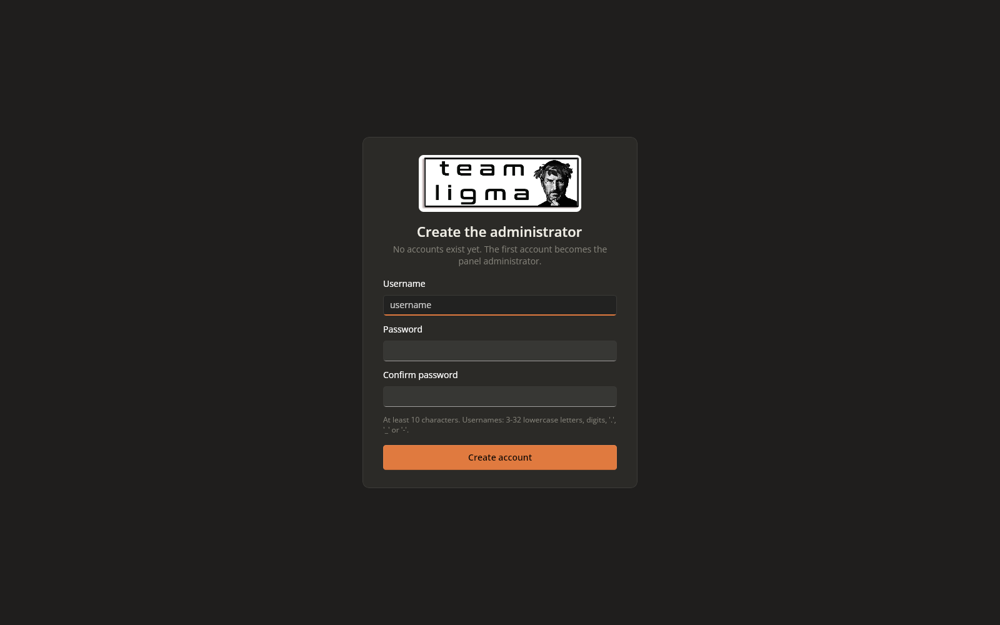
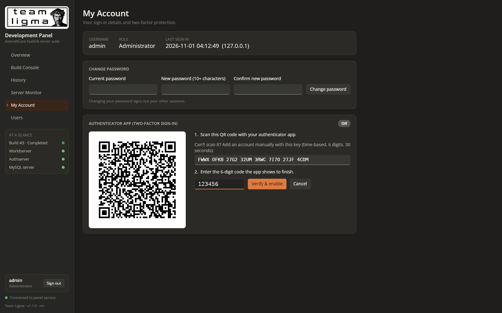
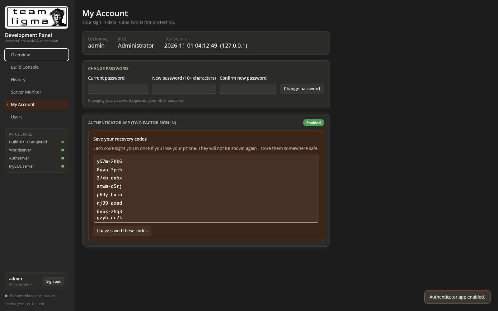
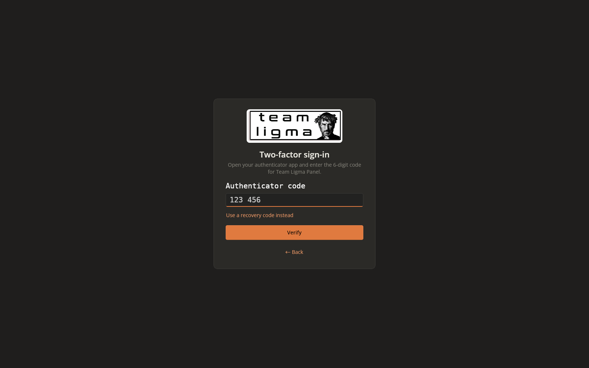
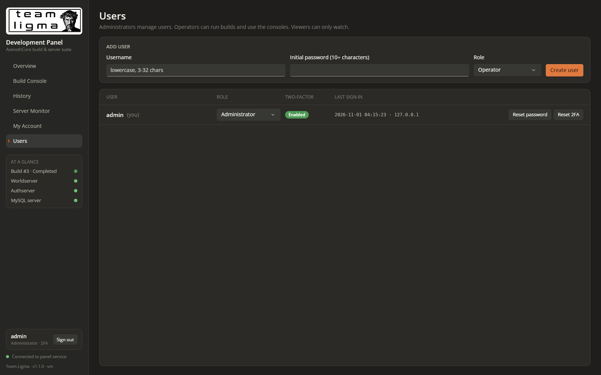
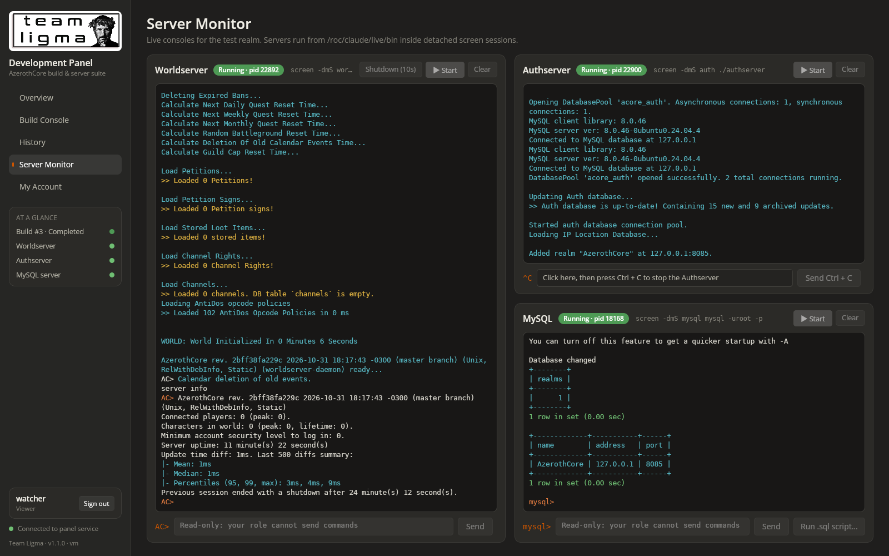

# Prompt
Add a user account system to the panel, with Authenticator app login support. If you get near running out of credits for this cloud environment, present an archive of the environment to be used via Claude Code locally.

# Reponse
Added user accounts with authenticator-app (TOTP) two-factor sign-in. The panel is now v1.1.0.

**How it works**
- **First run:** a "Create the administrator" screen appears. After that, every page and API call needs a signed-in account (cookie session, HttpOnly, SameSite=Strict, 12 h sliding).
- **Roles:** Administrator (everything plus the Users page), Operator (builds and consoles), Viewer (read-only). The server enforces roles on every endpoint, and the UI greys out what a role can't use.
- **Authenticator app:** in My Account, enrolment shows a QR code and a manual key. The user confirms with a 6-digit code and gets 8 one-time recovery codes. Sign-in becomes password, then authenticator code (or a recovery code). Users can regenerate recovery codes or disable 2FA with their password plus a code.
- **Users page (admin):** add users, change roles, reset passwords, reset a lost 2FA device, unlock, delete. You can't delete yourself or the last administrator, and you can't demote the last administrator.
- **Security:**
  - PBKDF2-SHA256 password hashes (210k iterations) and TOTP secrets encrypted with ASP.NET Core data protection, in `users.json` (mode 600).
  - Lockout for 5 minutes after 5 failures. Each code works once.
  - Sessions are revoked when a password, 2FA setup or role changes, or the user is deleted.
  - Audit log of sign-ins and every build/console action. MySQL input is never logged.
  - Command-line recovery with the `user-reset` command (see README).

**Tested**
- Through the API: unauthenticated requests get 401. Setup is one-shot. Wrong, replayed and expired codes are rejected. Recovery codes work once. Viewer and Operator permissions behave as designed (403 where expected). Revocation after an admin password reset, the guard rails and the lockout all work. The command-line reset works, and the running server picks up its change.
- In the browser: first-run setup, QR enrolment, recovery codes, sign-out, then password plus TOTP sign-in. An admin created a Viewer on the Users page, and the Viewer saw a read-only Build Console and Server Monitor.

Bugs found and fixed during testing:
- The running server would have overwritten changes made by the command-line reset.
- The backend restart script didn't wait for the old process to exit, and could match unrelated processes.
- Two cosmetic layout issues.

The test accounts were removed afterwards, so the next visit starts at the "Create the administrator" screen.

# File Changes
| File | Type | Workspace path | Change |
|---|---|---|---|
| `README.md` | `Docs` | `README.md` | Changed |
| `install.sh` | `Code` | `deploy/install.sh` | Changed |
| `nginx-teamligma-panel.conf` | `Config` | `deploy/nginx-teamligma-panel.conf` | Changed |
| `restart-backend.sh` | `Code` | `deploy/restart-backend.sh` | Changed |
| `Dtos.cs` | `Code` | `src/Shared/Dtos.cs` | Changed |
| `AuthService.cs` | `Code` | `src/TeamLigma.Panel.Server/Auth/AuthService.cs` | Created |
| `Crypto.cs` | `Code` | `src/TeamLigma.Panel.Server/Auth/Crypto.cs` | Created |
| `UserStore.cs` | `Code` | `src/TeamLigma.Panel.Server/Auth/UserStore.cs` | Created |
| `Program.cs` | `Code` | `src/TeamLigma.Panel.Server/Program.cs` | Changed |
| `TeamLigma.Panel.Server.csproj` | `Config` | `src/TeamLigma.Panel.Server/TeamLigma.Panel.Server.csproj` | Changed |
| `App.xaml.cs` | `Code` | `src/TeamLigma.Panel/TeamLigma.Panel/App.xaml.cs` | Changed |
| `QrView.cs` | `Code` | `src/TeamLigma.Panel/TeamLigma.Panel/Controls/QrView.cs` | Created |
| `ApiClient.cs` | `Code` | `src/TeamLigma.Panel/TeamLigma.Panel/Services/ApiClient.cs` | Changed |
| `Session.cs` | `Code` | `src/TeamLigma.Panel/TeamLigma.Panel/Services/Session.cs` | Created |
| `TeamLigma.Panel.csproj` | `Config` | `src/TeamLigma.Panel/TeamLigma.Panel/TeamLigma.Panel.csproj` | Changed |
| `AccountView.xaml` | `Code` | `src/TeamLigma.Panel/TeamLigma.Panel/Views/AccountView.xaml` | Created |
| `AccountView.xaml.cs` | `Code` | `src/TeamLigma.Panel/TeamLigma.Panel/Views/AccountView.xaml.cs` | Created |
| `BuildConsoleView.xaml.cs` | `Code` | `src/TeamLigma.Panel/TeamLigma.Panel/Views/BuildConsoleView.xaml.cs` | Changed |
| `ConsolePanel.xaml.cs` | `Code` | `src/TeamLigma.Panel/TeamLigma.Panel/Views/ConsolePanel.xaml.cs` | Changed |
| `HistoryView.xaml.cs` | `Code` | `src/TeamLigma.Panel/TeamLigma.Panel/Views/HistoryView.xaml.cs` | Changed |
| `LoginView.xaml` | `Code` | `src/TeamLigma.Panel/TeamLigma.Panel/Views/LoginView.xaml` | Created |
| `LoginView.xaml.cs` | `Code` | `src/TeamLigma.Panel/TeamLigma.Panel/Views/LoginView.xaml.cs` | Created |
| `RootView.cs` | `Code` | `src/TeamLigma.Panel/TeamLigma.Panel/Views/RootView.cs` | Created |
| `Shell.xaml` | `Code` | `src/TeamLigma.Panel/TeamLigma.Panel/Views/Shell.xaml` | Changed |
| `Shell.xaml.cs` | `Code` | `src/TeamLigma.Panel/TeamLigma.Panel/Views/Shell.xaml.cs` | Changed |
| `UsersView.xaml` | `Code` | `src/TeamLigma.Panel/TeamLigma.Panel/Views/UsersView.xaml` | Created |
| `UsersView.xaml.cs` | `Code` | `src/TeamLigma.Panel/TeamLigma.Panel/Views/UsersView.xaml.cs` | Created |

Environment (outside the project folder): `/roc/claude/panel/` redeployed (v1.1.0); new runtime files `/roc/claude/panel-data/users.json`, `/roc/claude/panel-data/keys/`, `/roc/claude/panel-data/audit.log`.

# Code Diffs
### `README.md` (Changed)
```diff
--- a/README.md
+++ b/README.md
@@ -1,7 +1,7 @@
 <p align="center"></p>
 
 # Team Ligma Development Panel
-**Version 1.0.0**
+**Version 1.1.0**
 
 One dark, burnt-orange control room for an AzerothCore test realm. Kick off builds, watch every object compile in real time, look back at old logs, and talk to the Worldserver, Authserver and MySQL from your browser. No SSH session needed.
 
@@ -12,6 +12,43 @@
 nginx serves both on port **26767**.
 
 ---
+
+## Accounts & sign-in
+Every page and API call requires a signed-in account. Accounts can be protected with an **authenticator app** (TOTP: Google Authenticator, Microsoft Authenticator, Authy, 1Password, Bitwarden, Aegis and similar).
+
+### First run
+The first time you open the panel it asks you to **create the administrator**. That account manages everyone else from the **Users** page.
+
+### Roles
+| Role | Can do |
+|---|---|
+| **Administrator** | Everything, plus the **Users** page: add, delete, change role, reset password, reset 2FA, unlock. |
+| **Operator** | Run builds (Start, Prepare, Clean, Force Stop), remove history entries, start servers and use all three consoles. |
+| **Viewer** | Watch only. Build controls and console inputs are disabled. |
+
+The server enforces these rules on every request; the greyed-out controls are only a convenience.
+
+### Turning on the authenticator app
+1. Open **My Account → Set up authenticator app**.
+2. Scan the QR code, or type the key into your app by hand (time-based, 6 digits, 30 seconds).
+3. Enter the 6-digit code the app shows and press **Verify & enable**.
+4. Save the **8 recovery codes** that appear. Each one signs you in once if you lose your phone, and they are shown only this once.
+
+From then on, signing in takes your password and then a code from the app. If you don't have the app to hand, choose **Use a recovery code instead**. **My Account** also lets you change your password, generate new recovery codes, or turn two-factor off (this needs your password and a current code).
+
+### Protection built in
+- **Passwords:** stored as PBKDF2-SHA256 hashes (210,000 iterations). The minimum length is 10 characters.
+- **Lockout:** 5 wrong passwords or codes lock the account for 5 minutes. An administrator can unlock it sooner.
+- **One-time codes:** each authenticator code works only once, and the clock may drift by one 30-second step either way.
+- **Sessions:** a cookie (`tl_session`, HttpOnly, SameSite=Strict) that ends after 12 idle hours. Changing a password, the 2FA setup or a role signs that user out of every other session, and so does deleting the user.
+- **Secrets at rest:** authenticator secrets are encrypted with ASP.NET Core data protection. The keys live in `/roc/claude/panel-data/keys/`.
+- **Audit log:** sign-ins, failures, account changes and every build or console action are recorded with the user and IP in `/roc/claude/panel-data/audit.log`. Text typed into the MySQL console is never logged.
+
+### Locked out?
+On the server, reset (or create) an administrator. This also removes their two-factor setup:
+```bash
+cd /roc/claude/panel/server && sudo dotnet TeamLigma.Panel.Server.dll user-reset <username> '<new-password>'
+```
 
 ## Sections
 
@@ -57,7 +94,7 @@
 | `/roc/claude/claude-acore` | AzerothCore source (`build/` is the Ninja build directory) |
 | `/roc/claude/live` | Installed server (`bin/`, `etc/*.conf`, `data/` client data) |
 | `/roc/claude/panel` | Deployed panel (`wwwroot/` front end, `server/` backend) |
-| `/roc/claude/panel-data` | Build records, console logs, task logs, uploaded `.sql` files, `CREDENTIALS.txt` |
+| `/roc/claude/panel-data` | Build records, console logs, task logs, uploaded `.sql` files, `CREDENTIALS.txt`, `users.json` (accounts, mode 600), `keys/` (data-protection keys), `audit.log` |
 
 ## Set-up guide (Debian 12 / Ubuntu 24.04)
 1. **Packages**
@@ -81,7 +118,7 @@
    sudo ./deploy/install.sh
    ```
    The script installs `ninja-dash` and publishes the backend and the Uno front end. It also installs the nginx site and starts the `teamligma-panel` systemd unit. On hosts without systemd it starts the backend directly.
-5. Open `http://<host>:26767/`.
+5. Open `http://<host>:26767/` and create the administrator account. Turning on the authenticator app under **My Account** is recommended.
 6. Run **Prepare (CMake)**, then **Start Build**.
 7. After the first install, copy `etc/*.conf.dist` to `.conf`. Set `DataDir` in `worldserver.conf` and put the client data in `/roc/claude/live/data`.
 8. Start the servers from **Server Monitor**.
@@ -93,12 +130,15 @@
 - **Consoles:** each console keeps its raw coloured log in `/roc/claude/panel-data/consoles/<name>.log`. **Clear** empties it.
 
 ## Security
-The panel can run server and SQL commands and has no login of its own. Keep port 26767 on a trusted network, or turn on the `auth_basic` lines in `deploy/nginx-teamligma-panel.conf`.
+The panel can run server and SQL commands, so give Operator or Administrator only to people who need it, and turn on the authenticator app for those accounts.
+
+Over plain HTTP, passwords and session cookies cross the network unencrypted. On anything other than a trusted LAN, put TLS in front of the panel (for example an nginx `listen 443 ssl` server block that proxies to this one). Once you do, the session cookie is marked Secure automatically.
 
 ## Troubleshooting
 - **"Build directory is not prepared":** run Prepare (CMake) first.
 - **A build shows *Interrupted*:** ninja-dash was killed without cleaning up. Start a new build.
 - **A server shows *Session open* but not *Running*:** the program exited inside its screen session. Read its console for the reason, then press Start again after the session closes.
+- **"That code is not valid" for every code:** the server's clock or your phone's clock is wrong. Authenticator codes need both to be within about 30 seconds of the real time.
 - **The page loads but the status dot is red:** check the backend with `curl http://127.0.0.1:5267/api/health`, and read `/roc/claude/panel/server.log` or `journalctl -u teamligma-panel`.
 
 ---
```

### `deploy/install.sh` (Changed)
```diff
--- a/deploy/install.sh
+++ b/deploy/install.sh
@@ -33,8 +33,7 @@
     systemctl reload nginx || systemctl start nginx
 else
     # Containers without systemd
-    pkill -f TeamLigma.Panel.Server.dll || true
-    (cd "$PANEL/server" && nohup dotnet TeamLigma.Panel.Server.dll > "$PANEL/server.log" 2>&1 &)
+    "$ROOT/deploy/restart-backend.sh"
     if pgrep -x nginx >/dev/null; then nginx -s reload; else nginx; fi
 fi
 echo "==> Panel available at http://$(hostname -f 2>/dev/null || hostname):26767/"
```

### `deploy/nginx-teamligma-panel.conf` (Changed)
```diff
--- a/deploy/nginx-teamligma-panel.conf
+++ b/deploy/nginx-teamligma-panel.conf
@@ -19,7 +19,7 @@
     gzip_static on;
     client_max_body_size 512m;
 
-    # Optional: protect the panel (it can run server and SQL commands).
+    # Optional extra layer in front of the panel's own accounts.
     # auth_basic "Team Ligma Development Panel";
     # auth_basic_user_file /etc/nginx/teamligma.htpasswd;
 
```

### `deploy/restart-backend.sh` (Changed)
```diff
--- a/deploy/restart-backend.sh
+++ b/deploy/restart-backend.sh
@@ -1,6 +1,12 @@
 #!/usr/bin/env bash
 # Restarts the panel backend on hosts without systemd.
 if [ -d /run/systemd/system ]; then systemctl restart teamligma-panel; exit; fi
-for p in $(pgrep -f "TeamLigma.Panel.Server.dll"); do [ "$p" != "$$" ] && kill "$p" 2>/dev/null; done
-sleep 1
+panel_pids() {
+    for p in $(pgrep -x dotnet); do
+        tr '\0' ' ' < /proc/$p/cmdline 2>/dev/null | grep -q 'TeamLigma\.Panel\.Server\.dll *$' && echo "$p"
+    done
+}
+pids=$(panel_pids); [ -n "$pids" ] && kill $pids 2>/dev/null
+for i in $(seq 1 50); do [ -z "$(panel_pids)" ] && break; sleep 0.2; done
+pids=$(panel_pids); [ -n "$pids" ] && kill -9 $pids 2>/dev/null && sleep 0.5
 cd /roc/claude/panel/server && nohup dotnet TeamLigma.Panel.Server.dll > /roc/claude/panel/server.log 2>&1 &
```

### `src/Shared/Dtos.cs` (Changed)
```diff
--- a/src/Shared/Dtos.cs
+++ b/src/Shared/Dtos.cs
@@ -123,3 +123,93 @@
 {
     public string Text { get; set; } = "";
 }
+
+// ---------------- Accounts & authentication (v1.1.0) ----------------
+
+public static class Roles
+{
+    public const string Admin = "admin";
+    public const string Operator = "operator";
+    public const string Viewer = "viewer";
+    public static readonly string[] All = { Admin, Operator, Viewer };
+}
+
+public sealed class UserInfo
+{
+    public string Username { get; set; } = "";
+    public string Role { get; set; } = Roles.Viewer;
+    public bool TotpEnabled { get; set; }
+    public int RecoveryCodesLeft { get; set; }
+    public DateTimeOffset Created { get; set; }
+    public DateTimeOffset? LastLogin { get; set; }
+    public string? LastLoginIp { get; set; }
+    public bool Locked { get; set; }
+}
+
+public sealed class AuthState
+{
+    public bool SetupRequired { get; set; }
+    public bool Authenticated { get; set; }
+    public UserInfo? User { get; set; }
+    public string Version { get; set; } = "";
+}
+
+public sealed class LoginRequest
+{
+    public string Username { get; set; } = "";
+    public string Password { get; set; } = "";
+}
+
+public sealed class TotpLoginRequest
+{
+    public string Challenge { get; set; } = "";
+    public string Code { get; set; } = "";
+}
+
+public sealed class LoginResult
+{
+    public bool Ok { get; set; }
+    public string Message { get; set; } = "";
+    public bool RequiresTotp { get; set; }
+    public string? Challenge { get; set; }
+    public AuthState? State { get; set; }
+}
+
+public sealed class TotpSetup
+{
+    public string Secret { get; set; } = "";
+    public string Uri { get; set; } = "";
+    /// <summary>QR module matrix, one string per row ('1' = dark).</summary>
+    public List<string> Matrix { get; set; } = new();
+}
+
+public sealed class CodeRequest
+{
+    public string Code { get; set; } = "";
+    public string Password { get; set; } = "";
+}
+
+public sealed class RecoveryCodesResult
+{
+    public bool Ok { get; set; }
+    public string Message { get; set; } = "";
+    public List<string> Codes { get; set; } = new();
+}
+
+public sealed class PasswordChangeRequest
+{
+    public string Current { get; set; } = "";
+    public string New { get; set; } = "";
+}
+
+public sealed class CreateUserRequest
+{
+    public string Username { get; set; } = "";
+    public string Password { get; set; } = "";
+    public string Role { get; set; } = Roles.Operator;
+}
+
+public sealed class SetRoleRequest
+{
+    public string Role { get; set; } = Roles.Operator;
+}
```

### `src/TeamLigma.Panel.Server/Auth/AuthService.cs` (Created)
```diff
--- /dev/null
+++ b/src/TeamLigma.Panel.Server/Auth/AuthService.cs
@@ -0,0 +1,314 @@
+using System.Security.Claims;
+using Microsoft.AspNetCore.Authentication;
+using Microsoft.AspNetCore.Authentication.Cookies;
+using Microsoft.AspNetCore.DataProtection;
+using Microsoft.Extensions.Options;
+using QRCoder;
+using TeamLigma.Shared;
+
+namespace TeamLigma.Panel.Server.Auth;
+
+/// <summary>Sign-in, two-factor, enrolment and account management logic.</summary>
+public sealed class AuthService
+{
+    public const string StampClaim = "tl:stamp";
+    const int MaxFailures = 5;
+    static readonly TimeSpan LockoutTime = TimeSpan.FromMinutes(5);
+    static readonly TimeSpan ChallengeLifetime = TimeSpan.FromMinutes(5);
+
+    readonly UserStore _users;
+    readonly ITimeLimitedDataProtector _challenges;
+    readonly string _auditPath;
+    readonly ILogger<AuthService> _log;
+
+    public AuthService(UserStore users, IDataProtectionProvider dp, IOptions<PanelOptions> o, ILogger<AuthService> log)
+    {
+        _users = users;
+        _challenges = dp.CreateProtector("TeamLigma.Panel.LoginChallenge.v1").ToTimeLimitedDataProtector();
+        _auditPath = Path.Combine(o.Value.DataHome, "audit.log");
+        _log = log;
+    }
+
+    public static string ClientIp(HttpContext ctx)
+    {
+        var ip = ctx.Connection.RemoteIpAddress;
+        // nginx on the same host forwards the real client address
+        if (ip != null && System.Net.IPAddress.IsLoopback(ip) && ctx.Request.Headers.TryGetValue("X-Forwarded-For", out var fwd))
+            return fwd.ToString().Split(',')[0].Trim();
+        return ip?.ToString() ?? "?";
+    }
+
+    public void Audit(HttpContext? ctx, string user, string action)
+    {
+        var line = $"{DateTimeOffset.UtcNow:O}\t{(ctx != null ? ClientIp(ctx) : "local")}\t{user}\t{action}";
+        try { lock (this) File.AppendAllText(_auditPath, line + Environment.NewLine); } catch { }
+        _log.LogInformation("audit: {Line}", line);
+    }
+
+    public AuthState State(ClaimsPrincipal principal, string version)
+    {
+        var user = principal.Identity?.IsAuthenticated == true ? _users.Find(principal.Identity.Name) : null;
+        return new AuthState
+        {
+            SetupRequired = !_users.Any,
+            Authenticated = user != null,
+            User = user != null ? UserStore.ToInfo(user) : null,
+            Version = version,
+        };
+    }
+
+    static ClaimsPrincipal Principal(UserRecord u) => new(new ClaimsIdentity(new[]
+    {
+        new Claim(ClaimTypes.Name, u.Username),
+        new Claim(ClaimTypes.Role, u.Role),
+        new Claim(StampClaim, u.SecurityStamp),
+    }, CookieAuthenticationDefaults.AuthenticationScheme));
+
+    async Task SignIn(HttpContext ctx, UserRecord u)
+    {
+        _users.Mutate(_ =>
+        {
+            u.FailedAttempts = 0;
+            u.LockedUntil = null;
+            u.LastLogin = DateTimeOffset.UtcNow;
+            u.LastLoginIp = ClientIp(ctx);
+            return 0;
+        });
+        await ctx.SignInAsync(CookieAuthenticationDefaults.AuthenticationScheme, Principal(u),
+            new AuthenticationProperties { IsPersistent = false, AllowRefresh = true });
+        Audit(ctx, u.Username, "sign-in");
+    }
+
+    /// <summary>Re-issues the cookie after the security stamp changed (password/2FA change by the user).</summary>
+    public Task RefreshCookie(HttpContext ctx, UserRecord u)
+        => ctx.SignInAsync(CookieAuthenticationDefaults.AuthenticationScheme, Principal(u));
+
+    bool RegisterFailure(HttpContext ctx, UserRecord u, string what)
+    {
+        _users.Mutate(_ =>
+        {
+            u.FailedAttempts++;
+            if (u.FailedAttempts >= MaxFailures) { u.LockedUntil = DateTimeOffset.UtcNow + LockoutTime; u.FailedAttempts = 0; }
+            return 0;
+        });
+        Audit(ctx, u.Username, $"failed {what}" + (u.LockedUntil > DateTimeOffset.UtcNow ? " (account locked 5 min)" : ""));
+        return false;
+    }
+
+    static LoginResult Fail(string m) => new() { Message = m };
+
+    public async Task<LoginResult> SetupAsync(HttpContext ctx, LoginRequest req, string version)
+    {
+        if (_users.Any) return Fail("Setup has already been completed.");
+        var name = req.Username?.Trim().ToLowerInvariant() ?? "";
+        if (UserStore.ValidateName(name) is { } e1) return Fail(e1);
+        if (Passwords.Validate(req.Password) is { } e2) return Fail(e2);
+        var u = new UserRecord { Username = name, PasswordHash = Passwords.Hash(req.Password), Role = Roles.Admin };
+        var created = _users.Mutate(list => { if (list.Count > 0) return false; list.Add(u); return true; });
+        if (!created) return Fail("Setup has already been completed.");
+        Audit(ctx, name, "initial administrator created");
+        await SignIn(ctx, u);
+        return new LoginResult { Ok = true, Message = "Administrator account created.", State = State(new ClaimsPrincipal(Principal(u).Identity!), version) };
+    }
+
+    public async Task<LoginResult> LoginAsync(HttpContext ctx, LoginRequest req, string version)
+    {
+        await Task.Delay(Random.Shared.Next(150, 350)); // blunt timing/brute-force probes
+        var u = _users.Find(req.Username);
+        if (u == null)
+        {
+            Passwords.Verify(req.Password ?? "", "pbkdf2-sha256$210000$AAAAAAAAAAAAAAAAAAAAAA==$AAAAAAAAAAAAAAAAAAAAAAAAAAAAAAAAAAAAAAAAAAA=");
+            Audit(ctx, req.Username ?? "", "failed sign-in (unknown user)");
+            return Fail("Incorrect username or password.");
+        }
+        if (u.LockedUntil > DateTimeOffset.UtcNow)
+            return Fail($"Too many failed attempts. Try again after {u.LockedUntil.Value.ToLocalTime():HH:mm:ss}.");
+        if (!Passwords.Verify(req.Password ?? "", u.PasswordHash))
+        {
+            RegisterFailure(ctx, u, "sign-in (password)");
+            return Fail("Incorrect username or password.");
+        }
+        if (u.TotpSecret != null)
+        {
+            var challenge = _challenges.Protect($"{u.Username}\n{u.SecurityStamp}", ChallengeLifetime);
+            return new LoginResult { Ok = false, RequiresTotp = true, Challenge = challenge, Message = "Enter the code from your authenticator app." };
+        }
+        await SignIn(ctx, u);
+        return new LoginResult { Ok = true, Message = "Signed in.", State = State(new ClaimsPrincipal(Principal(u).Identity!), version) };
+    }
+
+    public async Task<LoginResult> TotpLoginAsync(HttpContext ctx, TotpLoginRequest req, string version)
+    {
+        string payload;
+        try { payload = _challenges.Unprotect(req.Challenge ?? ""); }
+        catch { return Fail("Your sign-in attempt expired. Enter your password again."); }
+        var parts = payload.Split('\n');
+        var u = _users.Find(parts[0]);
+        if (u == null || parts.Length != 2 || parts[1] != u.SecurityStamp || u.TotpSecret == null)
+            return Fail("Your sign-in attempt expired. Enter your password again.");
+        if (u.LockedUntil > DateTimeOffset.UtcNow)
+            return Fail($"Too many failed attempts. Try again after {u.LockedUntil.Value.ToLocalTime():HH:mm:ss}.");
+
+        var code = req.Code ?? "";
+        var digits = new string(code.Where(char.IsDigit).ToArray());
+        if (digits.Length == 6 && code.Trim().Length <= 7)
+        {
+            var step = Totp.Verify(_users.Unprotect(u.TotpSecret), code, u.TotpLastStep);
+            if (step == null) { RegisterFailure(ctx, u, "two-factor code"); return Fail("That code is not valid. Check your device's clock and try again."); }
+            _users.Mutate(_ => { u.TotpLastStep = step.Value; return 0; });
+        }
+        else
+        {
+            var hash = RecoveryCodes.HashCode(code);
+            var used = _users.Mutate(_ => u.RecoveryCodeHashes.Remove(hash));
+            if (!used) { RegisterFailure(ctx, u, "recovery code"); return Fail("That recovery code is not valid."); }
+            Audit(ctx, u.Username, $"recovery code used ({u.RecoveryCodeHashes.Count} left)");
+        }
+        await SignIn(ctx, u);
+        return new LoginResult { Ok = true, Message = "Signed in.", State = State(new ClaimsPrincipal(Principal(u).Identity!), version) };
+    }
+
+    // ---- Account (self-service) ----
+
+    public async Task<ActionResult> ChangePasswordAsync(HttpContext ctx, UserRecord u, PasswordChangeRequest req)
+    {
+        if (!Passwords.Verify(req.Current ?? "", u.PasswordHash)) return new() { Message = "Your current password is incorrect." };
+        if (Passwords.Validate(req.New) is { } err) return new() { Message = err };
+        _users.Mutate(_ => { u.PasswordHash = Passwords.Hash(req.New); u.SecurityStamp = UserRecord.NewStamp(); return 0; });
+        await RefreshCookie(ctx, u);
+        Audit(ctx, u.Username, "password changed (other sessions signed out)");
+        return new() { Ok = true, Message = "Password changed. Other sessions were signed out." };
+    }
+
+    public TotpSetup BeginTotp(UserRecord u)
+    {
+        var secret = Totp.NewSecret();
+        _users.Mutate(_ => { u.PendingTotpSecret = _users.Protect(secret); return 0; });
+        var uri = Totp.Uri("Team Ligma Panel", u.Username, secret);
+        using var gen = new QRCodeGenerator();
+        using var data = gen.CreateQrCode(uri, QRCodeGenerator.ECCLevel.M);
+        var matrix = data.ModuleMatrix.Select(row => string.Concat(row.Cast<bool>().Select(b => b ? '1' : '0'))).ToList();
+        return new TotpSetup { Secret = string.Join(" ", secret.Chunk(4).Select(c => new string(c))), Uri = uri, Matrix = matrix };
+    }
+
+    public async Task<RecoveryCodesResult> ConfirmTotpAsync(HttpContext ctx, UserRecord u, CodeRequest req)
+    {
+        if (u.PendingTotpSecret == null) return new() { Message = "Start authenticator setup first." };
+        var secret = _users.Unprotect(u.PendingTotpSecret);
+        var step = Totp.Verify(secret, req.Code, 0);
+        if (step == null) return new() { Message = "That code does not match. Make sure you scanned the newest QR code and your clock is correct." };
+        var codes = RecoveryCodes.Generate();
+        _users.Mutate(_ =>
+        {
+            u.TotpSecret = u.PendingTotpSecret;
+            u.PendingTotpSecret = null;
+            u.TotpLastStep = step.Value;
+            u.RecoveryCodeHashes = codes.Select(RecoveryCodes.HashCode).ToList();
+            u.SecurityStamp = UserRecord.NewStamp();
+            return 0;
+        });
+        await RefreshCookie(ctx, u);
+        Audit(ctx, u.Username, "authenticator enabled");
+        return new() { Ok = true, Message = "Authenticator app enabled.", Codes = codes };
+    }
+
+    bool CheckSecondFactor(UserRecord u, string code)
+    {
+        if (u.TotpSecret == null) return true;
+        var step = Totp.Verify(_users.Unprotect(u.TotpSecret), code, u.TotpLastStep);
+        if (step != null) { _users.Mutate(_ => { u.TotpLastStep = step.Value; return 0; }); return true; }
+        var hash = RecoveryCodes.HashCode(code);
+        return _users.Mutate(_ => u.RecoveryCodeHashes.Remove(hash));
+    }
+
+    public async Task<ActionResult> DisableTotpAsync(HttpContext ctx, UserRecord u, CodeRequest req)
+    {
+        if (u.TotpSecret == null) return new() { Message = "Two-factor sign-in is not enabled." };
+        if (!Passwords.Verify(req.Password ?? "", u.PasswordHash)) return new() { Message = "Your password is incorrect." };
+        if (!CheckSecondFactor(u, req.Code ?? "")) return new() { Message = "That code is not valid." };
+        _users.Mutate(_ => { u.TotpSecret = null; u.PendingTotpSecret = null; u.RecoveryCodeHashes.Clear(); u.SecurityStamp = UserRecord.NewStamp(); return 0; });
+        await RefreshCookie(ctx, u);
+        Audit(ctx, u.Username, "authenticator disabled");
+        return new() { Ok = true, Message = "Two-factor sign-in disabled." };
+    }
+
+    public async Task<RecoveryCodesResult> RegenerateRecoveryAsync(HttpContext ctx, UserRecord u, CodeRequest req)
+    {
+        if (u.TotpSecret == null) return new() { Message = "Enable the authenticator app first." };
+        if (!Passwords.Verify(req.Password ?? "", u.PasswordHash)) return new() { Message = "Your password is incorrect." };
+        var codes = RecoveryCodes.Generate();
+        _users.Mutate(_ => { u.RecoveryCodeHashes = codes.Select(RecoveryCodes.HashCode).ToList(); return 0; });
+        await Task.CompletedTask;
+        Audit(ctx, u.Username, "recovery codes regenerated");
+        return new() { Ok = true, Message = "New recovery codes generated. The old ones no longer work.", Codes = codes };
+    }
+
+    // ---- Administration ----
+
+    public ActionResult CreateUser(HttpContext ctx, string admin, CreateUserRequest req)
+    {
+        var name = req.Username?.Trim().ToLowerInvariant() ?? "";
+        if (UserStore.ValidateName(name) is { } e1) return new() { Message = e1 };
+        if (Passwords.Validate(req.Password) is { } e2) return new() { Message = e2 };
+        if (!Roles.All.Contains(req.Role)) return new() { Message = "Unknown role." };
+        var ok = _users.Mutate(list =>
+        {
+            if (list.Any(x => x.Username == name)) return false;
+            list.Add(new UserRecord { Username = name, PasswordHash = Passwords.Hash(req.Password), Role = req.Role });
+            return true;
+        });
+        if (!ok) return new() { Message = $"User '{name}' already exists." };
+        Audit(ctx, admin, $"created user {name} ({req.Role})");
+        return new() { Ok = true, Message = $"User '{name}' created." };
+    }
+
+    public ActionResult DeleteUser(HttpContext ctx, string admin, string name)
+    {
+        var u = _users.Find(name);
+        if (u == null) return new() { Message = "User not found." };
+        if (u.Username == admin) return new() { Message = "You cannot delete your own account." };
+        if (u.Role == Roles.Admin && _users.AdminCount() <= 1) return new() { Message = "The last administrator cannot be deleted." };
+        _users.Mutate(list => list.Remove(u));
+        Audit(ctx, admin, $"deleted user {u.Username}");
+        return new() { Ok = true, Message = $"User '{u.Username}' deleted." };
+    }
+
+    public ActionResult SetRole(HttpContext ctx, string admin, string name, string role)
+    {
+        var u = _users.Find(name);
+        if (u == null) return new() { Message = "User not found." };
+        if (!Roles.All.Contains(role)) return new() { Message = "Unknown role." };
+        if (u.Role == Roles.Admin && role != Roles.Admin && _users.AdminCount() <= 1) return new() { Message = "The last administrator cannot be demoted." };
+        _users.Mutate(_ => { u.Role = role; u.SecurityStamp = UserRecord.NewStamp(); return 0; });
+        Audit(ctx, admin, $"set role of {u.Username} to {role}");
+        return new() { Ok = true, Message = $"{u.Username} is now {role}." };
+    }
+
+    public ActionResult AdminResetPassword(HttpContext ctx, string admin, string name, string password)
+    {
+        var u = _users.Find(name);
+        if (u == null) return new() { Message = "User not found." };
+        if (Passwords.Validate(password) is { } err) return new() { Message = err };
+        _users.Mutate(_ => { u.PasswordHash = Passwords.Hash(password); u.SecurityStamp = UserRecord.NewStamp(); u.LockedUntil = null; u.FailedAttempts = 0; return 0; });
+        Audit(ctx, admin, $"reset password of {u.Username}");
+        return new() { Ok = true, Message = $"Password for '{u.Username}' reset. Their sessions were signed out." };
+    }
+
+    public ActionResult AdminResetTotp(HttpContext ctx, string admin, string name)
+    {
+        var u = _users.Find(name);
+        if (u == null) return new() { Message = "User not found." };
+        _users.Mutate(_ => { u.TotpSecret = null; u.PendingTotpSecret = null; u.RecoveryCodeHashes.Clear(); u.SecurityStamp = UserRecord.NewStamp(); u.LockedUntil = null; return 0; });
+        Audit(ctx, admin, $"reset two-factor of {u.Username}");
+        return new() { Ok = true, Message = $"Two-factor sign-in removed for '{u.Username}'." };
+    }
+
+    public ActionResult Unlock(HttpContext ctx, string admin, string name)
+    {
+        var u = _users.Find(name);
+        if (u == null) return new() { Message = "User not found." };
+        _users.Mutate(_ => { u.LockedUntil = null; u.FailedAttempts = 0; return 0; });
+        Audit(ctx, admin, $"unlocked {u.Username}");
+        return new() { Ok = true, Message = $"'{u.Username}' unlocked." };
+    }
+}
```

### `src/TeamLigma.Panel.Server/Auth/Crypto.cs` (Created)
```diff
--- /dev/null
+++ b/src/TeamLigma.Panel.Server/Auth/Crypto.cs
@@ -0,0 +1,126 @@
+using System.Security.Cryptography;
+using System.Text;
+
+namespace TeamLigma.Panel.Server.Auth;
+
+/// <summary>PBKDF2 password hashing.</summary>
+public static class Passwords
+{
+    const int Iterations = 210_000;
+
+    public static string Hash(string password)
+    {
+        var salt = RandomNumberGenerator.GetBytes(16);
+        var hash = Rfc2898DeriveBytes.Pbkdf2(password, salt, Iterations, HashAlgorithmName.SHA256, 32);
+        return $"pbkdf2-sha256${Iterations}${Convert.ToBase64String(salt)}${Convert.ToBase64String(hash)}";
+    }
+
+    public static bool Verify(string password, string stored)
+    {
+        try
+        {
+            var p = stored.Split('$');
+            if (p.Length != 4 || p[0] != "pbkdf2-sha256") return false;
+            var iter = int.Parse(p[1]);
+            var salt = Convert.FromBase64String(p[2]);
+            var expected = Convert.FromBase64String(p[3]);
+            var actual = Rfc2898DeriveBytes.Pbkdf2(password, salt, iter, HashAlgorithmName.SHA256, expected.Length);
+            return CryptographicOperations.FixedTimeEquals(actual, expected);
+        }
+        catch { return false; }
+    }
+
+    /// <summary>Returns an error message, or null when the password is acceptable.</summary>
+    public static string? Validate(string? password)
+    {
+        if (string.IsNullOrEmpty(password) || password.Length < 10) return "Passwords must be at least 10 characters.";
+        if (password.Length > 256) return "Passwords must be at most 256 characters.";
+        return null;
+    }
+}
+
+/// <summary>RFC 6238 time-based one-time passwords (SHA-1, 6 digits, 30 s) as used by authenticator apps.</summary>
+public static class Totp
+{
+    const string Alphabet = "ABCDEFGHIJKLMNOPQRSTUVWXYZ234567";
+    public const int Step = 30;
+
+    public static string NewSecret() => Base32Encode(RandomNumberGenerator.GetBytes(20));
+
+    public static long CurrentStep(DateTimeOffset? now = null) => (now ?? DateTimeOffset.UtcNow).ToUnixTimeSeconds() / Step;
+
+    public static string Code(string base32Secret, long step)
+    {
+        var key = Base32Decode(base32Secret);
+        Span<byte> counter = stackalloc byte[8];
+        for (var i = 7; i >= 0; i--) { counter[i] = (byte)(step & 0xFF); step >>= 8; }
+        var hash = HMACSHA1.HashData(key, counter);
+        var offset = hash[^1] & 0x0F;
+        var bin = (hash[offset] & 0x7F) << 24 | hash[offset + 1] << 16 | hash[offset + 2] << 8 | hash[offset + 3];
+        return (bin % 1_000_000).ToString("D6");
+    }
+
+    /// <summary>Verifies a code within ±1 step; returns the matched step (for replay protection) or null.</summary>
+    public static long? Verify(string base32Secret, string code, long lastUsedStep)
+    {
+        code = new string((code ?? "").Where(char.IsDigit).ToArray());
+        if (code.Length != 6) return null;
+        var now = CurrentStep();
+        for (var s = now - 1; s <= now + 1; s++)
+        {
+            if (s <= lastUsedStep) continue;
+            if (CryptographicOperations.FixedTimeEquals(Encoding.ASCII.GetBytes(Code(base32Secret, s)), Encoding.ASCII.GetBytes(code)))
+                return s;
+        }
+        return null;
+    }
+
+    public static string Uri(string issuer, string account, string secret)
+        => $"otpauth://totp/{System.Uri.EscapeDataString(issuer)}:{System.Uri.EscapeDataString(account)}" +
+           $"?secret={secret}&issuer={System.Uri.EscapeDataString(issuer)}&algorithm=SHA1&digits=6&period={Step}";
+
+    public static string Base32Encode(byte[] data)
+    {
+        var sb = new StringBuilder();
+        int buffer = 0, bits = 0;
+        foreach (var b in data)
+        {
+            buffer = buffer << 8 | b; bits += 8;
+            while (bits >= 5) { sb.Append(Alphabet[(buffer >> (bits - 5)) & 31]); bits -= 5; }
+        }
+        if (bits > 0) sb.Append(Alphabet[(buffer << (5 - bits)) & 31]);
+        return sb.ToString();
+    }
+
+    public static byte[] Base32Decode(string s)
+    {
+        s = s.TrimEnd('=').Replace(" ", "").ToUpperInvariant();
+        var output = new List<byte>();
+        int buffer = 0, bits = 0;
+        foreach (var c in s)
+        {
+            var v = Alphabet.IndexOf(c);
+            if (v < 0) throw new FormatException("Invalid base32 secret");
+            buffer = buffer << 5 | v; bits += 5;
+            if (bits >= 8) { output.Add((byte)((buffer >> (bits - 8)) & 0xFF)); bits -= 8; }
+        }
+        return output.ToArray();
+    }
+}
+
+public static class RecoveryCodes
+{
+    const string Chars = "abcdefghjkmnpqrstuvwxyz23456789";
+
+    public static List<string> Generate(int count = 8)
+        => Enumerable.Range(0, count).Select(_ =>
+        {
+            var c = new char[8];
+            for (var i = 0; i < 8; i++) c[i] = Chars[RandomNumberGenerator.GetInt32(Chars.Length)];
+            return new string(c, 0, 4) + "-" + new string(c, 4, 4);
+        }).ToList();
+
+    public static string Normalize(string code) => new string((code ?? "").ToLowerInvariant().Where(char.IsLetterOrDigit).ToArray());
+
+    public static string HashCode(string code) => Convert.ToHexString(SHA256.HashData(Encoding.UTF8.GetBytes(Normalize(code))));
+}
```

### `src/TeamLigma.Panel.Server/Auth/UserStore.cs` (Created)
```diff
--- /dev/null
+++ b/src/TeamLigma.Panel.Server/Auth/UserStore.cs
@@ -0,0 +1,111 @@
+using System.Security.Cryptography;
+using System.Text.Json;
+using System.Text.RegularExpressions;
+using Microsoft.AspNetCore.DataProtection;
+using Microsoft.Extensions.Options;
+using TeamLigma.Shared;
+
+namespace TeamLigma.Panel.Server.Auth;
+
+public sealed class UserRecord
+{
+    public string Username { get; set; } = "";
+    public string PasswordHash { get; set; } = "";
+    public string Role { get; set; } = Roles.Viewer;
+    public string SecurityStamp { get; set; } = NewStamp();
+    /// <summary>TOTP secret, encrypted with ASP.NET Core data protection.</summary>
+    public string? TotpSecret { get; set; }
+    public string? PendingTotpSecret { get; set; }
+    public long TotpLastStep { get; set; }
+    public List<string> RecoveryCodeHashes { get; set; } = new();
+    public DateTimeOffset Created { get; set; } = DateTimeOffset.UtcNow;
+    public DateTimeOffset? LastLogin { get; set; }
+    public string? LastLoginIp { get; set; }
+    public int FailedAttempts { get; set; }
+    public DateTimeOffset? LockedUntil { get; set; }
+
+    public static string NewStamp() => Convert.ToHexString(RandomNumberGenerator.GetBytes(16));
+}
+
+/// <summary>JSON-file user store (panel-data/users.json, mode 600). All access is serialised.</summary>
+public sealed partial class UserStore
+{
+    static readonly JsonSerializerOptions Json = new(JsonSerializerDefaults.Web) { WriteIndented = true };
+    readonly string _path;
+    readonly object _lock = new();
+    readonly IDataProtector _protector;
+    List<UserRecord> _users = new();
+    DateTime _loadedStamp;
+
+    [GeneratedRegex("^[a-z0-9][a-z0-9_.-]{2,31}$")]
+    private static partial Regex NameRegex();
+
+    public UserStore(IOptions<PanelOptions> o, IDataProtectionProvider dp)
+    {
+        _path = Path.Combine(o.Value.DataHome, "users.json");
+        _protector = dp.CreateProtector("TeamLigma.Panel.Totp.v1");
+        lock (_lock) Reload();
+    }
+
+    /// <summary>Picks up edits made by other processes (e.g. the user-reset command). Call under _lock.</summary>
+    void Reload()
+    {
+        var stamp = File.Exists(_path) ? File.GetLastWriteTimeUtc(_path) : DateTime.MinValue;
+        if (stamp == _loadedStamp) return;
+        _users = stamp == DateTime.MinValue ? new()
+            : JsonSerializer.Deserialize<List<UserRecord>>(File.ReadAllText(_path), Json) ?? new();
+        _loadedStamp = stamp;
+    }
+
+    public static string? ValidateName(string? name)
+        => name != null && NameRegex().IsMatch(name) ? null : "Usernames are 3-32 characters: lowercase letters, digits, '.', '_' or '-'.";
+
+    public bool Any { get { lock (_lock) { Reload(); return _users.Count > 0; } } }
+
+    public UserRecord? Find(string? name)
+    {
+        if (string.IsNullOrEmpty(name)) return null;
+        name = name.Trim().ToLowerInvariant();
+        lock (_lock) { Reload(); return _users.FirstOrDefault(u => u.Username == name); }
+    }
+
+    public List<UserRecord> All() { lock (_lock) { Reload(); return _users.OrderBy(u => u.Username).ToList(); } }
+
+    public int AdminCount() { lock (_lock) { Reload(); return _users.Count(u => u.Role == Roles.Admin); } }
+
+    /// <summary>Runs a mutation under the store lock and persists the result.</summary>
+    public T Mutate<T>(Func<List<UserRecord>, T> change)
+    {
+        lock (_lock)
+        {
+            var result = change(_users);
+            Save();
+            return result;
+        }
+    }
+
+    void Save()
+    {
+        Directory.CreateDirectory(Path.GetDirectoryName(_path)!);
+        var tmp = _path + ".tmp";
+        File.WriteAllText(tmp, JsonSerializer.Serialize(_users, Json));
+        if (!OperatingSystem.IsWindows()) File.SetUnixFileMode(tmp, UnixFileMode.UserRead | UnixFileMode.UserWrite);
+        File.Move(tmp, _path, true);
+        _loadedStamp = File.GetLastWriteTimeUtc(_path);
+    }
+
+    public string Protect(string secret) => _protector.Protect(secret);
+    public string Unprotect(string secret) => _protector.Unprotect(secret);
+
+    public static UserInfo ToInfo(UserRecord u) => new()
+    {
+        Username = u.Username,
+        Role = u.Role,
+        TotpEnabled = u.TotpSecret != null,
+        RecoveryCodesLeft = u.RecoveryCodeHashes.Count,
+        Created = u.Created,
+        LastLogin = u.LastLogin,
+        LastLoginIp = u.LastLoginIp,
+        Locked = u.LockedUntil > DateTimeOffset.UtcNow,
+    };
+}
```

### `src/TeamLigma.Panel.Server/Program.cs` (Changed)
```diff
--- a/src/TeamLigma.Panel.Server/Program.cs
+++ b/src/TeamLigma.Panel.Server/Program.cs
@@ -1,8 +1,21 @@
+using System.Security.Claims;
+using Microsoft.AspNetCore.Authentication;
+using Microsoft.AspNetCore.Authentication.Cookies;
+using Microsoft.AspNetCore.DataProtection;
 using TeamLigma.Panel.Server;
+using TeamLigma.Panel.Server.Auth;
 using TeamLigma.Shared;
 
 var builder = WebApplication.CreateBuilder(args);
 builder.Services.Configure<PanelOptions>(builder.Configuration.GetSection("Panel"));
+var dataHome = builder.Configuration["Panel:DataHome"] ?? "/roc/claude/panel-data";
+
+builder.Services.AddDataProtection()
+    .SetApplicationName("TeamLigma.Panel")
+    .PersistKeysToFileSystem(new DirectoryInfo(Path.Combine(dataHome, "keys")));
+
+builder.Services.AddSingleton<UserStore>();
+builder.Services.AddSingleton<AuthService>();
 builder.Services.AddSingleton<BuildService>();
 builder.Services.AddSingleton<ConsoleService>();
 builder.Services.AddSingleton<SystemMonitor>();
@@ -10,13 +23,106 @@
 builder.Services.ConfigureHttpJsonOptions(o => o.SerializerOptions.PropertyNamingPolicy = System.Text.Json.JsonNamingPolicy.CamelCase);
 builder.WebHost.ConfigureKestrel(k => k.Limits.MaxRequestBodySize = 512L * 1024 * 1024);
 
+builder.Services.AddAuthentication(CookieAuthenticationDefaults.AuthenticationScheme)
+    .AddCookie(o =>
+    {
+        o.Cookie.Name = "tl_session";
+        o.Cookie.HttpOnly = true;
+        o.Cookie.SameSite = SameSiteMode.Strict;
+        o.Cookie.SecurePolicy = CookieSecurePolicy.SameAsRequest;
+        o.ExpireTimeSpan = TimeSpan.FromHours(12);
+        o.SlidingExpiration = true;
+        o.Events.OnRedirectToLogin = ctx => { ctx.Response.StatusCode = 401; return Task.CompletedTask; };
+        o.Events.OnRedirectToAccessDenied = ctx => { ctx.Response.StatusCode = 403; return Task.CompletedTask; };
+        // Invalidate sessions when the account changes (password, 2FA, role) or is deleted.
+        o.Events.OnValidatePrincipal = ctx =>
+        {
+            var users = ctx.HttpContext.RequestServices.GetRequiredService<UserStore>();
+            var u = users.Find(ctx.Principal?.Identity?.Name);
+            var stamp = ctx.Principal?.FindFirstValue(AuthService.StampClaim);
+            if (u == null || u.SecurityStamp != stamp)
+            {
+                ctx.RejectPrincipal();
+                return ctx.HttpContext.SignOutAsync(CookieAuthenticationDefaults.AuthenticationScheme);
+            }
+            return Task.CompletedTask;
+        };
+    });
+builder.Services.AddAuthorizationBuilder()
+    .SetFallbackPolicy(new Microsoft.AspNetCore.Authorization.AuthorizationPolicyBuilder().RequireAuthenticatedUser().Build())
+    .AddPolicy("operate", p => p.RequireRole(Roles.Admin, Roles.Operator))
+    .AddPolicy("admin", p => p.RequireRole(Roles.Admin));
+
 var app = builder.Build();
-var version = typeof(BuildService).Assembly.GetName().Version?.ToString(3) ?? "1.0.0";
+var version = typeof(BuildService).Assembly.GetName().Version?.ToString(3) ?? "1.1.0";
+
+// ---- Command-line account recovery: dotnet TeamLigma.Panel.Server.dll user-reset <name> <password>
+if (args.Length >= 1 && args[0] == "user-reset")
+{
+    if (args.Length != 3) { Console.Error.WriteLine("usage: user-reset <username> <new-password>"); return 2; }
+    var store = app.Services.GetRequiredService<UserStore>();
+    var name = args[1].Trim().ToLowerInvariant();
+    if (UserStore.ValidateName(name) is { } e1) { Console.Error.WriteLine(e1); return 2; }
+    if (Passwords.Validate(args[2]) is { } e2) { Console.Error.WriteLine(e2); return 2; }
+    store.Mutate(list =>
+    {
+        var u = list.FirstOrDefault(x => x.Username == name);
+        if (u == null) list.Add(u = new UserRecord { Username = name });
+        u.PasswordHash = Passwords.Hash(args[2]);
+        u.Role = Roles.Admin;
+        u.TotpSecret = u.PendingTotpSecret = null;
+        u.RecoveryCodeHashes.Clear();
+        u.LockedUntil = null;
+        u.FailedAttempts = 0;
+        u.SecurityStamp = UserRecord.NewStamp();
+        return 0;
+    });
+    app.Services.GetRequiredService<AuthService>().Audit(null, name, "account reset from command line");
+    Console.WriteLine($"'{name}' is an administrator with the new password; two-factor sign-in was removed.");
+    return 0;
+}
+
+app.UseAuthentication();
+app.UseAuthorization();
 
 var api = app.MapGroup("/api");
 
-api.MapGet("/health", () => Results.Ok(new { ok = true, version }));
+api.MapGet("/health", () => Results.Ok(new { ok = true, version })).AllowAnonymous();
 
+// ---- Authentication ----
+var auth = api.MapGroup("/auth");
+auth.MapGet("/state", (HttpContext ctx, AuthService a) => a.State(ctx.User, version)).AllowAnonymous();
+auth.MapPost("/setup", (HttpContext ctx, LoginRequest req, AuthService a) => a.SetupAsync(ctx, req, version)).AllowAnonymous();
+auth.MapPost("/login", (HttpContext ctx, LoginRequest req, AuthService a) => a.LoginAsync(ctx, req, version)).AllowAnonymous();
+auth.MapPost("/totp", (HttpContext ctx, TotpLoginRequest req, AuthService a) => a.TotpLoginAsync(ctx, req, version)).AllowAnonymous();
+auth.MapPost("/logout", async (HttpContext ctx, AuthService a) =>
+{
+    if (ctx.User.Identity?.IsAuthenticated == true) a.Audit(ctx, ctx.User.Identity.Name ?? "", "sign-out");
+    await ctx.SignOutAsync(CookieAuthenticationDefaults.AuthenticationScheme);
+    return new ActionResult { Ok = true, Message = "Signed out." };
+}).AllowAnonymous();
+
+// ---- Own account ----
+var account = api.MapGroup("/account");
+UserRecord Me(HttpContext ctx, UserStore s) => s.Find(ctx.User.Identity!.Name)!;
+account.MapPost("/password", (HttpContext ctx, PasswordChangeRequest r, UserStore s, AuthService a) => a.ChangePasswordAsync(ctx, Me(ctx, s), r));
+account.MapPost("/totp/begin", (HttpContext ctx, UserStore s, AuthService a) => a.BeginTotp(Me(ctx, s)));
+account.MapPost("/totp/confirm", (HttpContext ctx, CodeRequest r, UserStore s, AuthService a) => a.ConfirmTotpAsync(ctx, Me(ctx, s), r));
+account.MapPost("/totp/disable", (HttpContext ctx, CodeRequest r, UserStore s, AuthService a) => a.DisableTotpAsync(ctx, Me(ctx, s), r));
+account.MapPost("/totp/recovery", (HttpContext ctx, CodeRequest r, UserStore s, AuthService a) => a.RegenerateRecoveryAsync(ctx, Me(ctx, s), r));
+
+// ---- User administration ----
+var users = api.MapGroup("/users").RequireAuthorization("admin");
+string Admin(HttpContext ctx) => ctx.User.Identity!.Name!;
+users.MapGet("", (UserStore s) => s.All().Select(UserStore.ToInfo).ToList());
+users.MapPost("", (HttpContext ctx, CreateUserRequest r, AuthService a) => a.CreateUser(ctx, Admin(ctx), r));
+users.MapDelete("/{name}", (HttpContext ctx, string name, AuthService a) => a.DeleteUser(ctx, Admin(ctx), name));
+users.MapPost("/{name}/role", (HttpContext ctx, string name, SetRoleRequest r, AuthService a) => a.SetRole(ctx, Admin(ctx), name, r.Role));
+users.MapPost("/{name}/password", (HttpContext ctx, string name, LoginRequest r, AuthService a) => a.AdminResetPassword(ctx, Admin(ctx), name, r.Password));
+users.MapPost("/{name}/reset-totp", (HttpContext ctx, string name, AuthService a) => a.AdminResetTotp(ctx, Admin(ctx), name));
+users.MapPost("/{name}/unlock", (HttpContext ctx, string name, AuthService a) => a.Unlock(ctx, Admin(ctx), name));
+
+// ---- Panel (any signed-in user may read; operators/admins may act) ----
 api.MapGet("/overview", async (BuildService b, SystemMonitor m, ConsoleService c) => new Overview
 {
     Build = b.Current(),
@@ -35,28 +141,37 @@
     return Results.Ok(FileTail.Read(b.LogPath(id), offset ?? -1, "build:" + id, $"Build #{id}",
         s.Phase is "building" or "installing", full ?? false));
 });
-api.MapDelete("/builds/{id:int}", (int id, BuildService b) => b.Delete(id));
+api.MapGet("/build/console", (string? key, long? offset, BuildService b) => b.Console(key, offset ?? -1));
+api.MapGet("/servers", (ConsoleService c) => c.StatusAsync());
+api.MapGet("/servers/{name}/output", (string name, long? offset, ConsoleService c) => c.Output(name, offset ?? -1));
 
-api.MapPost("/build/start", (BuildService b) => b.StartBuildAsync());
-api.MapPost("/build/stop", (BuildService b) => b.StopBuildAsync());
-api.MapPost("/build/configure", (BuildService b) => b.Configure());
-api.MapPost("/build/clean", (BuildService b) => b.Clean());
-api.MapGet("/build/console", (string? key, long? offset, BuildService b) => b.Console(key, offset ?? -1));
-
-api.MapGet("/servers", (ConsoleService c) => c.StatusAsync());
-api.MapPost("/servers/{name}/start", (string name, ConsoleService c) => c.StartAsync(name));
-api.MapPost("/servers/{name}/input", (string name, InputRequest req, ConsoleService c) => c.InputAsync(name, req.Text ?? ""));
-api.MapPost("/servers/{name}/ctrlc", (string name, ConsoleService c) => c.CtrlCAsync(name));
-api.MapPost("/servers/{name}/clear", (string name, ConsoleService c) => c.ClearLog(name));
-api.MapGet("/servers/{name}/output", (string name, long? offset, ConsoleService c) => c.Output(name, offset ?? -1));
-api.MapPost("/servers/mysql/sql", async (HttpRequest req, ConsoleService c) =>
+var op = api.MapGroup("").RequireAuthorization("operate");
+op.MapDelete("/builds/{id:int}", (HttpContext ctx, int id, BuildService b, AuthService a) => Logged(ctx, a, $"remove build #{id}", b.Delete(id)));
+op.MapPost("/build/start", async (HttpContext ctx, BuildService b, AuthService a) => Logged(ctx, a, "start build", await b.StartBuildAsync()));
+op.MapPost("/build/stop", async (HttpContext ctx, BuildService b, AuthService a) => Logged(ctx, a, "force stop build", await b.StopBuildAsync()));
+op.MapPost("/build/configure", (HttpContext ctx, BuildService b, AuthService a) => Logged(ctx, a, "prepare (cmake)", b.Configure()));
+op.MapPost("/build/clean", (HttpContext ctx, BuildService b, AuthService a) => Logged(ctx, a, "clean", b.Clean()));
+op.MapPost("/servers/{name}/start", async (HttpContext ctx, string name, ConsoleService c, AuthService a) => Logged(ctx, a, $"start {name}", await c.StartAsync(name)));
+op.MapPost("/servers/{name}/input", async (HttpContext ctx, string name, InputRequest req, ConsoleService c, AuthService a) =>
+    // Never log what is typed into MySQL (it may be a password).
+    Logged(ctx, a, name == "mysql" ? "mysql input" : $"{name} input: {req.Text}", await c.InputAsync(name, req.Text ?? "")));
+op.MapPost("/servers/{name}/ctrlc", async (HttpContext ctx, string name, ConsoleService c, AuthService a) => Logged(ctx, a, $"ctrl+c {name}", await c.CtrlCAsync(name)));
+op.MapPost("/servers/{name}/clear", (string name, ConsoleService c) => c.ClearLog(name));
+op.MapPost("/servers/mysql/sql", async (HttpContext ctx, HttpRequest req, ConsoleService c, AuthService a) =>
 {
     if (!req.HasFormContentType) return new ActionResult { Message = "Expected a multipart upload." };
     var form = await req.ReadFormAsync();
     var file = form.Files.FirstOrDefault();
     if (file == null) return new ActionResult { Message = "No file uploaded." };
     await using var s = file.OpenReadStream();
-    return await c.RunSqlAsync(file.FileName, s);
+    return Logged(ctx, a, $"run sql {file.FileName}", await c.RunSqlAsync(file.FileName, s));
 }).DisableAntiforgery();
 
 app.Run();
+return 0;
+
+static ActionResult Logged(HttpContext ctx, AuthService a, string action, ActionResult r)
+{
+    a.Audit(ctx, ctx.User.Identity?.Name ?? "?", action + (r.Ok ? "" : $" (refused: {r.Message})"));
+    return r;
+}
```

### `src/TeamLigma.Panel.Server/TeamLigma.Panel.Server.csproj` (Changed)
```diff
--- a/src/TeamLigma.Panel.Server/TeamLigma.Panel.Server.csproj
+++ b/src/TeamLigma.Panel.Server/TeamLigma.Panel.Server.csproj
@@ -4,9 +4,12 @@
     <Nullable>enable</Nullable>
     <ImplicitUsings>enable</ImplicitUsings>
     <RootNamespace>TeamLigma.Panel.Server</RootNamespace>
-    <Version>1.0.0</Version>
+    <Version>1.1.0</Version>
   </PropertyGroup>
   <ItemGroup>
     <Compile Include="../Shared/Dtos.cs" Link="Shared/Dtos.cs" />
   </ItemGroup>
+  <ItemGroup>
+    <PackageReference Include="QRCoder" Version="1.8.1" />
+  </ItemGroup>
 </Project>
```

### `src/TeamLigma.Panel/TeamLigma.Panel/App.xaml.cs` (Changed)
```diff
--- a/src/TeamLigma.Panel/TeamLigma.Panel/App.xaml.cs
+++ b/src/TeamLigma.Panel/TeamLigma.Panel/App.xaml.cs
@@ -18,7 +18,7 @@
     protected override void OnLaunched(LaunchActivatedEventArgs args)
     {
         MainWindow = new Window { Title = "Team Ligma Development Panel" };
-        MainWindow.Content = new Views.Shell();
+        MainWindow.Content = new Views.RootView();
         MainWindow.SetWindowIcon();
         MainWindow.Activate();
     }
```

### `src/TeamLigma.Panel/TeamLigma.Panel/Controls/QrView.cs` (Created)
```diff
--- /dev/null
+++ b/src/TeamLigma.Panel/TeamLigma.Panel/Controls/QrView.cs
@@ -0,0 +1,42 @@
+using Microsoft.UI.Xaml.Media;
+using Microsoft.UI.Xaml.Shapes;
+
+namespace TeamLigma.Panel.Controls;
+
+/// <summary>Draws a QR module matrix (rows of '0'/'1') with a white quiet zone.</summary>
+public sealed partial class QrView : Border
+{
+    readonly Canvas _canvas = new();
+    public QrView()
+    {
+        Background = new SolidColorBrush(Microsoft.UI.Colors.White);
+        CornerRadius = new CornerRadius(8);
+        Padding = new Thickness(12);
+        Child = _canvas;
+    }
+
+    public double ModuleSize { get; set; } = 5;
+
+    public void SetMatrix(IReadOnlyList<string> rows)
+    {
+        _canvas.Children.Clear();
+        var n = rows.Count;
+        _canvas.Width = _canvas.Height = n * ModuleSize;
+        var black = new SolidColorBrush(Microsoft.UI.Colors.Black);
+        for (var y = 0; y < n; y++)
+        {
+            var row = rows[y];
+            var x = 0;
+            while (x < row.Length)
+            {
+                if (row[x] != '1') { x++; continue; }
+                var start = x;
+                while (x < row.Length && row[x] == '1') x++; // merge horizontal runs
+                var r = new Rectangle { Width = (x - start) * ModuleSize + 0.4, Height = ModuleSize + 0.4, Fill = black };
+                Canvas.SetLeft(r, start * ModuleSize);
+                Canvas.SetTop(r, y * ModuleSize);
+                _canvas.Children.Add(r);
+            }
+        }
+    }
+}
```

### `src/TeamLigma.Panel/TeamLigma.Panel/Services/ApiClient.cs` (Changed)
```diff
--- a/src/TeamLigma.Panel/TeamLigma.Panel/Services/ApiClient.cs
+++ b/src/TeamLigma.Panel/TeamLigma.Panel/Services/ApiClient.cs
@@ -14,6 +14,17 @@
 [JsonSerializable(typeof(LogChunk))]
 [JsonSerializable(typeof(ActionResult))]
 [JsonSerializable(typeof(InputRequest))]
+[JsonSerializable(typeof(AuthState))]
+[JsonSerializable(typeof(LoginRequest))]
+[JsonSerializable(typeof(TotpLoginRequest))]
+[JsonSerializable(typeof(LoginResult))]
+[JsonSerializable(typeof(TotpSetup))]
+[JsonSerializable(typeof(CodeRequest))]
+[JsonSerializable(typeof(RecoveryCodesResult))]
+[JsonSerializable(typeof(PasswordChangeRequest))]
+[JsonSerializable(typeof(CreateUserRequest))]
+[JsonSerializable(typeof(SetRoleRequest))]
+[JsonSerializable(typeof(List<UserInfo>))]
 internal partial class PanelJson : JsonSerializerContext { }
 
 /// <summary>Thin client for the panel backend (same origin, proxied by nginx under /api).</summary>
@@ -44,13 +55,23 @@
 
     public bool Connected { get; private set; } = true;
 
+    /// <summary>Raised when the server says the session is no longer valid (401).</summary>
+    public event Action? Unauthorized;
+
+    void Check(HttpResponseMessage resp)
+    {
+        Connected = true;
+        if (resp.StatusCode == System.Net.HttpStatusCode.Unauthorized) Unauthorized?.Invoke();
+    }
+
     async Task<T?> Get<T>(string url, System.Text.Json.Serialization.Metadata.JsonTypeInfo<T> info)
     {
         try
         {
-            var r = await _http.GetFromJsonAsync(url, info);
-            Connected = true;
-            return r;
+            using var resp = await _http.GetAsync(url);
+            Check(resp);
+            if (!resp.IsSuccessStatusCode) return default;
+            return await resp.Content.ReadFromJsonAsync(info);
         }
         catch
         {
@@ -59,12 +80,34 @@
         }
     }
 
+    async Task<TResult?> PostJson<TReq, TResult>(string url, TReq body,
+        System.Text.Json.Serialization.Metadata.JsonTypeInfo<TReq> reqInfo,
+        System.Text.Json.Serialization.Metadata.JsonTypeInfo<TResult> resInfo) where TResult : class
+    {
+        try
+        {
+            using var resp = await _http.PostAsync(url, JsonContent.Create(body, reqInfo));
+            Check(resp);
+            if (!resp.IsSuccessStatusCode) return null;
+            return await resp.Content.ReadFromJsonAsync(resInfo);
+        }
+        catch
+        {
+            Connected = false;
+            return null;
+        }
+    }
+
     async Task<ActionResult> Send(HttpRequestMessage req)
     {
         try
         {
             var resp = await _http.SendAsync(req);
-            Connected = true;
+            Check(resp);
+            if (resp.StatusCode == System.Net.HttpStatusCode.Forbidden)
+                return new ActionResult { Message = $"Your role ({Session.User?.Role ?? "unknown"}) is not allowed to do that." };
+            if (resp.StatusCode == System.Net.HttpStatusCode.Unauthorized)
+                return new ActionResult { Message = "Your session has ended. Please sign in again." };
             if (!resp.IsSuccessStatusCode)
                 return new ActionResult { Message = $"Server returned {(int)resp.StatusCode} {resp.ReasonPhrase}" };
             return await resp.Content.ReadFromJsonAsync(PanelJson.Default.ActionResult) ?? new ActionResult { Message = "Empty response" };
@@ -102,6 +145,51 @@
             Content = JsonContent.Create(new InputRequest { Text = text }, PanelJson.Default.InputRequest),
         });
 
+    // ---- Authentication & accounts ----
+    public Task<AuthState?> AuthStateAsync() => Get("api/auth/state", PanelJson.Default.AuthState);
+    public Task<LoginResult?> SetupAsync(string user, string pass)
+        => PostJson("api/auth/setup", new LoginRequest { Username = user, Password = pass }, PanelJson.Default.LoginRequest, PanelJson.Default.LoginResult);
+    public Task<LoginResult?> LoginAsync(string user, string pass)
+        => PostJson("api/auth/login", new LoginRequest { Username = user, Password = pass }, PanelJson.Default.LoginRequest, PanelJson.Default.LoginResult);
+    public Task<LoginResult?> TotpLoginAsync(string challenge, string code)
+        => PostJson("api/auth/totp", new TotpLoginRequest { Challenge = challenge, Code = code }, PanelJson.Default.TotpLoginRequest, PanelJson.Default.LoginResult);
+    public Task<ActionResult> LogoutAsync() => Post("api/auth/logout");
+
+    Task<ActionResult> PostBody<T>(string url, T body, System.Text.Json.Serialization.Metadata.JsonTypeInfo<T> info)
+        => Send(new HttpRequestMessage(HttpMethod.Post, url) { Content = JsonContent.Create(body, info) });
+
+    public Task<ActionResult> ChangePasswordAsync(string current, string next)
+        => PostBody("api/account/password", new PasswordChangeRequest { Current = current, New = next }, PanelJson.Default.PasswordChangeRequest);
+    public async Task<TotpSetup?> BeginTotpAsync()
+    {
+        try
+        {
+            using var resp = await _http.PostAsync("api/account/totp/begin", null);
+            Check(resp);
+            return resp.IsSuccessStatusCode ? await resp.Content.ReadFromJsonAsync(PanelJson.Default.TotpSetup) : null;
+        }
+        catch { Connected = false; return null; }
+    }
+    public async Task<RecoveryCodesResult> ConfirmTotpAsync(string code)
+        => await PostJson("api/account/totp/confirm", new CodeRequest { Code = code }, PanelJson.Default.CodeRequest, PanelJson.Default.RecoveryCodesResult)
+           ?? new RecoveryCodesResult { Message = "Panel service unreachable." };
+    public Task<ActionResult> DisableTotpAsync(string password, string code)
+        => PostBody("api/account/totp/disable", new CodeRequest { Password = password, Code = code }, PanelJson.Default.CodeRequest);
+    public async Task<RecoveryCodesResult> RegenerateRecoveryAsync(string password)
+        => await PostJson("api/account/totp/recovery", new CodeRequest { Password = password }, PanelJson.Default.CodeRequest, PanelJson.Default.RecoveryCodesResult)
+           ?? new RecoveryCodesResult { Message = "Panel service unreachable." };
+
+    public Task<List<UserInfo>?> UsersAsync() => Get("api/users", PanelJson.Default.ListUserInfo);
+    public Task<ActionResult> CreateUserAsync(string user, string pass, string role)
+        => PostBody("api/users", new CreateUserRequest { Username = user, Password = pass, Role = role }, PanelJson.Default.CreateUserRequest);
+    public Task<ActionResult> DeleteUserAsync(string user) => Send(new HttpRequestMessage(HttpMethod.Delete, $"api/users/{Uri.EscapeDataString(user)}"));
+    public Task<ActionResult> SetRoleAsync(string user, string role)
+        => PostBody($"api/users/{Uri.EscapeDataString(user)}/role", new SetRoleRequest { Role = role }, PanelJson.Default.SetRoleRequest);
+    public Task<ActionResult> AdminResetPasswordAsync(string user, string pass)
+        => PostBody($"api/users/{Uri.EscapeDataString(user)}/password", new LoginRequest { Username = user, Password = pass }, PanelJson.Default.LoginRequest);
+    public Task<ActionResult> AdminResetTotpAsync(string user) => Post($"api/users/{Uri.EscapeDataString(user)}/reset-totp");
+    public Task<ActionResult> UnlockUserAsync(string user) => Post($"api/users/{Uri.EscapeDataString(user)}/unlock");
+
     public Task<ActionResult> RunSqlAsync(string fileName, Stream content)
     {
         var form = new MultipartFormDataContent();
```

### `src/TeamLigma.Panel/TeamLigma.Panel/Services/Session.cs` (Created)
```diff
--- /dev/null
+++ b/src/TeamLigma.Panel/TeamLigma.Panel/Services/Session.cs
@@ -0,0 +1,20 @@
+using TeamLigma.Shared;
+
+namespace TeamLigma.Panel.Services;
+
+/// <summary>The signed-in user, as last reported by the server. The server enforces every permission;
+/// this only decides which controls are shown as available.</summary>
+public static class Session
+{
+    public static UserInfo? User { get; set; }
+    public static bool IsAdmin => User?.Role == Roles.Admin;
+    public static bool CanOperate => User?.Role is Roles.Admin or Roles.Operator;
+
+    public static string RoleLabel(string? role) => role switch
+    {
+        Roles.Admin => "Administrator",
+        Roles.Operator => "Operator",
+        Roles.Viewer => "Viewer",
+        _ => role ?? "",
+    };
+}
```

### `src/TeamLigma.Panel/TeamLigma.Panel/TeamLigma.Panel.csproj` (Changed)
```diff
--- a/src/TeamLigma.Panel/TeamLigma.Panel/TeamLigma.Panel.csproj
+++ b/src/TeamLigma.Panel/TeamLigma.Panel/TeamLigma.Panel.csproj
@@ -5,11 +5,11 @@
     <UnoSingleProject>true</UnoSingleProject>
     <ApplicationTitle>Team Ligma Development Panel</ApplicationTitle>
     <ApplicationId>com.teamligma.devpanel</ApplicationId>
-    <ApplicationDisplayVersion>1.0.0</ApplicationDisplayVersion>
+    <ApplicationDisplayVersion>1.1.0</ApplicationDisplayVersion>
     <ApplicationVersion>1</ApplicationVersion>
     <ApplicationPublisher>Team Ligma</ApplicationPublisher>
     <Description>Team Ligma Development Panel - AzerothCore build and server console suite.</Description>
-    <Version>1.0.0</Version>
+    <Version>1.1.0</Version>
     <UnoFeatures>
       Mvvm;
       SkiaRenderer;
```

### `src/TeamLigma.Panel/TeamLigma.Panel/Views/AccountView.xaml` (Created)
```diff
--- /dev/null
+++ b/src/TeamLigma.Panel/TeamLigma.Panel/Views/AccountView.xaml
@@ -0,0 +1,96 @@
+<UserControl x:Class="TeamLigma.Panel.Views.AccountView"
+             xmlns="http://schemas.microsoft.com/winfx/2006/xaml/presentation"
+             xmlns:x="http://schemas.microsoft.com/winfx/2006/xaml"
+             xmlns:c="using:TeamLigma.Panel.Controls">
+  <ScrollViewer VerticalScrollBarVisibility="Auto">
+    <StackPanel Padding="28,24,28,28" Spacing="18">
+      <StackPanel Spacing="2">
+        <TextBlock Style="{StaticResource TlPageTitle}" Text="My Account" />
+        <TextBlock Foreground="{StaticResource TlTextMuted}" Text="Your sign-in details and two-factor protection." />
+      </StackPanel>
+
+      <Border Style="{StaticResource TlCardStyle}">
+        <Grid ColumnSpacing="32">
+          <Grid.ColumnDefinitions><ColumnDefinition Width="Auto" /><ColumnDefinition Width="Auto" /><ColumnDefinition Width="Auto" /></Grid.ColumnDefinitions>
+          <StackPanel><TextBlock Style="{StaticResource TlLabel}" Text="USERNAME" /><TextBlock x:Name="NameText" Style="{StaticResource TlValue}" FontSize="18" /></StackPanel>
+          <StackPanel Grid.Column="1"><TextBlock Style="{StaticResource TlLabel}" Text="ROLE" /><TextBlock x:Name="RoleText" Style="{StaticResource TlValue}" FontSize="18" /></StackPanel>
+          <StackPanel Grid.Column="2"><TextBlock Style="{StaticResource TlLabel}" Text="LAST SIGN-IN" /><TextBlock x:Name="LastText" Style="{StaticResource TlValue}" FontSize="18" /></StackPanel>
+        </Grid>
+      </Border>
+
+      <Border Style="{StaticResource TlCardStyle}">
+        <StackPanel Spacing="12">
+          <TextBlock Style="{StaticResource TlCardTitle}" Text="CHANGE PASSWORD" />
+          <Grid ColumnSpacing="12">
+            <Grid.ColumnDefinitions><ColumnDefinition Width="*" /><ColumnDefinition Width="*" /><ColumnDefinition Width="*" /><ColumnDefinition Width="Auto" /></Grid.ColumnDefinitions>
+            <PasswordBox x:Name="CurrentPass" Header="Current password" />
+            <PasswordBox x:Name="NewPass" Grid.Column="1" Header="New password (10+ characters)" />
+            <PasswordBox x:Name="ConfirmPass" Grid.Column="2" Header="Confirm new password" />
+            <Button Grid.Column="3" VerticalAlignment="Bottom" Content="Change password" Click="OnChangePassword" />
+          </Grid>
+          <TextBlock Style="{StaticResource TlLabel}" Text="Changing your password signs out your other sessions." />
+        </StackPanel>
+      </Border>
+
+      <Border Style="{StaticResource TlCardStyle}">
+        <StackPanel Spacing="14">
+          <Grid>
+            <TextBlock Style="{StaticResource TlCardTitle}" Text="AUTHENTICATOR APP (TWO-FACTOR SIGN-IN)" VerticalAlignment="Center" />
+            <Border x:Name="TotpPill" HorizontalAlignment="Right" CornerRadius="10" Padding="10,3" Background="#555450">
+              <TextBlock x:Name="TotpPillText" FontSize="12" FontWeight="SemiBold" Foreground="White" Text="Off" />
+            </Border>
+          </Grid>
+
+          <!-- Not enrolled -->
+          <StackPanel x:Name="OffPanel" Spacing="10">
+            <TextBlock TextWrapping="Wrap" Foreground="{StaticResource TlTextSecondary}"
+                       Text="Protect your account with a 6-digit code from an authenticator app such as Google Authenticator, Microsoft Authenticator, Authy, 1Password, Bitwarden or Aegis. After it is enabled you will need the code every time you sign in." />
+            <Button x:Name="BeginButton" Style="{StaticResource AccentButtonStyle}" Content="Set up authenticator app" Click="OnBegin" />
+          </StackPanel>
+
+          <!-- Enrolment -->
+          <Grid x:Name="SetupPanel" Visibility="Collapsed" ColumnSpacing="28">
+            <Grid.ColumnDefinitions><ColumnDefinition Width="Auto" /><ColumnDefinition Width="*" /></Grid.ColumnDefinitions>
+            <c:QrView x:Name="Qr" VerticalAlignment="Top" />
+            <StackPanel Grid.Column="1" Spacing="12">
+              <TextBlock TextWrapping="Wrap" Foreground="{StaticResource TlText}" Text="1.  Scan this QR code with your authenticator app." />
+              <StackPanel Spacing="4">
+                <TextBlock TextWrapping="Wrap" Foreground="{StaticResource TlTextSecondary}" Text="Can't scan it? Add an account manually with this key (time-based, 6 digits, 30 seconds):" />
+                <TextBox x:Name="SecretBox" IsReadOnly="True" FontFamily="{StaticResource TlMono}" FontSize="15" />
+              </StackPanel>
+              <TextBlock TextWrapping="Wrap" Foreground="{StaticResource TlText}" Text="2.  Enter the 6-digit code the app shows to finish." />
+              <StackPanel Orientation="Horizontal" Spacing="10">
+                <TextBox x:Name="ConfirmCode" Width="160" PlaceholderText="123456" MaxLength="7" FontFamily="{StaticResource TlMono}" FontSize="18" KeyDown="OnConfirmKeyDown" />
+                <Button Style="{StaticResource AccentButtonStyle}" Content="Verify &amp; enable" Click="OnConfirm" VerticalAlignment="Stretch" />
+                <Button Content="Cancel" Click="OnCancelSetup" VerticalAlignment="Stretch" />
+              </StackPanel>
+            </StackPanel>
+          </Grid>
+
+          <!-- Recovery codes (shown once) -->
+          <Border x:Name="CodesPanel" Visibility="Collapsed" CornerRadius="8" Padding="16" Background="{StaticResource TlAccentSoft}" BorderBrush="{StaticResource TlAccent}" BorderThickness="1">
+            <StackPanel Spacing="10">
+              <TextBlock FontWeight="SemiBold" Foreground="{StaticResource TlText}" Text="Save your recovery codes" />
+              <TextBlock TextWrapping="Wrap" Foreground="{StaticResource TlTextSecondary}"
+                         Text="Each code signs you in once if you lose your phone. They will not be shown again - store them somewhere safe." />
+              <TextBox x:Name="CodesBox" IsReadOnly="True" AcceptsReturn="True" TextWrapping="Wrap" FontFamily="{StaticResource TlMono}" FontSize="15" />
+              <Button Content="I have saved these codes" Click="OnCodesSaved" />
+            </StackPanel>
+          </Border>
+
+          <!-- Enrolled -->
+          <StackPanel x:Name="OnPanel" Spacing="12" Visibility="Collapsed">
+            <TextBlock x:Name="OnText" TextWrapping="Wrap" Foreground="{StaticResource TlTextSecondary}" />
+            <Grid ColumnSpacing="12">
+              <Grid.ColumnDefinitions><ColumnDefinition Width="*" /><ColumnDefinition Width="*" /><ColumnDefinition Width="Auto" /><ColumnDefinition Width="Auto" /></Grid.ColumnDefinitions>
+              <PasswordBox x:Name="ManagePass" Header="Password" />
+              <TextBox x:Name="ManageCode" Grid.Column="1" Header="Authenticator or recovery code" FontFamily="{StaticResource TlMono}" />
+              <Button Grid.Column="2" VerticalAlignment="Bottom" Content="New recovery codes" Click="OnRegenerate" ToolTipService.ToolTip="Needs your password" />
+              <Button Grid.Column="3" VerticalAlignment="Bottom" Content="Disable two-factor" Click="OnDisable" Background="{StaticResource TlDanger}" Foreground="White" />
+            </Grid>
+          </StackPanel>
+        </StackPanel>
+      </Border>
+    </StackPanel>
+  </ScrollViewer>
+</UserControl>
```

### `src/TeamLigma.Panel/TeamLigma.Panel/Views/AccountView.xaml.cs` (Created)
```diff
--- /dev/null
+++ b/src/TeamLigma.Panel/TeamLigma.Panel/Views/AccountView.xaml.cs
@@ -0,0 +1,117 @@
+using Microsoft.UI.Xaml.Input;
+using Microsoft.UI.Xaml.Media;
+using TeamLigma.Panel.Services;
+using TeamLigma.Shared;
+
+namespace TeamLigma.Panel.Views;
+
+public sealed partial class AccountView : UserControl, IPanelPage
+{
+    public AccountView() => InitializeComponent();
+
+    public void SetActive(bool active) { if (active) _ = Refresh(); }
+    public void OnOverview(Overview o) { }
+
+    async Task Refresh()
+    {
+        var state = await ApiClient.Instance.AuthStateAsync();
+        if (state?.User != null) Session.User = state.User;
+        var u = Session.User;
+        if (u == null) return;
+        NameText.Text = u.Username;
+        RoleText.Text = Session.RoleLabel(u.Role);
+        LastText.Text = u.LastLogin != null ? $"{Fmt.Time(u.LastLogin)}  ({u.LastLoginIp})" : "—";
+        var on = u.TotpEnabled;
+        TotpPillText.Text = on ? "Enabled" : "Off";
+        TotpPill.Background = new SolidColorBrush(on ? Windows.UI.Color.FromArgb(255, 0x4E, 0x9A, 0x55) : Windows.UI.Color.FromArgb(255, 0x55, 0x54, 0x50));
+        if (CodesPanel.Visibility == Visibility.Visible) return; // keep showing new codes until acknowledged
+        OnPanel.Visibility = on ? Visibility.Visible : Visibility.Collapsed;
+        OffPanel.Visibility = !on && SetupPanel.Visibility != Visibility.Visible ? Visibility.Visible : Visibility.Collapsed;
+        OnText.Text = $"Two-factor sign-in is on. You have {u.RecoveryCodesLeft} unused recovery code(s). Enter your password and a current code to disable it.";
+    }
+
+    async void OnChangePassword(object sender, RoutedEventArgs e)
+    {
+        if (NewPass.Password != ConfirmPass.Password) { Shell.Current?.ShowToast("The new passwords do not match.", true); return; }
+        var r = await ApiClient.Instance.ChangePasswordAsync(CurrentPass.Password, NewPass.Password);
+        Shell.Notify(r);
+        if (r.Ok) CurrentPass.Password = NewPass.Password = ConfirmPass.Password = "";
+    }
+
+    async void OnBegin(object sender, RoutedEventArgs e)
+    {
+        var setup = await ApiClient.Instance.BeginTotpAsync();
+        if (setup == null) { Shell.Current?.ShowToast("Could not start authenticator setup.", true); return; }
+        Qr.SetMatrix(setup.Matrix);
+        SecretBox.Text = setup.Secret;
+        ConfirmCode.Text = "";
+        OffPanel.Visibility = Visibility.Collapsed;
+        SetupPanel.Visibility = Visibility.Visible;
+        ConfirmCode.Focus(FocusState.Programmatic);
+    }
+
+    async void OnConfirmKeyDown(object sender, KeyRoutedEventArgs e)
+    {
+        if (e.Key != Windows.System.VirtualKey.Enter) return;
+        e.Handled = true;
+        await Confirm();
+    }
+
+    async void OnConfirm(object sender, RoutedEventArgs e) => await Confirm();
+
+    async Task Confirm()
+    {
+        var r = await ApiClient.Instance.ConfirmTotpAsync(ConfirmCode.Text ?? "");
+        Shell.Current?.ShowToast(r.Message, !r.Ok);
+        if (!r.Ok) { ConfirmCode.Text = ""; return; }
+        SetupPanel.Visibility = Visibility.Collapsed;
+        ShowCodes(r.Codes);
+        await Refresh();
+    }
+
+    void ShowCodes(List<string> codes)
+    {
+        CodesBox.Text = string.Join("\n", codes);
+        CodesPanel.Visibility = Visibility.Visible;
+        OnPanel.Visibility = OffPanel.Visibility = Visibility.Collapsed;
+    }
+
+    async void OnCodesSaved(object sender, RoutedEventArgs e)
+    {
+        CodesPanel.Visibility = Visibility.Collapsed;
+        CodesBox.Text = "";
+        await Refresh();
+    }
+
+    async void OnCancelSetup(object sender, RoutedEventArgs e)
+    {
+        SetupPanel.Visibility = Visibility.Collapsed;
+        await Refresh();
+    }
+
+    async void OnDisable(object sender, RoutedEventArgs e)
+    {
+        var dlg = new ContentDialog
+        {
+            XamlRoot = XamlRoot,
+            Title = "Disable two-factor sign-in?",
+            Content = "Your account will be protected by your password only.",
+            PrimaryButtonText = "Disable",
+            CloseButtonText = "Cancel",
+            DefaultButton = ContentDialogButton.Close,
+        };
+        if (await dlg.ShowAsync() != ContentDialogResult.Primary) return;
+        var r = await ApiClient.Instance.DisableTotpAsync(ManagePass.Password, ManageCode.Text ?? "");
+        Shell.Notify(r);
+        ManagePass.Password = ""; ManageCode.Text = "";
+        await Refresh();
+    }
+
+    async void OnRegenerate(object sender, RoutedEventArgs e)
+    {
+        var r = await ApiClient.Instance.RegenerateRecoveryAsync(ManagePass.Password);
+        Shell.Current?.ShowToast(r.Message, !r.Ok);
+        ManagePass.Password = "";
+        if (r.Ok) ShowCodes(r.Codes);
+    }
+}
```

### `src/TeamLigma.Panel/TeamLigma.Panel/Views/BuildConsoleView.xaml.cs` (Changed)
```diff
--- a/src/TeamLigma.Panel/TeamLigma.Panel/Views/BuildConsoleView.xaml.cs
+++ b/src/TeamLigma.Panel/TeamLigma.Panel/Views/BuildConsoleView.xaml.cs
@@ -31,11 +31,13 @@
         Dash.Update(o.Build);
         var building = o.Build?.Phase is "building" or "installing";
         var taskRunning = o.Task.Running;
-        StartButton.IsEnabled = !building && !taskRunning;
-        ConfigureButton.IsEnabled = !building && !taskRunning;
-        CleanButton.IsEnabled = !building && !taskRunning;
-        StopButton.IsEnabled = building;
-        TaskText.Text = taskRunning ? $"Running: {o.Task.Name}…"
+        var can = Session.CanOperate;
+        StartButton.IsEnabled = can && !building && !taskRunning;
+        ConfigureButton.IsEnabled = can && !building && !taskRunning;
+        CleanButton.IsEnabled = can && !building && !taskRunning;
+        StopButton.IsEnabled = can && building;
+        TaskText.Text = !can ? "Read-only: your role can watch builds but not run them."
+            : taskRunning ? $"Running: {o.Task.Name}…"
             : o.Task.Name != null ? $"Last task: {o.Task.Name} — exit {o.Task.ExitCode} at {Fmt.Time(o.Task.Ended)}"
             : "";
     }
```

### `src/TeamLigma.Panel/TeamLigma.Panel/Views/ConsolePanel.xaml.cs` (Changed)
```diff
--- a/src/TeamLigma.Panel/TeamLigma.Panel/Views/ConsolePanel.xaml.cs
+++ b/src/TeamLigma.Panel/TeamLigma.Panel/Views/ConsolePanel.xaml.cs
@@ -56,10 +56,14 @@
         StatePill.Background = new SolidColorBrush(s.ProcessRunning
             ? Windows.UI.Color.FromArgb(255, 0x4E, 0x9A, 0x55)
             : running ? Windows.UI.Color.FromArgb(255, 0xCC, 0x55, 0x00) : Windows.UI.Color.FromArgb(255, 0x55, 0x54, 0x50));
-        StartButton.IsEnabled = !running;
-        SendButton.IsEnabled = running;
-        ExtraButton.IsEnabled = running;
-        SqlButton.IsEnabled = running && s.InputHint != "password";
+        var can = Session.CanOperate;
+        StartButton.IsEnabled = can && !running;
+        SendButton.IsEnabled = can && running;
+        ExtraButton.IsEnabled = can && running;
+        ClearButton.IsEnabled = can;
+        Input.IsEnabled = Password.IsEnabled = CtrlCBox.IsEnabled = can;
+        if (!can) Input.PlaceholderText = "Read-only: your role cannot send commands";
+        SqlButton.IsEnabled = can && running && s.InputHint != "password";
         if (_mode == ConsoleMode.MySql)
         {
             var pw = s.InputHint == "password";
```

### `src/TeamLigma.Panel/TeamLigma.Panel/Views/HistoryView.xaml.cs` (Changed)
```diff
--- a/src/TeamLigma.Panel/TeamLigma.Panel/Views/HistoryView.xaml.cs
+++ b/src/TeamLigma.Panel/TeamLigma.Panel/Views/HistoryView.xaml.cs
@@ -95,7 +95,7 @@
         var actions = new StackPanel { Orientation = Orientation.Horizontal, Spacing = 8, HorizontalAlignment = HorizontalAlignment.Right };
         var view = new Button { Content = "View Log", Padding = new Thickness(12, 5, 12, 5) };
         view.Click += async (_, _) => await ShowLog(b);
-        var remove = new Button { Content = "Remove", Padding = new Thickness(12, 5, 12, 5), IsEnabled = !running };
+        var remove = new Button { Content = "Remove", Padding = new Thickness(12, 5, 12, 5), IsEnabled = !running && Session.CanOperate };
         ToolTipService.SetToolTip(remove, running ? "A running build cannot be removed" : "Delete this build record and its log");
         remove.Click += async (_, _) => await Remove(b);
         actions.Children.Add(view);
```

### `src/TeamLigma.Panel/TeamLigma.Panel/Views/LoginView.xaml` (Created)
```diff
--- /dev/null
+++ b/src/TeamLigma.Panel/TeamLigma.Panel/Views/LoginView.xaml
@@ -0,0 +1,44 @@
+<UserControl x:Class="TeamLigma.Panel.Views.LoginView"
+             xmlns="http://schemas.microsoft.com/winfx/2006/xaml/presentation"
+             xmlns:x="http://schemas.microsoft.com/winfx/2006/xaml">
+  <Grid Background="{StaticResource TlBg}">
+    <Border Width="440" HorizontalAlignment="Center" VerticalAlignment="Center" Style="{StaticResource TlCardStyle}" Padding="32,28">
+      <StackPanel Spacing="16">
+        <Border CornerRadius="8" Background="White" Padding="4" HorizontalAlignment="Center" Width="260">
+          <Image Source="ms-appx:///Assets/teamligma.png" Stretch="Uniform" />
+        </Border>
+        <StackPanel Spacing="4">
+          <TextBlock x:Name="Heading" Style="{StaticResource TlPageTitle}" FontSize="22" Text="Sign in" HorizontalAlignment="Center" />
+          <TextBlock x:Name="SubHeading" Foreground="{StaticResource TlTextMuted}" TextWrapping="Wrap" TextAlignment="Center"
+                     Text="Team Ligma Development Panel" />
+        </StackPanel>
+
+        <Border x:Name="MessageBox" Visibility="Collapsed" CornerRadius="6" Padding="12,8" Background="#3A2420" BorderBrush="{StaticResource TlDanger}" BorderThickness="1">
+          <TextBlock x:Name="MessageText" TextWrapping="Wrap" Foreground="{StaticResource TlText}" FontSize="13" />
+        </Border>
+
+        <!-- Step 1: username + password (also used for first-run setup) -->
+        <StackPanel x:Name="PasswordStep" Spacing="12">
+          <TextBox x:Name="UserBox" Header="Username" PlaceholderText="username" KeyDown="OnKeyDown" />
+          <PasswordBox x:Name="PassBox" Header="Password" KeyDown="OnKeyDown" />
+          <PasswordBox x:Name="ConfirmBox" Header="Confirm password" Visibility="Collapsed" KeyDown="OnKeyDown" />
+          <TextBlock x:Name="SetupHint" Visibility="Collapsed" Style="{StaticResource TlLabel}" TextWrapping="Wrap"
+                     Text="At least 10 characters. Usernames: 3-32 lowercase letters, digits, '.', '_' or '-'." />
+        </StackPanel>
+
+        <!-- Step 2: authenticator code -->
+        <StackPanel x:Name="TotpStep" Spacing="12" Visibility="Collapsed">
+          <TextBlock x:Name="CodeLabel" Text="Authenticator code" Foreground="{StaticResource TlText}" Margin="0,0,0,-6" />
+          <TextBox x:Name="CodeBox" PlaceholderText="123 456" FontFamily="{StaticResource TlMono}"
+                   FontSize="20" MaxLength="12" KeyDown="OnKeyDown" />
+          <HyperlinkButton x:Name="RecoveryLink" Content="Use a recovery code instead" Click="OnToggleRecovery" Padding="0" />
+        </StackPanel>
+
+        <Button x:Name="SubmitButton" Style="{StaticResource AccentButtonStyle}" HorizontalAlignment="Stretch" Padding="12,9" Click="OnSubmit">
+          <TextBlock x:Name="SubmitText" Text="Sign in" FontWeight="SemiBold" />
+        </Button>
+        <HyperlinkButton x:Name="BackLink" Content="← Back" Visibility="Collapsed" Click="OnBack" HorizontalAlignment="Center" />
+      </StackPanel>
+    </Border>
+  </Grid>
+</UserControl>
```

### `src/TeamLigma.Panel/TeamLigma.Panel/Views/LoginView.xaml.cs` (Created)
```diff
--- /dev/null
+++ b/src/TeamLigma.Panel/TeamLigma.Panel/Views/LoginView.xaml.cs
@@ -0,0 +1,117 @@
+using Microsoft.UI.Xaml.Input;
+using TeamLigma.Panel.Services;
+using TeamLigma.Shared;
+using Windows.System;
+
+namespace TeamLigma.Panel.Views;
+
+public sealed partial class LoginView : UserControl
+{
+    readonly bool _setup;
+    string? _challenge;
+    bool _recovery, _busy;
+
+    public LoginView(bool setup, string? message)
+    {
+        InitializeComponent();
+        _setup = setup;
+        if (setup)
+        {
+            Heading.Text = "Create the administrator";
+            SubHeading.Text = "No accounts exist yet. The first account becomes the panel administrator.";
+            ConfirmBox.Visibility = SetupHint.Visibility = Visibility.Visible;
+            SubmitText.Text = "Create account";
+        }
+        if (message != null) ShowMessage(message, isError: !message.StartsWith("You have been"));
+        Loaded += (_, _) => UserBox.Focus(FocusState.Programmatic);
+    }
+
+    void ShowMessage(string? text, bool isError = true)
+    {
+        MessageBox.Visibility = string.IsNullOrEmpty(text) ? Visibility.Collapsed : Visibility.Visible;
+        MessageText.Text = text ?? "";
+        MessageBox.BorderBrush = (Microsoft.UI.Xaml.Media.Brush)Application.Current.Resources[isError ? "TlDanger" : "TlAccent"];
+    }
+
+    async void OnKeyDown(object sender, KeyRoutedEventArgs e)
+    {
+        if (e.Key != VirtualKey.Enter) return;
+        e.Handled = true;
+        await Submit();
+    }
+
+    async void OnSubmit(object sender, RoutedEventArgs e) => await Submit();
+
+    async Task Submit()
+    {
+        if (_busy) return;
+        _busy = true;
+        SubmitButton.IsEnabled = false;
+        try
+        {
+            LoginResult? r;
+            if (_challenge != null)
+            {
+                r = await ApiClient.Instance.TotpLoginAsync(_challenge, CodeBox.Text ?? "");
+                if (r != null && !r.Ok && r.Message.Contains("expired")) ResetToPassword();
+            }
+            else if (_setup)
+            {
+                if (PassBox.Password != ConfirmBox.Password) { ShowMessage("The passwords do not match."); return; }
+                r = await ApiClient.Instance.SetupAsync(UserBox.Text ?? "", PassBox.Password ?? "");
+            }
+            else
+            {
+                r = await ApiClient.Instance.LoginAsync(UserBox.Text ?? "", PassBox.Password ?? "");
+            }
+
+            if (r == null) { ShowMessage("The panel service is unreachable."); return; }
+            if (r.Ok && r.State?.User != null) { RootView.Current?.ShowShell(r.State.User); return; }
+            if (r.RequiresTotp && r.Challenge != null)
+            {
+                _challenge = r.Challenge;
+                PasswordStep.Visibility = Visibility.Collapsed;
+                TotpStep.Visibility = BackLink.Visibility = Visibility.Visible;
+                Heading.Text = "Two-factor sign-in";
+                SubHeading.Text = "Open your authenticator app and enter the 6-digit code for Team Ligma Panel.";
+                SubmitText.Text = "Verify";
+                ShowMessage(null);
+                CodeBox.Text = "";
+                CodeBox.Focus(FocusState.Programmatic);
+                return;
+            }
+            ShowMessage(r.Message);
+            if (_challenge == null) PassBox.Password = "";
+            else { CodeBox.Text = ""; CodeBox.Focus(FocusState.Programmatic); }
+        }
+        finally
+        {
+            _busy = false;
+            SubmitButton.IsEnabled = true;
+        }
+    }
+
+    void OnToggleRecovery(object sender, RoutedEventArgs e)
+    {
+        _recovery = !_recovery;
+        CodeLabel.Text = _recovery ? "Recovery code" : "Authenticator code";
+        CodeBox.PlaceholderText = _recovery ? "xxxx-xxxx" : "123 456";
+        RecoveryLink.Content = _recovery ? "Use my authenticator app instead" : "Use a recovery code instead";
+        CodeBox.Text = "";
+        CodeBox.Focus(FocusState.Programmatic);
+    }
+
+    void OnBack(object sender, RoutedEventArgs e) { ResetToPassword(); ShowMessage(null); }
+
+    void ResetToPassword()
+    {
+        _challenge = null;
+        PasswordStep.Visibility = Visibility.Visible;
+        TotpStep.Visibility = BackLink.Visibility = Visibility.Collapsed;
+        Heading.Text = "Sign in";
+        SubHeading.Text = "Team Ligma Development Panel";
+        SubmitText.Text = "Sign in";
+        PassBox.Password = "";
+        PassBox.Focus(FocusState.Programmatic);
+    }
+}
```

### `src/TeamLigma.Panel/TeamLigma.Panel/Views/RootView.cs` (Created)
```diff
--- /dev/null
+++ b/src/TeamLigma.Panel/TeamLigma.Panel/Views/RootView.cs
@@ -0,0 +1,60 @@
+using TeamLigma.Panel.Services;
+using TeamLigma.Shared;
+
+namespace TeamLigma.Panel.Views;
+
+/// <summary>Top-level host: shows the sign-in screen or the panel shell depending on the session.</summary>
+public sealed partial class RootView : Grid
+{
+    public static RootView? Current { get; private set; }
+    Shell? _shell;
+    bool _showingLogin;
+
+    public RootView()
+    {
+        Current = this;
+        Background = (Microsoft.UI.Xaml.Media.Brush)Application.Current.Resources["TlBg"];
+        ApiClient.Instance.Unauthorized += () => DispatcherQueue.TryEnqueue(() => _ = ShowLoginAsync("Your session has ended. Please sign in again."));
+        Loaded += async (_, _) => await StartAsync();
+    }
+
+    async Task StartAsync()
+    {
+        AuthState? state = null;
+        for (var i = 0; i < 5 && state == null; i++)
+        {
+            state = await ApiClient.Instance.AuthStateAsync();
+            if (state == null) await Task.Delay(1500);
+        }
+        if (state is { Authenticated: true, User: not null }) ShowShell(state.User);
+        else await ShowLoginAsync(state == null ? "The panel service is unreachable." : null, state);
+    }
+
+    public void ShowShell(UserInfo user)
+    {
+        Session.User = user;
+        _showingLogin = false;
+        _shell?.Shutdown();
+        Children.Clear();
+        _shell = new Shell();
+        Children.Add(_shell);
+    }
+
+    public async Task ShowLoginAsync(string? message = null, AuthState? state = null)
+    {
+        if (_showingLogin) return;
+        _showingLogin = true;
+        _shell?.Shutdown();
+        _shell = null;
+        Session.User = null;
+        state ??= await ApiClient.Instance.AuthStateAsync();
+        Children.Clear();
+        Children.Add(new LoginView(state?.SetupRequired == true, message));
+    }
+
+    public async Task SignOutAsync()
+    {
+        await ApiClient.Instance.LogoutAsync();
+        await ShowLoginAsync("You have been signed out.");
+    }
+}
```

### `src/TeamLigma.Panel/TeamLigma.Panel/Views/Shell.xaml` (Changed)
```diff
--- a/src/TeamLigma.Panel/TeamLigma.Panel/Views/Shell.xaml
+++ b/src/TeamLigma.Panel/TeamLigma.Panel/Views/Shell.xaml
@@ -51,7 +51,17 @@
           </StackPanel>
         </Border>
 
-        <StackPanel Grid.Row="3" Spacing="4">
+        <StackPanel Grid.Row="3" Spacing="10">
+          <Border Style="{StaticResource TlCardStyle}" Padding="12,10">
+            <Grid ColumnSpacing="8">
+              <Grid.ColumnDefinitions><ColumnDefinition Width="*" /><ColumnDefinition Width="Auto" /></Grid.ColumnDefinitions>
+              <StackPanel>
+                <TextBlock x:Name="UserNameText" FontSize="13.5" FontWeight="SemiBold" Foreground="{StaticResource TlText}" TextTrimming="CharacterEllipsis" />
+                <TextBlock x:Name="UserRoleText" FontSize="11" Foreground="{StaticResource TlTextMuted}" TextTrimming="CharacterEllipsis" />
+              </StackPanel>
+              <Button Grid.Column="1" Content="Sign out" Padding="8,4" FontSize="12" VerticalAlignment="Center" Click="OnSignOut" />
+            </Grid>
+          </Border>
           <StackPanel Orientation="Horizontal" Spacing="8">
             <Ellipse x:Name="ConnDot" Width="8" Height="8" Fill="#6FBF73" VerticalAlignment="Center" />
             <TextBlock x:Name="ConnText" FontSize="11.5" Foreground="{StaticResource TlTextMuted}" Text="Connected" />
@@ -67,6 +77,8 @@
       <v:BuildConsoleView x:Name="BuildPage" Visibility="Collapsed" />
       <v:HistoryView x:Name="HistoryPage" Visibility="Collapsed" />
       <v:ServersView x:Name="ServersPage" Visibility="Collapsed" />
+      <v:AccountView x:Name="AccountPage" Visibility="Collapsed" />
+      <v:UsersView x:Name="UsersPage" Visibility="Collapsed" />
       <!-- toast -->
       <Border x:Name="Toast" Visibility="Collapsed" HorizontalAlignment="Right" VerticalAlignment="Bottom" Margin="0,0,24,24"
               MaxWidth="520" CornerRadius="8" Padding="16,10" Background="#3A3935" BorderBrush="{StaticResource TlCardBorder}" BorderThickness="1">
```

### `src/TeamLigma.Panel/TeamLigma.Panel/Views/Shell.xaml.cs` (Changed)
```diff
--- a/src/TeamLigma.Panel/TeamLigma.Panel/Views/Shell.xaml.cs
+++ b/src/TeamLigma.Panel/TeamLigma.Panel/Views/Shell.xaml.cs
@@ -26,6 +26,10 @@
         AddNav("Build Console", BuildPage);
         AddNav("History", HistoryPage);
         AddNav("Server Monitor", ServersPage);
+        AddNav("My Account", AccountPage);
+        if (Session.IsAdmin) AddNav("Users", UsersPage);
+        UserNameText.Text = Session.User?.Username ?? "";
+        UserRoleText.Text = Session.RoleLabel(Session.User?.Role) + (Session.User?.TotpEnabled == true ? " · 2FA" : "");
         Select(0);
         _timer.Tick += async (_, _) => await Poll();
         _toastTimer.Tick += (_, _) => { Toast.Visibility = Visibility.Collapsed; _toastTimer.Stop(); };
@@ -69,6 +73,18 @@
         }
     }
 
+    /// <summary>Stops all polling before the shell is discarded (sign-out / session end).</summary>
+    public void Shutdown()
+    {
+        _timer.Stop();
+        foreach (var (_, _, page) in _nav) (page as IPanelPage)?.SetActive(false);
+    }
+
+    async void OnSignOut(object sender, RoutedEventArgs e)
+    {
+        if (RootView.Current != null) await RootView.Current.SignOutAsync();
+    }
+
     async Task Poll()
     {
         if (_busy) return;
```

### `src/TeamLigma.Panel/TeamLigma.Panel/Views/UsersView.xaml` (Created)
```diff
--- /dev/null
+++ b/src/TeamLigma.Panel/TeamLigma.Panel/Views/UsersView.xaml
@@ -0,0 +1,31 @@
+<UserControl x:Class="TeamLigma.Panel.Views.UsersView"
+             xmlns="http://schemas.microsoft.com/winfx/2006/xaml/presentation"
+             xmlns:x="http://schemas.microsoft.com/winfx/2006/xaml">
+  <Grid Padding="28,24,28,24" RowSpacing="16">
+    <Grid.RowDefinitions><RowDefinition Height="Auto" /><RowDefinition Height="Auto" /><RowDefinition Height="*" /></Grid.RowDefinitions>
+    <StackPanel Spacing="2">
+      <TextBlock Style="{StaticResource TlPageTitle}" Text="Users" />
+      <TextBlock Foreground="{StaticResource TlTextMuted}" TextWrapping="Wrap"
+                 Text="Administrators manage users. Operators can run builds and use the consoles. Viewers can only watch." />
+    </StackPanel>
+    <Border Grid.Row="1" Style="{StaticResource TlCardStyle}">
+      <StackPanel Spacing="10">
+        <TextBlock Style="{StaticResource TlCardTitle}" Text="ADD USER" />
+        <Grid ColumnSpacing="12">
+          <Grid.ColumnDefinitions><ColumnDefinition Width="*" /><ColumnDefinition Width="*" /><ColumnDefinition Width="180" /><ColumnDefinition Width="Auto" /></Grid.ColumnDefinitions>
+          <TextBox x:Name="NewUser" Header="Username" PlaceholderText="lowercase, 3-32 chars" />
+          <PasswordBox x:Name="NewPass" Grid.Column="1" Header="Initial password (10+ characters)" />
+          <ComboBox x:Name="NewRole" Grid.Column="2" Header="Role" HorizontalAlignment="Stretch" />
+          <Button Grid.Column="3" VerticalAlignment="Bottom" Style="{StaticResource AccentButtonStyle}" Content="Create user" Click="OnCreate" />
+        </Grid>
+      </StackPanel>
+    </Border>
+    <Border Grid.Row="2" Style="{StaticResource TlCardStyle}" Padding="0">
+      <Grid>
+        <Grid.RowDefinitions><RowDefinition Height="Auto" /><RowDefinition Height="*" /></Grid.RowDefinitions>
+        <Grid x:Name="HeaderRow" Padding="18,12" BorderBrush="{StaticResource TlCardBorder}" BorderThickness="0,0,0,1" />
+        <ScrollViewer Grid.Row="1" VerticalScrollBarVisibility="Auto"><StackPanel x:Name="Rows" /></ScrollViewer>
+      </Grid>
+    </Border>
+  </Grid>
+</UserControl>
```

### `src/TeamLigma.Panel/TeamLigma.Panel/Views/UsersView.xaml.cs` (Created)
```diff
--- /dev/null
+++ b/src/TeamLigma.Panel/TeamLigma.Panel/Views/UsersView.xaml.cs
@@ -0,0 +1,117 @@
+using Microsoft.UI.Xaml.Media;
+using TeamLigma.Panel.Services;
+using TeamLigma.Shared;
+
+namespace TeamLigma.Panel.Views;
+
+public sealed partial class UsersView : UserControl, IPanelPage
+{
+    static readonly (string Title, GridLength Width)[] Columns =
+    {
+        ("USER", new GridLength(1, GridUnitType.Star)),
+        ("ROLE", new GridLength(170)),
+        ("TWO-FACTOR", new GridLength(120)),
+        ("LAST SIGN-IN", new GridLength(230)),
+        ("", new GridLength(420)),
+    };
+
+    public UsersView()
+    {
+        InitializeComponent();
+        foreach (var r in Roles.All) NewRole.Items.Add(Session.RoleLabel(r));
+        NewRole.SelectedIndex = 1;
+        Layout(HeaderRow);
+        for (var i = 0; i < Columns.Length; i++)
+            Cell(HeaderRow, i, new TextBlock { Text = Columns[i].Title, Style = (Style)Application.Current.Resources["TlLabel"] });
+    }
+
+    public void SetActive(bool active) { if (active) _ = Refresh(); }
+    public void OnOverview(Overview o) { }
+
+    static void Layout(Grid g) { g.ColumnSpacing = 12; foreach (var c in Columns) g.ColumnDefinitions.Add(new ColumnDefinition { Width = c.Width }); }
+    static void Cell(Grid g, int col, FrameworkElement e) { e.VerticalAlignment = VerticalAlignment.Center; Grid.SetColumn(e, col); g.Children.Add(e); }
+
+    async Task Refresh()
+    {
+        var users = await ApiClient.Instance.UsersAsync();
+        if (users == null) return;
+        Rows.Children.Clear();
+        foreach (var u in users) Rows.Children.Add(MakeRow(u));
+    }
+
+    FrameworkElement MakeRow(UserInfo u)
+    {
+        var res = Application.Current.Resources;
+        var g = new Grid { Padding = new Thickness(18, 10, 18, 10), BorderBrush = (Brush)res["TlCardBorder"], BorderThickness = new Thickness(0, 0, 0, 1) };
+        Layout(g);
+        var me = u.Username == Session.User?.Username;
+        var name = new StackPanel { Orientation = Orientation.Horizontal, Spacing = 8 };
+        name.Children.Add(new TextBlock { Text = u.Username, FontSize = 15, FontWeight = Microsoft.UI.Text.FontWeights.SemiBold, Foreground = (Brush)res["TlText"] });
+        if (me) name.Children.Add(new TextBlock { Text = "(you)", Foreground = (Brush)res["TlTextMuted"], VerticalAlignment = VerticalAlignment.Center });
+        if (u.Locked) name.Children.Add(Pill("Locked", Windows.UI.Color.FromArgb(255, 0xC8, 0x40, 0x3A)));
+        Cell(g, 0, name);
+
+        var role = new ComboBox { HorizontalAlignment = HorizontalAlignment.Stretch };
+        foreach (var r in Roles.All) role.Items.Add(Session.RoleLabel(r));
+        role.SelectedIndex = Array.IndexOf(Roles.All, u.Role);
+        role.SelectionChanged += async (_, _) =>
+        {
+            var newRole = Roles.All[role.SelectedIndex];
+            if (newRole == u.Role) return;
+            Shell.Notify(await ApiClient.Instance.SetRoleAsync(u.Username, newRole));
+            await Refresh();
+        };
+        Cell(g, 1, role);
+        Cell(g, 2, u.TotpEnabled ? Pill("Enabled", Windows.UI.Color.FromArgb(255, 0x4E, 0x9A, 0x55)) : Pill("Off", Windows.UI.Color.FromArgb(255, 0x55, 0x54, 0x50)));
+        Cell(g, 3, new TextBlock { Text = u.LastLogin != null ? $"{Fmt.Time(u.LastLogin)} · {u.LastLoginIp}" : "never", Style = (Style)res["TlMonoText"] });
+
+        var actions = new StackPanel { Orientation = Orientation.Horizontal, Spacing = 6, HorizontalAlignment = HorizontalAlignment.Right };
+        actions.Children.Add(Action("Reset password", () => ResetPassword(u)));
+        if (u.TotpEnabled) actions.Children.Add(Action("Reset 2FA", () => Confirm($"Remove two-factor sign-in for '{u.Username}'?",
+            "Use this when they have lost their authenticator device. They can enrol again from My Account.", "Reset 2FA",
+            () => ApiClient.Instance.AdminResetTotpAsync(u.Username))));
+        if (u.Locked) actions.Children.Add(Action("Unlock", async () => { Shell.Notify(await ApiClient.Instance.UnlockUserAsync(u.Username)); await Refresh(); }));
+        if (!me) actions.Children.Add(Action("Delete", () => Confirm($"Delete user '{u.Username}'?", "They will be signed out and can no longer use the panel.", "Delete",
+            () => ApiClient.Instance.DeleteUserAsync(u.Username))));
+        Cell(g, 4, actions);
+        return g;
+    }
+
+    static Border Pill(string text, Windows.UI.Color color) => new()
+    {
+        CornerRadius = new CornerRadius(10), Padding = new Thickness(9, 2, 9, 2), Background = new SolidColorBrush(color),
+        HorizontalAlignment = HorizontalAlignment.Left, VerticalAlignment = VerticalAlignment.Center,
+        Child = new TextBlock { Text = text, FontSize = 11.5, FontWeight = Microsoft.UI.Text.FontWeights.SemiBold, Foreground = new SolidColorBrush(Microsoft.UI.Colors.White) },
+    };
+
+    static Button Action(string text, Func<Task> act)
+    {
+        var b = new Button { Content = text, Padding = new Thickness(10, 4, 10, 4), FontSize = 12.5 };
+        b.Click += async (_, _) => await act();
+        return b;
+    }
+
+    async Task Confirm(string title, string body, string verb, Func<Task<ActionResult>> act)
+    {
+        var dlg = new ContentDialog { XamlRoot = XamlRoot, Title = title, Content = body, PrimaryButtonText = verb, CloseButtonText = "Cancel", DefaultButton = ContentDialogButton.Close };
+        if (await dlg.ShowAsync() != ContentDialogResult.Primary) return;
+        Shell.Notify(await act());
+        await Refresh();
+    }
+
+    async Task ResetPassword(UserInfo u)
+    {
+        var box = new PasswordBox { Header = "New password (10+ characters)", Width = 360 };
+        var dlg = new ContentDialog { XamlRoot = XamlRoot, Title = $"Reset password for '{u.Username}'", Content = box, PrimaryButtonText = "Reset", CloseButtonText = "Cancel", DefaultButton = ContentDialogButton.Primary };
+        if (await dlg.ShowAsync() != ContentDialogResult.Primary) return;
+        Shell.Notify(await ApiClient.Instance.AdminResetPasswordAsync(u.Username, box.Password));
+        await Refresh();
+    }
+
+    async void OnCreate(object sender, RoutedEventArgs e)
+    {
+        var r = await ApiClient.Instance.CreateUserAsync(NewUser.Text ?? "", NewPass.Password ?? "", Roles.All[Math.Max(0, NewRole.SelectedIndex)]);
+        Shell.Notify(r);
+        if (r.Ok) { NewUser.Text = ""; NewPass.Password = ""; await Refresh(); }
+    }
+}
```

# Image Assets

`Prompts/Team Ligma Development Panel/screenshots/v110-setup.png` (First-run administrator creation, sanity-test capture)


`Prompts/Team Ligma Development Panel/screenshots/v110-qr.png` (Authenticator enrolment with QR code, sanity-test capture)


`Prompts/Team Ligma Development Panel/screenshots/v110-codes.png` (One-time recovery codes, sanity-test capture)


`Prompts/Team Ligma Development Panel/screenshots/v110-totp_prompt.png` (Two-factor sign-in prompt, sanity-test capture)


`Prompts/Team Ligma Development Panel/screenshots/v110-users.png` (Users administration page, sanity-test capture)


`Prompts/Team Ligma Development Panel/screenshots/v110-viewer_servers.png` (Server Monitor as a read-only Viewer, sanity-test capture)

