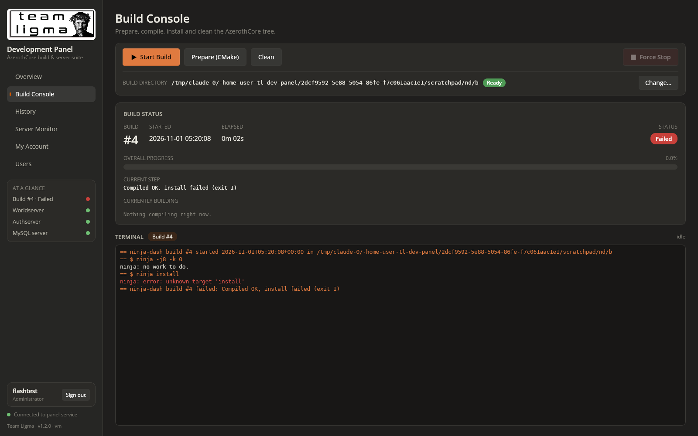
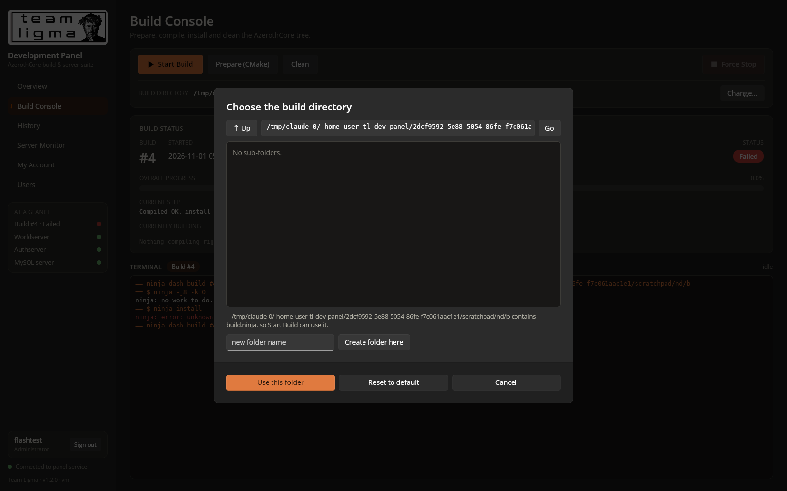
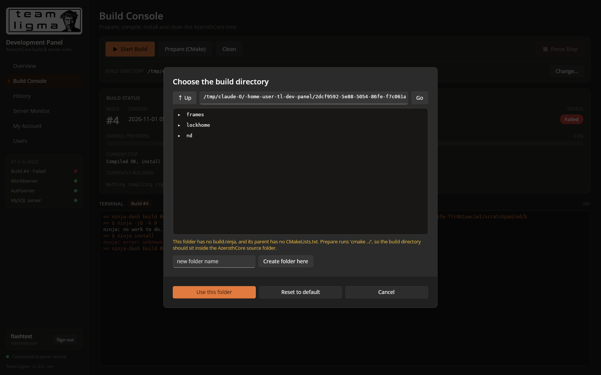

# Prompt
Small cosmetic issue:

* In the Overview tab, in the Server Components section, on each update of the process stats, it causes the stats to flash. This should not happen

Additionally, a critical issue:

* Clicking the "Start Build" button in the Build Console tab is failing to start a build at all, on my deployement.

Feature addition:

* Add an option to show a filepicker, for setting a build directory on the server.

Cosmetic fix:

* The three buttons on the Build Console tab are all different heights. Make them uniform.

An addendum to the "Start Build" button issue:

* I provided the wrong command(s) for starting a build+install. The correct commands to run are:
   * `ninja -j$(( $(nproc) - 1 ))`
   * `ninja install`

# Reponse
Fixed in v1.2.0: Start Build now uses the corrected commands, and the panel has a server-side folder picker for the build directory. The Overview stats no longer flash, and the Build Console buttons are a uniform height.

**Start Build (critical)**
- **Commands:** Start Build now runs exactly `ninja -j$(( $(nproc) - 1 ))` in the build directory, then `ninja install` only if that succeeds. They are configurable as `BuildCommand` / `InstallCommand` in appsettings. `ninja-dash` stays as an internal wrapper inside a detached `screen`, so progress bars, history and Force Stop keep working, but it executes these commands verbatim.
- **Silent failures fixed:** previously the panel only checked that `screen` started, so if `ninja-dash` died immediately nothing was reported.
  - **Before launch, the panel now checks:** that the directory is prepared; that `screen`, `ninja-dash`, `ninja` and `python3` are on PATH; that `ninja-dash` doesn't have CRLF line endings; and that no `build` screen session is already open.
  - **After launch:** it captures the screen window's output and reports the actual error in a notification and in the Build Console terminal.
- **Stale locks fixed:** a build counted as "running" whenever its old PID existed. After a reboot that PID can belong to another process and block every start. The panel and `ninja-dash` now also check that the process really is `ninja-dash`.
- **`.gitattributes`:** forces LF line endings so `tools/ninja-dash` and the scripts can't be checked out with CRLF on Windows, which breaks the `#!/usr/bin/env python3` line.

**Build directory picker**
- A Build directory row in the Build Console shows the active folder with a status: Ready, Needs Prepare, or No source in parent.
- **Change…** opens a folder browser on the server: Up, typed path, folders tagged `build.ninja` / `CMake source`, and Create folder. Then Use this folder, or Reset to default.
- The choice is saved in `/roc/claude/panel-data/settings.json`. Start, Prepare and Clean all use it. It's available to operators and admins, and blocked while a build or task is running.

**Cosmetic**
- Server Components rows are created once and updated in place, so they no longer flash. The Currently building list had the same problem and got the same fix.
- The Build Console buttons now have a fixed 40 px height. I also removed the ⚙/✦ glyphs, which the Skia renderer drew from mismatched fallback fonts (✦ didn't render at all).

**Tested**
- **Flash:** 50 rapid captures of Server Components while values changed 25 times; the rows never dropped out.
- **Start Build failures:** a dying `ninja-dash` and a CRLF copy each produced a clear error; a stale lock no longer blocks.
- **Picker:** browsing, folder creation, switching directory, and Reset to default all work.
- **Real build:** on the AzerothCore tree (build #5) it ran `ninja -j3`, then `ninja install`, and completed and installed; the servers came back up afterwards. Force Stop kills the bash, ninja and compiler processes.

**Docs:** README updated. Because the old command was wrong, I also corrected the build command in CLAUDE.md and skills/BUILD.md.

# File Changes
| File | Type | Workspace path | Change |
|---|---|---|---|
| `.gitattributes` | `Config` | `.gitattributes` | Created |
| `.gitignore` | `Config` | `.gitignore` | Changed |
| `CLAUDE.md` | `Docs` | `CLAUDE.md` | Changed |
| `v120-build-console.png` | `Asset` | `Prompts/Team Ligma Development Panel/screenshots/v120-build-console.png` | Created |
| `v120-picker-browse.png` | `Asset` | `Prompts/Team Ligma Development Panel/screenshots/v120-picker-browse.png` | Created |
| `v120-picker.png` | `Asset` | `Prompts/Team Ligma Development Panel/screenshots/v120-picker.png` | Created |
| `README.md` | `Docs` | `README.md` | Changed |
| `BUILD.md` | `Docs` | `skills/BUILD.md` | Changed |
| `Dtos.cs` | `Code` | `src/Shared/Dtos.cs` | Changed |
| `BuildService.cs` | `Code` | `src/TeamLigma.Panel.Server/BuildService.cs` | Changed |
| `DirBrowser.cs` | `Code` | `src/TeamLigma.Panel.Server/DirBrowser.cs` | Created |
| `PanelOptions.cs` | `Code` | `src/TeamLigma.Panel.Server/PanelOptions.cs` | Changed |
| `Program.cs` | `Code` | `src/TeamLigma.Panel.Server/Program.cs` | Changed |
| `Shell.cs` | `Code` | `src/TeamLigma.Panel.Server/Shell.cs` | Changed |
| `TeamLigma.Panel.Server.csproj` | `Config` | `src/TeamLigma.Panel.Server/TeamLigma.Panel.Server.csproj` | Changed |
| `appsettings.json` | `Config` | `src/TeamLigma.Panel.Server/appsettings.json` | Changed |
| `ApiClient.cs` | `Code` | `src/TeamLigma.Panel/TeamLigma.Panel/Services/ApiClient.cs` | Changed |
| `TeamLigma.Panel.csproj` | `Config` | `src/TeamLigma.Panel/TeamLigma.Panel/TeamLigma.Panel.csproj` | Changed |
| `BuildConsoleView.xaml` | `Code` | `src/TeamLigma.Panel/TeamLigma.Panel/Views/BuildConsoleView.xaml` | Changed |
| `BuildConsoleView.xaml.cs` | `Code` | `src/TeamLigma.Panel/TeamLigma.Panel/Views/BuildConsoleView.xaml.cs` | Changed |
| `BuildDash.xaml.cs` | `Code` | `src/TeamLigma.Panel/TeamLigma.Panel/Views/BuildDash.xaml.cs` | Changed |
| `DirectoryPicker.cs` | `Code` | `src/TeamLigma.Panel/TeamLigma.Panel/Views/DirectoryPicker.cs` | Created |
| `OverviewView.xaml.cs` | `Code` | `src/TeamLigma.Panel/TeamLigma.Panel/Views/OverviewView.xaml.cs` | Changed |
| `ninja-dash` | `Code` | `tools/ninja-dash` | Changed |

Environment: `/roc/claude/panel/` redeployed (v1.2.0); `/usr/local/bin/ninja-dash` updated; new runtime file `/roc/claude/panel-data/settings.json`.

# Code Diffs
### `.gitattributes` (Created)
```diff
diff --git a/.gitattributes b/.gitattributes
new file mode 100644
index 0000000..cbd07d5
--- /dev/null
+++ b/.gitattributes
@@ -0,0 +1,8 @@
+# Keep Unix line endings for everything that runs on the Debian server.
+* text=auto eol=lf
+tools/ninja-dash text eol=lf
+*.sh text eol=lf
+*.png binary
+*.ttf binary
+*.gz binary
+*.bundle binary
```

### `.gitignore` (Changed)
```diff
diff --git a/.gitignore b/.gitignore
index beb280e..4839168 100644
--- a/.gitignore
+++ b/.gitignore
@@ -3,3 +3,4 @@ obj/
 *.user
 .vs/
 dist/
+__pycache__/
```

### `CLAUDE.md` (Changed)
```diff
diff --git a/CLAUDE.md b/CLAUDE.md
index 52246ad..d0d8e50 100644
--- a/CLAUDE.md
+++ b/CLAUDE.md
@@ -1,89 +1,89 @@
-# Team Ligma Development Panel
-A clean and robust web-panel suite for monitoring, compiling and managing Azerothcore private server codebase deployments using CMake and Ninja. It also features live console monitors with command input capablities, and colourized output, for the test server components (Authserver, Worldserver, MySQL). It is written in C#.Net 9 using the Uno framework. 
-
-## Task-Specific Guides
-Before starting a task, check if any of these reference files are relevant and read them first:
-- `skills/DOCUMENTATION.md`: Guidelines for maintaining documentation.
-- `skills/BUILD.md`: Guidelines for server compilation.
-- `skills/MODULE.md`: Instructions related to designing and coding the server module.
-
-## Cloud Environment
-Use a base system image of Debian 12 (bookworm) for this cloud environment, as that is the target deployment environment.
-
-### Workspace
-You will need to make a non-Docker instance of the Azerothcore project and the current verion of MySQL for this panel to compile and monitor.
-You are to run the panel using nginx, and put it on port 26767.
-You may use the folders/tools in the following locations as needed:
-- The project folder this file is located.
-- Any tools you install on the cloud session to facilitate building and running the web-panel.
-
-## General Information
-This section is to relavent to the entire project. It details Requirements, Resources, Workspace, System Safety, Rules, and Post-Response Tasks.
-
-### Requirements
-- The theme is based on the Claude Dark theme-set, with burnt-orange accents.
-- There should be 3 sections between which functions are based:
-  - Overview
-    - This contains a dash for the current build:
-      - The current build's number and start date/time.
-      - The current general status of the build.
-      - Live-updating progress bars for the overall build and the currently building object(s).
-      - Live updating text for the current step of the build and the currently building object(s).
-      - An overview of system usage and performance metrics, with graphs/guages as appropriate.
-  - Build Console
-    - This contains build controls and the detailed build status
-      - Build controls:
-        - Starting a build (`screen -dmS build ninja-dash /roc/claude/claude-acore/build -- -j8 -k 0`).
-        - Preparing the build directory (`cmake ../ -G Ninja -DCMAKE_INSTALL_PREFIX=/roc/claude/live/ -DCMAKE_C_COMPILER=/usr/bin/clang -DCMAKE_CXX_COMPILER=/usr/bin/clang++ -DWITH_WARNINGS=0 -DTOOLS_BUILD=all -DSCRIPTS=static -DMODULES=static`)
-        - Force stopping the currently running build, with a confirmation warning dialog.
-        - Preforming a build directory clean (`ninja -t clean`).
-      - Build Status:
-        - The current build's number and start date/time.
-        - The current general status of the build.
-        - Live-updating progress bars for the overall build and the currently building object(s).
-        - Live terminal output, with scrollback, of the currently running build/install.
-  - History:
-    - Build history items are sorted by date/time.
-    - They have the following in each lone item, in order:
-      - The build number.
-      - The date/time the build started.
-      - The date/time the build completed.
-      - The current and/or final status.
-      - The compilation result.
-      - Option to remove them individually.
-      - Option to display the full build/install log, in a dialog with scrollback.
-  - Server Monitor:
-    - Contains interactive, rich colour console panels for monitoring and sending commands for the following components:
-      - Authserver (`/roc/claude/live/bin/authserver`).
-      - Worldserver (`/roc/claude/live/bin/worldserver`).
-      - MySQL (`mysql -uroot -p`).
-   - Panels are set up in two columns on the page.
-     - Left column:
-      - Worldserver terminal:
-        - Accepts single-line inputs.
-    - Right column:
-      - Authserver terminal (top half):
-        - Accepts Ctrl + C as the only input.
-      - MySQL terminal (bottom half):
-        - Accepts single line inputs.
-        - Ability to run .sql scripts uplodaded from the user's local machine.
-
-### Post-Response Tasks
-1. After each promt's response, create an appropriately numbered file in `{project_folder}/Prompts/{Module or Track project}/` (using an ascending scheme i.e. 0001.md, 0002.md, etc) in the following format:
-
-```
-# Prompt
-{prompt here}
-
-# Reponse
-{response here}
-
-# File Changes
-{filenames, file type (`Code`, `Asset`, `Docs`, etc), and workspace paths of any created/removed/changed files}
-
-# Code Diffs
-{code diffs, on a per file basis with correct coloring}
-
-# Image Assets
-{Any image assets along with their file paths}
+# Team Ligma Development Panel
+A clean and robust web-panel suite for monitoring, compiling and managing Azerothcore private server codebase deployments using CMake and Ninja. It also features live console monitors with command input capablities, and colourized output, for the test server components (Authserver, Worldserver, MySQL). It is written in C#.Net 9 using the Uno framework. 
+
+## Task-Specific Guides
+Before starting a task, check if any of these reference files are relevant and read them first:
+- `skills/DOCUMENTATION.md`: Guidelines for maintaining documentation.
+- `skills/BUILD.md`: Guidelines for server compilation.
+- `skills/MODULE.md`: Instructions related to designing and coding the server module.
+
+## Cloud Environment
+Use a base system image of Debian 12 (bookworm) for this cloud environment, as that is the target deployment environment.
+
+### Workspace
+You will need to make a non-Docker instance of the Azerothcore project and the current verion of MySQL for this panel to compile and monitor.
+You are to run the panel using nginx, and put it on port 26767.
+You may use the folders/tools in the following locations as needed:
+- The project folder this file is located.
+- Any tools you install on the cloud session to facilitate building and running the web-panel.
+
+## General Information
+This section is to relavent to the entire project. It details Requirements, Resources, Workspace, System Safety, Rules, and Post-Response Tasks.
+
+### Requirements
+- The theme is based on the Claude Dark theme-set, with burnt-orange accents.
+- There should be 3 sections between which functions are based:
+  - Overview
+    - This contains a dash for the current build:
+      - The current build's number and start date/time.
+      - The current general status of the build.
+      - Live-updating progress bars for the overall build and the currently building object(s).
+      - Live updating text for the current step of the build and the currently building object(s).
+      - An overview of system usage and performance metrics, with graphs/guages as appropriate.
+  - Build Console
+    - This contains build controls and the detailed build status
+      - Build controls:
+        - Starting a build+install (`ninja -j$(( $(nproc) - 1 ))`, then `ninja install`).
+        - Preparing the build directory (`cmake ../ -G Ninja -DCMAKE_INSTALL_PREFIX=/roc/claude/live/ -DCMAKE_C_COMPILER=/usr/bin/clang -DCMAKE_CXX_COMPILER=/usr/bin/clang++ -DWITH_WARNINGS=0 -DTOOLS_BUILD=all -DSCRIPTS=static -DMODULES=static`)
+        - Force stopping the currently running build, with a confirmation warning dialog.
+        - Preforming a build directory clean (`ninja -t clean`).
+      - Build Status:
+        - The current build's number and start date/time.
+        - The current general status of the build.
+        - Live-updating progress bars for the overall build and the currently building object(s).
+        - Live terminal output, with scrollback, of the currently running build/install.
+  - History:
+    - Build history items are sorted by date/time.
+    - They have the following in each lone item, in order:
+      - The build number.
+      - The date/time the build started.
+      - The date/time the build completed.
+      - The current and/or final status.
+      - The compilation result.
+      - Option to remove them individually.
+      - Option to display the full build/install log, in a dialog with scrollback.
+  - Server Monitor:
+    - Contains interactive, rich colour console panels for monitoring and sending commands for the following components:
+      - Authserver (`/roc/claude/live/bin/authserver`).
+      - Worldserver (`/roc/claude/live/bin/worldserver`).
+      - MySQL (`mysql -uroot -p`).
+   - Panels are set up in two columns on the page.
+     - Left column:
+      - Worldserver terminal:
+        - Accepts single-line inputs.
+    - Right column:
+      - Authserver terminal (top half):
+        - Accepts Ctrl + C as the only input.
+      - MySQL terminal (bottom half):
+        - Accepts single line inputs.
+        - Ability to run .sql scripts uplodaded from the user's local machine.
+
+### Post-Response Tasks
+1. After each promt's response, create an appropriately numbered file in `{project_folder}/Prompts/{Module or Track project}/` (using an ascending scheme i.e. 0001.md, 0002.md, etc) in the following format:
+
+```
+# Prompt
+{prompt here}
+
+# Reponse
+{response here}
+
+# File Changes
+{filenames, file type (`Code`, `Asset`, `Docs`, etc), and workspace paths of any created/removed/changed files}
+
+# Code Diffs
+{code diffs, on a per file basis with correct coloring}
+
+# Image Assets
+{Any image assets along with their file paths}
 ```
\ No newline at end of file
```

### `README.md` (Changed)
```diff
diff --git a/README.md b/README.md
index 0807fac..fc6f70e 100644
--- a/README.md
+++ b/README.md
@@ -1,7 +1,7 @@
 <p align="center"></p>
 
 # Team Ligma Development Panel
-**Version 1.1.0**
+**Version 1.2.0**
 
 One dark, burnt-orange control room for an AzerothCore test realm. Kick off builds, watch every object compile in real time, look back at old logs, and talk to the Worldserver, Authserver and MySQL from your browser. No SSH session needed.
 
@@ -61,9 +61,9 @@ cd /roc/claude/panel/server && sudo dotnet TeamLigma.Panel.Server.dll user-reset
 
 ## Commands the panel runs
 
-| Control | Command (cwd `/roc/claude/claude-acore/build`) |
+| Control | Command (cwd = the build directory, default `/roc/claude/claude-acore/build`) |
 |---|---|
-| Start Build | `screen -dmS build ninja-dash /roc/claude/claude-acore/build -- -j8 -k 0` (build, then `ninja install` on success) |
+| Start Build | `ninja -j$(( $(nproc) - 1 ))`, then `ninja install` if the build succeeded |
 | Prepare (CMake) | `cmake ../ -G Ninja -DCMAKE_INSTALL_PREFIX=/roc/claude/live/ -DCMAKE_C_COMPILER=/usr/bin/clang -DCMAKE_CXX_COMPILER=/usr/bin/clang++ -DWITH_WARNINGS=0 -DTOOLS_BUILD=all -DSCRIPTS=static -DMODULES=static` |
 | Clean | `ninja -t clean` |
 | Force Stop | Sends SIGTERM to ninja-dash, which stops ninja's process group and records the build as *Stopped* |
@@ -71,7 +71,21 @@ cd /roc/claude/panel/server && sudo dotnet TeamLigma.Panel.Server.dll user-reset
 | Authserver | `screen -dmS auth ./authserver` (cwd `/roc/claude/live/bin`) |
 | MySQL | `screen -dmS mysql mysql -uroot -p` |
 
-All of these are set in `src/TeamLigma.Panel.Server/appsettings.json` (`Panel` section).
+All of these are set in `src/TeamLigma.Panel.Server/appsettings.json` (`Panel` section). Start Build uses `BuildCommand` and `InstallCommand`.
+
+Start Build runs inside a detached `screen` session named `build`, through `ninja-dash`, so a build keeps going if the panel restarts. Before launching, the panel checks for the usual problems, and if the build still doesn't start it shows the reason in a notification and in the Build Console terminal:
+- the directory isn't prepared;
+- `screen`, `ninja-dash`, `ninja` or `python3` is missing;
+- `ninja-dash` has Windows line endings;
+- a `build` screen session is already open.
+
+## Build directory
+The **Build directory** row in the Build Console shows the folder that Start Build, Prepare and Clean run in, with a status:
+- **Ready:** it contains `build.ninja`.
+- **Needs Prepare:** it doesn't contain `build.ninja` yet.
+- **No source in parent:** the parent folder has no `CMakeLists.txt`.
+
+**Change…** opens a folder browser on the server. You can move up, type a path, open folders (folders containing `build.ninja` or `CMakeLists.txt` are tagged) and create a new folder. **Use this folder** saves the choice to `/roc/claude/panel-data/settings.json`; **Reset to default** returns to `Panel:BuildDir`. Prepare runs `cmake ../`, so pick a folder that sits directly inside the AzerothCore source tree. Operators and administrators can change it, but not while a build or task is running.
 
 The panel never force-kills `worldserver`, `authserver`, `mysql` or `mysqld`:
 - Worldserver: use `server shutdown 0h0m10s`, or the Shutdown button.
@@ -79,12 +93,13 @@ The panel never force-kills `worldserver`, `authserver`, `mysql` or `mysqld`:
 - MySQL: type `exit`.
 
 ## ninja-dash
-`tools/ninja-dash` is the build runner behind **Start Build**. It mirrors ninja output to the screen session and records each numbered build under `/roc/claude/panel-data/builds/<n>/`:
+`tools/ninja-dash` is the wrapper behind **Start Build**. It runs the build command and then the install command through bash, exactly as configured. It mirrors their output to the screen session and records each numbered build under `/roc/claude/panel-data/builds/<n>/`:
 - `status.json`: live phase, step counts, failed targets, result, and the objects currently compiling with elapsed and estimated times. Estimates come from earlier `.ninja_log` timings.
 - `build.log`: the complete build and install log.
 
 ```bash
-ninja-dash <build-dir> -- [ninja args]   # NINJA_DASH_HOME overrides /roc/claude/panel-data
+ninja-dash <build-dir> --build-cmd 'ninja -j$(( $(nproc) - 1 ))' --install-cmd 'ninja install'
+# NINJA_DASH_HOME overrides /roc/claude/panel-data
 ```
 
 ## Layout on disk
@@ -135,7 +150,9 @@ The panel can run server and SQL commands, so give Operator or Administrator onl
 Over plain HTTP, passwords and session cookies cross the network unencrypted. On anything other than a trusted LAN, put TLS in front of the panel (for example an nginx `listen 443 ssl` server block that proxies to this one). Once you do, the session cookie is marked Secure automatically.
 
 ## Troubleshooting
-- **"Build directory is not prepared":** run Prepare (CMake) first.
+- **"Build directory is not prepared":** run Prepare (CMake) first, or choose the right folder with **Change…**.
+- **"The build did not start: …":** the text after the colon is what `ninja-dash` or `screen` printed. The full output is in the Build Console terminal under *Start Build (failed)*.
+- **On a 1-CPU machine:** `$(( $(nproc) - 1 ))` is 0, and `ninja -j0` means unlimited parallel jobs. Set `BuildCommand` to `ninja -j1` there.
 - **A build shows *Interrupted*:** ninja-dash was killed without cleaning up. Start a new build.
 - **A server shows *Session open* but not *Running*:** the program exited inside its screen session. Read its console for the reason, then press Start again after the session closes.
 - **"That code is not valid" for every code:** the server's clock or your phone's clock is wrong. Authenticator codes need both to be within about 30 seconds of the real time.
```

### `skills/BUILD.md` (Changed)
```diff
diff --git a/skills/BUILD.md b/skills/BUILD.md
index df6ad18..5088ad0 100644
--- a/skills/BUILD.md
+++ b/skills/BUILD.md
@@ -1,11 +1,11 @@
-# Build Guidelines
-This skill is relavent to compiling and installing the server codebase. It details the Build System, and Common Build Commands.
-
-## Build System
-This project is now using `ninja` as its build system, over the Azerothcore project's preferred `cmake`. You should adapt potential issues with the build system itself from `cmake` to it's likely equivalent's cause in `ninja`, if they are to ocurr.
-
-## Common Build System Commands
-- Configure: `cmake ../ -G Ninja -DCMAKE_INSTALL_PREFIX=/roc/claude/live/ -DCMAKE_C_COMPILER=/usr/bin/clang -DCMAKE_CXX_COMPILER=/usr/bin/clang++ -DWITH_WARNINGS=0 -DTOOLS_BUILD=all -DSCRIPTS=static -DMODULES=static`
-- Build: `screen -dmS build ninja-dash /roc/claude/claude-acore/build -- -j8 -k 0`
-- Install: `ninja install`
+# Build Guidelines
+This skill is relavent to compiling and installing the server codebase. It details the Build System, and Common Build Commands.
+
+## Build System
+This project is now using `ninja` as its build system, over the Azerothcore project's preferred `cmake`. You should adapt potential issues with the build system itself from `cmake` to it's likely equivalent's cause in `ninja`, if they are to ocurr.
+
+## Common Build System Commands
+- Configure: `cmake ../ -G Ninja -DCMAKE_INSTALL_PREFIX=/roc/claude/live/ -DCMAKE_C_COMPILER=/usr/bin/clang -DCMAKE_CXX_COMPILER=/usr/bin/clang++ -DWITH_WARNINGS=0 -DTOOLS_BUILD=all -DSCRIPTS=static -DMODULES=static`
+- Build: `ninja -j$(( $(nproc) - 1 ))`
+- Install: `ninja install`
 - Clean: `ninja -t clean`
\ No newline at end of file
```

### `src/Shared/Dtos.cs` (Changed)
```diff
diff --git a/src/Shared/Dtos.cs b/src/Shared/Dtos.cs
index ddcbd06..b6bd0a4 100644
--- a/src/Shared/Dtos.cs
+++ b/src/Shared/Dtos.cs
@@ -213,3 +213,38 @@ public sealed class SetRoleRequest
 {
     public string Role { get; set; } = Roles.Operator;
 }
+
+// ---------------- Build directory selection (v1.2.0) ----------------
+
+public sealed class BuildSettings
+{
+    public string BuildDir { get; set; } = "";
+    public string DefaultBuildDir { get; set; } = "";
+    public bool Ready { get; set; }
+    public bool SourceFound { get; set; }
+    public string BuildCommand { get; set; } = "";
+    public string InstallCommand { get; set; } = "";
+}
+
+public sealed class DirEntry
+{
+    public string Name { get; set; } = "";
+    public string Path { get; set; } = "";
+    public bool HasBuildNinja { get; set; }
+    public bool HasCMakeLists { get; set; }
+}
+
+public sealed class DirListing
+{
+    public string Path { get; set; } = "";
+    public string? Parent { get; set; }
+    public bool HasBuildNinja { get; set; }
+    public bool ParentHasCMakeLists { get; set; }
+    public string? Error { get; set; }
+    public List<DirEntry> Entries { get; set; } = new();
+}
+
+public sealed class PathRequest
+{
+    public string Path { get; set; } = "";
+}
```

### `src/TeamLigma.Panel.Server/BuildService.cs` (Changed)
```diff
diff --git a/src/TeamLigma.Panel.Server/BuildService.cs b/src/TeamLigma.Panel.Server/BuildService.cs
index ebe65eb..7a2b8ba 100644
--- a/src/TeamLigma.Panel.Server/BuildService.cs
+++ b/src/TeamLigma.Panel.Server/BuildService.cs
@@ -17,6 +17,15 @@ public sealed class BuildService
     string? _taskLog;
     int _taskSeq;
     DateTimeOffset _lastTaskStart = DateTimeOffset.MinValue;
+    string? _buildDirOverride;
+    string SettingsPath => Path.Combine(_o.DataHome, "settings.json");
+
+    /// <summary>The active build directory: the one chosen in the panel, else Panel:BuildDir from appsettings.</summary>
+    public string BuildDir => _buildDirOverride ?? _o.BuildDir;
+
+    /// <summary>Fills a configured command for the active build directory.
+    /// Accepts the {BuildDir} placeholder, and also rewrites the default path in older configs.</summary>
+    public string Cmd(string template) => template.Replace(_o.BuildDir, "{BuildDir}").Replace("{BuildDir}", BuildDir);
 
     public BuildService(IOptions<PanelOptions> o, ILogger<BuildService> log)
     {
@@ -26,8 +35,56 @@ public sealed class BuildService
         Directory.CreateDirectory(_o.TasksDir);
         Directory.CreateDirectory(_o.ScreenDir);
         _taskSeq = Directory.GetFiles(_o.TasksDir, "*.log").Length;
+        try
+        {
+            if (File.Exists(SettingsPath))
+            {
+                var dir = JsonDocument.Parse(File.ReadAllText(SettingsPath)).RootElement.GetProperty("buildDir").GetString();
+                if (!string.IsNullOrWhiteSpace(dir)) _buildDirOverride = dir;
+            }
+        }
+        catch (Exception ex) { _log.LogWarning(ex, "Ignoring unreadable {Path}", SettingsPath); }
+    }
+
+    public BuildSettings Settings() => new()
+    {
+        BuildDir = BuildDir,
+        DefaultBuildDir = _o.BuildDir,
+        Ready = File.Exists(Path.Combine(BuildDir, "build.ninja")),
+        SourceFound = File.Exists(Path.Combine(Path.GetDirectoryName(BuildDir.TrimEnd('/')) ?? "/", "CMakeLists.txt")),
+        BuildCommand = _o.BuildCommand,
+        InstallCommand = _o.InstallCommand,
+    };
+
+    static string Quote(string s) => "'" + s.Replace("'", "'\\''") + "'";
+
+    /// <summary>The shell line that starts a build: the configured build/install commands run, verbatim,
+    /// inside a detached screen session through ninja-dash (which records progress and history).
+    /// A BuildCommand that already names ninja-dash (pre-1.2 configs) is used as-is.</summary>
+    string LaunchCommand()
+    {
+        var build = Cmd(_o.BuildCommand);
+        if (build.Contains("ninja-dash")) return build;
+        return $"screen -dmS build ninja-dash {Quote(BuildDir)} --build-cmd {Quote(build)}" +
+               (string.IsNullOrWhiteSpace(_o.InstallCommand) ? "" : $" --install-cmd {Quote(Cmd(_o.InstallCommand))}");
+    }
+
+    public ActionResult SetBuildDir(string path)
+    {
+        if (string.IsNullOrWhiteSpace(path) || !Path.IsPathRooted(path)) return Fail("Choose an absolute directory path.");
+        var full = Path.GetFullPath(path).TrimEnd('/');
+        if (full.Length == 0) full = "/";
+        if (!Directory.Exists(full)) return Fail($"{full} does not exist.");
+        if (Running() is { } r) return Fail($"Build #{r.Id} is running; stop it before changing the build directory.");
+        if (TaskRunning) return Fail($"Wait for '{Task.Name}' to finish first.");
+        _buildDirOverride = full == _o.BuildDir.TrimEnd('/') ? null : full;
+        File.WriteAllText(SettingsPath, JsonSerializer.Serialize(new { buildDir = _buildDirOverride }, Json));
+        var s = Settings();
+        var note = s.Ready ? "Ready to build." : s.SourceFound ? "Run Prepare (CMake) before building." : "Warning: no CMakeLists.txt in the parent folder, so Prepare ('cmake ../') will not find the source.";
+        return Ok($"Build directory set to {full}. {note}");
     }
 
+
     public Dictionary<string, string> Env(string screenSession) => new()
     {
         ["NINJA_DASH_HOME"] = _o.DataHome,
@@ -66,7 +123,7 @@ public sealed class BuildService
         {
             var s = JsonSerializer.Deserialize<BuildStatus>(File.ReadAllText(path), Json);
             if (s == null) return null;
-            if (s.Phase is "building" or "installing" && !Shell.PidAlive(s.Pid))
+            if (s.Phase is "building" or "installing" && !Shell.IsNinjaDash(s.Pid))
             {
                 s.Phase = "interrupted";
                 s.Result ??= "Build process ended unexpectedly";
@@ -102,21 +159,73 @@ public sealed class BuildService
     {
         if (Running() is { } r) return Fail($"Build #{r.Id} is already running.");
         if (TaskRunning) return Fail($"Wait for '{Task.Name}' to finish first.");
-        if (!File.Exists(Path.Combine(_o.BuildDir, "build.ninja")))
-            return Fail("The build directory is not prepared. Run 'Prepare (CMake)' first.");
+        if (!Directory.Exists(BuildDir)) return Fail($"The build directory {BuildDir} does not exist. Choose another one or run Prepare (CMake).");
+        if (!File.Exists(Path.Combine(BuildDir, "build.ninja")))
+            return Fail($"{BuildDir} is not prepared (no build.ninja). Run 'Prepare (CMake)' first.");
+
+        // Preflight: everything the screen session needs must be resolvable, or it dies silently.
+        var env = Env("build");
+        foreach (var tool in new[] { "screen", "ninja-dash", "ninja", "python3" })
+            if (Shell.Which(tool, env["PATH"]) == null)
+                return Fail($"'{tool}' was not found on the panel's PATH ({env["PATH"]}). " +
+                            (tool == "ninja-dash" ? "Re-run deploy/install.sh to install it to /usr/local/bin." : "Install it on the server."));
+        var nd = Shell.Which("ninja-dash", env["PATH"])!;
+        try
+        {
+            var head = new byte[256];
+            int n;
+            using (var fs = File.OpenRead(nd)) n = fs.Read(head, 0, head.Length);
+            var nl = Array.IndexOf(head, (byte)'\n', 0, n);
+            if (nl > 0 && head[nl - 1] == (byte)'\r')
+                return Fail($"{nd} has Windows (CRLF) line endings, so it cannot run. Fix it with: sed -i 's/\\r$//' {nd}");
+        }
+        catch { }
+
         var sessions = await Shell.ScreenSessionsAsync();
-        if (sessions.Contains("build")) return Fail("A 'build' screen session already exists.");
+        if (sessions.Contains("build"))
+            return Fail("A 'build' screen session is already open on the server. Close it with 'screen -S build -X quit' and try again.");
+
+        // Log the screen window so a failed start can be explained.
+        var launchLog = Path.Combine(_o.ScreenDir, "build-launch.log");
+        File.WriteAllText(launchLog, "");
+        env["SCREENRC"] = ScreenRc("build", launchLog);
         var known = All().Select(b => b.Id).DefaultIfEmpty(0).Max();
-        var (code, output) = await Shell.BashAsync(_o.BuildCommand, _o.BuildDir, Env("build"));
-        if (code != 0) return Fail($"Failed to start build (exit {code}): {output}");
-        // wait for ninja-dash to register the new record
-        for (var i = 0; i < 40; i++)
+        var command = LaunchCommand();
+        _log.LogInformation("Starting build: {Command} (cwd {Dir})", command, BuildDir);
+        var (code, output) = await Shell.BashAsync(command, BuildDir, env);
+        if (code != 0) return LaunchFailed(command, $"screen exited with code {code}: {output}");
+
+        for (var i = 0; i < 60; i++)
         {
             await System.Threading.Tasks.Task.Delay(150);
             var newest = All().Select(b => b.Id).DefaultIfEmpty(0).Max();
             if (newest > known) return Ok($"Build #{newest} started.");
+            if (i >= 6 && !(await Shell.ScreenSessionsAsync()).Contains("build"))
+            {
+                await System.Threading.Tasks.Task.Delay(300); // let screen flush its log
+                var why = File.Exists(launchLog) ? File.ReadAllText(launchLog).Trim() : "";
+                return LaunchFailed(command, string.IsNullOrEmpty(why) ? "ninja-dash exited without output." : why);
+            }
+        }
+        return LaunchFailed(command, "ninja-dash did not register a build within 9 seconds. Check 'screen -r build' on the server.");
+    }
+
+    /// <summary>Records a failed start as a task so its output appears in the Build Console terminal.</summary>
+    ActionResult LaunchFailed(string command, string detail)
+    {
+        _log.LogWarning("Build failed to start: {Detail}", detail);
+        lock (_taskLock)
+        {
+            _taskLog = Path.Combine(_o.TasksDir, $"{DateTime.UtcNow:yyyyMMdd-HHmmss}-start-failed.log");
+            File.WriteAllText(_taskLog,
+                $"== Start Build failed {DateTimeOffset.Now:yyyy-MM-dd HH:mm:ss} in {BuildDir}\n== $ {command}\n{detail}\n");
+            _taskState.Name = "Start Build (failed)";
+            _taskState.Running = false;
+            _taskState.ExitCode = 1;
+            _taskState.Started = _taskState.Ended = DateTimeOffset.Now;
         }
-        return Ok("Build started.");
+        var first = detail.Split('\n').Select(l => l.Trim()).FirstOrDefault(l => l.Length > 0) ?? detail;
+        return Fail($"The build did not start: {first}");
     }
 
     public async Task<ActionResult> StopBuildAsync()
@@ -125,7 +234,7 @@ public sealed class BuildService
         if (r == null) return Fail("No build is running.");
         // ninja-dash traps SIGTERM, stops ninja's process group and records the build as stopped.
         await Shell.RunAsync("kill", new[] { "-TERM", r.Pid!.Value.ToString() });
-        for (var i = 0; i < 50 && Shell.PidAlive(r.Pid); i++) await System.Threading.Tasks.Task.Delay(200);
+        for (var i = 0; i < 50 && Shell.IsNinjaDash(r.Pid); i++) await System.Threading.Tasks.Task.Delay(200);
         var sessions = await Shell.ScreenSessionsAsync();
         if (sessions.Contains("build")) await Shell.RunAsync("screen", new[] { "-S", "build", "-X", "quit" });
         return Ok($"Build #{r.Id} stopped.");
@@ -142,15 +251,15 @@ public sealed class BuildService
 
     public ActionResult Configure()
     {
-        Directory.CreateDirectory(_o.BuildDir);
-        return StartTask("Prepare (CMake)", _o.ConfigureCommand);
+        Directory.CreateDirectory(BuildDir);
+        return StartTask("Prepare (CMake)", Cmd(_o.ConfigureCommand));
     }
 
     public ActionResult Clean()
     {
-        if (!File.Exists(Path.Combine(_o.BuildDir, "build.ninja")))
+        if (!File.Exists(Path.Combine(BuildDir, "build.ninja")))
             return Fail("Nothing to clean: the build directory has not been prepared.");
-        return StartTask("Clean (ninja -t clean)", _o.CleanCommand);
+        return StartTask("Clean (ninja -t clean)", Cmd(_o.CleanCommand));
     }
 
     ActionResult StartTask(string name, string command)
@@ -164,7 +273,7 @@ public sealed class BuildService
             _taskLog = Path.Combine(_o.TasksDir, $"{DateTime.UtcNow:yyyyMMdd-HHmmss}-{slug}.log");
             var psi = new ProcessStartInfo("/bin/bash")
             {
-                WorkingDirectory = _o.BuildDir,
+                WorkingDirectory = BuildDir,
                 RedirectStandardOutput = true,
                 RedirectStandardError = true,
                 UseShellExecute = false,
@@ -173,7 +282,7 @@ public sealed class BuildService
             psi.ArgumentList.Add(command + " 2>&1");
             psi.Environment["CLICOLOR_FORCE"] = "1";
             var writer = new StreamWriter(new FileStream(_taskLog, FileMode.Create, FileAccess.Write, FileShare.ReadWrite)) { AutoFlush = true };
-            writer.WriteLine($"== {name} started {DateTimeOffset.Now:yyyy-MM-dd HH:mm:ss} in {_o.BuildDir}");
+            writer.WriteLine($"== {name} started {DateTimeOffset.Now:yyyy-MM-dd HH:mm:ss} in {BuildDir}");
             writer.WriteLine($"== $ {command}");
             var p = new Process { StartInfo = psi, EnableRaisingEvents = true };
             void Line(object? _, DataReceivedEventArgs e) { if (e.Data != null) lock (writer) writer.WriteLine(e.Data); }
```

### `src/TeamLigma.Panel.Server/DirBrowser.cs` (Created)
```diff
diff --git a/src/TeamLigma.Panel.Server/DirBrowser.cs b/src/TeamLigma.Panel.Server/DirBrowser.cs
new file mode 100644
index 0000000..6680159
--- /dev/null
+++ b/src/TeamLigma.Panel.Server/DirBrowser.cs
@@ -0,0 +1,56 @@
+using TeamLigma.Shared;
+
+namespace TeamLigma.Panel.Server;
+
+/// <summary>Directory-only browsing for the build-directory picker (no file names or contents are exposed).</summary>
+public static class DirBrowser
+{
+    static readonly HashSet<string> HiddenRoots = new() { "/proc", "/sys", "/dev", "/run", "/boot", "/lost+found", "/snap" };
+
+    public static DirListing List(string path)
+    {
+        var listing = new DirListing();
+        try
+        {
+            if (!Path.IsPathRooted(path)) path = "/";
+            var full = Path.GetFullPath(path);
+            // Walk up to the nearest existing folder so a deleted build dir still opens somewhere useful.
+            while (!Directory.Exists(full) && Path.GetDirectoryName(full) is { } up) full = up;
+            if (full.Length > 1) full = full.TrimEnd('/');
+            listing.Path = full;
+            listing.Parent = full == "/" ? null : Path.GetDirectoryName(full) ?? "/";
+            listing.HasBuildNinja = File.Exists(Path.Combine(full, "build.ninja"));
+            listing.ParentHasCMakeLists = listing.Parent != null && File.Exists(Path.Combine(listing.Parent, "CMakeLists.txt"));
+            foreach (var dir in Directory.EnumerateDirectories(full).OrderBy(d => d, StringComparer.OrdinalIgnoreCase))
+            {
+                var name = Path.GetFileName(dir);
+                if (name.StartsWith('.') || (full == "/" && HiddenRoots.Contains(dir))) continue;
+                var e = new DirEntry { Name = name, Path = dir };
+                try
+                {
+                    e.HasBuildNinja = File.Exists(Path.Combine(dir, "build.ninja"));
+                    e.HasCMakeLists = File.Exists(Path.Combine(dir, "CMakeLists.txt"));
+                }
+                catch { }
+                listing.Entries.Add(e);
+                if (listing.Entries.Count >= 500) break;
+            }
+        }
+        catch (Exception ex) { listing.Error = ex.Message; }
+        return listing;
+    }
+
+    public static ActionResult Create(string path)
+    {
+        if (string.IsNullOrWhiteSpace(path) || !Path.IsPathRooted(path)) return new() { Message = "Choose an absolute path." };
+        var full = Path.GetFullPath(path);
+        var name = Path.GetFileName(full.TrimEnd('/'));
+        if (string.IsNullOrEmpty(name) || name.StartsWith('.') || name.IndexOfAny(Path.GetInvalidFileNameChars()) >= 0)
+            return new() { Message = "That is not a valid folder name." };
+        if (Directory.Exists(full)) return new() { Message = $"{full} already exists." };
+        if (!Directory.Exists(Path.GetDirectoryName(full))) return new() { Message = "The parent folder does not exist." };
+        try { Directory.CreateDirectory(full); }
+        catch (Exception ex) { return new() { Message = ex.Message }; }
+        return new() { Ok = true, Message = $"Created {full}." };
+    }
+}
```

### `src/TeamLigma.Panel.Server/PanelOptions.cs` (Changed)
```diff
diff --git a/src/TeamLigma.Panel.Server/PanelOptions.cs b/src/TeamLigma.Panel.Server/PanelOptions.cs
index ea710a3..2660e7c 100644
--- a/src/TeamLigma.Panel.Server/PanelOptions.cs
+++ b/src/TeamLigma.Panel.Server/PanelOptions.cs
@@ -7,7 +7,10 @@ public sealed class PanelOptions
     public string InstallDir { get; set; } = "/roc/claude/live";
     public string BinDir { get; set; } = "/roc/claude/live/bin";
     public string DataHome { get; set; } = "/roc/claude/panel-data";
-    public string BuildCommand { get; set; } = "";
+    /// <summary>Compile command, run with bash in the build directory.</summary>
+    public string BuildCommand { get; set; } = "ninja -j$(( $(nproc) - 1 ))";
+    /// <summary>Install command, run only when the compile succeeded.</summary>
+    public string InstallCommand { get; set; } = "ninja install";
     public string ConfigureCommand { get; set; } = "";
     public string CleanCommand { get; set; } = "";
     public string WorldCommand { get; set; } = "";
```

### `src/TeamLigma.Panel.Server/Program.cs` (Changed)
```diff
diff --git a/src/TeamLigma.Panel.Server/Program.cs b/src/TeamLigma.Panel.Server/Program.cs
index 1794376..43e2d39 100644
--- a/src/TeamLigma.Panel.Server/Program.cs
+++ b/src/TeamLigma.Panel.Server/Program.cs
@@ -142,6 +142,7 @@ api.MapGet("/builds/{id:int}/log", (int id, long? offset, bool? full, BuildServi
         s.Phase is "building" or "installing", full ?? false));
 });
 api.MapGet("/build/console", (string? key, long? offset, BuildService b) => b.Console(key, offset ?? -1));
+api.MapGet("/build/settings", (BuildService b) => b.Settings());
 api.MapGet("/servers", (ConsoleService c) => c.StatusAsync());
 api.MapGet("/servers/{name}/output", (string name, long? offset, ConsoleService c) => c.Output(name, offset ?? -1));
 
@@ -151,6 +152,9 @@ op.MapPost("/build/start", async (HttpContext ctx, BuildService b, AuthService a
 op.MapPost("/build/stop", async (HttpContext ctx, BuildService b, AuthService a) => Logged(ctx, a, "force stop build", await b.StopBuildAsync()));
 op.MapPost("/build/configure", (HttpContext ctx, BuildService b, AuthService a) => Logged(ctx, a, "prepare (cmake)", b.Configure()));
 op.MapPost("/build/clean", (HttpContext ctx, BuildService b, AuthService a) => Logged(ctx, a, "clean", b.Clean()));
+op.MapPost("/build/directory", (HttpContext ctx, PathRequest r, BuildService b, AuthService a) => Logged(ctx, a, $"set build directory {r.Path}", b.SetBuildDir(r.Path)));
+op.MapGet("/fs/dirs", (string? path, BuildService b) => DirBrowser.List(string.IsNullOrWhiteSpace(path) ? b.BuildDir : path));
+op.MapPost("/fs/mkdir", (HttpContext ctx, PathRequest r, AuthService a) => Logged(ctx, a, $"create folder {r.Path}", DirBrowser.Create(r.Path)));
 op.MapPost("/servers/{name}/start", async (HttpContext ctx, string name, ConsoleService c, AuthService a) => Logged(ctx, a, $"start {name}", await c.StartAsync(name)));
 op.MapPost("/servers/{name}/input", async (HttpContext ctx, string name, InputRequest req, ConsoleService c, AuthService a) =>
     // Never log what is typed into MySQL (it may be a password).
```

### `src/TeamLigma.Panel.Server/Shell.cs` (Changed)
```diff
diff --git a/src/TeamLigma.Panel.Server/Shell.cs b/src/TeamLigma.Panel.Server/Shell.cs
index e704f26..1fb42cc 100644
--- a/src/TeamLigma.Panel.Server/Shell.cs
+++ b/src/TeamLigma.Panel.Server/Shell.cs
@@ -90,6 +90,26 @@ public static class Shell
         return null;
     }
 
+    /// <summary>True only when the pid is alive AND is a ninja-dash process (pids get reused after reboots).</summary>
+    public static bool IsNinjaDash(int? pid)
+    {
+        if (!PidAlive(pid)) return false;
+        try { return File.ReadAllText($"/proc/{pid}/cmdline").Replace('\0', ' ').Contains("ninja-dash"); }
+        catch { return false; }
+    }
+
+    /// <summary>Resolves an executable on a PATH string, like `command -v`.</summary>
+    public static string? Which(string name, string path)
+    {
+        foreach (var dir in path.Split(':', StringSplitOptions.RemoveEmptyEntries))
+        {
+            var full = System.IO.Path.Combine(dir, name);
+            if (File.Exists(full) && (File.GetUnixFileMode(full) & (UnixFileMode.UserExecute | UnixFileMode.GroupExecute | UnixFileMode.OtherExecute)) != 0)
+                return full;
+        }
+        return null;
+    }
+
     public static bool PidAlive(int? pid)
     {
         if (pid is null or <= 0) return false;
```

### `src/TeamLigma.Panel.Server/TeamLigma.Panel.Server.csproj` (Changed)
```diff
diff --git a/src/TeamLigma.Panel.Server/TeamLigma.Panel.Server.csproj b/src/TeamLigma.Panel.Server/TeamLigma.Panel.Server.csproj
index 741bcce..43e550e 100644
--- a/src/TeamLigma.Panel.Server/TeamLigma.Panel.Server.csproj
+++ b/src/TeamLigma.Panel.Server/TeamLigma.Panel.Server.csproj
@@ -4,7 +4,7 @@
     <Nullable>enable</Nullable>
     <ImplicitUsings>enable</ImplicitUsings>
     <RootNamespace>TeamLigma.Panel.Server</RootNamespace>
-    <Version>1.1.0</Version>
+    <Version>1.2.0</Version>
   </PropertyGroup>
   <ItemGroup>
     <Compile Include="../Shared/Dtos.cs" Link="Shared/Dtos.cs" />
```

### `src/TeamLigma.Panel.Server/appsettings.json` (Changed)
```diff
diff --git a/src/TeamLigma.Panel.Server/appsettings.json b/src/TeamLigma.Panel.Server/appsettings.json
index 6e38ef7..c2a9b41 100644
--- a/src/TeamLigma.Panel.Server/appsettings.json
+++ b/src/TeamLigma.Panel.Server/appsettings.json
@@ -7,7 +7,8 @@
     "InstallDir": "/roc/claude/live",
     "BinDir": "/roc/claude/live/bin",
     "DataHome": "/roc/claude/panel-data",
-    "BuildCommand": "screen -dmS build ninja-dash /roc/claude/claude-acore/build -- -j8 -k 0",
+    "BuildCommand": "ninja -j$(( $(nproc) - 1 ))",
+    "InstallCommand": "ninja install",
     "ConfigureCommand": "cmake ../ -G Ninja -DCMAKE_INSTALL_PREFIX=/roc/claude/live/ -DCMAKE_C_COMPILER=/usr/bin/clang -DCMAKE_CXX_COMPILER=/usr/bin/clang++ -DWITH_WARNINGS=0 -DTOOLS_BUILD=all -DSCRIPTS=static -DMODULES=static",
     "CleanCommand": "ninja -t clean",
     "WorldCommand": "screen -dmS world ./worldserver",
```

### `src/TeamLigma.Panel/TeamLigma.Panel/Services/ApiClient.cs` (Changed)
```diff
diff --git a/src/TeamLigma.Panel/TeamLigma.Panel/Services/ApiClient.cs b/src/TeamLigma.Panel/TeamLigma.Panel/Services/ApiClient.cs
index fd96c79..48b213f 100644
--- a/src/TeamLigma.Panel/TeamLigma.Panel/Services/ApiClient.cs
+++ b/src/TeamLigma.Panel/TeamLigma.Panel/Services/ApiClient.cs
@@ -25,6 +25,9 @@ namespace TeamLigma.Panel.Services;
 [JsonSerializable(typeof(CreateUserRequest))]
 [JsonSerializable(typeof(SetRoleRequest))]
 [JsonSerializable(typeof(List<UserInfo>))]
+[JsonSerializable(typeof(BuildSettings))]
+[JsonSerializable(typeof(DirListing))]
+[JsonSerializable(typeof(PathRequest))]
 internal partial class PanelJson : JsonSerializerContext { }
 
 /// <summary>Thin client for the panel backend (same origin, proxied by nginx under /api).</summary>
@@ -145,6 +148,15 @@ public sealed class ApiClient
             Content = JsonContent.Create(new InputRequest { Text = text }, PanelJson.Default.InputRequest),
         });
 
+    // ---- Build directory ----
+    public Task<BuildSettings?> BuildSettingsAsync() => Get("api/build/settings", PanelJson.Default.BuildSettings);
+    public Task<DirListing?> ListDirsAsync(string? path)
+        => Get($"api/fs/dirs?path={Uri.EscapeDataString(path ?? "")}", PanelJson.Default.DirListing);
+    public Task<ActionResult> SetBuildDirAsync(string path)
+        => PostBody("api/build/directory", new PathRequest { Path = path }, PanelJson.Default.PathRequest);
+    public Task<ActionResult> MakeDirAsync(string path)
+        => PostBody("api/fs/mkdir", new PathRequest { Path = path }, PanelJson.Default.PathRequest);
+
     // ---- Authentication & accounts ----
     public Task<AuthState?> AuthStateAsync() => Get("api/auth/state", PanelJson.Default.AuthState);
     public Task<LoginResult?> SetupAsync(string user, string pass)
```

### `src/TeamLigma.Panel/TeamLigma.Panel/TeamLigma.Panel.csproj` (Changed)
```diff
diff --git a/src/TeamLigma.Panel/TeamLigma.Panel/TeamLigma.Panel.csproj b/src/TeamLigma.Panel/TeamLigma.Panel/TeamLigma.Panel.csproj
index e47f3ab..10ab6cc 100644
--- a/src/TeamLigma.Panel/TeamLigma.Panel/TeamLigma.Panel.csproj
+++ b/src/TeamLigma.Panel/TeamLigma.Panel/TeamLigma.Panel.csproj
@@ -5,11 +5,11 @@
     <UnoSingleProject>true</UnoSingleProject>
     <ApplicationTitle>Team Ligma Development Panel</ApplicationTitle>
     <ApplicationId>com.teamligma.devpanel</ApplicationId>
-    <ApplicationDisplayVersion>1.1.0</ApplicationDisplayVersion>
+    <ApplicationDisplayVersion>1.2.0</ApplicationDisplayVersion>
     <ApplicationVersion>1</ApplicationVersion>
     <ApplicationPublisher>Team Ligma</ApplicationPublisher>
     <Description>Team Ligma Development Panel - AzerothCore build and server console suite.</Description>
-    <Version>1.1.0</Version>
+    <Version>1.2.0</Version>
     <UnoFeatures>
       Mvvm;
       SkiaRenderer;
```

### `src/TeamLigma.Panel/TeamLigma.Panel/Views/BuildConsoleView.xaml` (Changed)
```diff
diff --git a/src/TeamLigma.Panel/TeamLigma.Panel/Views/BuildConsoleView.xaml b/src/TeamLigma.Panel/TeamLigma.Panel/Views/BuildConsoleView.xaml
index 1c217e7..ddbd5ab 100644
--- a/src/TeamLigma.Panel/TeamLigma.Panel/Views/BuildConsoleView.xaml
+++ b/src/TeamLigma.Panel/TeamLigma.Panel/Views/BuildConsoleView.xaml
@@ -12,10 +12,11 @@
     </Grid.RowDefinitions>
     <StackPanel Spacing="2">
       <TextBlock Style="{StaticResource TlPageTitle}" Text="Build Console" />
-      <TextBlock Foreground="{StaticResource TlTextMuted}" Text="Prepare, compile, install and clean the AzerothCore tree at /roc/claude/claude-acore." />
+      <TextBlock Foreground="{StaticResource TlTextMuted}" x:Name="Subtitle" Text="Prepare, compile, install and clean the AzerothCore tree." />
     </StackPanel>
 
     <Border Grid.Row="1" Style="{StaticResource TlCardStyle}" Padding="16,12">
+      <StackPanel Spacing="12">
       <Grid ColumnSpacing="10">
         <Grid.ColumnDefinitions>
           <ColumnDefinition Width="Auto" />
@@ -24,19 +25,19 @@
           <ColumnDefinition Width="*" />
           <ColumnDefinition Width="Auto" />
         </Grid.ColumnDefinitions>
-        <Button x:Name="StartButton" Style="{StaticResource AccentButtonStyle}" Padding="18,8" Click="OnStart"
-                ToolTipService.ToolTip="screen -dmS build ninja-dash /roc/claude/claude-acore/build -- -j8 -k 0">
-          <TextBlock Text="▶  Start Build" FontWeight="SemiBold" />
+        <Button x:Name="StartButton" Style="{StaticResource AccentButtonStyle}" Height="40" Padding="18,0" VerticalAlignment="Center" VerticalContentAlignment="Center" Click="OnStart"
+                ToolTipService.ToolTip="ninja -j$(( $(nproc) - 1 )), then ninja install">
+          <TextBlock Text="▶  Start Build" LineHeight="18" LineStackingStrategy="BlockLineHeight" VerticalAlignment="Center" FontWeight="SemiBold" />
         </Button>
-        <Button x:Name="ConfigureButton" Grid.Column="1" Padding="16,8" Click="OnConfigure"
+        <Button x:Name="ConfigureButton" Grid.Column="1" Height="40" Padding="16,0" VerticalAlignment="Center" VerticalContentAlignment="Center" Click="OnConfigure"
                 ToolTipService.ToolTip="cmake ../ -G Ninja -DCMAKE_INSTALL_PREFIX=/roc/claude/live/ ...">
-          <TextBlock Text="⚙  Prepare (CMake)" />
+          <TextBlock Text="Prepare (CMake)" LineHeight="18" LineStackingStrategy="BlockLineHeight" VerticalAlignment="Center" />
         </Button>
-        <Button x:Name="CleanButton" Grid.Column="2" Padding="16,8" Click="OnClean" ToolTipService.ToolTip="ninja -t clean">
-          <TextBlock Text="✦  Clean" />
+        <Button x:Name="CleanButton" Grid.Column="2" Height="40" Padding="16,0" VerticalAlignment="Center" VerticalContentAlignment="Center" Click="OnClean" ToolTipService.ToolTip="ninja -t clean">
+          <TextBlock Text="Clean" LineHeight="18" LineStackingStrategy="BlockLineHeight" VerticalAlignment="Center" />
         </Button>
         <TextBlock x:Name="TaskText" Grid.Column="3" VerticalAlignment="Center" Margin="12,0" Foreground="{StaticResource TlTextMuted}" TextTrimming="CharacterEllipsis" />
-        <Button x:Name="StopButton" Grid.Column="4" Padding="16,8" Click="OnStop" Background="{StaticResource TlDanger}" Foreground="White">
+        <Button x:Name="StopButton" Grid.Column="4" Height="40" Padding="16,0" VerticalAlignment="Center" VerticalContentAlignment="Center" Click="OnStop" Background="{StaticResource TlDanger}" Foreground="White">
           <Button.Resources>
             <SolidColorBrush x:Key="ButtonBackgroundPointerOver" Color="#DC4F48" />
             <SolidColorBrush x:Key="ButtonBackgroundPressed" Color="#A8332E" />
@@ -44,9 +45,26 @@
             <SolidColorBrush x:Key="ButtonForegroundPressed" Color="White" />
             <SolidColorBrush x:Key="ButtonBackgroundDisabled" Color="#3A2A28" />
           </Button.Resources>
-          <TextBlock Text="■  Force Stop" FontWeight="SemiBold" />
+          <TextBlock Text="■  Force Stop" LineHeight="18" LineStackingStrategy="BlockLineHeight" VerticalAlignment="Center" FontWeight="SemiBold" />
         </Button>
       </Grid>
+      <Grid ColumnSpacing="10" BorderBrush="{StaticResource TlCardBorder}" BorderThickness="0,1,0,0" Padding="0,10,0,0">
+        <Grid.ColumnDefinitions>
+          <ColumnDefinition Width="Auto" />
+          <ColumnDefinition Width="*" />
+          <ColumnDefinition Width="Auto" />
+        </Grid.ColumnDefinitions>
+        <TextBlock Style="{StaticResource TlLabel}" Text="BUILD DIRECTORY" VerticalAlignment="Center" />
+        <StackPanel Grid.Column="1" Orientation="Horizontal" Spacing="10" VerticalAlignment="Center">
+          <TextBlock x:Name="BuildDirText" Style="{StaticResource TlMonoText}" Foreground="{StaticResource TlText}" FontSize="13" VerticalAlignment="Center" Text="—" />
+          <Border x:Name="BuildDirPill" CornerRadius="10" Padding="9,2" Background="#555450" VerticalAlignment="Center">
+            <TextBlock x:Name="BuildDirState" FontSize="11.5" FontWeight="SemiBold" Foreground="White" Text="…" />
+          </Border>
+        </StackPanel>
+        <Button x:Name="BrowseButton" Grid.Column="2" Height="32" Padding="14,0" VerticalContentAlignment="Center" Content="Change…" Click="OnBrowse"
+                ToolTipService.ToolTip="Pick the Ninja build directory on the server" />
+      </Grid>
+      </StackPanel>
     </Border>
 
     <Border Grid.Row="2" Style="{StaticResource TlCardStyle}">
```

### `src/TeamLigma.Panel/TeamLigma.Panel/Views/BuildConsoleView.xaml.cs` (Changed)
```diff
diff --git a/src/TeamLigma.Panel/TeamLigma.Panel/Views/BuildConsoleView.xaml.cs b/src/TeamLigma.Panel/TeamLigma.Panel/Views/BuildConsoleView.xaml.cs
index ee461d7..a5715c5 100644
--- a/src/TeamLigma.Panel/TeamLigma.Panel/Views/BuildConsoleView.xaml.cs
+++ b/src/TeamLigma.Panel/TeamLigma.Panel/Views/BuildConsoleView.xaml.cs
@@ -20,7 +20,7 @@ public sealed partial class BuildConsoleView : UserControl, IPanelPage
     public void SetActive(bool active)
     {
         _active = active;
-        if (active) { _timer.Start(); _ = PollConsole(); if (_last != null) OnOverview(_last); }
+        if (active) { _timer.Start(); _ = PollConsole(); _ = RefreshBuildDir(); if (_last != null) OnOverview(_last); }
         else _timer.Stop();
     }
 
@@ -36,12 +36,59 @@ public sealed partial class BuildConsoleView : UserControl, IPanelPage
         ConfigureButton.IsEnabled = can && !building && !taskRunning;
         CleanButton.IsEnabled = can && !building && !taskRunning;
         StopButton.IsEnabled = can && building;
+        BrowseButton.IsEnabled = can && !building && !taskRunning;
+        if (++_settingsTick % 5 == 0) _ = RefreshBuildDir(); // a Prepare run can make the directory ready
         TaskText.Text = !can ? "Read-only: your role can watch builds but not run them."
             : taskRunning ? $"Running: {o.Task.Name}…"
             : o.Task.Name != null ? $"Last task: {o.Task.Name} — exit {o.Task.ExitCode} at {Fmt.Time(o.Task.Ended)}"
             : "";
     }
 
+    int _settingsTick;
+    BuildSettings? _settings;
+
+    async Task RefreshBuildDir()
+    {
+        var s = await ApiClient.Instance.BuildSettingsAsync();
+        if (s == null) return;
+        _settings = s;
+        BuildDirText.Text = s.BuildDir;
+        var (text, color) = s.Ready ? ("Ready", Windows.UI.Color.FromArgb(255, 0x4E, 0x9A, 0x55))
+            : s.SourceFound ? ("Needs Prepare", Windows.UI.Color.FromArgb(255, 0xCC, 0x55, 0x00))
+            : ("No source in parent", Windows.UI.Color.FromArgb(255, 0xC8, 0x40, 0x3A));
+        BuildDirState.Text = text;
+        BuildDirPill.Background = new Microsoft.UI.Xaml.Media.SolidColorBrush(color);
+        ToolTipService.SetToolTip(StartButton, $"In {s.BuildDir}:\n  {s.BuildCommand}\n  then {s.InstallCommand}");
+        ToolTipService.SetToolTip(BuildDirPill, s.Ready ? "build.ninja found: Start Build will work."
+            : s.SourceFound ? "No build.ninja yet: run Prepare (CMake) first."
+            : "The parent folder has no CMakeLists.txt, so Prepare ('cmake ../') will not find the AzerothCore source.");
+    }
+
+    async void OnBrowse(object sender, RoutedEventArgs e)
+    {
+        var picker = new DirectoryPicker(_settings?.BuildDir);
+        var dlg = new ContentDialog
+        {
+            XamlRoot = XamlRoot,
+            Title = "Choose the build directory",
+            Content = picker,
+            PrimaryButtonText = "Use this folder",
+            SecondaryButtonText = "Reset to default",
+            CloseButtonText = "Cancel",
+            DefaultButton = ContentDialogButton.Primary,
+        };
+        var result = await dlg.ShowAsync();
+        string? path = result switch
+        {
+            ContentDialogResult.Primary => picker.CurrentPath,
+            ContentDialogResult.Secondary => _settings?.DefaultBuildDir,
+            _ => null,
+        };
+        if (string.IsNullOrEmpty(path)) return;
+        Shell.Notify(await ApiClient.Instance.SetBuildDirAsync(path));
+        await RefreshBuildDir();
+    }
+
     async Task PollConsole()
     {
         if (_busy) return;
```

### `src/TeamLigma.Panel/TeamLigma.Panel/Views/BuildDash.xaml.cs` (Changed)
```diff
diff --git a/src/TeamLigma.Panel/TeamLigma.Panel/Views/BuildDash.xaml.cs b/src/TeamLigma.Panel/TeamLigma.Panel/Views/BuildDash.xaml.cs
index 7c2c403..2f6d922 100644
--- a/src/TeamLigma.Panel/TeamLigma.Panel/Views/BuildDash.xaml.cs
+++ b/src/TeamLigma.Panel/TeamLigma.Panel/Views/BuildDash.xaml.cs
@@ -66,19 +66,29 @@ public sealed partial class BuildDash : UserControl
         var shown = objs.Take(MaxObjects).ToList();
         ObjectsCount.Text = objs.Count > 0 ? $"{objs.Count} active job(s)" : "";
         NoObjects.Visibility = shown.Count == 0 ? Visibility.Visible : Visibility.Collapsed;
-        while (_rows.Count < shown.Count) _rows.Add(NewRow());
-        ObjectsPanel.Children.Clear();
-        for (var i = 0; i < shown.Count; i++)
+        // Rows stay attached and are shown/hidden; re-adding them every update makes them flash.
+        while (_rows.Count < shown.Count)
+        {
+            var row = NewRow();
+            _rows.Add(row);
+            ObjectsPanel.Children.Add(row.Root);
+        }
+        for (var i = 0; i < _rows.Count; i++)
         {
-            var o = shown[i];
             var r = _rows[i];
+            if (i >= shown.Count)
+            {
+                if (r.Root.Visibility != Visibility.Collapsed) r.Root.Visibility = Visibility.Collapsed;
+                continue;
+            }
+            var o = shown[i];
             var name = !string.IsNullOrEmpty(o.Source) ? System.IO.Path.GetFileName(o.Source) : System.IO.Path.GetFileName(o.Output);
-            r.Name.Text = $"{o.Kind}  {name}";
-            var ratio = o.EstimateMs > 0 ? Math.Min(0.97, (double)o.ElapsedMs / o.EstimateMs) : 0;
-            r.Bar.Value = ratio;
-            r.Detail.Text = $"{o.ElapsedMs / 1000.0:0}s / ~{o.EstimateMs / 1000.0:0}s";
-            ToolTipService.SetToolTip(r.Root, o.Output);
-            ObjectsPanel.Children.Add(r.Root);
+            var label = $"{o.Kind}  {name}";
+            if (r.Name.Text != label) { r.Name.Text = label; ToolTipService.SetToolTip(r.Root, o.Output); }
+            r.Bar.Value = o.EstimateMs > 0 ? Math.Min(0.97, (double)o.ElapsedMs / o.EstimateMs) : 0;
+            var detail = $"{o.ElapsedMs / 1000.0:0}s / ~{o.EstimateMs / 1000.0:0}s";
+            if (r.Detail.Text != detail) r.Detail.Text = detail;
+            if (r.Root.Visibility != Visibility.Visible) r.Root.Visibility = Visibility.Visible;
         }
     }
```

### `src/TeamLigma.Panel/TeamLigma.Panel/Views/DirectoryPicker.cs` (Created)
```diff
diff --git a/src/TeamLigma.Panel/TeamLigma.Panel/Views/DirectoryPicker.cs b/src/TeamLigma.Panel/TeamLigma.Panel/Views/DirectoryPicker.cs
new file mode 100644
index 0000000..31cee17
--- /dev/null
+++ b/src/TeamLigma.Panel/TeamLigma.Panel/Views/DirectoryPicker.cs
@@ -0,0 +1,120 @@
+using Microsoft.UI.Xaml.Input;
+using Microsoft.UI.Xaml.Media;
+using TeamLigma.Panel.Services;
+using TeamLigma.Shared;
+
+namespace TeamLigma.Panel.Views;
+
+/// <summary>Server-side folder browser shown inside a dialog (folders only).</summary>
+public sealed partial class DirectoryPicker : Grid
+{
+    readonly TextBox _path = new() { FontFamily = (FontFamily)Application.Current.Resources["TlMono"], FontSize = 13 };
+    readonly Button _up = new() { Content = "↑ Up", Height = 34, Padding = new Thickness(12, 0, 12, 0) };
+    readonly StackPanel _list = new() { Spacing = 2 };
+    readonly TextBlock _status = new() { TextWrapping = TextWrapping.Wrap, FontSize = 12.5 };
+    readonly TextBox _newName = new() { PlaceholderText = "new folder name", Width = 220 };
+    string? _parent;
+
+    public string CurrentPath { get; private set; } = "/";
+
+    public DirectoryPicker(string? start)
+    {
+        Width = 680;
+        Height = 470;
+        RowSpacing = 10;
+        foreach (var h in new[] { GridLength.Auto, new GridLength(1, GridUnitType.Star), GridLength.Auto, GridLength.Auto })
+            RowDefinitions.Add(new RowDefinition { Height = h });
+        var res = Application.Current.Resources;
+
+        var top = new Grid { ColumnSpacing = 8 };
+        top.ColumnDefinitions.Add(new ColumnDefinition { Width = GridLength.Auto });
+        top.ColumnDefinitions.Add(new ColumnDefinition { Width = new GridLength(1, GridUnitType.Star) });
+        top.ColumnDefinitions.Add(new ColumnDefinition { Width = GridLength.Auto });
+        var go = new Button { Content = "Go", Height = 34, Padding = new Thickness(12, 0, 12, 0) };
+        Grid.SetColumn(_path, 1); Grid.SetColumn(go, 2);
+        top.Children.Add(_up); top.Children.Add(_path); top.Children.Add(go);
+        Children.Add(top);
+
+        var listBorder = new Border
+        {
+            Background = (Brush)res["TlTerminal"], BorderBrush = (Brush)res["TlCardBorder"], BorderThickness = new Thickness(1),
+            CornerRadius = new CornerRadius(6), Padding = new Thickness(4),
+            Child = new ScrollViewer { VerticalScrollBarVisibility = ScrollBarVisibility.Auto, Content = _list },
+        };
+        SetRow(listBorder, 1);
+        Children.Add(listBorder);
+
+        SetRow(_status, 2);
+        Children.Add(_status);
+
+        var mk = new StackPanel { Orientation = Orientation.Horizontal, Spacing = 8 };
+        var create = new Button { Content = "Create folder here", Height = 32, Padding = new Thickness(12, 0, 12, 0) };
+        mk.Children.Add(_newName); mk.Children.Add(create);
+        SetRow(mk, 3);
+        Children.Add(mk);
+
+        _up.Click += async (_, _) => { if (_parent != null) await Load(_parent); };
+        go.Click += async (_, _) => await Load(_path.Text);
+        _path.KeyDown += async (_, e) => { if (e.Key == Windows.System.VirtualKey.Enter) { e.Handled = true; await Load(_path.Text); } };
+        create.Click += async (_, _) => await CreateFolder();
+        _newName.KeyDown += async (_, e) => { if (e.Key == Windows.System.VirtualKey.Enter) { e.Handled = true; await CreateFolder(); } };
+        Loaded += async (_, _) => await Load(start);
+    }
+
+    async Task Load(string? path)
+    {
+        var l = await ApiClient.Instance.ListDirsAsync(path);
+        if (l == null) { SetStatus("Could not reach the panel service.", true); return; }
+        CurrentPath = l.Path;
+        _parent = l.Parent;
+        _path.Text = l.Path;
+        _up.IsEnabled = l.Parent != null;
+        _list.Children.Clear();
+        var res = Application.Current.Resources;
+        if (l.Entries.Count == 0)
+            _list.Children.Add(new TextBlock { Text = l.Error ?? "No sub-folders.", Margin = new Thickness(8), Foreground = (Brush)res["TlTextMuted"] });
+        foreach (var d in l.Entries)
+        {
+            var row = new Grid { ColumnSpacing = 8 };
+            row.ColumnDefinitions.Add(new ColumnDefinition { Width = new GridLength(1, GridUnitType.Star) });
+            row.ColumnDefinitions.Add(new ColumnDefinition { Width = GridLength.Auto });
+            row.Children.Add(new TextBlock { Text = "▸  " + d.Name, FontFamily = (FontFamily)res["TlMono"], FontSize = 13, Foreground = (Brush)res["TlText"], TextTrimming = TextTrimming.CharacterEllipsis });
+            var tag = d.HasBuildNinja ? "build.ninja" : d.HasCMakeLists ? "CMake source" : null;
+            if (tag != null)
+            {
+                var t = new TextBlock { Text = tag, FontSize = 11.5, Foreground = new SolidColorBrush(d.HasBuildNinja ? Windows.UI.Color.FromArgb(255, 0x6F, 0xBF, 0x73) : Windows.UI.Color.FromArgb(255, 0xE0, 0x7A, 0x3F)) };
+                Grid.SetColumn(t, 1);
+                row.Children.Add(t);
+            }
+            var b = new Button
+            {
+                Content = row, HorizontalAlignment = HorizontalAlignment.Stretch, HorizontalContentAlignment = HorizontalAlignment.Stretch,
+                Background = new SolidColorBrush(Microsoft.UI.Colors.Transparent), BorderThickness = new Thickness(0), Padding = new Thickness(8, 5, 8, 5),
+            };
+            var target = d.Path;
+            b.Click += async (_, _) => await Load(target);
+            _list.Children.Add(b);
+        }
+        if (l.Error != null) SetStatus(l.Error, true);
+        else if (l.HasBuildNinja) SetStatus($"Ready: {l.Path} contains build.ninja, so Start Build can use it.", false);
+        else if (l.ParentHasCMakeLists) SetStatus($"No build.ninja yet. After selecting it, run Prepare (CMake): 'cmake ../' will use the source in {l.Parent}.", false);
+        else SetStatus("This folder has no build.ninja, and its parent has no CMakeLists.txt. Prepare runs 'cmake ../', so the build directory should sit inside the AzerothCore source folder.", true);
+    }
+
+    void SetStatus(string text, bool warn)
+    {
+        _status.Text = text;
+        _status.Foreground = warn ? new SolidColorBrush(Windows.UI.Color.FromArgb(255, 0xE0, 0xB3, 0x41)) : (Brush)Application.Current.Resources["TlTextSecondary"];
+    }
+
+    async Task CreateFolder()
+    {
+        var name = (_newName.Text ?? "").Trim();
+        if (name.Length == 0) return;
+        var target = CurrentPath.TrimEnd('/') + "/" + name;
+        var r = await ApiClient.Instance.MakeDirAsync(target);
+        if (!r.Ok) { SetStatus(r.Message, true); return; }
+        _newName.Text = "";
+        await Load(target);
+    }
+}
```

### `src/TeamLigma.Panel/TeamLigma.Panel/Views/OverviewView.xaml.cs` (Changed)
```diff
diff --git a/src/TeamLigma.Panel/TeamLigma.Panel/Views/OverviewView.xaml.cs b/src/TeamLigma.Panel/TeamLigma.Panel/Views/OverviewView.xaml.cs
index 61d8ab6..f245c52 100644
--- a/src/TeamLigma.Panel/TeamLigma.Panel/Views/OverviewView.xaml.cs
+++ b/src/TeamLigma.Panel/TeamLigma.Panel/Views/OverviewView.xaml.cs
@@ -73,31 +73,51 @@ public sealed partial class OverviewView : UserControl, IPanelPage
         DiskIoText.Text = $"R {Fmt.Rate(s.DiskReadBps)} · W {Fmt.Rate(s.DiskWriteBps)}";
         OsText.Text = s.Os;
 
-        ComponentsPanel.Children.Clear();
-        foreach (var c in s.Components)
+        // Rows are created once and updated in place; rebuilding them every poll makes them flash.
+        foreach (var comp in s.Components)
         {
-            var g = new Grid { ColumnSpacing = 8 };
-            foreach (var w in new[] { 1.0, 70, 64, 84 })
-                g.ColumnDefinitions.Add(new ColumnDefinition { Width = w == 1.0 ? new GridLength(1, GridUnitType.Star) : new GridLength(w) });
-            var namePanel = new StackPanel { Orientation = Orientation.Horizontal, Spacing = 8 };
-            namePanel.Children.Add(new Microsoft.UI.Xaml.Shapes.Ellipse
+            if (!_components.TryGetValue(comp.Name, out var row))
             {
-                Width = 8, Height = 8, VerticalAlignment = VerticalAlignment.Center,
-                Fill = new SolidColorBrush(c.Running ? Windows.UI.Color.FromArgb(255, 0x6F, 0xBF, 0x73) : Windows.UI.Color.FromArgb(255, 0x55, 0x54, 0x50)),
-            });
-            namePanel.Children.Add(new TextBlock { Text = Titles.GetValueOrDefault(c.Name, c.Name), Foreground = (Brush)Application.Current.Resources[c.Running ? "TlText" : "TlTextMuted"] });
-            g.Children.Add(namePanel);
-            AddCell(g, 1, c.Running ? c.Pid?.ToString() ?? "" : "—");
-            AddCell(g, 2, c.Running ? $"{c.Cpu:0.0}%" : "—");
-            AddCell(g, 3, c.Running ? Fmt.Bytes(c.RssBytes) : "—");
-            ComponentsPanel.Children.Add(g);
+                row = NewComponentRow(comp.Name);
+                _components[comp.Name] = row;
+                ComponentsPanel.Children.Add(row.Root);
+            }
+            Set(row.Dot, comp.Running ? RunningDot : StoppedDot);
+            var nameBrush = (Brush)Application.Current.Resources[comp.Running ? "TlText" : "TlTextMuted"];
+            if (row.Name.Foreground != nameBrush) row.Name.Foreground = nameBrush;
+            SetText(row.Pid, comp.Running ? comp.Pid?.ToString() ?? "" : "—");
+            SetText(row.Cpu, comp.Running ? $"{comp.Cpu:0.0}%" : "—");
+            SetText(row.Mem, comp.Running ? Fmt.Bytes(comp.RssBytes) : "—");
         }
     }
 
-    static void AddCell(Grid g, int col, string text)
+    sealed record ComponentRow(Grid Root, Microsoft.UI.Xaml.Shapes.Ellipse Dot, TextBlock Name, TextBlock Pid, TextBlock Cpu, TextBlock Mem);
+    readonly Dictionary<string, ComponentRow> _components = new();
+    static readonly SolidColorBrush RunningDot = new(Windows.UI.Color.FromArgb(255, 0x6F, 0xBF, 0x73));
+    static readonly SolidColorBrush StoppedDot = new(Windows.UI.Color.FromArgb(255, 0x55, 0x54, 0x50));
+
+    static void SetText(TextBlock t, string text) { if (t.Text != text) t.Text = text; }
+    static void Set(Microsoft.UI.Xaml.Shapes.Ellipse e, Brush b) { if (e.Fill != b) e.Fill = b; }
+
+    static ComponentRow NewComponentRow(string name)
+    {
+        var g = new Grid { ColumnSpacing = 8 };
+        foreach (var w in new[] { 1.0, 70, 64, 84 })
+            g.ColumnDefinitions.Add(new ColumnDefinition { Width = w == 1.0 ? new GridLength(1, GridUnitType.Star) : new GridLength(w) });
+        var namePanel = new StackPanel { Orientation = Orientation.Horizontal, Spacing = 8 };
+        var dot = new Microsoft.UI.Xaml.Shapes.Ellipse { Width = 8, Height = 8, VerticalAlignment = VerticalAlignment.Center, Fill = StoppedDot };
+        var title = new TextBlock { Text = Titles.GetValueOrDefault(name, name) };
+        namePanel.Children.Add(dot);
+        namePanel.Children.Add(title);
+        g.Children.Add(namePanel);
+        return new ComponentRow(g, dot, title, AddCell(g, 1), AddCell(g, 2), AddCell(g, 3));
+    }
+
+    static TextBlock AddCell(Grid g, int col)
     {
-        var t = new TextBlock { Text = text, Style = (Style)Application.Current.Resources["TlMonoText"] };
+        var t = new TextBlock { Text = "—", Style = (Style)Application.Current.Resources["TlMonoText"] };
         Grid.SetColumn(t, col);
         g.Children.Add(t);
+        return t;
     }
 }
```

### `tools/ninja-dash` (Changed)
```diff
diff --git a/tools/ninja-dash b/tools/ninja-dash
index e0c5f4b..e2a2527 100755
--- a/tools/ninja-dash
+++ b/tools/ninja-dash
@@ -1,11 +1,15 @@
 #!/usr/bin/env python3
 """ninja-dash - Team Ligma build runner.
 
-Usage: ninja-dash BUILD_DIR -- [ninja args...]
+Usage:
+  ninja-dash BUILD_DIR --build-cmd "CMD" [--install-cmd "CMD"]
+  ninja-dash BUILD_DIR -- [ninja args...]          (legacy: runs `ninja ARGS`, then `ninja install`)
+
+Runs the build command (then the install command, only if the build succeeded)
+through bash inside BUILD_DIR, mirroring all output to the terminal while
+recording a numbered build record that the Team Ligma Development Panel reads.
+The panel uses:  --build-cmd 'ninja -j$(( $(nproc) - 1 ))' --install-cmd 'ninja install'
 
-Runs `ninja` (then `ninja install` on success) inside BUILD_DIR, mirroring all
-output to the terminal while recording a numbered build record that the
-Team Ligma Development Panel reads:
 
     $NINJA_DASH_HOME/builds/<n>/status.json   live machine-readable status
     $NINJA_DASH_HOME/builds/<n>/build.log     full build + install log
@@ -13,7 +17,7 @@ Team Ligma Development Panel reads:
 NINJA_DASH_HOME defaults to /roc/claude/panel-data.
 Set NINJA_DASH_NO_INSTALL=1 to skip the install step.
 """
-import json, os, re, signal, subprocess, sys, threading, time
+import json, os, re, shlex, signal, subprocess, sys, threading, time
 from datetime import datetime, timezone
 
 HOME = os.environ.get("NINJA_DASH_HOME", "/roc/claude/panel-data")
@@ -33,6 +37,17 @@ def pid_alive(pid):
         return False
 
 
+def is_ninja_dash(pid):
+    """Alive AND actually ninja-dash: pids are reused after a reboot or container restart."""
+    if not pid_alive(pid):
+        return False
+    try:
+        with open(f"/proc/{pid}/cmdline", "rb") as f:
+            return b"ninja-dash" in f.read()
+    except OSError:
+        return False
+
+
 def running_build():
     if not os.path.isdir(BUILDS):
         return None
@@ -43,7 +58,7 @@ def running_build():
                 s = json.load(f)
         except Exception:
             continue
-        if s.get("phase") in ("building", "installing") and pid_alive(s.get("pid")):
+        if s.get("phase") in ("building", "installing") and is_ninja_dash(s.get("pid")):
             return s
     return None
 
@@ -86,9 +101,10 @@ def load_durations(build_dir):
 
 
 class Dash:
-    def __init__(self, build_dir, ninja_args):
+    def __init__(self, build_dir, build_cmd, install_cmd):
         self.build_dir = os.path.abspath(build_dir)
-        self.ninja_args = ninja_args
+        self.build_cmd = build_cmd
+        self.install_cmd = install_cmd
         self.id = next_id()
         self.dir = os.path.join(BUILDS, str(self.id))
         os.makedirs(self.dir, exist_ok=True)
@@ -101,7 +117,8 @@ class Dash:
         self.avg = (sum(known) / len(known)) if known else 15000
         self.s = {
             "id": self.id, "pid": os.getpid(), "buildDir": self.build_dir,
-            "command": "ninja " + " ".join(ninja_args),
+            "command": build_cmd,
+            "installCommand": install_cmd,
             "started": now_iso(), "ended": None, "phase": "building",
             "step": "Starting ninja", "done": 0, "total": 0,
             "installDone": 0, "installTotal": 0,
@@ -222,10 +239,10 @@ class Dash:
             signal.signal(sig, self.stop)
         self.emit(f"== ninja-dash build #{self.id} started {self.s['started']} in {self.build_dir}")
         self.emit("== $ " + self.s["command"])
-        rc = self.run(["ninja"] + self.ninja_args, self.on_build_line)
+        rc = self.run(["/bin/bash", "-c", self.build_cmd], self.on_build_line)
         self.s["exitCode"] = rc
-        if not self.stopped and rc == 0 and os.environ.get("NINJA_DASH_NO_INSTALL") != "1":
-            self.s["phase"], self.s["step"] = "installing", "Installing (ninja install)"
+        if not self.stopped and rc == 0 and self.install_cmd and os.environ.get("NINJA_DASH_NO_INSTALL") != "1":
+            self.s["phase"], self.s["step"] = "installing", f"Installing ({self.install_cmd})"
             manifest = os.path.join(self.build_dir, "install_manifest.txt")
             try:
                 with open(manifest) as f:
@@ -233,8 +250,8 @@ class Dash:
             except OSError:
                 pass
             self.flush()
-            self.emit("== $ ninja install")
-            irc = self.run(["ninja", "install"], self.on_install_line)
+            self.emit("== $ " + self.install_cmd)
+            irc = self.run(["/bin/bash", "-c", self.install_cmd], self.on_install_line)
             self.s["installExitCode"] = irc
             if self.s["installTotal"] < self.s["installDone"]:
                 self.s["installTotal"] = self.s["installDone"]
@@ -257,14 +274,31 @@ class Dash:
         return 0 if self.s["phase"] == "completed" else 1
 
 
+def parse_args(rest):
+    """Returns (build_cmd, install_cmd) for both the new and the legacy calling conventions."""
+    if rest and rest[0] == "--":
+        args = " ".join(shlex.quote(a) for a in rest[1:])
+        return ("ninja " + args).strip(), "ninja install"
+    build_cmd, install_cmd = None, None
+    i = 0
+    while i < len(rest):
+        if rest[i] == "--build-cmd" and i + 1 < len(rest):
+            build_cmd = rest[i + 1]; i += 2
+        elif rest[i] == "--install-cmd" and i + 1 < len(rest):
+            install_cmd = rest[i + 1]; i += 2
+        else:
+            raise SystemExit(f"ninja-dash: unexpected argument {rest[i]!r}")
+    if not build_cmd:
+        raise SystemExit("ninja-dash: --build-cmd is required (or use the legacy '-- ninja args' form)")
+    return build_cmd, install_cmd or ""
+
+
 def main(argv):
     if len(argv) < 2 or argv[1] in ("-h", "--help"):
         print(__doc__)
         return 2
     build_dir = argv[1]
-    rest = argv[2:]
-    if rest and rest[0] == "--":
-        rest = rest[1:]
+    build_cmd, install_cmd = parse_args(argv[2:])
     if not os.path.isfile(os.path.join(build_dir, "build.ninja")):
         print(f"ninja-dash: no build.ninja in {build_dir} (run cmake -G Ninja first)", file=sys.stderr)
         return 2
@@ -272,7 +306,7 @@ def main(argv):
     if rb:
         print(f"ninja-dash: build #{rb['id']} is already running (pid {rb['pid']})", file=sys.stderr)
         return 3
-    return Dash(build_dir, rest).main()
+    return Dash(build_dir, build_cmd, install_cmd).main()
 
 
 if __name__ == "__main__":
```

# Image Assets

`Prompts/Team Ligma Development Panel/screenshots/v120-build-console.png` (Build Console with uniform buttons and the build directory row, sanity-test capture)


`Prompts/Team Ligma Development Panel/screenshots/v120-picker.png` (Build directory picker, sanity-test capture)


`Prompts/Team Ligma Development Panel/screenshots/v120-picker-browse.png` (Picker browsing folders with the source-folder warning, sanity-test capture)

