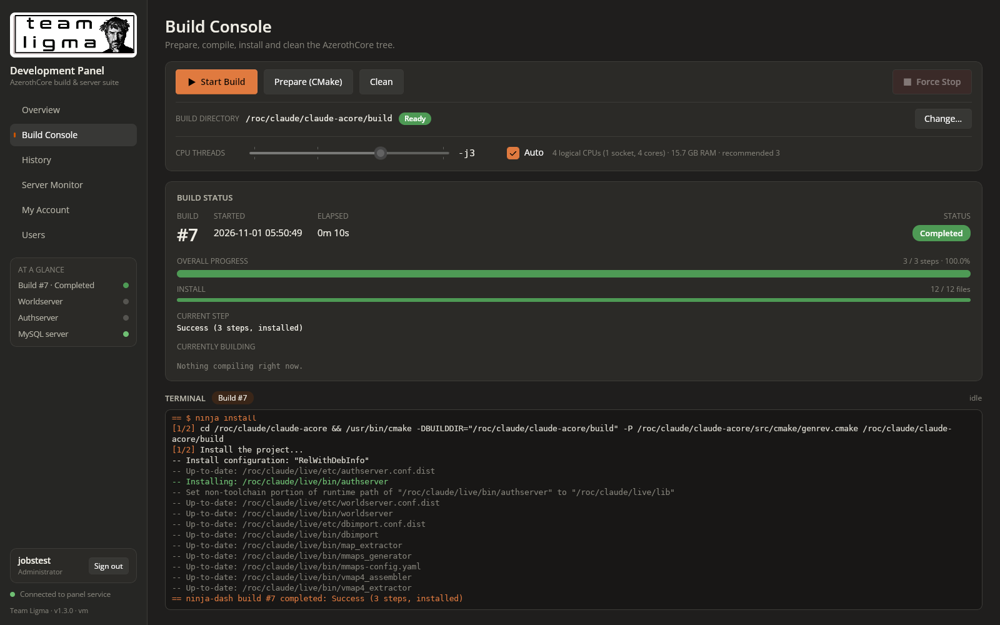
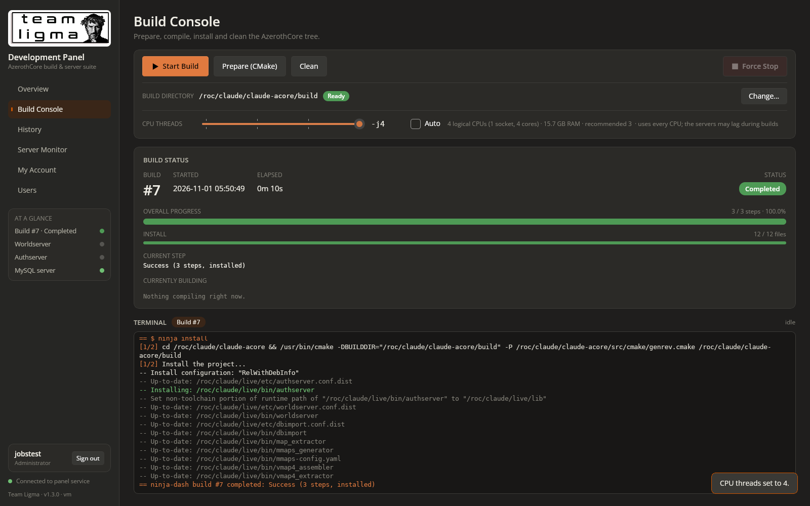

# Prompt
To the "Build Console" tab:

* Add functionality for setting the amount of CPU threads for the build. This should automatically detect and set the appropriate limits for this based on the host's CPU configuration.

# Reponse
Added a CPU threads control to the Build Console (v1.3.0).

**How it works**
- **Detection:** the server reads the host's CPU layout and memory: the logical CPUs the panel may use (honouring CPU affinity and container CPU limits), physical cores, sockets, threads per core, CPU model and RAM.
- **Range:** the slider runs from 1 to the number of logical CPUs.
- **Auto (default):** keeps the configured command, `ninja -j$(( $(nproc) - 1 ))`. On a single-CPU host it uses `-j1`, because `-j0` means unlimited jobs in ninja.
- **Manual:** untick Auto and drag the slider. The value replaces the `-j` argument from the next build on, and the Start Build tooltip shows the exact command.
- **Hints:** the row shows the CPU summary and a recommended value (logical CPUs − 1, capped at about one job per 2 GB of RAM). It warns when the choice exceeds what the RAM can hold, or uses every CPU.
- **Storage:** the setting is saved in `/roc/claude/panel-data/settings.json` and logged in the audit log. Operators and admins only, and not during a build.

**Tested**
- Detection on this host: 4 logical CPUs, 1 socket, 4 cores, 15.7 GB RAM, recommended 3.
- The API rejects 0 and 5 and accepts 1–4. Auto gives the original command.
- Real AzerothCore build #7 with the setting at 2 ran `ninja -j2`, then completed and installed.
- With the backend pinned to one CPU (`taskset -c 0`), auto mode gave `ninja -j1`.
- In the browser: unticking Auto and dragging to the maximum saved `-j4` and showed the all-CPUs warning.

# File Changes
| File | Type | Workspace path | Change |
|---|---|---|---|
| `v130-threads-auto.png` | `Asset` | `Prompts/Team Ligma Development Panel/screenshots/v130-threads-auto.png` | Created |
| `v130-threads-manual.png` | `Asset` | `Prompts/Team Ligma Development Panel/screenshots/v130-threads-manual.png` | Created |
| `README.md` | `Docs` | `README.md` | Changed |
| `Dtos.cs` | `Code` | `src/Shared/Dtos.cs` | Changed |
| `BuildService.cs` | `Code` | `src/TeamLigma.Panel.Server/BuildService.cs` | Changed |
| `CpuTopology.cs` | `Code` | `src/TeamLigma.Panel.Server/CpuTopology.cs` | Created |
| `Program.cs` | `Code` | `src/TeamLigma.Panel.Server/Program.cs` | Changed |
| `TeamLigma.Panel.Server.csproj` | `Config` | `src/TeamLigma.Panel.Server/TeamLigma.Panel.Server.csproj` | Changed |
| `ApiClient.cs` | `Code` | `src/TeamLigma.Panel/TeamLigma.Panel/Services/ApiClient.cs` | Changed |
| `TeamLigma.Panel.csproj` | `Config` | `src/TeamLigma.Panel/TeamLigma.Panel/TeamLigma.Panel.csproj` | Changed |
| `BuildConsoleView.xaml` | `Code` | `src/TeamLigma.Panel/TeamLigma.Panel/Views/BuildConsoleView.xaml` | Changed |
| `BuildConsoleView.xaml.cs` | `Code` | `src/TeamLigma.Panel/TeamLigma.Panel/Views/BuildConsoleView.xaml.cs` | Changed |

Environment: `/roc/claude/panel/` redeployed (v1.3.0); runtime file `/roc/claude/panel-data/settings.json`.

# Code Diffs
### `README.md` (Changed)
```diff
diff --git a/README.md b/README.md
index fc6f70e..667e423 100644
--- a/README.md
+++ b/README.md
@@ -1,7 +1,7 @@
 <p align="center"></p>
 
 # Team Ligma Development Panel
-**Version 1.2.0**
+**Version 1.3.0**
 
 One dark, burnt-orange control room for an AzerothCore test realm. Kick off builds, watch every object compile in real time, look back at old logs, and talk to the Worldserver, Authserver and MySQL from your browser. No SSH session needed.
 
@@ -63,7 +63,7 @@ cd /roc/claude/panel/server && sudo dotnet TeamLigma.Panel.Server.dll user-reset
 
 | Control | Command (cwd = the build directory, default `/roc/claude/claude-acore/build`) |
 |---|---|
-| Start Build | `ninja -j$(( $(nproc) - 1 ))`, then `ninja install` if the build succeeded |
+| Start Build | `ninja -j$(( $(nproc) - 1 ))`, then `ninja install` if the build succeeded. A thread count chosen under **CPU threads** replaces the `-j` value. |
 | Prepare (CMake) | `cmake ../ -G Ninja -DCMAKE_INSTALL_PREFIX=/roc/claude/live/ -DCMAKE_C_COMPILER=/usr/bin/clang -DCMAKE_CXX_COMPILER=/usr/bin/clang++ -DWITH_WARNINGS=0 -DTOOLS_BUILD=all -DSCRIPTS=static -DMODULES=static` |
 | Clean | `ninja -t clean` |
 | Force Stop | Sends SIGTERM to ninja-dash, which stops ninja's process group and records the build as *Stopped* |
@@ -92,6 +92,15 @@ The panel never force-kills `worldserver`, `authserver`, `mysql` or `mysqld`:
 - Authserver: use Ctrl + C.
 - MySQL: type `exit`.
 
+## CPU threads
+The **CPU threads** row in the Build Console sets how many parallel jobs ninja uses. The panel detects the host's CPU layout and memory, and builds the slider range from what it finds.
+- **Range:** 1 up to the number of logical CPUs the panel may use. This respects CPU affinity and container CPU limits.
+- **Auto (default):** runs the configured command unchanged (`ninja -j$(( $(nproc) - 1 ))`), so one CPU stays free for the panel, the servers and MySQL. On a single-CPU host it uses `-j1` instead, because `-j0` would mean unlimited jobs.
+- **Manual:** untick **Auto** and drag the slider. The value replaces the command's `-j` argument from the next build on.
+- **Hints:** the row shows the CPU summary (sockets, cores, threads per core, RAM) and a recommended value: one less than the logical CPUs, capped at roughly one job per 2 GB of RAM. It warns when the setting is above what the RAM can comfortably hold, or uses every CPU.
+
+The choice is saved in `/roc/claude/panel-data/settings.json`. Operators and administrators can change it, but not while a build is running. Each build's record keeps the exact command it ran, so History shows which `-j` was used.
+
 ## ninja-dash
 `tools/ninja-dash` is the wrapper behind **Start Build**. It runs the build command and then the install command through bash, exactly as configured. It mirrors their output to the screen session and records each numbered build under `/roc/claude/panel-data/builds/<n>/`:
 - `status.json`: live phase, step counts, failed targets, result, and the objects currently compiling with elapsed and estimated times. Estimates come from earlier `.ninja_log` timings.
@@ -152,7 +161,7 @@ Over plain HTTP, passwords and session cookies cross the network unencrypted. On
 ## Troubleshooting
 - **"Build directory is not prepared":** run Prepare (CMake) first, or choose the right folder with **Change…**.
 - **"The build did not start: …":** the text after the colon is what `ninja-dash` or `screen` printed. The full output is in the Build Console terminal under *Start Build (failed)*.
-- **On a 1-CPU machine:** `$(( $(nproc) - 1 ))` is 0, and `ninja -j0` means unlimited parallel jobs. Set `BuildCommand` to `ninja -j1` there.
+- **Builds run out of memory (clang killed, "signal 9"):** lower **CPU threads** to the recommended value or below.
 - **A build shows *Interrupted*:** ninja-dash was killed without cleaning up. Start a new build.
 - **A server shows *Session open* but not *Running*:** the program exited inside its screen session. Read its console for the reason, then press Start again after the session closes.
 - **"That code is not valid" for every code:** the server's clock or your phone's clock is wrong. Authenticator codes need both to be within about 30 seconds of the real time.
```

### `src/Shared/Dtos.cs` (Changed)
```diff
diff --git a/src/Shared/Dtos.cs b/src/Shared/Dtos.cs
index b6bd0a4..0f7bebf 100644
--- a/src/Shared/Dtos.cs
+++ b/src/Shared/Dtos.cs
@@ -224,6 +224,13 @@ public sealed class BuildSettings
     public bool SourceFound { get; set; }
     public string BuildCommand { get; set; } = "";
     public string InstallCommand { get; set; } = "";
+    /// <summary>Thread count chosen in the panel, or null for automatic.</summary>
+    public int? Jobs { get; set; }
+    /// <summary>The -j value the next build will use.</summary>
+    public int EffectiveJobs { get; set; }
+    /// <summary>The build command exactly as the next build will run it.</summary>
+    public string EffectiveBuildCommand { get; set; } = "";
+    public CpuInfo Cpu { get; set; } = new();
 }
 
 public sealed class DirEntry
@@ -248,3 +255,26 @@ public sealed class PathRequest
 {
     public string Path { get; set; } = "";
 }
+
+// ---------------- Build CPU threads (v1.3.0) ----------------
+
+public sealed class CpuInfo
+{
+    public string Model { get; set; } = "";
+    public int LogicalCpus { get; set; }
+    public int PhysicalCores { get; set; }
+    public int Sockets { get; set; }
+    public int ThreadsPerCore { get; set; }
+    public long MemTotal { get; set; }
+    /// <summary>Highest job count the RAM comfortably supports (~2 GB per clang job).</summary>
+    public int MemorySafeJobs { get; set; }
+    public int MinJobs { get; set; } = 1;
+    public int MaxJobs { get; set; }
+    public int RecommendedJobs { get; set; }
+}
+
+public sealed class JobsRequest
+{
+    /// <summary>null = automatic (the configured nproc - 1 command).</summary>
+    public int? Jobs { get; set; }
+}
```

### `src/TeamLigma.Panel.Server/BuildService.cs` (Changed)
```diff
diff --git a/src/TeamLigma.Panel.Server/BuildService.cs b/src/TeamLigma.Panel.Server/BuildService.cs
index 7a2b8ba..653a6ae 100644
--- a/src/TeamLigma.Panel.Server/BuildService.cs
+++ b/src/TeamLigma.Panel.Server/BuildService.cs
@@ -18,6 +18,7 @@ public sealed class BuildService
     int _taskSeq;
     DateTimeOffset _lastTaskStart = DateTimeOffset.MinValue;
     string? _buildDirOverride;
+    int? _jobs;
     string SettingsPath => Path.Combine(_o.DataHome, "settings.json");
 
     /// <summary>The active build directory: the one chosen in the panel, else Panel:BuildDir from appsettings.</summary>
@@ -39,8 +40,10 @@ public sealed class BuildService
         {
             if (File.Exists(SettingsPath))
             {
-                var dir = JsonDocument.Parse(File.ReadAllText(SettingsPath)).RootElement.GetProperty("buildDir").GetString();
-                if (!string.IsNullOrWhiteSpace(dir)) _buildDirOverride = dir;
+                var root = JsonDocument.Parse(File.ReadAllText(SettingsPath)).RootElement;
+                if (root.TryGetProperty("buildDir", out var bd) && bd.ValueKind == JsonValueKind.String && !string.IsNullOrWhiteSpace(bd.GetString()))
+                    _buildDirOverride = bd.GetString();
+                if (root.TryGetProperty("jobs", out var j) && j.ValueKind == JsonValueKind.Number) _jobs = j.GetInt32();
             }
         }
         catch (Exception ex) { _log.LogWarning(ex, "Ignoring unreadable {Path}", SettingsPath); }
@@ -54,8 +57,46 @@ public sealed class BuildService
         SourceFound = File.Exists(Path.Combine(Path.GetDirectoryName(BuildDir.TrimEnd('/')) ?? "/", "CMakeLists.txt")),
         BuildCommand = _o.BuildCommand,
         InstallCommand = _o.InstallCommand,
+        Jobs = _jobs,
+        EffectiveJobs = EffectiveJobs(CpuTopology.Detect()),
+        EffectiveBuildCommand = EffectiveBuildCommand(),
+        Cpu = CpuTopology.Detect(),
     };
 
+    void SaveSettings() => File.WriteAllText(SettingsPath, JsonSerializer.Serialize(new { buildDir = _buildDirOverride, jobs = _jobs }, Json));
+
+    // Matches the -j argument of the build command: "-j$(( ... ))", "-j 8" or "-j8".
+    static readonly System.Text.RegularExpressions.Regex JobsArg =
+        new(@"-j\s*(\$\(\(.*?\)\)|\S+)", System.Text.RegularExpressions.RegexOptions.Compiled);
+
+    int EffectiveJobs(CpuInfo cpu) => _jobs is { } j ? Math.Clamp(j, cpu.MinJobs, cpu.MaxJobs) : Math.Max(1, cpu.LogicalCpus - 1);
+
+    /// <summary>The build command for the next build. Automatic mode keeps the configured command
+    /// (except on single-CPU hosts, where nproc - 1 = 0 would mean unlimited jobs); a chosen thread
+    /// count replaces the command's -j argument.</summary>
+    public string EffectiveBuildCommand()
+    {
+        var cmd = Cmd(_o.BuildCommand);
+        if (cmd.Contains("ninja-dash")) return cmd; // legacy launch line, used verbatim
+        var cpu = CpuTopology.Detect();
+        if (_jobs == null && cpu.LogicalCpus > 1) return cmd;
+        var jobs = EffectiveJobs(cpu);
+        return JobsArg.IsMatch(cmd) ? JobsArg.Replace(cmd, $"-j{jobs}", 1) : $"{cmd} -j{jobs}";
+    }
+
+    public ActionResult SetJobs(int? jobs)
+    {
+        if (Running() is { } r) return Fail($"Build #{r.Id} is running; the thread count applies from the next build. Stop it first to change now.");
+        var cpu = CpuTopology.Detect();
+        if (jobs is { } j && (j < cpu.MinJobs || j > cpu.MaxJobs))
+            return Fail($"Choose between {cpu.MinJobs} and {cpu.MaxJobs} threads (this host has {cpu.LogicalCpus} logical CPUs).");
+        _jobs = jobs;
+        SaveSettings();
+        if (jobs == null) return Ok($"CPU threads set to automatic ({EffectiveJobs(cpu)}).");
+        var warn = jobs > cpu.MemorySafeJobs ? $" Warning: {jobs} jobs may exceed RAM ({cpu.MemTotal / 1024 / 1024 / 1024} GB; about {cpu.MemorySafeJobs} is safe)." : "";
+        return Ok($"CPU threads set to {jobs}.{warn}");
+    }
+
     static string Quote(string s) => "'" + s.Replace("'", "'\\''") + "'";
 
     /// <summary>The shell line that starts a build: the configured build/install commands run, verbatim,
@@ -63,7 +104,7 @@ public sealed class BuildService
     /// A BuildCommand that already names ninja-dash (pre-1.2 configs) is used as-is.</summary>
     string LaunchCommand()
     {
-        var build = Cmd(_o.BuildCommand);
+        var build = EffectiveBuildCommand();
         if (build.Contains("ninja-dash")) return build;
         return $"screen -dmS build ninja-dash {Quote(BuildDir)} --build-cmd {Quote(build)}" +
                (string.IsNullOrWhiteSpace(_o.InstallCommand) ? "" : $" --install-cmd {Quote(Cmd(_o.InstallCommand))}");
@@ -78,7 +119,7 @@ public sealed class BuildService
         if (Running() is { } r) return Fail($"Build #{r.Id} is running; stop it before changing the build directory.");
         if (TaskRunning) return Fail($"Wait for '{Task.Name}' to finish first.");
         _buildDirOverride = full == _o.BuildDir.TrimEnd('/') ? null : full;
-        File.WriteAllText(SettingsPath, JsonSerializer.Serialize(new { buildDir = _buildDirOverride }, Json));
+        SaveSettings();
         var s = Settings();
         var note = s.Ready ? "Ready to build." : s.SourceFound ? "Run Prepare (CMake) before building." : "Warning: no CMakeLists.txt in the parent folder, so Prepare ('cmake ../') will not find the source.";
         return Ok($"Build directory set to {full}. {note}");
```

### `src/TeamLigma.Panel.Server/CpuTopology.cs` (Created)
```diff
diff --git a/src/TeamLigma.Panel.Server/CpuTopology.cs b/src/TeamLigma.Panel.Server/CpuTopology.cs
new file mode 100644
index 0000000..b431a8d
--- /dev/null
+++ b/src/TeamLigma.Panel.Server/CpuTopology.cs
@@ -0,0 +1,61 @@
+using TeamLigma.Shared;
+
+namespace TeamLigma.Panel.Server;
+
+/// <summary>Detects the host CPU layout and derives sensible build job limits.</summary>
+public static class CpuTopology
+{
+    const long BytesPerJob = 2L * 1024 * 1024 * 1024; // clang on AzerothCore peaks around 1.5-2 GB per job
+
+    public static CpuInfo Detect()
+    {
+        // Logical CPUs this process may actually use (honours affinity and cgroup CPU quotas).
+        var logical = Math.Max(1, Environment.ProcessorCount);
+        var info = new CpuInfo { LogicalCpus = logical, MaxJobs = logical };
+        try
+        {
+            string? model = null;
+            var cores = new HashSet<(string, string)>();
+            var sockets = new HashSet<string>();
+            string physical = "0", core = "0";
+            foreach (var line in File.ReadLines("/proc/cpuinfo"))
+            {
+                var parts = line.Split(':', 2);
+                if (parts.Length != 2) continue;
+                var key = parts[0].Trim();
+                var val = parts[1].Trim();
+                switch (key)
+                {
+                    case "model name": model ??= val; break;
+                    case "physical id": physical = val; sockets.Add(val); break;
+                    case "core id": core = val; cores.Add((physical, core)); break;
+                }
+            }
+            info.Model = model ?? "Unknown CPU";
+            info.Sockets = Math.Max(1, sockets.Count);
+            info.PhysicalCores = cores.Count > 0 ? cores.Count : logical;
+        }
+        catch
+        {
+            info.Model = "Unknown CPU";
+            info.Sockets = 1;
+            info.PhysicalCores = logical;
+        }
+        var online = Environment.ProcessorCount; // threads per core from the whole machine's view
+        try { online = Math.Max(online, File.ReadLines("/proc/cpuinfo").Count(l => l.StartsWith("processor"))); } catch { }
+        info.ThreadsPerCore = Math.Max(1, (int)Math.Round((double)online / Math.Max(1, info.PhysicalCores)));
+        // Only cap physical cores at what we can use when a quota restricts us.
+        info.PhysicalCores = Math.Min(info.PhysicalCores, logical);
+
+        try
+        {
+            var memLine = File.ReadLines("/proc/meminfo").First(l => l.StartsWith("MemTotal:"));
+            info.MemTotal = long.Parse(memLine.Split(' ', StringSplitOptions.RemoveEmptyEntries)[1]) * 1024;
+        }
+        catch { }
+        info.MemorySafeJobs = info.MemTotal > 0 ? (int)Math.Clamp(info.MemTotal / BytesPerJob, 1, logical) : logical;
+        // Leave one CPU for the panel, servers and MySQL (the nproc - 1 rule), and stay inside RAM.
+        info.RecommendedJobs = Math.Max(1, Math.Min(logical - 1, info.MemorySafeJobs));
+        return info;
+    }
+}
```

### `src/TeamLigma.Panel.Server/Program.cs` (Changed)
```diff
diff --git a/src/TeamLigma.Panel.Server/Program.cs b/src/TeamLigma.Panel.Server/Program.cs
index 43e2d39..d69e937 100644
--- a/src/TeamLigma.Panel.Server/Program.cs
+++ b/src/TeamLigma.Panel.Server/Program.cs
@@ -153,6 +153,7 @@ op.MapPost("/build/stop", async (HttpContext ctx, BuildService b, AuthService a)
 op.MapPost("/build/configure", (HttpContext ctx, BuildService b, AuthService a) => Logged(ctx, a, "prepare (cmake)", b.Configure()));
 op.MapPost("/build/clean", (HttpContext ctx, BuildService b, AuthService a) => Logged(ctx, a, "clean", b.Clean()));
 op.MapPost("/build/directory", (HttpContext ctx, PathRequest r, BuildService b, AuthService a) => Logged(ctx, a, $"set build directory {r.Path}", b.SetBuildDir(r.Path)));
+op.MapPost("/build/jobs", (HttpContext ctx, JobsRequest r, BuildService b, AuthService a) => Logged(ctx, a, $"set build threads {(r.Jobs?.ToString() ?? "auto")}", b.SetJobs(r.Jobs)));
 op.MapGet("/fs/dirs", (string? path, BuildService b) => DirBrowser.List(string.IsNullOrWhiteSpace(path) ? b.BuildDir : path));
 op.MapPost("/fs/mkdir", (HttpContext ctx, PathRequest r, AuthService a) => Logged(ctx, a, $"create folder {r.Path}", DirBrowser.Create(r.Path)));
 op.MapPost("/servers/{name}/start", async (HttpContext ctx, string name, ConsoleService c, AuthService a) => Logged(ctx, a, $"start {name}", await c.StartAsync(name)));
```

### `src/TeamLigma.Panel.Server/TeamLigma.Panel.Server.csproj` (Changed)
```diff
diff --git a/src/TeamLigma.Panel.Server/TeamLigma.Panel.Server.csproj b/src/TeamLigma.Panel.Server/TeamLigma.Panel.Server.csproj
index 43e550e..da6cfe9 100644
--- a/src/TeamLigma.Panel.Server/TeamLigma.Panel.Server.csproj
+++ b/src/TeamLigma.Panel.Server/TeamLigma.Panel.Server.csproj
@@ -4,7 +4,7 @@
     <Nullable>enable</Nullable>
     <ImplicitUsings>enable</ImplicitUsings>
     <RootNamespace>TeamLigma.Panel.Server</RootNamespace>
-    <Version>1.2.0</Version>
+    <Version>1.3.0</Version>
   </PropertyGroup>
   <ItemGroup>
     <Compile Include="../Shared/Dtos.cs" Link="Shared/Dtos.cs" />
```

### `src/TeamLigma.Panel/TeamLigma.Panel/Services/ApiClient.cs` (Changed)
```diff
diff --git a/src/TeamLigma.Panel/TeamLigma.Panel/Services/ApiClient.cs b/src/TeamLigma.Panel/TeamLigma.Panel/Services/ApiClient.cs
index 48b213f..c2ff8f1 100644
--- a/src/TeamLigma.Panel/TeamLigma.Panel/Services/ApiClient.cs
+++ b/src/TeamLigma.Panel/TeamLigma.Panel/Services/ApiClient.cs
@@ -28,6 +28,7 @@ namespace TeamLigma.Panel.Services;
 [JsonSerializable(typeof(BuildSettings))]
 [JsonSerializable(typeof(DirListing))]
 [JsonSerializable(typeof(PathRequest))]
+[JsonSerializable(typeof(JobsRequest))]
 internal partial class PanelJson : JsonSerializerContext { }
 
 /// <summary>Thin client for the panel backend (same origin, proxied by nginx under /api).</summary>
@@ -154,6 +155,8 @@ public sealed class ApiClient
         => Get($"api/fs/dirs?path={Uri.EscapeDataString(path ?? "")}", PanelJson.Default.DirListing);
     public Task<ActionResult> SetBuildDirAsync(string path)
         => PostBody("api/build/directory", new PathRequest { Path = path }, PanelJson.Default.PathRequest);
+    public Task<ActionResult> SetJobsAsync(int? jobs)
+        => PostBody("api/build/jobs", new JobsRequest { Jobs = jobs }, PanelJson.Default.JobsRequest);
     public Task<ActionResult> MakeDirAsync(string path)
         => PostBody("api/fs/mkdir", new PathRequest { Path = path }, PanelJson.Default.PathRequest);
```

### `src/TeamLigma.Panel/TeamLigma.Panel/TeamLigma.Panel.csproj` (Changed)
```diff
diff --git a/src/TeamLigma.Panel/TeamLigma.Panel/TeamLigma.Panel.csproj b/src/TeamLigma.Panel/TeamLigma.Panel/TeamLigma.Panel.csproj
index 10ab6cc..9782369 100644
--- a/src/TeamLigma.Panel/TeamLigma.Panel/TeamLigma.Panel.csproj
+++ b/src/TeamLigma.Panel/TeamLigma.Panel/TeamLigma.Panel.csproj
@@ -5,11 +5,11 @@
     <UnoSingleProject>true</UnoSingleProject>
     <ApplicationTitle>Team Ligma Development Panel</ApplicationTitle>
     <ApplicationId>com.teamligma.devpanel</ApplicationId>
-    <ApplicationDisplayVersion>1.2.0</ApplicationDisplayVersion>
+    <ApplicationDisplayVersion>1.3.0</ApplicationDisplayVersion>
     <ApplicationVersion>1</ApplicationVersion>
     <ApplicationPublisher>Team Ligma</ApplicationPublisher>
     <Description>Team Ligma Development Panel - AzerothCore build and server console suite.</Description>
-    <Version>1.2.0</Version>
+    <Version>1.3.0</Version>
     <UnoFeatures>
       Mvvm;
       SkiaRenderer;
```

### `src/TeamLigma.Panel/TeamLigma.Panel/Views/BuildConsoleView.xaml` (Changed)
```diff
diff --git a/src/TeamLigma.Panel/TeamLigma.Panel/Views/BuildConsoleView.xaml b/src/TeamLigma.Panel/TeamLigma.Panel/Views/BuildConsoleView.xaml
index ddbd5ab..7b6bba3 100644
--- a/src/TeamLigma.Panel/TeamLigma.Panel/Views/BuildConsoleView.xaml
+++ b/src/TeamLigma.Panel/TeamLigma.Panel/Views/BuildConsoleView.xaml
@@ -64,6 +64,24 @@
         <Button x:Name="BrowseButton" Grid.Column="2" Height="32" Padding="14,0" VerticalContentAlignment="Center" Content="Change…" Click="OnBrowse"
                 ToolTipService.ToolTip="Pick the Ninja build directory on the server" />
       </Grid>
+      <Grid ColumnSpacing="14" BorderBrush="{StaticResource TlCardBorder}" BorderThickness="0,1,0,0" Padding="0,10,0,0">
+        <Grid.ColumnDefinitions>
+          <ColumnDefinition Width="Auto" />
+          <ColumnDefinition Width="320" />
+          <ColumnDefinition Width="Auto" />
+          <ColumnDefinition Width="Auto" />
+          <ColumnDefinition Width="*" />
+        </Grid.ColumnDefinitions>
+        <TextBlock Style="{StaticResource TlLabel}" Text="CPU THREADS" VerticalAlignment="Center" Width="104" />
+        <Slider x:Name="JobsSlider" Grid.Column="1" Minimum="1" Maximum="4" StepFrequency="1" TickFrequency="1"
+                TickPlacement="Outside" SnapsTo="Ticks" VerticalAlignment="Center" ValueChanged="OnJobsChanged" />
+        <TextBlock x:Name="JobsValue" Grid.Column="2" FontFamily="{StaticResource TlMono}" FontSize="15" FontWeight="SemiBold"
+                   Foreground="{StaticResource TlText}" VerticalAlignment="Center" MinWidth="64" Text="-j?" />
+        <CheckBox x:Name="JobsAuto" Grid.Column="3" Content="Auto" VerticalAlignment="Center" MinWidth="0"
+                  Checked="OnJobsAutoChanged" Unchecked="OnJobsAutoChanged"
+                  ToolTipService.ToolTip="Automatic: one less than the number of logical CPUs (ninja -j$(( $(nproc) - 1 )))" />
+        <TextBlock x:Name="CpuInfoText" Grid.Column="4" Style="{StaticResource TlLabel}" VerticalAlignment="Center" TextWrapping="Wrap" />
+      </Grid>
       </StackPanel>
     </Border>
```

### `src/TeamLigma.Panel/TeamLigma.Panel/Views/BuildConsoleView.xaml.cs` (Changed)
```diff
diff --git a/src/TeamLigma.Panel/TeamLigma.Panel/Views/BuildConsoleView.xaml.cs b/src/TeamLigma.Panel/TeamLigma.Panel/Views/BuildConsoleView.xaml.cs
index a5715c5..2e5dc4b 100644
--- a/src/TeamLigma.Panel/TeamLigma.Panel/Views/BuildConsoleView.xaml.cs
+++ b/src/TeamLigma.Panel/TeamLigma.Panel/Views/BuildConsoleView.xaml.cs
@@ -15,6 +15,7 @@ public sealed partial class BuildConsoleView : UserControl, IPanelPage
     {
         InitializeComponent();
         _timer.Tick += async (_, _) => await PollConsole();
+        _jobsSave.Tick += async (_, _) => await SaveJobs();
     }
 
     public void SetActive(bool active)
@@ -37,6 +38,8 @@ public sealed partial class BuildConsoleView : UserControl, IPanelPage
         CleanButton.IsEnabled = can && !building && !taskRunning;
         StopButton.IsEnabled = can && building;
         BrowseButton.IsEnabled = can && !building && !taskRunning;
+        JobsSlider.IsEnabled = can && !building && JobsAuto.IsChecked != true;
+        JobsAuto.IsEnabled = can && !building;
         if (++_settingsTick % 5 == 0) _ = RefreshBuildDir(); // a Prepare run can make the directory ready
         TaskText.Text = !can ? "Read-only: your role can watch builds but not run them."
             : taskRunning ? $"Running: {o.Task.Name}…"
@@ -58,12 +61,71 @@ public sealed partial class BuildConsoleView : UserControl, IPanelPage
             : ("No source in parent", Windows.UI.Color.FromArgb(255, 0xC8, 0x40, 0x3A));
         BuildDirState.Text = text;
         BuildDirPill.Background = new Microsoft.UI.Xaml.Media.SolidColorBrush(color);
-        ToolTipService.SetToolTip(StartButton, $"In {s.BuildDir}:\n  {s.BuildCommand}\n  then {s.InstallCommand}");
+        ToolTipService.SetToolTip(StartButton, $"In {s.BuildDir}:\n  {s.EffectiveBuildCommand}\n  then {s.InstallCommand}");
+        ShowJobs(s);
         ToolTipService.SetToolTip(BuildDirPill, s.Ready ? "build.ninja found: Start Build will work."
             : s.SourceFound ? "No build.ninja yet: run Prepare (CMake) first."
             : "The parent folder has no CMakeLists.txt, so Prepare ('cmake ../') will not find the AzerothCore source.");
     }
 
+    bool _updatingJobs;
+    readonly DispatcherTimer _jobsSave = new() { Interval = TimeSpan.FromMilliseconds(600) };
+
+    void ShowJobs(BuildSettings s)
+    {
+        if (_jobsSave.IsEnabled) return; // don't fight the user while a change is pending
+        var cpu = s.Cpu;
+        _updatingJobs = true;
+        JobsSlider.Minimum = cpu.MinJobs;
+        JobsSlider.Maximum = Math.Max(cpu.MinJobs + 0.0001, cpu.MaxJobs); // a 1-CPU host still gets a valid range
+        JobsSlider.Value = s.EffectiveJobs;
+        JobsAuto.IsChecked = s.Jobs == null;
+        JobsSlider.IsEnabled = Session.CanOperate && s.Jobs != null;
+        _updatingJobs = false;
+        UpdateJobsText(s.EffectiveJobs);
+    }
+
+    void UpdateJobsText(int jobs)
+    {
+        JobsValue.Text = $"-j{jobs}";
+        var cpu = _settings?.Cpu;
+        if (cpu == null) return;
+        var smt = cpu.ThreadsPerCore > 1 ? $" × {cpu.ThreadsPerCore} threads" : "";
+        var ram = cpu.MemTotal / 1024.0 / 1024 / 1024;
+        var line = $"{cpu.LogicalCpus} logical CPUs ({cpu.Sockets} socket{(cpu.Sockets > 1 ? "s" : "")}, {cpu.PhysicalCores} cores{smt}) · {ram:0.#} GB RAM · recommended {cpu.RecommendedJobs}";
+        if (jobs > cpu.MemorySafeJobs) line += $"  ⚠ above the ~{cpu.MemorySafeJobs} jobs RAM can hold";
+        else if (jobs >= cpu.LogicalCpus && cpu.LogicalCpus > 1) line += "  · uses every CPU; the servers may lag during builds";
+        CpuInfoText.Text = line;
+        CpuInfoText.Foreground = (Microsoft.UI.Xaml.Media.Brush)Application.Current.Resources[jobs > cpu.MemorySafeJobs ? "TlAccent" : "TlTextMuted"];
+        ToolTipService.SetToolTip(CpuInfoText, cpu.Model);
+    }
+
+    void OnJobsChanged(object sender, Microsoft.UI.Xaml.Controls.Primitives.RangeBaseValueChangedEventArgs e)
+    {
+        var jobs = (int)Math.Round(e.NewValue);
+        UpdateJobsText(jobs);
+        if (_updatingJobs) return;
+        _jobsSave.Stop();
+        _jobsSave.Start(); // save once the slider settles
+    }
+
+    async void OnJobsAutoChanged(object sender, RoutedEventArgs e)
+    {
+        if (_updatingJobs) return;
+        var auto = JobsAuto.IsChecked == true;
+        JobsSlider.IsEnabled = !auto && Session.CanOperate;
+        _jobsSave.Stop();
+        Shell.Notify(await ApiClient.Instance.SetJobsAsync(auto ? null : (int)Math.Round(JobsSlider.Value)));
+        await RefreshBuildDir();
+    }
+
+    async Task SaveJobs()
+    {
+        _jobsSave.Stop();
+        Shell.Notify(await ApiClient.Instance.SetJobsAsync((int)Math.Round(JobsSlider.Value)));
+        await RefreshBuildDir();
+    }
+
     async void OnBrowse(object sender, RoutedEventArgs e)
     {
         var picker = new DirectoryPicker(_settings?.BuildDir);
```

# Image Assets

`Prompts/Team Ligma Development Panel/screenshots/v130-threads-auto.png` (CPU threads in Auto mode, sanity-test capture)


`Prompts/Team Ligma Development Panel/screenshots/v130-threads-manual.png` (CPU threads set manually to the maximum, sanity-test capture)

