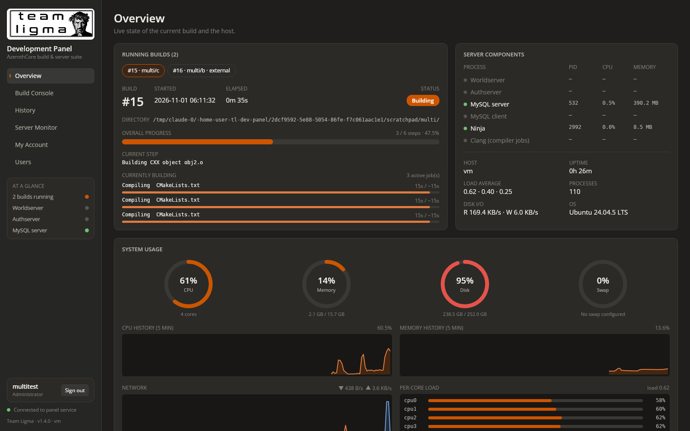
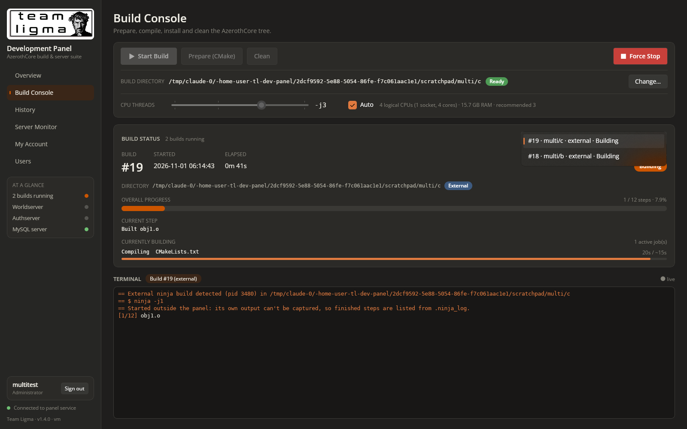
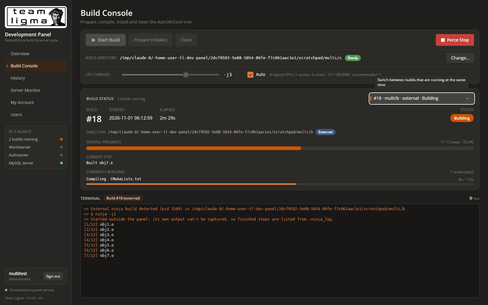

# Prompt
Feature addition:

* The panel should be able to detect a running ninja builds
   * This adds them to the "History" tab
   * The "Overview" tab > "Current Build" section should have tabs to switch which build is being displayed, for when multiple are running.
   * The "Build Console" tab should have a drop down on the page, to change between concurrently running builds

# Reponse
Added detection of external ninja builds and support for several builds running at once (v1.4.0).

**What it does**
- **Detection:** a background monitor finds `ninja` processes the panel didn't start, such as one run over SSH, and records each one in History as a numbered build tagged *external*.
- **Progress for external builds:**
  - finished steps come from `.ninja_log` and are listed live in the terminal;
  - currently compiling objects come from the process tree;
  - the exact total comes from a dry run every 10 s, isolated in a private mount namespace over *copies* of `.ninja_log`/`.ninja_deps`, so it can't damage the running build. Where mount namespaces aren't allowed, it falls back to a labelled estimate.
- **Outcome for external builds:** *Completed* or *Failed*, worked out after exit with `ninja -n -d explain`. Steps that are out of date by design, like AzerothCore's revision header, are ignored. External exit codes can't be read.
- **Concurrency:** builds can run at the same time in different directories. Start, Prepare and Clean are refused only when a build is running in the current directory. Each panel build gets its own screen session.
- **Overview:** shows a tab per running build.
- **Build Console:** has a dropdown to switch between running builds, sharing its selection with the Overview tabs. Force Stop acts on the selected build; for external builds it sends SIGTERM.

**Tested**
- Two external builds (a real AzerothCore rebuild and a test project) were detected while a third build was started from the panel in another directory. Start was correctly refused in the busy AzerothCore directory.
- Exact live totals were shown for external builds, and the dry run left `.ninja_deps` unchanged (checksum).
- Outcomes: a successful AzerothCore build was recorded as completed, and a project with a failing step as failed.
- The Overview tabs, the dropdown switch, the synced selection, and Force Stop of external builds (recorded as *Stopped from the panel*, no leftover processes) all work.

**Bugs found and fixed during testing:**
- The always-run revision step made successful builds look failed.
- Multi-output steps were double counted.
- Projects without `.ninja_deps` only ever got an estimated total.

# File Changes
| File | Type | Workspace path | Change |
|---|---|---|---|
| `v140-console-dropdown.png` | `Asset` | `Prompts/Team Ligma Development Panel/screenshots/v140-console-dropdown.png` | Created |
| `v140-console-switched.png` | `Asset` | `Prompts/Team Ligma Development Panel/screenshots/v140-console-switched.png` | Created |
| `v140-overview-tabs.png` | `Asset` | `Prompts/Team Ligma Development Panel/screenshots/v140-overview-tabs.png` | Created |
| `README.md` | `Docs` | `README.md` | Changed |
| `Dtos.cs` | `Code` | `src/Shared/Dtos.cs` | Changed |
| `BuildService.cs` | `Code` | `src/TeamLigma.Panel.Server/BuildService.cs` | Changed |
| `ExternalBuildMonitor.cs` | `Code` | `src/TeamLigma.Panel.Server/ExternalBuildMonitor.cs` | Created |
| `Program.cs` | `Code` | `src/TeamLigma.Panel.Server/Program.cs` | Changed |
| `Shell.cs` | `Code` | `src/TeamLigma.Panel.Server/Shell.cs` | Changed |
| `TeamLigma.Panel.Server.csproj` | `Config` | `src/TeamLigma.Panel.Server/TeamLigma.Panel.Server.csproj` | Changed |
| `ApiClient.cs` | `Code` | `src/TeamLigma.Panel/TeamLigma.Panel/Services/ApiClient.cs` | Changed |
| `BuildSelection.cs` | `Code` | `src/TeamLigma.Panel/TeamLigma.Panel/Services/BuildSelection.cs` | Created |
| `TeamLigma.Panel.csproj` | `Config` | `src/TeamLigma.Panel/TeamLigma.Panel/TeamLigma.Panel.csproj` | Changed |
| `BuildConsoleView.xaml` | `Code` | `src/TeamLigma.Panel/TeamLigma.Panel/Views/BuildConsoleView.xaml` | Changed |
| `BuildConsoleView.xaml.cs` | `Code` | `src/TeamLigma.Panel/TeamLigma.Panel/Views/BuildConsoleView.xaml.cs` | Changed |
| `BuildDash.xaml` | `Code` | `src/TeamLigma.Panel/TeamLigma.Panel/Views/BuildDash.xaml` | Changed |
| `BuildDash.xaml.cs` | `Code` | `src/TeamLigma.Panel/TeamLigma.Panel/Views/BuildDash.xaml.cs` | Changed |
| `HistoryView.xaml.cs` | `Code` | `src/TeamLigma.Panel/TeamLigma.Panel/Views/HistoryView.xaml.cs` | Changed |
| `OverviewView.xaml` | `Code` | `src/TeamLigma.Panel/TeamLigma.Panel/Views/OverviewView.xaml` | Changed |
| `OverviewView.xaml.cs` | `Code` | `src/TeamLigma.Panel/TeamLigma.Panel/Views/OverviewView.xaml.cs` | Changed |
| `Shell.xaml.cs` | `Code` | `src/TeamLigma.Panel/TeamLigma.Panel/Views/Shell.xaml.cs` | Changed |
| `ninja-dash` | `Code` | `tools/ninja-dash` | Changed |

Environment: `/roc/claude/panel/` redeployed (v1.4.0); `/usr/local/bin/ninja-dash` updated; runtime file `/roc/claude/panel-data/settings.json`.

# Code Diffs
### `README.md` (Changed)
```diff
diff --git a/README.md b/README.md
index 667e423..2815b7c 100644
--- a/README.md
+++ b/README.md
@@ -1,7 +1,7 @@
 <p align="center"></p>
 
 # Team Ligma Development Panel
-**Version 1.3.0**
+**Version 1.4.0**
 
 One dark, burnt-orange control room for an AzerothCore test realm. Kick off builds, watch every object compile in real time, look back at old logs, and talk to the Worldserver, Authserver and MySQL from your browser. No SSH session needed.
 
@@ -92,6 +92,25 @@ The panel never force-kills `worldserver`, `authserver`, `mysql` or `mysqld`:
 - Authserver: use Ctrl + C.
 - MySQL: type `exit`.
 
+## Concurrent and external builds
+The panel also notices ninja builds it didn't start, such as `ninja` run in an SSH terminal. Each one is added to **History** as a numbered build tagged *external*, alongside the panel's own builds.
+
+- **Detection:** every 2 seconds the panel scans for `ninja` processes in a directory containing `build.ninja`. It skips its own builds, `ninja -t …` tools, `ninja -n` dry runs, and CMake's configure-time test builds under `CMakeFiles/`.
+- **Progress:** an external build's terminal output belongs to the terminal that started it, so the panel can't show it. Instead:
+  - finished steps are read from `.ninja_log` (ninja writes a line as each step completes) and listed live in the Build Console terminal;
+  - the objects currently compiling come from the process tree;
+  - the step total comes from a dry run every 10 seconds. That dry run runs in a private mount namespace with *copies* of `.ninja_log` and `.ninja_deps` mounted over the originals, because a plain `ninja -n` can truncate a half-written `.ninja_deps` record and damage the running build. On hosts that don't allow mount namespaces, the total falls back to an estimate (all commands, not just out-of-date ones), labelled "of up to N steps (estimate)".
+  - Steps that finished before the panel spotted the build (normally only the first second or two) aren't counted.
+- **Outcome:** an external build's exit code can't be read by another process, so when it ends the panel checks which outputs are still out of date with `ninja -n -d explain`:
+  - none left: *Completed*;
+  - some left: *Failed* ("Ended with N output(s) still out of date").
+  - Steps that are out of date by design are ignored, such as AzerothCore's revision header, which is regenerated on every build.
+- **Several builds at once:** builds can run concurrently in *different* directories. Start, Prepare and Clean are refused only when a build (panel or external) is already running in the current build directory, because two ninjas in one tree corrupt each other's state.
+  - **Overview:** shows a tab per running build.
+  - **Build Console:** has a dropdown to switch the status and terminal between them.
+  - Both share the same selection.
+- **Force Stop:** acts on the selected build. An external build is sent SIGTERM (like Ctrl + C in its terminal) and recorded as *Stopped from the panel*.
+
 ## CPU threads
 The **CPU threads** row in the Build Console sets how many parallel jobs ninja uses. The panel detects the host's CPU layout and memory, and builds the slider range from what it finds.
 - **Range:** 1 up to the number of logical CPUs the panel may use. This respects CPU affinity and container CPU limits.
```

### `src/Shared/Dtos.cs` (Changed)
```diff
diff --git a/src/Shared/Dtos.cs b/src/Shared/Dtos.cs
index 0f7bebf..2f9f074 100644
--- a/src/Shared/Dtos.cs
+++ b/src/Shared/Dtos.cs
@@ -18,6 +18,11 @@ public sealed class BuildStatus
 {
     public int Id { get; set; }
     public int? Pid { get; set; }
+    /// <summary>"panel" or "external" (see BuildSources).</summary>
+    public string Source { get; set; } = BuildSources.Panel;
+    public string? BuildDir { get; set; }
+    /// <summary>True when Total is an estimate (external builds: total commands, not just out-of-date ones).</summary>
+    public bool TotalIsEstimate { get; set; }
     public string Phase { get; set; } = "unknown";   // building|installing|completed|failed|stopped|interrupted
     public string Step { get; set; } = "";
     public string? Command { get; set; }
@@ -107,6 +112,8 @@ public sealed class TaskState
 public sealed class Overview
 {
     public BuildStatus? Build { get; set; }
+    /// <summary>All builds running right now (panel and external), newest first.</summary>
+    public List<BuildStatus> Running { get; set; } = new();
     public SystemSnapshot System { get; set; } = new();
     public List<ServerStatus> Servers { get; set; } = new();
     public TaskState Task { get; set; } = new();
@@ -278,3 +285,13 @@ public sealed class JobsRequest
     /// <summary>null = automatic (the configured nproc - 1 command).</summary>
     public int? Jobs { get; set; }
 }
+
+// ---------------- Concurrent / external builds (v1.4.0) ----------------
+
+public static class BuildSources
+{
+    /// <summary>Started from the panel (Start Build, through ninja-dash).</summary>
+    public const string Panel = "panel";
+    /// <summary>A ninja process started outside the panel, detected and observed by it.</summary>
+    public const string External = "external";
+}
```

### `src/TeamLigma.Panel.Server/BuildService.cs` (Changed)
```diff
diff --git a/src/TeamLigma.Panel.Server/BuildService.cs b/src/TeamLigma.Panel.Server/BuildService.cs
index 653a6ae..e974533 100644
--- a/src/TeamLigma.Panel.Server/BuildService.cs
+++ b/src/TeamLigma.Panel.Server/BuildService.cs
@@ -86,7 +86,6 @@ public sealed class BuildService
 
     public ActionResult SetJobs(int? jobs)
     {
-        if (Running() is { } r) return Fail($"Build #{r.Id} is running; the thread count applies from the next build. Stop it first to change now.");
         var cpu = CpuTopology.Detect();
         if (jobs is { } j && (j < cpu.MinJobs || j > cpu.MaxJobs))
             return Fail($"Choose between {cpu.MinJobs} and {cpu.MaxJobs} threads (this host has {cpu.LogicalCpus} logical CPUs).");
@@ -106,7 +105,7 @@ public sealed class BuildService
     {
         var build = EffectiveBuildCommand();
         if (build.Contains("ninja-dash")) return build;
-        return $"screen -dmS build ninja-dash {Quote(BuildDir)} --build-cmd {Quote(build)}" +
+        return $"screen -dmS {SessionFor(BuildDir)} ninja-dash {Quote(BuildDir)} --build-cmd {Quote(build)}" +
                (string.IsNullOrWhiteSpace(_o.InstallCommand) ? "" : $" --install-cmd {Quote(Cmd(_o.InstallCommand))}");
     }
 
@@ -116,7 +115,6 @@ public sealed class BuildService
         var full = Path.GetFullPath(path).TrimEnd('/');
         if (full.Length == 0) full = "/";
         if (!Directory.Exists(full)) return Fail($"{full} does not exist.");
-        if (Running() is { } r) return Fail($"Build #{r.Id} is running; stop it before changing the build directory.");
         if (TaskRunning) return Fail($"Wait for '{Task.Name}' to finish first.");
         _buildDirOverride = full == _o.BuildDir.TrimEnd('/') ? null : full;
         SaveSettings();
@@ -164,7 +162,8 @@ public sealed class BuildService
         {
             var s = JsonSerializer.Deserialize<BuildStatus>(File.ReadAllText(path), Json);
             if (s == null) return null;
-            if (s.Phase is "building" or "installing" && !Shell.IsNinjaDash(s.Pid))
+            var alive = s.Source == BuildSources.External ? Shell.IsProcess(s.Pid, "ninja") : Shell.IsNinjaDash(s.Pid);
+            if (s.Phase is "building" or "installing" && !alive)
             {
                 s.Phase = "interrupted";
                 s.Result ??= "Build process ended unexpectedly";
@@ -184,9 +183,62 @@ public sealed class BuildService
         return list.OrderByDescending(b => b.Started ?? DateTimeOffset.MinValue).ThenByDescending(b => b.Id).ToList();
     }
 
-    public BuildStatus? Running() => All().FirstOrDefault(b => b.Phase is "building" or "installing");
+    public static bool IsActive(BuildStatus b) => b.Phase is "building" or "installing";
+
+    /// <summary>Every running build (panel and external), newest first.</summary>
+    public List<BuildStatus> RunningAll() => All().Where(IsActive).ToList();
+
+    /// <summary>The most recent running build, if any.</summary>
+    public BuildStatus? Running() => RunningAll().FirstOrDefault();
+
+    /// <summary>A build running in the given directory: two ninjas in one tree corrupt each other's state.</summary>
+    public BuildStatus? RunningIn(string dir)
+    {
+        var target = Normalize(dir);
+        return RunningAll().FirstOrDefault(b => b.BuildDir != null && Normalize(b.BuildDir) == target);
+    }
+
+    static string Normalize(string dir)
+    {
+        try { dir = Path.GetFullPath(dir); } catch { }
+        try { var real = new DirectoryInfo(dir).ResolveLinkTarget(true); if (real != null) dir = real.FullName; } catch { }
+        return dir.TrimEnd('/');
+    }
+
     public BuildStatus? Current() => Running() ?? All().FirstOrDefault();
 
+    /// <summary>Screen session name for a panel build in a directory, so builds in different directories don't collide.</summary>
+    public static string SessionFor(string dir)
+        => "build-" + Convert.ToHexString(System.Security.Cryptography.SHA1.HashData(System.Text.Encoding.UTF8.GetBytes(Normalize(dir))))[..8].ToLowerInvariant();
+
+    /// <summary>Claims the next build number. ninja-dash uses the same scheme: exclusive creation of builds/&lt;n&gt;/.owner.</summary>
+    public int AllocateId(string owner)
+    {
+        Directory.CreateDirectory(_o.BuildsDir);
+        var counterPath = Path.Combine(_o.DataHome, "build-counter");
+        var n = 0;
+        try { n = int.Parse(File.ReadAllText(counterPath).Trim()); } catch { }
+        foreach (var d in Directory.GetDirectories(_o.BuildsDir))
+            if (int.TryParse(Path.GetFileName(d), out var id)) n = Math.Max(n, id);
+        while (true)
+        {
+            n++;
+            var dir = Path.Combine(_o.BuildsDir, n.ToString());
+            Directory.CreateDirectory(dir);
+            try
+            {
+                using var f = new FileStream(Path.Combine(dir, ".owner"), FileMode.CreateNew);
+                f.Write(System.Text.Encoding.UTF8.GetBytes(owner + "\n"));
+                break;
+            }
+            catch (IOException) { }
+        }
+        File.WriteAllText(counterPath, n.ToString());
+        return n;
+    }
+
+    public string BuildDirOf(int id) => Path.Combine(_o.BuildsDir, id.ToString());
+
     public string LogPath(int id) => Path.Combine(_o.BuildsDir, id.ToString(), "build.log");
 
     public TaskState Task
@@ -198,14 +250,17 @@ public sealed class BuildService
 
     public async Task<ActionResult> StartBuildAsync()
     {
-        if (Running() is { } r) return Fail($"Build #{r.Id} is already running.");
+        if (RunningIn(BuildDir) is { } r)
+            return Fail($"Build #{r.Id}{(r.Source == BuildSources.External ? " (external)" : "")} is already running in {BuildDir}. " +
+                        "Builds in other directories can run at the same time.");
         if (TaskRunning) return Fail($"Wait for '{Task.Name}' to finish first.");
         if (!Directory.Exists(BuildDir)) return Fail($"The build directory {BuildDir} does not exist. Choose another one or run Prepare (CMake).");
         if (!File.Exists(Path.Combine(BuildDir, "build.ninja")))
             return Fail($"{BuildDir} is not prepared (no build.ninja). Run 'Prepare (CMake)' first.");
 
         // Preflight: everything the screen session needs must be resolvable, or it dies silently.
-        var env = Env("build");
+        var session = SessionFor(BuildDir);
+        var env = Env(session);
         foreach (var tool in new[] { "screen", "ninja-dash", "ninja", "python3" })
             if (Shell.Which(tool, env["PATH"]) == null)
                 return Fail($"'{tool}' was not found on the panel's PATH ({env["PATH"]}). " +
@@ -223,13 +278,13 @@ public sealed class BuildService
         catch { }
 
         var sessions = await Shell.ScreenSessionsAsync();
-        if (sessions.Contains("build"))
-            return Fail("A 'build' screen session is already open on the server. Close it with 'screen -S build -X quit' and try again.");
+        if (sessions.Contains(session))
+            return Fail($"A '{session}' screen session for this directory is already open on the server. Close it with 'screen -S {session} -X quit' and try again.");
 
         // Log the screen window so a failed start can be explained.
-        var launchLog = Path.Combine(_o.ScreenDir, "build-launch.log");
+        var launchLog = Path.Combine(_o.ScreenDir, session + "-launch.log");
         File.WriteAllText(launchLog, "");
-        env["SCREENRC"] = ScreenRc("build", launchLog);
+        env["SCREENRC"] = ScreenRc(session, launchLog);
         var known = All().Select(b => b.Id).DefaultIfEmpty(0).Max();
         var command = LaunchCommand();
         _log.LogInformation("Starting build: {Command} (cwd {Dir})", command, BuildDir);
@@ -240,8 +295,9 @@ public sealed class BuildService
         {
             await System.Threading.Tasks.Task.Delay(150);
             var newest = All().Select(b => b.Id).DefaultIfEmpty(0).Max();
-            if (newest > known) return Ok($"Build #{newest} started.");
-            if (i >= 6 && !(await Shell.ScreenSessionsAsync()).Contains("build"))
+            if (newest > known && Read(newest) is { Source: BuildSources.Panel } nb && nb.BuildDir != null && Normalize(nb.BuildDir) == Normalize(BuildDir))
+                return Ok($"Build #{newest} started.");
+            if (i >= 6 && !(await Shell.ScreenSessionsAsync()).Contains(session))
             {
                 await System.Threading.Tasks.Task.Delay(300); // let screen flush its log
                 var why = File.Exists(launchLog) ? File.ReadAllText(launchLog).Trim() : "";
@@ -269,15 +325,28 @@ public sealed class BuildService
         return Fail($"The build did not start: {first}");
     }
 
-    public async Task<ActionResult> StopBuildAsync()
+    public async Task<ActionResult> StopBuildAsync(int? id)
     {
-        var r = Running();
-        if (r == null) return Fail("No build is running.");
+        var running = RunningAll();
+        var r = id is { } want ? running.FirstOrDefault(b => b.Id == want) : running.Count == 1 ? running[0] : null;
+        if (r == null)
+            return Fail(running.Count == 0 ? "No build is running." : id == null ? "Several builds are running; choose which one to stop." : $"Build #{id} is not running.");
+        if (r.Source == BuildSources.External)
+        {
+            // ninja stops its running commands cleanly on SIGTERM; the monitor records the outcome.
+            ExternalBuildMonitor.StopRequested[r.Pid!.Value] = true;
+            await Shell.RunAsync("kill", new[] { "-TERM", r.Pid!.Value.ToString() });
+            for (var i = 0; i < 50 && Shell.IsProcess(r.Pid, "ninja"); i++) await System.Threading.Tasks.Task.Delay(200);
+            return Shell.IsProcess(r.Pid, "ninja")
+                ? Fail($"Build #{r.Id} (external ninja, pid {r.Pid}) did not stop within 10 seconds.")
+                : Ok($"Build #{r.Id} (external) stopped.");
+        }
         // ninja-dash traps SIGTERM, stops ninja's process group and records the build as stopped.
         await Shell.RunAsync("kill", new[] { "-TERM", r.Pid!.Value.ToString() });
         for (var i = 0; i < 50 && Shell.IsNinjaDash(r.Pid); i++) await System.Threading.Tasks.Task.Delay(200);
+        var session = r.BuildDir != null ? SessionFor(r.BuildDir) : "build";
         var sessions = await Shell.ScreenSessionsAsync();
-        if (sessions.Contains("build")) await Shell.RunAsync("screen", new[] { "-S", "build", "-X", "quit" });
+        if (sessions.Contains(session)) await Shell.RunAsync("screen", new[] { "-S", session, "-X", "quit" });
         return Ok($"Build #{r.Id} stopped.");
     }
 
@@ -305,7 +374,7 @@ public sealed class BuildService
 
     ActionResult StartTask(string name, string command)
     {
-        if (Running() is { } r) return Fail($"Build #{r.Id} is running; stop it first.");
+        if (RunningIn(BuildDir) is { } r) return Fail($"Build #{r.Id} is running in {BuildDir}; stop it first.");
         lock (_taskLock)
         {
             if (_taskState.Running) return Fail($"'{_taskState.Name}' is already running.");
@@ -359,8 +428,16 @@ public sealed class BuildService
     }
 
     /// <summary>Console for the Build Console page: the running task, else the current build.</summary>
-    public LogChunk Console(string? key, long offset)
+    public LogChunk Console(string? key, long offset, int? buildId = null)
     {
+        if (buildId is { } bid && Read(bid) is { } chosen)
+        {
+            var k = "build:" + chosen.Id;
+            var t = $"Build #{chosen.Id}" + (chosen.Source == BuildSources.External ? " (external)" : "");
+            var ch = FileTail.Read(LogPath(chosen.Id), key == k ? offset : -1, k, t, IsActive(chosen));
+            if (key != k) ch.Reset = true;
+            return ch;
+        }
         var current = Current();
         var task = Task;
         string newKey, title, path;
```

### `src/TeamLigma.Panel.Server/ExternalBuildMonitor.cs` (Created)
```diff
diff --git a/src/TeamLigma.Panel.Server/ExternalBuildMonitor.cs b/src/TeamLigma.Panel.Server/ExternalBuildMonitor.cs
new file mode 100644
index 0000000..de48713
--- /dev/null
+++ b/src/TeamLigma.Panel.Server/ExternalBuildMonitor.cs
@@ -0,0 +1,474 @@
+using System.Collections.Concurrent;
+using System.Diagnostics;
+using System.Text.Json;
+using System.Text.RegularExpressions;
+using Microsoft.Extensions.Options;
+using TeamLigma.Shared;
+
+namespace TeamLigma.Panel.Server;
+
+/// <summary>
+/// Detects ninja builds started outside the panel (e.g. from a shell) and records them as builds in
+/// History. Their stdout belongs to another terminal, so progress comes from .ninja_log (written as each
+/// step finishes) and the process tree; the step total is estimated with `ninja -t commands`, which does
+/// not touch the build logs. `ninja -n` is only run after the build has exited: while a build runs, a dry
+/// run can truncate a half-written .ninja_deps record and corrupt it.
+/// </summary>
+public sealed class ExternalBuildMonitor : BackgroundService
+{
+    static readonly JsonSerializerOptions Json = new(JsonSerializerDefaults.Web);
+    readonly BuildService _builds;
+    readonly ILogger<ExternalBuildMonitor> _log;
+    readonly Dictionary<int, Observed> _observed = new();
+    readonly HashSet<int> _ignored = new();
+    readonly int _self = Environment.ProcessId;
+    bool _isolationUnavailable;
+    readonly string _tmp;
+
+    /// <summary>External builds the panel was asked to stop (so the outcome reads "Stopped").</summary>
+    public static readonly ConcurrentDictionary<int, bool> StopRequested = new();
+
+    sealed class Observed
+    {
+        public int Pid, Id;
+        public string Dir = "", Command = "";
+        public bool Install;
+        public List<string> Targets = new();
+        public long LogOffset;
+        public Dictionary<string, long> Durations = new();
+        public double AvgMs = 15000;
+        public BuildStatus S = new();
+        public DateTime NextRemainingCheck;
+        /// <summary>Outputs this build produced, and the steps seen (an edge with several outputs logs one line per output).</summary>
+        public HashSet<string> BuiltOutputs = new();
+        public HashSet<string> EdgeKeys = new();
+        public string LogPath = "", StatusPath = "";
+    }
+
+    public ExternalBuildMonitor(BuildService builds, ILogger<ExternalBuildMonitor> log, IOptions<PanelOptions> o)
+    {
+        _builds = builds;
+        _log = log;
+        _tmp = Path.Combine(o.Value.DataHome, "tmp");
+    }
+
+    protected override async Task ExecuteAsync(CancellationToken ct)
+    {
+        await Task.Delay(1500, ct).ContinueWith(_ => { });
+        try { Readopt(); } catch (Exception ex) { _log.LogWarning(ex, "Could not re-adopt external builds"); }
+        while (!ct.IsCancellationRequested)
+        {
+            try { await Tick(); }
+            catch (Exception ex) { _log.LogWarning(ex, "External build scan failed"); }
+            await Task.Delay(2000, ct).ContinueWith(_ => { });
+        }
+    }
+
+    /// <summary>After a panel restart, keep following external builds that are still running.</summary>
+    void Readopt()
+    {
+        foreach (var b in _builds.All().Where(b => b.Source == BuildSources.External && BuildService.IsActive(b)))
+        {
+            var o = NewObserved(b.Pid ?? 0, b.Id, b.BuildDir ?? "", b.Command ?? "ninja");
+            o.S = b;
+            o.Install = (b.Command ?? "").Split(' ').Contains("install");
+            LoadDurations(o);
+            o.LogOffset = SafeLength(Path.Combine(o.Dir, ".ninja_log"));
+            _observed[o.Pid] = o;
+            Append(o, "== Panel restarted; continuing to follow this build.");
+        }
+    }
+
+    Observed NewObserved(int pid, int id, string dir, string command)
+    {
+        var bdir = _builds.BuildDirOf(id);
+        return new Observed
+        {
+            Pid = pid, Id = id, Dir = dir, Command = command,
+            LogPath = Path.Combine(bdir, "build.log"),
+            StatusPath = Path.Combine(bdir, "status.json"),
+        };
+    }
+
+    async Task Tick()
+    {
+        var procs = ProcTable.Read();
+
+        // 1) discover new external ninja processes
+        foreach (var (pid, p) in procs)
+        {
+            if (p.Comm != "ninja" || _observed.ContainsKey(pid) || _ignored.Contains(pid)) continue;
+            if (!IsExternalBuild(pid, p, procs, out var dir, out var targets))
+            {
+                _ignored.Add(pid);
+                continue;
+            }
+            await Adopt(pid, p, dir, targets);
+        }
+        _ignored.RemoveWhere(pid => !procs.ContainsKey(pid));
+
+        // 2) update the builds we follow
+        foreach (var o in _observed.Values.ToList())
+        {
+            if (procs.TryGetValue(o.Pid, out var p) && p.Comm == "ninja")
+            {
+                Update(o, procs);
+                if (!o.Install && DateTime.UtcNow >= o.NextRemainingCheck)
+                {
+                    o.NextRemainingCheck = DateTime.UtcNow.AddSeconds(10);
+                    await RefreshRemaining(o);
+                }
+            }
+            else await Finish(o);
+        }
+    }
+
+    bool IsExternalBuild(int pid, ProcTable.Proc p, Dictionary<int, ProcTable.Proc> procs, out string dir, out List<string> targets)
+    {
+        dir = "";
+        targets = new();
+        var args = p.Args.Skip(1).ToList();
+        // Tools (-t), dry runs (-n) and help/version are not builds.
+        if (args.Any(a => a == "-n" || a.StartsWith("-t") || a is "--version" or "-h" or "--help")) return false;
+        // Started by the panel (ninja-dash, tasks, our own probes)?
+        var q = p.PPid;
+        for (var depth = 0; q > 1 && depth < 32 && procs.TryGetValue(q, out var anc); depth++, q = anc.PPid)
+        {
+            if (q == _self) return false;
+            if (anc.Args.Any(a => a.Contains("ninja-dash"))) return false;
+        }
+        string? cwd = null;
+        try { cwd = new FileInfo($"/proc/{pid}/cwd").LinkTarget; } catch { }
+        if (cwd == null) return false;
+        dir = cwd;
+        for (var i = 0; i < args.Count; i++)
+        {
+            var a = args[i];
+            if (a == "-C" && i + 1 < args.Count) { dir = Path.GetFullPath(Path.Combine(dir, args[++i])); continue; }
+            if (a.StartsWith("-C") && a.Length > 2) { dir = Path.GetFullPath(Path.Combine(dir, a[2..])); continue; }
+            if (a is "-f" or "-j" or "-k" or "-l" or "-d" or "-w") { i++; continue; }
+            if (a.StartsWith('-')) continue;
+            targets.Add(a);
+        }
+        // CMake's configure-time test projects (try_compile) are not builds.
+        if (dir.Contains("/CMakeFiles/")) return false;
+        return File.Exists(Path.Combine(dir, "build.ninja"));
+    }
+
+    async Task Adopt(int pid, ProcTable.Proc p, string dir, List<string> targets)
+    {
+        var command = string.Join(' ', p.Args.Select(a => a.Contains(' ') ? $"'{a}'" : a));
+        var id = _builds.AllocateId($"external ninja pid {pid}");
+        var o = NewObserved(pid, id, dir, command);
+        o.Targets = targets;
+        o.Install = targets.Contains("install");
+        o.LogOffset = SafeLength(Path.Combine(dir, ".ninja_log"));
+        LoadDurations(o);
+        o.S = new BuildStatus
+        {
+            Id = id, Pid = pid, Source = BuildSources.External, BuildDir = dir, Command = command,
+            Started = ProcTable.StartTime(p) ?? DateTimeOffset.Now, Phase = o.Install ? "installing" : "building",
+            Step = "Following an external build", TotalIsEstimate = true,
+        };
+        _observed[pid] = o;
+        Append(o, $"== External ninja build detected (pid {pid}) in {dir}");
+        Append(o, $"== $ {command}");
+        Append(o, "== Started outside the panel: its own output can't be captured, so finished steps are listed from .ninja_log.");
+        _log.LogInformation("Following external build #{Id}: pid {Pid} in {Dir}", id, pid, dir);
+        Write(o);
+        if (!o.Install)
+        {
+            var total = await CountCommands(dir, targets);
+            if (total > 0) { o.S.Total = Math.Max(total, o.S.Done); Write(o); }
+        }
+    }
+
+    void Update(Observed o, Dictionary<int, ProcTable.Proc> procs)
+    {
+        var logFile = Path.Combine(o.Dir, ".ninja_log");
+        var len = SafeLength(logFile);
+        if (len < o.LogOffset) o.LogOffset = len; // ninja recompacted the log
+        if (len > o.LogOffset)
+        {
+            try
+            {
+                using var fs = new FileStream(logFile, FileMode.Open, FileAccess.Read, FileShare.ReadWrite);
+                fs.Seek(o.LogOffset, SeekOrigin.Begin);
+                using var sr = new StreamReader(fs);
+                var text = sr.ReadToEnd();
+                var complete = text.LastIndexOf('\n') + 1; // only whole lines
+                foreach (var line in text[..complete].Split('\n'))
+                {
+                    var f = line.Split('\t');
+                    if (f.Length < 4 || line.StartsWith('#')) continue;
+                    o.BuiltOutputs.Add(f[3]);
+                    // One step with several outputs writes several lines with identical times and command hash.
+                    if (!o.EdgeKeys.Add($"{f[0]}|{f[1]}|{(f.Length > 4 ? f[4] : f[3])}")) continue;
+                    o.S.Done++;
+                    if (o.S.Total < o.S.Done) o.S.Total = o.S.Done;
+                    o.S.Step = "Built " + f[3];
+                    Append(o, $"[{o.S.Done}/{(o.S.Total > 0 ? o.S.Total : "?")}] {f[3]}");
+                    if (long.TryParse(f[0], out var st) && long.TryParse(f[1], out var en)) o.Durations[f[3]] = en - st;
+                }
+                o.LogOffset += System.Text.Encoding.UTF8.GetByteCount(text[..complete]);
+            }
+            catch { }
+        }
+        o.S.Current = CurrentObjects(o, procs);
+        Write(o);
+    }
+
+    async Task Finish(Observed o)
+    {
+        _observed.Remove(o.Pid);
+        Update(o, new());
+        o.S.Current.Clear();
+        o.S.Ended = DateTimeOffset.Now;
+        var stopped = StopRequested.TryRemove(o.Pid, out _);
+        if (stopped)
+        {
+            o.S.Phase = "stopped";
+            o.S.Result = "Stopped from the panel (external build)";
+        }
+        else if (o.Install)
+        {
+            o.S.Phase = "completed";
+            o.S.Result = "External 'ninja install' finished (exit code not available)";
+        }
+        else if (_builds.RunningIn(o.Dir) != null)
+        {
+            o.S.Phase = "completed";
+            o.S.Result = $"External build ended after {o.S.Done} step(s); outcome not checked (another build is using the directory)";
+        }
+        else
+        {
+            var pending = await PendingOutputs(o.Dir, o.Targets, o.BuiltOutputs);
+            if (pending == 0) { o.S.Phase = "completed"; o.S.Result = $"Completed ({o.S.Done} step(s) observed; nothing left to build)"; }
+            else if (pending > 0) { o.S.Phase = "failed"; o.S.Result = $"Ended with {pending} output(s) still out of date (failed or stopped outside the panel)"; }
+            else { o.S.Phase = "interrupted"; o.S.Result = $"External build ended after {o.S.Done} step(s); outcome unknown"; }
+        }
+        if (o.S.Phase == "completed") o.S.Total = o.S.Done;
+        o.S.TotalIsEstimate = false;
+        o.S.Step = o.S.Result!;
+        Append(o, $"== External build #{o.Id} {o.S.Phase}: {o.S.Result}");
+        Write(o);
+        _log.LogInformation("External build #{Id} {Phase}: {Result}", o.Id, o.S.Phase, o.S.Result);
+    }
+
+    /// <summary>Exact progress for a live external build: steps done + steps still out of date.</summary>
+    async Task RefreshRemaining(Observed o)
+    {
+        var remaining = await IsolatedRemaining(o);
+        if (remaining < 0) return; // keep the commands-count estimate
+        o.S.Total = o.S.Done + remaining;
+        o.S.TotalIsEstimate = false;
+        Write(o);
+    }
+
+    /// <summary>
+    /// `ninja -n` against a live build directory, made safe: it runs in a private mount namespace where
+    /// .ninja_deps/.ninja_log are bind-mounted copies, so a dry run that truncates a half-written record
+    /// only touches the copy. Returns -1 when isolation isn't available (e.g. a container without
+    /// CAP_SYS_ADMIN); the caller then keeps the estimate.
+    /// </summary>
+    async Task<int> IsolatedRemaining(Observed o)
+    {
+        if (_isolationUnavailable) return -1;
+        var deps = Path.Combine(o.Dir, ".ninja_deps");
+        var log = Path.Combine(o.Dir, ".ninja_log");
+        if (!File.Exists(log)) return -1;
+        var hasDeps = File.Exists(deps); // builds without header-dependency tracking have no .ninja_deps
+        var work = Path.Combine(_tmp, $"dryrun-{o.Id}");
+        try
+        {
+            Directory.CreateDirectory(work);
+            if (hasDeps) File.Copy(deps, Path.Combine(work, "deps"), true);
+            File.Copy(log, Path.Combine(work, "log"), true);
+            var script = "mount --bind \"$3\" \"$4\" || exit 97; if [ -n \"$1\" ]; then mount --bind \"$1\" \"$2\" || exit 97; fi; shift 4; exec ninja -n \"$@\"";
+            var args = new List<string> { "-m", "--propagation", "private", "/bin/bash", "-c", script, "dryrun",
+                hasDeps ? Path.Combine(work, "deps") : "", deps, Path.Combine(work, "log"), log, "-C", o.Dir };
+            args.AddRange(o.Targets);
+            var (code, output) = await Shell.RunAsync("unshare", args, o.Dir,
+                new Dictionary<string, string> { ["NINJA_STATUS"] = "[%f/%t] " }, timeoutMs: 60000);
+            if (code == 97 || output.Contains("unshare failed") || output.Contains("Operation not permitted"))
+            {
+                _isolationUnavailable = true;
+                _log.LogInformation("Isolated dry runs unavailable here ({Output}); external build totals stay estimates", output.Trim());
+                return -1;
+            }
+            if (code != 0) return -1;
+            if (output.Contains("no work to do")) return 0;
+            var m = System.Text.RegularExpressions.Regex.Matches(output, @"^\[\d+/(\d+)\]", System.Text.RegularExpressions.RegexOptions.Multiline);
+            return m.Count > 0 ? int.Parse(m[^1].Groups[1].Value) : -1;
+        }
+        catch { return -1; }
+        finally { try { Directory.Delete(work, true); } catch { } }
+    }
+
+    // ---- helpers ----
+
+    List<BuildObject> CurrentObjects(Observed o, Dictionary<int, ProcTable.Proc> procs)
+    {
+        var list = new List<BuildObject>();
+        var seen = new HashSet<string>();
+        foreach (var (pid, p) in procs)
+        {
+            var q = p.PPid;
+            var depth = 0;
+            while (q > 1 && q != o.Pid && depth++ < 8 && procs.TryGetValue(q, out var anc)) q = anc.PPid;
+            if (q != o.Pid) continue;
+            var oi = p.Args.IndexOf("-o");
+            if (oi < 0 || oi + 1 >= p.Args.Count) continue;
+            var exe = Path.GetFileName(p.Args[0]);
+            if (exe is "sh" or "bash" or "ccache") continue;
+            var target = p.Args[oi + 1];
+            if (!seen.Add(target)) continue;
+            var ci = p.Args.IndexOf("-c");
+            var start = ProcTable.StartTime(p);
+            var elapsed = start != null ? (long)(DateTimeOffset.Now - start.Value).TotalMilliseconds : 0;
+            var rel = Path.GetRelativePath(o.Dir, Path.GetFullPath(Path.Combine(o.Dir, target)));
+            var est = o.Durations.TryGetValue(target, out var d) ? d : o.Durations.TryGetValue(rel, out var d2) ? d2 : (long)o.AvgMs;
+            list.Add(new BuildObject
+            {
+                Output = target,
+                Source = ci >= 0 && ci + 1 < p.Args.Count ? p.Args[ci + 1] : "",
+                Kind = ci >= 0 ? "Compiling" : "Linking",
+                ElapsedMs = Math.Max(0, elapsed),
+                EstimateMs = Math.Max(1000, est),
+            });
+        }
+        return list.OrderByDescending(x => x.ElapsedMs).ToList();
+    }
+
+    static void LoadDurations(Observed o)
+    {
+        try
+        {
+            foreach (var line in File.ReadLines(Path.Combine(o.Dir, ".ninja_log")))
+            {
+                var f = line.Split('\t');
+                if (f.Length >= 4 && long.TryParse(f[0], out var s) && long.TryParse(f[1], out var e)) o.Durations[f[3]] = e - s;
+            }
+            var known = o.Durations.Values.Where(v => v > 0).ToList();
+            if (known.Count > 0) o.AvgMs = known.Average();
+        }
+        catch { }
+    }
+
+    static long SafeLength(string path) { try { return new FileInfo(path).Length; } catch { return 0; } }
+
+    /// <summary>Edges with a command for the targets: an upper bound for the build's step count.
+    /// `-t commands` runs after loading the manifest only, so it never touches .ninja_log/.ninja_deps.</summary>
+    static async Task<int> CountCommands(string dir, List<string> targets)
+    {
+        var args = new List<string> { "-C", dir, "-t", "commands" };
+        args.AddRange(targets);
+        var (code, output) = await Shell.RunAsync("ninja", args, dir, timeoutMs: 60000);
+        return code == 0 ? output.Split('\n').Count(l => l.Trim().Length > 0) : 0;
+    }
+
+    /// <summary>
+    /// Outputs genuinely left unbuilt after the build ended. Uses `ninja -n -d explain` (only safe once no
+    /// ninja is running in the directory) and ignores phony targets and outputs this build already produced:
+    /// some steps are always out of date (e.g. AzerothCore's revision header), so a dry run never reaches 0.
+    /// </summary>
+    static async Task<int> PendingOutputs(string dir, List<string> targets, HashSet<string> built)
+    {
+        var args = new List<string> { "-C", dir, "-n", "-d", "explain" };
+        args.AddRange(targets);
+        var (code, output) = await Shell.RunAsync("ninja", args, dir, timeoutMs: 120000);
+        if (code != 0) return -1;
+        var phony = new HashSet<string>();
+        var dirty = new HashSet<string>();
+        var ownReason = new HashSet<string>(); // dirty for a reason of their own, not just because an input is dirty
+        foreach (var line in output.Split('\n'))
+        {
+            Match m;
+            if ((m = Rx(line, @"^ninja explain: output (.+) of phony edge")).Success) { phony.Add(m.Groups[1].Value); continue; }
+            if ((m = Rx(line, @"^ninja explain: (.+) is dirty$")).Success) { dirty.Add(m.Groups[1].Value); continue; }
+            if ((m = Rx(line, @"^ninja explain: output (.+?) (doesn't exist|older than most recent input)")).Success
+                || (m = Rx(line, @"^ninja explain: recorded mtime of (.+?) older than")).Success
+                || (m = Rx(line, @"^ninja explain: command line changed for (.+)$")).Success)
+                ownReason.Add(m.Groups[1].Value);
+        }
+        // Outputs that are never created (logged with mtime 0) make their step run every time by design.
+        var symbolic = new HashSet<string>();
+        try
+        {
+            var latest = new Dictionary<string, string>();
+            foreach (var line in File.ReadLines(Path.Combine(dir, ".ninja_log")))
+            {
+                var f = line.Split('\t');
+                if (f.Length >= 4 && !line.StartsWith('#')) latest[f[3]] = f[2];
+            }
+            foreach (var (path, mtime) in latest) if (mtime == "0") symbolic.Add(path);
+        }
+        catch { }
+        dirty.IntersectWith(ownReason);
+        dirty.ExceptWith(phony);
+        dirty.ExceptWith(built);
+        dirty.ExceptWith(symbolic);
+        return dirty.Count;
+    }
+
+    static Match Rx(string input, string pattern) => Regex.Match(input, pattern);
+
+    static void Append(Observed o, string line)
+    {
+        try { File.AppendAllText(o.LogPath, line + "\n"); } catch { }
+        o.S.LastLine = line.Length > 300 ? line[^300..] : line;
+    }
+
+    static void Write(Observed o)
+    {
+        try
+        {
+            var tmp = o.StatusPath + ".tmp";
+            File.WriteAllText(tmp, JsonSerializer.Serialize(o.S, Json));
+            File.Move(tmp, o.StatusPath, true);
+        }
+        catch { }
+    }
+}
+
+/// <summary>Snapshot of /proc: pid -> (ppid, comm, argv, start ticks).</summary>
+public static class ProcTable
+{
+    public sealed record Proc(int PPid, string Comm, List<string> Args, long StartTicks);
+
+    static readonly Lazy<DateTimeOffset> Boot = new(() =>
+    {
+        try
+        {
+            var line = File.ReadLines("/proc/stat").First(l => l.StartsWith("btime "));
+            return DateTimeOffset.FromUnixTimeSeconds(long.Parse(line[6..].Trim()));
+        }
+        catch { return DateTimeOffset.Now; }
+    });
+
+    public static DateTimeOffset? StartTime(Proc p) => p.StartTicks > 0 ? Boot.Value.AddSeconds(p.StartTicks / 100.0) : null;
+
+    public static Dictionary<int, Proc> Read()
+    {
+        var map = new Dictionary<int, Proc>();
+        foreach (var dir in Directory.EnumerateDirectories("/proc"))
+        {
+            if (!int.TryParse(Path.GetFileName(dir), out var pid)) continue;
+            try
+            {
+                var st = File.ReadAllText(Path.Combine(dir, "stat"));
+                var open = st.IndexOf('(');
+                var close = st.LastIndexOf(')');
+                var comm = st[(open + 1)..close];
+                var f = st[(close + 2)..].Split(' ');
+                var ppid = int.Parse(f[1]);
+                var start = long.Parse(f[19]);
+                var raw = File.ReadAllBytes(Path.Combine(dir, "cmdline"));
+                var args = System.Text.Encoding.UTF8.GetString(raw).Split('\0', StringSplitOptions.RemoveEmptyEntries).ToList();
+                map[pid] = new Proc(ppid, comm, args, start);
+            }
+            catch { }
+        }
+        return map;
+    }
+}
```

### `src/TeamLigma.Panel.Server/Program.cs` (Changed)
```diff
diff --git a/src/TeamLigma.Panel.Server/Program.cs b/src/TeamLigma.Panel.Server/Program.cs
index d69e937..c83f5a5 100644
--- a/src/TeamLigma.Panel.Server/Program.cs
+++ b/src/TeamLigma.Panel.Server/Program.cs
@@ -20,6 +20,7 @@ builder.Services.AddSingleton<BuildService>();
 builder.Services.AddSingleton<ConsoleService>();
 builder.Services.AddSingleton<SystemMonitor>();
 builder.Services.AddHostedService(sp => sp.GetRequiredService<SystemMonitor>());
+builder.Services.AddHostedService<ExternalBuildMonitor>();
 builder.Services.ConfigureHttpJsonOptions(o => o.SerializerOptions.PropertyNamingPolicy = System.Text.Json.JsonNamingPolicy.CamelCase);
 builder.WebHost.ConfigureKestrel(k => k.Limits.MaxRequestBodySize = 512L * 1024 * 1024);
 
@@ -126,6 +127,7 @@ users.MapPost("/{name}/unlock", (HttpContext ctx, string name, AuthService a) =>
 api.MapGet("/overview", async (BuildService b, SystemMonitor m, ConsoleService c) => new Overview
 {
     Build = b.Current(),
+    Running = b.RunningAll(),
     System = m.Snapshot,
     Servers = await c.StatusAsync(),
     Task = b.Task,
@@ -141,7 +143,7 @@ api.MapGet("/builds/{id:int}/log", (int id, long? offset, bool? full, BuildServi
     return Results.Ok(FileTail.Read(b.LogPath(id), offset ?? -1, "build:" + id, $"Build #{id}",
         s.Phase is "building" or "installing", full ?? false));
 });
-api.MapGet("/build/console", (string? key, long? offset, BuildService b) => b.Console(key, offset ?? -1));
+api.MapGet("/build/console", (string? key, long? offset, int? build, BuildService b) => b.Console(key, offset ?? -1, build));
 api.MapGet("/build/settings", (BuildService b) => b.Settings());
 api.MapGet("/servers", (ConsoleService c) => c.StatusAsync());
 api.MapGet("/servers/{name}/output", (string name, long? offset, ConsoleService c) => c.Output(name, offset ?? -1));
@@ -149,7 +151,7 @@ api.MapGet("/servers/{name}/output", (string name, long? offset, ConsoleService
 var op = api.MapGroup("").RequireAuthorization("operate");
 op.MapDelete("/builds/{id:int}", (HttpContext ctx, int id, BuildService b, AuthService a) => Logged(ctx, a, $"remove build #{id}", b.Delete(id)));
 op.MapPost("/build/start", async (HttpContext ctx, BuildService b, AuthService a) => Logged(ctx, a, "start build", await b.StartBuildAsync()));
-op.MapPost("/build/stop", async (HttpContext ctx, BuildService b, AuthService a) => Logged(ctx, a, "force stop build", await b.StopBuildAsync()));
+op.MapPost("/build/stop", async (HttpContext ctx, int? id, BuildService b, AuthService a) => Logged(ctx, a, $"force stop build #{id}", await b.StopBuildAsync(id)));
 op.MapPost("/build/configure", (HttpContext ctx, BuildService b, AuthService a) => Logged(ctx, a, "prepare (cmake)", b.Configure()));
 op.MapPost("/build/clean", (HttpContext ctx, BuildService b, AuthService a) => Logged(ctx, a, "clean", b.Clean()));
 op.MapPost("/build/directory", (HttpContext ctx, PathRequest r, BuildService b, AuthService a) => Logged(ctx, a, $"set build directory {r.Path}", b.SetBuildDir(r.Path)));
```

### `src/TeamLigma.Panel.Server/Shell.cs` (Changed)
```diff
diff --git a/src/TeamLigma.Panel.Server/Shell.cs b/src/TeamLigma.Panel.Server/Shell.cs
index 1fb42cc..219125c 100644
--- a/src/TeamLigma.Panel.Server/Shell.cs
+++ b/src/TeamLigma.Panel.Server/Shell.cs
@@ -98,6 +98,13 @@ public static class Shell
         catch { return false; }
     }
 
+    /// <summary>True when the pid is alive and its executable name (comm) matches.</summary>
+    public static bool IsProcess(int? pid, string comm)
+    {
+        if (!PidAlive(pid)) return false;
+        try { return File.ReadAllText($"/proc/{pid}/comm").Trim() == comm; } catch { return false; }
+    }
+
     /// <summary>Resolves an executable on a PATH string, like `command -v`.</summary>
     public static string? Which(string name, string path)
     {
```

### `src/TeamLigma.Panel.Server/TeamLigma.Panel.Server.csproj` (Changed)
```diff
diff --git a/src/TeamLigma.Panel.Server/TeamLigma.Panel.Server.csproj b/src/TeamLigma.Panel.Server/TeamLigma.Panel.Server.csproj
index da6cfe9..2d37810 100644
--- a/src/TeamLigma.Panel.Server/TeamLigma.Panel.Server.csproj
+++ b/src/TeamLigma.Panel.Server/TeamLigma.Panel.Server.csproj
@@ -4,7 +4,7 @@
     <Nullable>enable</Nullable>
     <ImplicitUsings>enable</ImplicitUsings>
     <RootNamespace>TeamLigma.Panel.Server</RootNamespace>
-    <Version>1.3.0</Version>
+    <Version>1.4.0</Version>
   </PropertyGroup>
   <ItemGroup>
     <Compile Include="../Shared/Dtos.cs" Link="Shared/Dtos.cs" />
```

### `src/TeamLigma.Panel/TeamLigma.Panel/Services/ApiClient.cs` (Changed)
```diff
diff --git a/src/TeamLigma.Panel/TeamLigma.Panel/Services/ApiClient.cs b/src/TeamLigma.Panel/TeamLigma.Panel/Services/ApiClient.cs
index c2ff8f1..4555c85 100644
--- a/src/TeamLigma.Panel/TeamLigma.Panel/Services/ApiClient.cs
+++ b/src/TeamLigma.Panel/TeamLigma.Panel/Services/ApiClient.cs
@@ -131,11 +131,11 @@ public sealed class ApiClient
         => Get($"api/builds/{id}/log?offset={offset}&full={(full ? "true" : "false")}", PanelJson.Default.LogChunk);
     public Task<ActionResult> DeleteBuildAsync(int id) => Send(new HttpRequestMessage(HttpMethod.Delete, $"api/builds/{id}"));
     public Task<ActionResult> StartBuildAsync() => Post("api/build/start");
-    public Task<ActionResult> StopBuildAsync() => Post("api/build/stop");
+    public Task<ActionResult> StopBuildAsync(int? id) => Post(id is { } i ? $"api/build/stop?id={i}" : "api/build/stop");
     public Task<ActionResult> ConfigureAsync() => Post("api/build/configure");
     public Task<ActionResult> CleanAsync() => Post("api/build/clean");
-    public Task<LogChunk?> BuildConsoleAsync(string? key, long offset)
-        => Get($"api/build/console?key={Uri.EscapeDataString(key ?? "")}&offset={offset}", PanelJson.Default.LogChunk);
+    public Task<LogChunk?> BuildConsoleAsync(string? key, long offset, int? build = null)
+        => Get($"api/build/console?key={Uri.EscapeDataString(key ?? "")}&offset={offset}" + (build is { } b ? $"&build={b}" : ""), PanelJson.Default.LogChunk);
 
     public Task<List<ServerStatus>?> ServersAsync() => Get("api/servers", PanelJson.Default.ListServerStatus);
     public Task<ActionResult> StartServerAsync(string name) => Post($"api/servers/{name}/start");
```

### `src/TeamLigma.Panel/TeamLigma.Panel/Services/BuildSelection.cs` (Created)
```diff
diff --git a/src/TeamLigma.Panel/TeamLigma.Panel/Services/BuildSelection.cs b/src/TeamLigma.Panel/TeamLigma.Panel/Services/BuildSelection.cs
new file mode 100644
index 0000000..81170b1
--- /dev/null
+++ b/src/TeamLigma.Panel/TeamLigma.Panel/Services/BuildSelection.cs
@@ -0,0 +1,32 @@
+using TeamLigma.Shared;
+
+namespace TeamLigma.Panel.Services;
+
+/// <summary>Which build the Overview tabs and the Build Console dropdown are showing (shared, so they stay in sync).</summary>
+public static class BuildSelection
+{
+    public static int? SelectedId { get; private set; }
+    public static event Action? Changed;
+
+    public static void Select(int? id)
+    {
+        if (SelectedId == id) return;
+        SelectedId = id;
+        Changed?.Invoke();
+    }
+
+    /// <summary>The selected running build; else the newest running build; else the latest build.</summary>
+    public static BuildStatus? Resolve(Overview o)
+    {
+        if (SelectedId is { } id && o.Running.FirstOrDefault(b => b.Id == id) is { } chosen) return chosen;
+        return o.Running.FirstOrDefault() ?? o.Build;
+    }
+
+    public static string Label(BuildStatus b)
+    {
+        var dir = b.BuildDir ?? "";
+        var parts = dir.TrimEnd('/').Split('/', StringSplitOptions.RemoveEmptyEntries);
+        var shortDir = parts.Length >= 2 ? $"{parts[^2]}/{parts[^1]}" : dir;
+        return $"#{b.Id} · {shortDir}" + (b.Source == BuildSources.External ? " · external" : "");
+    }
+}
```

### `src/TeamLigma.Panel/TeamLigma.Panel/TeamLigma.Panel.csproj` (Changed)
```diff
diff --git a/src/TeamLigma.Panel/TeamLigma.Panel/TeamLigma.Panel.csproj b/src/TeamLigma.Panel/TeamLigma.Panel/TeamLigma.Panel.csproj
index 9782369..7e25778 100644
--- a/src/TeamLigma.Panel/TeamLigma.Panel/TeamLigma.Panel.csproj
+++ b/src/TeamLigma.Panel/TeamLigma.Panel/TeamLigma.Panel.csproj
@@ -5,11 +5,11 @@
     <UnoSingleProject>true</UnoSingleProject>
     <ApplicationTitle>Team Ligma Development Panel</ApplicationTitle>
     <ApplicationId>com.teamligma.devpanel</ApplicationId>
-    <ApplicationDisplayVersion>1.3.0</ApplicationDisplayVersion>
+    <ApplicationDisplayVersion>1.4.0</ApplicationDisplayVersion>
     <ApplicationVersion>1</ApplicationVersion>
     <ApplicationPublisher>Team Ligma</ApplicationPublisher>
     <Description>Team Ligma Development Panel - AzerothCore build and server console suite.</Description>
-    <Version>1.3.0</Version>
+    <Version>1.4.0</Version>
     <UnoFeatures>
       Mvvm;
       SkiaRenderer;
```

### `src/TeamLigma.Panel/TeamLigma.Panel/Views/BuildConsoleView.xaml` (Changed)
```diff
diff --git a/src/TeamLigma.Panel/TeamLigma.Panel/Views/BuildConsoleView.xaml b/src/TeamLigma.Panel/TeamLigma.Panel/Views/BuildConsoleView.xaml
index 7b6bba3..132727a 100644
--- a/src/TeamLigma.Panel/TeamLigma.Panel/Views/BuildConsoleView.xaml
+++ b/src/TeamLigma.Panel/TeamLigma.Panel/Views/BuildConsoleView.xaml
@@ -87,7 +87,13 @@
 
     <Border Grid.Row="2" Style="{StaticResource TlCardStyle}">
       <StackPanel Spacing="12">
-        <TextBlock Style="{StaticResource TlCardTitle}" Text="BUILD STATUS" />
+        <Grid ColumnSpacing="12">
+          <Grid.ColumnDefinitions><ColumnDefinition Width="Auto" /><ColumnDefinition Width="*" /><ColumnDefinition Width="Auto" /></Grid.ColumnDefinitions>
+          <TextBlock Style="{StaticResource TlCardTitle}" Text="BUILD STATUS" VerticalAlignment="Center" />
+          <TextBlock x:Name="RunningCount" Grid.Column="1" Style="{StaticResource TlLabel}" VerticalAlignment="Center" />
+          <ComboBox x:Name="BuildPicker" Grid.Column="2" MinWidth="340" SelectionChanged="OnBuildPicked"
+                    ToolTipService.ToolTip="Switch between builds that are running at the same time" />
+        </Grid>
         <v:BuildDash x:Name="Dash" MaxObjects="8" />
       </StackPanel>
     </Border>
```

### `src/TeamLigma.Panel/TeamLigma.Panel/Views/BuildConsoleView.xaml.cs` (Changed)
```diff
diff --git a/src/TeamLigma.Panel/TeamLigma.Panel/Views/BuildConsoleView.xaml.cs b/src/TeamLigma.Panel/TeamLigma.Panel/Views/BuildConsoleView.xaml.cs
index 2e5dc4b..5ad98e7 100644
--- a/src/TeamLigma.Panel/TeamLigma.Panel/Views/BuildConsoleView.xaml.cs
+++ b/src/TeamLigma.Panel/TeamLigma.Panel/Views/BuildConsoleView.xaml.cs
@@ -16,6 +16,7 @@ public sealed partial class BuildConsoleView : UserControl, IPanelPage
         InitializeComponent();
         _timer.Tick += async (_, _) => await PollConsole();
         _jobsSave.Tick += async (_, _) => await SaveJobs();
+        BuildSelection.Changed += () => DispatcherQueue.TryEnqueue(OnSelectionChanged);
     }
 
     public void SetActive(bool active)
@@ -29,17 +30,20 @@ public sealed partial class BuildConsoleView : UserControl, IPanelPage
     {
         _last = o;
         if (!_active) return;
-        Dash.Update(o.Build);
-        var building = o.Build?.Phase is "building" or "installing";
+        UpdatePicker(o);
+        var shown = BuildSelection.Resolve(o);
+        Dash.Update(shown);
+        // Only a build in the *current* build directory blocks Start/Prepare/Clean here.
+        var busyHere = o.Running.Any(b => SameDir(b.BuildDir, _settings?.BuildDir));
         var taskRunning = o.Task.Running;
         var can = Session.CanOperate;
-        StartButton.IsEnabled = can && !building && !taskRunning;
-        ConfigureButton.IsEnabled = can && !building && !taskRunning;
-        CleanButton.IsEnabled = can && !building && !taskRunning;
-        StopButton.IsEnabled = can && building;
-        BrowseButton.IsEnabled = can && !building && !taskRunning;
-        JobsSlider.IsEnabled = can && !building && JobsAuto.IsChecked != true;
-        JobsAuto.IsEnabled = can && !building;
+        StartButton.IsEnabled = can && !busyHere && !taskRunning;
+        ConfigureButton.IsEnabled = can && !busyHere && !taskRunning;
+        CleanButton.IsEnabled = can && !busyHere && !taskRunning;
+        StopButton.IsEnabled = can && shown != null && o.Running.Any(b => b.Id == shown.Id);
+        BrowseButton.IsEnabled = can && !taskRunning;
+        JobsSlider.IsEnabled = can && JobsAuto.IsChecked != true;
+        JobsAuto.IsEnabled = can;
         if (++_settingsTick % 5 == 0) _ = RefreshBuildDir(); // a Prepare run can make the directory ready
         TaskText.Text = !can ? "Read-only: your role can watch builds but not run them."
             : taskRunning ? $"Running: {o.Task.Name}…"
@@ -151,6 +155,56 @@ public sealed partial class BuildConsoleView : UserControl, IPanelPage
         await RefreshBuildDir();
     }
 
+    static bool SameDir(string? a, string? b)
+        => a != null && b != null && a.TrimEnd('/') == b.TrimEnd('/');
+
+    string _pickerSignature = "";
+    bool _updatingPicker;
+
+    /// <summary>Dropdown of running builds; rebuilt only when the set of running builds changes.</summary>
+    void UpdatePicker(Overview o)
+    {
+        RunningCount.Text = o.Running.Count switch { 0 => "no builds running", 1 => "1 build running", var n => $"{n} builds running" };
+        var sig = string.Join(",", o.Running.Select(b => b.Id)) + "|" + o.Build?.Id;
+        _updatingPicker = true;
+        try
+        {
+            if (sig != _pickerSignature)
+            {
+                _pickerSignature = sig;
+                BuildPicker.Items.Clear();
+                foreach (var b in o.Running)
+                    BuildPicker.Items.Add(new ComboBoxItem { Content = $"{BuildSelection.Label(b)} · {Fmt.PhaseLabel(b.Phase)}", Tag = b.Id });
+                if (o.Running.Count == 0 && o.Build != null)
+                    BuildPicker.Items.Add(new ComboBoxItem { Content = $"#{o.Build.Id} · latest build ({Fmt.PhaseLabel(o.Build.Phase)})", Tag = o.Build.Id });
+            }
+            var want = BuildSelection.Resolve(o)?.Id;
+            var index = -1;
+            for (var i = 0; i < BuildPicker.Items.Count; i++)
+                if (BuildPicker.Items[i] is ComboBoxItem { Tag: int t } && t == want) index = i;
+            if (BuildPicker.SelectedIndex != index) BuildPicker.SelectedIndex = index;
+            BuildPicker.IsEnabled = o.Running.Count > 1;
+        }
+        finally { _updatingPicker = false; }
+    }
+
+    void OnBuildPicked(object sender, SelectionChangedEventArgs e)
+    {
+        if (_updatingPicker || BuildPicker.SelectedItem is not ComboBoxItem { Tag: int id }) return;
+        BuildSelection.Select(id);
+    }
+
+    void OnSelectionChanged()
+    {
+        if (_last == null) return;
+        OnOverview(_last);
+        _ = PollConsole(); // switch the terminal right away
+    }
+
+    /// <summary>The build whose log the terminal follows: the selected running build, or null
+    /// (then the server shows a running CMake/clean task, else the latest build).</summary>
+    int? ConsoleBuild => _last is { Running.Count: > 0 } o ? BuildSelection.Resolve(o)?.Id : null;
+
     async Task PollConsole()
     {
         if (_busy) return;
@@ -159,7 +213,7 @@ public sealed partial class BuildConsoleView : UserControl, IPanelPage
         {
             for (var guard = 0; guard < 8; guard++)
             {
-                var chunk = await ApiClient.Instance.BuildConsoleAsync(_key, _offset);
+                var chunk = await ApiClient.Instance.BuildConsoleAsync(_key, _offset, ConsoleBuild);
                 if (chunk == null) return;
                 if (chunk.Reset || chunk.Key != _key) Term.Clear();
                 _key = chunk.Key;
@@ -203,7 +257,10 @@ public sealed partial class BuildConsoleView : UserControl, IPanelPage
 
     async void OnStop(object sender, RoutedEventArgs e)
     {
-        var id = _last?.Build?.Id;
+        var target = _last != null ? BuildSelection.Resolve(_last) : null;
+        if (target == null) return;
+        var id = target.Id;
+        var external = target.Source == BuildSources.External;
         var dlg = new ContentDialog
         {
             XamlRoot = XamlRoot,
@@ -212,7 +269,10 @@ public sealed partial class BuildConsoleView : UserControl, IPanelPage
             {
                 TextWrapping = TextWrapping.Wrap,
                 MaxWidth = 460,
-                Text = $"Build #{id} will be terminated immediately. Objects being compiled right now are discarded and the build is recorded as Stopped. A partially installed server may be left in /roc/claude/live.",
+                Text = (external
+                    ? $"Build #{id} was started outside the panel (ninja pid {target.Pid}, in {target.BuildDir}). It will be sent SIGTERM, which stops it as if Ctrl + C were pressed in its terminal. "
+                    : $"Build #{id} in {target.BuildDir} will be terminated immediately. ")
+                    + "Objects being compiled right now are discarded and the build is recorded as Stopped. A partially installed server may be left in /roc/claude/live.",
             },
             PrimaryButtonText = "Force Stop",
             CloseButtonText = "Keep Building",
@@ -220,6 +280,6 @@ public sealed partial class BuildConsoleView : UserControl, IPanelPage
         };
         if (await dlg.ShowAsync() != ContentDialogResult.Primary) return;
         StopButton.IsEnabled = false;
-        Shell.Notify(await ApiClient.Instance.StopBuildAsync());
+        Shell.Notify(await ApiClient.Instance.StopBuildAsync(id));
     }
 }
```

### `src/TeamLigma.Panel/TeamLigma.Panel/Views/BuildDash.xaml` (Changed)
```diff
diff --git a/src/TeamLigma.Panel/TeamLigma.Panel/Views/BuildDash.xaml b/src/TeamLigma.Panel/TeamLigma.Panel/Views/BuildDash.xaml
index b07340a..26cd075 100644
--- a/src/TeamLigma.Panel/TeamLigma.Panel/Views/BuildDash.xaml
+++ b/src/TeamLigma.Panel/TeamLigma.Panel/Views/BuildDash.xaml
@@ -30,6 +30,15 @@
       </StackPanel>
     </Grid>
 
+    <StackPanel Orientation="Horizontal" Spacing="8">
+      <TextBlock Style="{StaticResource TlLabel}" Text="DIRECTORY" VerticalAlignment="Center" />
+      <TextBlock x:Name="DirText" Style="{StaticResource TlMonoText}" VerticalAlignment="Center" Text="—" />
+      <Border x:Name="ExternalPill" Visibility="Collapsed" CornerRadius="10" Padding="9,2" Background="#3D5A80" VerticalAlignment="Center"
+              ToolTipService.ToolTip="Started outside the panel. Its own output can't be captured; finished steps come from .ninja_log.">
+        <TextBlock Text="External" FontSize="11.5" FontWeight="SemiBold" Foreground="White" />
+      </Border>
+    </StackPanel>
+
     <StackPanel Spacing="6">
       <Grid>
         <TextBlock Style="{StaticResource TlLabel}" Text="OVERALL PROGRESS" />
```

### `src/TeamLigma.Panel/TeamLigma.Panel/Views/BuildDash.xaml.cs` (Changed)
```diff
diff --git a/src/TeamLigma.Panel/TeamLigma.Panel/Views/BuildDash.xaml.cs b/src/TeamLigma.Panel/TeamLigma.Panel/Views/BuildDash.xaml.cs
index 2f6d922..f055109 100644
--- a/src/TeamLigma.Panel/TeamLigma.Panel/Views/BuildDash.xaml.cs
+++ b/src/TeamLigma.Panel/TeamLigma.Panel/Views/BuildDash.xaml.cs
@@ -26,11 +26,15 @@ public sealed partial class BuildDash : UserControl
             OverallBar.Value = 0;
             OverallText.Text = "";
             StepText.Text = "Start a build from the Build Console.";
+            DirText.Text = "—";
+            ExternalPill.Visibility = Visibility.Collapsed;
             SetObjects(Array.Empty<BuildObject>());
             return;
         }
         var active = b.Phase is "building" or "installing";
         NumberText.Text = $"#{b.Id}";
+        DirText.Text = b.BuildDir ?? "—";
+        ExternalPill.Visibility = b.Source == BuildSources.External ? Visibility.Visible : Visibility.Collapsed;
         StartedText.Text = Fmt.Time(b.Started);
         ElapsedText.Text = Fmt.Duration(b.Started, b.Ended);
         StatusText.Text = Fmt.PhaseLabel(b.Phase);
@@ -46,7 +50,9 @@ public sealed partial class BuildDash : UserControl
         };
         OverallBar.Value = overall;
         OverallBar.Fill = Fmt.PhaseBrush(b.Phase == "completed" ? "completed" : b.Phase is "failed" or "interrupted" ? "failed" : "building");
-        OverallText.Text = b.Total > 0 ? $"{b.Done:N0} / {b.Total:N0} steps · {overall * 100:0.0}%" : $"{overall * 100:0.0}%";
+        OverallText.Text = b.Total > 0
+            ? (b.TotalIsEstimate ? $"{b.Done:N0} of up to {b.Total:N0} steps (estimate) · {overall * 100:0.0}%" : $"{b.Done:N0} / {b.Total:N0} steps · {overall * 100:0.0}%")
+            : b.Done > 0 ? $"{b.Done:N0} steps" : $"{overall * 100:0.0}%";
 
         var showInstall = b.Phase == "installing" || b.InstallDone > 0;
         InstallRow.Visibility = showInstall ? Visibility.Visible : Visibility.Collapsed;
```

### `src/TeamLigma.Panel/TeamLigma.Panel/Views/HistoryView.xaml.cs` (Changed)
```diff
diff --git a/src/TeamLigma.Panel/TeamLigma.Panel/Views/HistoryView.xaml.cs b/src/TeamLigma.Panel/TeamLigma.Panel/Views/HistoryView.xaml.cs
index 5b3deaa..1b1132c 100644
--- a/src/TeamLigma.Panel/TeamLigma.Panel/Views/HistoryView.xaml.cs
+++ b/src/TeamLigma.Panel/TeamLigma.Panel/Views/HistoryView.xaml.cs
@@ -61,7 +61,7 @@ public sealed partial class HistoryView : UserControl, IPanelPage
             var builds = await ApiClient.Instance.BuildsAsync();
             if (builds == null) return;
             builds = builds.OrderByDescending(b => b.Started ?? DateTimeOffset.MinValue).ThenByDescending(b => b.Id).ToList();
-            var sig = string.Join("|", builds.Select(b => $"{b.Id}:{b.Phase}:{b.Ended}:{b.Result}:{(b.Phase is "building" or "installing" ? b.Done : 0)}"));
+            var sig = string.Join("|", builds.Select(b => $"{b.Id}:{b.Phase}:{b.Ended}:{b.Result}:{(b.Phase is "building" or "installing" ? $"{b.Done}/{b.Total}" : "")}"));
             if (!force && sig == _signature) return;
             _signature = sig;
             Subtitle.Text = $"{builds.Count} recorded build(s), newest first.";
@@ -77,7 +77,12 @@ public sealed partial class HistoryView : UserControl, IPanelPage
         var res = Application.Current.Resources;
         var g = new Grid { Padding = new Thickness(18, 12, 18, 12), BorderBrush = (Brush)res["TlCardBorder"], BorderThickness = new Thickness(0, 0, 0, 1) };
         Layout(g);
-        Cell(g, 0, new TextBlock { Text = $"#{b.Id}", FontWeight = Microsoft.UI.Text.FontWeights.SemiBold, FontSize = 16, Foreground = (Brush)res["TlText"] });
+        var idCell = new StackPanel { Spacing = 2 };
+        idCell.Children.Add(new TextBlock { Text = $"#{b.Id}", FontWeight = Microsoft.UI.Text.FontWeights.SemiBold, FontSize = 16, Foreground = (Brush)res["TlText"] });
+        if (b.Source == BuildSources.External)
+            idCell.Children.Add(new TextBlock { Text = "external", FontSize = 11, Foreground = new SolidColorBrush(Windows.UI.Color.FromArgb(255, 0x8C, 0xB8, 0xEE)) });
+        ToolTipService.SetToolTip(idCell, $"{(b.Source == BuildSources.External ? "Started outside the panel" : "Started from the panel")}\n{b.BuildDir}\n{b.Command}");
+        Cell(g, 0, idCell);
         Cell(g, 1, new TextBlock { Text = Fmt.Time(b.Started), Style = (Style)res["TlMonoText"] });
         var running = b.Phase is "building" or "installing";
         Cell(g, 2, new TextBlock { Text = running ? "in progress…" : Fmt.Time(b.Ended), Style = (Style)res["TlMonoText"] });
@@ -86,7 +91,7 @@ public sealed partial class HistoryView : UserControl, IPanelPage
         Cell(g, 3, pill);
         var result = new StackPanel { Spacing = 4 };
         var resultText = running
-            ? $"{b.Done:N0} / {b.Total:N0} steps · {Fmt.Duration(b.Started, null)}"
+            ? (b.TotalIsEstimate ? $"{b.Done:N0} of up to {b.Total:N0} steps · {Fmt.Duration(b.Started, null)}" : $"{b.Done:N0} / {b.Total:N0} steps · {Fmt.Duration(b.Started, null)}")
             : $"{b.Result ?? "—"} · {Fmt.Duration(b.Started, b.Ended)}";
         result.Children.Add(new TextBlock { Text = resultText, Foreground = (Brush)res["TlTextSecondary"], TextTrimming = TextTrimming.CharacterEllipsis });
         if (running) result.Children.Add(new Bar { BarHeight = 5, Value = b.Total > 0 ? (double)b.Done / b.Total : 0 });
```

### `src/TeamLigma.Panel/TeamLigma.Panel/Views/OverviewView.xaml` (Changed)
```diff
diff --git a/src/TeamLigma.Panel/TeamLigma.Panel/Views/OverviewView.xaml b/src/TeamLigma.Panel/TeamLigma.Panel/Views/OverviewView.xaml
index 4ddfaf4..51a42b5 100644
--- a/src/TeamLigma.Panel/TeamLigma.Panel/Views/OverviewView.xaml
+++ b/src/TeamLigma.Panel/TeamLigma.Panel/Views/OverviewView.xaml
@@ -17,7 +17,11 @@
         </Grid.ColumnDefinitions>
         <Border Style="{StaticResource TlCardStyle}">
           <StackPanel Spacing="14">
-            <TextBlock Style="{StaticResource TlCardTitle}" Text="CURRENT BUILD" />
+            <TextBlock x:Name="BuildCardTitle" Style="{StaticResource TlCardTitle}" Text="CURRENT BUILD" />
+            <ScrollViewer x:Name="TabsScroller" Visibility="Collapsed" HorizontalScrollMode="Auto" HorizontalScrollBarVisibility="Auto"
+                          VerticalScrollMode="Disabled" VerticalScrollBarVisibility="Disabled">
+              <StackPanel x:Name="BuildTabs" Orientation="Horizontal" Spacing="6" Padding="0,0,0,4" />
+            </ScrollViewer>
             <v:BuildDash x:Name="Dash" MaxObjects="6" />
           </StackPanel>
         </Border>
```

### `src/TeamLigma.Panel/TeamLigma.Panel/Views/OverviewView.xaml.cs` (Changed)
```diff
diff --git a/src/TeamLigma.Panel/TeamLigma.Panel/Views/OverviewView.xaml.cs b/src/TeamLigma.Panel/TeamLigma.Panel/Views/OverviewView.xaml.cs
index f245c52..2c7cd20 100644
--- a/src/TeamLigma.Panel/TeamLigma.Panel/Views/OverviewView.xaml.cs
+++ b/src/TeamLigma.Panel/TeamLigma.Panel/Views/OverviewView.xaml.cs
@@ -20,14 +20,63 @@ public sealed partial class OverviewView : UserControl, IPanelPage
         InitializeComponent();
         RxSpark.Stroke = new SolidColorBrush(Windows.UI.Color.FromArgb(255, 0x6C, 0xA0, 0xDC));
         RxSpark.AreaFill = new SolidColorBrush(Windows.UI.Color.FromArgb(40, 0x6C, 0xA0, 0xDC));
+        BuildSelection.Changed += () => DispatcherQueue.TryEnqueue(OnSelectionChanged);
     }
 
     public void SetActive(bool active) => _active = active;
 
+    Overview? _last;
+    string _tabsSignature = "";
+    readonly Dictionary<int, Button> _tabs = new();
+
+    void OnSelectionChanged() { if (_last != null) { UpdateTabs(_last); Dash.Update(BuildSelection.Resolve(_last)); } }
+
+    /// <summary>One tab per running build when more than one is running. Rebuilt only when the set changes.</summary>
+    void UpdateTabs(Overview o)
+    {
+        var multi = o.Running.Count > 1;
+        TabsScroller.Visibility = multi ? Visibility.Visible : Visibility.Collapsed;
+        BuildCardTitle.Text = multi ? $"RUNNING BUILDS ({o.Running.Count})" : o.Running.Count == 1 ? "CURRENT BUILD" : "LATEST BUILD";
+        var sig = string.Join(",", o.Running.Select(b => b.Id));
+        if (sig != _tabsSignature)
+        {
+            _tabsSignature = sig;
+            BuildTabs.Children.Clear();
+            _tabs.Clear();
+            foreach (var b in o.Running)
+            {
+                var id = b.Id;
+                var tab = new Button
+                {
+                    Content = BuildSelection.Label(b),
+                    Padding = new Thickness(12, 5, 12, 5),
+                    FontSize = 12.5,
+                    CornerRadius = new CornerRadius(14),
+                    BorderThickness = new Thickness(1),
+                };
+                tab.Click += (_, _) => BuildSelection.Select(id);
+                BuildTabs.Children.Add(tab);
+                _tabs[id] = tab;
+            }
+        }
+        var selected = BuildSelection.Resolve(o)?.Id;
+        var res = Application.Current.Resources;
+        foreach (var (id, tab) in _tabs)
+        {
+            var on = id == selected;
+            var bg = (Brush)res[on ? "TlAccentSoft" : "TlCard"];
+            var border = (Brush)res[on ? "TlAccent" : "TlCardBorder"];
+            if (tab.Background != bg) tab.Background = bg;
+            if (tab.BorderBrush != border) tab.BorderBrush = border;
+        }
+    }
+
     public void OnOverview(Overview o)
     {
+        _last = o;
         if (!_active) return;
-        Dash.Update(o.Build);
+        UpdateTabs(o);
+        Dash.Update(BuildSelection.Resolve(o));
         var s = o.System;
 
         CpuGauge.Percent = s.Cpu;
```

### `src/TeamLigma.Panel/TeamLigma.Panel/Views/Shell.xaml.cs` (Changed)
```diff
diff --git a/src/TeamLigma.Panel/TeamLigma.Panel/Views/Shell.xaml.cs b/src/TeamLigma.Panel/TeamLigma.Panel/Views/Shell.xaml.cs
index ea05686..cdce9d5 100644
--- a/src/TeamLigma.Panel/TeamLigma.Panel/Views/Shell.xaml.cs
+++ b/src/TeamLigma.Panel/TeamLigma.Panel/Views/Shell.xaml.cs
@@ -96,7 +96,8 @@ public sealed partial class Shell : UserControl
             ConnText.Text = ApiClient.Instance.Connected ? "Connected to panel service" : "Panel service unreachable";
             if (o == null) return;
             VersionText.Text = $"Team Ligma · v{o.Version} · {o.System.Host}";
-            SideBuild.Text = o.Build == null ? "Build —" : $"Build #{o.Build.Id} · {Fmt.PhaseLabel(o.Build.Phase)}";
+            SideBuild.Text = o.Running.Count > 1 ? $"{o.Running.Count} builds running"
+                : o.Build == null ? "Build —" : $"Build #{o.Build.Id} · {Fmt.PhaseLabel(o.Build.Phase)}";
             SideBuildDot.Fill = Fmt.PhaseBrush(o.Build?.Phase);
             Dot(SideWorldDot, o.Servers.FirstOrDefault(s => s.Name == "world")?.ProcessRunning == true);
             Dot(SideAuthDot, o.Servers.FirstOrDefault(s => s.Name == "auth")?.ProcessRunning == true);
```

### `tools/ninja-dash` (Changed)
```diff
diff --git a/tools/ninja-dash b/tools/ninja-dash
index e2a2527..111cfcc 100755
--- a/tools/ninja-dash
+++ b/tools/ninja-dash
@@ -48,9 +48,11 @@ def is_ninja_dash(pid):
         return False
 
 
-def running_build():
+def running_build(build_dir):
+    """A build already running in the same directory (builds in other directories may run concurrently)."""
     if not os.path.isdir(BUILDS):
         return None
+    target = os.path.realpath(build_dir)
     for d in os.listdir(BUILDS):
         p = os.path.join(BUILDS, d, "status.json")
         try:
@@ -58,12 +60,19 @@ def running_build():
                 s = json.load(f)
         except Exception:
             continue
-        if s.get("phase") in ("building", "installing") and is_ninja_dash(s.get("pid")):
+        if s.get("phase") not in ("building", "installing"):
+            continue
+        if os.path.realpath(s.get("buildDir") or "") != target:
+            continue
+        alive = is_ninja_dash(s.get("pid")) if s.get("source", "panel") == "panel" else pid_alive(s.get("pid"))
+        if alive:
             return s
     return None
 
 
 def next_id():
+    """Allocates the next build number. The panel's external-build monitor allocates from the same
+    sequence, so a number is claimed by exclusively creating builds/<n>/.owner."""
     os.makedirs(BUILDS, exist_ok=True)
     counter = os.path.join(HOME, "build-counter")
     n = 0
@@ -75,7 +84,16 @@ def next_id():
     for d in os.listdir(BUILDS):
         if d.isdigit():
             n = max(n, int(d))
-    n += 1
+    while True:
+        n += 1
+        d = os.path.join(BUILDS, str(n))
+        os.makedirs(d, exist_ok=True)
+        try:
+            with open(os.path.join(d, ".owner"), "x") as f:
+                f.write(f"ninja-dash {os.getpid()}\n")
+            break
+        except FileExistsError:
+            continue
     with open(counter, "w") as f:
         f.write(str(n))
     return n
@@ -116,7 +134,7 @@ class Dash:
         known = [v for v in self.durations.values() if v > 0]
         self.avg = (sum(known) / len(known)) if known else 15000
         self.s = {
-            "id": self.id, "pid": os.getpid(), "buildDir": self.build_dir,
+            "id": self.id, "pid": os.getpid(), "buildDir": self.build_dir, "source": "panel",
             "command": build_cmd,
             "installCommand": install_cmd,
             "started": now_iso(), "ended": None, "phase": "building",
@@ -302,9 +320,9 @@ def main(argv):
     if not os.path.isfile(os.path.join(build_dir, "build.ninja")):
         print(f"ninja-dash: no build.ninja in {build_dir} (run cmake -G Ninja first)", file=sys.stderr)
         return 2
-    rb = running_build()
+    rb = running_build(build_dir)
     if rb:
-        print(f"ninja-dash: build #{rb['id']} is already running (pid {rb['pid']})", file=sys.stderr)
+        print(f"ninja-dash: build #{rb['id']} is already running in {build_dir} (pid {rb['pid']})", file=sys.stderr)
         return 3
     return Dash(build_dir, build_cmd, install_cmd).main()
```

# Image Assets

`Prompts/Team Ligma Development Panel/screenshots/v140-overview-tabs.png` (Overview tabs for two running builds, sanity-test capture)


`Prompts/Team Ligma Development Panel/screenshots/v140-console-dropdown.png` (Build Console dropdown listing concurrent builds, sanity-test capture)


`Prompts/Team Ligma Development Panel/screenshots/v140-console-switched.png` (Build Console after switching to the other build, sanity-test capture)

