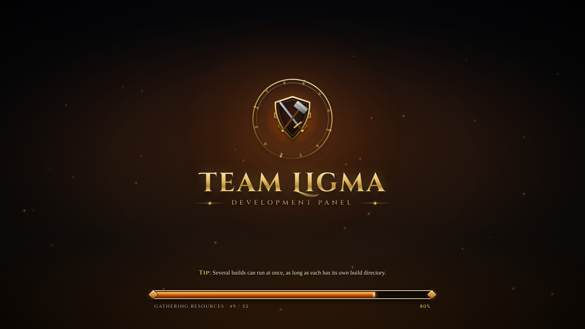
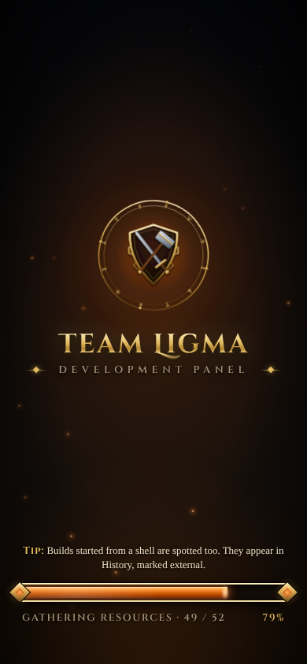

# Prompt
Create a dark-themed loading screen for when the Uno app is loading, but with a World of Warcraft visual theme

# Reponse
Added a dark, World of Warcraft-style loading screen that shows while the Uno WebAssembly app downloads and starts (v1.5.0).

**Design**
- **Look:** a stone-textured backdrop with a warm glow and drifting embers, and an original gold crest (heater shield, crossed sword and smithing hammer over a gear, inside a slowly turning rune ring). The title "Team Ligma" is set in Cinzel Decorative with an engraved gold finish.
- **Loading bar:** gold-framed with diamond end caps, a glowing burnt-orange fill and a moving sheen.
- **Tips:** rotating "Tip:" lines about the panel.
- **Original artwork:** no Blizzard logos or artwork are used. The fonts are Cinzel and Cinzel Decorative (SIL Open Font License, bundled with the licence).

**Behaviour**
- **Real progress:** the bar mirrors the Uno bootstrapper's actual resource downloads ("Gathering resources · n / N"), then shows "Waking the runtime" while .NET starts. When the app has drawn its first screen, it fills, says "Entering the realm" and fades out.
- **Hand-off:** it's a separate overlay, so Uno removing its own loader can't cut the fade short.
- **Accessibility and layout:** respects reduced-motion settings, works at phone widths, and shows bootstrap errors in place of the phase text.

**Implementation:** a custom `index.html` set through `WasmShellIndexHtmlPath`, with `loading.css`, `loading.js` and the fonts in `Platforms/WebAssembly/loading/`.

**Bug found and fixed during testing:** the Uno build rewrites every `./` and `/` path in `index.html` to its package folder, so the files placed in `wwwroot` returned 404s, served as the HTML fallback. They're now published as app content inside the package.

**Tested:** in headless Chromium with the network throttled to about 25 Mbit/s, the bar tracked the downloads (46 / 52 at 72%) and finished on "Entering the realm". It then faded into the app's first screen with no page errors, at both desktop and phone width.

# File Changes
| File | Type | Workspace path | Change |
|---|---|---|---|
| `v150-loading-desktop.png` | `Asset` | `Prompts/Team Ligma Development Panel/screenshots/v150-loading-desktop.png` | Created |
| `v150-loading-mobile.png` | `Asset` | `Prompts/Team Ligma Development Panel/screenshots/v150-loading-mobile.png` | Created |
| `README.md` | `Docs` | `README.md` | Changed |
| `TeamLigma.Panel.Server.csproj` | `Config` | `src/TeamLigma.Panel.Server/TeamLigma.Panel.Server.csproj` | Changed |
| `index.html` | `Code` | `src/TeamLigma.Panel/TeamLigma.Panel/Platforms/WebAssembly/index.html` | Created |
| `OFL.txt` | `Code` | `src/TeamLigma.Panel/TeamLigma.Panel/Platforms/WebAssembly/loading/fonts/OFL.txt` | Created |
| `cinzel-decorative-latin-700-normal.woff2` | `Code` | `src/TeamLigma.Panel/TeamLigma.Panel/Platforms/WebAssembly/loading/fonts/cinzel-decorative-latin-700-normal.woff2` | Created |
| `cinzel-latin-600-normal.woff2` | `Code` | `src/TeamLigma.Panel/TeamLigma.Panel/Platforms/WebAssembly/loading/fonts/cinzel-latin-600-normal.woff2` | Created |
| `cinzel-latin-700-normal.woff2` | `Code` | `src/TeamLigma.Panel/TeamLigma.Panel/Platforms/WebAssembly/loading/fonts/cinzel-latin-700-normal.woff2` | Created |
| `loading.css` | `Code` | `src/TeamLigma.Panel/TeamLigma.Panel/Platforms/WebAssembly/loading/loading.css` | Created |
| `loading.js` | `Code` | `src/TeamLigma.Panel/TeamLigma.Panel/Platforms/WebAssembly/loading/loading.js` | Created |
| `TeamLigma.Panel.csproj` | `Config` | `src/TeamLigma.Panel/TeamLigma.Panel/TeamLigma.Panel.csproj` | Changed |

Environment: `/roc/claude/panel/` redeployed (v1.5.0); runtime file `/roc/claude/panel-data/settings.json`.

# Code Diffs
### `README.md` (Changed)
```diff
diff --git a/README.md b/README.md
index 2815b7c..9f8b8b2 100644
--- a/README.md
+++ b/README.md
@@ -1,7 +1,7 @@
 <p align="center"></p>
 
 # Team Ligma Development Panel
-**Version 1.4.0**
+**Version 1.5.0**
 
 One dark, burnt-orange control room for an AzerothCore test realm. Kick off builds, watch every object compile in real time, look back at old logs, and talk to the Worldserver, Authserver and MySQL from your browser. No SSH session needed.
 
@@ -13,6 +13,17 @@ nginx serves both on port **26767**.
 
 ---
 
+## Loading screen
+While the WebAssembly app downloads and starts, the panel shows a dark, fantasy-MMO-styled loading screen:
+- **Look:** a stone backdrop with drifting embers, an original gold crest (shield, sword, smithing hammer and gear inside a turning rune ring), the title in Cinzel Decorative, and an ornate gold-framed loading bar.
+- **Tips:** rotating "Tip:" lines about using the panel.
+- **Progress is real:** the bar follows the Uno bootstrapper's resource downloads ("Gathering resources · 46 / 52"), then "Waking the runtime" while .NET starts. Once the app has drawn its first screen it fills, says "Entering the realm", and fades away.
+- **Accessibility:** animations are switched off when the browser asks for reduced motion.
+
+The files are `src/TeamLigma.Panel/TeamLigma.Panel/Platforms/WebAssembly/index.html` (markup and crest) and `Platforms/WebAssembly/loading/` (`loading.css`, `loading.js`, fonts). The page is selected with `WasmShellIndexHtmlPath` in the app's `.csproj`. The loading files are published as app content, because the Uno build rewrites `./` paths in `index.html` into its package folder.
+
+The artwork is original and inspired by the genre; it uses no Blizzard assets. Fonts: [Cinzel](https://github.com/NDISCOVER/Cinzel) and Cinzel Decorative, SIL Open Font License 1.1 (`loading/fonts/OFL.txt`).
+
 ## Accounts & sign-in
 Every page and API call requires a signed-in account. Accounts can be protected with an **authenticator app** (TOTP: Google Authenticator, Microsoft Authenticator, Authy, 1Password, Bitwarden, Aegis and similar).
```

### `src/TeamLigma.Panel.Server/TeamLigma.Panel.Server.csproj` (Changed)
```diff
diff --git a/src/TeamLigma.Panel.Server/TeamLigma.Panel.Server.csproj b/src/TeamLigma.Panel.Server/TeamLigma.Panel.Server.csproj
index 2d37810..414e0c5 100644
--- a/src/TeamLigma.Panel.Server/TeamLigma.Panel.Server.csproj
+++ b/src/TeamLigma.Panel.Server/TeamLigma.Panel.Server.csproj
@@ -4,7 +4,7 @@
     <Nullable>enable</Nullable>
     <ImplicitUsings>enable</ImplicitUsings>
     <RootNamespace>TeamLigma.Panel.Server</RootNamespace>
-    <Version>1.4.0</Version>
+    <Version>1.5.0</Version>
   </PropertyGroup>
   <ItemGroup>
     <Compile Include="../Shared/Dtos.cs" Link="Shared/Dtos.cs" />
```

### `src/TeamLigma.Panel/TeamLigma.Panel/Platforms/WebAssembly/index.html` (Created)
```diff
diff --git a/src/TeamLigma.Panel/TeamLigma.Panel/Platforms/WebAssembly/index.html b/src/TeamLigma.Panel/TeamLigma.Panel/Platforms/WebAssembly/index.html
new file mode 100644
index 0000000..5c3b718
--- /dev/null
+++ b/src/TeamLigma.Panel/TeamLigma.Panel/Platforms/WebAssembly/index.html
@@ -0,0 +1,151 @@
+<!DOCTYPE html>
+<html lang="en">
+<head>
+    <meta charset="utf-8" />
+    <meta name="viewport" content="width=device-width, initial-scale=1" />
+    <meta name="apple-mobile-web-app-status-bar-style" content="black-translucent" />
+    <meta name="theme-color" content="#0b0907" />
+    <title>Team Ligma Development Panel</title>
+
+    <!-- Themed loading screen (loads before the Uno runtime) -->
+    <link rel="preload" href="./loading/fonts/cinzel-decorative-latin-700-normal.woff2" as="font" type="font/woff2" crossorigin />
+    <link rel="preload" href="./loading/fonts/cinzel-latin-600-normal.woff2" as="font" type="font/woff2" crossorigin />
+    <link rel="stylesheet" type="text/css" href="./loading/loading.css" />
+    <script type="text/javascript" src="./loading/loading.js" defer></script>
+
+    <script type="text/javascript" src="./require.js"></script>
+    <script type="module" src="./uno-bootstrap.js"></script>
+    $(ADDITIONAL_CSS)
+    $(ADDITIONAL_HEAD)
+</head>
+<body>
+    <!-- Uno's own loader: kept (uno-bootstrap reports download progress into its <progress>) but hidden. -->
+    <div id="uno-body" class="container-fluid uno-body">
+        <div class="uno-loader"
+             loading-position="bottom"
+             loading-alert="none">
+            
+            <progress></progress>
+            <span class="alert"></span>
+        </div>
+    </div>
+
+    <!-- Team Ligma loading screen -->
+    <div id="tl-loading" role="progressbar" aria-label="Loading the Team Ligma Development Panel" aria-valuemin="0" aria-valuemax="100" aria-valuenow="0">
+        <div class="tl-bg" aria-hidden="true"></div>
+        <div class="tl-glow" aria-hidden="true"></div>
+        <div class="tl-embers" aria-hidden="true"></div>
+        <div class="tl-vignette" aria-hidden="true"></div>
+
+        <main class="tl-center">
+            <svg class="tl-crest" viewBox="0 0 240 240" aria-hidden="true">
+                <defs>
+                    <linearGradient id="tlGold" x1="0" y1="0" x2="0" y2="1">
+                        <stop offset="0" stop-color="#fff1c1" />
+                        <stop offset="0.35" stop-color="#e8c36a" />
+                        <stop offset="0.7" stop-color="#a87a2c" />
+                        <stop offset="1" stop-color="#5c3f12" />
+                    </linearGradient>
+                    <linearGradient id="tlSteel" x1="0" y1="0" x2="1" y2="1">
+                        <stop offset="0" stop-color="#e9edf2" />
+                        <stop offset="0.5" stop-color="#9aa4b1" />
+                        <stop offset="1" stop-color="#4d5560" />
+                    </linearGradient>
+                    <radialGradient id="tlShieldFill" cx="0.5" cy="0.35" r="0.75">
+                        <stop offset="0" stop-color="#3a1a0a" />
+                        <stop offset="0.6" stop-color="#1c0d06" />
+                        <stop offset="1" stop-color="#0b0604" />
+                    </radialGradient>
+                    <radialGradient id="tlCore" cx="0.5" cy="0.5" r="0.5">
+                        <stop offset="0" stop-color="#ffb066" stop-opacity="0.9" />
+                        <stop offset="0.45" stop-color="#cc5500" stop-opacity="0.45" />
+                        <stop offset="1" stop-color="#cc5500" stop-opacity="0" />
+                    </radialGradient>
+                    <filter id="tlEngrave" x="-10%" y="-10%" width="120%" height="120%">
+                        <feDropShadow dx="0" dy="2" stdDeviation="1.6" flood-color="#000" flood-opacity="0.85" />
+                    </filter>
+                </defs>
+
+                <!-- rune ring (rotates) -->
+                <g class="tl-ring">
+                    <circle cx="120" cy="120" r="111" fill="none" stroke="url(#tlGold)" stroke-width="2.5" />
+                    <circle cx="120" cy="120" r="101" fill="none" stroke="url(#tlGold)" stroke-width="1" stroke-opacity="0.7" />
+                    <g stroke="#d9b45c" stroke-width="1.6" stroke-linecap="round" fill="none" opacity="0.85">
+                        <!-- 12 original rune marks between the rings -->
+                        <path d="M120 12 v8 M117 15 l3 3 l3 -3" />
+                        <path d="M117 13 l3 7 l3 -7" transform="rotate(30 120 120)" />
+                        <path d="M120 12 v8 M116 16 h8" transform="rotate(60 120 120)" />
+                        <path d="M118 12 l4 8 M122 12 l-4 8" transform="rotate(90 120 120)" />
+                        <path d="M120 12 v8 M117 19 l3 -3 l3 3" transform="rotate(120 120 120)" />
+                        <path d="M117 13 h6 M120 13 v7" transform="rotate(150 120 120)" />
+                        <path d="M120 12 v8 M117 15 l3 3 l3 -3" transform="rotate(180 120 120)" />
+                        <path d="M120 12 v8 M116 16 h8" transform="rotate(210 120 120)" />
+                        <path d="M118 12 l4 8 M122 12 l-4 8" transform="rotate(240 120 120)" />
+                        <path d="M120 12 v8 M117 19 l3 -3 l3 3" transform="rotate(270 120 120)" />
+                        <path d="M117 13 h6 M120 13 v7" transform="rotate(300 120 120)" />
+                        <path d="M118 13 l2 7 l2 -7" transform="rotate(330 120 120)" />
+                    </g>
+                    <g fill="url(#tlGold)">
+                        <circle cx="120" cy="9" r="3" />
+                        <circle cx="231" cy="120" r="3" />
+                        <circle cx="120" cy="231" r="3" />
+                        <circle cx="9" cy="120" r="3" />
+                    </g>
+                </g>
+
+                <!-- ember core glow behind the shield -->
+                <circle class="tl-core" cx="120" cy="122" r="78" fill="url(#tlCore)" />
+
+                <!-- gear -->
+                <g class="tl-gear" transform="translate(120 122)" filter="url(#tlEngrave)">
+                    <path fill="none" stroke="url(#tlGold)" stroke-width="3"
+                          d="M-6 -62 h12 l3 11 a52 52 0 0 1 12 5 l10 -6 l9 9 l-6 10 a52 52 0 0 1 5 12 l11 3 v12 l-11 3 a52 52 0 0 1 -5 12 l6 10 l-9 9 l-10 -6 a52 52 0 0 1 -12 5 l-3 11 h-12 l-3 -11 a52 52 0 0 1 -12 -5 l-10 6 l-9 -9 l6 -10 a52 52 0 0 1 -5 -12 l-11 -3 v-12 l11 -3 a52 52 0 0 1 5 -12 l-6 -10 l9 -9 l10 6 a52 52 0 0 1 12 -5 z" />
+                </g>
+
+                <!-- shield -->
+                <g filter="url(#tlEngrave)">
+                    <path d="M120 58 L168 74 Q170 132 120 178 Q70 132 72 74 Z" fill="url(#tlShieldFill)" stroke="url(#tlGold)" stroke-width="4" stroke-linejoin="round" />
+                    <path d="M120 66 L160 79 Q161 128 120 168 Q79 128 80 79 Z" fill="none" stroke="#e8c36a" stroke-opacity="0.45" stroke-width="1.2" />
+                </g>
+
+                <!-- crossed sword and hammer -->
+                <g filter="url(#tlEngrave)">
+                    <g transform="rotate(-38 120 118)">
+                        <path d="M117 64 L120 56 L123 64 L123 140 L117 140 Z" fill="url(#tlSteel)" />
+                        <path d="M120 60 V138" stroke="#ffffff" stroke-opacity="0.5" stroke-width="0.8" />
+                        <rect x="106" y="140" width="28" height="5" rx="2" fill="url(#tlGold)" />
+                        <rect x="117.5" y="145" width="5" height="16" fill="#5a3416" />
+                        <circle cx="120" cy="164" r="4" fill="url(#tlGold)" />
+                    </g>
+                    <g transform="rotate(38 120 118)">
+                        <rect x="117.5" y="84" width="5" height="78" rx="1.5" fill="#6b3d19" />
+                        <path d="M104 70 h32 a3 3 0 0 1 3 3 v14 a3 3 0 0 1 -3 3 h-32 a3 3 0 0 1 -3 -3 v-14 a3 3 0 0 1 3 -3 z" fill="url(#tlSteel)" stroke="#2b2f35" stroke-width="1" />
+                        <rect x="101" y="77" width="38" height="3" fill="url(#tlGold)" />
+                        <circle cx="120" cy="164" r="3.5" fill="url(#tlGold)" />
+                    </g>
+                </g>
+            </svg>
+
+            <h1 class="tl-title">Team Ligma</h1>
+            <div class="tl-subtitle"><span class="tl-rule" aria-hidden="true"></span>Development Panel<span class="tl-rule" aria-hidden="true"></span></div>
+        </main>
+
+        <footer class="tl-footer">
+            <p class="tl-tip"><span class="tl-tip-label">Tip:</span> <span id="tl-tip-text"></span></p>
+            <div class="tl-bar">
+                <span class="tl-cap tl-cap-left" aria-hidden="true"></span>
+                <div class="tl-bar-frame">
+                    <div class="tl-bar-fill" id="tl-fill"></div>
+                    <div class="tl-bar-sheen" aria-hidden="true"></div>
+                </div>
+                <span class="tl-cap tl-cap-right" aria-hidden="true"></span>
+            </div>
+            <div class="tl-status"><span id="tl-phase">Opening the gates…</span><span id="tl-pct">0%</span></div>
+        </footer>
+    </div>
+
+    <noscript>
+        <p>This application requires JavaScript and WebAssembly to be enabled.</p>
+    </noscript>
+</body>
+</html>
```

### `src/TeamLigma.Panel/TeamLigma.Panel/Platforms/WebAssembly/loading/fonts/OFL.txt` (Created)
```diff
diff --git a/src/TeamLigma.Panel/TeamLigma.Panel/Platforms/WebAssembly/loading/fonts/OFL.txt b/src/TeamLigma.Panel/TeamLigma.Panel/Platforms/WebAssembly/loading/fonts/OFL.txt
new file mode 100644
index 0000000..5649a81
--- /dev/null
+++ b/src/TeamLigma.Panel/TeamLigma.Panel/Platforms/WebAssembly/loading/fonts/OFL.txt
@@ -0,0 +1,93 @@
+Copyright 2020 The Cinzel Project Authors (https://github.com/NDISCOVER/Cinzel)
+
+This Font Software is licensed under the SIL Open Font License, Version 1.1.
+This license is copied below, and is also available with a FAQ at:
+http://scripts.sil.org/OFL
+
+
+-----------------------------------------------------------
+SIL OPEN FONT LICENSE Version 1.1 - 26 February 2007
+-----------------------------------------------------------
+
+PREAMBLE
+The goals of the Open Font License (OFL) are to stimulate worldwide
+development of collaborative font projects, to support the font creation
+efforts of academic and linguistic communities, and to provide a free and
+open framework in which fonts may be shared and improved in partnership
+with others.
+
+The OFL allows the licensed fonts to be used, studied, modified and
+redistributed freely as long as they are not sold by themselves. The
+fonts, including any derivative works, can be bundled, embedded,
+redistributed and/or sold with any software provided that any reserved
+names are not used by derivative works. The fonts and derivatives,
+however, cannot be released under any other type of license. The
+requirement for fonts to remain under this license does not apply
+to any document created using the fonts or their derivatives.
+
+DEFINITIONS
+"Font Software" refers to the set of files released by the Copyright
+Holder(s) under this license and clearly marked as such. This may
+include source files, build scripts and documentation.
+
+"Reserved Font Name" refers to any names specified as such after the
+copyright statement(s).
+
+"Original Version" refers to the collection of Font Software components as
+distributed by the Copyright Holder(s).
+
+"Modified Version" refers to any derivative made by adding to, deleting,
+or substituting -- in part or in whole -- any of the components of the
+Original Version, by changing formats or by porting the Font Software to a
+new environment.
+
+"Author" refers to any designer, engineer, programmer, technical
+writer or other person who contributed to the Font Software.
+
+PERMISSION & CONDITIONS
+Permission is hereby granted, free of charge, to any person obtaining
+a copy of the Font Software, to use, study, copy, merge, embed, modify,
+redistribute, and sell modified and unmodified copies of the Font
+Software, subject to the following conditions:
+
+1) Neither the Font Software nor any of its individual components,
+in Original or Modified Versions, may be sold by itself.
+
+2) Original or Modified Versions of the Font Software may be bundled,
+redistributed and/or sold with any software, provided that each copy
+contains the above copyright notice and this license. These can be
+included either as stand-alone text files, human-readable headers or
+in the appropriate machine-readable metadata fields within text or
+binary files as long as those fields can be easily viewed by the user.
+
+3) No Modified Version of the Font Software may use the Reserved Font
+Name(s) unless explicit written permission is granted by the corresponding
+Copyright Holder. This restriction only applies to the primary font name as
+presented to the users.
+
+4) The name(s) of the Copyright Holder(s) or the Author(s) of the Font
+Software shall not be used to promote, endorse or advertise any
+Modified Version, except to acknowledge the contribution(s) of the
+Copyright Holder(s) and the Author(s) or with their explicit written
+permission.
+
+5) The Font Software, modified or unmodified, in part or in whole,
+must be distributed entirely under this license, and must not be
+distributed under any other license. The requirement for fonts to
+remain under this license does not apply to any document created
+using the Font Software.
+
+TERMINATION
+This license becomes null and void if any of the above conditions are
+not met.
+
+DISCLAIMER
+THE FONT SOFTWARE IS PROVIDED "AS IS", WITHOUT WARRANTY OF ANY KIND,
+EXPRESS OR IMPLIED, INCLUDING BUT NOT LIMITED TO ANY WARRANTIES OF
+MERCHANTABILITY, FITNESS FOR A PARTICULAR PURPOSE AND NONINFRINGEMENT
+OF COPYRIGHT, PATENT, TRADEMARK, OR OTHER RIGHT. IN NO EVENT SHALL THE
+COPYRIGHT HOLDER BE LIABLE FOR ANY CLAIM, DAMAGES OR OTHER LIABILITY,
+INCLUDING ANY GENERAL, SPECIAL, INDIRECT, INCIDENTAL, OR CONSEQUENTIAL
+DAMAGES, WHETHER IN AN ACTION OF CONTRACT, TORT OR OTHERWISE, ARISING
+FROM, OUT OF THE USE OR INABILITY TO USE THE FONT SOFTWARE OR FROM
+OTHER DEALINGS IN THE FONT SOFTWARE.
```

### `src/TeamLigma.Panel/TeamLigma.Panel/Platforms/WebAssembly/loading/fonts/cinzel-decorative-latin-700-normal.woff2` (Created)
```diff
diff --git a/src/TeamLigma.Panel/TeamLigma.Panel/Platforms/WebAssembly/loading/fonts/cinzel-decorative-latin-700-normal.woff2 b/src/TeamLigma.Panel/TeamLigma.Panel/Platforms/WebAssembly/loading/fonts/cinzel-decorative-latin-700-normal.woff2
new file mode 100644
index 0000000..0e184e3
Binary files /dev/null and b/src/TeamLigma.Panel/TeamLigma.Panel/Platforms/WebAssembly/loading/fonts/cinzel-decorative-latin-700-normal.woff2 differ
```

### `src/TeamLigma.Panel/TeamLigma.Panel/Platforms/WebAssembly/loading/fonts/cinzel-latin-600-normal.woff2` (Created)
```diff
diff --git a/src/TeamLigma.Panel/TeamLigma.Panel/Platforms/WebAssembly/loading/fonts/cinzel-latin-600-normal.woff2 b/src/TeamLigma.Panel/TeamLigma.Panel/Platforms/WebAssembly/loading/fonts/cinzel-latin-600-normal.woff2
new file mode 100644
index 0000000..a4b5e1b
Binary files /dev/null and b/src/TeamLigma.Panel/TeamLigma.Panel/Platforms/WebAssembly/loading/fonts/cinzel-latin-600-normal.woff2 differ
```

### `src/TeamLigma.Panel/TeamLigma.Panel/Platforms/WebAssembly/loading/fonts/cinzel-latin-700-normal.woff2` (Created)
```diff
diff --git a/src/TeamLigma.Panel/TeamLigma.Panel/Platforms/WebAssembly/loading/fonts/cinzel-latin-700-normal.woff2 b/src/TeamLigma.Panel/TeamLigma.Panel/Platforms/WebAssembly/loading/fonts/cinzel-latin-700-normal.woff2
new file mode 100644
index 0000000..a13fb08
Binary files /dev/null and b/src/TeamLigma.Panel/TeamLigma.Panel/Platforms/WebAssembly/loading/fonts/cinzel-latin-700-normal.woff2 differ
```

### `src/TeamLigma.Panel/TeamLigma.Panel/Platforms/WebAssembly/loading/loading.css` (Created)
```diff
diff --git a/src/TeamLigma.Panel/TeamLigma.Panel/Platforms/WebAssembly/loading/loading.css b/src/TeamLigma.Panel/TeamLigma.Panel/Platforms/WebAssembly/loading/loading.css
new file mode 100644
index 0000000..d61ef73
--- /dev/null
+++ b/src/TeamLigma.Panel/TeamLigma.Panel/Platforms/WebAssembly/loading/loading.css
@@ -0,0 +1,368 @@
+/* Team Ligma Development Panel - loading screen (shown while the Uno WebAssembly runtime loads).
+   Fantasy-MMO styling: stone, gold filigree, drifting embers and a glowing loading bar. */
+
+@font-face {
+    font-family: "Cinzel Decorative";
+    src: url("./fonts/cinzel-decorative-latin-700-normal.woff2") format("woff2");
+    font-weight: 700;
+    font-display: swap;
+}
+@font-face {
+    font-family: "Cinzel";
+    src: url("./fonts/cinzel-latin-600-normal.woff2") format("woff2");
+    font-weight: 600;
+    font-display: swap;
+}
+@font-face {
+    font-family: "Cinzel";
+    src: url("./fonts/cinzel-latin-700-normal.woff2") format("woff2");
+    font-weight: 700;
+    font-display: swap;
+}
+
+:root {
+    --tl-bg-deep: #050608;
+    --tl-bg-warm: #1a120b;
+    --tl-gold-light: #fff1c1;
+    --tl-gold: #e1b95e;
+    --tl-gold-mid: #b38634;
+    --tl-gold-dark: #5c3f12;
+    --tl-ember: #ff8a3d;
+    --tl-accent: #cc5500;
+    --tl-text: #e9dcc0;
+    --tl-text-dim: #a8977a;
+}
+
+html, body {
+    background: var(--tl-bg-deep);
+}
+
+/* Uno's built-in loader stays in the DOM (it receives download progress) but is invisible. */
+.uno-loader {
+    background: transparent !important;
+    opacity: 0 !important;
+    pointer-events: none !important;
+}
+
+#tl-loading {
+    position: fixed;
+    inset: 0;
+    z-index: 10000;
+    overflow: hidden;
+    display: flex;
+    flex-direction: column;
+    align-items: center;
+    justify-content: space-between;
+    padding: max(5vh, 24px) 16px max(6vh, 28px);
+    box-sizing: border-box;
+    background: var(--tl-bg-deep);
+    color: var(--tl-text);
+    font-family: "Cinzel", Georgia, "Times New Roman", serif;
+    transition: opacity 0.8s ease, visibility 0.8s;
+    user-select: none;
+}
+
+#tl-loading.tl-done {
+    opacity: 0;
+    visibility: hidden;
+}
+
+/* ---- backdrop layers ---- */
+
+.tl-bg {
+    position: absolute;
+    inset: 0;
+    background:
+        radial-gradient(ellipse 80% 55% at 50% 42%, rgba(120, 52, 14, 0.38), transparent 70%),
+        radial-gradient(ellipse 120% 70% at 50% 110%, rgba(204, 85, 0, 0.22), transparent 60%),
+        linear-gradient(180deg, #07080c 0%, #0d0b0a 45%, var(--tl-bg-warm) 100%);
+}
+
+/* stone grain from an inline SVG noise texture */
+.tl-bg::after {
+    content: "";
+    position: absolute;
+    inset: 0;
+    opacity: 0.22;
+    mix-blend-mode: overlay;
+    background-image: url("data:image/svg+xml;utf8,<svg xmlns='http://www.w3.org/2000/svg' width='220' height='220'><filter id='n'><feTurbulence type='fractalNoise' baseFrequency='0.9' numOctaves='3' stitchTiles='stitch'/><feColorMatrix values='0 0 0 0 0.6  0 0 0 0 0.5  0 0 0 0 0.4  0 0 0 0.9 0'/></filter><rect width='100%' height='100%' filter='url(%23n)'/></svg>");
+}
+
+.tl-glow {
+    position: absolute;
+    left: 50%;
+    top: 40%;
+    width: 70vmin;
+    height: 70vmin;
+    transform: translate(-50%, -50%);
+    border-radius: 50%;
+    background: radial-gradient(circle, rgba(255, 138, 61, 0.18), rgba(204, 85, 0, 0.06) 45%, transparent 70%);
+    animation: tl-breathe 5s ease-in-out infinite;
+}
+
+.tl-vignette {
+    position: absolute;
+    inset: 0;
+    background: radial-gradient(ellipse at center, transparent 45%, rgba(0, 0, 0, 0.75) 100%);
+    pointer-events: none;
+}
+
+/* ---- embers ---- */
+
+.tl-embers {
+    position: absolute;
+    inset: 0;
+    pointer-events: none;
+}
+
+.tl-ember {
+    position: absolute;
+    bottom: -12px;
+    left: var(--x);
+    width: var(--s);
+    height: var(--s);
+    border-radius: 50%;
+    background: radial-gradient(circle, #ffe2a8 0%, var(--tl-ember) 45%, rgba(204, 85, 0, 0) 70%);
+    box-shadow: 0 0 6px 2px rgba(255, 138, 61, 0.45);
+    opacity: 0;
+    animation: tl-rise var(--d) linear var(--delay) infinite;
+}
+
+@keyframes tl-rise {
+    0%   { transform: translate(0, 0) scale(1); opacity: 0; }
+    10%  { opacity: var(--o); }
+    70%  { opacity: calc(var(--o) * 0.8); }
+    100% { transform: translate(var(--drift), -105vh) scale(0.4); opacity: 0; }
+}
+
+/* ---- crest and title ---- */
+
+.tl-center {
+    position: relative;
+    flex: 1;
+    display: flex;
+    flex-direction: column;
+    align-items: center;
+    justify-content: center;
+    gap: 6px;
+    min-height: 0;
+}
+
+.tl-crest {
+    width: clamp(150px, 26vmin, 260px);
+    height: auto;
+    filter: drop-shadow(0 0 18px rgba(255, 138, 61, 0.25)) drop-shadow(0 6px 10px rgba(0, 0, 0, 0.8));
+    animation: tl-float 6s ease-in-out infinite;
+}
+
+.tl-ring {
+    transform-origin: 120px 120px;
+    animation: tl-spin 60s linear infinite;
+}
+
+.tl-core {
+    animation: tl-flicker 3.2s ease-in-out infinite;
+}
+
+.tl-title {
+    margin: 10px 0 0;
+    font-family: "Cinzel Decorative", "Cinzel", Georgia, serif;
+    font-weight: 700;
+    font-size: clamp(34px, 6.2vw, 72px);
+    letter-spacing: 0.06em;
+    line-height: 1.05;
+    text-align: center;
+    background: linear-gradient(180deg, var(--tl-gold-light) 0%, var(--tl-gold) 42%, var(--tl-gold-mid) 62%, #f2d58c 78%, var(--tl-gold-dark) 100%);
+    -webkit-background-clip: text;
+    background-clip: text;
+    color: transparent;
+    filter: drop-shadow(0 2px 0 #2a1a06) drop-shadow(0 0 14px rgba(225, 185, 94, 0.35)) drop-shadow(0 6px 8px rgba(0, 0, 0, 0.9));
+}
+
+.tl-subtitle {
+    display: flex;
+    align-items: center;
+    gap: 14px;
+    font-size: clamp(13px, 1.6vw, 18px);
+    font-weight: 600;
+    letter-spacing: 0.42em;
+    text-transform: uppercase;
+    color: var(--tl-text-dim);
+    text-shadow: 0 2px 4px #000;
+}
+
+.tl-rule {
+    display: block;
+    width: clamp(28px, 7vw, 90px);
+    height: 1px;
+    background: linear-gradient(90deg, transparent, var(--tl-gold), transparent);
+    position: relative;
+}
+
+.tl-rule::after {
+    content: "";
+    position: absolute;
+    left: 50%;
+    top: 50%;
+    width: 6px;
+    height: 6px;
+    background: var(--tl-gold);
+    transform: translate(-50%, -50%) rotate(45deg);
+    box-shadow: 0 0 6px rgba(225, 185, 94, 0.7);
+}
+
+/* ---- footer: tip, loading bar, status ---- */
+
+.tl-footer {
+    position: relative;
+    width: min(780px, 100%);
+    display: flex;
+    flex-direction: column;
+    align-items: center;
+    gap: 14px;
+}
+
+.tl-tip {
+    margin: 0;
+    min-height: 2.8em;
+    max-width: 640px;
+    text-align: center;
+    font-family: Georgia, "Times New Roman", serif;
+    font-size: clamp(13px, 1.5vw, 16px);
+    line-height: 1.4;
+    color: var(--tl-text);
+    text-shadow: 0 1px 3px #000;
+    transition: opacity 0.6s ease;
+}
+
+.tl-tip.tl-fade {
+    opacity: 0;
+}
+
+.tl-tip-label {
+    font-family: "Cinzel", Georgia, serif;
+    font-weight: 700;
+    color: var(--tl-gold);
+    letter-spacing: 0.06em;
+}
+
+.tl-bar {
+    position: relative;
+    width: 100%;
+    display: flex;
+    align-items: center;
+}
+
+.tl-bar-frame {
+    position: relative;
+    flex: 1;
+    height: 24px;
+    border-radius: 3px;
+    padding: 3px;
+    box-sizing: border-box;
+    /* gold metallic frame */
+    background:
+        linear-gradient(#120b06, #120b06) padding-box,
+        linear-gradient(180deg, var(--tl-gold-light), var(--tl-gold) 30%, var(--tl-gold-dark) 55%, var(--tl-gold-mid) 80%, var(--tl-gold-light)) border-box;
+    border: 2px solid transparent;
+    box-shadow:
+        0 0 0 1px #000,
+        0 4px 14px rgba(0, 0, 0, 0.8),
+        inset 0 2px 6px rgba(0, 0, 0, 0.9);
+    overflow: hidden;
+}
+
+.tl-bar-fill {
+    position: relative;
+    height: 100%;
+    width: 0%;
+    border-radius: 1px;
+    background: linear-gradient(180deg, #ffcf8a 0%, #ff9a3d 22%, var(--tl-accent) 60%, #7a2a04 100%);
+    box-shadow: 0 0 12px 2px rgba(255, 120, 40, 0.55), inset 0 1px 0 rgba(255, 240, 200, 0.6);
+    transition: width 0.25s ease-out;
+}
+
+/* bright leading edge */
+.tl-bar-fill::after {
+    content: "";
+    position: absolute;
+    right: -2px;
+    top: -3px;
+    bottom: -3px;
+    width: 10px;
+    background: radial-gradient(ellipse at center, rgba(255, 240, 200, 0.95), rgba(255, 150, 60, 0) 70%);
+    filter: blur(1px);
+}
+
+.tl-bar-sheen {
+    position: absolute;
+    inset: 3px;
+    background: linear-gradient(105deg, transparent 35%, rgba(255, 255, 255, 0.16) 50%, transparent 65%);
+    background-size: 220% 100%;
+    animation: tl-sheen 2.8s ease-in-out infinite;
+    pointer-events: none;
+}
+
+.tl-cap {
+    position: relative;
+    width: 18px;
+    height: 18px;
+    flex: none;
+    transform: rotate(45deg);
+    background: linear-gradient(135deg, var(--tl-gold-light), var(--tl-gold) 40%, var(--tl-gold-dark));
+    box-shadow: 0 0 0 1px #000, 0 0 10px rgba(225, 185, 94, 0.35);
+    z-index: 1;
+}
+
+.tl-cap::after {
+    content: "";
+    position: absolute;
+    inset: 5px;
+    background: radial-gradient(circle, #ffb066, var(--tl-accent));
+    box-shadow: 0 0 6px rgba(255, 138, 61, 0.9);
+}
+
+.tl-cap-left { margin-right: -9px; }
+.tl-cap-right { margin-left: -9px; }
+
+.tl-status {
+    width: calc(100% - 24px);
+    display: flex;
+    justify-content: space-between;
+    font-size: 12.5px;
+    font-weight: 600;
+    letter-spacing: 0.14em;
+    text-transform: uppercase;
+    color: var(--tl-text-dim);
+    text-shadow: 0 1px 3px #000;
+}
+
+#tl-pct {
+    color: var(--tl-gold);
+    font-variant-numeric: tabular-nums;
+}
+
+#tl-loading.tl-error #tl-phase {
+    color: #ff7b6b;
+    text-transform: none;
+    letter-spacing: 0.02em;
+}
+
+/* ---- animations ---- */
+
+@keyframes tl-spin { to { transform: rotate(360deg); } }
+@keyframes tl-float { 0%, 100% { transform: translateY(0); } 50% { transform: translateY(-6px); } }
+@keyframes tl-breathe { 0%, 100% { opacity: 0.75; } 50% { opacity: 1; } }
+@keyframes tl-flicker { 0%, 100% { opacity: 0.85; } 45% { opacity: 1; } 60% { opacity: 0.7; } }
+@keyframes tl-sheen { 0% { background-position: 120% 0; } 100% { background-position: -120% 0; } }
+
+@media (max-height: 560px) {
+    .tl-crest { width: 120px; }
+    .tl-tip { min-height: 0; }
+}
+
+@media (prefers-reduced-motion: reduce) {
+    .tl-ring, .tl-crest, .tl-glow, .tl-core, .tl-bar-sheen { animation: none; }
+    .tl-embers { display: none; }
+    #tl-loading { transition: none; }
+}
```

### `src/TeamLigma.Panel/TeamLigma.Panel/Platforms/WebAssembly/loading/loading.js` (Created)
```diff
diff --git a/src/TeamLigma.Panel/TeamLigma.Panel/Platforms/WebAssembly/loading/loading.js b/src/TeamLigma.Panel/TeamLigma.Panel/Platforms/WebAssembly/loading/loading.js
new file mode 100644
index 0000000..fe87fb9
--- /dev/null
+++ b/src/TeamLigma.Panel/TeamLigma.Panel/Platforms/WebAssembly/loading/loading.js
@@ -0,0 +1,154 @@
+// Team Ligma Development Panel - loading screen controller.
+// Mirrors the Uno bootstrapper's download progress into the themed bar and fades the
+// overlay out once the Uno app has rendered.
+(function () {
+    "use strict";
+
+    const TIPS = [
+        "A full clean build is Clean, then Prepare (CMake), then Start Build. The install runs on its own when the compile succeeds.",
+        "The Authserver console listens for one thing only: Ctrl + C.",
+        "Leave CPU threads on Auto to keep one core free for your realm while it builds.",
+        "Builds started from a shell are spotted too. They appear in History, marked external.",
+        "Turn on the authenticator app under My Account, and keep your recovery codes somewhere safe.",
+        "Upload a .sql script to the MySQL console with Run .sql script.",
+        "Shut the Worldserver down gracefully with: server shutdown 0h0m10s",
+        "Several builds can run at once, as long as each has its own build directory.",
+        "Every build keeps its full log. Open it from History with View Log.",
+        "A Viewer can watch every build and console, but cannot touch a single lever.",
+    ];
+
+    const DOWNLOAD_SHARE = 0.85;   // downloads fill the bar to 85%
+    const STARTUP_CEILING = 0.97;  // runtime start-up creeps towards this until the app appears
+
+    let root, fill, pct, phase, tipBox, tipText;
+    let shown = 0, target = 0, finished = false, startupSince = 0, tipIndex = 0;
+
+    function ready(fn) {
+        if (document.readyState !== "loading") fn();
+        else document.addEventListener("DOMContentLoaded", fn);
+    }
+
+    ready(function () {
+        root = document.getElementById("tl-loading");
+        if (!root) return;
+        fill = document.getElementById("tl-fill");
+        pct = document.getElementById("tl-pct");
+        phase = document.getElementById("tl-phase");
+        tipBox = root.querySelector(".tl-tip");
+        tipText = document.getElementById("tl-tip-text");
+
+        spawnEmbers();
+        tipIndex = Math.floor(Math.random() * TIPS.length);
+        tipText.textContent = TIPS[tipIndex];
+        setInterval(nextTip, 6500);
+        requestAnimationFrame(tick);
+    });
+
+    function spawnEmbers() {
+        if (window.matchMedia && window.matchMedia("(prefers-reduced-motion: reduce)").matches) return;
+        const box = root.querySelector(".tl-embers");
+        const count = Math.round(Math.min(48, Math.max(18, window.innerWidth / 32)));
+        for (let i = 0; i < count; i++) {
+            const e = document.createElement("span");
+            e.className = "tl-ember";
+            const size = 2 + Math.random() * 4;
+            e.style.setProperty("--x", (Math.random() * 100).toFixed(2) + "%");
+            e.style.setProperty("--s", size.toFixed(1) + "px");
+            e.style.setProperty("--d", (7 + Math.random() * 9).toFixed(2) + "s");
+            e.style.setProperty("--delay", (-Math.random() * 14).toFixed(2) + "s");
+            e.style.setProperty("--drift", ((Math.random() - 0.5) * 220).toFixed(0) + "px");
+            e.style.setProperty("--o", (0.35 + Math.random() * 0.6).toFixed(2));
+            box.appendChild(e);
+        }
+    }
+
+    function nextTip() {
+        if (finished) return;
+        tipBox.classList.add("tl-fade");
+        setTimeout(function () {
+            tipIndex = (tipIndex + 1) % TIPS.length;
+            tipText.textContent = TIPS[tipIndex];
+            tipBox.classList.remove("tl-fade");
+        }, 600);
+    }
+
+    // The Uno app has started rendering once the bootstrapper's loader is gone,
+    // or something other than the loader has been added to #uno-body.
+    function appHasRendered() {
+        const loader = document.querySelector(".uno-loader");
+        if (!loader) return true;
+        const body = document.getElementById("uno-body");
+        if (body) {
+            for (const child of body.children) {
+                if (!child.classList.contains("uno-loader")) return true;
+            }
+        }
+        return false;
+    }
+
+    function tick(now) {
+        if (finished) return;
+
+        const progress = document.querySelector(".uno-loader progress");
+        const alert = document.querySelector(".uno-loader .alert");
+
+        if (alert && alert.textContent.trim()) {
+            root.classList.add("tl-error");
+            phase.textContent = alert.textContent.trim();
+        } else if (appHasRendered()) {
+            complete();
+            return;
+        } else if (progress && progress.max > 1 && progress.value > 0) {
+            const loaded = Number(progress.value), total = Number(progress.max);
+            if (loaded < total) {
+                target = Math.max(target, DOWNLOAD_SHARE * (loaded / total));
+                phase.textContent = "Gathering resources · " + loaded + " / " + total;
+                startupSince = 0;
+            } else {
+                // downloads done: the .NET runtime and the app are starting
+                if (!startupSince) startupSince = now;
+                const t = (now - startupSince) / 1000;
+                target = DOWNLOAD_SHARE + (STARTUP_CEILING - DOWNLOAD_SHARE) * (1 - Math.exp(-t / 3));
+                phase.textContent = "Waking the runtime";
+            }
+        } else {
+            // before the bootstrapper reports anything: a gentle creep so the bar is alive
+            target = Math.max(target, Math.min(0.06, target + 0.0004));
+        }
+
+        render();
+        requestAnimationFrame(tick);
+    }
+
+    function render() {
+        shown += (target - shown) * 0.12;
+        if (Math.abs(target - shown) < 0.0005) shown = target;
+        const p = Math.max(0, Math.min(1, shown));
+        fill.style.width = (p * 100).toFixed(2) + "%";
+        pct.textContent = Math.floor(p * 100) + "%";
+        root.setAttribute("aria-valuenow", String(Math.floor(p * 100)));
+    }
+
+    function complete() {
+        finished = true;
+        target = 1;
+        phase.textContent = "Entering the realm";
+        // finish the bar, give the app a moment to paint its first frame, then fade
+        const start = performance.now();
+        (function finish(now) {
+            shown += (1 - shown) * 0.2;
+            if (now - start > 450) shown = 1;
+            const p = Math.min(1, shown);
+            fill.style.width = (p * 100).toFixed(2) + "%";
+            pct.textContent = Math.floor(p * 100) + "%";
+            root.setAttribute("aria-valuenow", String(Math.floor(p * 100)));
+            if (p < 1) requestAnimationFrame(finish);
+            else setTimeout(fadeOut, 350);
+        })(start);
+    }
+
+    function fadeOut() {
+        root.classList.add("tl-done");
+        setTimeout(function () { if (root && root.parentNode) root.parentNode.removeChild(root); }, 900);
+    }
+})();
```

### `src/TeamLigma.Panel/TeamLigma.Panel/TeamLigma.Panel.csproj` (Changed)
```diff
diff --git a/src/TeamLigma.Panel/TeamLigma.Panel/TeamLigma.Panel.csproj b/src/TeamLigma.Panel/TeamLigma.Panel/TeamLigma.Panel.csproj
index 7e25778..fa1a1af 100644
--- a/src/TeamLigma.Panel/TeamLigma.Panel/TeamLigma.Panel.csproj
+++ b/src/TeamLigma.Panel/TeamLigma.Panel/TeamLigma.Panel.csproj
@@ -5,17 +5,23 @@
     <UnoSingleProject>true</UnoSingleProject>
     <ApplicationTitle>Team Ligma Development Panel</ApplicationTitle>
     <ApplicationId>com.teamligma.devpanel</ApplicationId>
-    <ApplicationDisplayVersion>1.4.0</ApplicationDisplayVersion>
+    <ApplicationDisplayVersion>1.5.0</ApplicationDisplayVersion>
     <ApplicationVersion>1</ApplicationVersion>
     <ApplicationPublisher>Team Ligma</ApplicationPublisher>
     <Description>Team Ligma Development Panel - AzerothCore build and server console suite.</Description>
-    <Version>1.4.0</Version>
+    <Version>1.5.0</Version>
     <UnoFeatures>
       Mvvm;
       SkiaRenderer;
     </UnoFeatures>
+    <!-- Custom page with the themed loading screen (Platforms/WebAssembly/wwwroot/loading/) -->
+    <WasmShellIndexHtmlPath>$(MSBuildThisFileDirectory)Platforms/WebAssembly/index.html</WasmShellIndexHtmlPath>
     <NoWarn>$(NoWarn);CA1416;MVVMTK0045;Uno0001</NoWarn>
   </PropertyGroup>
+  <ItemGroup>
+    <!-- Loading-screen assets: published into the app package, where index.html's ./ paths resolve. -->
+    <Content Include="Platforms/WebAssembly/loading/**" Link="loading/%(RecursiveDir)%(Filename)%(Extension)" />
+  </ItemGroup>
   <ItemGroup>
     <Compile Include="../../Shared/Dtos.cs" Link="Shared/Dtos.cs" />
   </ItemGroup>
```

# Image Assets

`Prompts/Team Ligma Development Panel/screenshots/v150-loading-desktop.png` (Loading screen at desktop width, sanity-test capture)


`Prompts/Team Ligma Development Panel/screenshots/v150-loading-mobile.png` (Loading screen at phone width, sanity-test capture)

