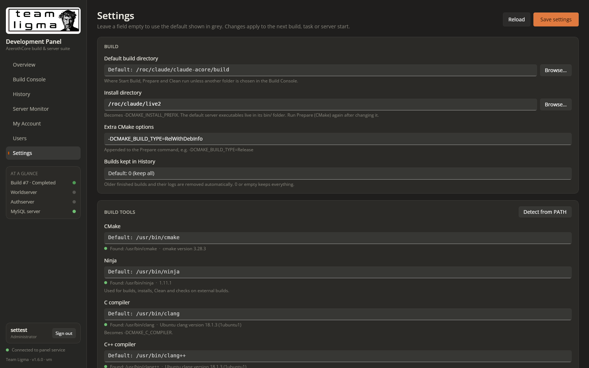
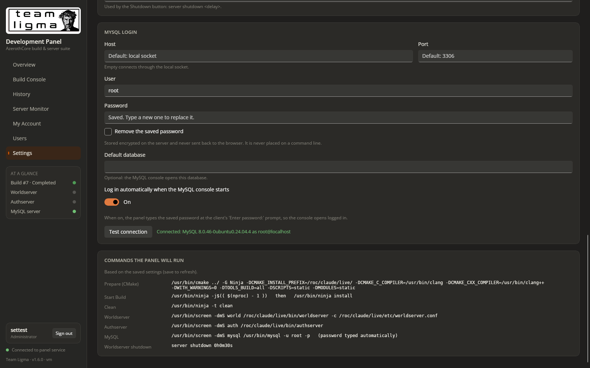

# Prompt
Add a settings panel:

* Set the default build directory
* Set the install directory (the value of the `-DCMAKE_INSTALL_PREFIX` CMake directive)
* Set the locations of the needed build tools
* Set the locations for the following excutables:
   * Worldserver executable
   * Authserver executable
   * MySQL executable
* MySQL login credentials
* Toggle MySQL auto-login
* Any other settings that might be useful

# Reponse
Added an administrator Settings page (v1.6.0).

**Settings**
- **Build:** default build directory; install directory, which becomes `-DCMAKE_INSTALL_PREFIX`; extra CMake options; how many builds History keeps (older records are pruned automatically).
- **Build tools:** CMake, Ninja, C compiler, C++ compiler and GNU screen paths, each with a found/version status and a **Detect from PATH** button.
- **Server executables:** Worldserver, Authserver and MySQL client paths; optional server config files (`-c`); the Worldserver shutdown delay used by the Shutdown button.
- **MySQL login:** host, port, user, password, default database, an **auto-login** toggle and **Test connection**.
- **Preview:** the exact commands the panel will run.

Empty fields use defaults (appsettings, tools on PATH, `<install dir>/bin`), shown as placeholder text.

**How it's applied:** Prepare, Start Build, install, Clean, the server consoles and the external-build checks are all composed from these settings.

**Security**
- The page is admin-only, because executable paths run as root.
- The MySQL password is encrypted at rest (data protection, mode 600). It's never returned to the browser, logged, or placed on a command line: auto-login types it at the prompt, and the connection test passes it in the environment.
- I also found that typed console input, including passwords, was left behind in a paste-buffer file. It's now written owner-only and deleted straight after use, and the old leftover file was removed.

**Tested**
- Tool detection and versions; validation (bad paths, ports and settings rejected; missing files saved as warnings).
- The MySQL connection test with right and wrong passwords.
- Encrypted storage, with no plain-text password in any file or log.
- Auto-login: the console reached `mysql>` and answered a query.
- Install-directory changes propagate to the CMake prefix and the server paths.
- The real Prepare run used the composed command (exit 0). The Worldserver started with `-c` and stopped gracefully with the configured shutdown command.
- In the browser: editing, saving and Test connection. Operators get 403 on the API, and the page doesn't appear for them.

My test settings and accounts were removed, so everything is back at its defaults.

# File Changes
| File | Type | Workspace path | Change |
|---|---|---|---|
| `v160-settings-mysql.png` | `Asset` | `Prompts/Team Ligma Development Panel/screenshots/v160-settings-mysql.png` | Created |
| `v160-settings-top.png` | `Asset` | `Prompts/Team Ligma Development Panel/screenshots/v160-settings-top.png` | Created |
| `README.md` | `Docs` | `README.md` | Changed |
| `Dtos.cs` | `Code` | `src/Shared/Dtos.cs` | Changed |
| `BuildService.cs` | `Code` | `src/TeamLigma.Panel.Server/BuildService.cs` | Changed |
| `ConsoleService.cs` | `Code` | `src/TeamLigma.Panel.Server/ConsoleService.cs` | Changed |
| `ExternalBuildMonitor.cs` | `Code` | `src/TeamLigma.Panel.Server/ExternalBuildMonitor.cs` | Changed |
| `Program.cs` | `Code` | `src/TeamLigma.Panel.Server/Program.cs` | Changed |
| `SettingsApi.cs` | `Code` | `src/TeamLigma.Panel.Server/SettingsApi.cs` | Created |
| `SettingsStore.cs` | `Code` | `src/TeamLigma.Panel.Server/SettingsStore.cs` | Created |
| `Shell.cs` | `Code` | `src/TeamLigma.Panel.Server/Shell.cs` | Changed |
| `TeamLigma.Panel.Server.csproj` | `Config` | `src/TeamLigma.Panel.Server/TeamLigma.Panel.Server.csproj` | Changed |
| `ApiClient.cs` | `Code` | `src/TeamLigma.Panel/TeamLigma.Panel/Services/ApiClient.cs` | Changed |
| `TeamLigma.Panel.csproj` | `Config` | `src/TeamLigma.Panel/TeamLigma.Panel/TeamLigma.Panel.csproj` | Changed |
| `ConsolePanel.xaml.cs` | `Code` | `src/TeamLigma.Panel/TeamLigma.Panel/Views/ConsolePanel.xaml.cs` | Changed |
| `SettingsView.cs` | `Code` | `src/TeamLigma.Panel/TeamLigma.Panel/Views/SettingsView.cs` | Created |
| `Shell.xaml` | `Code` | `src/TeamLigma.Panel/TeamLigma.Panel/Views/Shell.xaml` | Changed |
| `Shell.xaml.cs` | `Code` | `src/TeamLigma.Panel/TeamLigma.Panel/Views/Shell.xaml.cs` | Changed |

Environment: `/roc/claude/panel/` redeployed (v1.6.0); runtime file `/roc/claude/panel-data/settings.json`.

# Code Diffs
### `README.md` (Changed)
```diff
diff --git a/README.md b/README.md
index 9f8b8b2..945b7f1 100644
--- a/README.md
+++ b/README.md
@@ -1,7 +1,7 @@
 <p align="center"></p>
 
 # Team Ligma Development Panel
-**Version 1.5.0**
+**Version 1.6.0**
 
 One dark, burnt-orange control room for an AzerothCore test realm. Kick off builds, watch every object compile in real time, look back at old logs, and talk to the Worldserver, Authserver and MySQL from your browser. No SSH session needed.
 
@@ -13,6 +13,24 @@ nginx serves both on port **26767**.
 
 ---
 
+## Settings
+Administrators get a **Settings** page. Leave a field empty to use the default shown in grey. Changes apply to the next build, task or server start, and every save is recorded in the audit log.
+
+| Section | Settings |
+|---|---|
+| **Build** | Default build directory; install directory (becomes `-DCMAKE_INSTALL_PREFIX`); extra CMake options appended to Prepare; how many finished builds History keeps (older records and logs are removed automatically). |
+| **Build tools** | Paths to CMake, Ninja, the C and C++ compilers (become `-DCMAKE_C_COMPILER` / `-DCMAKE_CXX_COMPILER`) and GNU screen. Each shows whether it was found and its version. **Detect from PATH** fills them in. |
+| **Server executables** | Worldserver, Authserver and MySQL client executables (the server defaults are `<install dir>/bin/…`); optional Worldserver/Authserver config files (passed as `-c`); the Worldserver shutdown delay used by the Shutdown button. |
+| **MySQL login** | Host (empty = local socket), port, user, password, default database, and **auto-login**. With auto-login on, the panel types the saved password at the client's `Enter password:` prompt, so the MySQL console opens logged in. **Test connection** checks the login. |
+| **Preview** | The exact commands the panel will run with the saved settings. |
+
+How the MySQL password is protected:
+- it's encrypted on the server with ASP.NET Core data protection, in `settings.json` (mode 600);
+- it's never sent back to the browser or written to any log;
+- it's never placed on a command line: the console uses `mysql -p` and types it at the prompt, and Test connection passes it in the client's environment.
+
+Console input is pasted through a temporary owner-only file that's deleted immediately afterwards.
+
 ## Loading screen
 While the WebAssembly app downloads and starts, the panel shows a dark, fantasy-MMO-styled loading screen:
 - **Look:** a stone backdrop with drifting embers, an original gold crest (shield, sword, smithing hammer and gear inside a turning rune ring), the title in Cinzel Decorative, and an ornate gold-framed loading bar.
@@ -72,6 +90,8 @@ cd /roc/claude/panel/server && sudo dotnet TeamLigma.Panel.Server.dll user-reset
 
 ## Commands the panel runs
 
+These are the defaults; **Settings** can change the tool paths, the install directory, the executables and the MySQL login, and its preview shows the commands actually used.
+
 | Control | Command (cwd = the build directory, default `/roc/claude/claude-acore/build`) |
 |---|---|
 | Start Build | `ninja -j$(( $(nproc) - 1 ))`, then `ninja install` if the build succeeded. A thread count chosen under **CPU threads** replaces the `-j` value. |
@@ -80,7 +100,7 @@ cd /roc/claude/panel/server && sudo dotnet TeamLigma.Panel.Server.dll user-reset
 | Force Stop | Sends SIGTERM to ninja-dash, which stops ninja's process group and records the build as *Stopped* |
 | Worldserver | `screen -dmS world ./worldserver` (cwd `/roc/claude/live/bin`) |
 | Authserver | `screen -dmS auth ./authserver` (cwd `/roc/claude/live/bin`) |
-| MySQL | `screen -dmS mysql mysql -uroot -p` |
+| MySQL | `screen -dmS mysql mysql -u root -p` (plus `-h`/`-P`/database from Settings) |
 
 All of these are set in `src/TeamLigma.Panel.Server/appsettings.json` (`Panel` section). Start Build uses `BuildCommand` and `InstallCommand`.
```

### `src/Shared/Dtos.cs` (Changed)
```diff
diff --git a/src/Shared/Dtos.cs b/src/Shared/Dtos.cs
index 2f9f074..9f6cc7d 100644
--- a/src/Shared/Dtos.cs
+++ b/src/Shared/Dtos.cs
@@ -88,6 +88,10 @@ public sealed class ServerStatus
     /// <summary>"password" when the console is waiting for a hidden password.</summary>
     public string? InputHint { get; set; }
     public string Command { get; set; } = "";
+    /// <summary>Worldserver only: the graceful shutdown command for the Shutdown button.</summary>
+    public string? ShutdownCommand { get; set; }
+    /// <summary>MySQL only: the panel will type the stored password at the prompt.</summary>
+    public bool AutoLogin { get; set; }
 }
 
 public sealed class LogChunk
@@ -295,3 +299,76 @@ public static class BuildSources
     /// <summary>A ninja process started outside the panel, detected and observed by it.</summary>
     public const string External = "external";
 }
+
+// ---------------- Settings (v1.6.0) ----------------
+
+public sealed class ToolStatus
+{
+    public string Key { get; set; } = "";
+    public string Label { get; set; } = "";
+    public string Path { get; set; } = "";
+    public bool Found { get; set; }
+    public string? Version { get; set; }
+}
+
+public sealed class CommandPreview
+{
+    public string Label { get; set; } = "";
+    public string Command { get; set; } = "";
+}
+
+/// <summary>Panel settings. Null/empty string fields mean "use the default" (see Defaults).</summary>
+public sealed class PanelSettingsDto
+{
+    // Build
+    public string? DefaultBuildDir { get; set; }
+    public string? InstallDir { get; set; }
+    public string? ExtraCMakeArgs { get; set; }
+    public int? HistoryRetention { get; set; }
+
+    // Build tools
+    public string? CMakePath { get; set; }
+    public string? NinjaPath { get; set; }
+    public string? CCompilerPath { get; set; }
+    public string? CxxCompilerPath { get; set; }
+    public string? ScreenPath { get; set; }
+
+    // Servers
+    public string? WorldserverPath { get; set; }
+    public string? AuthserverPath { get; set; }
+    public string? MySqlClientPath { get; set; }
+    public string? WorldserverConfig { get; set; }
+    public string? AuthserverConfig { get; set; }
+    public int? ShutdownDelaySeconds { get; set; }
+
+    // MySQL login
+    public string? MySqlHost { get; set; }
+    public int? MySqlPort { get; set; }
+    public string? MySqlUser { get; set; }
+    public string? MySqlDatabase { get; set; }
+    public bool MySqlAutoLogin { get; set; }
+    /// <summary>Response only: whether a password is stored (it is never sent to the browser).</summary>
+    public bool MySqlPasswordSet { get; set; }
+    /// <summary>Request only: a new password; null leaves the stored one unchanged.</summary>
+    public string? MySqlNewPassword { get; set; }
+    /// <summary>Request only: remove the stored password.</summary>
+    public bool MySqlClearPassword { get; set; }
+
+    // Response only
+    public Dictionary<string, string> Defaults { get; set; } = new();
+    public List<ToolStatus> Tools { get; set; } = new();
+    public List<CommandPreview> Preview { get; set; } = new();
+}
+
+public sealed class SettingsSaveResult
+{
+    public bool Ok { get; set; }
+    public string Message { get; set; } = "";
+    public List<string> Warnings { get; set; } = new();
+    public PanelSettingsDto? Settings { get; set; }
+}
+
+public sealed class DetectedTools
+{
+    public Dictionary<string, string> Paths { get; set; } = new();
+}
```

### `src/TeamLigma.Panel.Server/BuildService.cs` (Changed)
```diff
diff --git a/src/TeamLigma.Panel.Server/BuildService.cs b/src/TeamLigma.Panel.Server/BuildService.cs
index e974533..8503149 100644
--- a/src/TeamLigma.Panel.Server/BuildService.cs
+++ b/src/TeamLigma.Panel.Server/BuildService.cs
@@ -17,53 +17,41 @@ public sealed class BuildService
     string? _taskLog;
     int _taskSeq;
     DateTimeOffset _lastTaskStart = DateTimeOffset.MinValue;
-    string? _buildDirOverride;
-    int? _jobs;
-    string SettingsPath => Path.Combine(_o.DataHome, "settings.json");
+    readonly SettingsStore _settings;
+    int? _jobs => _settings.Jobs;
 
-    /// <summary>The active build directory: the one chosen in the panel, else Panel:BuildDir from appsettings.</summary>
-    public string BuildDir => _buildDirOverride ?? _o.BuildDir;
+    /// <summary>The active build directory: the one chosen in the Build Console, else the default from Settings.</summary>
+    public string BuildDir => _settings.BuildDir;
 
     /// <summary>Fills a configured command for the active build directory.
     /// Accepts the {BuildDir} placeholder, and also rewrites the default path in older configs.</summary>
     public string Cmd(string template) => template.Replace(_o.BuildDir, "{BuildDir}").Replace("{BuildDir}", BuildDir);
 
-    public BuildService(IOptions<PanelOptions> o, ILogger<BuildService> log)
+    public BuildService(IOptions<PanelOptions> o, ILogger<BuildService> log, SettingsStore settings)
     {
         _o = o.Value;
         _log = log;
+        _settings = settings;
         Directory.CreateDirectory(_o.BuildsDir);
         Directory.CreateDirectory(_o.TasksDir);
         Directory.CreateDirectory(_o.ScreenDir);
         _taskSeq = Directory.GetFiles(_o.TasksDir, "*.log").Length;
-        try
-        {
-            if (File.Exists(SettingsPath))
-            {
-                var root = JsonDocument.Parse(File.ReadAllText(SettingsPath)).RootElement;
-                if (root.TryGetProperty("buildDir", out var bd) && bd.ValueKind == JsonValueKind.String && !string.IsNullOrWhiteSpace(bd.GetString()))
-                    _buildDirOverride = bd.GetString();
-                if (root.TryGetProperty("jobs", out var j) && j.ValueKind == JsonValueKind.Number) _jobs = j.GetInt32();
-            }
-        }
-        catch (Exception ex) { _log.LogWarning(ex, "Ignoring unreadable {Path}", SettingsPath); }
     }
 
     public BuildSettings Settings() => new()
     {
         BuildDir = BuildDir,
-        DefaultBuildDir = _o.BuildDir,
+        DefaultBuildDir = _settings.DefaultBuildDir,
         Ready = File.Exists(Path.Combine(BuildDir, "build.ninja")),
         SourceFound = File.Exists(Path.Combine(Path.GetDirectoryName(BuildDir.TrimEnd('/')) ?? "/", "CMakeLists.txt")),
         BuildCommand = _o.BuildCommand,
-        InstallCommand = _o.InstallCommand,
+        InstallCommand = _settings.NinjaCommand(Cmd(_o.InstallCommand)),
         Jobs = _jobs,
         EffectiveJobs = EffectiveJobs(CpuTopology.Detect()),
         EffectiveBuildCommand = EffectiveBuildCommand(),
         Cpu = CpuTopology.Detect(),
     };
 
-    void SaveSettings() => File.WriteAllText(SettingsPath, JsonSerializer.Serialize(new { buildDir = _buildDirOverride, jobs = _jobs }, Json));
 
     // Matches the -j argument of the build command: "-j$(( ... ))", "-j 8" or "-j8".
     static readonly System.Text.RegularExpressions.Regex JobsArg =
@@ -78,6 +66,7 @@ public sealed class BuildService
     {
         var cmd = Cmd(_o.BuildCommand);
         if (cmd.Contains("ninja-dash")) return cmd; // legacy launch line, used verbatim
+        cmd = _settings.NinjaCommand(cmd);
         var cpu = CpuTopology.Detect();
         if (_jobs == null && cpu.LogicalCpus > 1) return cmd;
         var jobs = EffectiveJobs(cpu);
@@ -89,8 +78,7 @@ public sealed class BuildService
         var cpu = CpuTopology.Detect();
         if (jobs is { } j && (j < cpu.MinJobs || j > cpu.MaxJobs))
             return Fail($"Choose between {cpu.MinJobs} and {cpu.MaxJobs} threads (this host has {cpu.LogicalCpus} logical CPUs).");
-        _jobs = jobs;
-        SaveSettings();
+        _settings.Update(s => s.Jobs = jobs);
         if (jobs == null) return Ok($"CPU threads set to automatic ({EffectiveJobs(cpu)}).");
         var warn = jobs > cpu.MemorySafeJobs ? $" Warning: {jobs} jobs may exceed RAM ({cpu.MemTotal / 1024 / 1024 / 1024} GB; about {cpu.MemorySafeJobs} is safe)." : "";
         return Ok($"CPU threads set to {jobs}.{warn}");
@@ -105,8 +93,8 @@ public sealed class BuildService
     {
         var build = EffectiveBuildCommand();
         if (build.Contains("ninja-dash")) return build;
-        return $"screen -dmS {SessionFor(BuildDir)} ninja-dash {Quote(BuildDir)} --build-cmd {Quote(build)}" +
-               (string.IsNullOrWhiteSpace(_o.InstallCommand) ? "" : $" --install-cmd {Quote(Cmd(_o.InstallCommand))}");
+        return $"{SettingsStore.Q(_settings.Screen)} -dmS {SessionFor(BuildDir)} ninja-dash {Quote(BuildDir)} --build-cmd {Quote(build)}" +
+               (string.IsNullOrWhiteSpace(_o.InstallCommand) ? "" : $" --install-cmd {Quote(_settings.NinjaCommand(Cmd(_o.InstallCommand)))}");
     }
 
     public ActionResult SetBuildDir(string path)
@@ -116,8 +104,8 @@ public sealed class BuildService
         if (full.Length == 0) full = "/";
         if (!Directory.Exists(full)) return Fail($"{full} does not exist.");
         if (TaskRunning) return Fail($"Wait for '{Task.Name}' to finish first.");
-        _buildDirOverride = full == _o.BuildDir.TrimEnd('/') ? null : full;
-        SaveSettings();
+        var isDefault = full == _settings.DefaultBuildDir.TrimEnd('/');
+        _settings.Update(s => s.BuildDir = isDefault ? null : full);
         var s = Settings();
         var note = s.Ready ? "Ready to build." : s.SourceFound ? "Run Prepare (CMake) before building." : "Warning: no CMakeLists.txt in the parent folder, so Prepare ('cmake ../') will not find the source.";
         return Ok($"Build directory set to {full}. {note}");
@@ -207,6 +195,11 @@ public sealed class BuildService
 
     public BuildStatus? Current() => Running() ?? All().FirstOrDefault();
 
+    /// <summary>Panel:BuildDir from appsettings (the fallback when Settings has no default build directory).</summary>
+    public string DefaultBuildDirFromConfig => _o.BuildDir;
+
+    public string CleanCommand() => _settings.NinjaCommand(Cmd(_o.CleanCommand));
+
     /// <summary>Screen session name for a panel build in a directory, so builds in different directories don't collide.</summary>
     public static string SessionFor(string dir)
         => "build-" + Convert.ToHexString(System.Security.Cryptography.SHA1.HashData(System.Text.Encoding.UTF8.GetBytes(Normalize(dir))))[..8].ToLowerInvariant();
@@ -239,6 +232,20 @@ public sealed class BuildService
 
     public string BuildDirOf(int id) => Path.Combine(_o.BuildsDir, id.ToString());
 
+    /// <summary>Applies the History retention setting: keeps the newest N finished builds (0 = keep all).</summary>
+    public int Prune()
+    {
+        var keep = _settings.HistoryRetention;
+        if (keep <= 0) return 0;
+        var removed = 0;
+        foreach (var b in All().Where(b => !IsActive(b)).Skip(keep))
+        {
+            try { Directory.Delete(BuildDirOf(b.Id), true); removed++; } catch { }
+        }
+        if (removed > 0) _log.LogInformation("History retention: removed {Count} old build record(s)", removed);
+        return removed;
+    }
+
     public string LogPath(int id) => Path.Combine(_o.BuildsDir, id.ToString(), "build.log");
 
     public TaskState Task
@@ -261,10 +268,11 @@ public sealed class BuildService
         // Preflight: everything the screen session needs must be resolvable, or it dies silently.
         var session = SessionFor(BuildDir);
         var env = Env(session);
-        foreach (var tool in new[] { "screen", "ninja-dash", "ninja", "python3" })
-            if (Shell.Which(tool, env["PATH"]) == null)
-                return Fail($"'{tool}' was not found on the panel's PATH ({env["PATH"]}). " +
-                            (tool == "ninja-dash" ? "Re-run deploy/install.sh to install it to /usr/local/bin." : "Install it on the server."));
+        foreach (var (tool, path) in new[] { ("screen", _settings.Screen), ("ninja-dash", "ninja-dash"), ("ninja", _settings.Ninja), ("python3", "python3") })
+            if (Shell.Resolve(path, env["PATH"]) == null)
+                return Fail($"'{tool}' was not found ({path}). " +
+                            (tool == "ninja-dash" ? "Re-run deploy/install.sh to install it to /usr/local/bin."
+                             : tool is "screen" or "ninja" ? "Install it, or set its location in Settings." : "Install it on the server."));
         var nd = Shell.Which("ninja-dash", env["PATH"])!;
         try
         {
@@ -346,7 +354,7 @@ public sealed class BuildService
         for (var i = 0; i < 50 && Shell.IsNinjaDash(r.Pid); i++) await System.Threading.Tasks.Task.Delay(200);
         var session = r.BuildDir != null ? SessionFor(r.BuildDir) : "build";
         var sessions = await Shell.ScreenSessionsAsync();
-        if (sessions.Contains(session)) await Shell.RunAsync("screen", new[] { "-S", session, "-X", "quit" });
+        if (sessions.Contains(session)) await Shell.RunAsync(Shell.ScreenExe, new[] { "-S", session, "-X", "quit" });
         return Ok($"Build #{r.Id} stopped.");
     }
 
@@ -362,14 +370,14 @@ public sealed class BuildService
     public ActionResult Configure()
     {
         Directory.CreateDirectory(BuildDir);
-        return StartTask("Prepare (CMake)", Cmd(_o.ConfigureCommand));
+        return StartTask("Prepare (CMake)", _settings.ConfigureCommand());
     }
 
     public ActionResult Clean()
     {
         if (!File.Exists(Path.Combine(BuildDir, "build.ninja")))
             return Fail("Nothing to clean: the build directory has not been prepared.");
-        return StartTask("Clean (ninja -t clean)", Cmd(_o.CleanCommand));
+        return StartTask("Clean (ninja -t clean)", CleanCommand());
     }
 
     ActionResult StartTask(string name, string command)
```

### `src/TeamLigma.Panel.Server/ConsoleService.cs` (Changed)
```diff
diff --git a/src/TeamLigma.Panel.Server/ConsoleService.cs b/src/TeamLigma.Panel.Server/ConsoleService.cs
index 6274e9b..a90ce06 100644
--- a/src/TeamLigma.Panel.Server/ConsoleService.cs
+++ b/src/TeamLigma.Panel.Server/ConsoleService.cs
@@ -10,23 +10,34 @@ namespace TeamLigma.Panel.Server;
 /// </summary>
 public sealed class ConsoleService
 {
-    public sealed record Component(string Name, string Title, string Exe, Func<PanelOptions, string> Command, string Cwd);
+    /// <summary>A console component. Paths and commands come from Settings, so they are evaluated each time.</summary>
+    public sealed record Component(string Name, string Title, Func<string> ExePath, Func<string> Command)
+    {
+        /// <summary>Process name as /proc/&lt;pid&gt;/comm shows it (truncated to 15 characters by the kernel).</summary>
+        public string Comm { get { var n = Path.GetFileName(ExePath()); return n.Length > 15 ? n[..15] : n; } }
+        /// <summary>Servers run from their own bin directory (AzerothCore resolves paths relative to it).</summary>
+        public string Cwd { get { var d = Path.GetDirectoryName(ExePath()); return d != null && Directory.Exists(d) ? d : "/"; } }
+    }
 
     readonly PanelOptions _o;
     readonly BuildService _builds;
+    readonly SettingsStore _settings;
+    readonly ILogger<ConsoleService> _log;
     public IReadOnlyDictionary<string, Component> Components { get; }
 
-    public ConsoleService(IOptions<PanelOptions> o, BuildService builds)
+    public ConsoleService(IOptions<PanelOptions> o, BuildService builds, SettingsStore settings, ILogger<ConsoleService> log)
     {
         _o = o.Value;
         _builds = builds;
+        _settings = settings;
+        _log = log;
         Directory.CreateDirectory(_o.ConsolesDir);
         Directory.CreateDirectory(_o.UploadsDir);
         Components = new Dictionary<string, Component>
         {
-            ["world"] = new("world", "Worldserver", "worldserver", x => x.WorldCommand, _o.BinDir),
-            ["auth"] = new("auth", "Authserver", "authserver", x => x.AuthCommand, _o.BinDir),
-            ["mysql"] = new("mysql", "MySQL", "mysql", x => x.MySqlCommand, _o.BinDir),
+            ["world"] = new("world", "Worldserver", () => _settings.Worldserver, _settings.WorldserverCommand),
+            ["auth"] = new("auth", "Authserver", () => _settings.Authserver, _settings.AuthserverCommand),
+            ["mysql"] = new("mysql", "MySQL", () => _settings.MySqlClient, _settings.MySqlCommand),
         };
     }
 
@@ -38,7 +49,7 @@ public sealed class ConsoleService
         var list = new List<ServerStatus>();
         foreach (var c in Components.Values)
         {
-            var pid = Shell.FindPid(c.Exe);
+            var pid = Shell.FindPid(c.Comm);
             var st = new ServerStatus
             {
                 Name = c.Name,
@@ -46,7 +57,9 @@ public sealed class ConsoleService
                 SessionActive = sessions.Contains(c.Name),
                 ProcessRunning = pid != null,
                 Pid = pid,
-                Command = c.Command(_o),
+                Command = c.Command(),
+                ShutdownCommand = c.Name == "world" ? _settings.ShutdownCommand() : null,
+                AutoLogin = c.Name == "mysql" && _settings.MySqlAutoLogin && _settings.MySqlPasswordSet,
             };
             if (st.SessionActive && TailEndsWith(LogFile(c.Name), "password:")) st.InputHint = "password";
             list.Add(st);
@@ -73,18 +86,44 @@ public sealed class ConsoleService
         if (!Components.TryGetValue(name, out var c)) return Fail("Unknown console.");
         var sessions = await Shell.ScreenSessionsAsync();
         if (sessions.Contains(name)) return Fail($"{c.Title} session is already running.");
-        if (name != "mysql" && !File.Exists(Path.Combine(_o.BinDir, c.Exe)))
-            return Fail($"{c.Exe} is not installed in {_o.BinDir}. Build and install the server first.");
-        if (name != "mysql" && Shell.FindPid(c.Exe) is { } pid)
-            return Fail($"{c.Exe} is already running outside the panel (pid {pid}).");
+        var exe = c.ExePath();
+        if (Shell.Resolve(exe, SettingsStore.SystemPath) == null)
+            return Fail(name == "mysql"
+                ? $"The MySQL client was not found ({exe}). Install it, or set its location in Settings."
+                : $"{exe} was not found or is not executable. Build and install the server, or set its location in Settings.");
+        if (name != "mysql" && Shell.FindPid(c.Comm) is { } pid)
+            return Fail($"{c.Comm} is already running outside the panel (pid {pid}).");
         var log = LogFile(name);
-        var header = $"\u001b[38;5;208m== Team Ligma panel: starting {c.Title} at {DateTimeOffset.Now:yyyy-MM-dd HH:mm:ss}\u001b[0m\n== $ {c.Command(_o)}\n";
+        var command = c.Command();
+        var header = $"\u001b[38;5;208m== Team Ligma panel: starting {c.Title} at {DateTimeOffset.Now:yyyy-MM-dd HH:mm:ss}\u001b[0m\n== $ {command}\n";
         await File.AppendAllTextAsync(log, header);
         var env = _builds.Env(name);
         env["SCREENRC"] = _builds.ScreenRc(name, log);
-        var cwd = Directory.Exists(c.Cwd) ? c.Cwd : "/";
-        var (code, output) = await Shell.BashAsync(c.Command(_o), cwd, env);
-        return code == 0 ? Ok($"{c.Title} started.") : Fail($"Failed to start {c.Title} (exit {code}): {output}");
+        var (code, output) = await Shell.BashAsync(command, c.Cwd, env);
+        if (code != 0) return Fail($"Failed to start {c.Title} (exit {code}): {output}");
+        if (name == "mysql" && _settings.MySqlAutoLogin && _settings.MySqlPassword() is { } password)
+        {
+            _ = AutoLoginAsync(log, password);
+            return Ok("MySQL started; logging in automatically.");
+        }
+        return Ok($"{c.Title} started.");
+    }
+
+    /// <summary>Types the stored password when the client shows its "Enter password:" prompt.</summary>
+    async Task AutoLoginAsync(string log, string password)
+    {
+        for (var i = 0; i < 75; i++) // up to 15 s
+        {
+            await Task.Delay(200);
+            if (!(await Shell.ScreenSessionsAsync()).Contains("mysql")) return;
+            if (TailEndsWith(log, "password:"))
+            {
+                var ok = await Shell.ScreenTypeAsync("mysql", password, true, _o.ScreenDir);
+                _log.LogInformation("MySQL auto-login {Result}", ok ? "sent the stored password" : "could not type into the session");
+                return;
+            }
+        }
+        _log.LogWarning("MySQL auto-login: no password prompt appeared within 15 seconds");
     }
 
     public async Task<ActionResult> InputAsync(string name, string text)
```

### `src/TeamLigma.Panel.Server/ExternalBuildMonitor.cs` (Changed)
```diff
diff --git a/src/TeamLigma.Panel.Server/ExternalBuildMonitor.cs b/src/TeamLigma.Panel.Server/ExternalBuildMonitor.cs
index de48713..65fcdf7 100644
--- a/src/TeamLigma.Panel.Server/ExternalBuildMonitor.cs
+++ b/src/TeamLigma.Panel.Server/ExternalBuildMonitor.cs
@@ -45,8 +45,13 @@ public sealed class ExternalBuildMonitor : BackgroundService
         public string LogPath = "", StatusPath = "";
     }
 
-    public ExternalBuildMonitor(BuildService builds, ILogger<ExternalBuildMonitor> log, IOptions<PanelOptions> o)
+    static SettingsStore? _settings;
+    static string NinjaExe => _settings?.Ninja ?? "ninja";
+    int _ticks;
+
+    public ExternalBuildMonitor(BuildService builds, ILogger<ExternalBuildMonitor> log, IOptions<PanelOptions> o, SettingsStore settings)
     {
+        _settings = settings;
         _builds = builds;
         _log = log;
         _tmp = Path.Combine(o.Value.DataHome, "tmp");
@@ -58,7 +63,11 @@ public sealed class ExternalBuildMonitor : BackgroundService
         try { Readopt(); } catch (Exception ex) { _log.LogWarning(ex, "Could not re-adopt external builds"); }
         while (!ct.IsCancellationRequested)
         {
-            try { await Tick(); }
+            try
+            {
+                await Tick();
+                if (++_ticks % 30 == 0) _builds.Prune(); // History retention, about once a minute
+            }
             catch (Exception ex) { _log.LogWarning(ex, "External build scan failed"); }
             await Task.Delay(2000, ct).ContinueWith(_ => { });
         }
@@ -284,9 +293,9 @@ public sealed class ExternalBuildMonitor : BackgroundService
             Directory.CreateDirectory(work);
             if (hasDeps) File.Copy(deps, Path.Combine(work, "deps"), true);
             File.Copy(log, Path.Combine(work, "log"), true);
-            var script = "mount --bind \"$3\" \"$4\" || exit 97; if [ -n \"$1\" ]; then mount --bind \"$1\" \"$2\" || exit 97; fi; shift 4; exec ninja -n \"$@\"";
+            var script = "mount --bind \"$3\" \"$4\" || exit 97; if [ -n \"$1\" ]; then mount --bind \"$1\" \"$2\" || exit 97; fi; shift 4; exec \"$@\"";
             var args = new List<string> { "-m", "--propagation", "private", "/bin/bash", "-c", script, "dryrun",
-                hasDeps ? Path.Combine(work, "deps") : "", deps, Path.Combine(work, "log"), log, "-C", o.Dir };
+                hasDeps ? Path.Combine(work, "deps") : "", deps, Path.Combine(work, "log"), log, NinjaExe, "-n", "-C", o.Dir };
             args.AddRange(o.Targets);
             var (code, output) = await Shell.RunAsync("unshare", args, o.Dir,
                 new Dictionary<string, string> { ["NINJA_STATUS"] = "[%f/%t] " }, timeoutMs: 60000);
@@ -363,7 +372,7 @@ public sealed class ExternalBuildMonitor : BackgroundService
     {
         var args = new List<string> { "-C", dir, "-t", "commands" };
         args.AddRange(targets);
-        var (code, output) = await Shell.RunAsync("ninja", args, dir, timeoutMs: 60000);
+        var (code, output) = await Shell.RunAsync(NinjaExe, args, dir, timeoutMs: 60000);
         return code == 0 ? output.Split('\n').Count(l => l.Trim().Length > 0) : 0;
     }
 
@@ -376,7 +385,7 @@ public sealed class ExternalBuildMonitor : BackgroundService
     {
         var args = new List<string> { "-C", dir, "-n", "-d", "explain" };
         args.AddRange(targets);
-        var (code, output) = await Shell.RunAsync("ninja", args, dir, timeoutMs: 120000);
+        var (code, output) = await Shell.RunAsync(NinjaExe, args, dir, timeoutMs: 120000);
         if (code != 0) return -1;
         var phony = new HashSet<string>();
         var dirty = new HashSet<string>();
```

### `src/TeamLigma.Panel.Server/Program.cs` (Changed)
```diff
diff --git a/src/TeamLigma.Panel.Server/Program.cs b/src/TeamLigma.Panel.Server/Program.cs
index c83f5a5..bf85a66 100644
--- a/src/TeamLigma.Panel.Server/Program.cs
+++ b/src/TeamLigma.Panel.Server/Program.cs
@@ -16,6 +16,8 @@ builder.Services.AddDataProtection()
 
 builder.Services.AddSingleton<UserStore>();
 builder.Services.AddSingleton<AuthService>();
+builder.Services.AddSingleton<SettingsStore>();
+builder.Services.AddSingleton<SettingsApi>();
 builder.Services.AddSingleton<BuildService>();
 builder.Services.AddSingleton<ConsoleService>();
 builder.Services.AddSingleton<SystemMonitor>();
@@ -121,6 +123,23 @@ users.MapDelete("/{name}", (HttpContext ctx, string name, AuthService a) => a.De
 users.MapPost("/{name}/role", (HttpContext ctx, string name, SetRoleRequest r, AuthService a) => a.SetRole(ctx, Admin(ctx), name, r.Role));
 users.MapPost("/{name}/password", (HttpContext ctx, string name, LoginRequest r, AuthService a) => a.AdminResetPassword(ctx, Admin(ctx), name, r.Password));
 users.MapPost("/{name}/reset-totp", (HttpContext ctx, string name, AuthService a) => a.AdminResetTotp(ctx, Admin(ctx), name));
+var settings = api.MapGroup("/settings").RequireAuthorization("admin");
+settings.MapGet("", (SettingsApi s) => s.GetAsync());
+settings.MapPut("", async (HttpContext ctx, PanelSettingsDto r, SettingsApi s, AuthService a) =>
+{
+    var result = await s.SaveAsync(r);
+    a.Audit(ctx, Admin(ctx), result.Ok
+        ? "settings saved" + (r.MySqlClearPassword ? " (MySQL password removed)" : r.MySqlNewPassword is { Length: > 0 } ? " (MySQL password changed)" : "")
+        : $"settings save refused: {result.Message}");
+    return result;
+});
+settings.MapPost("/detect", (SettingsApi s) => s.Detect());
+settings.MapPost("/mysql/test", async (HttpContext ctx, PanelSettingsDto r, SettingsApi s, AuthService a) =>
+{
+    var result = await s.TestMySqlAsync(r);
+    a.Audit(ctx, Admin(ctx), "tested MySQL login: " + (result.Ok ? "ok" : "failed"));
+    return result;
+});
 users.MapPost("/{name}/unlock", (HttpContext ctx, string name, AuthService a) => a.Unlock(ctx, Admin(ctx), name));
 
 // ---- Panel (any signed-in user may read; operators/admins may act) ----
```

### `src/TeamLigma.Panel.Server/SettingsApi.cs` (Created)
```diff
diff --git a/src/TeamLigma.Panel.Server/SettingsApi.cs b/src/TeamLigma.Panel.Server/SettingsApi.cs
new file mode 100644
index 0000000..1efdf64
--- /dev/null
+++ b/src/TeamLigma.Panel.Server/SettingsApi.cs
@@ -0,0 +1,249 @@
+using System.Text.RegularExpressions;
+using TeamLigma.Shared;
+
+namespace TeamLigma.Panel.Server;
+
+/// <summary>Settings page backend: read, validate and save settings; detect tools; test the MySQL login.</summary>
+public sealed class SettingsApi
+{
+    readonly SettingsStore _s;
+    readonly BuildService _builds;
+
+    public SettingsApi(SettingsStore s, BuildService builds)
+    {
+        _s = s;
+        _builds = builds;
+    }
+
+    public async Task<PanelSettingsDto> GetAsync()
+    {
+        var st = _s.Snapshot;
+        var dto = new PanelSettingsDto
+        {
+            DefaultBuildDir = st.DefaultBuildDir,
+            InstallDir = st.InstallDir,
+            ExtraCMakeArgs = st.ExtraCMakeArgs,
+            HistoryRetention = st.HistoryRetention,
+            CMakePath = st.CMakePath,
+            NinjaPath = st.NinjaPath,
+            CCompilerPath = st.CCompilerPath,
+            CxxCompilerPath = st.CxxCompilerPath,
+            ScreenPath = st.ScreenPath,
+            WorldserverPath = st.WorldserverPath,
+            AuthserverPath = st.AuthserverPath,
+            MySqlClientPath = st.MySqlClientPath,
+            WorldserverConfig = st.WorldserverConfig,
+            AuthserverConfig = st.AuthserverConfig,
+            ShutdownDelaySeconds = st.ShutdownDelaySeconds,
+            MySqlHost = st.MySqlHost,
+            MySqlPort = st.MySqlPort,
+            MySqlUser = st.MySqlUser,
+            MySqlDatabase = st.MySqlDatabase,
+            MySqlAutoLogin = st.MySqlAutoLogin,
+            MySqlPasswordSet = _s.MySqlPasswordSet,
+            Defaults = new()
+            {
+                ["DefaultBuildDir"] = _builds.DefaultBuildDirFromConfig,
+                ["InstallDir"] = _s.DefaultInstallDir,
+                ["CMakePath"] = _s.DefaultTool("cmake"),
+                ["NinjaPath"] = _s.DefaultTool("ninja"),
+                ["CCompilerPath"] = _s.DefaultCCompiler,
+                ["CxxCompilerPath"] = _s.DefaultCxxCompiler,
+                ["ScreenPath"] = _s.DefaultTool("screen"),
+                ["WorldserverPath"] = _s.DefaultWorldserver,
+                ["AuthserverPath"] = _s.DefaultAuthserver,
+                ["MySqlClientPath"] = _s.DefaultTool("mysql"),
+                ["ShutdownDelaySeconds"] = "10",
+                ["MySqlUser"] = "root",
+                ["MySqlHost"] = "local socket",
+                ["MySqlPort"] = "3306",
+                ["HistoryRetention"] = "0 (keep all)",
+            },
+        };
+        dto.Tools = await ToolStatusAsync();
+        dto.Preview = Preview();
+        return dto;
+    }
+
+    List<CommandPreview> Preview() => new()
+    {
+        new() { Label = "Prepare (CMake)", Command = _s.ConfigureCommand() },
+        new() { Label = "Start Build", Command = _builds.EffectiveBuildCommand() + "   then   " + _builds.Settings().InstallCommand },
+        new() { Label = "Clean", Command = _builds.CleanCommand() },
+        new() { Label = "Worldserver", Command = _s.WorldserverCommand() },
+        new() { Label = "Authserver", Command = _s.AuthserverCommand() },
+        new() { Label = "MySQL", Command = _s.MySqlCommand() + (_s.MySqlAutoLogin && _s.MySqlPasswordSet ? "   (password typed automatically)" : "") },
+        new() { Label = "Worldserver shutdown", Command = _s.ShutdownCommand() },
+    };
+
+    async Task<List<ToolStatus>> ToolStatusAsync()
+    {
+        var tools = new (string Key, string Label, string Path, string? VersionArg)[]
+        {
+            ("CMakePath", "CMake", _s.CMake, "--version"),
+            ("NinjaPath", "Ninja", _s.Ninja, "--version"),
+            ("CCompilerPath", "C compiler", _s.CCompiler, "--version"),
+            ("CxxCompilerPath", "C++ compiler", _s.CxxCompiler, "--version"),
+            ("ScreenPath", "GNU screen", _s.Screen, "-v"),
+            ("WorldserverPath", "Worldserver", _s.Worldserver, null),   // never run the servers just to ask for a version
+            ("AuthserverPath", "Authserver", _s.Authserver, null),
+            ("MySqlClientPath", "MySQL client", _s.MySqlClient, "--version"),
+        };
+        var tasks = tools.Select(async t =>
+        {
+            var resolved = Shell.Resolve(t.Path, SettingsStore.SystemPath);
+            var status = new ToolStatus { Key = t.Key, Label = t.Label, Path = resolved ?? t.Path, Found = resolved != null };
+            if (resolved != null && t.VersionArg != null)
+            {
+                var (code, output) = await Shell.RunAsync(resolved, new[] { t.VersionArg }, "/", timeoutMs: 4000);
+                var line = output.Split('\n').Select(l => l.Trim()).FirstOrDefault(l => l.Length > 0);
+                if (line != null && code is 0 or 1) status.Version = line.Length > 90 ? line[..90] : line;
+            }
+            return status;
+        });
+        return (await Task.WhenAll(tasks)).ToList();
+    }
+
+    public DetectedTools Detect()
+    {
+        var d = new DetectedTools();
+        void Find(string key, params string[] names)
+        {
+            foreach (var n in names)
+                if (Shell.Which(n, SettingsStore.SystemPath) is { } p) { d.Paths[key] = p; return; }
+        }
+        Find("CMakePath", "cmake");
+        Find("NinjaPath", "ninja", "ninja-build");
+        Find("CCompilerPath", "clang", "gcc", "cc");
+        Find("CxxCompilerPath", "clang++", "g++", "c++");
+        Find("ScreenPath", "screen");
+        Find("MySqlClientPath", "mysql", "mariadb");
+        if (File.Exists(_s.DefaultWorldserver)) d.Paths["WorldserverPath"] = _s.DefaultWorldserver;
+        if (File.Exists(_s.DefaultAuthserver)) d.Paths["AuthserverPath"] = _s.DefaultAuthserver;
+        return d;
+    }
+
+    static string? Clean(string? v) => string.IsNullOrWhiteSpace(v) ? null : v.Trim();
+
+    public async Task<SettingsSaveResult> SaveAsync(PanelSettingsDto r)
+    {
+        var errors = new List<string>();
+        var warnings = new List<string>();
+
+        string? Dir(string label, string? v, bool mustExist)
+        {
+            v = Clean(v);
+            if (v == null) return null;
+            if (!Path.IsPathRooted(v)) { errors.Add($"{label} must be an absolute path."); return v; }
+            v = Path.GetFullPath(v).TrimEnd('/');
+            if (v.Length == 0) v = "/";
+            if (!Directory.Exists(v)) (mustExist ? errors : warnings).Add($"{label}: {v} does not exist{(mustExist ? "" : " yet")}.");
+            return v;
+        }
+        string? Exe(string label, string? v)
+        {
+            v = Clean(v);
+            if (v == null) return null;
+            if (v.Contains('\n') || v.Contains('\0')) { errors.Add($"{label} contains invalid characters."); return v; }
+            if (!Path.IsPathRooted(v) && v.Contains('/')) { errors.Add($"{label} must be an absolute path or a command name on PATH."); return v; }
+            if (Shell.Resolve(v, SettingsStore.SystemPath) == null) warnings.Add($"{label}: {v} was not found or is not executable.");
+            return v;
+        }
+        string? FileOpt(string label, string? v)
+        {
+            v = Clean(v);
+            if (v == null) return null;
+            if (!Path.IsPathRooted(v)) { errors.Add($"{label} must be an absolute path."); return v; }
+            if (!File.Exists(v)) warnings.Add($"{label}: {v} does not exist.");
+            return v;
+        }
+
+        var defaultBuildDir = Dir("Default build directory", r.DefaultBuildDir, mustExist: false);
+        var installDir = Dir("Install directory", r.InstallDir, mustExist: false);
+        var cmake = Exe("CMake", r.CMakePath);
+        var ninja = Exe("Ninja", r.NinjaPath);
+        var cc = Exe("C compiler", r.CCompilerPath);
+        var cxx = Exe("C++ compiler", r.CxxCompilerPath);
+        var screen = Exe("GNU screen", r.ScreenPath);
+        var world = Exe("Worldserver executable", r.WorldserverPath);
+        var auth = Exe("Authserver executable", r.AuthserverPath);
+        var mysql = Exe("MySQL client", r.MySqlClientPath);
+        var worldConf = FileOpt("Worldserver config file", r.WorldserverConfig);
+        var authConf = FileOpt("Authserver config file", r.AuthserverConfig);
+        var extra = Clean(r.ExtraCMakeArgs);
+        if (extra != null && (extra.Contains('\n') || extra.Contains('\r'))) errors.Add("Extra CMake options must be on one line.");
+        if (r.MySqlPort is { } port && (port < 1 || port > 65535)) errors.Add("MySQL port must be between 1 and 65535.");
+        if (r.ShutdownDelaySeconds is { } sd && (sd < 0 || sd > 3600)) errors.Add("Shutdown delay must be between 0 and 3600 seconds.");
+        if (r.HistoryRetention is { } hr && (hr < 0 || hr > 100000)) errors.Add("History retention must be 0 (keep all) or a positive number.");
+        var host = Clean(r.MySqlHost);
+        if (host != null && !Regex.IsMatch(host, @"^[A-Za-z0-9._:\[\]-]+$")) errors.Add("MySQL host may only contain letters, digits, '.', '-', ':' and brackets.");
+        var user = Clean(r.MySqlUser);
+        if (user != null && Regex.IsMatch(user, @"\s")) errors.Add("MySQL user may not contain spaces.");
+        var db = Clean(r.MySqlDatabase);
+        if (db != null && !Regex.IsMatch(db, @"^[A-Za-z0-9_$]+$")) errors.Add("MySQL database name may only contain letters, digits, '_' and '$'.");
+        if (r.MySqlNewPassword is { Length: > 0 } np && (np.Contains('\n') || np.Contains('\r'))) errors.Add("The MySQL password may not contain line breaks.");
+        var willHavePassword = r.MySqlClearPassword ? false : r.MySqlNewPassword is { Length: > 0 } || _s.MySqlPasswordSet;
+        if (r.MySqlAutoLogin && !willHavePassword) errors.Add("MySQL auto-login needs a saved password.");
+
+        if (errors.Count > 0)
+            return new SettingsSaveResult { Message = string.Join(" ", errors), Warnings = warnings };
+
+        var newPassword = r.MySqlNewPassword is { Length: > 0 } p ? _s.Protect(p) : null;
+        _s.Update(s =>
+        {
+            s.DefaultBuildDir = defaultBuildDir;
+            s.InstallDir = installDir;
+            s.ExtraCMakeArgs = extra;
+            s.HistoryRetention = r.HistoryRetention is > 0 ? r.HistoryRetention : null;
+            s.CMakePath = cmake;
+            s.NinjaPath = ninja;
+            s.CCompilerPath = cc;
+            s.CxxCompilerPath = cxx;
+            s.ScreenPath = screen;
+            s.WorldserverPath = world;
+            s.AuthserverPath = auth;
+            s.MySqlClientPath = mysql;
+            s.WorldserverConfig = worldConf;
+            s.AuthserverConfig = authConf;
+            s.ShutdownDelaySeconds = r.ShutdownDelaySeconds;
+            s.MySqlHost = host;
+            s.MySqlPort = r.MySqlPort;
+            s.MySqlUser = user;
+            s.MySqlDatabase = db;
+            s.MySqlAutoLogin = r.MySqlAutoLogin;
+            if (r.MySqlClearPassword) s.MySqlPassword = null;
+            else if (newPassword != null) s.MySqlPassword = newPassword;
+            // The Build Console's directory follows the new default unless one was chosen explicitly.
+            if (s.BuildDir != null && defaultBuildDir != null && s.BuildDir.TrimEnd('/') == defaultBuildDir) s.BuildDir = null;
+        });
+        if (_s.HistoryRetention > 0) _builds.Prune();
+        return new SettingsSaveResult
+        {
+            Ok = true,
+            Message = warnings.Count == 0 ? "Settings saved." : $"Settings saved with {warnings.Count} warning(s).",
+            Warnings = warnings,
+            Settings = await GetAsync(),
+        };
+    }
+
+    /// <summary>Checks a MySQL login. The password is passed in the client's environment (MYSQL_PWD), never on its command line.</summary>
+    public async Task<ActionResult> TestMySqlAsync(PanelSettingsDto r)
+    {
+        var exe = Shell.Resolve(Clean(r.MySqlClientPath) ?? _s.MySqlClient, SettingsStore.SystemPath);
+        if (exe == null) return new ActionResult { Message = "The MySQL client was not found. Set its location first." };
+        var password = r.MySqlNewPassword is { Length: > 0 } np ? np : r.MySqlClearPassword ? null : _s.MySqlPassword();
+        var args = new List<string> { "--connect-timeout=5", "-N", "-B" };
+        if (Clean(r.MySqlHost) is { } host) { args.Add("-h"); args.Add(host); }
+        if (r.MySqlPort is { } port) { args.Add("-P"); args.Add(port.ToString()); }
+        args.Add("-u"); args.Add(Clean(r.MySqlUser) ?? "root");
+        if (Clean(r.MySqlDatabase) is { } db) args.Add(db);
+        args.Add("-e"); args.Add("SELECT CONCAT('MySQL ', VERSION(), ' as ', CURRENT_USER())");
+        var env = new Dictionary<string, string>();
+        if (password != null) env["MYSQL_PWD"] = password;
+        var (code, output) = await Shell.RunAsync(exe, args, "/", env, timeoutMs: 15000);
+        var text = string.Join(" ", output.Split('\n').Select(l => l.Trim()).Where(l => l.Length > 0 && !l.Contains("Using a password on the command line")));
+        return code == 0
+            ? new ActionResult { Ok = true, Message = $"Connected: {text}" }
+            : new ActionResult { Message = $"Login failed: {text}" };
+    }
+}
```

### `src/TeamLigma.Panel.Server/SettingsStore.cs` (Created)
```diff
diff --git a/src/TeamLigma.Panel.Server/SettingsStore.cs b/src/TeamLigma.Panel.Server/SettingsStore.cs
new file mode 100644
index 0000000..15617cd
--- /dev/null
+++ b/src/TeamLigma.Panel.Server/SettingsStore.cs
@@ -0,0 +1,200 @@
+using System.Text.Json;
+using System.Text.RegularExpressions;
+using Microsoft.AspNetCore.DataProtection;
+using Microsoft.Extensions.Options;
+using TeamLigma.Shared;
+
+namespace TeamLigma.Panel.Server;
+
+/// <summary>What is persisted in panel-data/settings.json. Null means "use the default".</summary>
+public sealed class StoredSettings
+{
+    // Build Console choices
+    public string? BuildDir { get; set; }
+    public int? Jobs { get; set; }
+
+    // Settings page
+    public string? DefaultBuildDir { get; set; }
+    public string? InstallDir { get; set; }
+    public string? ExtraCMakeArgs { get; set; }
+    public int? HistoryRetention { get; set; }
+    public string? CMakePath { get; set; }
+    public string? NinjaPath { get; set; }
+    public string? CCompilerPath { get; set; }
+    public string? CxxCompilerPath { get; set; }
+    public string? ScreenPath { get; set; }
+    public string? WorldserverPath { get; set; }
+    public string? AuthserverPath { get; set; }
+    public string? MySqlClientPath { get; set; }
+    public string? WorldserverConfig { get; set; }
+    public string? AuthserverConfig { get; set; }
+    public int? ShutdownDelaySeconds { get; set; }
+    public string? MySqlHost { get; set; }
+    public int? MySqlPort { get; set; }
+    public string? MySqlUser { get; set; }
+    public string? MySqlDatabase { get; set; }
+    public bool MySqlAutoLogin { get; set; }
+    /// <summary>Encrypted with ASP.NET Core data protection.</summary>
+    public string? MySqlPassword { get; set; }
+}
+
+/// <summary>
+/// Owns panel-data/settings.json and turns settings into the effective paths and commands the panel runs.
+/// </summary>
+public sealed class SettingsStore
+{
+    static readonly JsonSerializerOptions Json = new(JsonSerializerDefaults.Web) { WriteIndented = true };
+    public const string SystemPath = "/usr/local/sbin:/usr/local/bin:/usr/sbin:/usr/bin:/sbin:/bin";
+
+    readonly PanelOptions _o;
+    readonly IDataProtector _protector;
+    readonly ILogger<SettingsStore> _log;
+    readonly object _lock = new();
+    StoredSettings _s = new();
+
+    string FilePath => Path.Combine(_o.DataHome, "settings.json");
+
+    public SettingsStore(IOptions<PanelOptions> o, IDataProtectionProvider dp, ILogger<SettingsStore> log)
+    {
+        _o = o.Value;
+        _protector = dp.CreateProtector("TeamLigma.Panel.Settings.v1");
+        _log = log;
+        try
+        {
+            if (File.Exists(FilePath)) _s = JsonSerializer.Deserialize<StoredSettings>(File.ReadAllText(FilePath), Json) ?? new();
+        }
+        catch (Exception ex) { _log.LogWarning(ex, "Ignoring unreadable {Path}", FilePath); }
+        Shell.ScreenExe = Screen;
+    }
+
+    /// <summary>A copy of the stored settings.</summary>
+    public StoredSettings Snapshot { get { lock (_lock) return Clone(_s); } }
+
+    public void Update(Action<StoredSettings> change)
+    {
+        lock (_lock)
+        {
+            var next = Clone(_s);
+            change(next);
+            _s = next;
+            Directory.CreateDirectory(_o.DataHome);
+            var tmp = FilePath + ".tmp";
+            File.WriteAllText(tmp, JsonSerializer.Serialize(_s, Json));
+            File.SetUnixFileMode(tmp, UnixFileMode.UserRead | UnixFileMode.UserWrite); // holds the encrypted MySQL password
+            File.Move(tmp, FilePath, true);
+        }
+        Shell.ScreenExe = Screen;
+    }
+
+    static StoredSettings Clone(StoredSettings s) => JsonSerializer.Deserialize<StoredSettings>(JsonSerializer.Serialize(s, Json), Json)!;
+
+    static string? Blank(string? v) => string.IsNullOrWhiteSpace(v) ? null : v.Trim();
+    StoredSettings S { get { lock (_lock) return _s; } }
+
+    // ---------------- effective values ----------------
+
+    public string DefaultBuildDir => Blank(S.DefaultBuildDir) ?? _o.BuildDir;
+    public string BuildDir => Blank(S.BuildDir) ?? DefaultBuildDir;
+    public int? Jobs => S.Jobs;
+
+    public string DefaultInstallDir => (ConfigureArg("-DCMAKE_INSTALL_PREFIX=") ?? _o.InstallDir).TrimEnd('/');
+    public string InstallDir => (Blank(S.InstallDir) ?? DefaultInstallDir).TrimEnd('/');
+
+    public string DefaultTool(string name) => Shell.Which(name, SystemPath) ?? name;
+    public string CMake => Blank(S.CMakePath) ?? DefaultTool("cmake");
+    public string Ninja => Blank(S.NinjaPath) ?? DefaultTool("ninja");
+    public string Screen => Blank(S.ScreenPath) ?? DefaultTool("screen");
+    public string DefaultCCompiler => ConfigureArg("-DCMAKE_C_COMPILER=") ?? DefaultTool("clang");
+    public string DefaultCxxCompiler => ConfigureArg("-DCMAKE_CXX_COMPILER=") ?? DefaultTool("clang++");
+    public string CCompiler => Blank(S.CCompilerPath) ?? DefaultCCompiler;
+    public string CxxCompiler => Blank(S.CxxCompilerPath) ?? DefaultCxxCompiler;
+
+    public string DefaultWorldserver => Path.Combine(InstallDir, "bin", "worldserver");
+    public string DefaultAuthserver => Path.Combine(InstallDir, "bin", "authserver");
+    public string Worldserver => Blank(S.WorldserverPath) ?? DefaultWorldserver;
+    public string Authserver => Blank(S.AuthserverPath) ?? DefaultAuthserver;
+    public string MySqlClient => Blank(S.MySqlClientPath) ?? DefaultTool("mysql");
+    public string? WorldserverConfig => Blank(S.WorldserverConfig);
+    public string? AuthserverConfig => Blank(S.AuthserverConfig);
+    public int ShutdownDelaySeconds => Math.Clamp(S.ShutdownDelaySeconds ?? 10, 0, 3600);
+
+    public string? MySqlHost => Blank(S.MySqlHost);
+    public int? MySqlPort => S.MySqlPort;
+    public string MySqlUser => Blank(S.MySqlUser) ?? "root";
+    public string? MySqlDatabase => Blank(S.MySqlDatabase);
+    public bool MySqlAutoLogin => S.MySqlAutoLogin;
+    public bool MySqlPasswordSet => S.MySqlPassword != null;
+    public int HistoryRetention => Math.Max(0, S.HistoryRetention ?? 0);
+    public string? ExtraCMakeArgs => Blank(S.ExtraCMakeArgs);
+
+    public string? MySqlPassword()
+    {
+        var enc = S.MySqlPassword;
+        if (enc == null) return null;
+        try { return _protector.Unprotect(enc); }
+        catch (Exception ex) { _log.LogWarning(ex, "Stored MySQL password could not be decrypted"); return null; }
+    }
+
+    public string Protect(string secret) => _protector.Protect(secret);
+
+    // ---------------- commands ----------------
+
+    /// <summary>Quotes a shell word only when it needs it, so commands stay readable.</summary>
+    public static string Q(string s) => Regex.IsMatch(s, @"^[A-Za-z0-9_./+:=@%,-]+$") ? s : "'" + s.Replace("'", "'\\''") + "'";
+
+    string? ConfigureArg(string prefix)
+    {
+        var m = Regex.Match(_o.ConfigureCommand, Regex.Escape(prefix) + @"(\S+)");
+        return m.Success ? m.Groups[1].Value : null;
+    }
+
+    static string ReplaceArg(string cmd, string prefix, string value)
+    {
+        var rx = new Regex(Regex.Escape(prefix) + @"\S+");
+        return rx.IsMatch(cmd) ? rx.Replace(cmd, prefix + Q(value), 1) : $"{cmd} {prefix}{Q(value)}";
+    }
+
+    /// <summary>The Prepare (CMake) command with the configured cmake, compilers, install prefix and extra options.</summary>
+    public string ConfigureCommand()
+    {
+        var cmd = _o.ConfigureCommand.Trim();
+        if (cmd == "cmake" || cmd.StartsWith("cmake ")) cmd = Q(CMake) + cmd[5..];
+        cmd = ReplaceArg(cmd, "-DCMAKE_INSTALL_PREFIX=", InstallDir + "/");
+        cmd = ReplaceArg(cmd, "-DCMAKE_C_COMPILER=", CCompiler);
+        cmd = ReplaceArg(cmd, "-DCMAKE_CXX_COMPILER=", CxxCompiler);
+        if (ExtraCMakeArgs != null) cmd += " " + ExtraCMakeArgs;
+        return cmd;
+    }
+
+    /// <summary>Uses the configured ninja for a command that starts with "ninja".</summary>
+    public string NinjaCommand(string cmd)
+    {
+        cmd = cmd.Trim();
+        return cmd == "ninja" || cmd.StartsWith("ninja ") ? Q(Ninja) + cmd[5..] : cmd;
+    }
+
+    public string WorldserverCommand() =>
+        $"{Q(Screen)} -dmS world {Q(Worldserver)}" + (WorldserverConfig != null ? $" -c {Q(WorldserverConfig)}" : "");
+
+    public string AuthserverCommand() =>
+        $"{Q(Screen)} -dmS auth {Q(Authserver)}" + (AuthserverConfig != null ? $" -c {Q(AuthserverConfig)}" : "");
+
+    /// <summary>MySQL client in its screen session. The password is never put on the command line:
+    /// -p makes the client prompt, and auto-login (if enabled) types it into the session.</summary>
+    public string MySqlCommand() =>
+        $"{Q(Screen)} -dmS mysql {MySqlClientArgs(prompt: true)}";
+
+    public string MySqlClientArgs(bool prompt) =>
+        Q(MySqlClient)
+        + (MySqlHost != null ? $" -h {Q(MySqlHost)}" : "")
+        + (MySqlPort is { } port ? $" -P {port}" : "")
+        + $" -u {Q(MySqlUser)}"
+        + (prompt ? " -p" : "")
+        + (MySqlDatabase != null ? $" {Q(MySqlDatabase)}" : "");
+
+    public string ShutdownCommand()
+    {
+        var t = TimeSpan.FromSeconds(ShutdownDelaySeconds);
+        return $"server shutdown {(int)t.TotalHours}h{t.Minutes}m{t.Seconds}s";
+    }
+}
```

### `src/TeamLigma.Panel.Server/Shell.cs` (Changed)
```diff
diff --git a/src/TeamLigma.Panel.Server/Shell.cs b/src/TeamLigma.Panel.Server/Shell.cs
index 219125c..5a0b678 100644
--- a/src/TeamLigma.Panel.Server/Shell.cs
+++ b/src/TeamLigma.Panel.Server/Shell.cs
@@ -6,6 +6,9 @@ namespace TeamLigma.Panel.Server;
 /// <summary>Small helpers for running processes and talking to GNU screen.</summary>
 public static class Shell
 {
+    /// <summary>The screen executable (set from the panel's settings).</summary>
+    public static string ScreenExe { get; set; } = "screen";
+
     public static async Task<(int Code, string Output)> RunAsync(string file, IEnumerable<string> args,
         string? cwd = null, IDictionary<string, string>? env = null, int timeoutMs = 15000)
     {
@@ -33,7 +36,7 @@ public static class Shell
 
     public static async Task<HashSet<string>> ScreenSessionsAsync()
     {
-        var (_, output) = await RunAsync("screen", new[] { "-ls" });
+        var (_, output) = await RunAsync(ScreenExe, new[] { "-ls" });
         var set = new HashSet<string>();
         foreach (var line in output.Split('\n'))
         {
@@ -56,23 +59,30 @@ public static class Shell
         if (text.Length > 0)
         {
             Directory.CreateDirectory(scratchDir);
-            var buf = Path.Combine(scratchDir, $"{session}.paste");
+            // Random name, owner-only, deleted after pasting: the text may be a password.
+            var buf = Path.Combine(scratchDir, $"{session}-{Guid.NewGuid():N}.paste");
+            await File.WriteAllTextAsync(buf, "", new UTF8Encoding(false));
+            File.SetUnixFileMode(buf, UnixFileMode.UserRead | UnixFileMode.UserWrite);
             await File.WriteAllTextAsync(buf, text, new UTF8Encoding(false));
-            var r1 = await RunAsync("screen", new[] { "-S", session, "-p", "0", "-X", "readbuf", buf });
-            if (r1.Code != 0) return false;
-            var r2 = await RunAsync("screen", new[] { "-S", session, "-p", "0", "-X", "paste", "." });
-            if (r2.Code != 0) return false;
+            try
+            {
+                var r1 = await RunAsync(ScreenExe, new[] { "-S", session, "-p", "0", "-X", "readbuf", buf });
+                if (r1.Code != 0) return false;
+                var r2 = await RunAsync(ScreenExe, new[] { "-S", session, "-p", "0", "-X", "paste", "." });
+                if (r2.Code != 0) return false;
+            }
+            finally { try { File.Delete(buf); } catch { } }
         }
         if (enter)
         {
-            var r3 = await RunAsync("screen", new[] { "-S", session, "-p", "0", "-X", "stuff", "\r" });
+            var r3 = await RunAsync(ScreenExe, new[] { "-S", session, "-p", "0", "-X", "stuff", "\r" });
             return r3.Code == 0;
         }
         return true;
     }
 
     public static async Task<bool> ScreenStuffRawAsync(string session, string raw)
-        => (await RunAsync("screen", new[] { "-S", session, "-p", "0", "-X", "stuff", raw })).Code == 0;
+        => (await RunAsync(ScreenExe, new[] { "-S", session, "-p", "0", "-X", "stuff", raw })).Code == 0;
 
     public static int? FindPid(string exeName)
     {
@@ -105,6 +115,15 @@ public static class Shell
         try { return File.ReadAllText($"/proc/{pid}/comm").Trim() == comm; } catch { return false; }
     }
 
+    /// <summary>An absolute executable path if it exists and is executable; otherwise a PATH lookup.</summary>
+    public static string? Resolve(string pathOrName, string path)
+    {
+        if (System.IO.Path.IsPathRooted(pathOrName))
+            return File.Exists(pathOrName) && (File.GetUnixFileMode(pathOrName) & (UnixFileMode.UserExecute | UnixFileMode.GroupExecute | UnixFileMode.OtherExecute)) != 0
+                ? pathOrName : null;
+        return Which(pathOrName, path);
+    }
+
     /// <summary>Resolves an executable on a PATH string, like `command -v`.</summary>
     public static string? Which(string name, string path)
     {
```

### `src/TeamLigma.Panel.Server/TeamLigma.Panel.Server.csproj` (Changed)
```diff
diff --git a/src/TeamLigma.Panel.Server/TeamLigma.Panel.Server.csproj b/src/TeamLigma.Panel.Server/TeamLigma.Panel.Server.csproj
index 414e0c5..ba6b7c3 100644
--- a/src/TeamLigma.Panel.Server/TeamLigma.Panel.Server.csproj
+++ b/src/TeamLigma.Panel.Server/TeamLigma.Panel.Server.csproj
@@ -4,7 +4,7 @@
     <Nullable>enable</Nullable>
     <ImplicitUsings>enable</ImplicitUsings>
     <RootNamespace>TeamLigma.Panel.Server</RootNamespace>
-    <Version>1.5.0</Version>
+    <Version>1.6.0</Version>
   </PropertyGroup>
   <ItemGroup>
     <Compile Include="../Shared/Dtos.cs" Link="Shared/Dtos.cs" />
```

### `src/TeamLigma.Panel/TeamLigma.Panel/Services/ApiClient.cs` (Changed)
```diff
diff --git a/src/TeamLigma.Panel/TeamLigma.Panel/Services/ApiClient.cs b/src/TeamLigma.Panel/TeamLigma.Panel/Services/ApiClient.cs
index 4555c85..8f416cd 100644
--- a/src/TeamLigma.Panel/TeamLigma.Panel/Services/ApiClient.cs
+++ b/src/TeamLigma.Panel/TeamLigma.Panel/Services/ApiClient.cs
@@ -29,6 +29,9 @@ namespace TeamLigma.Panel.Services;
 [JsonSerializable(typeof(DirListing))]
 [JsonSerializable(typeof(PathRequest))]
 [JsonSerializable(typeof(JobsRequest))]
+[JsonSerializable(typeof(PanelSettingsDto))]
+[JsonSerializable(typeof(SettingsSaveResult))]
+[JsonSerializable(typeof(DetectedTools))]
 internal partial class PanelJson : JsonSerializerContext { }
 
 /// <summary>Thin client for the panel backend (same origin, proxied by nginx under /api).</summary>
@@ -160,6 +163,35 @@ public sealed class ApiClient
     public Task<ActionResult> MakeDirAsync(string path)
         => PostBody("api/fs/mkdir", new PathRequest { Path = path }, PanelJson.Default.PathRequest);
 
+    // ---- Settings (admin) ----
+    public Task<PanelSettingsDto?> SettingsAsync() => Get("api/settings", PanelJson.Default.PanelSettingsDto);
+
+    public async Task<SettingsSaveResult> SaveSettingsAsync(PanelSettingsDto s)
+    {
+        try
+        {
+            using var resp = await _http.PutAsync("api/settings", JsonContent.Create(s, PanelJson.Default.PanelSettingsDto));
+            Check(resp);
+            if (!resp.IsSuccessStatusCode) return new SettingsSaveResult { Message = $"Server returned {(int)resp.StatusCode} {resp.ReasonPhrase}" };
+            return await resp.Content.ReadFromJsonAsync(PanelJson.Default.SettingsSaveResult) ?? new SettingsSaveResult { Message = "Empty response" };
+        }
+        catch (Exception ex) { Connected = false; return new SettingsSaveResult { Message = "Panel service unreachable: " + ex.Message }; }
+    }
+
+    public async Task<DetectedTools?> DetectToolsAsync()
+    {
+        try
+        {
+            using var resp = await _http.PostAsync("api/settings/detect", null);
+            Check(resp);
+            return resp.IsSuccessStatusCode ? await resp.Content.ReadFromJsonAsync(PanelJson.Default.DetectedTools) : null;
+        }
+        catch { Connected = false; return null; }
+    }
+
+    public Task<ActionResult> TestMySqlAsync(PanelSettingsDto s)
+        => PostBody("api/settings/mysql/test", s, PanelJson.Default.PanelSettingsDto);
+
     // ---- Authentication & accounts ----
     public Task<AuthState?> AuthStateAsync() => Get("api/auth/state", PanelJson.Default.AuthState);
     public Task<LoginResult?> SetupAsync(string user, string pass)
```

### `src/TeamLigma.Panel/TeamLigma.Panel/TeamLigma.Panel.csproj` (Changed)
```diff
diff --git a/src/TeamLigma.Panel/TeamLigma.Panel/TeamLigma.Panel.csproj b/src/TeamLigma.Panel/TeamLigma.Panel/TeamLigma.Panel.csproj
index fa1a1af..be65728 100644
--- a/src/TeamLigma.Panel/TeamLigma.Panel/TeamLigma.Panel.csproj
+++ b/src/TeamLigma.Panel/TeamLigma.Panel/TeamLigma.Panel.csproj
@@ -5,11 +5,11 @@
     <UnoSingleProject>true</UnoSingleProject>
     <ApplicationTitle>Team Ligma Development Panel</ApplicationTitle>
     <ApplicationId>com.teamligma.devpanel</ApplicationId>
-    <ApplicationDisplayVersion>1.5.0</ApplicationDisplayVersion>
+    <ApplicationDisplayVersion>1.6.0</ApplicationDisplayVersion>
     <ApplicationVersion>1</ApplicationVersion>
     <ApplicationPublisher>Team Ligma</ApplicationPublisher>
     <Description>Team Ligma Development Panel - AzerothCore build and server console suite.</Description>
-    <Version>1.5.0</Version>
+    <Version>1.6.0</Version>
     <UnoFeatures>
       Mvvm;
       SkiaRenderer;
```

### `src/TeamLigma.Panel/TeamLigma.Panel/Views/ConsolePanel.xaml.cs` (Changed)
```diff
diff --git a/src/TeamLigma.Panel/TeamLigma.Panel/Views/ConsolePanel.xaml.cs b/src/TeamLigma.Panel/TeamLigma.Panel/Views/ConsolePanel.xaml.cs
index 04e2cb0..5642eb0 100644
--- a/src/TeamLigma.Panel/TeamLigma.Panel/Views/ConsolePanel.xaml.cs
+++ b/src/TeamLigma.Panel/TeamLigma.Panel/Views/ConsolePanel.xaml.cs
@@ -17,6 +17,7 @@ public sealed partial class ConsolePanel : UserControl
     readonly List<string> _history = new();
     int _historyIndex;
     ServerStatus? _status;
+    string _shutdownCommand = "server shutdown 0h0m10s";
 
     public string Component { get; set; } = "";
     public string Title { get => TitleText.Text; set => TitleText.Text = value; }
@@ -64,8 +65,17 @@ public sealed partial class ConsolePanel : UserControl
         Input.IsEnabled = Password.IsEnabled = CtrlCBox.IsEnabled = can;
         if (!can) Input.PlaceholderText = "Read-only: your role cannot send commands";
         SqlButton.IsEnabled = can && running && s.InputHint != "password";
+        if (s.ShutdownCommand != null)
+        {
+            var delay = System.Text.RegularExpressions.Regex.Match(s.ShutdownCommand, @"(\d+)h(\d+)m(\d+)s");
+            var secs = delay.Success ? int.Parse(delay.Groups[1].Value) * 3600 + int.Parse(delay.Groups[2].Value) * 60 + int.Parse(delay.Groups[3].Value) : 10;
+            ExtraButton.Content = $"Shutdown ({(secs >= 60 ? $"{secs / 60}m{(secs % 60 > 0 ? $"{secs % 60}s" : "")}" : $"{secs}s")})";
+            ToolTipService.SetToolTip(ExtraButton, "Sends: " + s.ShutdownCommand);
+            _shutdownCommand = s.ShutdownCommand;
+        }
         if (_mode == ConsoleMode.MySql)
         {
+            Password.PlaceholderText = s.AutoLogin ? "Auto-login is on (password saved in Settings)" : "MySQL password, then Enter";
             var pw = s.InputHint == "password";
             if (pw && Password.Visibility != Visibility.Visible) { Password.Visibility = Visibility.Visible; Input.Visibility = Visibility.Collapsed; }
             else if (!pw && Password.Visibility == Visibility.Visible) { Password.Visibility = Visibility.Collapsed; Input.Visibility = Visibility.Visible; }
@@ -112,13 +122,13 @@ public sealed partial class ConsolePanel : UserControl
         {
             XamlRoot = XamlRoot,
             Title = "Shut down the Worldserver?",
-            Content = "Sends 'server shutdown 0h0m10s'. Connected players get a 10 second warning.",
+            Content = $"Sends '{_shutdownCommand}'. Connected players are warned before it goes down.",
             PrimaryButtonText = "Shut down",
             CloseButtonText = "Cancel",
             DefaultButton = ContentDialogButton.Close,
         };
         if (await dlg.ShowAsync() != ContentDialogResult.Primary) return;
-        Shell.Notify(await ApiClient.Instance.SendInputAsync(Component, "server shutdown 0h0m10s"));
+        Shell.Notify(await ApiClient.Instance.SendInputAsync(Component, _shutdownCommand));
     }
 
     async void OnSend(object sender, RoutedEventArgs e)
```

### `src/TeamLigma.Panel/TeamLigma.Panel/Views/SettingsView.cs` (Created)
```diff
diff --git a/src/TeamLigma.Panel/TeamLigma.Panel/Views/SettingsView.cs b/src/TeamLigma.Panel/TeamLigma.Panel/Views/SettingsView.cs
new file mode 100644
index 0000000..01390ed
--- /dev/null
+++ b/src/TeamLigma.Panel/TeamLigma.Panel/Views/SettingsView.cs
@@ -0,0 +1,341 @@
+using Microsoft.UI.Xaml.Media;
+using Microsoft.UI.Xaml.Shapes;
+using TeamLigma.Panel.Services;
+using TeamLigma.Shared;
+
+namespace TeamLigma.Panel.Views;
+
+/// <summary>Administrator settings: directories, build tools, server executables, MySQL login and more.</summary>
+public sealed partial class SettingsView : UserControl, IPanelPage
+{
+    enum Kind { Text, Directory, Executable, File, Number }
+
+    readonly Dictionary<string, TextBox> _fields = new();
+    readonly Dictionary<string, (Ellipse Dot, TextBlock Text)> _status = new();
+    readonly PasswordBox _password = new();
+    readonly CheckBox _clearPassword = new() { Content = "Remove the saved password" };
+    readonly ToggleSwitch _autoLogin = new() { Header = "Log in automatically when the MySQL console starts", OnContent = "On", OffContent = "Off" };
+    readonly TextBlock _testResult = new() { TextWrapping = TextWrapping.Wrap, FontSize = 12.5 };
+    readonly StackPanel _preview = new() { Spacing = 8 };
+    readonly Border _warnings = new() { Visibility = Visibility.Collapsed, CornerRadius = new CornerRadius(6), Padding = new Thickness(14, 10, 14, 10), BorderThickness = new Thickness(1) };
+    readonly TextBlock _warningsText = new() { TextWrapping = TextWrapping.Wrap, FontSize = 13 };
+    readonly Button _save = new() { Content = "Save settings", Padding = new Thickness(18, 0, 18, 0), Height = 38 };
+
+    static Brush Res(string key) => (Brush)Application.Current.Resources[key];
+    static Style St(string key) => (Style)Application.Current.Resources[key];
+
+    public SettingsView()
+    {
+        _save.Style = St("AccentButtonStyle");
+        _warnings.Child = _warningsText;
+
+        var page = new StackPanel { Padding = new Thickness(28, 24, 28, 32), Spacing = 18 };
+
+        // header
+        var header = new Grid();
+        header.ColumnDefinitions.Add(new ColumnDefinition { Width = new GridLength(1, GridUnitType.Star) });
+        header.ColumnDefinitions.Add(new ColumnDefinition { Width = GridLength.Auto });
+        var titles = new StackPanel { Spacing = 2 };
+        titles.Children.Add(new TextBlock { Text = "Settings", Style = St("TlPageTitle") });
+        titles.Children.Add(new TextBlock { Text = "Leave a field empty to use the default shown in grey. Changes apply to the next build, task or server start.", Foreground = Res("TlTextMuted"), TextWrapping = TextWrapping.Wrap });
+        header.Children.Add(titles);
+        var actions = new StackPanel { Orientation = Orientation.Horizontal, Spacing = 8, VerticalAlignment = VerticalAlignment.Center };
+        var reload = new Button { Content = "Reload", Height = 38, Padding = new Thickness(14, 0, 14, 0) };
+        reload.Click += async (_, _) => await Load();
+        _save.Click += async (_, _) => await Save();
+        actions.Children.Add(reload);
+        actions.Children.Add(_save);
+        Grid.SetColumn(actions, 1);
+        header.Children.Add(actions);
+        page.Children.Add(header);
+        page.Children.Add(_warnings);
+
+        // Build
+        var build = Card("BUILD");
+        build.Children.Add(Field("DefaultBuildDir", "Default build directory", Kind.Directory, "Where Start Build, Prepare and Clean run unless another folder is chosen in the Build Console."));
+        build.Children.Add(Field("InstallDir", "Install directory", Kind.Directory, "Becomes -DCMAKE_INSTALL_PREFIX. The default server executables live in its bin/ folder. Run Prepare (CMake) again after changing it."));
+        build.Children.Add(Field("ExtraCMakeArgs", "Extra CMake options", Kind.Text, "Appended to the Prepare command, e.g. -DCMAKE_BUILD_TYPE=Release"));
+        build.Children.Add(Field("HistoryRetention", "Builds kept in History", Kind.Number, "Older finished builds and their logs are removed automatically. 0 or empty keeps everything."));
+        page.Children.Add(Wrap(build));
+
+        // Build tools
+        var tools = Card("BUILD TOOLS", out var toolsHeader);
+        var detect = new Button { Content = "Detect from PATH", Padding = new Thickness(12, 4, 12, 4) };
+        detect.Click += async (_, _) => await Detect();
+        Grid.SetColumn(detect, 1);
+        toolsHeader.Children.Add(detect);
+        tools.Children.Add(Field("CMakePath", "CMake", Kind.Executable, null));
+        tools.Children.Add(Field("NinjaPath", "Ninja", Kind.Executable, "Used for builds, installs, Clean and checks on external builds."));
+        tools.Children.Add(Field("CCompilerPath", "C compiler", Kind.Executable, "Becomes -DCMAKE_C_COMPILER."));
+        tools.Children.Add(Field("CxxCompilerPath", "C++ compiler", Kind.Executable, "Becomes -DCMAKE_CXX_COMPILER."));
+        tools.Children.Add(Field("ScreenPath", "GNU screen", Kind.Executable, "Runs builds and the server consoles in detached sessions."));
+        page.Children.Add(Wrap(tools));
+
+        // Servers
+        var servers = Card("SERVER EXECUTABLES");
+        servers.Children.Add(Field("WorldserverPath", "Worldserver executable", Kind.Executable, "Started from its own folder."));
+        servers.Children.Add(Field("WorldserverConfig", "Worldserver config file", Kind.File, "Optional: passed as -c <file>. Empty uses the server's built-in location."));
+        servers.Children.Add(Field("AuthserverPath", "Authserver executable", Kind.Executable, null));
+        servers.Children.Add(Field("AuthserverConfig", "Authserver config file", Kind.File, "Optional: passed as -c <file>."));
+        servers.Children.Add(Field("MySqlClientPath", "MySQL client executable", Kind.Executable, null));
+        servers.Children.Add(Field("ShutdownDelaySeconds", "Worldserver shutdown delay (seconds)", Kind.Number, "Used by the Shutdown button: server shutdown <delay>."));
+        page.Children.Add(Wrap(servers));
+
+        // MySQL
+        var mysql = Card("MYSQL LOGIN");
+        var grid = new Grid { ColumnSpacing = 14, RowSpacing = 4 };
+        grid.ColumnDefinitions.Add(new ColumnDefinition { Width = new GridLength(2, GridUnitType.Star) });
+        grid.ColumnDefinitions.Add(new ColumnDefinition { Width = new GridLength(1, GridUnitType.Star) });
+        var host = Field("MySqlHost", "Host", Kind.Text, "Empty connects through the local socket.");
+        var port = Field("MySqlPort", "Port", Kind.Number, null);
+        Grid.SetColumn(port, 1);
+        grid.Children.Add(host); grid.Children.Add(port);
+        mysql.Children.Add(grid);
+        mysql.Children.Add(Field("MySqlUser", "User", Kind.Text, null));
+        var pwRow = new StackPanel { Spacing = 6 };
+        pwRow.Children.Add(new TextBlock { Text = "Password", Foreground = Res("TlText"), FontSize = 14 });
+        pwRow.Children.Add(_password);
+        pwRow.Children.Add(_clearPassword);
+        pwRow.Children.Add(new TextBlock { Text = "Stored encrypted on the server and never sent back to the browser. It is never placed on a command line.", Style = St("TlLabel"), TextWrapping = TextWrapping.Wrap });
+        mysql.Children.Add(pwRow);
+        mysql.Children.Add(Field("MySqlDatabase", "Default database", Kind.Text, "Optional: the MySQL console opens this database."));
+        mysql.Children.Add(_autoLogin);
+        mysql.Children.Add(new TextBlock { Text = "When on, the panel types the saved password at the client's 'Enter password:' prompt, so the console opens logged in.", Style = St("TlLabel"), TextWrapping = TextWrapping.Wrap });
+        var testRow = new StackPanel { Orientation = Orientation.Horizontal, Spacing = 12 };
+        var test = new Button { Content = "Test connection", Padding = new Thickness(12, 5, 12, 5) };
+        test.Click += async (_, _) => await TestMySql();
+        testRow.Children.Add(test);
+        testRow.Children.Add(_testResult);
+        _testResult.VerticalAlignment = VerticalAlignment.Center;
+        mysql.Children.Add(testRow);
+        _clearPassword.Checked += (_, _) => { _password.Password = ""; _password.IsEnabled = false; };
+        _clearPassword.Unchecked += (_, _) => _password.IsEnabled = true;
+        page.Children.Add(Wrap(mysql));
+
+        // Preview
+        var preview = Card("COMMANDS THE PANEL WILL RUN");
+        preview.Children.Add(new TextBlock { Text = "Based on the saved settings (save to refresh).", Style = St("TlLabel") });
+        preview.Children.Add(_preview);
+        page.Children.Add(Wrap(preview));
+
+        Content = new ScrollViewer { VerticalScrollBarVisibility = ScrollBarVisibility.Auto, Content = page };
+    }
+
+    public void SetActive(bool active) { if (active) _ = Load(); }
+    public void OnOverview(Overview o) { }
+
+    // ---------------- layout helpers ----------------
+
+    static StackPanel Card(string title) => Card(title, out _);
+
+    static StackPanel Card(string title, out Grid header)
+    {
+        var stack = new StackPanel { Spacing = 14 };
+        header = new Grid();
+        header.ColumnDefinitions.Add(new ColumnDefinition { Width = new GridLength(1, GridUnitType.Star) });
+        header.ColumnDefinitions.Add(new ColumnDefinition { Width = GridLength.Auto });
+        header.Children.Add(new TextBlock { Text = title, Style = St("TlCardTitle"), VerticalAlignment = VerticalAlignment.Center });
+        stack.Children.Add(header);
+        return stack;
+    }
+
+    static Border Wrap(StackPanel content) => new() { Style = St("TlCardStyle"), Child = content };
+
+    FrameworkElement Field(string key, string label, Kind kind, string? help)
+    {
+        var box = new TextBox();
+        if (kind is Kind.Directory or Kind.Executable or Kind.File) box.FontFamily = (FontFamily)Application.Current.Resources["TlMono"];
+        if (kind == Kind.Number) box.InputScope = new Microsoft.UI.Xaml.Input.InputScope { Names = { new Microsoft.UI.Xaml.Input.InputScopeName(Microsoft.UI.Xaml.Input.InputScopeNameValue.Number) } };
+        _fields[key] = box;
+        var row = new StackPanel { Spacing = 4 };
+        // A separate label, so a monospace input doesn't turn its header monospace too.
+        row.Children.Add(new TextBlock { Text = label, Foreground = Res("TlText"), FontSize = 14, Margin = new Thickness(0, 0, 0, 2) });
+        if (kind == Kind.Directory)
+        {
+            var g = new Grid { ColumnSpacing = 8 };
+            g.ColumnDefinitions.Add(new ColumnDefinition { Width = new GridLength(1, GridUnitType.Star) });
+            g.ColumnDefinitions.Add(new ColumnDefinition { Width = GridLength.Auto });
+            var browse = new Button { Content = "Browse…", VerticalAlignment = VerticalAlignment.Bottom, Height = 32, Padding = new Thickness(12, 0, 12, 0) };
+            browse.Click += async (_, _) => await BrowseDirectory(box, label);
+            Grid.SetColumn(browse, 1);
+            g.Children.Add(box);
+            g.Children.Add(browse);
+            row.Children.Add(g);
+        }
+        else row.Children.Add(box);
+
+        if (kind == Kind.Executable)
+        {
+            var line = new StackPanel { Orientation = Orientation.Horizontal, Spacing = 8 };
+            var dot = new Ellipse { Width = 8, Height = 8, VerticalAlignment = VerticalAlignment.Center, Fill = new SolidColorBrush(Windows.UI.Color.FromArgb(255, 0x55, 0x54, 0x50)) };
+            var text = new TextBlock { Style = St("TlLabel"), TextTrimming = TextTrimming.CharacterEllipsis };
+            line.Children.Add(dot);
+            line.Children.Add(text);
+            row.Children.Add(line);
+            _status[key] = (dot, text);
+        }
+        if (help != null) row.Children.Add(new TextBlock { Text = help, Style = St("TlLabel"), TextWrapping = TextWrapping.Wrap });
+        return row;
+    }
+
+    async Task BrowseDirectory(TextBox box, string label)
+    {
+        var picker = new DirectoryPicker(string.IsNullOrWhiteSpace(box.Text) ? box.PlaceholderText.Replace("Default: ", "") : box.Text);
+        var dlg = new ContentDialog { XamlRoot = XamlRoot, Title = label, Content = picker, PrimaryButtonText = "Use this folder", CloseButtonText = "Cancel", DefaultButton = ContentDialogButton.Primary };
+        if (await dlg.ShowAsync() == ContentDialogResult.Primary) box.Text = picker.CurrentPath;
+    }
+
+    // ---------------- data ----------------
+
+    async Task Load()
+    {
+        var s = await ApiClient.Instance.SettingsAsync();
+        if (s == null) { Shell.Current?.ShowToast("Could not load the settings.", true); return; }
+        Apply(s);
+    }
+
+    void Apply(PanelSettingsDto s)
+    {
+        foreach (var (key, box) in _fields)
+        {
+            box.Text = Get(s, key) ?? "";
+            box.PlaceholderText = s.Defaults.TryGetValue(key, out var d) ? $"Default: {d}" : "";
+        }
+        _password.Password = "";
+        _password.PlaceholderText = s.MySqlPasswordSet ? "Saved. Type a new one to replace it." : "Not saved";
+        _clearPassword.IsChecked = false;
+        _clearPassword.Visibility = s.MySqlPasswordSet ? Visibility.Visible : Visibility.Collapsed;
+        _autoLogin.IsOn = s.MySqlAutoLogin;
+        foreach (var t in s.Tools)
+        {
+            if (!_status.TryGetValue(t.Key, out var st)) continue;
+            st.Dot.Fill = new SolidColorBrush(t.Found ? Windows.UI.Color.FromArgb(255, 0x6F, 0xBF, 0x73) : Windows.UI.Color.FromArgb(255, 0xE5, 0x53, 0x4B));
+            st.Text.Text = t.Found ? $"Found: {t.Path}{(t.Version != null ? "  ·  " + t.Version : "")}" : $"Not found: {t.Path}";
+            st.Text.Foreground = t.Found ? Res("TlTextMuted") : new SolidColorBrush(Windows.UI.Color.FromArgb(255, 0xE5, 0x53, 0x4B));
+        }
+        _preview.Children.Clear();
+        foreach (var p in s.Preview)
+        {
+            var g = new Grid { ColumnSpacing = 12 };
+            g.ColumnDefinitions.Add(new ColumnDefinition { Width = new GridLength(170) });
+            g.ColumnDefinitions.Add(new ColumnDefinition { Width = new GridLength(1, GridUnitType.Star) });
+            g.Children.Add(new TextBlock { Text = p.Label, Style = St("TlLabel"), VerticalAlignment = VerticalAlignment.Top, Margin = new Thickness(0, 2, 0, 0) });
+            var cmd = new TextBlock { Text = p.Command, Style = St("TlMonoText"), Foreground = Res("TlText"), TextWrapping = TextWrapping.Wrap, TextTrimming = TextTrimming.None, IsTextSelectionEnabled = true };
+            Grid.SetColumn(cmd, 1);
+            g.Children.Add(cmd);
+            _preview.Children.Add(g);
+        }
+    }
+
+    static string? Get(PanelSettingsDto s, string key) => key switch
+    {
+        "DefaultBuildDir" => s.DefaultBuildDir,
+        "InstallDir" => s.InstallDir,
+        "ExtraCMakeArgs" => s.ExtraCMakeArgs,
+        "HistoryRetention" => s.HistoryRetention?.ToString(),
+        "CMakePath" => s.CMakePath,
+        "NinjaPath" => s.NinjaPath,
+        "CCompilerPath" => s.CCompilerPath,
+        "CxxCompilerPath" => s.CxxCompilerPath,
+        "ScreenPath" => s.ScreenPath,
+        "WorldserverPath" => s.WorldserverPath,
+        "AuthserverPath" => s.AuthserverPath,
+        "MySqlClientPath" => s.MySqlClientPath,
+        "WorldserverConfig" => s.WorldserverConfig,
+        "AuthserverConfig" => s.AuthserverConfig,
+        "ShutdownDelaySeconds" => s.ShutdownDelaySeconds?.ToString(),
+        "MySqlHost" => s.MySqlHost,
+        "MySqlPort" => s.MySqlPort?.ToString(),
+        "MySqlUser" => s.MySqlUser,
+        "MySqlDatabase" => s.MySqlDatabase,
+        _ => null,
+    };
+
+    string? T(string key) => string.IsNullOrWhiteSpace(_fields[key].Text) ? null : _fields[key].Text.Trim();
+
+    bool TryNumber(string key, string label, out int? value)
+    {
+        value = null;
+        var t = T(key);
+        if (t == null) return true;
+        if (int.TryParse(t, out var n)) { value = n; return true; }
+        Shell.Current?.ShowToast($"{label} must be a whole number.", true);
+        return false;
+    }
+
+    PanelSettingsDto? Collect()
+    {
+        if (!TryNumber("HistoryRetention", "Builds kept in History", out var retention)) return null;
+        if (!TryNumber("ShutdownDelaySeconds", "Shutdown delay", out var delay)) return null;
+        if (!TryNumber("MySqlPort", "MySQL port", out var port)) return null;
+        return new PanelSettingsDto
+        {
+            DefaultBuildDir = T("DefaultBuildDir"),
+            InstallDir = T("InstallDir"),
+            ExtraCMakeArgs = T("ExtraCMakeArgs"),
+            HistoryRetention = retention,
+            CMakePath = T("CMakePath"),
+            NinjaPath = T("NinjaPath"),
+            CCompilerPath = T("CCompilerPath"),
+            CxxCompilerPath = T("CxxCompilerPath"),
+            ScreenPath = T("ScreenPath"),
+            WorldserverPath = T("WorldserverPath"),
+            AuthserverPath = T("AuthserverPath"),
+            MySqlClientPath = T("MySqlClientPath"),
+            WorldserverConfig = T("WorldserverConfig"),
+            AuthserverConfig = T("AuthserverConfig"),
+            ShutdownDelaySeconds = delay,
+            MySqlHost = T("MySqlHost"),
+            MySqlPort = port,
+            MySqlUser = T("MySqlUser"),
+            MySqlDatabase = T("MySqlDatabase"),
+            MySqlAutoLogin = _autoLogin.IsOn,
+            MySqlNewPassword = string.IsNullOrEmpty(_password.Password) ? null : _password.Password,
+            MySqlClearPassword = _clearPassword.IsChecked == true,
+        };
+    }
+
+    async Task Save()
+    {
+        var dto = Collect();
+        if (dto == null) return;
+        _save.IsEnabled = false;
+        try
+        {
+            var r = await ApiClient.Instance.SaveSettingsAsync(dto);
+            Shell.Current?.ShowToast(r.Message, !r.Ok);
+            ShowWarnings(r.Ok ? r.Warnings : new List<string> { r.Message }.Concat(r.Warnings).ToList(), error: !r.Ok);
+            if (r.Ok && r.Settings != null) Apply(r.Settings);
+        }
+        finally { _save.IsEnabled = true; }
+    }
+
+    void ShowWarnings(List<string> items, bool error)
+    {
+        _warnings.Visibility = items.Count == 0 ? Visibility.Collapsed : Visibility.Visible;
+        _warnings.BorderBrush = error ? Res("TlDanger") : new SolidColorBrush(Windows.UI.Color.FromArgb(255, 0xE0, 0xB3, 0x41));
+        _warnings.Background = new SolidColorBrush(error ? Windows.UI.Color.FromArgb(255, 0x3A, 0x24, 0x20) : Windows.UI.Color.FromArgb(255, 0x36, 0x2E, 0x1C));
+        _warningsText.Text = string.Join("\n", items.Select(i => "• " + i));
+        _warningsText.Foreground = Res("TlText");
+    }
+
+    async Task Detect()
+    {
+        var d = await ApiClient.Instance.DetectToolsAsync();
+        if (d == null) { Shell.Current?.ShowToast("Detection failed.", true); return; }
+        foreach (var (key, path) in d.Paths)
+            if (_fields.TryGetValue(key, out var box)) box.Text = path;
+        Shell.Current?.ShowToast($"Found {d.Paths.Count} tool(s). Review them, then Save settings.");
+    }
+
+    async Task TestMySql()
+    {
+        var dto = Collect();
+        if (dto == null) return;
+        _testResult.Text = "Testing…";
+        _testResult.Foreground = Res("TlTextMuted");
+        var r = await ApiClient.Instance.TestMySqlAsync(dto);
+        _testResult.Text = r.Message;
+        _testResult.Foreground = r.Ok ? new SolidColorBrush(Windows.UI.Color.FromArgb(255, 0x6F, 0xBF, 0x73)) : new SolidColorBrush(Windows.UI.Color.FromArgb(255, 0xE5, 0x53, 0x4B));
+    }
+}
```

### `src/TeamLigma.Panel/TeamLigma.Panel/Views/Shell.xaml` (Changed)
```diff
diff --git a/src/TeamLigma.Panel/TeamLigma.Panel/Views/Shell.xaml b/src/TeamLigma.Panel/TeamLigma.Panel/Views/Shell.xaml
index c4827d0..b75e2d0 100644
--- a/src/TeamLigma.Panel/TeamLigma.Panel/Views/Shell.xaml
+++ b/src/TeamLigma.Panel/TeamLigma.Panel/Views/Shell.xaml
@@ -79,6 +79,7 @@
       <v:ServersView x:Name="ServersPage" Visibility="Collapsed" />
       <v:AccountView x:Name="AccountPage" Visibility="Collapsed" />
       <v:UsersView x:Name="UsersPage" Visibility="Collapsed" />
+      <v:SettingsView x:Name="SettingsPage" Visibility="Collapsed" />
       <!-- toast -->
       <Border x:Name="Toast" Visibility="Collapsed" HorizontalAlignment="Right" VerticalAlignment="Bottom" Margin="0,0,24,24"
               MaxWidth="520" CornerRadius="8" Padding="16,10" Background="#3A3935" BorderBrush="{StaticResource TlCardBorder}" BorderThickness="1">
```

### `src/TeamLigma.Panel/TeamLigma.Panel/Views/Shell.xaml.cs` (Changed)
```diff
diff --git a/src/TeamLigma.Panel/TeamLigma.Panel/Views/Shell.xaml.cs b/src/TeamLigma.Panel/TeamLigma.Panel/Views/Shell.xaml.cs
index cdce9d5..3ba4c83 100644
--- a/src/TeamLigma.Panel/TeamLigma.Panel/Views/Shell.xaml.cs
+++ b/src/TeamLigma.Panel/TeamLigma.Panel/Views/Shell.xaml.cs
@@ -28,6 +28,7 @@ public sealed partial class Shell : UserControl
         AddNav("Server Monitor", ServersPage);
         AddNav("My Account", AccountPage);
         if (Session.IsAdmin) AddNav("Users", UsersPage);
+        if (Session.IsAdmin) AddNav("Settings", SettingsPage);
         UserNameText.Text = Session.User?.Username ?? "";
         UserRoleText.Text = Session.RoleLabel(Session.User?.Role) + (Session.User?.TotpEnabled == true ? " · 2FA" : "");
         Select(0);
```

# Image Assets

`Prompts/Team Ligma Development Panel/screenshots/v160-settings-top.png` (Settings: build and build tools, sanity-test capture)


`Prompts/Team Ligma Development Panel/screenshots/v160-settings-mysql.png` (Settings: MySQL login, connection test and command preview, sanity-test capture)

