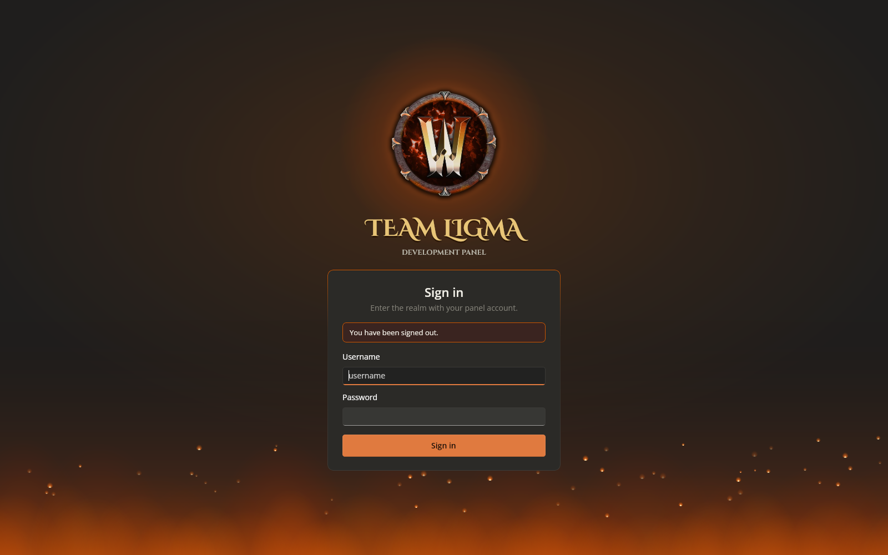
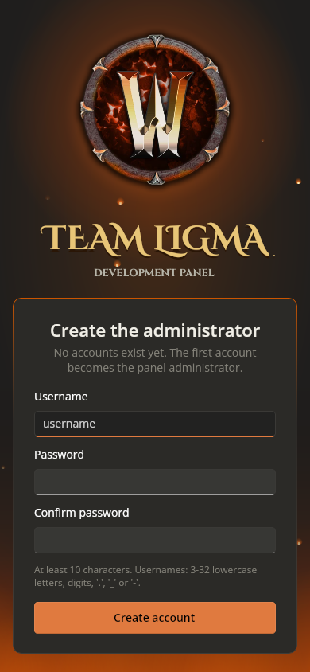

# Prompt
[Image: WoW-style emblem artwork] @WoWIcon.ico Redo the login screen to use the following art, with ember and fire effects while still using the overall claude-dark theming. Additionally change the favicon to the .ico provided.

# Reponse
Redid the sign-in screen around the provided emblem and switched the favicon to the provided .ico (v1.7.0).

**Sign-in screen**
- **Theme:** keeps the Claude-dark palette: the dark base, the same card style with burnt-orange accents, and an ember-coloured top edge on the card.
- **Emblem:** the provided art (468 px, transparent), floating gently in front of a pulsing heat halo.
- **Title:** an engraved gold "TEAM LIGMA" in Cinzel Decorative, with "Development Panel" beneath.
- **Fire:** a two-layer flickering fire line along the bottom (a wide dim back row and a bright front row), plus a warm glow rising from it.
- **Embers:** rise from the fire, sway, flicker and fade.
- **Effects lifecycle:** one ~30 fps timer drives everything. It runs only while the screen is visible and stops on sign-in.
- **Layout and flow:** the card is fluid down to phone width. Setup, sign-in and two-factor steps are unchanged.

**Favicon:** the provided .ico (16 to 256 px) is linked from `index.html` and installed as `/favicon.ico` by `deploy/install.sh`, replacing Uno's generated icon. Uno refuses a second favicon.ico at build time, so the deploy step replaces it.

**Bugs found and fixed during testing:**
- Skia doesn't paint gradient text, so the title was invisible. It's now solid gold with an engraved shadow.
- The card overflowed at phone width.
- The first embers were too faint.

**Tested:** the screen rendered at desktop and phone widths with moving embers and flickering fire. The favicon is served correctly in both places (checksums match). Setup, sign-out and sign-in all completed through the new screen with no page errors.

# File Changes
| File | Type | Workspace path | Change |
|---|---|---|---|
| `v170-login-mobile.png` | `Asset` | `Prompts/Team Ligma Development Panel/screenshots/v170-login-mobile.png` | Created |
| `v170-login.png` | `Asset` | `Prompts/Team Ligma Development Panel/screenshots/v170-login.png` | Created |
| `README.md` | `Docs` | `README.md` | Changed |
| `install.sh` | `Code` | `deploy/install.sh` | Changed |
| `TeamLigma.Panel.Server.csproj` | `Config` | `src/TeamLigma.Panel.Server/TeamLigma.Panel.Server.csproj` | Changed |
| `OFL-Cinzel.txt` | `Code` | `src/TeamLigma.Panel/TeamLigma.Panel/Assets/Fonts/OFL-Cinzel.txt` | Created |
| `cinzel-decorative-latin-700-normal.ttf` | `Asset` | `src/TeamLigma.Panel/TeamLigma.Panel/Assets/Fonts/cinzel-decorative-latin-700-normal.ttf` | Created |
| `cinzel-latin-700-normal.ttf` | `Asset` | `src/TeamLigma.Panel/TeamLigma.Panel/Assets/Fonts/cinzel-latin-700-normal.ttf` | Created |
| `LoginEmblem.png` | `Asset` | `src/TeamLigma.Panel/TeamLigma.Panel/Assets/LoginEmblem.png` | Created |
| `index.html` | `Code` | `src/TeamLigma.Panel/TeamLigma.Panel/Platforms/WebAssembly/index.html` | Changed |
| `favicon.ico` | `Code` | `src/TeamLigma.Panel/TeamLigma.Panel/Platforms/WebAssembly/loading/favicon.ico` | Created |
| `TeamLigma.Panel.csproj` | `Config` | `src/TeamLigma.Panel/TeamLigma.Panel/TeamLigma.Panel.csproj` | Changed |
| `LoginView.Effects.cs` | `Code` | `src/TeamLigma.Panel/TeamLigma.Panel/Views/LoginView.Effects.cs` | Created |
| `LoginView.xaml` | `Code` | `src/TeamLigma.Panel/TeamLigma.Panel/Views/LoginView.xaml` | Changed |
| `LoginView.xaml.cs` | `Code` | `src/TeamLigma.Panel/TeamLigma.Panel/Views/LoginView.xaml.cs` | Changed |

Environment: `/roc/claude/panel/` redeployed (v1.7.0); runtime file `/roc/claude/panel-data/settings.json`.

# Code Diffs
### `README.md` (Changed)
```diff
diff --git a/README.md b/README.md
index 945b7f1..61f4929 100644
--- a/README.md
+++ b/README.md
@@ -1,7 +1,7 @@
 <p align="center"></p>
 
 # Team Ligma Development Panel
-**Version 1.6.0**
+**Version 1.7.0**
 
 One dark, burnt-orange control room for an AzerothCore test realm. Kick off builds, watch every object compile in real time, look back at old logs, and talk to the Worldserver, Authserver and MySQL from your browser. No SSH session needed.
 
@@ -13,6 +13,23 @@ nginx serves both on port **26767**.
 
 ---
 
+## Sign-in screen
+The sign-in screen keeps the Claude-dark card and burnt-orange accents, set against:
+- the Team Ligma emblem, floating gently in front of a pulsing heat halo;
+- an engraved gold "TEAM LIGMA" title in Cinzel Decorative;
+- a flickering fire line along the bottom edge;
+- embers that rise, sway and flicker across the screen.
+
+The effects run only while the screen is visible, and stop as soon as you sign in. The layout adapts down to phone width.
+
+Files:
+- `Views/LoginView.xaml`: the layout.
+- `Views/LoginView.Effects.cs`: the fire, embers, halo and float, driven by one 30 fps timer.
+- `Assets/LoginEmblem.png`: the emblem.
+- `Assets/Fonts/cinzel-*.ttf`: Cinzel, SIL OFL 1.1; see `OFL-Cinzel.txt`.
+
+The browser tab icon is the panel's own `favicon.ico`. It's linked from `index.html` (it ships in `Platforms/WebAssembly/loading/favicon.ico`), and `deploy/install.sh` also installs it as the site's `/favicon.ico` in place of the icon Uno generates.
+
 ## Settings
 Administrators get a **Settings** page. Leave a field empty to use the default shown in grey. Changes apply to the next build, task or server start, and every save is recorded in the audit log.
```

### `deploy/install.sh` (Changed)
```diff
diff --git a/deploy/install.sh b/deploy/install.sh
index 62ab402..01feeca 100755
--- a/deploy/install.sh
+++ b/deploy/install.sh
@@ -20,6 +20,14 @@ mv "$PANEL/server.new" "$PANEL/server"
 mv "$PANEL/web.new/wwwroot" "$PANEL/wwwroot"
 rm -rf "$PANEL/web.new"
 
+# Site favicon: Uno generates /favicon.ico from its app icon; replace it with the panel's icon
+# (index.html also links it explicitly from the app package).
+FAVICON="$ROOT/src/TeamLigma.Panel/TeamLigma.Panel/Platforms/WebAssembly/loading/favicon.ico"
+if [ -f "$FAVICON" ]; then
+    install -m 0644 "$FAVICON" "$PANEL/wwwroot/favicon.ico"
+    rm -f "$PANEL/wwwroot/favicon.ico.gz" "$PANEL/wwwroot/favicon.ico.br"
+fi
+
 echo "==> Configuring nginx (port 26767)"
 install -m 0644 "$ROOT/deploy/nginx-teamligma-panel.conf" /etc/nginx/sites-available/teamligma-panel
 ln -sf /etc/nginx/sites-available/teamligma-panel /etc/nginx/sites-enabled/teamligma-panel
```

### `src/TeamLigma.Panel.Server/TeamLigma.Panel.Server.csproj` (Changed)
```diff
diff --git a/src/TeamLigma.Panel.Server/TeamLigma.Panel.Server.csproj b/src/TeamLigma.Panel.Server/TeamLigma.Panel.Server.csproj
index ba6b7c3..63152ef 100644
--- a/src/TeamLigma.Panel.Server/TeamLigma.Panel.Server.csproj
+++ b/src/TeamLigma.Panel.Server/TeamLigma.Panel.Server.csproj
@@ -4,7 +4,7 @@
     <Nullable>enable</Nullable>
     <ImplicitUsings>enable</ImplicitUsings>
     <RootNamespace>TeamLigma.Panel.Server</RootNamespace>
-    <Version>1.6.0</Version>
+    <Version>1.7.0</Version>
   </PropertyGroup>
   <ItemGroup>
     <Compile Include="../Shared/Dtos.cs" Link="Shared/Dtos.cs" />
```

### `src/TeamLigma.Panel/TeamLigma.Panel/Assets/Fonts/OFL-Cinzel.txt` (Created)
```diff
diff --git a/src/TeamLigma.Panel/TeamLigma.Panel/Assets/Fonts/OFL-Cinzel.txt b/src/TeamLigma.Panel/TeamLigma.Panel/Assets/Fonts/OFL-Cinzel.txt
new file mode 100644
index 0000000..5649a81
--- /dev/null
+++ b/src/TeamLigma.Panel/TeamLigma.Panel/Assets/Fonts/OFL-Cinzel.txt
@@ -0,0 +1,93 @@
+Copyright 2020 The Cinzel Project Authors (https://github.com/NDISCOVER/Cinzel)
+
+This Font Software is licensed under the SIL Open Font License, Version 1.1.
+This license is copied below, and is also available with a FAQ at:
+http://scripts.sil.org/OFL
+
+
+-----------------------------------------------------------
+SIL OPEN FONT LICENSE Version 1.1 - 26 February 2007
+-----------------------------------------------------------
+
+PREAMBLE
+The goals of the Open Font License (OFL) are to stimulate worldwide
+development of collaborative font projects, to support the font creation
+efforts of academic and linguistic communities, and to provide a free and
+open framework in which fonts may be shared and improved in partnership
+with others.
+
+The OFL allows the licensed fonts to be used, studied, modified and
+redistributed freely as long as they are not sold by themselves. The
+fonts, including any derivative works, can be bundled, embedded,
+redistributed and/or sold with any software provided that any reserved
+names are not used by derivative works. The fonts and derivatives,
+however, cannot be released under any other type of license. The
+requirement for fonts to remain under this license does not apply
+to any document created using the fonts or their derivatives.
+
+DEFINITIONS
+"Font Software" refers to the set of files released by the Copyright
+Holder(s) under this license and clearly marked as such. This may
+include source files, build scripts and documentation.
+
+"Reserved Font Name" refers to any names specified as such after the
+copyright statement(s).
+
+"Original Version" refers to the collection of Font Software components as
+distributed by the Copyright Holder(s).
+
+"Modified Version" refers to any derivative made by adding to, deleting,
+or substituting -- in part or in whole -- any of the components of the
+Original Version, by changing formats or by porting the Font Software to a
+new environment.
+
+"Author" refers to any designer, engineer, programmer, technical
+writer or other person who contributed to the Font Software.
+
+PERMISSION & CONDITIONS
+Permission is hereby granted, free of charge, to any person obtaining
+a copy of the Font Software, to use, study, copy, merge, embed, modify,
+redistribute, and sell modified and unmodified copies of the Font
+Software, subject to the following conditions:
+
+1) Neither the Font Software nor any of its individual components,
+in Original or Modified Versions, may be sold by itself.
+
+2) Original or Modified Versions of the Font Software may be bundled,
+redistributed and/or sold with any software, provided that each copy
+contains the above copyright notice and this license. These can be
+included either as stand-alone text files, human-readable headers or
+in the appropriate machine-readable metadata fields within text or
+binary files as long as those fields can be easily viewed by the user.
+
+3) No Modified Version of the Font Software may use the Reserved Font
+Name(s) unless explicit written permission is granted by the corresponding
+Copyright Holder. This restriction only applies to the primary font name as
+presented to the users.
+
+4) The name(s) of the Copyright Holder(s) or the Author(s) of the Font
+Software shall not be used to promote, endorse or advertise any
+Modified Version, except to acknowledge the contribution(s) of the
+Copyright Holder(s) and the Author(s) or with their explicit written
+permission.
+
+5) The Font Software, modified or unmodified, in part or in whole,
+must be distributed entirely under this license, and must not be
+distributed under any other license. The requirement for fonts to
+remain under this license does not apply to any document created
+using the Font Software.
+
+TERMINATION
+This license becomes null and void if any of the above conditions are
+not met.
+
+DISCLAIMER
+THE FONT SOFTWARE IS PROVIDED "AS IS", WITHOUT WARRANTY OF ANY KIND,
+EXPRESS OR IMPLIED, INCLUDING BUT NOT LIMITED TO ANY WARRANTIES OF
+MERCHANTABILITY, FITNESS FOR A PARTICULAR PURPOSE AND NONINFRINGEMENT
+OF COPYRIGHT, PATENT, TRADEMARK, OR OTHER RIGHT. IN NO EVENT SHALL THE
+COPYRIGHT HOLDER BE LIABLE FOR ANY CLAIM, DAMAGES OR OTHER LIABILITY,
+INCLUDING ANY GENERAL, SPECIAL, INDIRECT, INCIDENTAL, OR CONSEQUENTIAL
+DAMAGES, WHETHER IN AN ACTION OF CONTRACT, TORT OR OTHERWISE, ARISING
+FROM, OUT OF THE USE OR INABILITY TO USE THE FONT SOFTWARE OR FROM
+OTHER DEALINGS IN THE FONT SOFTWARE.
```

### `src/TeamLigma.Panel/TeamLigma.Panel/Assets/Fonts/cinzel-decorative-latin-700-normal.ttf` (Created)
```diff
diff --git a/src/TeamLigma.Panel/TeamLigma.Panel/Assets/Fonts/cinzel-decorative-latin-700-normal.ttf b/src/TeamLigma.Panel/TeamLigma.Panel/Assets/Fonts/cinzel-decorative-latin-700-normal.ttf
new file mode 100644
index 0000000..e4c5b65
Binary files /dev/null and b/src/TeamLigma.Panel/TeamLigma.Panel/Assets/Fonts/cinzel-decorative-latin-700-normal.ttf differ
```

### `src/TeamLigma.Panel/TeamLigma.Panel/Assets/Fonts/cinzel-latin-700-normal.ttf` (Created)
```diff
diff --git a/src/TeamLigma.Panel/TeamLigma.Panel/Assets/Fonts/cinzel-latin-700-normal.ttf b/src/TeamLigma.Panel/TeamLigma.Panel/Assets/Fonts/cinzel-latin-700-normal.ttf
new file mode 100644
index 0000000..80f4aeb
Binary files /dev/null and b/src/TeamLigma.Panel/TeamLigma.Panel/Assets/Fonts/cinzel-latin-700-normal.ttf differ
```

### `src/TeamLigma.Panel/TeamLigma.Panel/Platforms/WebAssembly/index.html` (Changed)
```diff
diff --git a/src/TeamLigma.Panel/TeamLigma.Panel/Platforms/WebAssembly/index.html b/src/TeamLigma.Panel/TeamLigma.Panel/Platforms/WebAssembly/index.html
index 5c3b718..96b5627 100644
--- a/src/TeamLigma.Panel/TeamLigma.Panel/Platforms/WebAssembly/index.html
+++ b/src/TeamLigma.Panel/TeamLigma.Panel/Platforms/WebAssembly/index.html
@@ -6,6 +6,8 @@
     <meta name="apple-mobile-web-app-status-bar-style" content="black-translucent" />
     <meta name="theme-color" content="#0b0907" />
     <title>Team Ligma Development Panel</title>
+    <link rel="icon" type="image/x-icon" href="./loading/favicon.ico" sizes="16x16 32x32 48x48 64x64 128x128 256x256" />
+    <link rel="shortcut icon" href="./loading/favicon.ico" />
 
     <!-- Themed loading screen (loads before the Uno runtime) -->
     <link rel="preload" href="./loading/fonts/cinzel-decorative-latin-700-normal.woff2" as="font" type="font/woff2" crossorigin />
```

### `src/TeamLigma.Panel/TeamLigma.Panel/Platforms/WebAssembly/loading/favicon.ico` (Created)
```diff
diff --git a/src/TeamLigma.Panel/TeamLigma.Panel/Platforms/WebAssembly/loading/favicon.ico b/src/TeamLigma.Panel/TeamLigma.Panel/Platforms/WebAssembly/loading/favicon.ico
new file mode 100644
index 0000000..f6dfbef
Binary files /dev/null and b/src/TeamLigma.Panel/TeamLigma.Panel/Platforms/WebAssembly/loading/favicon.ico differ
```

### `src/TeamLigma.Panel/TeamLigma.Panel/TeamLigma.Panel.csproj` (Changed)
```diff
diff --git a/src/TeamLigma.Panel/TeamLigma.Panel/TeamLigma.Panel.csproj b/src/TeamLigma.Panel/TeamLigma.Panel/TeamLigma.Panel.csproj
index be65728..653b741 100644
--- a/src/TeamLigma.Panel/TeamLigma.Panel/TeamLigma.Panel.csproj
+++ b/src/TeamLigma.Panel/TeamLigma.Panel/TeamLigma.Panel.csproj
@@ -5,11 +5,11 @@
     <UnoSingleProject>true</UnoSingleProject>
     <ApplicationTitle>Team Ligma Development Panel</ApplicationTitle>
     <ApplicationId>com.teamligma.devpanel</ApplicationId>
-    <ApplicationDisplayVersion>1.6.0</ApplicationDisplayVersion>
+    <ApplicationDisplayVersion>1.7.0</ApplicationDisplayVersion>
     <ApplicationVersion>1</ApplicationVersion>
     <ApplicationPublisher>Team Ligma</ApplicationPublisher>
     <Description>Team Ligma Development Panel - AzerothCore build and server console suite.</Description>
-    <Version>1.6.0</Version>
+    <Version>1.7.0</Version>
     <UnoFeatures>
       Mvvm;
       SkiaRenderer;
```

### `src/TeamLigma.Panel/TeamLigma.Panel/Views/LoginView.Effects.cs` (Created)
```diff
diff --git a/src/TeamLigma.Panel/TeamLigma.Panel/Views/LoginView.Effects.cs b/src/TeamLigma.Panel/TeamLigma.Panel/Views/LoginView.Effects.cs
new file mode 100644
index 0000000..43bf4dc
--- /dev/null
+++ b/src/TeamLigma.Panel/TeamLigma.Panel/Views/LoginView.Effects.cs
@@ -0,0 +1,171 @@
+using Microsoft.UI.Xaml.Media;
+using Microsoft.UI.Xaml.Shapes;
+using Windows.Foundation;
+using Windows.UI;
+
+namespace TeamLigma.Panel.Views;
+
+/// <summary>Fire, embers and the glowing emblem behind the sign-in card.</summary>
+public sealed partial class LoginView
+{
+    sealed class Ember
+    {
+        public Ellipse Shape = null!;
+        public double X, Y, Vy, Sway, SwayPhase, Size, Age, Life, Flicker;
+    }
+
+    sealed class Flame
+    {
+        public Ellipse Shape = null!;
+        public double X, Width, Height, TargetHeight, Opacity, TargetOpacity, NextChange;
+        public bool Front;
+    }
+
+    readonly List<Ember> _embers = new();
+    readonly List<Flame> _flames = new();
+    readonly Random _rng = new();
+    DispatcherTimer? _fx;
+    DateTime _last;
+    double _time, _haloFlicker;
+
+    static readonly RadialGradientBrush EmberBrush = Radial(
+        (Color.FromArgb(255, 255, 246, 214), 0), (Color.FromArgb(255, 255, 196, 110), 0.3), (Color.FromArgb(230, 255, 120, 40), 0.55), (Color.FromArgb(0, 204, 85, 0), 1));
+    static readonly RadialGradientBrush BackFlameBrush = Radial(
+        (Color.FromArgb(190, 230, 80, 12), 0), (Color.FromArgb(120, 170, 52, 8), 0.45), (Color.FromArgb(0, 120, 30, 5), 1));
+    static readonly RadialGradientBrush FrontFlameBrush = Radial(
+        (Color.FromArgb(255, 255, 232, 170), 0), (Color.FromArgb(225, 255, 150, 60), 0.26), (Color.FromArgb(140, 214, 90, 10), 0.55), (Color.FromArgb(0, 204, 85, 0), 1));
+
+    static RadialGradientBrush Radial(params (Color Color, double Offset)[] stops)
+    {
+        var b = new RadialGradientBrush { Center = new Point(0.5, 0.78), GradientOrigin = new Point(0.5, 0.95), RadiusX = 0.5, RadiusY = 0.62 };
+        foreach (var (color, offset) in stops) b.GradientStops.Add(new GradientStop { Color = color, Offset = offset });
+        return b;
+    }
+
+    void StartEffects()
+    {
+        if (_fx != null) return;
+        BuildFire();
+        _last = DateTime.UtcNow;
+        _fx = new DispatcherTimer { Interval = TimeSpan.FromMilliseconds(33) };
+        _fx.Tick += (_, _) => Step();
+        _fx.Start();
+    }
+
+    void StopEffects()
+    {
+        _fx?.Stop();
+        _fx = null;
+        EmberLayer.Children.Clear();
+        FireLayer.Children.Clear();
+        _embers.Clear();
+        _flames.Clear();
+    }
+
+    /// <summary>Flame tongues along the bottom edge: a dim, wide back row and a brighter front row.</summary>
+    void BuildFire()
+    {
+        if (_fx == null && FireLayer.Children.Count > 0) return;
+        var w = Root.ActualWidth;
+        if (w <= 0) return;
+        FireLayer.Children.Clear();
+        _flames.Clear();
+        foreach (var front in new[] { false, true })
+        {
+            var spacing = front ? 70.0 : 110.0;
+            var count = (int)Math.Ceiling(w / spacing) + 2;
+            for (var i = 0; i < count; i++)
+            {
+                var f = new Flame
+                {
+                    Front = front,
+                    Width = front ? 150 + _rng.NextDouble() * 60 : 230 + _rng.NextDouble() * 80,
+                    X = i * spacing - spacing / 2 + (_rng.NextDouble() - 0.5) * 30,
+                    Opacity = 0.6,
+                };
+                f.Height = f.TargetHeight = Base(f);
+                f.TargetOpacity = f.Opacity;
+                f.Shape = new Ellipse { Width = f.Width, Height = f.Height, Fill = front ? FrontFlameBrush : BackFlameBrush, IsHitTestVisible = false };
+                FireLayer.Children.Add(f.Shape);
+                _flames.Add(f);
+            }
+        }
+    }
+
+    double Base(Flame f) => f.Front ? 140 + _rng.NextDouble() * 150 : 220 + _rng.NextDouble() * 170;
+
+    void Step()
+    {
+        var now = DateTime.UtcNow;
+        var dt = Math.Clamp((now - _last).TotalSeconds, 0, 0.1);
+        _last = now;
+        _time += dt;
+        var w = Root.ActualWidth;
+        var h = Root.ActualHeight;
+        if (w <= 0 || h <= 0) return;
+
+        // --- flames: random flicker towards new heights and brightness ---
+        foreach (var f in _flames)
+        {
+            if (_time >= f.NextChange)
+            {
+                f.TargetHeight = Base(f);
+                f.TargetOpacity = f.Front ? 0.55 + _rng.NextDouble() * 0.45 : 0.45 + _rng.NextDouble() * 0.4;
+                f.NextChange = _time + 0.08 + _rng.NextDouble() * 0.22;
+            }
+            var k = Math.Min(1, dt * 9);
+            f.Height += (f.TargetHeight - f.Height) * k;
+            f.Opacity += (f.TargetOpacity - f.Opacity) * k;
+            f.Shape.Height = f.Height;
+            f.Shape.Opacity = f.Opacity;
+            Canvas.SetLeft(f.Shape, f.X - f.Width / 2);
+            Canvas.SetTop(f.Shape, h - f.Height * (f.Front ? 0.62 : 0.72));
+        }
+
+        // --- embers: spawn from the fire, rise, sway, flicker and fade ---
+        var target = Math.Clamp((int)(w / 28), 24, 64);
+        while (_embers.Count < target) _embers.Add(Spawn(w, h, initial: _embers.Count < target / 2 && _time < 0.1));
+        foreach (var e in _embers)
+        {
+            e.Age += dt;
+            if (e.Age >= e.Life || e.Y < -20) { Respawn(e, w, h); continue; }
+            e.Y += e.Vy * dt;
+            e.X += Math.Sin(_time * 1.3 + e.SwayPhase) * e.Sway * dt;
+            var life = e.Age / e.Life;
+            var fade = life < 0.12 ? life / 0.12 : life > 0.7 ? Math.Max(0, (1 - life) / 0.3) : 1;
+            var flicker = 0.65 + 0.35 * Math.Sin(_time * e.Flicker + e.SwayPhase);
+            e.Shape.Opacity = fade * flicker;
+            Canvas.SetLeft(e.Shape, e.X - e.Size / 2);
+            Canvas.SetTop(e.Shape, e.Y - e.Size / 2);
+        }
+
+        // --- emblem: slow float and a heat halo that breathes and flickers ---
+        _haloFlicker += ((_rng.NextDouble() - 0.5) * 0.25 - _haloFlicker) * Math.Min(1, dt * 6);
+        Halo.Opacity = Math.Clamp(0.62 + 0.2 * Math.Sin(_time * 1.6) + _haloFlicker, 0.3, 1);
+        EmblemTransform.TranslateY = Math.Sin(_time * 0.9) * 5;
+    }
+
+    Ember Spawn(double w, double h, bool initial)
+    {
+        var e = new Ember { Shape = new Ellipse { Fill = EmberBrush, IsHitTestVisible = false } };
+        Respawn(e, w, h);
+        if (initial) { e.Y = h * _rng.NextDouble(); e.Age = e.Life * _rng.NextDouble() * 0.6; } // first frame: already mid-air
+        EmberLayer.Children.Add(e.Shape);
+        return e;
+    }
+
+    void Respawn(Ember e, double w, double h)
+    {
+        e.Size = 5 + _rng.NextDouble() * 8;
+        e.Shape.Width = e.Shape.Height = e.Size;
+        e.X = _rng.NextDouble() * w;
+        e.Y = h - 20 - _rng.NextDouble() * 90;
+        e.Vy = -(35 + _rng.NextDouble() * 85) * (e.Size > 9 ? 0.75 : 1);
+        e.Sway = 12 + _rng.NextDouble() * 38;
+        e.SwayPhase = _rng.NextDouble() * Math.PI * 2;
+        e.Flicker = 4 + _rng.NextDouble() * 9;
+        e.Age = 0;
+        e.Life = 4 + _rng.NextDouble() * 6;
+        e.Shape.Opacity = 0;
+    }
+}
```

### `src/TeamLigma.Panel/TeamLigma.Panel/Views/LoginView.xaml` (Changed)
```diff
diff --git a/src/TeamLigma.Panel/TeamLigma.Panel/Views/LoginView.xaml b/src/TeamLigma.Panel/TeamLigma.Panel/Views/LoginView.xaml
index eddf3c9..9e0c6d5 100644
--- a/src/TeamLigma.Panel/TeamLigma.Panel/Views/LoginView.xaml
+++ b/src/TeamLigma.Panel/TeamLigma.Panel/Views/LoginView.xaml
@@ -1,16 +1,81 @@
 <UserControl x:Class="TeamLigma.Panel.Views.LoginView"
              xmlns="http://schemas.microsoft.com/winfx/2006/xaml/presentation"
              xmlns:x="http://schemas.microsoft.com/winfx/2006/xaml">
-  <Grid Background="{StaticResource TlBg}">
-    <Border Width="440" HorizontalAlignment="Center" VerticalAlignment="Center" Style="{StaticResource TlCardStyle}" Padding="32,28">
-      <StackPanel Spacing="16">
-        <Border CornerRadius="8" Background="White" Padding="4" HorizontalAlignment="Center" Width="260">
-          <Image Source="ms-appx:///Assets/teamligma.png" Stretch="Uniform" />
-        </Border>
+  <Grid x:Name="Root" Background="{StaticResource TlBg}">
+    <!-- warm glow rising from the fire below and behind the emblem -->
+    <Rectangle IsHitTestVisible="False">
+      <Rectangle.Fill>
+        <RadialGradientBrush Center="0.5,0.32" GradientOrigin="0.5,0.32" RadiusX="0.55" RadiusY="0.5">
+          <GradientStop Color="#38CC5500" Offset="0" />
+          <GradientStop Color="#14CC5500" Offset="0.55" />
+          <GradientStop Color="#00CC5500" Offset="1" />
+        </RadialGradientBrush>
+      </Rectangle.Fill>
+    </Rectangle>
+    <Rectangle IsHitTestVisible="False">
+      <Rectangle.Fill>
+        <LinearGradientBrush StartPoint="0.5,0" EndPoint="0.5,1">
+          <GradientStop Color="#00000000" Offset="0.55" />
+          <GradientStop Color="#33A33A08" Offset="0.85" />
+          <GradientStop Color="#66CC5500" Offset="1" />
+        </LinearGradientBrush>
+      </Rectangle.Fill>
+    </Rectangle>
+
+    <!-- animated fire and embers (driven from code-behind) -->
+    <Canvas x:Name="FireLayer" IsHitTestVisible="False" />
+    <Canvas x:Name="EmberLayer" IsHitTestVisible="False" />
+
+    <ScrollViewer VerticalScrollBarVisibility="Auto" HorizontalScrollMode="Disabled">
+      <StackPanel HorizontalAlignment="Stretch" MaxWidth="452" VerticalAlignment="Center" Spacing="14" Padding="16,28,16,40">
+
+        <!-- emblem with a pulsing heat halo -->
+        <Grid Width="230" Height="230" HorizontalAlignment="Center">
+          <Ellipse x:Name="Halo" Width="380" Height="380" Margin="-75" IsHitTestVisible="False">
+            <Ellipse.Fill>
+              <RadialGradientBrush>
+                <GradientStop Color="#FFFF9A4A" Offset="0" />
+                <GradientStop Color="#B3E0661A" Offset="0.32" />
+                <GradientStop Color="#4DA33A08" Offset="0.6" />
+                <GradientStop Color="#00A33A08" Offset="1" />
+              </RadialGradientBrush>
+            </Ellipse.Fill>
+          </Ellipse>
+          <Image x:Name="Emblem" Source="ms-appx:///Assets/LoginEmblem.png" Stretch="Uniform" Width="210" Height="210"
+                 RenderTransformOrigin="0.5,0.5">
+            <Image.RenderTransform>
+              <CompositeTransform x:Name="EmblemTransform" />
+            </Image.RenderTransform>
+          </Image>
+        </Grid>
+
+        <StackPanel Spacing="2" HorizontalAlignment="Center">
+          <!-- engraved gold title: dark offset copy behind a solid gold face (Skia does not paint gradient text) -->
+          <Grid HorizontalAlignment="Center">
+            <TextBlock Text="TEAM LIGMA" FontSize="42" CharacterSpacing="80" Foreground="#FF2A1606" Margin="0,3,0,0"
+                       FontFamily="ms-appx:///Assets/Fonts/cinzel-decorative-latin-700-normal.ttf#Cinzel Decorative" />
+            <TextBlock Text="TEAM LIGMA" FontSize="42" CharacterSpacing="80" Foreground="#FFE8C577"
+                       FontFamily="ms-appx:///Assets/Fonts/cinzel-decorative-latin-700-normal.ttf#Cinzel Decorative" />
+          </Grid>
+          <TextBlock Text="DEVELOPMENT PANEL" HorizontalAlignment="Center" FontSize="13" CharacterSpacing="420"
+                     Foreground="{StaticResource TlTextSecondary}"
+                     FontFamily="ms-appx:///Assets/Fonts/cinzel-latin-700-normal.ttf#Cinzel" />
+        </StackPanel>
+
+        <!-- sign-in card: Claude-dark surface with an ember edge -->
+        <Border HorizontalAlignment="Stretch" Style="{StaticResource TlCardStyle}" Padding="26,24" Margin="0,8,0,0">
+          <Border.BorderBrush>
+            <LinearGradientBrush StartPoint="0.5,0" EndPoint="0.5,1">
+              <GradientStop Color="#FFCC5500" Offset="0" />
+              <GradientStop Color="#663D3C38" Offset="0.35" />
+              <GradientStop Color="#FF3D3C38" Offset="1" />
+            </LinearGradientBrush>
+          </Border.BorderBrush>
+          <StackPanel Spacing="16">
         <StackPanel Spacing="4">
           <TextBlock x:Name="Heading" Style="{StaticResource TlPageTitle}" FontSize="22" Text="Sign in" HorizontalAlignment="Center" />
           <TextBlock x:Name="SubHeading" Foreground="{StaticResource TlTextMuted}" TextWrapping="Wrap" TextAlignment="Center"
-                     Text="Team Ligma Development Panel" />
+                     Text="Enter the realm with your panel account." />
         </StackPanel>
 
         <Border x:Name="MessageBox" Visibility="Collapsed" CornerRadius="6" Padding="12,8" Background="#3A2420" BorderBrush="{StaticResource TlDanger}" BorderThickness="1">
@@ -38,7 +103,9 @@
           <TextBlock x:Name="SubmitText" Text="Sign in" FontWeight="SemiBold" />
         </Button>
         <HyperlinkButton x:Name="BackLink" Content="← Back" Visibility="Collapsed" Click="OnBack" HorizontalAlignment="Center" />
+          </StackPanel>
+        </Border>
       </StackPanel>
-    </Border>
+    </ScrollViewer>
   </Grid>
 </UserControl>
```

### `src/TeamLigma.Panel/TeamLigma.Panel/Views/LoginView.xaml.cs` (Changed)
```diff
diff --git a/src/TeamLigma.Panel/TeamLigma.Panel/Views/LoginView.xaml.cs b/src/TeamLigma.Panel/TeamLigma.Panel/Views/LoginView.xaml.cs
index 4ddc90c..e23a078 100644
--- a/src/TeamLigma.Panel/TeamLigma.Panel/Views/LoginView.xaml.cs
+++ b/src/TeamLigma.Panel/TeamLigma.Panel/Views/LoginView.xaml.cs
@@ -23,7 +23,9 @@ public sealed partial class LoginView : UserControl
             SubmitText.Text = "Create account";
         }
         if (message != null) ShowMessage(message, isError: !message.StartsWith("You have been"));
-        Loaded += (_, _) => UserBox.Focus(FocusState.Programmatic);
+        Loaded += (_, _) => { UserBox.Focus(FocusState.Programmatic); StartEffects(); };
+        Unloaded += (_, _) => StopEffects();
+        Root.SizeChanged += (_, _) => BuildFire();
     }
 
     void ShowMessage(string? text, bool isError = true)
@@ -109,7 +111,7 @@ public sealed partial class LoginView : UserControl
         PasswordStep.Visibility = Visibility.Visible;
         TotpStep.Visibility = BackLink.Visibility = Visibility.Collapsed;
         Heading.Text = "Sign in";
-        SubHeading.Text = "Team Ligma Development Panel";
+        SubHeading.Text = "Enter the realm with your panel account.";
         SubmitText.Text = "Sign in";
         PassBox.Password = "";
         PassBox.Focus(FocusState.Programmatic);
```

# Image Assets

`Prompts/Team Ligma Development Panel/screenshots/v170-login.png` (Sign-in screen with emblem, fire and embers, sanity-test capture)


`Prompts/Team Ligma Development Panel/screenshots/v170-login-mobile.png` (Sign-in screen at phone width, sanity-test capture)

