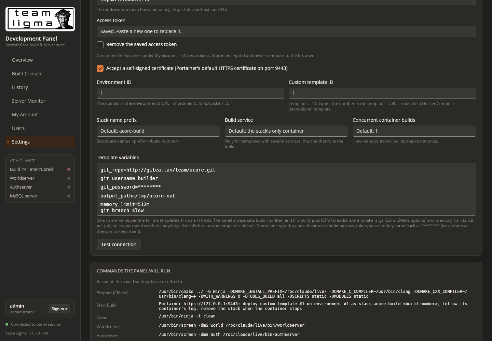
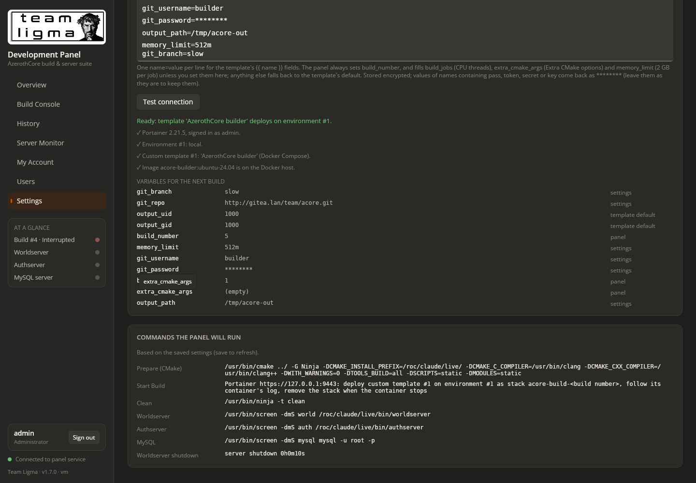
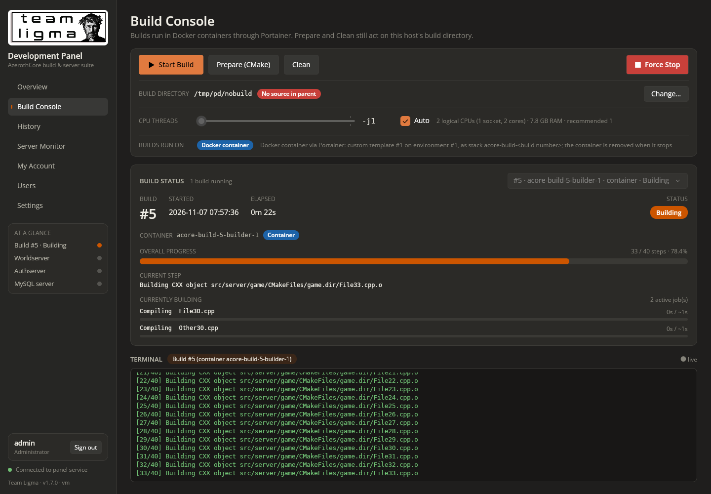
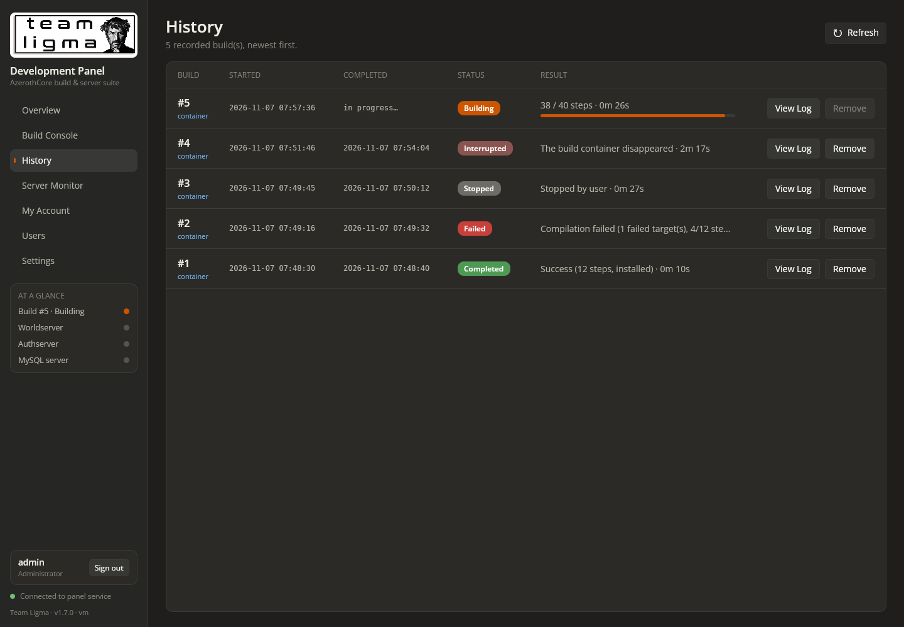

# Prompt
Now add the following feature to interface the panel with Portainer BE, adding features to the panel and attacked docker files as needed:
- When a build is started from the panel, it spawns a one shot docker container using a Portainer BE container custom template (specified in the panel's config section)
- The build runs in the container
- The panel monitors builds in the containers, rather than on the host machine
- When the build is complete and the docker container stops, that docker container is removed

# Reponse
Added container builds through Portainer BE (v1.7.0).

**How it works**
- With **Settings → Container builds** on, **Start Build** reads the configured Portainer custom template, fills its `{{ variable }}` fields and deploys it as a standalone Compose stack named `acore-build-<build number>`.
- The panel follows the container through Portainer's Docker API:
  - its log feeds the Build Console terminal and the History log;
  - ninja's `[n/total]` lines and the install lines drive the progress bars;
  - `docker top` fills "currently building".
- When the container stops, the panel records *Completed*, *Failed* (with the stage that failed: clone, configure, compile or install), *Stopped* or *Out of memory*, then removes the stack and its container. If removal fails it retries every minute.
- **Force Stop** stops the container (SIGTERM, then SIGKILL after 10 seconds), and it's removed too.
- After a panel restart, running container builds are picked up again where they left off.

**Settings → Container builds:** Portainer URL, access token (encrypted, never sent back to the browser), a self-signed certificate option, environment ID, template ID, stack prefix, build service, concurrent build limit, and template variables. The variables are stored encrypted, and secrets are masked in the browser. The panel fills `build_number` itself, and `build_jobs`, `extra_cmake_args` and `memory_limit` unless you set them. **Test connection** checks the token, environment, template type and image, and lists each variable's value and where it comes from.

**Elsewhere in the panel:** the Build Console shows where builds run. Container builds are tagged *container* in History, the dropdown and the Overview. A ninja running inside a container is no longer picked up as an *external* host build.

**tl-build-env**
- The Portainer template now uses the prebuilt image, because a deployed template has no build context.
- I removed the top-level `name:`. It would have given every build the same Compose project.
- The 256 MB memory limit is replaced by `{{ memory_limit }}`. 256 MB is far too little for a clang build.
- `build.sh` prints `##tl-phase` stage markers and records the panel build number.
- Added a README.

**Tested** against a real Portainer 2.21 (CE, which has the same API), using a stand-in builder image:
- success, compile failure, Force Stop, the concurrency limit, a panel restart mid-build, and a container deleted by hand (this one exposed a bug that is now fixed);
- a Git password containing `"` and `\` arrived intact;
- after every case, the stack and the container were gone;
- settings validation;
- the WebAssembly front end was built and checked in a browser.

# File Changes
| File | Type | Workspace path | Change |
|---|---|---|---|
| `README.md` | `Docs` | `tl-dev-panel/README.md` | Changed |
| `Dtos.cs` | `Code` | `tl-dev-panel/src/Shared/Dtos.cs` | Changed |
| `PortainerClient.cs` | `Code` | `tl-dev-panel/src/TeamLigma.Panel.Server/PortainerClient.cs` | Created |
| `ContainerBuildService.cs` | `Code` | `tl-dev-panel/src/TeamLigma.Panel.Server/ContainerBuildService.cs` | Created |
| `BuildService.cs` | `Code` | `tl-dev-panel/src/TeamLigma.Panel.Server/BuildService.cs` | Changed |
| `ExternalBuildMonitor.cs` | `Code` | `tl-dev-panel/src/TeamLigma.Panel.Server/ExternalBuildMonitor.cs` | Changed |
| `Program.cs` | `Code` | `tl-dev-panel/src/TeamLigma.Panel.Server/Program.cs` | Changed |
| `SettingsApi.cs` | `Code` | `tl-dev-panel/src/TeamLigma.Panel.Server/SettingsApi.cs` | Changed |
| `SettingsStore.cs` | `Code` | `tl-dev-panel/src/TeamLigma.Panel.Server/SettingsStore.cs` | Changed |
| `TeamLigma.Panel.Server.csproj` | `Config` | `tl-dev-panel/src/TeamLigma.Panel.Server/TeamLigma.Panel.Server.csproj` | Changed |
| `ApiClient.cs` | `Code` | `tl-dev-panel/src/TeamLigma.Panel/TeamLigma.Panel/Services/ApiClient.cs` | Changed |
| `BuildSelection.cs` | `Code` | `tl-dev-panel/src/TeamLigma.Panel/TeamLigma.Panel/Services/BuildSelection.cs` | Changed |
| `BuildConsoleView.xaml` | `Code` | `tl-dev-panel/src/TeamLigma.Panel/TeamLigma.Panel/Views/BuildConsoleView.xaml` | Changed |
| `BuildConsoleView.xaml.cs` | `Code` | `tl-dev-panel/src/TeamLigma.Panel/TeamLigma.Panel/Views/BuildConsoleView.xaml.cs` | Changed |
| `BuildDash.xaml` | `Code` | `tl-dev-panel/src/TeamLigma.Panel/TeamLigma.Panel/Views/BuildDash.xaml` | Changed |
| `BuildDash.xaml.cs` | `Code` | `tl-dev-panel/src/TeamLigma.Panel/TeamLigma.Panel/Views/BuildDash.xaml.cs` | Changed |
| `HistoryView.xaml.cs` | `Code` | `tl-dev-panel/src/TeamLigma.Panel/TeamLigma.Panel/Views/HistoryView.xaml.cs` | Changed |
| `SettingsView.cs` | `Code` | `tl-dev-panel/src/TeamLigma.Panel/TeamLigma.Panel/Views/SettingsView.cs` | Changed |
| `TeamLigma.Panel.csproj` | `Config` | `tl-dev-panel/src/TeamLigma.Panel/TeamLigma.Panel/TeamLigma.Panel.csproj` | Changed |
| `build.sh` | `Code` | `tl-build-env/build.sh` | Changed |
| `docker-compose.portainer.yml` | `Config` | `tl-build-env/docker-compose.portainer.yml` | Changed |
| `docker-compose.yml` | `Config` | `tl-build-env/docker-compose.yml` | Changed |
| `env.example` | `Config` | `tl-build-env/env.example` | Changed |
| `README.md` | `Docs` | `tl-build-env/README.md` | Created |
| `v170-settings-portainer.png` | `Asset` | `tl-dev-panel/Prompts/Team Ligma Development Panel/screenshots/v170-settings-portainer.png` | Created |
| `v170-portainer-test.png` | `Asset` | `tl-dev-panel/Prompts/Team Ligma Development Panel/screenshots/v170-portainer-test.png` | Created |
| `v170-container-build.png` | `Asset` | `tl-dev-panel/Prompts/Team Ligma Development Panel/screenshots/v170-container-build.png` | Created |
| `v170-history.png` | `Asset` | `tl-dev-panel/Prompts/Team Ligma Development Panel/screenshots/v170-history.png` | Created |

# Code Diffs
## `tl-dev-panel/README.md`
```diff
--- a/tl-dev-panel/README.md
+++ b/tl-dev-panel/README.md
@@ -1,13 +1,13 @@
 <p align="center"></p>
 
 # Team Ligma Development Panel
-**Version 1.6.0**
+**Version 1.7.0**
 
 One dark, burnt-orange control room for an AzerothCore test realm. Kick off builds, watch every object compile in real time, look back at old logs, and talk to the Worldserver, Authserver and MySQL from your browser. No SSH session needed.
 
 The panel has two parts:
 - **Front end:** C#/.NET 9 on the Uno Platform (WebAssembly, Skia renderer).
-- **Backend:** a small ASP.NET Core service that drives `cmake`, `ninja`, `screen` and `/proc`.
+- **Backend:** a small ASP.NET Core service that drives `cmake`, `ninja`, `screen` and `/proc`, and, for container builds, Portainer BE.
 
 nginx serves both on port **26767**.
 
@@ -22,6 +22,7 @@
 | **Build tools** | Paths to CMake, Ninja, the C and C++ compilers (become `-DCMAKE_C_COMPILER` / `-DCMAKE_CXX_COMPILER`) and GNU screen. Each shows whether it was found and its version. **Detect from PATH** fills them in. |
 | **Server executables** | Worldserver, Authserver and MySQL client executables (the server defaults are `<install dir>/bin/…`); optional Worldserver/Authserver config files (passed as `-c`); the Worldserver shutdown delay used by the Shutdown button. |
 | **MySQL login** | Host (empty = local socket), port, user, password, default database, and **auto-login**. With auto-login on, the panel types the saved password at the client's `Enter password:` prompt, so the MySQL console opens logged in. **Test connection** checks the login. |
+| **Container builds (Portainer BE)** | Turns container builds on and sets the Portainer URL, access token, self-signed certificate option, environment ID, custom template ID, stack name prefix, build service, how many container builds may run at once, and the template's variables. **Test connection** checks all of it (see [Container builds](#container-builds-portainer-be)). |
 | **Preview** | The exact commands the panel will run with the saved settings. |
 
 How the MySQL password is protected:
@@ -31,6 +32,62 @@
 
 Console input is pasted through a temporary owner-only file that's deleted immediately afterwards.
 
+## Container builds (Portainer BE)
+Hand the heavy lifting to Docker. With **Container builds** on, **Start Build** stops compiling on the panel's host. Instead, Portainer spins up a one-shot builder container from a custom template, and the panel watches it from start to finish.
+
+**What happens on Start Build**
+1. The panel reads the custom template from Portainer and fills its `{{ variable }}` fields.
+2. It deploys the template as a standalone Compose stack named `<prefix>-<build number>`, for example `acore-build-42`.
+3. It follows the container's log through Portainer's Docker API:
+   - the Build Console terminal and History log show the container's output;
+   - the progress bars follow ninja's `[n/total]` lines and the install lines;
+   - the "currently compiling" list comes from the processes running inside the container.
+4. When the container stops, the panel records the result (*Completed*, *Failed* with the stage that failed, *Stopped*, or out of memory). It then **removes the stack, and with it the container**. If Portainer can't be reached at that moment, the panel retries every minute.
+
+**Force Stop** stops the container: SIGTERM, then SIGKILL after 10 seconds. The build is recorded as *Stopped* and the container is removed. If the panel restarts during a build, it carries on following the container where it left off. Container builds are tagged *container* in History, in the Build Console dropdown and on the Overview tabs.
+
+Prepare (CMake) and Clean still act on this host's build directory, and they don't block container builds.
+
+### Setting it up
+1. **Build the image** on the Docker host, from the `tl-build-env` folder:
+   ```bash
+   docker build -t acore-builder:ubuntu-24.04 .
+   ```
+   Alternatively, use Portainer → Images → *Build a new image*. A stack deployed from a template has no build context, so the image must exist first. Rebuild it after changing `Dockerfile` or `build.sh`.
+2. **Create the custom template.** In Portainer go to Templates → Custom → *Add custom template*, choose type **Standalone / Podman** (Docker Compose) and paste `tl-build-env/docker-compose.portainer.yml`. You can give variables defaults and labels there too. The template ID is the number in its URL.
+3. **Create an access token** under My account → Access tokens. The token's user needs access to the environment and the template.
+4. **Fill in Settings → Container builds:**
+   - URL, token, environment ID and template ID;
+   - the template variables, one `name=value` per line.
+
+   Press **Test connection**. It shows the Portainer version and account, the environment, the template, whether its image is on the Docker host, and the value each variable will get and where it comes from. **Add missing variables** adds a line for each variable that still needs a value.
+5. Turn **Container builds** on and save. The Build Console's **Builds run on** row shows *Docker container*.
+
+### Template variables
+Values come from, in order:
+- **Always set by the panel:** `build_number`.
+- **Settings:** anything you list there.
+- **Filled in by the panel if you don't set them:**
+
+  | Variable | Value |
+  |---|---|
+  | `build_jobs` | the **CPU threads** value |
+  | `extra_cmake_args` | **Extra CMake options** |
+  | `memory_limit` | 2 GB per job, capped at the host's RAM |
+- **The template's own default.**
+
+A build won't start while a variable has no value.
+
+All variable values are stored encrypted in `settings.json`. Names containing `pass`, `token`, `secret` or `key` are sent back to the browser as `********`; leave that as it is to keep the saved value. The panel escapes `"` and `\` in values placed inside double quotes, so passwords containing them can't break the stack file. Note that Portainer keeps the filled-in stack file, Git password included, for as long as the stack exists. The panel removes the stack when the build ends.
+
+The builder installs each successful build into its own `<output_path>/<version>` folder and writes a `BUILD_INFO.txt` there (it now includes the panel's build number). Point **Server executables** in Settings at the build you want to run.
+
+### Good to know
+- Leave out a top-level `name:` and `container_name:` in the template, because every build needs its own project and container. Keep `restart: "no"`.
+- For a template with several services, set **Build service** to the one that runs the build.
+- `build.sh` prints `##tl-phase <stage>` lines (clone, configure, build, install, done). The panel uses them to tell which stage failed and hides them from the log.
+- A ninja running inside any container is no longer mistaken for an *external* build on the panel's host.
+
 ## Loading screen
 While the WebAssembly app downloads and starts, the panel shows a dark, fantasy-MMO-styled loading screen:
 - **Look:** a stone backdrop with drifting embers, an original gold crest (shield, sword, smithing hammer and gear inside a turning rune ring), the title in Cinzel Decorative, and an ornate gold-framed loading bar.
@@ -94,10 +151,10 @@
 
 | Control | Command (cwd = the build directory, default `/roc/claude/claude-acore/build`) |
 |---|---|
-| Start Build | `ninja -j$(( $(nproc) - 1 ))`, then `ninja install` if the build succeeded. A thread count chosen under **CPU threads** replaces the `-j` value. |
+| Start Build | `ninja -j$(( $(nproc) - 1 ))`, then `ninja install` if the build succeeded. A thread count chosen under **CPU threads** replaces the `-j` value. With container builds on, it deploys the Portainer template instead (see above). |
 | Prepare (CMake) | `cmake ../ -G Ninja -DCMAKE_INSTALL_PREFIX=/roc/claude/live/ -DCMAKE_C_COMPILER=/usr/bin/clang -DCMAKE_CXX_COMPILER=/usr/bin/clang++ -DWITH_WARNINGS=0 -DTOOLS_BUILD=all -DSCRIPTS=static -DMODULES=static` |
 | Clean | `ninja -t clean` |
-| Force Stop | Sends SIGTERM to ninja-dash, which stops ninja's process group and records the build as *Stopped* |
+| Force Stop | Sends SIGTERM to ninja-dash, which stops ninja's process group and records the build as *Stopped*. A container build's container is stopped and removed. |
 | Worldserver | `screen -dmS world ./worldserver` (cwd `/roc/claude/live/bin`) |
 | Authserver | `screen -dmS auth ./authserver` (cwd `/roc/claude/live/bin`) |
 | MySQL | `screen -dmS mysql mysql -u root -p` (plus `-h`/`-P`/database from Settings) |
@@ -168,7 +225,7 @@
 | `/roc/claude/claude-acore` | AzerothCore source (`build/` is the Ninja build directory) |
 | `/roc/claude/live` | Installed server (`bin/`, `etc/*.conf`, `data/` client data) |
 | `/roc/claude/panel` | Deployed panel (`wwwroot/` front end, `server/` backend) |
-| `/roc/claude/panel-data` | Build records, console logs, task logs, uploaded `.sql` files, `CREDENTIALS.txt`, `users.json` (accounts, mode 600), `keys/` (data-protection keys), `audit.log` |
+| `/roc/claude/panel-data` | Build records (container builds add `container.json`: stack, container and log position, no secrets), console logs, task logs, uploaded `.sql` files, `CREDENTIALS.txt`, `users.json` (accounts, mode 600), `keys/` (data-protection keys), `audit.log` |
 
 ## Set-up guide (Debian 12 / Ubuntu 24.04)
 1. **Packages**
@@ -213,6 +270,11 @@
 - **"The build did not start: …":** the text after the colon is what `ninja-dash` or `screen` printed. The full output is in the Build Console terminal under *Start Build (failed)*.
 - **Builds run out of memory (clang killed, "signal 9"):** lower **CPU threads** to the recommended value or below.
 - **A build shows *Interrupted*:** ninja-dash was killed without cleaning up. Start a new build.
+- **Container build: "Portainer returned 401":** the access token is wrong or was deleted. Paste a new one in Settings.
+- **Container build fails at once with "No such image" / "pull access denied":** build `acore-builder:ubuntu-24.04` on the Docker host first (see Container builds).
+- **Container build: "Out of memory: the container was OOM-killed":** raise `memory_limit` or lower **CPU threads**. clang needs about 2 GB per job.
+- **Container build: "Could not remove stack … yet":** Portainer was unreachable when the build ended. The panel retries every minute; you can also delete the stack in Portainer.
+- **Portainer on `https://…:9443` fails with a certificate error:** tick *Accept a self-signed certificate*, or give Portainer a trusted certificate.
 - **A server shows *Session open* but not *Running*:** the program exited inside its screen session. Read its console for the reason, then press Start again after the session closes.
 - **"That code is not valid" for every code:** the server's clock or your phone's clock is wrong. Authenticator codes need both to be within about 30 seconds of the real time.
 - **The page loads but the status dot is red:** check the backend with `curl http://127.0.0.1:5267/api/health`, and read `/roc/claude/panel/server.log` or `journalctl -u teamligma-panel`.
```

## `tl-dev-panel/src/Shared/Dtos.cs`
```diff
--- a/tl-dev-panel/src/Shared/Dtos.cs
+++ b/tl-dev-panel/src/Shared/Dtos.cs
@@ -18,9 +18,11 @@
 {
     public int Id { get; set; }
     public int? Pid { get; set; }
-    /// <summary>"panel" or "external" (see BuildSources).</summary>
+    /// <summary>"panel", "external" or "container" (see BuildSources).</summary>
     public string Source { get; set; } = BuildSources.Panel;
     public string? BuildDir { get; set; }
+    /// <summary>Container builds: the build container's name (the Portainer stack name until it is found).</summary>
+    public string? Container { get; set; }
     /// <summary>True when Total is an estimate (external builds: total commands, not just out-of-date ones).</summary>
     public bool TotalIsEstimate { get; set; }
     public string Phase { get; set; } = "unknown";   // building|installing|completed|failed|stopped|interrupted
@@ -242,6 +244,12 @@
     /// <summary>The build command exactly as the next build will run it.</summary>
     public string EffectiveBuildCommand { get; set; } = "";
     public CpuInfo Cpu { get; set; } = new();
+    /// <summary>Start Build runs in a Docker container through Portainer instead of on this host.</summary>
+    public bool ContainerMode { get; set; }
+    /// <summary>Where Start Build runs, in words.</summary>
+    public string Runner { get; set; } = "";
+    /// <summary>Container mode: why Start Build can't work yet (incomplete Portainer settings), else null.</summary>
+    public string? RunnerProblem { get; set; }
 }
 
 public sealed class DirEntry
@@ -298,6 +306,8 @@
     public const string Panel = "panel";
     /// <summary>A ninja process started outside the panel, detected and observed by it.</summary>
     public const string External = "external";
+    /// <summary>Started from the panel in a one-shot Docker container through Portainer (v1.7.0).</summary>
+    public const string Container = "container";
 }
 
 // ---------------- Settings (v1.6.0) ----------------
@@ -354,6 +364,24 @@
     /// <summary>Request only: remove the stored password.</summary>
     public bool MySqlClearPassword { get; set; }
 
+    // Container builds (Portainer BE)
+    public bool ContainerBuilds { get; set; }
+    public string? PortainerUrl { get; set; }
+    public int? PortainerEndpointId { get; set; }
+    public int? PortainerTemplateId { get; set; }
+    public bool PortainerInsecureTls { get; set; }
+    public string? PortainerStackPrefix { get; set; }
+    public string? PortainerService { get; set; }
+    public int? PortainerMaxConcurrent { get; set; }
+    /// <summary>Template variables, one "name=value" per line. Secret values come back masked; sending the mask keeps them.</summary>
+    public string? PortainerVariables { get; set; }
+    /// <summary>Response only: whether an access token is stored (it is never sent to the browser).</summary>
+    public bool PortainerApiKeySet { get; set; }
+    /// <summary>Request only: a new access token; null leaves the stored one unchanged.</summary>
+    public string? PortainerNewApiKey { get; set; }
+    /// <summary>Request only: remove the stored access token.</summary>
+    public bool PortainerClearApiKey { get; set; }
+
     // Response only
     public Dictionary<string, string> Defaults { get; set; } = new();
     public List<ToolStatus> Tools { get; set; } = new();
@@ -372,3 +400,30 @@
 {
     public Dictionary<string, string> Paths { get; set; } = new();
 }
+
+// ---------------- Container builds through Portainer (v1.7.0) ----------------
+
+public static class SecretMask
+{
+    /// <summary>Stands in for a saved secret value; sending it back unchanged keeps the saved value.</summary>
+    public const string Value = "********";
+}
+
+public sealed class TemplateVariableInfo
+{
+    public string Name { get; set; } = "";
+    public string Label { get; set; } = "";
+    /// <summary>The value the next build would use (masked for secrets).</summary>
+    public string Value { get; set; } = "";
+    /// <summary>"settings", "panel", "template default" or "missing".</summary>
+    public string Source { get; set; } = "";
+}
+
+public sealed class PortainerTestResult
+{
+    public bool Ok { get; set; }
+    public string Message { get; set; } = "";
+    public List<string> Details { get; set; } = new();
+    public List<string> Warnings { get; set; } = new();
+    public List<TemplateVariableInfo> Variables { get; set; } = new();
+}
```

## `tl-dev-panel/src/TeamLigma.Panel.Server/PortainerClient.cs`
```diff
--- a/tl-dev-panel/src/TeamLigma.Panel.Server/PortainerClient.cs
+++ b/tl-dev-panel/src/TeamLigma.Panel.Server/PortainerClient.cs
@@ -0,0 +1,392 @@
+using System.Net;
+using System.Net.Http.Headers;
+using System.Text;
+using System.Text.Json;
+using System.Text.Json.Nodes;
+using System.Text.RegularExpressions;
+
+namespace TeamLigma.Panel.Server;
+
+/// <summary>Where and how to reach Portainer (a snapshot of the saved settings).</summary>
+public sealed record PortainerTarget(string Url, string ApiKey, int EndpointId, int TemplateId, bool InsecureTls);
+
+public sealed class PortainerException : Exception
+{
+    public HttpStatusCode? Status { get; }
+    public PortainerException(string message, HttpStatusCode? status = null) : base(message) => Status = status;
+}
+
+/// <summary>A Portainer custom template: its metadata and compose file.</summary>
+public sealed class PortainerTemplate
+{
+    public int Id { get; set; }
+    public string Title { get; set; } = "";
+    /// <summary>1 = Swarm stack, 2 = Compose (standalone), 3 = Kubernetes.</summary>
+    public int Type { get; set; }
+    public string FileContent { get; set; } = "";
+    public List<(string Name, string Label, string Default, string Description)> Variables { get; } = new();
+}
+
+public sealed class ContainerState
+{
+    public string Id { get; set; } = "";
+    public string Name { get; set; } = "";
+    public string Status { get; set; } = "";
+    public bool Running { get; set; }
+    public int ExitCode { get; set; }
+    public bool OomKilled { get; set; }
+    public bool Tty { get; set; }
+    public string? Error { get; set; }
+}
+
+/// <summary>
+/// Minimal Portainer BE API client: custom templates, standalone Compose stacks, and the Docker API that
+/// Portainer proxies for an environment. Authenticates with an access token (X-API-Key).
+/// </summary>
+public sealed class PortainerClient
+{
+    readonly HttpClient _http;
+    readonly PortainerTarget _t;
+
+    static readonly object CacheLock = new();
+    static readonly Dictionary<(string, bool), HttpClient> Clients = new();
+
+    public PortainerClient(PortainerTarget t)
+    {
+        _t = t;
+        var key = (t.Url.TrimEnd('/'), t.InsecureTls);
+        lock (CacheLock)
+        {
+            if (!Clients.TryGetValue(key, out var http))
+            {
+                var handler = new SocketsHttpHandler { PooledConnectionLifetime = TimeSpan.FromMinutes(5) };
+                if (t.InsecureTls)
+                    handler.SslOptions.RemoteCertificateValidationCallback = (_, _, _, _) => true; // self-signed Portainer certificate
+                http = new HttpClient(handler) { BaseAddress = new Uri(key.Item1 + "/"), Timeout = Timeout.InfiniteTimeSpan };
+                Clients[key] = http;
+            }
+            _http = http;
+        }
+    }
+
+    public int EndpointId => _t.EndpointId;
+    string Docker(string path) => $"api/endpoints/{_t.EndpointId}/docker/{path.TrimStart('/')}";
+
+    async Task<HttpResponseMessage> SendAsync(HttpMethod method, string path, HttpContent? body, int timeoutSeconds, CancellationToken ct)
+    {
+        using var cts = CancellationTokenSource.CreateLinkedTokenSource(ct);
+        cts.CancelAfter(TimeSpan.FromSeconds(timeoutSeconds));
+        var req = new HttpRequestMessage(method, path) { Content = body };
+        req.Headers.Add("X-API-Key", _t.ApiKey);
+        req.Headers.Accept.Add(new MediaTypeWithQualityHeaderValue("application/json"));
+        try
+        {
+            var resp = await _http.SendAsync(req, HttpCompletionOption.ResponseContentRead, cts.Token);
+            return resp;
+        }
+        catch (OperationCanceledException) when (!ct.IsCancellationRequested)
+        {
+            throw new PortainerException($"Portainer did not answer within {timeoutSeconds} seconds ({method} /{path.Split('?')[0]}).");
+        }
+        catch (HttpRequestException ex)
+        {
+            var why = ex.InnerException?.Message ?? ex.Message;
+            if (why.Contains("certificate", StringComparison.OrdinalIgnoreCase) || why.Contains("SSL", StringComparison.OrdinalIgnoreCase))
+                why += " (for a self-signed certificate, turn on 'Accept self-signed certificate')";
+            throw new PortainerException($"Could not reach Portainer at {_t.Url}: {why}");
+        }
+    }
+
+    async Task<string> RequestAsync(HttpMethod method, string path, HttpContent? body = null, int timeoutSeconds = 20, CancellationToken ct = default)
+    {
+        using var resp = await SendAsync(method, path, body, timeoutSeconds, ct);
+        var text = await resp.Content.ReadAsStringAsync(ct);
+        if (resp.IsSuccessStatusCode) return text;
+        throw new PortainerException(Describe(resp.StatusCode, text, path), resp.StatusCode);
+    }
+
+    static string Describe(HttpStatusCode code, string body, string path)
+    {
+        string? detail = null;
+        try
+        {
+            var j = JsonNode.Parse(body);
+            detail = (string?)j?["details"] ?? (string?)j?["message"];
+            var msg = (string?)j?["message"];
+            if (msg != null && detail != null && msg != detail) detail = $"{msg}: {detail}";
+        }
+        catch { detail = body.Length > 300 ? body[..300] : body; }
+        var hint = code switch
+        {
+            HttpStatusCode.Unauthorized => " The access token was rejected.",
+            HttpStatusCode.Forbidden => " The token's user is not allowed to do this (it needs access to the environment and template).",
+            HttpStatusCode.NotFound when path.Contains("custom_templates") => " Check the custom template ID.",
+            HttpStatusCode.NotFound when path.Contains("endpoints") => " Check the environment ID.",
+            _ => "",
+        };
+        return $"Portainer returned {(int)code} {code}{(string.IsNullOrWhiteSpace(detail) ? "" : $": {detail.Trim()}")}.{hint}";
+    }
+
+    static JsonNode Parse(string json) => JsonNode.Parse(json) ?? throw new PortainerException("Portainer sent an empty response.");
+
+    // ---------------- system / environment ----------------
+
+    public async Task<string> VersionAsync(CancellationToken ct = default)
+    {
+        foreach (var path in new[] { "api/system/status", "api/status" })
+        {
+            try { return (string?)Parse(await RequestAsync(HttpMethod.Get, path, ct: ct))["Version"] ?? "?"; }
+            catch (PortainerException ex) when (ex.Status == HttpStatusCode.NotFound) { }
+        }
+        return "?";
+    }
+
+    /// <summary>Checks the token (any authenticated call).</summary>
+    public async Task<string> WhoAmIAsync(CancellationToken ct = default)
+    {
+        var j = Parse(await RequestAsync(HttpMethod.Get, "api/users/me", ct: ct));
+        return (string?)j["Username"] ?? "?";
+    }
+
+    public async Task<string> EndpointNameAsync(CancellationToken ct = default)
+    {
+        var j = Parse(await RequestAsync(HttpMethod.Get, $"api/endpoints/{_t.EndpointId}", ct: ct));
+        return (string?)j["Name"] ?? $"#{_t.EndpointId}";
+    }
+
+    // ---------------- custom templates ----------------
+
+    public async Task<PortainerTemplate> TemplateAsync(CancellationToken ct = default)
+    {
+        var j = Parse(await RequestAsync(HttpMethod.Get, $"api/custom_templates/{_t.TemplateId}", ct: ct));
+        var t = new PortainerTemplate
+        {
+            Id = _t.TemplateId,
+            Title = (string?)j["Title"] ?? $"Template #{_t.TemplateId}",
+            Type = (int?)j["Type"] ?? 0,
+        };
+        if (j["Variables"] is JsonArray vars)
+            foreach (var v in vars)
+                if ((string?)v?["name"] is { Length: > 0 } name)
+                    t.Variables.Add((name, (string?)v!["label"] ?? name, (string?)v["defaultValue"] ?? "", (string?)v["description"] ?? ""));
+
+        string? file = null;
+        try { file = (string?)Parse(await RequestAsync(HttpMethod.Get, $"api/custom_templates/{_t.TemplateId}/file", ct: ct))["FileContent"]; }
+        catch (PortainerException) when (j["GitConfig"] is JsonObject) { }
+        if (string.IsNullOrWhiteSpace(file) && j["GitConfig"] is JsonObject)
+        {
+            // Git-backed template: ask Portainer to fetch the current file from the repository.
+            file = (string?)Parse(await RequestAsync(HttpMethod.Put, $"api/custom_templates/{_t.TemplateId}/git_fetch", timeoutSeconds: 60, ct: ct))["FileContent"];
+        }
+        t.FileContent = file ?? "";
+        if (string.IsNullOrWhiteSpace(t.FileContent)) throw new PortainerException($"Custom template #{_t.TemplateId} has no compose file content.");
+        return t;
+    }
+
+    static readonly Regex VarRx = new(@"\{\{\s*([A-Za-z0-9_.-]+)\s*\}\}", RegexOptions.Compiled);
+
+    /// <summary>The {{ variable }} names used in a compose file (outside comments), in order of first use.</summary>
+    public static List<string> UsedVariables(string content)
+        => VarRx.Matches(content).Where(m => Context(content, m.Index) != Ctx.Comment).Select(m => m.Groups[1].Value).Distinct().ToList();
+
+    /// <summary>Fills {{ variable }} fields the way Portainer's deploy form does. Inside a double-quoted YAML
+    /// string, \ and " in a value are escaped so that a password containing them can't break the file.</summary>
+    public static string Render(string content, IReadOnlyDictionary<string, string> values)
+        => VarRx.Replace(content, m =>
+        {
+            var ctx = Context(content, m.Index);
+            if (ctx == Ctx.Comment || !values.TryGetValue(m.Groups[1].Value, out var v)) return m.Value;
+            return ctx == Ctx.DoubleQuoted ? v.Replace("\\", "\\\\").Replace("\"", "\\\"") : v;
+        });
+
+    enum Ctx { Plain, DoubleQuoted, Comment }
+
+    /// <summary>Where a position sits on its YAML line: plain, inside a double-quoted string, or in a comment.</summary>
+    static Ctx Context(string content, int index)
+    {
+        var lineStart = index == 0 ? 0 : content.LastIndexOf('\n', index - 1) + 1;
+        var open = false;
+        for (var i = lineStart; i < index; i++)
+        {
+            if (content[i] == '\\' && open) { i++; continue; }
+            if (content[i] == '"') open = !open;
+            else if (content[i] == '#' && !open && (i == lineStart || char.IsWhiteSpace(content[i - 1]))) return Ctx.Comment;
+        }
+        return open ? Ctx.DoubleQuoted : Ctx.Plain;
+    }
+
+    // ---------------- stacks ----------------
+
+    /// <summary>Deploys a standalone Compose stack from file content; returns the stack ID.</summary>
+    public async Task<int> CreateStackAsync(string name, string content, CancellationToken ct = default)
+    {
+        var body = new JsonObject { ["name"] = name, ["stackFileContent"] = content, ["env"] = new JsonArray() };
+        string text;
+        try
+        {
+            // Portainer 2.19+
+            text = await RequestAsync(HttpMethod.Post, $"api/stacks/create/standalone/string?endpointId={_t.EndpointId}",
+                new StringContent(body.ToJsonString(), Encoding.UTF8, "application/json"), timeoutSeconds: 900, ct: ct);
+        }
+        catch (PortainerException ex) when (ex.Status is HttpStatusCode.NotFound or HttpStatusCode.MethodNotAllowed)
+        {
+            // Older Portainer releases
+            var legacy = new JsonObject { ["Name"] = name, ["StackFileContent"] = content, ["Env"] = new JsonArray() };
+            text = await RequestAsync(HttpMethod.Post, $"api/stacks?type=2&method=string&endpointId={_t.EndpointId}",
+                new StringContent(legacy.ToJsonString(), Encoding.UTF8, "application/json"), timeoutSeconds: 900, ct: ct);
+        }
+        return (int?)Parse(text)["Id"] ?? throw new PortainerException("Portainer created the stack but did not return its ID.");
+    }
+
+    /// <summary>The ID of a stack with this name on the environment, if Portainer has one.</summary>
+    public async Task<int?> FindStackAsync(string name, CancellationToken ct = default)
+    {
+        var list = Parse(await RequestAsync(HttpMethod.Get, "api/stacks", ct: ct)) as JsonArray;
+        foreach (var s in list ?? new JsonArray())
+            if ((string?)s?["Name"] == name && (int?)s!["EndpointId"] == _t.EndpointId) return (int?)s["Id"];
+        return null;
+    }
+
+    /// <summary>Removes a stack and its containers (and its anonymous volumes where Portainer supports it).</summary>
+    public async Task DeleteStackAsync(int stackId, CancellationToken ct = default)
+    {
+        try { await RequestAsync(HttpMethod.Delete, $"api/stacks/{stackId}?endpointId={_t.EndpointId}&removeVolumes=true", timeoutSeconds: 120, ct: ct); }
+        catch (PortainerException ex) when (ex.Status == HttpStatusCode.NotFound) { }
+    }
+
+    // ---------------- containers (Docker API through Portainer) ----------------
+
+    /// <summary>Containers belonging to a Compose project (Portainer uses the stack name as the project name).</summary>
+    public async Task<List<(string Id, string Name, string Service, string State)>> ProjectContainersAsync(string project, CancellationToken ct = default)
+    {
+        var filters = Uri.EscapeDataString(new JsonObject { ["label"] = new JsonArray($"com.docker.compose.project={project}") }.ToJsonString());
+        var list = Parse(await RequestAsync(HttpMethod.Get, Docker($"containers/json?all=1&filters={filters}"), ct: ct)) as JsonArray;
+        var result = new List<(string, string, string, string)>();
+        foreach (var c in list ?? new JsonArray())
+        {
+            if (c == null) continue;
+            var name = ((c["Names"] as JsonArray)?.FirstOrDefault()?.GetValue<string>() ?? "").TrimStart('/');
+            var service = (string?)c["Labels"]?["com.docker.compose.service"] ?? "";
+            result.Add(((string?)c["Id"] ?? "", name, service, (string?)c["State"] ?? ""));
+        }
+        return result;
+    }
+
+    /// <summary>The container's state, or null when it no longer exists.</summary>
+    public async Task<ContainerState?> InspectAsync(string id, CancellationToken ct = default)
+    {
+        string text;
+        try { text = await RequestAsync(HttpMethod.Get, Docker($"containers/{id}/json"), ct: ct); }
+        catch (PortainerException ex) when (ex.Status == HttpStatusCode.NotFound) { return null; }
+        var j = Parse(text);
+        var st = j["State"];
+        return new ContainerState
+        {
+            Id = (string?)j["Id"] ?? id,
+            Name = ((string?)j["Name"] ?? "").TrimStart('/'),
+            Status = (string?)st?["Status"] ?? "",
+            Running = (bool?)st?["Running"] ?? false,
+            ExitCode = (int?)st?["ExitCode"] ?? 0,
+            OomKilled = (bool?)st?["OOMKilled"] ?? false,
+            Error = (string?)st?["Error"] is { Length: > 0 } e ? e : null,
+            Tty = (bool?)j["Config"]?["Tty"] ?? false,
+        };
+    }
+
+    /// <summary>Log lines written after <paramref name="sinceNs"/> (Unix time in nanoseconds; 0 = all), each with its timestamp.</summary>
+    public async Task<List<(long Ns, string Text)>> LogsAsync(string id, long sinceNs, bool tty, CancellationToken ct = default)
+    {
+        var since = sinceNs <= 0 ? "0" : $"{sinceNs / 1_000_000_000}.{sinceNs % 1_000_000_000:D9}";
+        using var resp = await SendAsync(HttpMethod.Get, Docker($"containers/{id}/logs?stdout=1&stderr=1&timestamps=1&since={since}"), null, 60, ct);
+        var bytes = await resp.Content.ReadAsByteArrayAsync(ct);
+        if (resp.StatusCode == HttpStatusCode.NotFound) return new(); // container gone: the caller's inspect reports it
+        if (!resp.IsSuccessStatusCode)
+            throw new PortainerException(Describe(resp.StatusCode, Encoding.UTF8.GetString(bytes), "logs"), resp.StatusCode);
+        var text = tty || !LooksMultiplexed(bytes) ? Encoding.UTF8.GetString(bytes) : Demultiplex(bytes);
+        var lines = new List<(long, string)>();
+        foreach (var raw in text.Split('\n'))
+        {
+            var line = raw.TrimEnd('\r');
+            if (line.Length == 0) continue;
+            var sp = line.IndexOf(' ');
+            if (sp > 0 && ParseTimestamp(line[..sp]) is { } ns) lines.Add((ns, line[(sp + 1)..]));
+            else lines.Add((0, line));
+        }
+        return lines;
+    }
+
+    static bool LooksMultiplexed(byte[] b) => b.Length >= 8 && b[0] is 0 or 1 or 2 && b[1] == 0 && b[2] == 0 && b[3] == 0;
+
+    /// <summary>Joins the payloads of Docker's stdout/stderr stream frames (8-byte header: stream, 0, 0, 0, big-endian size).</summary>
+    static string Demultiplex(byte[] b)
+    {
+        var ms = new MemoryStream(b.Length);
+        var i = 0;
+        while (i + 8 <= b.Length)
+        {
+            var size = (b[i + 4] << 24) | (b[i + 5] << 16) | (b[i + 6] << 8) | b[i + 7];
+            i += 8;
+            if (size < 0 || i + size > b.Length) size = b.Length - i;
+            ms.Write(b, i, size);
+            i += size;
+        }
+        return Encoding.UTF8.GetString(ms.GetBuffer(), 0, (int)ms.Length);
+    }
+
+    /// <summary>RFC 3339 timestamp with up to 9 fraction digits → Unix nanoseconds.</summary>
+    public static long? ParseTimestamp(string s)
+    {
+        if (s.Length < 20 || s[4] != '-' || s[10] != 'T') return null;
+        var dot = s.IndexOf('.');
+        var zone = s.IndexOfAny(new[] { 'Z', '+' }, 19);
+        if (zone < 0) zone = s.LastIndexOf('-');
+        if (zone < 19) return null;
+        var basePart = (dot > 0 ? s[..dot] : s[..zone]) + s[zone..];
+        if (!DateTimeOffset.TryParse(basePart, System.Globalization.CultureInfo.InvariantCulture, System.Globalization.DateTimeStyles.AssumeUniversal, out var t)) return null;
+        long frac = 0;
+        if (dot > 0)
+        {
+            var digits = s[(dot + 1)..zone];
+            if (digits.Length > 9) digits = digits[..9];
+            if (!long.TryParse(digits.PadRight(9, '0'), out frac)) frac = 0;
+        }
+        return t.ToUnixTimeSeconds() * 1_000_000_000 + frac;
+    }
+
+    /// <summary>Processes in the container (docker top): pid, seconds running, command line.</summary>
+    public async Task<List<(int Pid, long Seconds, string Args)>> TopAsync(string id, CancellationToken ct = default)
+    {
+        var j = Parse(await RequestAsync(HttpMethod.Get, Docker($"containers/{id}/top?ps_args={Uri.EscapeDataString("-eo pid,etimes,args")}"), ct: ct));
+        var titles = (j["Titles"] as JsonArray)?.Select(x => (string?)x ?? "").ToList() ?? new();
+        int pi = titles.IndexOf("PID"), ei = titles.IndexOf("ELAPSED"), ai = titles.FindIndex(x => x is "COMMAND" or "CMD" or "ARGS");
+        var result = new List<(int, long, string)>();
+        foreach (var row in (j["Processes"] as JsonArray) ?? new JsonArray())
+        {
+            if (row is not JsonArray r) continue;
+            string Col(int i) => i >= 0 && i < r.Count ? (string?)r[i] ?? "" : "";
+            int.TryParse(Col(pi), out var pid);
+            long.TryParse(Col(ei), out var secs);
+            result.Add((pid, secs, Col(ai)));
+        }
+        return result;
+    }
+
+    public async Task StopContainerAsync(string id, int graceSeconds, CancellationToken ct = default)
+    {
+        try { await RequestAsync(HttpMethod.Post, Docker($"containers/{id}/stop?t={graceSeconds}"), timeoutSeconds: graceSeconds + 30, ct: ct); }
+        catch (PortainerException ex) when (ex.Status is HttpStatusCode.NotModified or HttpStatusCode.NotFound) { }
+    }
+
+    public async Task RemoveContainerAsync(string id, CancellationToken ct = default)
+    {
+        try { await RequestAsync(HttpMethod.Delete, Docker($"containers/{id}?force=1&v=1"), timeoutSeconds: 60, ct: ct); }
+        catch (PortainerException ex) when (ex.Status == HttpStatusCode.NotFound) { }
+    }
+
+    /// <summary>True when the image exists on the environment's Docker host.</summary>
+    public async Task<bool> ImageExistsAsync(string image, CancellationToken ct = default)
+    {
+        try { await RequestAsync(HttpMethod.Get, Docker($"images/{Uri.EscapeDataString(image)}/json"), ct: ct); return true; }
+        catch (PortainerException ex) when (ex.Status == HttpStatusCode.NotFound) { return false; }
+    }
+}
```

## `tl-dev-panel/src/TeamLigma.Panel.Server/ContainerBuildService.cs`
```diff
--- a/tl-dev-panel/src/TeamLigma.Panel.Server/ContainerBuildService.cs
+++ b/tl-dev-panel/src/TeamLigma.Panel.Server/ContainerBuildService.cs
@@ -0,0 +1,654 @@
+using System.Collections.Concurrent;
+using System.Text.Json;
+using System.Text.RegularExpressions;
+using TeamLigma.Shared;
+
+namespace TeamLigma.Panel.Server;
+
+/// <summary>
+/// Runs panel builds in one-shot Docker containers through Portainer BE. Start Build deploys the configured
+/// custom template as a standalone Compose stack named &lt;prefix&gt;-&lt;build number&gt;; the panel follows the
+/// container's log for output and progress, and once the container stops it records the outcome and removes
+/// the stack (and with it the container). Builds are kept in History like any other build.
+/// </summary>
+public sealed class ContainerBuildService : BackgroundService
+{
+    static readonly JsonSerializerOptions Json = new(JsonSerializerDefaults.Web);
+    static readonly JsonSerializerOptions JsonIndented = new(JsonSerializerDefaults.Web) { WriteIndented = true };
+    static readonly Regex Ansi = new(@"\x1B\[[0-9;?]*[ -/]*[@-~]", RegexOptions.Compiled);
+    static readonly Regex NinjaStatus = new(@"^\[(\d+)/(\d+)\]\s*(.*)$", RegexOptions.Compiled);
+    static readonly Regex PhaseMarker = new(@"^##tl-phase\s+(\w+)", RegexOptions.Compiled);
+    static readonly Regex BuilderLog = new(@"^\[acore-builder [0-9:]+\]\s*(.*)$", RegexOptions.Compiled);
+
+    readonly BuildService _builds;
+    readonly SettingsStore _settings;
+    readonly ILogger<ContainerBuildService> _log;
+    readonly ConcurrentDictionary<int, Run> _runs = new();
+    readonly SemaphoreSlim _startGate = new(1, 1);
+    CancellationToken _stopping;
+
+    /// <summary>What the panel remembers about a build's container (builds/&lt;n&gt;/container.json, no secrets).</summary>
+    public sealed class ContainerRecord
+    {
+        public string PortainerUrl { get; set; } = "";
+        public int EndpointId { get; set; }
+        public int TemplateId { get; set; }
+        public string TemplateTitle { get; set; } = "";
+        public string StackName { get; set; } = "";
+        public int? StackId { get; set; }
+        public string? ContainerId { get; set; }
+        public string? ContainerName { get; set; }
+        public bool Tty { get; set; }
+        public long LastLogNs { get; set; }
+        public int LinesAtLastNs { get; set; }
+        public string Stage { get; set; } = "create";
+        public bool StopRequested { get; set; }
+        public bool Removed { get; set; }
+        public DateTimeOffset? BuildStepsStarted { get; set; }
+    }
+
+    sealed class Run
+    {
+        public int Id;
+        public BuildStatus S = new();
+        public ContainerRecord R = new();
+        public string Dir = "", LogPath = "", StatusPath = "", RecordPath = "";
+        public readonly object Lock = new();
+        public StreamWriter? Writer;
+    }
+
+    public ContainerBuildService(BuildService builds, SettingsStore settings, ILogger<ContainerBuildService> log)
+    {
+        _builds = builds;
+        _settings = settings;
+        _log = log;
+    }
+
+    // ---------------------------------------------------------------- lifecycle
+
+    protected override async Task ExecuteAsync(CancellationToken ct)
+    {
+        _stopping = ct;
+        await Task.Delay(1000, ct).ContinueWith(_ => { });
+        try { Readopt(); } catch (Exception ex) { _log.LogWarning(ex, "Could not re-adopt container builds"); }
+        while (!ct.IsCancellationRequested)
+        {
+            await Task.Delay(TimeSpan.FromSeconds(60), ct).ContinueWith(_ => { });
+            if (ct.IsCancellationRequested) break;
+            try { await RetryRemovals(ct); } catch (Exception ex) { _log.LogDebug(ex, "Container removal retry failed"); }
+        }
+    }
+
+    /// <summary>After a panel restart: keep following running container builds and finish pending removals.</summary>
+    void Readopt()
+    {
+        foreach (var b in _builds.All().Where(b => b.Source == BuildSources.Container))
+        {
+            var run = Load(b);
+            if (run == null) continue;
+            if (BuildService.IsActive(b))
+            {
+                if (!_runs.TryAdd(run.Id, run)) continue;
+                Append(run, "== Panel restarted; continuing to follow this container build.");
+                _ = Task.Run(() => Resume(run));
+            }
+        }
+    }
+
+    Run? Load(BuildStatus b)
+    {
+        var run = NewRun(b.Id);
+        run.S = b;
+        try { run.R = JsonSerializer.Deserialize<ContainerRecord>(File.ReadAllText(run.RecordPath), Json) ?? new(); }
+        catch
+        {
+            if (!BuildService.IsActive(b)) return null;
+            run.R = new ContainerRecord();
+        }
+        return run;
+    }
+
+    Run NewRun(int id)
+    {
+        var dir = _builds.BuildDirOf(id);
+        return new Run
+        {
+            Id = id, Dir = dir,
+            LogPath = Path.Combine(dir, "build.log"),
+            StatusPath = Path.Combine(dir, "status.json"),
+            RecordPath = Path.Combine(dir, "container.json"),
+        };
+    }
+
+    async Task RetryRemovals(CancellationToken ct)
+    {
+        foreach (var b in _builds.All().Where(b => b.Source == BuildSources.Container && !BuildService.IsActive(b)))
+        {
+            if (_runs.ContainsKey(b.Id) || Load(b) is not { } run || run.R.Removed || string.IsNullOrEmpty(run.R.StackName)) continue;
+            if (Client(run.R, out _) is { } client) await RemoveAsync(run, client, ct);
+            lock (run.Lock) { run.Writer?.Dispose(); run.Writer = null; }
+        }
+    }
+
+    PortainerClient? Client(ContainerRecord r, out string? problem)
+    {
+        var current = _settings.Portainer(out problem);
+        if (current == null) return null;
+        // A build keeps using the Portainer instance and environment it was started on.
+        var url = string.IsNullOrEmpty(r.PortainerUrl) ? current.Url : r.PortainerUrl;
+        var endpoint = r.EndpointId > 0 ? r.EndpointId : current.EndpointId;
+        return new PortainerClient(current with { Url = url, EndpointId = endpoint });
+    }
+
+    // ---------------------------------------------------------------- template variables
+
+    public sealed record ResolvedVariable(string Name, string Label, string Value, string Source, bool Secret);
+
+    /// <summary>Values for every {{ variable }} the template uses. Precedence: the panel's build number;
+    /// a value saved in Settings; a value the panel fills automatically; the template's default.</summary>
+    public List<ResolvedVariable> Resolve(PortainerTemplate t, Dictionary<string, string> saved, int buildNumber, out List<string> missing)
+    {
+        var auto = AutoValues(buildNumber);
+        var names = t.Variables.Select(v => v.Name).Concat(PortainerClient.UsedVariables(t.FileContent)).Distinct().ToList();
+        var result = new List<ResolvedVariable>();
+        missing = new();
+        foreach (var name in names)
+        {
+            var def = t.Variables.FirstOrDefault(v => v.Name == name);
+            var label = def.Label ?? name;
+            var secret = SettingsStore.IsSecretVariable(name);
+            if (name == "build_number") result.Add(new(name, label, auto[name], "panel", secret));
+            else if (saved.TryGetValue(name, out var v)) result.Add(new(name, label, v, "settings", secret));
+            else if (auto.TryGetValue(name, out var a)) result.Add(new(name, label, a, "panel", secret));
+            else if (!string.IsNullOrEmpty(def.Default)) result.Add(new(name, label, def.Default, "template default", secret));
+            else { missing.Add(name); result.Add(new(name, label, "", "missing", secret)); }
+        }
+        return result;
+    }
+
+    /// <summary>Variables the panel can fill from its own settings when Settings doesn't set them.</summary>
+    public Dictionary<string, string> AutoValues(int buildNumber)
+    {
+        var cpu = CpuTopology.Detect();
+        var jobs = _builds.EffectiveJobs(cpu);
+        var ramGb = Math.Max(1, (int)(cpu.MemTotal / 1024 / 1024 / 1024) - 1);
+        return new()
+        {
+            ["build_number"] = buildNumber.ToString(),
+            ["build_jobs"] = jobs.ToString(),
+            ["extra_cmake_args"] = _settings.ExtraCMakeArgs ?? "",
+            ["memory_limit"] = $"{Math.Clamp(jobs * 2, 2, ramGb)}g",
+        };
+    }
+
+    // ---------------------------------------------------------------- start / stop
+
+    public int ActiveCount => _runs.Values.Count(r => BuildService.IsActive(r.S));
+
+    public async Task<ActionResult> StartAsync()
+    {
+        if (!_settings.ContainerBuilds) return Fail("Container builds are turned off in Settings.");
+        var target = _settings.Portainer(out var problem);
+        if (target == null) return Fail(problem!);
+        if (!await _startGate.WaitAsync(0)) return Fail("A container build is already being started; wait a moment.");
+        try
+        {
+            if (ActiveCount >= _settings.PortainerMaxConcurrent)
+                return Fail(_settings.PortainerMaxConcurrent == 1
+                    ? "A container build is already running. Raise 'Concurrent container builds' in Settings to run more at once."
+                    : $"{ActiveCount} container builds are already running (the limit in Settings is {_settings.PortainerMaxConcurrent}).");
+
+            var client = new PortainerClient(target);
+            PortainerTemplate template;
+            try { template = await client.TemplateAsync(); }
+            catch (PortainerException ex) { return Fail("The build container could not be prepared: " + ex.Message); }
+            if (template.Type != 2)
+                return Fail($"Custom template #{template.Id} ('{template.Title}') is a {TypeName(template.Type)} template. Container builds need a Docker Compose (standalone) template.");
+
+            var saved = _settings.PortainerVariables();
+            Resolve(template, saved, 0, out var missing);
+            if (missing.Count > 0)
+                return Fail($"Template variable(s) without a value: {string.Join(", ", missing)}. Set them under Settings → Container builds.");
+
+            var id = _builds.AllocateId("container build");
+            var stack = $"{_settings.PortainerStackPrefix}-{id}";
+            var values = Resolve(template, saved, id, out _).ToDictionary(v => v.Name, v => v.Value);
+            var content = PortainerClient.Render(template.FileContent, values);
+
+            var run = NewRun(id);
+            run.R = new ContainerRecord
+            {
+                PortainerUrl = target.Url, EndpointId = target.EndpointId, TemplateId = template.Id,
+                TemplateTitle = template.Title, StackName = stack,
+            };
+            run.S = new BuildStatus
+            {
+                Id = id, Source = BuildSources.Container, Container = stack, Phase = "building",
+                Step = "Creating the build container", Started = DateTimeOffset.Now,
+                Command = $"Portainer template #{template.Id} '{template.Title}' → stack {stack} on environment #{target.EndpointId}",
+            };
+            _runs[id] = run;
+            Save(run);
+            Append(run, $"== Container build #{id} started {DateTimeOffset.Now:yyyy-MM-dd HH:mm:ss}");
+            Append(run, $"== Portainer {target.Url}, environment #{target.EndpointId}, custom template #{template.Id} '{template.Title}'");
+            var shown = values.Where(kv => kv.Key is "git_repo" or "git_branch" or "build_jobs" or "extra_cmake_args" or "output_path" or "memory_limit")
+                              .Select(kv => $"{kv.Key}={kv.Value}");
+            if (shown.Any()) Append(run, "== " + string.Join("  ", shown));
+            Append(run, $"== Deploying stack {stack} (pulling the image if needed)…");
+            _log.LogInformation("Container build #{Id}: deploying template #{Template} as stack {Stack}", id, template.Id, stack);
+            _ = Task.Run(() => DeployAndFollow(run, client, content));
+            return Ok($"Build #{id} started: creating container stack {stack} in Portainer.");
+        }
+        finally { _startGate.Release(); }
+    }
+
+    static string TypeName(int type) => type switch { 1 => "Docker Swarm", 3 => "Kubernetes", _ => $"type {type}" };
+
+    public async Task<ActionResult> StopAsync(int id)
+    {
+        if (!_runs.TryGetValue(id, out var run) || !BuildService.IsActive(run.S)) return Fail($"Build #{id} is not running.");
+        lock (run.Lock) run.R.StopRequested = true;
+        Save(run);
+        Append(run, "== Force stop requested from the panel: the container gets SIGTERM, then SIGKILL after 10 seconds.");
+        if (run.R.ContainerId != null && Client(run.R, out _) is { } client)
+        {
+            try { await client.StopContainerAsync(run.R.ContainerId, 10); }
+            catch (PortainerException ex) { return Fail($"Build #{id}: the container could not be stopped: {ex.Message}"); }
+        }
+        return Ok($"Build #{id} is stopping; its container will be removed.");
+    }
+
+    // ---------------------------------------------------------------- deploy, follow, finish
+
+    async Task DeployAndFollow(Run run, PortainerClient client, string content)
+    {
+        try
+        {
+            try
+            {
+                var stackId = await client.CreateStackAsync(run.R.StackName, content, _stopping);
+                lock (run.Lock) run.R.StackId = stackId;
+                Save(run);
+                Append(run, $"== Stack {run.R.StackName} created (Portainer stack #{stackId}).");
+            }
+            catch (PortainerException ex)
+            {
+                Append(run, "== " + ex.Message);
+                Finish(run, "failed", "The build container could not be created", null);
+                await RemoveAsync(run, client, _stopping);
+                return;
+            }
+
+            if (!await FindContainer(run, client)) return;
+            await Follow(run, client);
+        }
+        catch (OperationCanceledException) when (_stopping.IsCancellationRequested) { }
+        catch (Exception ex)
+        {
+            _log.LogError(ex, "Container build #{Id} failed unexpectedly", run.Id);
+            Append(run, "== Panel error while following the container: " + ex.Message);
+            Finish(run, "interrupted", "The panel lost track of the build container", null);
+        }
+        finally { Release(run); }
+    }
+
+    void Release(Run run)
+    {
+        if (BuildService.IsActive(run.S)) return;
+        _runs.TryRemove(run.Id, out _);
+        lock (run.Lock) { run.Writer?.Dispose(); run.Writer = null; }
+    }
+
+    async Task Resume(Run run)
+    {
+        try
+        {
+            if (string.IsNullOrEmpty(run.R.StackName))
+            {
+                Finish(run, "interrupted", "The panel lost track of the build container", null);
+                return;
+            }
+            var client = Client(run.R, out var problem);
+            while (client == null && !_stopping.IsCancellationRequested)
+            {
+                SetStep(run, $"Waiting for Portainer settings: {problem}");
+                await Task.Delay(10000, _stopping);
+                client = Client(run.R, out problem);
+            }
+            if (client == null) return;
+            if (run.R.ContainerId == null && !await FindContainer(run, client)) return;
+            await Follow(run, client);
+        }
+        catch (OperationCanceledException) when (_stopping.IsCancellationRequested) { }
+        catch (Exception ex)
+        {
+            _log.LogError(ex, "Container build #{Id}: resume failed", run.Id);
+            Finish(run, "interrupted", "The panel lost track of the build container", null);
+        }
+        finally { Release(run); }
+    }
+
+    /// <summary>Finds the stack's build container (the service named in Settings, else the stack's only container).</summary>
+    async Task<bool> FindContainer(Run run, PortainerClient client)
+    {
+        var want = _settings.PortainerService;
+        for (var attempt = 0; attempt < 30; attempt++)
+        {
+            List<(string Id, string Name, string Service, string State)> list;
+            try { list = await client.ProjectContainersAsync(run.R.StackName, _stopping); }
+            catch (PortainerException ex) { SetStep(run, "Looking for the build container: " + ex.Message); list = new(); }
+            var pick = want != null ? list.FirstOrDefault(c => c.Service == want) : list.Count >= 1 ? list.OrderBy(c => c.Name).First() : default;
+            if (pick.Id != null)
+            {
+                if (want == null && list.Count > 1)
+                    Append(run, $"== The stack has {list.Count} containers; following {pick.Name}. Set 'Build service' in Settings to choose another.");
+                lock (run.Lock)
+                {
+                    run.R.ContainerId = pick.Id;
+                    run.R.ContainerName = pick.Name;
+                    run.S.Container = pick.Name;
+                    run.R.Stage = "start";
+                }
+                Save(run);
+                Append(run, $"== Following container {pick.Name} ({pick.Id[..Math.Min(12, pick.Id.Length)]}).");
+                return true;
+            }
+            await Task.Delay(1000, _stopping);
+        }
+        Append(run, want != null
+            ? $"== No container for service '{want}' was found in stack {run.R.StackName}."
+            : $"== Portainer created stack {run.R.StackName}, but no container was found for it.");
+        Finish(run, "failed", "The build container was not found", null);
+        await RemoveAsync(run, client, _stopping);
+        return false;
+    }
+
+    async Task Follow(Run run, PortainerClient client)
+    {
+        var id = run.R.ContainerId!;
+        var tick = 0;
+        var stopSent = false;
+        DateTime? unreachableSince = null;
+        SetStep(run, "Container running");
+        while (!_stopping.IsCancellationRequested)
+        {
+            try
+            {
+                if (run.R.StopRequested && !stopSent)
+                {
+                    stopSent = true;
+                    await client.StopContainerAsync(id, 10, _stopping);
+                }
+                await PullLogs(run, client, id);
+                if (++tick % 2 == 0) await ScanProcesses(run, client, id);
+                var st = await client.InspectAsync(id, _stopping);
+                if (unreachableSince != null) { Append(run, "== Portainer is reachable again."); unreachableSince = null; }
+                if (st == null)
+                {
+                    Append(run, "== The container no longer exists (it was removed outside the panel).");
+                    Finish(run, run.R.StopRequested ? "stopped" : "interrupted", run.R.StopRequested ? "Stopped by user" : "The build container disappeared", null);
+                    await RemoveAsync(run, client, _stopping);
+                    return;
+                }
+                if (!st.Running && st.Status is "exited" or "dead" or "created" && !(st.Status == "created" && tick < 10))
+                {
+                    await PullLogs(run, client, id); // the last lines
+                    Conclude(run, st);
+                    await RemoveAsync(run, client, _stopping);
+                    return;
+                }
+                Save(run);
+            }
+            catch (PortainerException ex)
+            {
+                unreachableSince ??= DateTime.UtcNow;
+                if (tick % 20 == 0 || DateTime.UtcNow - unreachableSince < TimeSpan.FromSeconds(3))
+                    Append(run, "== " + ex.Message + " Retrying…");
+                SetStep(run, "Portainer unreachable, retrying: " + ex.Message);
+                tick++;
+            }
+            await Task.Delay(1500, _stopping);
+        }
+    }
+
+    async Task PullLogs(Run run, PortainerClient client, string id)
+    {
+        if (run.R.Tty == false && run.R.LastLogNs == 0 && run.R.LinesAtLastNs == 0)
+        {
+            var st = await client.InspectAsync(id, _stopping);
+            if (st != null) run.R.Tty = st.Tty;
+        }
+        var lines = await client.LogsAsync(id, run.R.LastLogNs, run.R.Tty, _stopping);
+        var skip = run.R.LinesAtLastNs;
+        var changed = false;
+        foreach (var (rawNs, text) in lines)
+        {
+            var ns = rawNs == 0 ? run.R.LastLogNs : rawNs;
+            if (ns < run.R.LastLogNs) continue;
+            if (ns == run.R.LastLogNs && skip > 0) { skip--; continue; } // already seen (since= is inclusive)
+            if (ns > run.R.LastLogNs) { run.R.LastLogNs = ns; run.R.LinesAtLastNs = 0; skip = 0; }
+            run.R.LinesAtLastNs++;
+            OnLine(run, text);
+            changed = true;
+        }
+        if (changed) Save(run);
+    }
+
+    /// <summary>Progress from a log line: build.sh phase markers and messages, ninja's [n/t] status, install lines.</summary>
+    void OnLine(Run run, string text)
+    {
+        var plain = Ansi.Replace(text, "");
+        var marker = PhaseMarker.Match(plain);
+        lock (run.Lock)
+        {
+            var s = run.S;
+            if (marker.Success)
+            {
+                SetStage(run, marker.Groups[1].Value);
+                return; // markers are for the panel, not the log
+            }
+            WriteLog(run, text);
+            s.LastLine = plain.Length > 300 ? plain[^300..] : plain;
+            var m = NinjaStatus.Match(plain);
+            if (m.Success)
+            {
+                if (run.R.Stage != "build") SetStage(run, "build");
+                s.Done = int.Parse(m.Groups[1].Value);
+                s.Total = int.Parse(m.Groups[2].Value);
+                s.Step = Trim(m.Groups[3].Value);
+                run.R.BuildStepsStarted ??= DateTimeOffset.Now;
+                return;
+            }
+            if (plain.StartsWith("FAILED:")) { s.Failed++; return; }
+            if (plain.StartsWith("-- Installing:") || plain.StartsWith("-- Up-to-date:"))
+            {
+                if (run.R.Stage != "install") SetStage(run, "install");
+                s.InstallDone++;
+                s.InstallTotal = Math.Max(s.InstallTotal, s.InstallDone);
+                s.Step = Trim(plain);
+                return;
+            }
+            var b = BuilderLog.Match(plain);
+            if (b.Success)
+            {
+                var msg = b.Groups[1].Value;
+                if (msg.StartsWith("Cloning")) SetStage(run, "clone");
+                else if (msg.StartsWith("Configuring")) SetStage(run, "configure");
+                else if (msg.StartsWith("Building with")) SetStage(run, "build");
+                else if (msg.StartsWith("Installing to")) SetStage(run, "install");
+                s.Step = Trim(msg);
+            }
+        }
+    }
+
+    void SetStage(Run run, string stage)
+    {
+        stage = stage switch { "cloning" => "clone", "configuring" => "configure", "building" => "build", "installing" => "install", _ => stage };
+        run.R.Stage = stage;
+        var s = run.S;
+        s.Phase = stage == "install" ? "installing" : "building";
+        s.Step = stage switch
+        {
+            "clone" => "Cloning the source",
+            "configure" => "Configuring with CMake (Ninja)",
+            "build" => "Compiling",
+            "install" => "Installing",
+            "done" => "Build finished; container shutting down",
+            _ => s.Step,
+        };
+    }
+
+    async Task ScanProcesses(Run run, PortainerClient client, string id)
+    {
+        List<(int Pid, long Seconds, string Args)> procs;
+        try { procs = await client.TopAsync(id, _stopping); }
+        catch (PortainerException) { return; } // not running yet, or ps lacks etimes: progress bars still work
+        var current = new List<BuildObject>();
+        var seen = new HashSet<string>();
+        lock (run.Lock)
+        {
+            // Rough per-object estimate: wall time per finished step × objects in flight.
+            var avg = 15000.0;
+            if (run.R.BuildStepsStarted is { } t0 && run.S.Done > 0)
+                avg = (DateTimeOffset.Now - t0).TotalMilliseconds / run.S.Done * Math.Max(1, procs.Count(p => p.Args.Contains(" -o ")));
+            foreach (var p in procs)
+            {
+                var args = p.Args.Split(' ', StringSplitOptions.RemoveEmptyEntries);
+                var o = Array.IndexOf(args, "-o");
+                if (args.Length == 0 || o < 0 || o + 1 >= args.Length) continue;
+                var exe = Path.GetFileName(args[0]);
+                if (exe is "sh" or "bash" or "ccache" or "ninja" or "cmake") continue;
+                var target = args[o + 1];
+                if (!seen.Add(target)) continue;
+                var c = Array.IndexOf(args, "-c");
+                current.Add(new BuildObject
+                {
+                    Output = target,
+                    Source = c >= 0 && c + 1 < args.Length ? args[c + 1] : "",
+                    Kind = c >= 0 ? "Compiling" : "Linking",
+                    ElapsedMs = p.Seconds * 1000,
+                    EstimateMs = (long)Math.Max(avg, 1000),
+                });
+            }
+            run.S.Current = current.OrderByDescending(x => x.ElapsedMs).ToList();
+        }
+    }
+
+    void Conclude(Run run, ContainerState st)
+    {
+        var s = run.S;
+        var code = st.ExitCode;
+        string phase, result;
+        if (run.R.StopRequested) { phase = "stopped"; result = "Stopped by user"; }
+        else if (code == 0) { phase = "completed"; result = $"Success ({s.Total} steps, installed)"; }
+        else if (st.OomKilled) { phase = "failed"; result = "Out of memory: the container was OOM-killed (raise its memory limit or lower CPU threads)"; }
+        else
+        {
+            phase = "failed";
+            result = run.R.Stage switch
+            {
+                "clone" => $"Clone failed (exit {code})",
+                "configure" => $"CMake configure failed (exit {code})",
+                "build" => $"Compilation failed ({s.Failed} failed target(s), {s.Done}/{s.Total} steps)",
+                "install" => $"Compiled OK, install failed (exit {code})",
+                _ => $"The container exited with code {code}",
+            };
+        }
+        if (st.Error != null) Append(run, "== Docker: " + st.Error);
+        Finish(run, phase, result, code);
+    }
+
+    void Finish(Run run, string phase, string result, int? exitCode)
+    {
+        lock (run.Lock)
+        {
+            var s = run.S;
+            s.Phase = phase;
+            s.Result = result;
+            s.Step = result;
+            s.Ended = DateTimeOffset.Now;
+            s.Current.Clear();
+            if (exitCode != null)
+            {
+                if (run.R.Stage == "install") { s.ExitCode = 0; s.InstallExitCode = exitCode; }
+                else s.ExitCode = exitCode;
+            }
+            if (phase == "completed" && s.InstallTotal == 0 && s.InstallDone > 0) s.InstallTotal = s.InstallDone;
+        }
+        Append(run, $"== Container build #{run.Id} {phase}: {result}");
+        Save(run);
+        _log.LogInformation("Container build #{Id} {Phase}: {Result}", run.Id, phase, result);
+    }
+
+    /// <summary>Removes the build's stack (and so its container); falls back to removing the container itself.</summary>
+    async Task RemoveAsync(Run run, PortainerClient client, CancellationToken ct)
+    {
+        if (run.R.Removed) return;
+        try
+        {
+            var stackId = run.R.StackId ?? await client.FindStackAsync(run.R.StackName, ct);
+            if (stackId != null) await client.DeleteStackAsync(stackId.Value, ct);
+            if (run.R.ContainerId != null && await client.InspectAsync(run.R.ContainerId, ct) != null)
+                await client.RemoveContainerAsync(run.R.ContainerId, ct);
+            lock (run.Lock) run.R.Removed = true;
+            Append(run, stackId != null
+                ? $"== Removed stack {run.R.StackName} and its container."
+                : $"== Removed container {run.R.ContainerName ?? run.R.StackName}.");
+        }
+        catch (PortainerException ex)
+        {
+            Append(run, $"== Could not remove stack {run.R.StackName} yet: {ex.Message} The panel retries every minute.");
+        }
+        Save(run);
+    }
+
+    // ---------------------------------------------------------------- files
+
+    static string Trim(string s) => s.Length > 300 ? s[..300] : s;
+
+    void SetStep(Run run, string step)
+    {
+        lock (run.Lock) run.S.Step = Trim(step);
+        Save(run);
+    }
+
+    void Save(Run run)
+    {
+        lock (run.Lock)
+        {
+            try
+            {
+                Directory.CreateDirectory(run.Dir);
+                var tmp = run.StatusPath + ".tmp";
+                File.WriteAllText(tmp, JsonSerializer.Serialize(run.S, Json));
+                File.Move(tmp, run.StatusPath, true);
+                var rtmp = run.RecordPath + ".tmp";
+                File.WriteAllText(rtmp, JsonSerializer.Serialize(run.R, JsonIndented));
+                File.Move(rtmp, run.RecordPath, true);
+            }
+            catch (Exception ex) { _log.LogWarning(ex, "Could not save container build #{Id}", run.Id); }
+        }
+    }
+
+    void Append(Run run, string line)
+    {
+        lock (run.Lock)
+        {
+            WriteLog(run, line);
+            run.S.LastLine = line;
+        }
+    }
+
+    void WriteLog(Run run, string line)
+    {
+        try
+        {
+            run.Writer ??= new StreamWriter(new FileStream(run.LogPath, FileMode.Append, FileAccess.Write, FileShare.ReadWrite | FileShare.Delete)) { AutoFlush = true };
+            run.Writer.WriteLine(line);
+        }
+        catch (Exception ex) { _log.LogDebug(ex, "Could not write the log of build #{Id}", run.Id); }
+    }
+
+    static ActionResult Ok(string m) => new() { Ok = true, Message = m };
+    static ActionResult Fail(string m) => new() { Ok = false, Message = m };
+}
```

## `tl-dev-panel/src/TeamLigma.Panel.Server/BuildService.cs`
```diff
--- a/tl-dev-panel/src/TeamLigma.Panel.Server/BuildService.cs
+++ b/tl-dev-panel/src/TeamLigma.Panel.Server/BuildService.cs
@@ -18,7 +18,9 @@
     int _taskSeq;
     DateTimeOffset _lastTaskStart = DateTimeOffset.MinValue;
     readonly SettingsStore _settings;
+    readonly IServiceProvider _services;
     int? _jobs => _settings.Jobs;
+    ContainerBuildService Containers => _services.GetRequiredService<ContainerBuildService>();
 
     /// <summary>The active build directory: the one chosen in the Build Console, else the default from Settings.</summary>
     public string BuildDir => _settings.BuildDir;
@@ -27,8 +29,9 @@
     /// Accepts the {BuildDir} placeholder, and also rewrites the default path in older configs.</summary>
     public string Cmd(string template) => template.Replace(_o.BuildDir, "{BuildDir}").Replace("{BuildDir}", BuildDir);
 
-    public BuildService(IOptions<PanelOptions> o, ILogger<BuildService> log, SettingsStore settings)
+    public BuildService(IOptions<PanelOptions> o, ILogger<BuildService> log, SettingsStore settings, IServiceProvider services)
     {
+        _services = services;
         _o = o.Value;
         _log = log;
         _settings = settings;
@@ -38,7 +41,21 @@
         _taskSeq = Directory.GetFiles(_o.TasksDir, "*.log").Length;
     }
 
-    public BuildSettings Settings() => new()
+    public BuildSettings Settings()
+    {
+        var s = HostSettings();
+        s.ContainerMode = _settings.ContainerBuilds;
+        if (s.ContainerMode)
+        {
+            _settings.Portainer(out var problem);
+            s.RunnerProblem = problem;
+            s.Runner = $"Docker container via Portainer: custom template #{_settings.PortainerTemplateId?.ToString() ?? "?"} on environment #{_settings.PortainerEndpointId?.ToString() ?? "?"}, as stack {_settings.PortainerStackPrefix}-<build number>; the container is removed when it stops";
+        }
+        else s.Runner = "This host: ninja-dash in a detached screen session";
+        return s;
+    }
+
+    BuildSettings HostSettings() => new()
     {
         BuildDir = BuildDir,
         DefaultBuildDir = _settings.DefaultBuildDir,
@@ -57,7 +74,7 @@
     static readonly System.Text.RegularExpressions.Regex JobsArg =
         new(@"-j\s*(\$\(\(.*?\)\)|\S+)", System.Text.RegularExpressions.RegexOptions.Compiled);
 
-    int EffectiveJobs(CpuInfo cpu) => _jobs is { } j ? Math.Clamp(j, cpu.MinJobs, cpu.MaxJobs) : Math.Max(1, cpu.LogicalCpus - 1);
+    public int EffectiveJobs(CpuInfo cpu) => _jobs is { } j ? Math.Clamp(j, cpu.MinJobs, cpu.MaxJobs) : Math.Max(1, cpu.LogicalCpus - 1);
 
     /// <summary>The build command for the next build. Automatic mode keeps the configured command
     /// (except on single-CPU hosts, where nproc - 1 = 0 would mean unlimited jobs); a chosen thread
@@ -150,6 +167,7 @@
         {
             var s = JsonSerializer.Deserialize<BuildStatus>(File.ReadAllText(path), Json);
             if (s == null) return null;
+            if (s.Source == BuildSources.Container) return s; // followed through Portainer by ContainerBuildService
             var alive = s.Source == BuildSources.External ? Shell.IsProcess(s.Pid, "ninja") : Shell.IsNinjaDash(s.Pid);
             if (s.Phase is "building" or "installing" && !alive)
             {
@@ -257,6 +275,8 @@
 
     public async Task<ActionResult> StartBuildAsync()
     {
+        // Container mode: the build runs in a one-shot container from the Portainer custom template.
+        if (_settings.ContainerBuilds) return await Containers.StartAsync();
         if (RunningIn(BuildDir) is { } r)
             return Fail($"Build #{r.Id}{(r.Source == BuildSources.External ? " (external)" : "")} is already running in {BuildDir}. " +
                         "Builds in other directories can run at the same time.");
@@ -339,6 +359,7 @@
         var r = id is { } want ? running.FirstOrDefault(b => b.Id == want) : running.Count == 1 ? running[0] : null;
         if (r == null)
             return Fail(running.Count == 0 ? "No build is running." : id == null ? "Several builds are running; choose which one to stop." : $"Build #{id} is not running.");
+        if (r.Source == BuildSources.Container) return await Containers.StopAsync(r.Id);
         if (r.Source == BuildSources.External)
         {
             // ninja stops its running commands cleanly on SIGTERM; the monitor records the outcome.
@@ -441,7 +462,7 @@
         if (buildId is { } bid && Read(bid) is { } chosen)
         {
             var k = "build:" + chosen.Id;
-            var t = $"Build #{chosen.Id}" + (chosen.Source == BuildSources.External ? " (external)" : "");
+            var t = $"Build #{chosen.Id}" + (chosen.Source == BuildSources.External ? " (external)" : chosen.Source == BuildSources.Container ? $" (container {chosen.Container})" : "");
             var ch = FileTail.Read(LogPath(chosen.Id), key == k ? offset : -1, k, t, IsActive(chosen));
             if (key != k) ch.Reset = true;
             return ch;
@@ -461,7 +482,7 @@
         else if (current != null)
         {
             newKey = "build:" + current.Id;
-            title = $"Build #{current.Id}";
+            title = $"Build #{current.Id}" + (current.Source == BuildSources.Container ? $" (container {current.Container})" : "");
             path = LogPath(current.Id);
             running = current.Phase is "building" or "installing";
         }
```

## `tl-dev-panel/src/TeamLigma.Panel.Server/ExternalBuildMonitor.cs`
```diff
--- a/tl-dev-panel/src/TeamLigma.Panel.Server/ExternalBuildMonitor.cs
+++ b/tl-dev-panel/src/TeamLigma.Panel.Server/ExternalBuildMonitor.cs
@@ -139,6 +139,8 @@
         var args = p.Args.Skip(1).ToList();
         // Tools (-t), dry runs (-n) and help/version are not builds.
         if (args.Any(a => a == "-n" || a.StartsWith("-t") || a is "--version" or "-h" or "--help")) return false;
+        // A ninja in another mount namespace runs inside a container (e.g. a container build): not a host build.
+        if (!SameMountNamespace(pid)) return false;
         // Started by the panel (ninja-dash, tasks, our own probes)?
         var q = p.PPid;
         for (var depth = 0; q > 1 && depth < 32 && procs.TryGetValue(q, out var anc); depth++, q = anc.PPid)
@@ -164,6 +166,19 @@
         return File.Exists(Path.Combine(dir, "build.ninja"));
     }
 
+    static readonly string? OwnMountNs = MountNs("self");
+
+    static string? MountNs(string pid)
+    {
+        try { return new FileInfo($"/proc/{pid}/ns/mnt").LinkTarget; } catch { return null; }
+    }
+
+    static bool SameMountNamespace(int pid)
+    {
+        var ns = MountNs(pid.ToString());
+        return ns == null || OwnMountNs == null || ns == OwnMountNs; // unreadable: assume the host
+    }
+
     async Task Adopt(int pid, ProcTable.Proc p, string dir, List<string> targets)
     {
         var command = string.Join(' ', p.Args.Select(a => a.Contains(' ') ? $"'{a}'" : a));
```

## `tl-dev-panel/src/TeamLigma.Panel.Server/Program.cs`
```diff
--- a/tl-dev-panel/src/TeamLigma.Panel.Server/Program.cs
+++ b/tl-dev-panel/src/TeamLigma.Panel.Server/Program.cs
@@ -23,6 +23,8 @@
 builder.Services.AddSingleton<SystemMonitor>();
 builder.Services.AddHostedService(sp => sp.GetRequiredService<SystemMonitor>());
 builder.Services.AddHostedService<ExternalBuildMonitor>();
+builder.Services.AddSingleton<ContainerBuildService>();
+builder.Services.AddHostedService(sp => sp.GetRequiredService<ContainerBuildService>());
 builder.Services.ConfigureHttpJsonOptions(o => o.SerializerOptions.PropertyNamingPolicy = System.Text.Json.JsonNamingPolicy.CamelCase);
 builder.WebHost.ConfigureKestrel(k => k.Limits.MaxRequestBodySize = 512L * 1024 * 1024);
 
@@ -130,10 +132,17 @@
     var result = await s.SaveAsync(r);
     a.Audit(ctx, Admin(ctx), result.Ok
         ? "settings saved" + (r.MySqlClearPassword ? " (MySQL password removed)" : r.MySqlNewPassword is { Length: > 0 } ? " (MySQL password changed)" : "")
+            + (r.PortainerClearApiKey ? " (Portainer token removed)" : r.PortainerNewApiKey is { Length: > 0 } ? " (Portainer token changed)" : "")
         : $"settings save refused: {result.Message}");
     return result;
 });
 settings.MapPost("/detect", (SettingsApi s) => s.Detect());
+settings.MapPost("/portainer/test", async (HttpContext ctx, PanelSettingsDto r, SettingsApi s, AuthService a) =>
+{
+    var result = await s.TestPortainerAsync(r);
+    a.Audit(ctx, Admin(ctx), "tested Portainer connection: " + (result.Ok ? "ok" : "failed"));
+    return result;
+});
 settings.MapPost("/mysql/test", async (HttpContext ctx, PanelSettingsDto r, SettingsApi s, AuthService a) =>
 {
     var result = await s.TestMySqlAsync(r);
```

## `tl-dev-panel/src/TeamLigma.Panel.Server/SettingsApi.cs`
```diff
--- a/tl-dev-panel/src/TeamLigma.Panel.Server/SettingsApi.cs
+++ b/tl-dev-panel/src/TeamLigma.Panel.Server/SettingsApi.cs
@@ -8,11 +8,41 @@
 {
     readonly SettingsStore _s;
     readonly BuildService _builds;
+    readonly ContainerBuildService _containers;
 
-    public SettingsApi(SettingsStore s, BuildService builds)
+    public SettingsApi(SettingsStore s, BuildService builds, ContainerBuildService containers)
     {
         _s = s;
         _builds = builds;
+        _containers = containers;
+    }
+
+    // ---------------- Portainer template variables ----------------
+
+    /// <summary>"name=value" lines for the browser; secret values are masked.</summary>
+    static string FormatVariables(Dictionary<string, string> vars)
+        => string.Join("\n", vars.Select(kv => $"{kv.Key}={(SettingsStore.IsSecretVariable(kv.Key) && kv.Value.Length > 0 ? SecretMask.Value : kv.Value)}"));
+
+    /// <summary>Parses "name=value" lines; a masked value keeps the saved one.</summary>
+    static Dictionary<string, string> ParseVariables(string? text, Dictionary<string, string> saved, List<string> errors)
+    {
+        var result = new Dictionary<string, string>();
+        foreach (var raw in (text ?? "").Split('\n'))
+        {
+            var line = raw.Trim();
+            if (line.Length == 0 || line.StartsWith('#')) continue;
+            var eq = line.IndexOf('=');
+            var name = (eq < 0 ? line : line[..eq]).Trim();
+            var value = eq < 0 ? "" : line[(eq + 1)..].Trim();
+            if (!Regex.IsMatch(name, @"^[A-Za-z0-9_.-]+$")) { errors.Add($"Template variable '{name}' has an invalid name (letters, digits, '_', '.', '-')."); continue; }
+            if (value == SecretMask.Value)
+            {
+                if (saved.TryGetValue(name, out var old)) value = old;
+                else { errors.Add($"Template variable '{name}' has no saved value to keep; type its value."); continue; }
+            }
+            result[name] = value;
+        }
+        return result;
     }
 
     public async Task<PanelSettingsDto> GetAsync()
@@ -41,6 +71,16 @@
             MySqlDatabase = st.MySqlDatabase,
             MySqlAutoLogin = st.MySqlAutoLogin,
             MySqlPasswordSet = _s.MySqlPasswordSet,
+            ContainerBuilds = st.ContainerBuilds,
+            PortainerUrl = st.PortainerUrl,
+            PortainerEndpointId = st.PortainerEndpointId,
+            PortainerTemplateId = st.PortainerTemplateId,
+            PortainerInsecureTls = st.PortainerInsecureTls,
+            PortainerStackPrefix = st.PortainerStackPrefix,
+            PortainerService = st.PortainerService,
+            PortainerMaxConcurrent = st.PortainerMaxConcurrent,
+            PortainerVariables = FormatVariables(_s.PortainerVariables()),
+            PortainerApiKeySet = _s.PortainerApiKeySet,
             Defaults = new()
             {
                 ["DefaultBuildDir"] = _builds.DefaultBuildDirFromConfig,
@@ -58,6 +98,10 @@
                 ["MySqlHost"] = "local socket",
                 ["MySqlPort"] = "3306",
                 ["HistoryRetention"] = "0 (keep all)",
+                ["PortainerUrl"] = "https://portainer.example.lan:9443",
+                ["PortainerStackPrefix"] = SettingsStore.DefaultStackPrefix,
+                ["PortainerService"] = "the stack's only container",
+                ["PortainerMaxConcurrent"] = "1",
             },
         };
         dto.Tools = await ToolStatusAsync();
@@ -68,7 +112,9 @@
     List<CommandPreview> Preview() => new()
     {
         new() { Label = "Prepare (CMake)", Command = _s.ConfigureCommand() },
-        new() { Label = "Start Build", Command = _builds.EffectiveBuildCommand() + "   then   " + _builds.Settings().InstallCommand },
+        _s.ContainerBuilds
+            ? new() { Label = "Start Build", Command = $"Portainer {_s.PortainerUrl ?? "(no URL)"}: deploy custom template #{_s.PortainerTemplateId?.ToString() ?? "?"} on environment #{_s.PortainerEndpointId?.ToString() ?? "?"} as stack {_s.PortainerStackPrefix}-<build number>, follow its container's log, remove the stack when the container stops" }
+            : new() { Label = "Start Build", Command = _builds.EffectiveBuildCommand() + "   then   " + _builds.Settings().InstallCommand },
         new() { Label = "Clean", Command = _builds.CleanCommand() },
         new() { Label = "Worldserver", Command = _s.WorldserverCommand() },
         new() { Label = "Authserver", Command = _s.AuthserverCommand() },
@@ -182,6 +228,27 @@
         var db = Clean(r.MySqlDatabase);
         if (db != null && !Regex.IsMatch(db, @"^[A-Za-z0-9_$]+$")) errors.Add("MySQL database name may only contain letters, digits, '_' and '$'.");
         if (r.MySqlNewPassword is { Length: > 0 } np && (np.Contains('\n') || np.Contains('\r'))) errors.Add("The MySQL password may not contain line breaks.");
+        var portainerUrl = Clean(r.PortainerUrl)?.TrimEnd('/');
+        if (portainerUrl != null && !(Uri.TryCreate(portainerUrl, UriKind.Absolute, out var pu) && pu.Scheme is "http" or "https"))
+            errors.Add("Portainer URL must start with http:// or https://.");
+        if (r.PortainerNewApiKey is { Length: > 0 } nk && (nk.Trim() != nk || nk.Contains('\n'))) errors.Add("The Portainer access token may not contain spaces or line breaks.");
+        if (r.PortainerEndpointId is { } pe && pe < 1) errors.Add("Portainer environment ID must be a positive number.");
+        if (r.PortainerTemplateId is { } pt && pt < 1) errors.Add("Portainer custom template ID must be a positive number.");
+        if (r.PortainerMaxConcurrent is { } pm && (pm < 1 || pm > 64)) errors.Add("Concurrent container builds must be between 1 and 64.");
+        var prefix = Clean(r.PortainerStackPrefix)?.ToLowerInvariant();
+        if (prefix != null && !Regex.IsMatch(prefix, @"^[a-z0-9][a-z0-9_-]{0,40}$")) errors.Add("Stack name prefix may only contain lowercase letters, digits, '-' and '_', and must start with a letter or digit.");
+        var service = Clean(r.PortainerService);
+        if (service != null && !Regex.IsMatch(service, @"^[A-Za-z0-9][A-Za-z0-9_.-]*$")) errors.Add("Build service must be a Compose service name.");
+        var variables = ParseVariables(r.PortainerVariables, _s.PortainerVariables(), errors);
+        var willHaveKey = r.PortainerClearApiKey ? false : r.PortainerNewApiKey is { Length: > 0 } || _s.PortainerApiKeySet;
+        if (r.ContainerBuilds)
+        {
+            if (portainerUrl == null) errors.Add("Container builds need the Portainer URL.");
+            if (!willHaveKey) errors.Add("Container builds need a Portainer access token.");
+            if (r.PortainerEndpointId == null) errors.Add("Container builds need the Portainer environment ID.");
+            if (r.PortainerTemplateId == null) errors.Add("Container builds need the custom template ID.");
+        }
+
         var willHavePassword = r.MySqlClearPassword ? false : r.MySqlNewPassword is { Length: > 0 } || _s.MySqlPasswordSet;
         if (r.MySqlAutoLogin && !willHavePassword) errors.Add("MySQL auto-login needs a saved password.");
 
@@ -189,6 +256,8 @@
             return new SettingsSaveResult { Message = string.Join(" ", errors), Warnings = warnings };
 
         var newPassword = r.MySqlNewPassword is { Length: > 0 } p ? _s.Protect(p) : null;
+        var newKey = r.PortainerNewApiKey is { Length: > 0 } k ? _s.Protect(k) : null;
+        var encryptedVariables = _s.EncryptVariables(variables);
         _s.Update(s =>
         {
             s.DefaultBuildDir = defaultBuildDir;
@@ -213,6 +282,17 @@
             s.MySqlAutoLogin = r.MySqlAutoLogin;
             if (r.MySqlClearPassword) s.MySqlPassword = null;
             else if (newPassword != null) s.MySqlPassword = newPassword;
+            s.ContainerBuilds = r.ContainerBuilds;
+            s.PortainerUrl = portainerUrl;
+            if (r.PortainerClearApiKey) s.PortainerApiKey = null;
+            else if (newKey != null) s.PortainerApiKey = newKey;
+            s.PortainerEndpointId = r.PortainerEndpointId;
+            s.PortainerTemplateId = r.PortainerTemplateId;
+            s.PortainerInsecureTls = r.PortainerInsecureTls;
+            s.PortainerStackPrefix = prefix;
+            s.PortainerService = service;
+            s.PortainerMaxConcurrent = r.PortainerMaxConcurrent;
+            s.PortainerVariables = encryptedVariables;
             // The Build Console's directory follows the new default unless one was chosen explicitly.
             if (s.BuildDir != null && defaultBuildDir != null && s.BuildDir.TrimEnd('/') == defaultBuildDir) s.BuildDir = null;
         });
@@ -226,6 +306,64 @@
         };
     }
 
+    /// <summary>Checks the Portainer settings from the form (saved values fill the gaps): token, environment,
+    /// custom template and its variables, and whether the template's image exists on the Docker host.</summary>
+    public async Task<PortainerTestResult> TestPortainerAsync(PanelSettingsDto r)
+    {
+        var res = new PortainerTestResult();
+        var url = Clean(r.PortainerUrl)?.TrimEnd('/') ?? _s.PortainerUrl;
+        var key = r.PortainerNewApiKey is { Length: > 0 } nk ? nk : r.PortainerClearApiKey ? null : _s.PortainerApiKey();
+        var endpoint = r.PortainerEndpointId ?? _s.PortainerEndpointId;
+        var template = r.PortainerTemplateId ?? _s.PortainerTemplateId;
+        if (url == null || !Uri.TryCreate(url, UriKind.Absolute, out var u) || u.Scheme is not ("http" or "https")) { res.Message = "Enter the Portainer URL (http:// or https://)."; return res; }
+        if (key == null) { res.Message = "Enter a Portainer access token (My account → Access tokens in Portainer)."; return res; }
+        var client = new PortainerClient(new PortainerTarget(url, key, endpoint ?? 0, template ?? 0, r.PortainerInsecureTls));
+        try
+        {
+            var version = await client.VersionAsync();
+            var user = await client.WhoAmIAsync();
+            res.Details.Add($"Portainer {version}, signed in as {user}.");
+            if (endpoint is not > 0) { res.Message = "Connected. Now enter the environment ID (the number in the environment's URL in Portainer)."; return res; }
+            res.Details.Add($"Environment #{endpoint}: {await client.EndpointNameAsync()}.");
+            if (template is not > 0) { res.Message = "Connected. Now enter the custom template ID (the number in the template's URL in Portainer)."; return res; }
+            var t = await client.TemplateAsync();
+            res.Details.Add($"Custom template #{t.Id}: '{t.Title}' ({(t.Type == 2 ? "Docker Compose" : t.Type == 1 ? "Docker Swarm" : t.Type == 3 ? "Kubernetes" : $"type {t.Type}")}).");
+            if (t.Type != 2) { res.Message = $"Template #{t.Id} is not a Docker Compose (standalone) template, so it can't run container builds."; return res; }
+
+            var errors = new List<string>();
+            var vars = r.PortainerVariables != null ? ParseVariables(r.PortainerVariables, _s.PortainerVariables(), errors) : _s.PortainerVariables();
+            res.Warnings.AddRange(errors);
+            var next = _builds.All().Select(b => b.Id).DefaultIfEmpty(0).Max() + 1;
+            var resolved = _containers.Resolve(t, vars, next, out var missing);
+            res.Variables = resolved.Select(v => new TemplateVariableInfo
+            {
+                Name = v.Name, Label = v.Label, Source = v.Source,
+                Value = v.Secret && v.Value.Length > 0 ? SecretMask.Value : v.Value,
+            }).ToList();
+            foreach (var extra in vars.Keys.Where(k => resolved.All(v => v.Name != k)))
+                res.Warnings.Add($"'{extra}' is set here but the template doesn't use it.");
+            if (!t.FileContent.Contains("restart: \"no\"") && !t.FileContent.Contains("restart: no") && !t.FileContent.Contains("restart: 'no'"))
+                res.Warnings.Add("The template doesn't set restart: \"no\". A restart policy would restart the build container after it exits.");
+
+            var rendered = PortainerClient.Render(t.FileContent, resolved.ToDictionary(v => v.Name, v => v.Value));
+            foreach (Match m in Regex.Matches(rendered, @"^\s*image:\s*[""']?([^\s""'#]+)", RegexOptions.Multiline))
+            {
+                var image = m.Groups[1].Value;
+                if (await client.ImageExistsAsync(image)) res.Details.Add($"Image {image} is on the Docker host.");
+                else res.Warnings.Add($"Image {image} is not on the Docker host yet. The first build will try to pull it; for a local image, build it first (see tl-build-env/README).");
+            }
+            if (Regex.IsMatch(rendered, @"^\s*build:", RegexOptions.Multiline))
+                res.Warnings.Add("The template has a 'build:' section. Stacks deployed from a template have no build context, so use a prebuilt image instead.");
+
+            res.Ok = missing.Count == 0;
+            res.Message = missing.Count == 0
+                ? $"Ready: template '{t.Title}' deploys on environment #{endpoint}."
+                : $"Connected, but {missing.Count} template variable(s) have no value: {string.Join(", ", missing)}.";
+            return res;
+        }
+        catch (PortainerException ex) { res.Message = ex.Message; return res; }
+    }
+
     /// <summary>Checks a MySQL login. The password is passed in the client's environment (MYSQL_PWD), never on its command line.</summary>
     public async Task<ActionResult> TestMySqlAsync(PanelSettingsDto r)
     {
```

## `tl-dev-panel/src/TeamLigma.Panel.Server/SettingsStore.cs`
```diff
--- a/tl-dev-panel/src/TeamLigma.Panel.Server/SettingsStore.cs
+++ b/tl-dev-panel/src/TeamLigma.Panel.Server/SettingsStore.cs
@@ -36,6 +36,20 @@
     public bool MySqlAutoLogin { get; set; }
     /// <summary>Encrypted with ASP.NET Core data protection.</summary>
     public string? MySqlPassword { get; set; }
+
+    // Container builds through Portainer BE (v1.7.0)
+    public bool ContainerBuilds { get; set; }
+    public string? PortainerUrl { get; set; }
+    /// <summary>Encrypted with ASP.NET Core data protection.</summary>
+    public string? PortainerApiKey { get; set; }
+    public int? PortainerEndpointId { get; set; }
+    public int? PortainerTemplateId { get; set; }
+    public bool PortainerInsecureTls { get; set; }
+    public string? PortainerStackPrefix { get; set; }
+    public string? PortainerService { get; set; }
+    public int? PortainerMaxConcurrent { get; set; }
+    /// <summary>Template variable values (JSON object), encrypted: they often hold Git credentials.</summary>
+    public string? PortainerVariables { get; set; }
 }
 
 /// <summary>
@@ -137,6 +151,54 @@
 
     public string Protect(string secret) => _protector.Protect(secret);
 
+    // ---------------- container builds (Portainer) ----------------
+
+    public const string DefaultStackPrefix = "acore-build";
+    public bool ContainerBuilds => S.ContainerBuilds;
+    public string? PortainerUrl => Blank(S.PortainerUrl)?.TrimEnd('/');
+    public bool PortainerApiKeySet => S.PortainerApiKey != null;
+    public int? PortainerEndpointId => S.PortainerEndpointId;
+    public int? PortainerTemplateId => S.PortainerTemplateId;
+    public bool PortainerInsecureTls => S.PortainerInsecureTls;
+    public string PortainerStackPrefix => Blank(S.PortainerStackPrefix) ?? DefaultStackPrefix;
+    public string? PortainerService => Blank(S.PortainerService);
+    public int PortainerMaxConcurrent => Math.Clamp(S.PortainerMaxConcurrent ?? 1, 1, 64);
+
+    public string? PortainerApiKey()
+    {
+        var enc = S.PortainerApiKey;
+        if (enc == null) return null;
+        try { return _protector.Unprotect(enc); }
+        catch (Exception ex) { _log.LogWarning(ex, "Stored Portainer access token could not be decrypted"); return null; }
+    }
+
+    public Dictionary<string, string> PortainerVariables() => DecryptVariables(S.PortainerVariables);
+
+    public Dictionary<string, string> DecryptVariables(string? enc)
+    {
+        if (enc == null) return new();
+        try { return JsonSerializer.Deserialize<Dictionary<string, string>>(_protector.Unprotect(enc)) ?? new(); }
+        catch (Exception ex) { _log.LogWarning(ex, "Stored Portainer template variables could not be decrypted"); return new(); }
+    }
+
+    public string? EncryptVariables(Dictionary<string, string> vars)
+        => vars.Count == 0 ? null : _protector.Protect(JsonSerializer.Serialize(vars));
+
+    /// <summary>Everything needed to talk to Portainer, or why it isn't configured.</summary>
+    public PortainerTarget? Portainer(out string? problem)
+    {
+        problem = null;
+        var key = PortainerApiKey();
+        if (PortainerUrl == null) problem = "Set the Portainer URL in Settings.";
+        else if (key == null) problem = "Save a Portainer access token in Settings.";
+        else if (PortainerEndpointId is not > 0) problem = "Set the Portainer environment ID in Settings.";
+        else if (PortainerTemplateId is not > 0) problem = "Set the Portainer custom template ID in Settings.";
+        return problem == null ? new PortainerTarget(PortainerUrl!, key!, PortainerEndpointId!.Value, PortainerTemplateId!.Value, PortainerInsecureTls) : null;
+    }
+
+    /// <summary>Template variable names whose values are masked when sent to the browser.</summary>
+    public static bool IsSecretVariable(string name) => Regex.IsMatch(name, "pass|token|secret|key|credential", RegexOptions.IgnoreCase);
+
     // ---------------- commands ----------------
 
     /// <summary>Quotes a shell word only when it needs it, so commands stay readable.</summary>
```

## `tl-dev-panel/src/TeamLigma.Panel.Server/TeamLigma.Panel.Server.csproj`
```diff
--- a/tl-dev-panel/src/TeamLigma.Panel.Server/TeamLigma.Panel.Server.csproj
+++ b/tl-dev-panel/src/TeamLigma.Panel.Server/TeamLigma.Panel.Server.csproj
@@ -4,7 +4,7 @@
     <Nullable>enable</Nullable>
     <ImplicitUsings>enable</ImplicitUsings>
     <RootNamespace>TeamLigma.Panel.Server</RootNamespace>
-    <Version>1.6.0</Version>
+    <Version>1.7.0</Version>
   </PropertyGroup>
   <ItemGroup>
     <Compile Include="../Shared/Dtos.cs" Link="Shared/Dtos.cs" />
```

## `tl-dev-panel/src/TeamLigma.Panel/TeamLigma.Panel/Services/ApiClient.cs`
```diff
--- a/tl-dev-panel/src/TeamLigma.Panel/TeamLigma.Panel/Services/ApiClient.cs
+++ b/tl-dev-panel/src/TeamLigma.Panel/TeamLigma.Panel/Services/ApiClient.cs
@@ -32,6 +32,7 @@
 [JsonSerializable(typeof(PanelSettingsDto))]
 [JsonSerializable(typeof(SettingsSaveResult))]
 [JsonSerializable(typeof(DetectedTools))]
+[JsonSerializable(typeof(PortainerTestResult))]
 internal partial class PanelJson : JsonSerializerContext { }
 
 /// <summary>Thin client for the panel backend (same origin, proxied by nginx under /api).</summary>
@@ -192,6 +193,10 @@
     public Task<ActionResult> TestMySqlAsync(PanelSettingsDto s)
         => PostBody("api/settings/mysql/test", s, PanelJson.Default.PanelSettingsDto);
 
+    public async Task<PortainerTestResult> TestPortainerAsync(PanelSettingsDto s)
+        => await PostJson("api/settings/portainer/test", s, PanelJson.Default.PanelSettingsDto, PanelJson.Default.PortainerTestResult)
+           ?? new PortainerTestResult { Message = "The panel service did not answer." };
+
     // ---- Authentication & accounts ----
     public Task<AuthState?> AuthStateAsync() => Get("api/auth/state", PanelJson.Default.AuthState);
     public Task<LoginResult?> SetupAsync(string user, string pass)
```

## `tl-dev-panel/src/TeamLigma.Panel/TeamLigma.Panel/Services/BuildSelection.cs`
```diff
--- a/tl-dev-panel/src/TeamLigma.Panel/TeamLigma.Panel/Services/BuildSelection.cs
+++ b/tl-dev-panel/src/TeamLigma.Panel/TeamLigma.Panel/Services/BuildSelection.cs
@@ -24,6 +24,7 @@
 
     public static string Label(BuildStatus b)
     {
+        if (b.Source == BuildSources.Container) return $"#{b.Id} · {b.Container ?? "container"} · container";
         var dir = b.BuildDir ?? "";
         var parts = dir.TrimEnd('/').Split('/', StringSplitOptions.RemoveEmptyEntries);
         var shortDir = parts.Length >= 2 ? $"{parts[^2]}/{parts[^1]}" : dir;
```

## `tl-dev-panel/src/TeamLigma.Panel/TeamLigma.Panel/Views/BuildConsoleView.xaml`
```diff
--- a/tl-dev-panel/src/TeamLigma.Panel/TeamLigma.Panel/Views/BuildConsoleView.xaml
+++ b/tl-dev-panel/src/TeamLigma.Panel/TeamLigma.Panel/Views/BuildConsoleView.xaml
@@ -82,6 +82,19 @@
                   ToolTipService.ToolTip="Automatic: one less than the number of logical CPUs (ninja -j$(( $(nproc) - 1 )))" />
         <TextBlock x:Name="CpuInfoText" Grid.Column="4" Style="{StaticResource TlLabel}" VerticalAlignment="Center" TextWrapping="Wrap" />
       </Grid>
+      <Grid ColumnSpacing="14" BorderBrush="{StaticResource TlCardBorder}" BorderThickness="0,1,0,0" Padding="0,10,0,0">
+        <Grid.ColumnDefinitions>
+          <ColumnDefinition Width="Auto" />
+          <ColumnDefinition Width="Auto" />
+          <ColumnDefinition Width="*" />
+        </Grid.ColumnDefinitions>
+        <TextBlock Style="{StaticResource TlLabel}" Text="BUILDS RUN ON" VerticalAlignment="Center" Width="104" />
+        <Border x:Name="RunnerPill" Grid.Column="1" CornerRadius="10" Padding="9,2" Background="#555450" VerticalAlignment="Center">
+          <TextBlock x:Name="RunnerKind" FontSize="11.5" FontWeight="SemiBold" Foreground="White" Text="…" />
+        </Border>
+        <TextBlock x:Name="RunnerText" Grid.Column="2" Style="{StaticResource TlLabel}" VerticalAlignment="Center" TextWrapping="Wrap"
+                   ToolTipService.ToolTip="Change this under Settings → Container builds" />
+      </Grid>
       </StackPanel>
     </Border>
```

## `tl-dev-panel/src/TeamLigma.Panel/TeamLigma.Panel/Views/BuildConsoleView.xaml.cs`
```diff
--- a/tl-dev-panel/src/TeamLigma.Panel/TeamLigma.Panel/Views/BuildConsoleView.xaml.cs
+++ b/tl-dev-panel/src/TeamLigma.Panel/TeamLigma.Panel/Views/BuildConsoleView.xaml.cs
@@ -37,7 +37,9 @@
         var busyHere = o.Running.Any(b => SameDir(b.BuildDir, _settings?.BuildDir));
         var taskRunning = o.Task.Running;
         var can = Session.CanOperate;
-        StartButton.IsEnabled = can && !busyHere && !taskRunning;
+        // A container build doesn't touch this host's build directory, so host builds and tasks don't block it.
+        var container = _settings?.ContainerMode == true;
+        StartButton.IsEnabled = can && (container ? _settings!.RunnerProblem == null : !busyHere && !taskRunning);
         ConfigureButton.IsEnabled = can && !busyHere && !taskRunning;
         CleanButton.IsEnabled = can && !busyHere && !taskRunning;
         StopButton.IsEnabled = can && shown != null && o.Running.Any(b => b.Id == shown.Id);
@@ -65,7 +67,17 @@
             : ("No source in parent", Windows.UI.Color.FromArgb(255, 0xC8, 0x40, 0x3A));
         BuildDirState.Text = text;
         BuildDirPill.Background = new Microsoft.UI.Xaml.Media.SolidColorBrush(color);
-        ToolTipService.SetToolTip(StartButton, $"In {s.BuildDir}:\n  {s.EffectiveBuildCommand}\n  then {s.InstallCommand}");
+        ToolTipService.SetToolTip(StartButton, s.ContainerMode
+            ? $"Runs in a one-shot Docker container through Portainer ({s.EffectiveJobs} jobs).\n{s.Runner}"
+            : $"In {s.BuildDir}:\n  {s.EffectiveBuildCommand}\n  then {s.InstallCommand}");
+        RunnerKind.Text = s.ContainerMode ? "Docker container" : "This host";
+        RunnerPill.Background = new Microsoft.UI.Xaml.Media.SolidColorBrush(s.ContainerMode
+            ? Windows.UI.Color.FromArgb(255, 0x1D, 0x63, 0xA8) : Windows.UI.Color.FromArgb(255, 0x55, 0x54, 0x50));
+        RunnerText.Text = s.RunnerProblem != null ? $"{s.Runner}. Not ready: {s.RunnerProblem}" : s.Runner;
+        RunnerText.Foreground = (Microsoft.UI.Xaml.Media.Brush)Application.Current.Resources[s.RunnerProblem != null ? "TlAccent" : "TlTextMuted"];
+        Subtitle.Text = s.ContainerMode
+            ? "Builds run in Docker containers through Portainer. Prepare and Clean still act on this host's build directory."
+            : "Prepare, compile, install and clean the AzerothCore tree.";
         ShowJobs(s);
         ToolTipService.SetToolTip(BuildDirPill, s.Ready ? "build.ninja found: Start Build will work."
             : s.SourceFound ? "No build.ninja yet: run Prepare (CMake) first."
@@ -261,6 +273,7 @@
         if (target == null) return;
         var id = target.Id;
         var external = target.Source == BuildSources.External;
+        var inContainer = target.Source == BuildSources.Container;
         var dlg = new ContentDialog
         {
             XamlRoot = XamlRoot,
@@ -269,10 +282,12 @@
             {
                 TextWrapping = TextWrapping.Wrap,
                 MaxWidth = 460,
-                Text = (external
-                    ? $"Build #{id} was started outside the panel (ninja pid {target.Pid}, in {target.BuildDir}). It will be sent SIGTERM, which stops it as if Ctrl + C were pressed in its terminal. "
-                    : $"Build #{id} in {target.BuildDir} will be terminated immediately. ")
-                    + "Objects being compiled right now are discarded and the build is recorded as Stopped. A partially installed server may be left in /roc/claude/live.",
+                Text = inContainer
+                    ? $"Build #{id} runs in container {target.Container}. Docker sends it SIGTERM, then SIGKILL after 10 seconds. The build is recorded as Stopped and its container is removed. A half-installed build is never published to the output folder."
+                    : (external
+                        ? $"Build #{id} was started outside the panel (ninja pid {target.Pid}, in {target.BuildDir}). It will be sent SIGTERM, which stops it as if Ctrl + C were pressed in its terminal. "
+                        : $"Build #{id} in {target.BuildDir} will be terminated immediately. ")
+                      + "Objects being compiled right now are discarded and the build is recorded as Stopped. A partially installed server may be left in /roc/claude/live.",
             },
             PrimaryButtonText = "Force Stop",
             CloseButtonText = "Keep Building",
```

## `tl-dev-panel/src/TeamLigma.Panel/TeamLigma.Panel/Views/BuildDash.xaml`
```diff
--- a/tl-dev-panel/src/TeamLigma.Panel/TeamLigma.Panel/Views/BuildDash.xaml
+++ b/tl-dev-panel/src/TeamLigma.Panel/TeamLigma.Panel/Views/BuildDash.xaml
@@ -31,11 +31,11 @@
     </Grid>
 
     <StackPanel Orientation="Horizontal" Spacing="8">
-      <TextBlock Style="{StaticResource TlLabel}" Text="DIRECTORY" VerticalAlignment="Center" />
+      <TextBlock x:Name="DirLabel" Style="{StaticResource TlLabel}" Text="DIRECTORY" VerticalAlignment="Center" />
       <TextBlock x:Name="DirText" Style="{StaticResource TlMonoText}" VerticalAlignment="Center" Text="—" />
       <Border x:Name="ExternalPill" Visibility="Collapsed" CornerRadius="10" Padding="9,2" Background="#3D5A80" VerticalAlignment="Center"
               ToolTipService.ToolTip="Started outside the panel. Its own output can't be captured; finished steps come from .ninja_log.">
-        <TextBlock Text="External" FontSize="11.5" FontWeight="SemiBold" Foreground="White" />
+        <TextBlock x:Name="SourcePillText" Text="External" FontSize="11.5" FontWeight="SemiBold" Foreground="White" />
       </Border>
     </StackPanel>
```

## `tl-dev-panel/src/TeamLigma.Panel/TeamLigma.Panel/Views/BuildDash.xaml.cs`
```diff
--- a/tl-dev-panel/src/TeamLigma.Panel/TeamLigma.Panel/Views/BuildDash.xaml.cs
+++ b/tl-dev-panel/src/TeamLigma.Panel/TeamLigma.Panel/Views/BuildDash.xaml.cs
@@ -27,14 +27,29 @@
             OverallText.Text = "";
             StepText.Text = "Start a build from the Build Console.";
             DirText.Text = "—";
+            DirLabel.Text = "DIRECTORY";
             ExternalPill.Visibility = Visibility.Collapsed;
             SetObjects(Array.Empty<BuildObject>());
             return;
         }
         var active = b.Phase is "building" or "installing";
         NumberText.Text = $"#{b.Id}";
-        DirText.Text = b.BuildDir ?? "—";
-        ExternalPill.Visibility = b.Source == BuildSources.External ? Visibility.Visible : Visibility.Collapsed;
+        var container = b.Source == BuildSources.Container;
+        DirLabel.Text = container ? "CONTAINER" : "DIRECTORY";
+        DirText.Text = (container ? b.Container : b.BuildDir) ?? "—";
+        ExternalPill.Visibility = b.Source is BuildSources.External or BuildSources.Container ? Visibility.Visible : Visibility.Collapsed;
+        if (container)
+        {
+            SourcePillText.Text = "Container";
+            ExternalPill.Background = new SolidColorBrush(Windows.UI.Color.FromArgb(255, 0x1D, 0x63, 0xA8));
+            ToolTipService.SetToolTip(ExternalPill, "Runs in a one-shot Docker container started through Portainer. It is removed when the build ends.\n" + b.Command);
+        }
+        else if (b.Source == BuildSources.External)
+        {
+            SourcePillText.Text = "External";
+            ExternalPill.Background = new SolidColorBrush(Windows.UI.Color.FromArgb(255, 0x3D, 0x5A, 0x80));
+            ToolTipService.SetToolTip(ExternalPill, "Started outside the panel. Its own output can't be captured; finished steps come from .ninja_log.");
+        }
         StartedText.Text = Fmt.Time(b.Started);
         ElapsedText.Text = Fmt.Duration(b.Started, b.Ended);
         StatusText.Text = Fmt.PhaseLabel(b.Phase);
```

## `tl-dev-panel/src/TeamLigma.Panel/TeamLigma.Panel/Views/HistoryView.xaml.cs`
```diff
--- a/tl-dev-panel/src/TeamLigma.Panel/TeamLigma.Panel/Views/HistoryView.xaml.cs
+++ b/tl-dev-panel/src/TeamLigma.Panel/TeamLigma.Panel/Views/HistoryView.xaml.cs
@@ -81,7 +81,14 @@
         idCell.Children.Add(new TextBlock { Text = $"#{b.Id}", FontWeight = Microsoft.UI.Text.FontWeights.SemiBold, FontSize = 16, Foreground = (Brush)res["TlText"] });
         if (b.Source == BuildSources.External)
             idCell.Children.Add(new TextBlock { Text = "external", FontSize = 11, Foreground = new SolidColorBrush(Windows.UI.Color.FromArgb(255, 0x8C, 0xB8, 0xEE)) });
-        ToolTipService.SetToolTip(idCell, $"{(b.Source == BuildSources.External ? "Started outside the panel" : "Started from the panel")}\n{b.BuildDir}\n{b.Command}");
+        else if (b.Source == BuildSources.Container)
+            idCell.Children.Add(new TextBlock { Text = "container", FontSize = 11, Foreground = new SolidColorBrush(Windows.UI.Color.FromArgb(255, 0x6C, 0xB4, 0xF0)) });
+        ToolTipService.SetToolTip(idCell, b.Source switch
+        {
+            BuildSources.External => $"Started outside the panel\n{b.BuildDir}\n{b.Command}",
+            BuildSources.Container => $"Ran in a Docker container through Portainer\n{b.Container}\n{b.Command}",
+            _ => $"Started from the panel\n{b.BuildDir}\n{b.Command}",
+        });
         Cell(g, 0, idCell);
         Cell(g, 1, new TextBlock { Text = Fmt.Time(b.Started), Style = (Style)res["TlMonoText"] });
         var running = b.Phase is "building" or "installing";
```

## `tl-dev-panel/src/TeamLigma.Panel/TeamLigma.Panel/Views/SettingsView.cs`
```diff
--- a/tl-dev-panel/src/TeamLigma.Panel/TeamLigma.Panel/Views/SettingsView.cs
+++ b/tl-dev-panel/src/TeamLigma.Panel/TeamLigma.Panel/Views/SettingsView.cs
@@ -21,6 +21,16 @@
     readonly TextBlock _warningsText = new() { TextWrapping = TextWrapping.Wrap, FontSize = 13 };
     readonly Button _save = new() { Content = "Save settings", Padding = new Thickness(18, 0, 18, 0), Height = 38 };
 
+    // Container builds (Portainer)
+    readonly ToggleSwitch _containerBuilds = new() { Header = "Run Start Build in a one-shot Docker container through Portainer", OnContent = "On", OffContent = "Off" };
+    readonly PasswordBox _token = new();
+    readonly CheckBox _clearToken = new() { Content = "Remove the saved access token" };
+    readonly CheckBox _insecureTls = new() { Content = "Accept a self-signed certificate (Portainer's default HTTPS certificate on port 9443)" };
+    readonly TextBox _variables = new() { AcceptsReturn = true, TextWrapping = TextWrapping.NoWrap, MinHeight = 150, MaxHeight = 320 };
+    readonly StackPanel _portainerResult = new() { Spacing = 6, Visibility = Visibility.Collapsed };
+    readonly Button _addMissing = new() { Content = "Add missing variables", Padding = new Thickness(12, 5, 12, 5), Visibility = Visibility.Collapsed };
+    List<string> _missingVariables = new();
+
     static Brush Res(string key) => (Brush)Application.Current.Resources[key];
     static Style St(string key) => (Style)Application.Current.Resources[key];
 
@@ -112,6 +122,53 @@
         _clearPassword.Unchecked += (_, _) => _password.IsEnabled = true;
         page.Children.Add(Wrap(mysql));
 
+        // Container builds
+        var cont = Card("CONTAINER BUILDS (PORTAINER BE)");
+        cont.Children.Add(_containerBuilds);
+        cont.Children.Add(new TextBlock { Text = "When on, Start Build deploys the custom template below as a stack named <prefix>-<build number>. The panel follows the container's log for the terminal, progress and History, and removes the stack and its container once the container stops. Prepare and Clean still run on this host.", Style = St("TlLabel"), TextWrapping = TextWrapping.Wrap });
+        cont.Children.Add(Field("PortainerUrl", "Portainer URL", Kind.Text, "The address you open Portainer at, e.g. https://docker-host.lan:9443"));
+        var tokenRow = new StackPanel { Spacing = 6 };
+        tokenRow.Children.Add(new TextBlock { Text = "Access token", Foreground = Res("TlText"), FontSize = 14 });
+        tokenRow.Children.Add(_token);
+        tokenRow.Children.Add(_clearToken);
+        tokenRow.Children.Add(new TextBlock { Text = "Create one in Portainer under My account → Access tokens. Stored encrypted and never sent back to the browser.", Style = St("TlLabel"), TextWrapping = TextWrapping.Wrap });
+        cont.Children.Add(tokenRow);
+        cont.Children.Add(_insecureTls);
+        var ids = new Grid { ColumnSpacing = 14 };
+        ids.ColumnDefinitions.Add(new ColumnDefinition { Width = new GridLength(1, GridUnitType.Star) });
+        ids.ColumnDefinitions.Add(new ColumnDefinition { Width = new GridLength(1, GridUnitType.Star) });
+        var env = Field("PortainerEndpointId", "Environment ID", Kind.Number, "The number in the environment's URL in Portainer (…/#!/2/docker/…).");
+        var tpl = Field("PortainerTemplateId", "Custom template ID", Kind.Number, "Templates → Custom; the number in the template's URL. It must be a Docker Compose (standalone) template.");
+        Grid.SetColumn(tpl, 1);
+        ids.Children.Add(env); ids.Children.Add(tpl);
+        cont.Children.Add(ids);
+        var more = new Grid { ColumnSpacing = 14 };
+        for (var i = 0; i < 3; i++) more.ColumnDefinitions.Add(new ColumnDefinition { Width = new GridLength(1, GridUnitType.Star) });
+        var prefix = Field("PortainerStackPrefix", "Stack name prefix", Kind.Text, "Stacks are named <prefix>-<build number>.");
+        var service = Field("PortainerService", "Build service", Kind.Text, "Only for templates with several services: the one that runs the build.");
+        var max = Field("PortainerMaxConcurrent", "Concurrent container builds", Kind.Number, "How many container builds may run at once.");
+        Grid.SetColumn(service, 1); Grid.SetColumn(max, 2);
+        more.Children.Add(prefix); more.Children.Add(service); more.Children.Add(max);
+        cont.Children.Add(more);
+        var varsRow = new StackPanel { Spacing = 4 };
+        varsRow.Children.Add(new TextBlock { Text = "Template variables", Foreground = Res("TlText"), FontSize = 14, Margin = new Thickness(0, 0, 0, 2) });
+        _variables.FontFamily = (FontFamily)Application.Current.Resources["TlMono"];
+        _variables.PlaceholderText = "git_repo=http://gitea.lan:3000/team/azerothcore-wotlk.git\ngit_branch=master\ngit_username=builder\ngit_password=…\noutput_path=/srv/acore/builds\noutput_uid=1000\noutput_gid=1000";
+        varsRow.Children.Add(_variables);
+        varsRow.Children.Add(new TextBlock { Text = "One name=value per line for the template's {{ name }} fields. The panel always sets build_number, and fills build_jobs (CPU threads), extra_cmake_args (Extra CMake options) and memory_limit (2 GB per job) unless you set them here; anything else falls back to the template's default. Stored encrypted; values of names containing pass, token, secret or key come back as ******** (leave them as they are to keep them).", Style = St("TlLabel"), TextWrapping = TextWrapping.Wrap });
+        cont.Children.Add(varsRow);
+        var ptest = new StackPanel { Orientation = Orientation.Horizontal, Spacing = 10 };
+        var testPortainer = new Button { Content = "Test connection", Padding = new Thickness(12, 5, 12, 5) };
+        testPortainer.Click += async (_, _) => await TestPortainer();
+        _addMissing.Click += (_, _) => AddMissingVariables();
+        ptest.Children.Add(testPortainer);
+        ptest.Children.Add(_addMissing);
+        cont.Children.Add(ptest);
+        cont.Children.Add(_portainerResult);
+        _clearToken.Checked += (_, _) => { _token.Password = ""; _token.IsEnabled = false; };
+        _clearToken.Unchecked += (_, _) => _token.IsEnabled = true;
+        page.Children.Add(Wrap(cont));
+
         // Preview
         var preview = Card("COMMANDS THE PANEL WILL RUN");
         preview.Children.Add(new TextBlock { Text = "Based on the saved settings (save to refresh).", Style = St("TlLabel") });
@@ -206,6 +263,13 @@
         _clearPassword.IsChecked = false;
         _clearPassword.Visibility = s.MySqlPasswordSet ? Visibility.Visible : Visibility.Collapsed;
         _autoLogin.IsOn = s.MySqlAutoLogin;
+        _containerBuilds.IsOn = s.ContainerBuilds;
+        _insecureTls.IsChecked = s.PortainerInsecureTls;
+        _variables.Text = s.PortainerVariables ?? "";
+        _token.Password = "";
+        _token.PlaceholderText = s.PortainerApiKeySet ? "Saved. Paste a new one to replace it." : "Not saved";
+        _clearToken.IsChecked = false;
+        _clearToken.Visibility = s.PortainerApiKeySet ? Visibility.Visible : Visibility.Collapsed;
         foreach (var t in s.Tools)
         {
             if (!_status.TryGetValue(t.Key, out var st)) continue;
@@ -248,6 +312,12 @@
         "MySqlPort" => s.MySqlPort?.ToString(),
         "MySqlUser" => s.MySqlUser,
         "MySqlDatabase" => s.MySqlDatabase,
+        "PortainerUrl" => s.PortainerUrl,
+        "PortainerEndpointId" => s.PortainerEndpointId?.ToString(),
+        "PortainerTemplateId" => s.PortainerTemplateId?.ToString(),
+        "PortainerStackPrefix" => s.PortainerStackPrefix,
+        "PortainerService" => s.PortainerService,
+        "PortainerMaxConcurrent" => s.PortainerMaxConcurrent?.ToString(),
         _ => null,
     };
 
@@ -268,6 +338,9 @@
         if (!TryNumber("HistoryRetention", "Builds kept in History", out var retention)) return null;
         if (!TryNumber("ShutdownDelaySeconds", "Shutdown delay", out var delay)) return null;
         if (!TryNumber("MySqlPort", "MySQL port", out var port)) return null;
+        if (!TryNumber("PortainerEndpointId", "Environment ID", out var endpoint)) return null;
+        if (!TryNumber("PortainerTemplateId", "Custom template ID", out var template)) return null;
+        if (!TryNumber("PortainerMaxConcurrent", "Concurrent container builds", out var maxBuilds)) return null;
         return new PanelSettingsDto
         {
             DefaultBuildDir = T("DefaultBuildDir"),
@@ -292,6 +365,17 @@
             MySqlAutoLogin = _autoLogin.IsOn,
             MySqlNewPassword = string.IsNullOrEmpty(_password.Password) ? null : _password.Password,
             MySqlClearPassword = _clearPassword.IsChecked == true,
+            ContainerBuilds = _containerBuilds.IsOn,
+            PortainerUrl = T("PortainerUrl"),
+            PortainerEndpointId = endpoint,
+            PortainerTemplateId = template,
+            PortainerInsecureTls = _insecureTls.IsChecked == true,
+            PortainerStackPrefix = T("PortainerStackPrefix"),
+            PortainerService = T("PortainerService"),
+            PortainerMaxConcurrent = maxBuilds,
+            PortainerVariables = _variables.Text.Replace("\r\n", "\n").Replace('\r', '\n'),
+            PortainerNewApiKey = string.IsNullOrEmpty(_token.Password) ? null : _token.Password.Trim(),
+            PortainerClearApiKey = _clearToken.IsChecked == true,
         };
     }
 
@@ -328,6 +412,55 @@
         Shell.Current?.ShowToast($"Found {d.Paths.Count} tool(s). Review them, then Save settings.");
     }
 
+    async Task TestPortainer()
+    {
+        var dto = Collect();
+        if (dto == null) return;
+        _portainerResult.Children.Clear();
+        _portainerResult.Visibility = Visibility.Visible;
+        _portainerResult.Children.Add(new TextBlock { Text = "Testing…", Style = St("TlLabel") });
+        _addMissing.Visibility = Visibility.Collapsed;
+        var r = await ApiClient.Instance.TestPortainerAsync(dto);
+        _portainerResult.Children.Clear();
+        var green = new SolidColorBrush(Windows.UI.Color.FromArgb(255, 0x6F, 0xBF, 0x73));
+        var red = new SolidColorBrush(Windows.UI.Color.FromArgb(255, 0xE5, 0x53, 0x4B));
+        var amber = new SolidColorBrush(Windows.UI.Color.FromArgb(255, 0xE0, 0xB3, 0x41));
+        _portainerResult.Children.Add(new TextBlock { Text = r.Message, Foreground = r.Ok ? green : red, TextWrapping = TextWrapping.Wrap, FontSize = 13 });
+        foreach (var d in r.Details) _portainerResult.Children.Add(new TextBlock { Text = "✓ " + d, Style = St("TlLabel"), TextWrapping = TextWrapping.Wrap });
+        foreach (var w in r.Warnings) _portainerResult.Children.Add(new TextBlock { Text = "⚠ " + w, Foreground = amber, FontSize = 12.5, TextWrapping = TextWrapping.Wrap });
+        if (r.Variables.Count > 0)
+        {
+            _portainerResult.Children.Add(new TextBlock { Text = "VARIABLES FOR THE NEXT BUILD", Style = St("TlLabel"), Margin = new Thickness(0, 6, 0, 0) });
+            foreach (var v in r.Variables)
+            {
+                var g = new Grid { ColumnSpacing = 12 };
+                g.ColumnDefinitions.Add(new ColumnDefinition { Width = new GridLength(170) });
+                g.ColumnDefinitions.Add(new ColumnDefinition { Width = new GridLength(1, GridUnitType.Star) });
+                g.ColumnDefinitions.Add(new ColumnDefinition { Width = new GridLength(130) });
+                g.Children.Add(new TextBlock { Text = v.Name, Style = St("TlMonoText"), Foreground = Res("TlText") });
+                var val = new TextBlock { Text = v.Source == "missing" ? "(no value)" : v.Value.Length == 0 ? "(empty)" : v.Value, Style = St("TlMonoText"), TextTrimming = TextTrimming.CharacterEllipsis, IsTextSelectionEnabled = true };
+                Grid.SetColumn(val, 1);
+                g.Children.Add(val);
+                var src = new TextBlock { Text = v.Source, FontSize = 12, Foreground = v.Source == "missing" ? red : Res("TlTextMuted") };
+                Grid.SetColumn(src, 2);
+                g.Children.Add(src);
+                ToolTipService.SetToolTip(g, v.Label);
+                _portainerResult.Children.Add(g);
+            }
+        }
+        _missingVariables = r.Variables.Where(v => v.Source == "missing").Select(v => v.Name).ToList();
+        _addMissing.Visibility = _missingVariables.Count > 0 ? Visibility.Visible : Visibility.Collapsed;
+    }
+
+    void AddMissingVariables()
+    {
+        var text = _variables.Text.Replace("\r\n", "\n").Replace('\r', '\n').TrimEnd('\n');
+        foreach (var name in _missingVariables) text += (text.Length > 0 ? "\n" : "") + name + "=";
+        _variables.Text = text;
+        _addMissing.Visibility = Visibility.Collapsed;
+        Shell.Current?.ShowToast("Fill in the new lines, then Save settings.");
+    }
+
     async Task TestMySql()
     {
         var dto = Collect();
```

## `tl-dev-panel/src/TeamLigma.Panel/TeamLigma.Panel/TeamLigma.Panel.csproj`
```diff
--- a/tl-dev-panel/src/TeamLigma.Panel/TeamLigma.Panel/TeamLigma.Panel.csproj
+++ b/tl-dev-panel/src/TeamLigma.Panel/TeamLigma.Panel/TeamLigma.Panel.csproj
@@ -5,11 +5,11 @@
     <UnoSingleProject>true</UnoSingleProject>
     <ApplicationTitle>Team Ligma Development Panel</ApplicationTitle>
     <ApplicationId>com.teamligma.devpanel</ApplicationId>
-    <ApplicationDisplayVersion>1.6.0</ApplicationDisplayVersion>
+    <ApplicationDisplayVersion>1.7.0</ApplicationDisplayVersion>
     <ApplicationVersion>1</ApplicationVersion>
     <ApplicationPublisher>Team Ligma</ApplicationPublisher>
     <Description>Team Ligma Development Panel - AzerothCore build and server console suite.</Description>
-    <Version>1.6.0</Version>
+    <Version>1.7.0</Version>
     <UnoFeatures>
       Mvvm;
       SkiaRenderer;
```

## `tl-build-env/build.sh`
```diff
--- a/tl-build-env/build.sh
+++ b/tl-build-env/build.sh
@@ -3,6 +3,8 @@
 set -Eeuo pipefail
 
 log() { printf '[acore-builder %s] %s\n' "$(date '+%H:%M:%S')" "$*"; }
+# Machine-readable stage marker for the Team Ligma Development Panel (it hides these lines).
+phase() { printf '##tl-phase %s\n' "$1"; }
 
 # ---------------------------------------------------------------- config
 : "${GIT_REPO:?GIT_REPO must be set}"
@@ -17,6 +19,7 @@
 OUTPUT_UID="${OUTPUT_UID:-}"                  # optional: chown published files
 OUTPUT_GID="${OUTPUT_GID:-}"
 FAIL_DELAY="${FAIL_DELAY:-10}"
+BUILD_NUMBER="${BUILD_NUMBER:-}"              # optional: panel build number, recorded in BUILD_INFO.txt
 
 OUTPUT_DIR="${OUTPUT_DIR%/}"
 SRC_DIR=/work/src
@@ -50,6 +53,7 @@
 fi
 
 # ---------------------------------------------------------------- clone
+phase clone
 log "Cloning $GIT_REPO (branch: $GIT_BRANCH)"
 rm -rf "$SRC_DIR"
 git clone --depth 1 --branch "$GIT_BRANCH" --single-branch \
@@ -74,6 +78,7 @@
 mkdir -p "$SRC_DIR/build"
 cd "$SRC_DIR/build"
 
+phase configure
 log "Configuring with CMake (Ninja)"
 # shellcheck disable=SC2086  # EXTRA_CMAKE_ARGS is intentionally word-split
 cmake ../ -G Ninja \
@@ -82,6 +87,7 @@
     -DWITH_WARNINGS=1 -DTOOLS_BUILD=all -DSCRIPTS=static -DMODULES=static \
     $EXTRA_CMAKE_ARGS
 
+phase build
 log "Building with $BUILD_JOBS jobs"
 start=$(date +%s)
 cmake --build . --parallel "$BUILD_JOBS"
@@ -92,6 +98,7 @@
 # rename it into place, so a half-installed build never shows up under a
 # version name. The binaries still see $FINAL_DIR as their install prefix.
 STAGING="$OUTPUT_DIR/.incoming-$BUILD_VERSION"
+phase install
 log "Installing to $FINAL_DIR"
 mkdir -p "$STAGING"
 DESTDIR="$STAGING" cmake --install .
@@ -104,6 +111,7 @@
 commit:     $(git -C "$SRC_DIR" rev-parse HEAD)
 built_at:   $(date -u '+%Y-%m-%dT%H:%M:%SZ')
 cmake_args: $EXTRA_CMAKE_ARGS
+panel_build: ${BUILD_NUMBER:-n/a}
 EOF
 if [[ -n "$OUTPUT_UID" ]]; then
     chown -R "$OUTPUT_UID:${OUTPUT_GID:-$OUTPUT_UID}" "$STAGED"
@@ -112,5 +120,6 @@
 rm -rf "$STAGING"
 STAGING=""
 
+phase done
 log "SUCCESS: $FINAL_DIR"
 exit 0
```

## `tl-build-env/docker-compose.portainer.yml`
```diff
--- a/tl-build-env/docker-compose.portainer.yml
+++ b/tl-build-env/docker-compose.portainer.yml
@@ -1,25 +1,41 @@
-# Portainer BE custom template version.
-# {{ ... }} fields are filled in on the template's deploy form.
-name: acore-builder
+# Portainer BE custom template for container builds started from the
+# Team Ligma Development Panel (Settings -> Container builds).
+#
+# Create it in Portainer under Templates -> Custom -> Add custom template:
+#   type "Standalone / Podman" (Docker Compose), Web editor, paste this file.
+# {{ ... }} fields are filled in by the panel (or by Portainer's deploy form).
+#
+# The panel deploys this template as one stack per build, named
+# <prefix>-<build number>, follows the container's log, and removes the
+# stack once the container stops. Don't set a top-level "name:" or a
+# "container_name:" here: each build needs its own project and container.
+#
+# The image is not built from this file (a deployed template has no build
+# context). Build it once on the Docker host, and again after changing
+# the Dockerfile or build.sh:
+#   docker build -t acore-builder:ubuntu-24.04 .
+# or use Portainer -> Images -> Build a new image.
 
 services:
   builder:
-    build:
-      context: .
     image: acore-builder:ubuntu-24.04
+    pull_policy: never       # local image: fail clearly instead of trying Docker Hub
+    restart: "no"            # one-shot: never restart after the build ends
+    labels:
+      com.teamligma.build: "{{ build_number }}"
     deploy:
       resources:
         limits:
-          memory: 256m
-        reservations:
-          memory: 128m
-    restart: "no"            # one-shot: never restart after the build ends
+          # clang needs about 2 GB per parallel job; the panel fills
+          # in build_jobs x 2 GB (capped at the host's RAM) by default.
+          memory: "{{ memory_limit }}"
     environment:
       GIT_REPO: "{{ git_repo }}"
       GIT_BRANCH: "{{ git_branch }}"
       GIT_USERNAME: "{{ git_username }}"
       GIT_PASSWORD: "{{ git_password }}"
       BUILD_JOBS: "{{ build_jobs }}"
+      BUILD_NUMBER: "{{ build_number }}"
       EXTRA_CMAKE_ARGS: "{{ extra_cmake_args }}"
       OUTPUT_DIR: "{{ output_path }}"
       OUTPUT_UID: "{{ output_uid }}"
```

## `tl-build-env/docker-compose.yml`
```diff
--- a/tl-build-env/docker-compose.yml
+++ b/tl-build-env/docker-compose.yml
@@ -15,6 +15,7 @@
       GIT_PASSWORD: ${GIT_PASSWORD:-}
       BUILD_JOBS: ${BUILD_JOBS:-}
       BUILD_VERSION: ${BUILD_VERSION:-}
+      BUILD_NUMBER: ${BUILD_NUMBER:-}
       EXTRA_CMAKE_ARGS: ${EXTRA_CMAKE_ARGS:-}
       OUTPUT_DIR: ${OUTPUT_PATH:?set OUTPUT_PATH in .env}
       OUTPUT_UID: ${OUTPUT_UID:-}
```

## `tl-build-env/env.example`
```diff
--- a/tl-build-env/env.example
+++ b/tl-build-env/env.example
@@ -16,6 +16,8 @@
 EXTRA_CMAKE_ARGS=
 # Force the output folder name; empty = <acore.json version>_<UTC timestamp>_<commit>
 BUILD_VERSION=
+# Optional build number recorded in BUILD_INFO.txt (the panel sets this for container builds)
+BUILD_NUMBER=
 
 # --- Output ---------------------------------------------------------------
 # Absolute host path that receives one versioned subfolder per successful build.
```

## `tl-build-env/README.md`
```diff
--- a/tl-build-env/README.md
+++ b/tl-build-env/README.md
@@ -0,0 +1,49 @@
+# AzerothCore build environment
+A one-shot builder container: it clones AzerothCore from your Git server, configures it with CMake and Ninja, compiles it with Clang, installs it into a versioned folder, and exits. Nothing is left running.
+
+| File | Purpose |
+|---|---|
+| `Dockerfile` | Ubuntu 24.04 with AzerothCore's build dependencies, Ninja and Clang |
+| `build.sh` | The entrypoint: clone → configure → build → install → exit |
+| `docker-compose.yml` | Run a build by hand with `docker compose up` (settings in `.env`) |
+| `docker-compose.portainer.yml` | Portainer BE custom template, used by the Team Ligma Development Panel's container builds |
+| `env.example` | Template for `.env` |
+
+## Build the image
+```bash
+docker build -t acore-builder:ubuntu-24.04 .
+```
+Rebuild it after changing `Dockerfile` or `build.sh`.
+
+## Run a build by hand
+```bash
+cp env.example .env     # fill in GIT_REPO, OUTPUT_PATH, ...
+docker compose up       # follows the log; the container exits when the build ends
+docker compose rm -f    # remove the stopped container
+```
+
+## Builds from the Team Ligma Development Panel
+1. Build the image on the Docker host (above). A stack deployed from a template has no build context, so the template uses the prebuilt image.
+2. In Portainer go to Templates → Custom → *Add custom template*, choose **Standalone / Podman** and paste `docker-compose.portainer.yml`.
+3. In the panel, open Settings → **Container builds**. Enter the Portainer URL, an access token, the environment ID, the template's ID and the variables below, then press **Test connection**.
+
+Each **Start Build** deploys the template as a stack named `acore-build-<build number>`, follows its log, and removes the stack when the container stops.
+
+| Variable | Meaning |
+|---|---|
+| `git_repo`, `git_branch` | Clone URL (no credentials in it) and branch |
+| `git_username`, `git_password` | Git login; a Gitea access token also works as the password |
+| `output_path` | Absolute host path that receives one `<version>` folder per successful build |
+| `output_uid`, `output_gid` | Owner of the installed files |
+| `build_jobs` | Parallel jobs; the panel fills in its CPU threads setting |
+| `extra_cmake_args` | Extra CMake flags; the panel fills in its Extra CMake options |
+| `memory_limit` | Container memory limit; the panel fills in 2 GB per job |
+| `build_number` | Set by the panel; recorded in `BUILD_INFO.txt` |
+
+## Output
+A successful build ends up in `<output_path>/<version>_<UTC time>_<commit>/`, alongside a `BUILD_INFO.txt`. It is installed into a hidden staging folder first and renamed into place, so a half-installed build never appears under a version name. A failed build leaves nothing behind.
+
+`build.sh` prints `##tl-phase <stage>` lines (clone, configure, build, install, done). The panel uses them to report which stage failed.
+
+---
+Created and maintained by Team Ligma. This content can be used for non-commercial use, with attribution.
```

# Image Assets

`tl-dev-panel/Prompts/Team Ligma Development Panel/screenshots/v170-settings-portainer.png`


`tl-dev-panel/Prompts/Team Ligma Development Panel/screenshots/v170-portainer-test.png`


`tl-dev-panel/Prompts/Team Ligma Development Panel/screenshots/v170-container-build.png`


`tl-dev-panel/Prompts/Team Ligma Development Panel/screenshots/v170-history.png`
