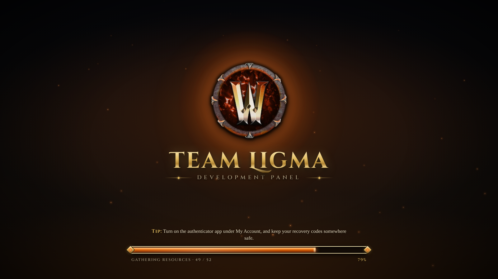
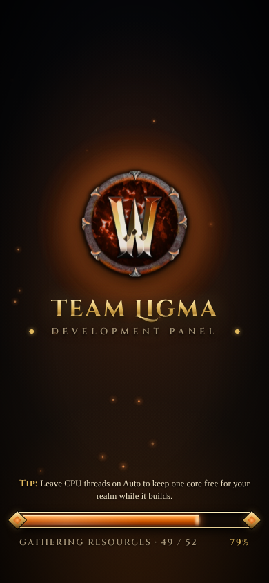

# Prompt
Update the loading screen to use the new emblem too

# Reponse
The loading screen now uses the Team Ligma emblem from the sign-in screen (v1.7.1).

- **Emblem:** the hand-drawn SVG crest is replaced by the emblem art, served as a 45 KB WebP copy (vs. the 260 KB PNG) and preloaded, so it appears as soon as the page opens.
- **Effects:** it gets the same treatment as the sign-in screen, a pulsing heat halo behind it and a gentle float. The embers, title, tips and the real-progress loading bar are unchanged.
- **Accessibility and cleanup:** reduced-motion settings stop the halo and float animations too. The CSS that only served the old SVG crest (rune ring rotation, core flicker) was removed.

**Tested:** a throttled load (about 25 Mbit/s) showed the emblem, halo and progress (49 / 52 resources at 79%), then faded into the app with no page errors, at desktop and phone width.

# File Changes
| File | Type | Workspace path | Change |
|---|---|---|---|
| `v171-loading-emblem-mobile.png` | `Asset` | `Prompts/Team Ligma Development Panel/screenshots/v171-loading-emblem-mobile.png` | Created |
| `v171-loading-emblem.png` | `Asset` | `Prompts/Team Ligma Development Panel/screenshots/v171-loading-emblem.png` | Created |
| `README.md` | `Docs` | `README.md` | Changed |
| `TeamLigma.Panel.Server.csproj` | `Config` | `src/TeamLigma.Panel.Server/TeamLigma.Panel.Server.csproj` | Changed |
| `index.html` | `Code` | `src/TeamLigma.Panel/TeamLigma.Panel/Platforms/WebAssembly/index.html` | Changed |
| `emblem.webp` | `Code` | `src/TeamLigma.Panel/TeamLigma.Panel/Platforms/WebAssembly/loading/emblem.webp` | Created |
| `loading.css` | `Code` | `src/TeamLigma.Panel/TeamLigma.Panel/Platforms/WebAssembly/loading/loading.css` | Changed |
| `TeamLigma.Panel.csproj` | `Config` | `src/TeamLigma.Panel/TeamLigma.Panel/TeamLigma.Panel.csproj` | Changed |

Environment: `/roc/claude/panel/` redeployed (v1.7.1); runtime file `/roc/claude/panel-data/settings.json`.

# Code Diffs
### `README.md` (Changed)
```diff
diff --git a/README.md b/README.md
index 61f4929..01f790b 100644
--- a/README.md
+++ b/README.md
@@ -1,7 +1,7 @@
 <p align="center"></p>
 
 # Team Ligma Development Panel
-**Version 1.7.0**
+**Version 1.7.1**
 
 One dark, burnt-orange control room for an AzerothCore test realm. Kick off builds, watch every object compile in real time, look back at old logs, and talk to the Worldserver, Authserver and MySQL from your browser. No SSH session needed.
 
@@ -50,14 +50,14 @@ Console input is pasted through a temporary owner-only file that's deleted immed
 
 ## Loading screen
 While the WebAssembly app downloads and starts, the panel shows a dark, fantasy-MMO-styled loading screen:
-- **Look:** a stone backdrop with drifting embers, an original gold crest (shield, sword, smithing hammer and gear inside a turning rune ring), the title in Cinzel Decorative, and an ornate gold-framed loading bar.
+- **Look:** a stone backdrop with drifting embers, the Team Ligma emblem (the same art as the sign-in screen) floating in front of a pulsing heat halo, the title in Cinzel Decorative, and an ornate gold-framed loading bar.
 - **Tips:** rotating "Tip:" lines about using the panel.
 - **Progress is real:** the bar follows the Uno bootstrapper's resource downloads ("Gathering resources · 46 / 52"), then "Waking the runtime" while .NET starts. Once the app has drawn its first screen it fills, says "Entering the realm", and fades away.
 - **Accessibility:** animations are switched off when the browser asks for reduced motion.
 
-The files are `src/TeamLigma.Panel/TeamLigma.Panel/Platforms/WebAssembly/index.html` (markup and crest) and `Platforms/WebAssembly/loading/` (`loading.css`, `loading.js`, fonts). The page is selected with `WasmShellIndexHtmlPath` in the app's `.csproj`. The loading files are published as app content, because the Uno build rewrites `./` paths in `index.html` into its package folder.
+The files are `src/TeamLigma.Panel/TeamLigma.Panel/Platforms/WebAssembly/index.html` (markup) and `Platforms/WebAssembly/loading/` (`loading.css`, `loading.js`, `emblem.webp`, fonts). The emblem is a 45 KB WebP copy of `Assets/LoginEmblem.png`, preloaded so the screen appears quickly. The page is selected with `WasmShellIndexHtmlPath` in the app's `.csproj`. The loading files are published as app content, because the Uno build rewrites `./` paths in `index.html` into its package folder.
 
-The artwork is original and inspired by the genre; it uses no Blizzard assets. Fonts: [Cinzel](https://github.com/NDISCOVER/Cinzel) and Cinzel Decorative, SIL Open Font License 1.1 (`loading/fonts/OFL.txt`).
+Fonts: [Cinzel](https://github.com/NDISCOVER/Cinzel) and Cinzel Decorative, SIL Open Font License 1.1 (`loading/fonts/OFL.txt`).
 
 ## Accounts & sign-in
 Every page and API call requires a signed-in account. Accounts can be protected with an **authenticator app** (TOTP: Google Authenticator, Microsoft Authenticator, Authy, 1Password, Bitwarden, Aegis and similar).
```

### `src/TeamLigma.Panel.Server/TeamLigma.Panel.Server.csproj` (Changed)
```diff
diff --git a/src/TeamLigma.Panel.Server/TeamLigma.Panel.Server.csproj b/src/TeamLigma.Panel.Server/TeamLigma.Panel.Server.csproj
index 63152ef..37ad26c 100644
--- a/src/TeamLigma.Panel.Server/TeamLigma.Panel.Server.csproj
+++ b/src/TeamLigma.Panel.Server/TeamLigma.Panel.Server.csproj
@@ -4,7 +4,7 @@
     <Nullable>enable</Nullable>
     <ImplicitUsings>enable</ImplicitUsings>
     <RootNamespace>TeamLigma.Panel.Server</RootNamespace>
-    <Version>1.7.0</Version>
+    <Version>1.7.1</Version>
   </PropertyGroup>
   <ItemGroup>
     <Compile Include="../Shared/Dtos.cs" Link="Shared/Dtos.cs" />
```

### `src/TeamLigma.Panel/TeamLigma.Panel/Platforms/WebAssembly/index.html` (Changed)
```diff
diff --git a/src/TeamLigma.Panel/TeamLigma.Panel/Platforms/WebAssembly/index.html b/src/TeamLigma.Panel/TeamLigma.Panel/Platforms/WebAssembly/index.html
index 96b5627..a79f494 100644
--- a/src/TeamLigma.Panel/TeamLigma.Panel/Platforms/WebAssembly/index.html
+++ b/src/TeamLigma.Panel/TeamLigma.Panel/Platforms/WebAssembly/index.html
@@ -10,6 +10,7 @@
     <link rel="shortcut icon" href="./loading/favicon.ico" />
 
     <!-- Themed loading screen (loads before the Uno runtime) -->
+    <link rel="preload" href="./loading/emblem.webp" as="image" type="image/webp" />
     <link rel="preload" href="./loading/fonts/cinzel-decorative-latin-700-normal.woff2" as="font" type="font/woff2" crossorigin />
     <link rel="preload" href="./loading/fonts/cinzel-latin-600-normal.woff2" as="font" type="font/woff2" crossorigin />
     <link rel="stylesheet" type="text/css" href="./loading/loading.css" />
@@ -40,93 +41,9 @@
         <div class="tl-vignette" aria-hidden="true"></div>
 
         <main class="tl-center">
-            <svg class="tl-crest" viewBox="0 0 240 240" aria-hidden="true">
-                <defs>
-                    <linearGradient id="tlGold" x1="0" y1="0" x2="0" y2="1">
-                        <stop offset="0" stop-color="#fff1c1" />
-                        <stop offset="0.35" stop-color="#e8c36a" />
-                        <stop offset="0.7" stop-color="#a87a2c" />
-                        <stop offset="1" stop-color="#5c3f12" />
-                    </linearGradient>
-                    <linearGradient id="tlSteel" x1="0" y1="0" x2="1" y2="1">
-                        <stop offset="0" stop-color="#e9edf2" />
-                        <stop offset="0.5" stop-color="#9aa4b1" />
-                        <stop offset="1" stop-color="#4d5560" />
-                    </linearGradient>
-                    <radialGradient id="tlShieldFill" cx="0.5" cy="0.35" r="0.75">
-                        <stop offset="0" stop-color="#3a1a0a" />
-                        <stop offset="0.6" stop-color="#1c0d06" />
-                        <stop offset="1" stop-color="#0b0604" />
-                    </radialGradient>
-                    <radialGradient id="tlCore" cx="0.5" cy="0.5" r="0.5">
-                        <stop offset="0" stop-color="#ffb066" stop-opacity="0.9" />
-                        <stop offset="0.45" stop-color="#cc5500" stop-opacity="0.45" />
-                        <stop offset="1" stop-color="#cc5500" stop-opacity="0" />
-                    </radialGradient>
-                    <filter id="tlEngrave" x="-10%" y="-10%" width="120%" height="120%">
-                        <feDropShadow dx="0" dy="2" stdDeviation="1.6" flood-color="#000" flood-opacity="0.85" />
-                    </filter>
-                </defs>
-
-                <!-- rune ring (rotates) -->
-                <g class="tl-ring">
-                    <circle cx="120" cy="120" r="111" fill="none" stroke="url(#tlGold)" stroke-width="2.5" />
-                    <circle cx="120" cy="120" r="101" fill="none" stroke="url(#tlGold)" stroke-width="1" stroke-opacity="0.7" />
-                    <g stroke="#d9b45c" stroke-width="1.6" stroke-linecap="round" fill="none" opacity="0.85">
-                        <!-- 12 original rune marks between the rings -->
-                        <path d="M120 12 v8 M117 15 l3 3 l3 -3" />
-                        <path d="M117 13 l3 7 l3 -7" transform="rotate(30 120 120)" />
-                        <path d="M120 12 v8 M116 16 h8" transform="rotate(60 120 120)" />
-                        <path d="M118 12 l4 8 M122 12 l-4 8" transform="rotate(90 120 120)" />
-                        <path d="M120 12 v8 M117 19 l3 -3 l3 3" transform="rotate(120 120 120)" />
-                        <path d="M117 13 h6 M120 13 v7" transform="rotate(150 120 120)" />
-                        <path d="M120 12 v8 M117 15 l3 3 l3 -3" transform="rotate(180 120 120)" />
-                        <path d="M120 12 v8 M116 16 h8" transform="rotate(210 120 120)" />
-                        <path d="M118 12 l4 8 M122 12 l-4 8" transform="rotate(240 120 120)" />
-                        <path d="M120 12 v8 M117 19 l3 -3 l3 3" transform="rotate(270 120 120)" />
-                        <path d="M117 13 h6 M120 13 v7" transform="rotate(300 120 120)" />
-                        <path d="M118 13 l2 7 l2 -7" transform="rotate(330 120 120)" />
-                    </g>
-                    <g fill="url(#tlGold)">
-                        <circle cx="120" cy="9" r="3" />
-                        <circle cx="231" cy="120" r="3" />
-                        <circle cx="120" cy="231" r="3" />
-                        <circle cx="9" cy="120" r="3" />
-                    </g>
-                </g>
-
-                <!-- ember core glow behind the shield -->
-                <circle class="tl-core" cx="120" cy="122" r="78" fill="url(#tlCore)" />
-
-                <!-- gear -->
-                <g class="tl-gear" transform="translate(120 122)" filter="url(#tlEngrave)">
-                    <path fill="none" stroke="url(#tlGold)" stroke-width="3"
-                          d="M-6 -62 h12 l3 11 a52 52 0 0 1 12 5 l10 -6 l9 9 l-6 10 a52 52 0 0 1 5 12 l11 3 v12 l-11 3 a52 52 0 0 1 -5 12 l6 10 l-9 9 l-10 -6 a52 52 0 0 1 -12 5 l-3 11 h-12 l-3 -11 a52 52 0 0 1 -12 -5 l-10 6 l-9 -9 l6 -10 a52 52 0 0 1 -5 -12 l-11 -3 v-12 l11 -3 a52 52 0 0 1 5 -12 l-6 -10 l9 -9 l10 6 a52 52 0 0 1 12 -5 z" />
-                </g>
-
-                <!-- shield -->
-                <g filter="url(#tlEngrave)">
-                    <path d="M120 58 L168 74 Q170 132 120 178 Q70 132 72 74 Z" fill="url(#tlShieldFill)" stroke="url(#tlGold)" stroke-width="4" stroke-linejoin="round" />
-                    <path d="M120 66 L160 79 Q161 128 120 168 Q79 128 80 79 Z" fill="none" stroke="#e8c36a" stroke-opacity="0.45" stroke-width="1.2" />
-                </g>
-
-                <!-- crossed sword and hammer -->
-                <g filter="url(#tlEngrave)">
-                    <g transform="rotate(-38 120 118)">
-                        <path d="M117 64 L120 56 L123 64 L123 140 L117 140 Z" fill="url(#tlSteel)" />
-                        <path d="M120 60 V138" stroke="#ffffff" stroke-opacity="0.5" stroke-width="0.8" />
-                        <rect x="106" y="140" width="28" height="5" rx="2" fill="url(#tlGold)" />
-                        <rect x="117.5" y="145" width="5" height="16" fill="#5a3416" />
-                        <circle cx="120" cy="164" r="4" fill="url(#tlGold)" />
-                    </g>
-                    <g transform="rotate(38 120 118)">
-                        <rect x="117.5" y="84" width="5" height="78" rx="1.5" fill="#6b3d19" />
-                        <path d="M104 70 h32 a3 3 0 0 1 3 3 v14 a3 3 0 0 1 -3 3 h-32 a3 3 0 0 1 -3 -3 v-14 a3 3 0 0 1 3 -3 z" fill="url(#tlSteel)" stroke="#2b2f35" stroke-width="1" />
-                        <rect x="101" y="77" width="38" height="3" fill="url(#tlGold)" />
-                        <circle cx="120" cy="164" r="3.5" fill="url(#tlGold)" />
-                    </g>
-                </g>
-            </svg>
+            <div class="tl-crest" aria-hidden="true">
+                
+            </div>
 
             <h1 class="tl-title">Team Ligma</h1>
             <div class="tl-subtitle"><span class="tl-rule" aria-hidden="true"></span>Development Panel<span class="tl-rule" aria-hidden="true"></span></div>
```

### `src/TeamLigma.Panel/TeamLigma.Panel/Platforms/WebAssembly/loading/emblem.webp` (Created)
```diff
diff --git a/src/TeamLigma.Panel/TeamLigma.Panel/Platforms/WebAssembly/loading/emblem.webp b/src/TeamLigma.Panel/TeamLigma.Panel/Platforms/WebAssembly/loading/emblem.webp
new file mode 100644
index 0000000..15d7baf
Binary files /dev/null and b/src/TeamLigma.Panel/TeamLigma.Panel/Platforms/WebAssembly/loading/emblem.webp differ
```

### `src/TeamLigma.Panel/TeamLigma.Panel/Platforms/WebAssembly/loading/loading.css` (Changed)
```diff
diff --git a/src/TeamLigma.Panel/TeamLigma.Panel/Platforms/WebAssembly/loading/loading.css b/src/TeamLigma.Panel/TeamLigma.Panel/Platforms/WebAssembly/loading/loading.css
index d61ef73..c25610a 100644
--- a/src/TeamLigma.Panel/TeamLigma.Panel/Platforms/WebAssembly/loading/loading.css
+++ b/src/TeamLigma.Panel/TeamLigma.Panel/Platforms/WebAssembly/loading/loading.css
@@ -148,20 +148,31 @@ html, body {
     min-height: 0;
 }
 
+/* emblem with a pulsing heat halo, matching the sign-in screen */
 .tl-crest {
-    width: clamp(150px, 26vmin, 260px);
-    height: auto;
-    filter: drop-shadow(0 0 18px rgba(255, 138, 61, 0.25)) drop-shadow(0 6px 10px rgba(0, 0, 0, 0.8));
+    position: relative;
+    width: clamp(170px, 30vmin, 290px);
+    aspect-ratio: 1;
     animation: tl-float 6s ease-in-out infinite;
 }
 
-.tl-ring {
-    transform-origin: 120px 120px;
-    animation: tl-spin 60s linear infinite;
+.tl-crest::before {
+    content: "";
+    position: absolute;
+    inset: -32%;
+    border-radius: 50%;
+    background: radial-gradient(circle, rgba(255, 154, 74, 0.75) 0%, rgba(224, 102, 26, 0.42) 30%, rgba(163, 58, 8, 0.16) 58%, transparent 72%);
+    animation: tl-halo 3.4s ease-in-out infinite;
+    pointer-events: none;
 }
 
-.tl-core {
-    animation: tl-flicker 3.2s ease-in-out infinite;
+.tl-emblem {
+    position: relative;
+    display: block;
+    width: 100%;
+    height: 100%;
+    object-fit: contain;
+    filter: drop-shadow(0 8px 14px rgba(0, 0, 0, 0.85)) drop-shadow(0 0 22px rgba(255, 120, 40, 0.35));
 }
 
 .tl-title {
@@ -350,19 +361,23 @@ html, body {
 
 /* ---- animations ---- */
 
-@keyframes tl-spin { to { transform: rotate(360deg); } }
 @keyframes tl-float { 0%, 100% { transform: translateY(0); } 50% { transform: translateY(-6px); } }
 @keyframes tl-breathe { 0%, 100% { opacity: 0.75; } 50% { opacity: 1; } }
-@keyframes tl-flicker { 0%, 100% { opacity: 0.85; } 45% { opacity: 1; } 60% { opacity: 0.7; } }
+@keyframes tl-halo {
+    0%, 100% { opacity: 0.7; transform: scale(1); }
+    40% { opacity: 1; transform: scale(1.04); }
+    55% { opacity: 0.78; transform: scale(1.01); }
+    70% { opacity: 0.92; transform: scale(1.03); }
+}
 @keyframes tl-sheen { 0% { background-position: 120% 0; } 100% { background-position: -120% 0; } }
 
 @media (max-height: 560px) {
-    .tl-crest { width: 120px; }
+    .tl-crest { width: 130px; }
     .tl-tip { min-height: 0; }
 }
 
 @media (prefers-reduced-motion: reduce) {
-    .tl-ring, .tl-crest, .tl-glow, .tl-core, .tl-bar-sheen { animation: none; }
+    .tl-crest, .tl-crest::before, .tl-glow, .tl-bar-sheen { animation: none; }
     .tl-embers { display: none; }
     #tl-loading { transition: none; }
 }
```

### `src/TeamLigma.Panel/TeamLigma.Panel/TeamLigma.Panel.csproj` (Changed)
```diff
diff --git a/src/TeamLigma.Panel/TeamLigma.Panel/TeamLigma.Panel.csproj b/src/TeamLigma.Panel/TeamLigma.Panel/TeamLigma.Panel.csproj
index 653b741..5ed0ecc 100644
--- a/src/TeamLigma.Panel/TeamLigma.Panel/TeamLigma.Panel.csproj
+++ b/src/TeamLigma.Panel/TeamLigma.Panel/TeamLigma.Panel.csproj
@@ -5,11 +5,11 @@
     <UnoSingleProject>true</UnoSingleProject>
     <ApplicationTitle>Team Ligma Development Panel</ApplicationTitle>
     <ApplicationId>com.teamligma.devpanel</ApplicationId>
-    <ApplicationDisplayVersion>1.7.0</ApplicationDisplayVersion>
+    <ApplicationDisplayVersion>1.7.1</ApplicationDisplayVersion>
     <ApplicationVersion>1</ApplicationVersion>
     <ApplicationPublisher>Team Ligma</ApplicationPublisher>
     <Description>Team Ligma Development Panel - AzerothCore build and server console suite.</Description>
-    <Version>1.7.0</Version>
+    <Version>1.7.1</Version>
     <UnoFeatures>
       Mvvm;
       SkiaRenderer;
```

# Image Assets

`Prompts/Team Ligma Development Panel/screenshots/v171-loading-emblem.png` (Loading screen with the emblem, sanity-test capture)


`Prompts/Team Ligma Development Panel/screenshots/v171-loading-emblem-mobile.png` (Loading screen with the emblem at phone width, sanity-test capture)

