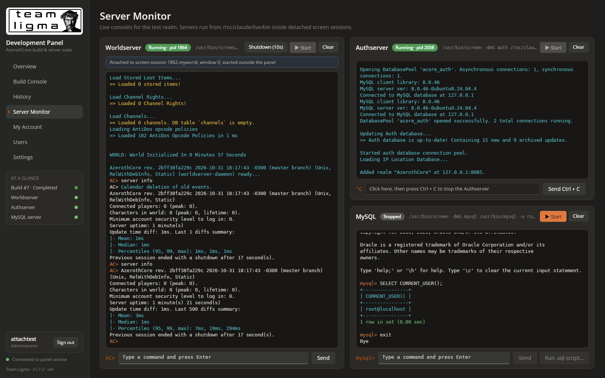

# Prompt
Fix:

* Ensure the server monitor panels hook to the currently running world/authserver sessions, even if started outside of the panel

# Reponse
The Worldserver and Authserver consoles now attach to the running server whoever started it (v1.7.2).

**How it works:** the panel finds the running process and reads its environment to see where it lives.
- **screen** (any session name, any user): the existing output is copied into the console once, then that window's output is logged. Commands are typed into that session and window.
- **tmux** (any user): the pane's earlier output is copied in with colours, then the pane is piped. Commands use `send-keys`.
- **No terminal** (nohup, a service): read-only, showing the server's stdout file if redirected, or its Server.log/Auth.log. Authserver Ctrl + C is sent as SIGINT, the same signal. Worldserver commands are reported as impossible without a terminal.
- **Other users:** their sessions are driven as that user via `runuser`, since screen refuses even root ("You are not the owner"), using helper files in `/run/tl-panel/<user>/`.
- **Restarts:** attachments are remembered in `consoles/attached.json`, so a panel restart doesn't copy the output twice. The panel's own sessions are registered at start so they're never treated as external.
- **UI:** a banner explains the connection; input, Ctrl + C, Start and Clear are enabled according to what's possible. When the output source changes, the console starts fresh.
- **Tidying:** clearing a read-only console is refused, since that file is the server's own log.

**Tested:**
- A root Worldserver in a screen session named `myworld`: earlier output captured, live output, and `server info` answered.
- An Authserver run by another user in tmux: earlier output captured, live output, and Ctrl + C stopped it gracefully.
- An Authserver under nohup: stdout file shown read-only, Clear refused, and SIGINT stopped it gracefully.
- A panel restart kept the attachment without a second capture.
- A panel-started session shows no banner.
- The UI banner was checked in the browser.

**Known limits:** the copied earlier output from screen is plain text wrapped at the window width, and its box-drawing characters may come out garbled. A server writing to a file instead of a terminal may buffer its output.

# File Changes
| File | Type | Workspace path | Change |
|---|---|---|---|
| `v172-attached-console.png` | `Asset` | `Prompts/Team Ligma Development Panel/screenshots/v172-attached-console.png` | Created |
| `README.md` | `Docs` | `README.md` | Changed |
| `Dtos.cs` | `Code` | `src/Shared/Dtos.cs` | Changed |
| `ConsoleAttach.cs` | `Code` | `src/TeamLigma.Panel.Server/ConsoleAttach.cs` | Created |
| `ConsoleService.cs` | `Code` | `src/TeamLigma.Panel.Server/ConsoleService.cs` | Changed |
| `Program.cs` | `Code` | `src/TeamLigma.Panel.Server/Program.cs` | Changed |
| `Shell.cs` | `Code` | `src/TeamLigma.Panel.Server/Shell.cs` | Changed |
| `TeamLigma.Panel.Server.csproj` | `Config` | `src/TeamLigma.Panel.Server/TeamLigma.Panel.Server.csproj` | Changed |
| `ApiClient.cs` | `Code` | `src/TeamLigma.Panel/TeamLigma.Panel/Services/ApiClient.cs` | Changed |
| `TeamLigma.Panel.csproj` | `Config` | `src/TeamLigma.Panel/TeamLigma.Panel/TeamLigma.Panel.csproj` | Changed |
| `ConsolePanel.xaml` | `Code` | `src/TeamLigma.Panel/TeamLigma.Panel/Views/ConsolePanel.xaml` | Changed |
| `ConsolePanel.xaml.cs` | `Code` | `src/TeamLigma.Panel/TeamLigma.Panel/Views/ConsolePanel.xaml.cs` | Changed |
| `ServersView.xaml` | `Code` | `src/TeamLigma.Panel/TeamLigma.Panel/Views/ServersView.xaml` | Changed |

Environment: `/roc/claude/panel/` redeployed (v1.7.2); runtime files `/roc/claude/panel-data/consoles/attached.json`, `/run/tl-panel/<user>/`; `/roc/claude/panel-data/settings.json`.

# Code Diffs
### `README.md` (Changed)
```diff
diff --git a/README.md b/README.md
index 01f790b..8d8994b 100644
--- a/README.md
+++ b/README.md
@@ -1,7 +1,7 @@
 <p align="center"></p>
 
 # Team Ligma Development Panel
-**Version 1.7.1**
+**Version 1.7.2**
 
 One dark, burnt-orange control room for an AzerothCore test realm. Kick off builds, watch every object compile in real time, look back at old logs, and talk to the Worldserver, Authserver and MySQL from your browser. No SSH session needed.
 
@@ -105,6 +105,24 @@ cd /roc/claude/panel/server && sudo dotnet TeamLigma.Panel.Server.dll user-reset
 | **History** | Every build, newest first, with number, start, completion, status and compilation result. Each entry has **View Log** (full build/install log in a scrollable dialog, followed live if the build is still running) and **Remove**. |
 | **Server Monitor** | Coloured, interactive consoles. Left column: **Worldserver** (single-line commands, with a 10-second graceful shutdown button). Right column: **Authserver** (accepts Ctrl + C only) above **MySQL** (`mysql -uroot -p`; masked password entry, single-line queries, and **Run .sql script…** to upload and `source` a local file). |
 
+## Servers started outside the panel
+The Worldserver and Authserver consoles attach to whichever `worldserver`/`authserver` process is running, even one started by hand or by another user. The panel works out where the process lives from its environment:
+
+| The server is running in… | Console output | Commands / Ctrl + C |
+|---|---|---|
+| a **screen** session (any name, any user) | the session's existing output is copied in once, then the window is logged | typed into that session and window |
+| a **tmux** pane (any user) | the pane's earlier output is copied in with colours, then the pane is piped | `tmux send-keys` |
+| **no terminal** (nohup, a service, a plain shell) | read-only: the server's stdout file if redirected, else its `Server.log` / `Auth.log` | Authserver Ctrl + C is sent as `SIGINT` (the same signal). Worldserver commands aren't possible without a terminal, and the console says so. |
+
+A banner above the console describes the connection, for example *"Attached to screen session 1862.myworld, window 0, started outside the panel"*.
+
+Details:
+- **Other users' sessions:** `screen` and `tmux` sessions owned by other users are driven as that user (`runuser`), with helper files in `/run/tl-panel/<user>/`.
+- **Restarts:** attachments are remembered in `panel-data/consoles/attached.json`, so restarting the panel doesn't copy the earlier output again.
+- **Start:** Start is disabled while the server is already running.
+- **Copied output:** the earlier output that `screen` hands over is plain text wrapped at the window width, and its box-drawing characters may come out garbled. Output after attaching is unaffected.
+- **Buffered output:** a server writing to a file instead of a terminal may buffer its output, so lines can appear in bursts.
+
 ## Commands the panel runs
 
 These are the defaults; **Settings** can change the tool paths, the install directory, the executables and the MySQL login, and its preview shows the commands actually used.
```

### `src/Shared/Dtos.cs` (Changed)
```diff
diff --git a/src/Shared/Dtos.cs b/src/Shared/Dtos.cs
index 9f6cc7d..8437b84 100644
--- a/src/Shared/Dtos.cs
+++ b/src/Shared/Dtos.cs
@@ -92,6 +92,12 @@ public sealed class ServerStatus
     public string? ShutdownCommand { get; set; }
     /// <summary>MySQL only: the panel will type the stored password at the prompt.</summary>
     public bool AutoLogin { get; set; }
+    /// <summary>How the console is connected: none, screen, tmux or log (read-only server log).</summary>
+    public string Attach { get; set; } = "none";
+    /// <summary>Human-readable description of the connection (e.g. an external screen session).</summary>
+    public string? AttachNote { get; set; }
+    /// <summary>Whether typed commands can reach the server.</summary>
+    public bool CanType { get; set; }
 }
 
 public sealed class LogChunk
```

### `src/TeamLigma.Panel.Server/ConsoleAttach.cs` (Created)
```diff
diff --git a/src/TeamLigma.Panel.Server/ConsoleAttach.cs b/src/TeamLigma.Panel.Server/ConsoleAttach.cs
new file mode 100644
index 0000000..516d17d
--- /dev/null
+++ b/src/TeamLigma.Panel.Server/ConsoleAttach.cs
@@ -0,0 +1,236 @@
+using System.Text;
+using System.Text.Json;
+
+namespace TeamLigma.Panel.Server;
+
+public enum AttachKind { None, Screen, Tmux, LogOnly }
+
+/// <summary>Where a running server's console lives, and where the panel reads its output from.</summary>
+public sealed record Attachment(
+    AttachKind Kind,
+    int? Pid,
+    string User,
+    string? Sty,          // screen: "<pid>.<name>"
+    string? Window,       // screen window number
+    string? TmuxSocket,
+    string? TmuxPane,
+    string OutputPath,    // file the console tails
+    bool PanelOwned)      // a session the panel started itself
+{
+    public string Key => Kind switch
+    {
+        AttachKind.Screen => $"screen:{Sty}:{Window}",
+        AttachKind.Tmux => $"tmux:{TmuxSocket}:{TmuxPane}",
+        AttachKind.LogOnly => $"log:{OutputPath}",
+        _ => "none",
+    };
+
+    public bool CanType => Kind is AttachKind.Screen or AttachKind.Tmux;
+
+    public string Describe(string exe) => Kind switch
+    {
+        AttachKind.Screen when PanelOwned => $"Panel session ({Sty})",
+        AttachKind.Screen => $"Attached to screen session {Sty}, window {Window}{UserNote}, started outside the panel",
+        AttachKind.Tmux => $"Attached to tmux pane {TmuxPane}{UserNote}, started outside the panel",
+        AttachKind.LogOnly => $"{exe} (pid {Pid}) isn't running in screen or tmux. Showing {Path.GetFileName(OutputPath)} read-only.",
+        _ => "",
+    };
+
+    string UserNote => User == "root" ? "" : $" (user {User})";
+}
+
+/// <summary>
+/// Finds the terminal a server process lives in and drives it. Commands for another user's screen/tmux
+/// session run as that user (screen refuses even root), with helper files in a directory they own.
+/// </summary>
+public static class Mux
+{
+    const string UserDirRoot = "/run/tl-panel";
+
+    public static Dictionary<string, string> Environ(int pid)
+    {
+        var map = new Dictionary<string, string>();
+        try
+        {
+            foreach (var kv in File.ReadAllText($"/proc/{pid}/environ").Split('\0', StringSplitOptions.RemoveEmptyEntries))
+            {
+                var i = kv.IndexOf('=');
+                if (i > 0) map[kv[..i]] = kv[(i + 1)..];
+            }
+        }
+        catch { }
+        return map;
+    }
+
+    public static string OwnerOf(int pid)
+    {
+        try
+        {
+            var uidLine = File.ReadLines($"/proc/{pid}/status").First(l => l.StartsWith("Uid:"));
+            var uid = uidLine.Split('\t', ' ', StringSplitOptions.RemoveEmptyEntries)[1];
+            foreach (var line in File.ReadLines("/etc/passwd"))
+            {
+                var f = line.Split(':');
+                if (f.Length > 2 && f[2] == uid) return f[0];
+            }
+            return uid;
+        }
+        catch { return "root"; }
+    }
+
+    /// <summary>A directory the session owner can use for paste buffers, logs and scrollback captures.</summary>
+    public static async Task<string> UserDirAsync(string user, string rootDir)
+    {
+        if (user == "root") { Directory.CreateDirectory(rootDir); return rootDir; }
+        var dir = Path.Combine(UserDirRoot, user);
+        Directory.CreateDirectory(dir);
+        await Shell.RunAsync("chown", new[] { $"{user}:", dir });
+        File.SetUnixFileMode(dir, UnixFileMode.UserRead | UnixFileMode.UserWrite | UnixFileMode.UserExecute);
+        return dir;
+    }
+
+    static Task<(int Code, string Output)> AsUser(string user, string exe, IEnumerable<string> args, Dictionary<string, string>? env = null)
+    {
+        if (user == "root") return Shell.RunAsync(exe, args, "/", env);
+        var full = new List<string> { "-u", user, "--", "env" };
+        if (env != null) full.AddRange(env.Select(kv => $"{kv.Key}={kv.Value}"));
+        full.Add(exe);
+        full.AddRange(args);
+        return Shell.RunAsync("runuser", full, "/");
+    }
+
+    public static Task<(int Code, string Output)> ScreenAsync(Attachment a, params string[] command)
+    {
+        var args = new List<string> { "-S", a.Sty!, "-p", a.Window ?? "0", "-X" };
+        args.AddRange(command);
+        var env = a.User == "root" ? null : new Dictionary<string, string> { ["SCREENDIR"] = $"/run/screen/S-{a.User}" };
+        return AsUser(a.User, Shell.ScreenExe, args, env);
+    }
+
+    public static Task<(int Code, string Output)> TmuxAsync(Attachment a, params string[] command)
+    {
+        var args = new List<string> { "-S", a.TmuxSocket! };
+        args.AddRange(command);
+        return AsUser(a.User, "tmux", args);
+    }
+
+    /// <summary>Types a line (pasted via a buffer, so ^ and \ are literal) and optionally Enter.</summary>
+    public static async Task<bool> TypeAsync(Attachment a, string text, bool enter, string rootDir)
+    {
+        if (a.Kind == AttachKind.Tmux)
+        {
+            if (text.Length > 0 && (await TmuxAsync(a, "send-keys", "-t", a.TmuxPane!, "-l", text)).Code != 0) return false;
+            return !enter || (await TmuxAsync(a, "send-keys", "-t", a.TmuxPane!, "Enter")).Code == 0;
+        }
+        if (a.Kind != AttachKind.Screen) return false;
+        if (text.Length > 0)
+        {
+            var dir = await UserDirAsync(a.User, rootDir);
+            var buf = Path.Combine(dir, $"in-{Guid.NewGuid():N}.paste");
+            await File.WriteAllTextAsync(buf, "");
+            File.SetUnixFileMode(buf, UnixFileMode.UserRead | UnixFileMode.UserWrite);
+            if (a.User != "root") await Shell.RunAsync("chown", new[] { a.User, buf });
+            await File.WriteAllTextAsync(buf, text, new UTF8Encoding(false));
+            try
+            {
+                if ((await ScreenAsync(a, "readbuf", buf)).Code != 0) return false;
+                if ((await ScreenAsync(a, "paste", ".")).Code != 0) return false;
+            }
+            finally { try { File.Delete(buf); } catch { } }
+        }
+        return !enter || (await ScreenAsync(a, "stuff", "\r")).Code == 0;
+    }
+
+    public static async Task<bool> CtrlCAsync(Attachment a)
+    {
+        switch (a.Kind)
+        {
+            case AttachKind.Screen: return (await ScreenAsync(a, "stuff", "\u0003")).Code == 0;
+            case AttachKind.Tmux: return (await TmuxAsync(a, "send-keys", "-t", a.TmuxPane!, "C-c")).Code == 0;
+            case AttachKind.LogOnly when a.Pid is { } pid:
+                // No terminal to type into: SIGINT is exactly what Ctrl + C sends.
+                return (await Shell.RunAsync("kill", new[] { "-INT", pid.ToString() })).Code == 0;
+            default: return false;
+        }
+    }
+
+    /// <summary>
+    /// First contact with a session: copy its existing scrollback into the console file, then make the
+    /// multiplexer append everything new to it (screen logging / tmux pipe-pane).
+    /// </summary>
+    public static async Task AttachAsync(Attachment a, string exe, string rootDir, ILogger log)
+    {
+        var dir = await UserDirAsync(a.User, rootDir);
+        var header = $"\u001b[38;5;208m== Team Ligma panel: attached to {(a.Kind == AttachKind.Screen ? $"screen session {a.Sty}, window {a.Window}" : $"tmux pane {a.TmuxPane}")} " +
+                     $"running {exe} (pid {a.Pid}{(a.User == "root" ? "" : $", user {a.User}")}) at {DateTimeOffset.Now:yyyy-MM-dd HH:mm:ss}\u001b[0m\n";
+        string scrollback = "";
+        if (a.Kind == AttachKind.Screen)
+        {
+            var cap = Path.Combine(dir, $"cap-{Guid.NewGuid():N}.txt");
+            await ScreenAsync(a, "hardcopy", "-h", cap);
+            for (var i = 0; i < 20 && !File.Exists(cap); i++) await Task.Delay(100);
+            await Task.Delay(150);
+            try { scrollback = File.Exists(cap) ? await File.ReadAllTextAsync(cap) : ""; } catch { }
+            try { File.Delete(cap); } catch { }
+        }
+        else if (a.Kind == AttachKind.Tmux)
+        {
+            var (code, output) = await TmuxAsync(a, "capture-pane", "-p", "-e", "-J", "-S", "-", "-t", a.TmuxPane!);
+            if (code == 0) scrollback = output;
+        }
+        scrollback = scrollback.TrimEnd('\n', ' ', '\r');
+        await File.AppendAllTextAsync(a.OutputPath, header + (scrollback.Length > 0 ? scrollback + "\n\u001b[38;5;208m== (end of earlier output)\u001b[0m\n" : ""));
+        if (a.User != "root") await Shell.RunAsync("chown", new[] { a.User, a.OutputPath });
+
+        if (a.Kind == AttachKind.Screen)
+        {
+            await ScreenAsync(a, "logfile", a.OutputPath);
+            await ScreenAsync(a, "logfile", "flush", "1");
+            await ScreenAsync(a, "log", "on");
+        }
+        else
+        {
+            await TmuxAsync(a, "pipe-pane", "-o", "-t", a.TmuxPane!, $"cat >> '{a.OutputPath.Replace("'", "'\\''")}'");
+        }
+        log.LogInformation("Console attached: {Key} ({Exe}, pid {Pid}, user {User})", a.Key, exe, a.Pid, a.User);
+    }
+}
+
+/// <summary>Remembers which sessions are already attached, so a panel restart doesn't re-capture scrollback.</summary>
+public sealed class AttachRegistry
+{
+    readonly string _path;
+    readonly object _lock = new();
+    Dictionary<string, string> _map;
+
+    public AttachRegistry(string consolesDir)
+    {
+        _path = Path.Combine(consolesDir, "attached.json");
+        try { _map = File.Exists(_path) ? JsonSerializer.Deserialize<Dictionary<string, string>>(File.ReadAllText(_path)) ?? new() : new(); }
+        catch { _map = new(); }
+    }
+
+    public bool Has(string key) { lock (_lock) return _map.ContainsKey(key); }
+    public string? Get(string key) { lock (_lock) return _map.TryGetValue(key, out var v) ? v : null; }
+
+    public void Add(string key, string output)
+    {
+        lock (_lock)
+        {
+            _map[key] = output;
+            File.WriteAllText(_path, JsonSerializer.Serialize(_map));
+        }
+    }
+
+    /// <summary>Drops entries whose sessions no longer exist.</summary>
+    public void Prune(Func<string, bool> stillExists)
+    {
+        lock (_lock)
+        {
+            var dead = _map.Keys.Where(k => !stillExists(k)).ToList();
+            if (dead.Count == 0) return;
+            foreach (var k in dead) _map.Remove(k);
+            File.WriteAllText(_path, JsonSerializer.Serialize(_map));
+        }
+    }
+}
```

### `src/TeamLigma.Panel.Server/ConsoleService.cs` (Changed)
```diff
diff --git a/src/TeamLigma.Panel.Server/ConsoleService.cs b/src/TeamLigma.Panel.Server/ConsoleService.cs
index a90ce06..f105877 100644
--- a/src/TeamLigma.Panel.Server/ConsoleService.cs
+++ b/src/TeamLigma.Panel.Server/ConsoleService.cs
@@ -24,6 +24,9 @@ public sealed class ConsoleService
     readonly SettingsStore _settings;
     readonly ILogger<ConsoleService> _log;
     public IReadOnlyDictionary<string, Component> Components { get; }
+    readonly AttachRegistry _registry;
+    readonly SemaphoreSlim _attachLock = new(1, 1);
+    readonly Dictionary<string, (DateTime At, Attachment A)> _attachCache = new();
 
     public ConsoleService(IOptions<PanelOptions> o, BuildService builds, SettingsStore settings, ILogger<ConsoleService> log)
     {
@@ -33,6 +36,7 @@ public sealed class ConsoleService
         _log = log;
         Directory.CreateDirectory(_o.ConsolesDir);
         Directory.CreateDirectory(_o.UploadsDir);
+        _registry = new AttachRegistry(_o.ConsolesDir);
         Components = new Dictionary<string, Component>
         {
             ["world"] = new("world", "Worldserver", () => _settings.Worldserver, _settings.WorldserverCommand),
@@ -43,23 +47,92 @@ public sealed class ConsoleService
 
     string LogFile(string name) => Path.Combine(_o.ConsolesDir, name + ".log");
 
+    static bool IsServer(string name) => name is "world" or "auth";
+
+    /// <summary>
+    /// Finds the running server and the terminal it lives in, whoever started it: a screen session or tmux
+    /// pane is attached to (scrollback captured once, then logged); a server with no terminal is shown
+    /// read-only from its own log file.
+    /// </summary>
+    async Task<Attachment> ResolveAsync(Component c)
+    {
+        await _attachLock.WaitAsync();
+        try
+        {
+            if (_attachCache.TryGetValue(c.Name, out var hit) && DateTime.UtcNow - hit.At < TimeSpan.FromSeconds(1)) return hit.A;
+            Attachment a;
+            if (Shell.FindPid(c.Comm) is { } pid)
+            {
+                var env = Mux.Environ(pid);
+                var user = Mux.OwnerOf(pid);
+                var output = user == "root" ? LogFile(c.Name) : Path.Combine(await Mux.UserDirAsync(user, _o.ScreenDir), c.Name + ".log");
+                if (env.TryGetValue("STY", out var sty))
+                    a = new(AttachKind.Screen, pid, user, sty, env.GetValueOrDefault("WINDOW", "0"), null, null, output, false);
+                else if (env.TryGetValue("TMUX", out var tmux) && env.TryGetValue("TMUX_PANE", out var pane))
+                    a = new(AttachKind.Tmux, pid, user, null, null, tmux.Split(',')[0], pane, output, false);
+                else
+                    a = new(AttachKind.LogOnly, pid, user, null, null, null, null, ServerLog(pid, c), false);
+
+                if (a.CanType)
+                {
+                    if (_registry.Get(a.Key) is { } recorded)
+                        a = a with { PanelOwned = recorded.StartsWith("panel:") };
+                    else
+                    {
+                        await Mux.AttachAsync(a, c.Comm, _o.ScreenDir, _log);
+                        _registry.Add(a.Key, "external:" + a.OutputPath);
+                    }
+                }
+            }
+            else a = new(AttachKind.None, null, "root", null, null, null, null, LogFile(c.Name), false);
+            _attachCache[c.Name] = (DateTime.UtcNow, a);
+            return a;
+        }
+        finally { _attachLock.Release(); }
+    }
+
+    /// <summary>For a server with no terminal: its stdout file if redirected, else its own log (Server.log / Auth.log).</summary>
+    string ServerLog(int pid, Component c)
+    {
+        try
+        {
+            var target = new FileInfo($"/proc/{pid}/fd/1").LinkTarget;
+            if (target != null && target.StartsWith('/') && !target.StartsWith("/dev/") && File.Exists(target)) return target;
+        }
+        catch { }
+        var name = c.Name == "world" ? "Server.log" : "Auth.log";
+        var dirs = new List<string?>();
+        try { dirs.Add(new FileInfo($"/proc/{pid}/cwd").LinkTarget); } catch { }
+        dirs.Add(Path.GetDirectoryName(c.ExePath()));
+        foreach (var d in dirs)
+            if (d != null && File.Exists(Path.Combine(d, name))) return Path.Combine(d, name);
+        return LogFile(c.Name);
+    }
     public async Task<List<ServerStatus>> StatusAsync()
     {
         var sessions = await Shell.ScreenSessionsAsync();
         var list = new List<ServerStatus>();
+        PruneRegistry();
         foreach (var c in Components.Values)
         {
-            var pid = Shell.FindPid(c.Comm);
+            var att = IsServer(c.Name) ? await ResolveAsync(c) : null;
+            var pid = att?.Pid ?? Shell.FindPid(c.Comm);
             var st = new ServerStatus
             {
                 Name = c.Name,
                 Title = c.Title,
-                SessionActive = sessions.Contains(c.Name),
+                SessionActive = att != null ? att.CanType || sessions.Contains(c.Name) : sessions.Contains(c.Name),
                 ProcessRunning = pid != null,
                 Pid = pid,
                 Command = c.Command(),
                 ShutdownCommand = c.Name == "world" ? _settings.ShutdownCommand() : null,
                 AutoLogin = c.Name == "mysql" && _settings.MySqlAutoLogin && _settings.MySqlPasswordSet,
+                Attach = att == null ? (sessions.Contains(c.Name) ? "screen" : "none") : att.Kind switch
+                {
+                    AttachKind.Screen => "screen", AttachKind.Tmux => "tmux", AttachKind.LogOnly => "log", _ => "none",
+                },
+                AttachNote = att?.Describe(c.Comm),
+                CanType = att?.CanType ?? sessions.Contains(c.Name),
             };
             if (st.SessionActive && TailEndsWith(LogFile(c.Name), "password:")) st.InputHint = "password";
             list.Add(st);
@@ -92,7 +165,7 @@ public sealed class ConsoleService
                 ? $"The MySQL client was not found ({exe}). Install it, or set its location in Settings."
                 : $"{exe} was not found or is not executable. Build and install the server, or set its location in Settings.");
         if (name != "mysql" && Shell.FindPid(c.Comm) is { } pid)
-            return Fail($"{c.Comm} is already running outside the panel (pid {pid}).");
+            return Fail($"{c.Title} is already running (pid {pid}); its console is attached to the running process.");
         var log = LogFile(name);
         var command = c.Command();
         var header = $"\u001b[38;5;208m== Team Ligma panel: starting {c.Title} at {DateTimeOffset.Now:yyyy-MM-dd HH:mm:ss}\u001b[0m\n== $ {command}\n";
@@ -101,6 +174,9 @@ public sealed class ConsoleService
         env["SCREENRC"] = _builds.ScreenRc(name, log);
         var (code, output) = await Shell.BashAsync(command, c.Cwd, env);
         if (code != 0) return Fail($"Failed to start {c.Title} (exit {code}): {output}");
+        // Register the panel's own session so it is never "attached" (it already logs to the console file).
+        if (await Shell.ScreenIdAsync(name) is { } sty) _registry.Add($"screen:{sty}:0", "panel:" + log);
+        _attachCache.Remove(name);
         if (name == "mysql" && _settings.MySqlAutoLogin && _settings.MySqlPassword() is { } password)
         {
             _ = AutoLoginAsync(log, password);
@@ -131,6 +207,15 @@ public sealed class ConsoleService
         if (!Components.TryGetValue(name, out var c)) return Fail("Unknown console.");
         if (name == "auth") return Fail("The Authserver console only accepts Ctrl + C.");
         if (text.Contains('\n') || text.Contains('\r')) return Fail("Only single-line input is accepted.");
+        if (IsServer(name))
+        {
+            var att = await ResolveAsync(c);
+            if (att.Kind == AttachKind.None) return Fail($"{c.Title} is not running.");
+            if (!att.CanType)
+                return Fail($"{c.Title} (pid {att.Pid}) isn't running inside screen or tmux, so commands can't be typed into it. " +
+                            "Its log is shown read-only; start it from the panel (or inside screen/tmux) to use the console.");
+            return await Mux.TypeAsync(att, text, true, _o.ScreenDir) ? Ok("sent") : Fail("Failed to send input to the session.");
+        }
         var sessions = await Shell.ScreenSessionsAsync();
         if (!sessions.Contains(name)) return Fail($"{c.Title} is not running.");
         var ok = await Shell.ScreenTypeAsync(name, text, true, _o.ScreenDir);
@@ -140,6 +225,15 @@ public sealed class ConsoleService
     public async Task<ActionResult> CtrlCAsync(string name)
     {
         if (!Components.TryGetValue(name, out var c)) return Fail("Unknown console.");
+        if (IsServer(name))
+        {
+            var att = await ResolveAsync(c);
+            if (att.Kind == AttachKind.None) return Fail($"{c.Title} is not running.");
+            var sent = await Mux.CtrlCAsync(att);
+            return sent
+                ? Ok(att.Kind == AttachKind.LogOnly ? $"Sent SIGINT (the Ctrl + C signal) to {c.Comm}, pid {att.Pid}." : "Ctrl + C sent.")
+                : Fail("Failed to send Ctrl + C.");
+        }
         var sessions = await Shell.ScreenSessionsAsync();
         if (!sessions.Contains(name)) return Fail($"{c.Title} is not running.");
         return await Shell.ScreenStuffRawAsync(name, "\u0003") ? Ok("Ctrl + C sent.") : Fail("Failed to send Ctrl + C.");
@@ -158,20 +252,38 @@ public sealed class ConsoleService
         return ok ? Ok($"Running {safe} ({new FileInfo(dest).Length:N0} bytes).") : Fail("Failed to send the script to MySQL.");
     }
 
-    public LogChunk Output(string name, long offset)
+    public async Task<LogChunk> OutputAsync(string name, long offset, string? key)
     {
-        var title = Components.TryGetValue(name, out var c) ? c.Title : name;
-        return FileTail.Read(LogFile(name), offset, name, title, true);
+        if (!Components.TryGetValue(name, out var c)) return new LogChunk { Key = name, Title = name };
+        var path = IsServer(name) ? (await ResolveAsync(c)).OutputPath : LogFile(name);
+        // The key names the file being followed; when the source changes the client starts over.
+        var newKey = $"{name}|{path}";
+        var changed = key != null && key != newKey;
+        var chunk = FileTail.Read(path, changed ? -1 : offset, newKey, c.Title, true);
+        if (changed) chunk.Reset = true;
+        return chunk;
     }
 
     public ActionResult ClearLog(string name)
     {
         if (!Components.ContainsKey(name)) return Fail("Unknown console.");
-        // Truncate in place so screen keeps writing to the same inode.
-        using (var fs = new FileStream(LogFile(name), FileMode.OpenOrCreate, FileAccess.Write, FileShare.ReadWrite)) fs.SetLength(0);
+        if (IsServer(name) && _attachCache.TryGetValue(name, out var cached) && cached.A.Kind == AttachKind.LogOnly)
+            return Fail("This console shows the server's own log file, which the panel doesn't clear.");
+        // Truncate in place so screen/tmux keep appending to the same file.
+        var target = IsServer(name) && _attachCache.TryGetValue(name, out var c2) ? c2.A.OutputPath : LogFile(name);
+        using (var f2 = new FileStream(target, FileMode.OpenOrCreate, FileAccess.Write, FileShare.ReadWrite)) f2.SetLength(0);
         return Ok("Console cleared.");
     }
 
+    /// <summary>Forgets sessions that have ended (their screen daemon or tmux socket is gone).</summary>
+    void PruneRegistry() => _registry.Prune(k =>
+    {
+        var p = k.Split(':');
+        if (p[0] == "screen" && p.Length > 1 && int.TryParse(p[1].Split('.')[0], out var spid)) return Shell.PidAlive(spid);
+        if (p[0] == "tmux" && p.Length > 1) return File.Exists(p[1]);
+        return true;
+    });
+
     static ActionResult Ok(string m) => new() { Ok = true, Message = m };
     static ActionResult Fail(string m) => new() { Ok = false, Message = m };
 }
```

### `src/TeamLigma.Panel.Server/Program.cs` (Changed)
```diff
diff --git a/src/TeamLigma.Panel.Server/Program.cs b/src/TeamLigma.Panel.Server/Program.cs
index bf85a66..f9d2e74 100644
--- a/src/TeamLigma.Panel.Server/Program.cs
+++ b/src/TeamLigma.Panel.Server/Program.cs
@@ -165,7 +165,7 @@ api.MapGet("/builds/{id:int}/log", (int id, long? offset, bool? full, BuildServi
 api.MapGet("/build/console", (string? key, long? offset, int? build, BuildService b) => b.Console(key, offset ?? -1, build));
 api.MapGet("/build/settings", (BuildService b) => b.Settings());
 api.MapGet("/servers", (ConsoleService c) => c.StatusAsync());
-api.MapGet("/servers/{name}/output", (string name, long? offset, ConsoleService c) => c.Output(name, offset ?? -1));
+api.MapGet("/servers/{name}/output", (string name, long? offset, string? key, ConsoleService c) => c.OutputAsync(name, offset ?? -1, key));
 
 var op = api.MapGroup("").RequireAuthorization("operate");
 op.MapDelete("/builds/{id:int}", (HttpContext ctx, int id, BuildService b, AuthService a) => Logged(ctx, a, $"remove build #{id}", b.Delete(id)));
```

### `src/TeamLigma.Panel.Server/Shell.cs` (Changed)
```diff
diff --git a/src/TeamLigma.Panel.Server/Shell.cs b/src/TeamLigma.Panel.Server/Shell.cs
index 5a0b678..c264b64 100644
--- a/src/TeamLigma.Panel.Server/Shell.cs
+++ b/src/TeamLigma.Panel.Server/Shell.cs
@@ -50,6 +50,19 @@ public static class Shell
         return set;
     }
 
+    /// <summary>The full id ("pid.name") of the root screen session with this name, if any.</summary>
+    public static async Task<string?> ScreenIdAsync(string name)
+    {
+        var (_, output) = await RunAsync(ScreenExe, new[] { "-ls" });
+        foreach (var line in output.Split('\n'))
+        {
+            var id = line.Trim().Split('\t', ' ')[0];
+            var dot = id.IndexOf('.');
+            if (dot > 0 && char.IsDigit(id[0]) && id[(dot + 1)..] == name && !line.Contains("(Dead")) return id;
+        }
+        return null;
+    }
+
     /// <summary>
     /// Types text into a screen session window. The text is pasted through a
     /// screen buffer file so that ^ and \ are never interpreted by screen.
```

### `src/TeamLigma.Panel.Server/TeamLigma.Panel.Server.csproj` (Changed)
```diff
diff --git a/src/TeamLigma.Panel.Server/TeamLigma.Panel.Server.csproj b/src/TeamLigma.Panel.Server/TeamLigma.Panel.Server.csproj
index 37ad26c..ca46c97 100644
--- a/src/TeamLigma.Panel.Server/TeamLigma.Panel.Server.csproj
+++ b/src/TeamLigma.Panel.Server/TeamLigma.Panel.Server.csproj
@@ -4,7 +4,7 @@
     <Nullable>enable</Nullable>
     <ImplicitUsings>enable</ImplicitUsings>
     <RootNamespace>TeamLigma.Panel.Server</RootNamespace>
-    <Version>1.7.1</Version>
+    <Version>1.7.2</Version>
   </PropertyGroup>
   <ItemGroup>
     <Compile Include="../Shared/Dtos.cs" Link="Shared/Dtos.cs" />
```

### `src/TeamLigma.Panel/TeamLigma.Panel/Services/ApiClient.cs` (Changed)
```diff
diff --git a/src/TeamLigma.Panel/TeamLigma.Panel/Services/ApiClient.cs b/src/TeamLigma.Panel/TeamLigma.Panel/Services/ApiClient.cs
index 8f416cd..315ae17 100644
--- a/src/TeamLigma.Panel/TeamLigma.Panel/Services/ApiClient.cs
+++ b/src/TeamLigma.Panel/TeamLigma.Panel/Services/ApiClient.cs
@@ -144,8 +144,8 @@ public sealed class ApiClient
     public Task<ActionResult> StartServerAsync(string name) => Post($"api/servers/{name}/start");
     public Task<ActionResult> CtrlCAsync(string name) => Post($"api/servers/{name}/ctrlc");
     public Task<ActionResult> ClearConsoleAsync(string name) => Post($"api/servers/{name}/clear");
-    public Task<LogChunk?> ServerOutputAsync(string name, long offset)
-        => Get($"api/servers/{name}/output?offset={offset}", PanelJson.Default.LogChunk);
+    public Task<LogChunk?> ServerOutputAsync(string name, long offset, string? key = null)
+        => Get($"api/servers/{name}/output?offset={offset}" + (key != null ? $"&key={Uri.EscapeDataString(key)}" : ""), PanelJson.Default.LogChunk);
     public Task<ActionResult> SendInputAsync(string name, string text)
         => Send(new HttpRequestMessage(HttpMethod.Post, $"api/servers/{name}/input")
         {
```

### `src/TeamLigma.Panel/TeamLigma.Panel/TeamLigma.Panel.csproj` (Changed)
```diff
diff --git a/src/TeamLigma.Panel/TeamLigma.Panel/TeamLigma.Panel.csproj b/src/TeamLigma.Panel/TeamLigma.Panel/TeamLigma.Panel.csproj
index 5ed0ecc..96f3009 100644
--- a/src/TeamLigma.Panel/TeamLigma.Panel/TeamLigma.Panel.csproj
+++ b/src/TeamLigma.Panel/TeamLigma.Panel/TeamLigma.Panel.csproj
@@ -5,11 +5,11 @@
     <UnoSingleProject>true</UnoSingleProject>
     <ApplicationTitle>Team Ligma Development Panel</ApplicationTitle>
     <ApplicationId>com.teamligma.devpanel</ApplicationId>
-    <ApplicationDisplayVersion>1.7.1</ApplicationDisplayVersion>
+    <ApplicationDisplayVersion>1.7.2</ApplicationDisplayVersion>
     <ApplicationVersion>1</ApplicationVersion>
     <ApplicationPublisher>Team Ligma</ApplicationPublisher>
     <Description>Team Ligma Development Panel - AzerothCore build and server console suite.</Description>
-    <Version>1.7.1</Version>
+    <Version>1.7.2</Version>
     <UnoFeatures>
       Mvvm;
       SkiaRenderer;
```

### `src/TeamLigma.Panel/TeamLigma.Panel/Views/ConsolePanel.xaml` (Changed)
```diff
diff --git a/src/TeamLigma.Panel/TeamLigma.Panel/Views/ConsolePanel.xaml b/src/TeamLigma.Panel/TeamLigma.Panel/Views/ConsolePanel.xaml
index b83785c..c1f3eeb 100644
--- a/src/TeamLigma.Panel/TeamLigma.Panel/Views/ConsolePanel.xaml
+++ b/src/TeamLigma.Panel/TeamLigma.Panel/Views/ConsolePanel.xaml
@@ -5,6 +5,7 @@
   <Border Style="{StaticResource TlCardStyle}" Padding="14,12">
     <Grid RowSpacing="10">
       <Grid.RowDefinitions>
+        <RowDefinition Height="Auto" />
         <RowDefinition Height="Auto" />
         <RowDefinition Height="*" />
         <RowDefinition Height="Auto" />
@@ -29,9 +30,15 @@
         </StackPanel>
       </Grid>
 
-      <c:TerminalView x:Name="Term" Grid.Row="1" MaxLines="6000" />
+      <!-- how the console is connected (shown for sessions started outside the panel) -->
+      <Border x:Name="AttachBanner" Grid.Row="1" Visibility="Collapsed" CornerRadius="6" Padding="10,5" BorderThickness="1"
+              Background="#2A2F38" BorderBrush="#3D5A80">
+        <TextBlock x:Name="AttachText" FontSize="12" TextWrapping="Wrap" Foreground="{StaticResource TlTextSecondary}" />
+      </Border>
+
+      <c:TerminalView x:Name="Term" Grid.Row="2" MaxLines="6000" />
 
-      <Grid x:Name="InputRow" Grid.Row="2" ColumnSpacing="8">
+      <Grid x:Name="InputRow" Grid.Row="3" ColumnSpacing="8">
         <Grid.ColumnDefinitions>
           <ColumnDefinition Width="Auto" />
           <ColumnDefinition Width="*" />
```

### `src/TeamLigma.Panel/TeamLigma.Panel/Views/ConsolePanel.xaml.cs` (Changed)
```diff
diff --git a/src/TeamLigma.Panel/TeamLigma.Panel/Views/ConsolePanel.xaml.cs b/src/TeamLigma.Panel/TeamLigma.Panel/Views/ConsolePanel.xaml.cs
index 5642eb0..6868991 100644
--- a/src/TeamLigma.Panel/TeamLigma.Panel/Views/ConsolePanel.xaml.cs
+++ b/src/TeamLigma.Panel/TeamLigma.Panel/Views/ConsolePanel.xaml.cs
@@ -12,6 +12,7 @@ public enum ConsoleMode { Line, CtrlCOnly, MySql }
 public sealed partial class ConsolePanel : UserControl
 {
     long _offset = -1;
+    string? _key;
     bool _busy;
     ConsoleMode _mode;
     readonly List<string> _history = new();
@@ -58,12 +59,28 @@ public sealed partial class ConsolePanel : UserControl
             ? Windows.UI.Color.FromArgb(255, 0x4E, 0x9A, 0x55)
             : running ? Windows.UI.Color.FromArgb(255, 0xCC, 0x55, 0x00) : Windows.UI.Color.FromArgb(255, 0x55, 0x54, 0x50));
         var can = Session.CanOperate;
-        StartButton.IsEnabled = can && !running;
-        SendButton.IsEnabled = can && running;
-        ExtraButton.IsEnabled = can && running;
-        ClearButton.IsEnabled = can;
-        Input.IsEnabled = Password.IsEnabled = CtrlCBox.IsEnabled = can;
-        if (!can) Input.PlaceholderText = "Read-only: your role cannot send commands";
+        var typable = running && s.CanType;
+        // The Authserver's Ctrl + C also works without a terminal (it becomes SIGINT).
+        var ctrlC = s.ProcessRunning || running;
+        StartButton.IsEnabled = can && !running && !s.ProcessRunning;
+        SendButton.IsEnabled = can && (_mode == ConsoleMode.CtrlCOnly ? ctrlC : typable);
+        ExtraButton.IsEnabled = can && typable;
+        ClearButton.IsEnabled = can && s.Attach != "log";
+        Input.IsEnabled = Password.IsEnabled = can && (typable || !s.ProcessRunning);
+        CtrlCBox.IsEnabled = can && ctrlC;
+        Input.PlaceholderText = !can ? "Read-only: your role cannot send commands"
+            : s.ProcessRunning && !s.CanType ? "Read-only: this server isn't running in screen or tmux"
+            : _mode == ConsoleMode.MySql ? "Type a command and press Enter" : "Type a command and press Enter";
+
+        var note = s.Attach is "screen" or "tmux" or "log" ? s.AttachNote : null;
+        var external = note != null && !note.StartsWith("Panel session");
+        AttachBanner.Visibility = external ? Visibility.Visible : Visibility.Collapsed;
+        if (external)
+        {
+            AttachText.Text = note;
+            AttachBanner.BorderBrush = new SolidColorBrush(s.Attach == "log"
+                ? Windows.UI.Color.FromArgb(255, 0xA0, 0x7A, 0x2A) : Windows.UI.Color.FromArgb(255, 0x3D, 0x5A, 0x80));
+        }
         SqlButton.IsEnabled = can && running && s.InputHint != "password";
         if (s.ShutdownCommand != null)
         {
@@ -90,9 +107,10 @@ public sealed partial class ConsolePanel : UserControl
         {
             for (var i = 0; i < 6; i++)
             {
-                var chunk = await ApiClient.Instance.ServerOutputAsync(Component, _offset);
+                var chunk = await ApiClient.Instance.ServerOutputAsync(Component, _offset, _key);
                 if (chunk == null) return;
-                if (chunk.Reset) Term.Clear();
+                if (chunk.Reset || (_key != null && chunk.Key != _key)) Term.Clear();
+                _key = chunk.Key;
                 _offset = chunk.Offset;
                 Term.Append(chunk.Text);
                 if (chunk.Text.Length < 500_000) break;
```

### `src/TeamLigma.Panel/TeamLigma.Panel/Views/ServersView.xaml` (Changed)
```diff
diff --git a/src/TeamLigma.Panel/TeamLigma.Panel/Views/ServersView.xaml b/src/TeamLigma.Panel/TeamLigma.Panel/Views/ServersView.xaml
index a5a52bc..cacfc19 100644
--- a/src/TeamLigma.Panel/TeamLigma.Panel/Views/ServersView.xaml
+++ b/src/TeamLigma.Panel/TeamLigma.Panel/Views/ServersView.xaml
@@ -9,7 +9,7 @@
     </Grid.RowDefinitions>
     <StackPanel Spacing="2">
       <TextBlock Style="{StaticResource TlPageTitle}" Text="Server Monitor" />
-      <TextBlock Foreground="{StaticResource TlTextMuted}" Text="Live consoles for the test realm. Servers run from /roc/claude/live/bin inside detached screen sessions." />
+      <TextBlock Foreground="{StaticResource TlTextMuted}" Text="Live consoles for the test realm. They attach to running servers whether the panel started them or not (screen, tmux, or read-only logs)." />
     </StackPanel>
     <Grid Grid.Row="1" ColumnSpacing="16">
       <Grid.ColumnDefinitions>
```

# Image Assets

`Prompts/Team Ligma Development Panel/screenshots/v172-attached-console.png` (Worldserver console attached to an external screen session, sanity-test capture)

