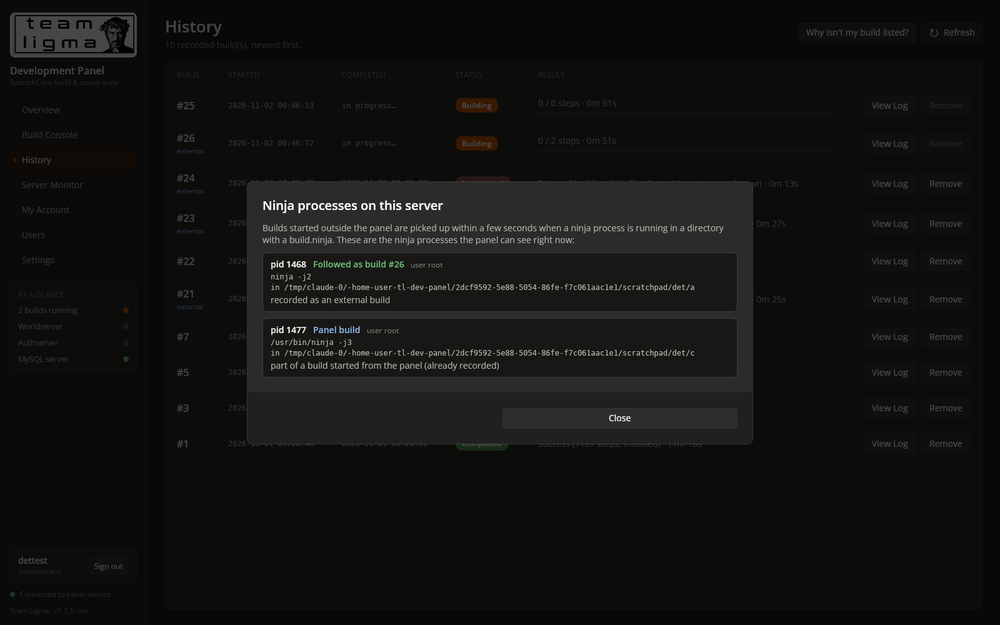

# Prompt
I can confirm a non-panel build is not being catuired by the panel after the most recent changes

# Reponse
Fixed external-build detection and added diagnostics (v1.7.3).

**What I found:** on this deployment a plain external build was detected, but the detection had three weaknesses that make it miss builds on a real server:
1. **A process skipped once was ignored forever.** A transient condition at first sight, such as `build.ninja` briefly missing while CMake regenerates it, meant the build was never picked up.
2. **The panel-build check was too broad.** It skipped any ninja with an ancestor whose command line merely *contained* "ninja-dash". For example, a build typed into a screen session originally created with `screen -dmS build ninja-dash …` was wrongly skipped.
3. **There was no visibility** into why a process was skipped.

**Fixes:**
- **Retries:** transient skips are re-checked every 5 s while the process runs. Only definite non-builds are excluded permanently: tools, dry runs, panel builds and CMake test builds.
- **Precise panel-build check:** an ancestor must actually be the ninja-dash process, a running panel build, or the panel itself.
- **Coverage:** other ninja binary names are accepted (`ninja-build`, `samu`, or the one set in Settings), and `-f <file>` builds are supported.
- **Logging:** each skip is logged with its reason ("Not following ninja pid …").
- **Diagnostics:** a **Why isn't my build listed?** button on History shows every ninja process the panel sees, with its decision and reason (new `/api/builds/external/scan` endpoint).

**Tested:**
- A build inside a screen session whose command line mentions ninja-dash is now followed (it was skipped before).
- A ninja process whose build.ninja appears a few seconds later moves from "retrying" to followed.
- A panel build is recognised and not duplicated.
- The diagnostics dialog works in the browser.

Test builds, records and accounts were removed.

**If it still doesn't show on your server:** open History, then **Why isn't my build listed?**, and send me what it says about your ninja process. An empty list means the build isn't on the same machine as the panel.

# File Changes
| File | Type | Workspace path | Change |
|---|---|---|---|
| `v173-detection-diagnostics.png` | `Asset` | `Prompts/Team Ligma Development Panel/screenshots/v173-detection-diagnostics.png` | Created |
| `README.md` | `Docs` | `README.md` | Changed |
| `Dtos.cs` | `Code` | `src/Shared/Dtos.cs` | Changed |
| `ExternalBuildMonitor.cs` | `Code` | `src/TeamLigma.Panel.Server/ExternalBuildMonitor.cs` | Changed |
| `Program.cs` | `Code` | `src/TeamLigma.Panel.Server/Program.cs` | Changed |
| `TeamLigma.Panel.Server.csproj` | `Config` | `src/TeamLigma.Panel.Server/TeamLigma.Panel.Server.csproj` | Changed |
| `ApiClient.cs` | `Code` | `src/TeamLigma.Panel/TeamLigma.Panel/Services/ApiClient.cs` | Changed |
| `TeamLigma.Panel.csproj` | `Config` | `src/TeamLigma.Panel/TeamLigma.Panel/TeamLigma.Panel.csproj` | Changed |
| `HistoryView.xaml` | `Code` | `src/TeamLigma.Panel/TeamLigma.Panel/Views/HistoryView.xaml` | Changed |
| `HistoryView.xaml.cs` | `Code` | `src/TeamLigma.Panel/TeamLigma.Panel/Views/HistoryView.xaml.cs` | Changed |

Environment: `/roc/claude/panel/` redeployed (v1.7.3); `/roc/claude/panel-data/settings.json`.

# Code Diffs
### `README.md` (Changed)
```diff
diff --git a/README.md b/README.md
index 8d8994b..3a00f30 100644
--- a/README.md
+++ b/README.md
@@ -1,7 +1,7 @@
 <p align="center"></p>
 
 # Team Ligma Development Panel
-**Version 1.7.2**
+**Version 1.7.3**
 
 One dark, burnt-orange control room for an AzerothCore test realm. Kick off builds, watch every object compile in real time, look back at old logs, and talk to the Worldserver, Authserver and MySQL from your browser. No SSH session needed.
 
@@ -161,7 +161,10 @@ The panel never force-kills `worldserver`, `authserver`, `mysql` or `mysqld`:
 ## Concurrent and external builds
 The panel also notices ninja builds it didn't start, such as `ninja` run in an SSH terminal. Each one is added to **History** as a numbered build tagged *external*, alongside the panel's own builds.
 
-- **Detection:** every 2 seconds the panel scans for `ninja` processes in a directory containing `build.ninja`. It skips its own builds, `ninja -t …` tools, `ninja -n` dry runs, and CMake's configure-time test builds under `CMakeFiles/`.
+- **Detection:** every 2 seconds the panel scans for ninja processes (`ninja`, `ninja-build`, `samu`, or the binary set in Settings) running in a directory with a `build.ninja` (or the file given with `-f`).
+  - **Skipped:** the panel's own builds (an ancestor that is really `ninja-dash`, a panel build or the panel itself), `ninja -t …` tools, `ninja -n` dry runs, and CMake's configure-time test builds under `CMakeFiles/`.
+  - **Re-checked:** a process skipped for a reason that can change, such as `build.ninja` briefly missing, is checked again every 5 seconds while it runs.
+  - **Logged:** every skip is written to the panel log with its reason.
 - **Progress:** an external build's terminal output belongs to the terminal that started it, so the panel can't show it. Instead:
   - finished steps are read from `.ninja_log` (ninja writes a line as each step completes) and listed live in the Build Console terminal;
   - the objects currently compiling come from the process tree;
@@ -249,6 +252,7 @@ Over plain HTTP, passwords and session cookies cross the network unencrypted. On
 - **Builds run out of memory (clang killed, "signal 9"):** lower **CPU threads** to the recommended value or below.
 - **A build shows *Interrupted*:** ninja-dash was killed without cleaning up. Start a new build.
 - **A server shows *Session open* but not *Running*:** the program exited inside its screen session. Read its console for the reason, then press Start again after the session closes.
+- **A build started outside the panel isn't in History:** click **Why isn't my build listed?** on the History page. It lists every ninja process the panel can see, and whether each is followed, recognised as a panel build, or skipped (with the reason). The same reasons are in the panel log (`journalctl -u teamligma-panel`, lines starting "Not following ninja pid"). If the list is empty, the build isn't running on the same machine as the panel, for example it's in another container.
 - **"That code is not valid" for every code:** the server's clock or your phone's clock is wrong. Authenticator codes need both to be within about 30 seconds of the real time.
 - **The page loads but the status dot is red:** check the backend with `curl http://127.0.0.1:5267/api/health`, and read `/roc/claude/panel/server.log` or `journalctl -u teamligma-panel`.
```

### `src/Shared/Dtos.cs` (Changed)
```diff
diff --git a/src/Shared/Dtos.cs b/src/Shared/Dtos.cs
index 8437b84..9ff53ff 100644
--- a/src/Shared/Dtos.cs
+++ b/src/Shared/Dtos.cs
@@ -378,3 +378,23 @@ public sealed class DetectedTools
 {
     public Dictionary<string, string> Paths { get; set; } = new();
 }
+
+// ---------------- External build detection diagnostics (v1.7.3) ----------------
+
+public sealed class NinjaProcessInfo
+{
+    public int Pid { get; set; }
+    public string User { get; set; } = "";
+    public string Command { get; set; } = "";
+    public string? Directory { get; set; }
+    /// <summary>"followed", "panel", "skipped" or "retrying".</summary>
+    public string Decision { get; set; } = "";
+    public string Reason { get; set; } = "";
+    public int? BuildId { get; set; }
+}
+
+public sealed class ExternalScanResult
+{
+    public DateTimeOffset At { get; set; }
+    public List<NinjaProcessInfo> Processes { get; set; } = new();
+}
```

### `src/TeamLigma.Panel.Server/ExternalBuildMonitor.cs` (Changed)
```diff
diff --git a/src/TeamLigma.Panel.Server/ExternalBuildMonitor.cs b/src/TeamLigma.Panel.Server/ExternalBuildMonitor.cs
index 65fcdf7..4c87b77 100644
--- a/src/TeamLigma.Panel.Server/ExternalBuildMonitor.cs
+++ b/src/TeamLigma.Panel.Server/ExternalBuildMonitor.cs
@@ -20,7 +20,13 @@ public sealed class ExternalBuildMonitor : BackgroundService
     readonly BuildService _builds;
     readonly ILogger<ExternalBuildMonitor> _log;
     readonly Dictionary<int, Observed> _observed = new();
-    readonly HashSet<int> _ignored = new();
+    /// <summary>Ninja processes that are not followed: why, and when to look again (null = never).</summary>
+    readonly Dictionary<int, (string Reason, bool Permanent, DateTime Next)> _skipped = new();
+    readonly object _scanLock = new();
+    ExternalScanResult _lastScan = new();
+
+    /// <summary>What the monitor saw on its last scan, for the "Why isn't my build listed?" view.</summary>
+    public ExternalScanResult LastScan { get { lock (_scanLock) return _lastScan; } }
     readonly int _self = Environment.ProcessId;
     bool _isolationUnavailable;
     readonly string _tmp;
@@ -104,22 +110,32 @@ public sealed class ExternalBuildMonitor : BackgroundService
         var procs = ProcTable.Read();
 
         // 1) discover new external ninja processes
+        var now = DateTime.UtcNow;
+        var panelPids = _builds.RunningAll().Where(b => b.Source == BuildSources.Panel && b.Pid != null).Select(b => b.Pid!.Value).ToHashSet();
         foreach (var (pid, p) in procs)
         {
-            if (p.Comm != "ninja" || _observed.ContainsKey(pid) || _ignored.Contains(pid)) continue;
-            if (!IsExternalBuild(pid, p, procs, out var dir, out var targets))
+            if (!IsNinja(p) || _observed.ContainsKey(pid)) continue;
+            if (_skipped.TryGetValue(pid, out var sk) && (sk.Permanent || now < sk.Next)) continue;
+            var verdict = Classify(pid, p, procs, panelPids, out var dir, out var targets);
+            if (verdict == null)
             {
-                _ignored.Add(pid);
+                _skipped.Remove(pid);
+                await Adopt(pid, p, dir, targets);
                 continue;
             }
-            await Adopt(pid, p, dir, targets);
+            var (reason, permanent) = verdict.Value;
+            if (!_skipped.ContainsKey(pid))
+                _log.LogInformation("Not following ninja pid {Pid} ({Command}): {Reason}", pid, string.Join(' ', p.Args), reason);
+            // Transient reasons (e.g. build.ninja being regenerated) are re-checked while the process runs.
+            _skipped[pid] = (reason, permanent, now.AddSeconds(5));
         }
-        _ignored.RemoveWhere(pid => !procs.ContainsKey(pid));
+        foreach (var gone in _skipped.Keys.Where(k => !procs.ContainsKey(k)).ToList()) _skipped.Remove(gone);
+        RecordScan(procs);
 
         // 2) update the builds we follow
         foreach (var o in _observed.Values.ToList())
         {
-            if (procs.TryGetValue(o.Pid, out var p) && p.Comm == "ninja")
+            if (procs.TryGetValue(o.Pid, out var p) && IsNinja(p))
             {
                 Update(o, procs);
                 if (!o.Install && DateTime.UtcNow >= o.NextRemainingCheck)
@@ -132,38 +148,84 @@ public sealed class ExternalBuildMonitor : BackgroundService
         }
     }
 
-    bool IsExternalBuild(int pid, ProcTable.Proc p, Dictionary<int, ProcTable.Proc> procs, out string dir, out List<string> targets)
+    /// <summary>ninja under its usual names, or the binary configured in Settings.</summary>
+    static bool IsNinja(ProcTable.Proc p)
+    {
+        if (p.Comm is "ninja" or "ninja-build" or "samu") return true;
+        var configured = Path.GetFileName(NinjaExe);
+        return configured.Length > 0 && p.Comm == (configured.Length > 15 ? configured[..15] : configured);
+    }
+
+    /// <summary>
+    /// Null when the process is an external build to follow; otherwise why not, and whether that can change.
+    /// </summary>
+    (string Reason, bool Permanent)? Classify(int pid, ProcTable.Proc p, Dictionary<int, ProcTable.Proc> procs, HashSet<int> panelPids,
+        out string dir, out List<string> targets)
     {
         dir = "";
         targets = new();
         var args = p.Args.Skip(1).ToList();
-        // Tools (-t), dry runs (-n) and help/version are not builds.
-        if (args.Any(a => a == "-n" || a.StartsWith("-t") || a is "--version" or "-h" or "--help")) return false;
-        // Started by the panel (ninja-dash, tasks, our own probes)?
+        if (args.Any(a => a == "-n" || a.StartsWith("-t") || a is "--version" or "-h" or "--help"))
+            return ("a ninja tool, dry run or help command, not a build", true);
+
+        // Started by the panel? Only a real ninja-dash process (or a panel build/task) counts; text that merely
+        // mentions ninja-dash further up (e.g. the screen session's original command line) does not.
         var q = p.PPid;
         for (var depth = 0; q > 1 && depth < 32 && procs.TryGetValue(q, out var anc); depth++, q = anc.PPid)
         {
-            if (q == _self) return false;
-            if (anc.Args.Any(a => a.Contains("ninja-dash"))) return false;
+            if (q == _self) return ("started by the panel itself (a task or a check)", true);
+            if (panelPids.Contains(q)) return ("part of a build started from the panel (already recorded)", true);
+            if (IsNinjaDash(anc)) return ("run by ninja-dash, which records the build itself", true);
         }
+
         string? cwd = null;
         try { cwd = new FileInfo($"/proc/{pid}/cwd").LinkTarget; } catch { }
-        if (cwd == null) return false;
+        if (cwd == null) return ("its working directory can't be read (the panel needs to run as root)", false);
         dir = cwd;
+        string? buildFile = null;
         for (var i = 0; i < args.Count; i++)
         {
             var a = args[i];
             if (a == "-C" && i + 1 < args.Count) { dir = Path.GetFullPath(Path.Combine(dir, args[++i])); continue; }
             if (a.StartsWith("-C") && a.Length > 2) { dir = Path.GetFullPath(Path.Combine(dir, a[2..])); continue; }
-            if (a is "-f" or "-j" or "-k" or "-l" or "-d" or "-w") { i++; continue; }
+            if (a == "-f" && i + 1 < args.Count) { buildFile = args[++i]; continue; }
+            if (a.StartsWith("-f") && a.Length > 2) { buildFile = a[2..]; continue; }
+            if (a is "-j" or "-k" or "-l" or "-d" or "-w") { i++; continue; }
             if (a.StartsWith('-')) continue;
             targets.Add(a);
         }
-        // CMake's configure-time test projects (try_compile) are not builds.
-        if (dir.Contains("/CMakeFiles/")) return false;
-        return File.Exists(Path.Combine(dir, "build.ninja"));
+        if (dir.Contains("/CMakeFiles/")) return ("a CMake configure-time test build", true);
+        var manifest = Path.Combine(dir, buildFile ?? "build.ninja");
+        if (!File.Exists(manifest)) return ($"no {Path.GetFileName(manifest)} in {dir} (yet)", false);
+        return null;
     }
 
+    static bool IsNinjaDash(ProcTable.Proc p) =>
+        p.Comm == "ninja-dash"
+        || (p.Args.Count > 1 && p.Comm.StartsWith("python") && Path.GetFileName(p.Args[1]) == "ninja-dash");
+
+    void RecordScan(Dictionary<int, ProcTable.Proc> procs)
+    {
+        var list = new List<NinjaProcessInfo>();
+        foreach (var (pid, p) in procs.Where(kv => IsNinja(kv.Value)).OrderBy(kv => kv.Key))
+        {
+            var info = new NinjaProcessInfo { Pid = pid, Command = string.Join(' ', p.Args), User = SafeOwner(pid) };
+            try { info.Directory = new FileInfo($"/proc/{pid}/cwd").LinkTarget; } catch { }
+            if (_observed.TryGetValue(pid, out var o)) { info.Decision = "followed"; info.Reason = "recorded as an external build"; info.BuildId = o.Id; info.Directory = o.Dir; }
+            else if (_skipped.TryGetValue(pid, out var sk))
+            {
+                info.Decision = sk.Reason.StartsWith("part of a build") || sk.Reason.StartsWith("run by ninja-dash") || sk.Reason.StartsWith("started by the panel") ? "panel"
+                    : sk.Permanent ? "skipped" : "retrying";
+                info.Reason = sk.Reason;
+            }
+            else { info.Decision = "retrying"; info.Reason = "just started; checking"; }
+            list.Add(info);
+        }
+        lock (_scanLock) _lastScan = new ExternalScanResult { At = DateTimeOffset.Now, Processes = list };
+    }
+
+    static string SafeOwner(int pid) { try { return Mux.OwnerOf(pid); } catch { return "?"; } }
+
     async Task Adopt(int pid, ProcTable.Proc p, string dir, List<string> targets)
     {
         var command = string.Join(' ', p.Args.Select(a => a.Contains(' ') ? $"'{a}'" : a));
```

### `src/TeamLigma.Panel.Server/Program.cs` (Changed)
```diff
diff --git a/src/TeamLigma.Panel.Server/Program.cs b/src/TeamLigma.Panel.Server/Program.cs
index f9d2e74..8359f89 100644
--- a/src/TeamLigma.Panel.Server/Program.cs
+++ b/src/TeamLigma.Panel.Server/Program.cs
@@ -22,7 +22,8 @@ builder.Services.AddSingleton<BuildService>();
 builder.Services.AddSingleton<ConsoleService>();
 builder.Services.AddSingleton<SystemMonitor>();
 builder.Services.AddHostedService(sp => sp.GetRequiredService<SystemMonitor>());
-builder.Services.AddHostedService<ExternalBuildMonitor>();
+builder.Services.AddSingleton<ExternalBuildMonitor>();
+builder.Services.AddHostedService(sp => sp.GetRequiredService<ExternalBuildMonitor>());
 builder.Services.ConfigureHttpJsonOptions(o => o.SerializerOptions.PropertyNamingPolicy = System.Text.Json.JsonNamingPolicy.CamelCase);
 builder.WebHost.ConfigureKestrel(k => k.Limits.MaxRequestBodySize = 512L * 1024 * 1024);
 
@@ -154,6 +155,7 @@ api.MapGet("/overview", async (BuildService b, SystemMonitor m, ConsoleService c
 });
 
 api.MapGet("/builds", (BuildService b) => b.All());
+api.MapGet("/builds/external/scan", (ExternalBuildMonitor m) => m.LastScan);
 api.MapGet("/builds/{id:int}", (int id, BuildService b) => b.Read(id) is { } s ? Results.Ok(s) : Results.NotFound());
 api.MapGet("/builds/{id:int}/log", (int id, long? offset, bool? full, BuildService b) =>
 {
```

### `src/TeamLigma.Panel.Server/TeamLigma.Panel.Server.csproj` (Changed)
```diff
diff --git a/src/TeamLigma.Panel.Server/TeamLigma.Panel.Server.csproj b/src/TeamLigma.Panel.Server/TeamLigma.Panel.Server.csproj
index ca46c97..5b24e4a 100644
--- a/src/TeamLigma.Panel.Server/TeamLigma.Panel.Server.csproj
+++ b/src/TeamLigma.Panel.Server/TeamLigma.Panel.Server.csproj
@@ -4,7 +4,7 @@
     <Nullable>enable</Nullable>
     <ImplicitUsings>enable</ImplicitUsings>
     <RootNamespace>TeamLigma.Panel.Server</RootNamespace>
-    <Version>1.7.2</Version>
+    <Version>1.7.3</Version>
   </PropertyGroup>
   <ItemGroup>
     <Compile Include="../Shared/Dtos.cs" Link="Shared/Dtos.cs" />
```

### `src/TeamLigma.Panel/TeamLigma.Panel/Services/ApiClient.cs` (Changed)
```diff
diff --git a/src/TeamLigma.Panel/TeamLigma.Panel/Services/ApiClient.cs b/src/TeamLigma.Panel/TeamLigma.Panel/Services/ApiClient.cs
index 315ae17..5d87f0f 100644
--- a/src/TeamLigma.Panel/TeamLigma.Panel/Services/ApiClient.cs
+++ b/src/TeamLigma.Panel/TeamLigma.Panel/Services/ApiClient.cs
@@ -32,6 +32,7 @@ namespace TeamLigma.Panel.Services;
 [JsonSerializable(typeof(PanelSettingsDto))]
 [JsonSerializable(typeof(SettingsSaveResult))]
 [JsonSerializable(typeof(DetectedTools))]
+[JsonSerializable(typeof(ExternalScanResult))]
 internal partial class PanelJson : JsonSerializerContext { }
 
 /// <summary>Thin client for the panel backend (same origin, proxied by nginx under /api).</summary>
@@ -130,6 +131,7 @@ public sealed class ApiClient
 
     public Task<Overview?> OverviewAsync() => Get("api/overview", PanelJson.Default.Overview);
     public Task<List<BuildStatus>?> BuildsAsync() => Get("api/builds", PanelJson.Default.ListBuildStatus);
+    public Task<ExternalScanResult?> ExternalScanAsync() => Get("api/builds/external/scan", PanelJson.Default.ExternalScanResult);
     public Task<LogChunk?> BuildLogAsync(int id, long offset, bool full = false)
         => Get($"api/builds/{id}/log?offset={offset}&full={(full ? "true" : "false")}", PanelJson.Default.LogChunk);
     public Task<ActionResult> DeleteBuildAsync(int id) => Send(new HttpRequestMessage(HttpMethod.Delete, $"api/builds/{id}"));
```

### `src/TeamLigma.Panel/TeamLigma.Panel/TeamLigma.Panel.csproj` (Changed)
```diff
diff --git a/src/TeamLigma.Panel/TeamLigma.Panel/TeamLigma.Panel.csproj b/src/TeamLigma.Panel/TeamLigma.Panel/TeamLigma.Panel.csproj
index 96f3009..beec3fd 100644
--- a/src/TeamLigma.Panel/TeamLigma.Panel/TeamLigma.Panel.csproj
+++ b/src/TeamLigma.Panel/TeamLigma.Panel/TeamLigma.Panel.csproj
@@ -5,11 +5,11 @@
     <UnoSingleProject>true</UnoSingleProject>
     <ApplicationTitle>Team Ligma Development Panel</ApplicationTitle>
     <ApplicationId>com.teamligma.devpanel</ApplicationId>
-    <ApplicationDisplayVersion>1.7.2</ApplicationDisplayVersion>
+    <ApplicationDisplayVersion>1.7.3</ApplicationDisplayVersion>
     <ApplicationVersion>1</ApplicationVersion>
     <ApplicationPublisher>Team Ligma</ApplicationPublisher>
     <Description>Team Ligma Development Panel - AzerothCore build and server console suite.</Description>
-    <Version>1.7.2</Version>
+    <Version>1.7.3</Version>
     <UnoFeatures>
       Mvvm;
       SkiaRenderer;
```

### `src/TeamLigma.Panel/TeamLigma.Panel/Views/HistoryView.xaml` (Changed)
```diff
diff --git a/src/TeamLigma.Panel/TeamLigma.Panel/Views/HistoryView.xaml b/src/TeamLigma.Panel/TeamLigma.Panel/Views/HistoryView.xaml
index 1653002..1d03725 100644
--- a/src/TeamLigma.Panel/TeamLigma.Panel/Views/HistoryView.xaml
+++ b/src/TeamLigma.Panel/TeamLigma.Panel/Views/HistoryView.xaml
@@ -11,7 +11,11 @@
         <TextBlock Style="{StaticResource TlPageTitle}" Text="History" />
         <TextBlock x:Name="Subtitle" Foreground="{StaticResource TlTextMuted}" Text="Every recorded build, newest first." />
       </StackPanel>
-      <Button HorizontalAlignment="Right" VerticalAlignment="Center" Click="OnRefresh" Content="↻  Refresh" />
+      <StackPanel HorizontalAlignment="Right" VerticalAlignment="Center" Orientation="Horizontal" Spacing="8">
+        <Button Click="OnWhyNotListed" Content="Why isn't my build listed?"
+                ToolTipService.ToolTip="Shows every ninja process the panel can see, and whether it is followed" />
+        <Button Click="OnRefresh" Content="↻  Refresh" />
+      </StackPanel>
     </Grid>
     <Border Grid.Row="1" Style="{StaticResource TlCardStyle}" Padding="0">
       <Grid>
```

### `src/TeamLigma.Panel/TeamLigma.Panel/Views/HistoryView.xaml.cs` (Changed)
```diff
diff --git a/src/TeamLigma.Panel/TeamLigma.Panel/Views/HistoryView.xaml.cs b/src/TeamLigma.Panel/TeamLigma.Panel/Views/HistoryView.xaml.cs
index 1b1132c..2210f2e 100644
--- a/src/TeamLigma.Panel/TeamLigma.Panel/Views/HistoryView.xaml.cs
+++ b/src/TeamLigma.Panel/TeamLigma.Panel/Views/HistoryView.xaml.cs
@@ -39,6 +39,62 @@ public sealed partial class HistoryView : UserControl, IPanelPage
 
     async void OnRefresh(object sender, RoutedEventArgs e) => await Refresh(true);
 
+    /// <summary>Lists the ninja processes the panel sees and why each one is (not) followed.</summary>
+    async void OnWhyNotListed(object sender, RoutedEventArgs e)
+    {
+        var scan = await ApiClient.Instance.ExternalScanAsync();
+        var res = Application.Current.Resources;
+        var body = new StackPanel { Spacing = 10, Width = 760 };
+        body.Children.Add(new TextBlock
+        {
+            TextWrapping = TextWrapping.Wrap, Foreground = (Brush)res["TlTextSecondary"],
+            Text = "Builds started outside the panel are picked up within a few seconds when a ninja process is running in a directory with a build.ninja. " +
+                   "These are the ninja processes the panel can see right now:",
+        });
+        if (scan == null) body.Children.Add(new TextBlock { Text = "Could not reach the panel service.", Foreground = (Brush)res["TlDanger"] });
+        else if (scan.Processes.Count == 0)
+            body.Children.Add(new TextBlock
+            {
+                TextWrapping = TextWrapping.Wrap, Foreground = (Brush)res["TlText"],
+                Text = "No ninja process is running on this server. If your build is running, check that it runs on the same machine (not in another container or VM) and that it really invokes ninja.",
+            });
+        else
+            foreach (var p in scan.Processes)
+            {
+                var color = p.Decision switch
+                {
+                    "followed" => Windows.UI.Color.FromArgb(255, 0x6F, 0xBF, 0x73),
+                    "panel" => Windows.UI.Color.FromArgb(255, 0x8C, 0xB8, 0xEE),
+                    "retrying" => Windows.UI.Color.FromArgb(255, 0xE0, 0xB3, 0x41),
+                    _ => Windows.UI.Color.FromArgb(255, 0xA8, 0x97, 0x7A),
+                };
+                var row = new Border
+                {
+                    Padding = new Thickness(12, 8, 12, 8), CornerRadius = new CornerRadius(6), BorderThickness = new Thickness(1),
+                    BorderBrush = (Brush)res["TlCardBorder"], Background = (Brush)res["TlTerminal"],
+                };
+                var stack = new StackPanel { Spacing = 3 };
+                var head = new StackPanel { Orientation = Orientation.Horizontal, Spacing = 10 };
+                head.Children.Add(new TextBlock { Text = $"pid {p.Pid}", FontWeight = Microsoft.UI.Text.FontWeights.SemiBold, Foreground = (Brush)res["TlText"] });
+                head.Children.Add(new TextBlock { Text = p.Decision == "followed" ? $"Followed as build #{p.BuildId}" : p.Decision == "panel" ? "Panel build" : p.Decision == "retrying" ? "Not yet followed (re-checking)" : "Not followed", Foreground = new SolidColorBrush(color), FontWeight = Microsoft.UI.Text.FontWeights.SemiBold });
+                head.Children.Add(new TextBlock { Text = $"user {p.User}", Style = (Style)res["TlLabel"], VerticalAlignment = VerticalAlignment.Center });
+                stack.Children.Add(head);
+                stack.Children.Add(new TextBlock { Text = p.Command, Style = (Style)res["TlMonoText"], TextWrapping = TextWrapping.Wrap });
+                if (p.Directory != null) stack.Children.Add(new TextBlock { Text = "in " + p.Directory, Style = (Style)res["TlMonoText"] });
+                stack.Children.Add(new TextBlock { Text = p.Reason, Foreground = (Brush)res["TlTextSecondary"], TextWrapping = TextWrapping.Wrap });
+                row.Child = stack;
+                body.Children.Add(row);
+            }
+        var dlg = new ContentDialog
+        {
+            XamlRoot = XamlRoot,
+            Title = "Ninja processes on this server",
+            Content = new ScrollViewer { Content = body, MaxHeight = 560, VerticalScrollBarVisibility = ScrollBarVisibility.Auto },
+            CloseButtonText = "Close",
+        };
+        await dlg.ShowAsync();
+    }
+
     static void Layout(Grid g)
     {
         g.ColumnSpacing = 12;
```

# Image Assets

`Prompts/Team Ligma Development Panel/screenshots/v173-detection-diagnostics.png` (The 'Why isn't my build listed?' dialog, sanity-test capture)

