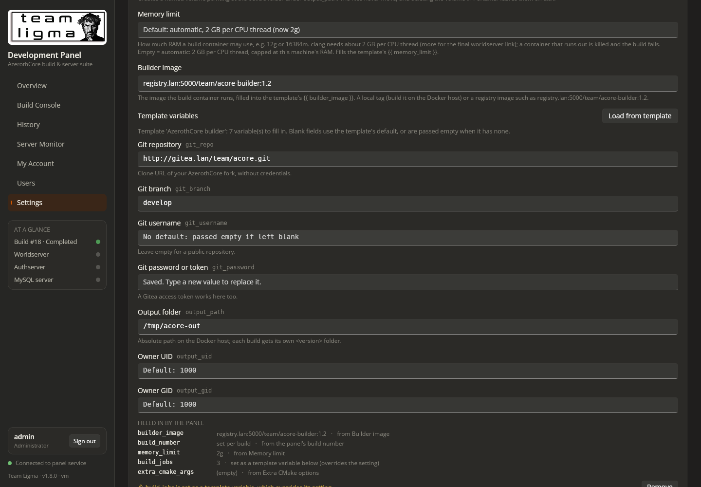
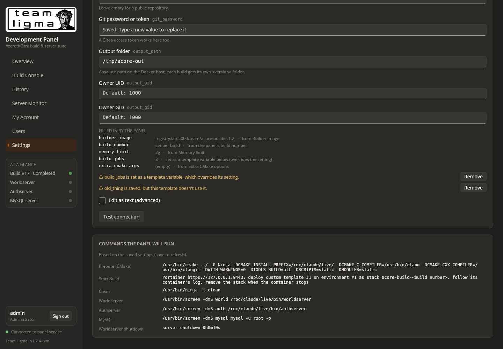
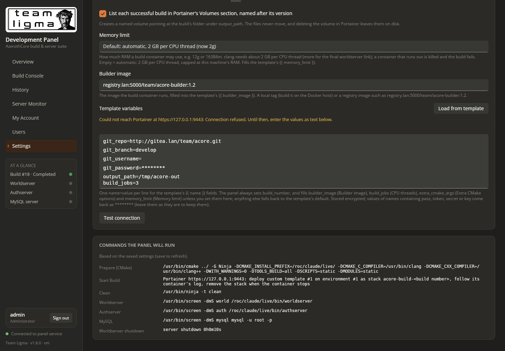

# Prompt
Is it possible to have the panel read the variables from the "linked" docker container, and display fields for them (rather than manually enter them)?

(Answer: yes, from the Portainer custom template. Follow-up prompt:) Yes

# Reponse
Template variables are now fields read from the Portainer custom template (v1.8.0).

- The panel reads the template when Settings opens, when the template ID changes, and on **Load from template**, and shows a field per variable: the label, description and default set in Portainer's template editor, or just the name for a `{{ name }}` with no definition.
- Blank fields use the template's default; a blank field with no default is passed empty and marked *no value yet*, so optional values (e.g. `git_username` for a public repo) don't block builds.
- Secret-looking names get password boxes; saved secrets never reach the browser and are kept when the box is left empty.
- Variables the panel fills itself (`build_number`, `builder_image`, `build_jobs`, `extra_cmake_args`, `memory_limit`) are listed with their next value and source setting. Saved values that override one of those, or that the template no longer uses, are flagged with **Remove** buttons.
- **Edit as text (advanced)** switches to the `name=value` editor and back. The text editor is the fallback whenever the template can't be read.
- New endpoint: `POST /api/settings/portainer/variables` (admin).

**Tested against Portainer**, with labels and descriptions on the template: the fields rendered with labels, descriptions and defaults; typing a branch, leaving the username blank and removing an unused value saved exactly those changes; the masked password still reached the build container intact; with Portainer stopped, the text editor appeared with the saved values. Both parts compile.

# File Changes
| File | Type | Workspace path | Change |
|---|---|---|---|
| `README.md` | `Docs` | `tl-dev-panel/README.md` | Changed |
| `Dtos.cs` | `Code` | `tl-dev-panel/src/Shared/Dtos.cs` | Changed |
| `ContainerBuildService.cs` | `Code` | `tl-dev-panel/src/TeamLigma.Panel.Server/ContainerBuildService.cs` | Changed |
| `Program.cs` | `Code` | `tl-dev-panel/src/TeamLigma.Panel.Server/Program.cs` | Changed |
| `SettingsApi.cs` | `Code` | `tl-dev-panel/src/TeamLigma.Panel.Server/SettingsApi.cs` | Changed |
| `TeamLigma.Panel.Server.csproj` | `Config` | `tl-dev-panel/src/TeamLigma.Panel.Server/TeamLigma.Panel.Server.csproj` | Changed |
| `ApiClient.cs` | `Code` | `tl-dev-panel/src/TeamLigma.Panel/TeamLigma.Panel/Services/ApiClient.cs` | Changed |
| `SettingsView.cs` | `Code` | `tl-dev-panel/src/TeamLigma.Panel/TeamLigma.Panel/Views/SettingsView.cs` | Changed |
| `TeamLigma.Panel.csproj` | `Config` | `tl-dev-panel/src/TeamLigma.Panel/TeamLigma.Panel/TeamLigma.Panel.csproj` | Changed |
| `v180-template-fields.png` | `Asset` | `tl-dev-panel/Prompts/Team Ligma Development Panel/screenshots/v180-template-fields.png` | Created |
| `v180-panel-filled.png` | `Asset` | `tl-dev-panel/Prompts/Team Ligma Development Panel/screenshots/v180-panel-filled.png` | Created |
| `v180-text-fallback.png` | `Asset` | `tl-dev-panel/Prompts/Team Ligma Development Panel/screenshots/v180-text-fallback.png` | Created |

# Code Diffs
## `tl-dev-panel/README.md`
```diff
--- a/tl-dev-panel/README.md
+++ b/tl-dev-panel/README.md
@@ -1,7 +1,7 @@
 <p align="center"></p>
 
 # Team Ligma Development Panel
-**Version 1.7.4**
+**Version 1.8.0**
 
 One dark, burnt-orange control room for an AzerothCore test realm. Kick off builds, watch every object compile in real time, look back at old logs, and talk to the Worldserver, Authserver and MySQL from your browser. No SSH session needed.
 
@@ -60,7 +60,7 @@
 3. **Create an access token** under My account → Access tokens. The token's user needs access to the environment and the template.
 4. **Fill in Settings → Container builds:**
    - URL, token, environment ID and template ID;
-   - the template variables, one `name=value` per line.
+   - the template's variables, which appear as fields once the panel can read the template (see [Template variables](#template-variables)).
 
    Press **Test connection**. It shows the Portainer version and account, the environment, the template, whether its image is on the Docker host, and the value each variable will get and where it comes from. **Add missing variables** adds a line for each variable that still needs a value.
 5. Turn **Container builds** on and save. The Build Console's **Builds run on** row shows *Docker container*.
@@ -74,6 +74,14 @@
 The Build Console's **Builds run on** line shows the limit the next build will use. A `memory_limit=` line under Template variables overrides the field; **Test connection** warns about that.
 
 ### Template variables
+The panel reads the custom template from Portainer and shows **a field for each variable** under Settings → Container builds → Template variables. It does this when the page opens, when the template ID changes, and when you press **Load from template**.
+- **What each field shows:** the label, description and default you gave the variable in Portainer's template editor (Templates → Custom → edit → *Variables*), so it's worth filling those in there. Variables without a definition there, but used as `{{ name }}` in the file, still get a field, labelled with their name.
+- **Blank fields:** use the template's default. A blank field with no default is passed to the template as an empty value and marked *no value yet*, so an optional value (such as `git_username` for a public repository) doesn't block builds.
+- **Secrets:** names containing `pass`, `token`, `secret` or `key` get a password box. A saved value is never sent back to the browser; leave the box empty to keep it, or type a new value.
+- **Filled in by the panel:** `build_number`, `builder_image`, `build_jobs`, `extra_cmake_args` and `memory_limit` are listed with the value the next build would use and the setting it comes from, instead of as fields.
+- **Leftovers:** a saved value that overrides one of those settings, or one the template no longer uses, is flagged with a **Remove** button.
+- **Edit as text (advanced):** switches to the `name=value` editor. Unticking it turns the text back into fields. The text editor is also shown when the template can't be read, for example while Portainer is unreachable.
+
 Values come from, in order:
 - **Always set by the panel:** `build_number`.
 - **Settings:** anything you list there.
```

## `tl-dev-panel/src/Shared/Dtos.cs`
```diff
--- a/tl-dev-panel/src/Shared/Dtos.cs
+++ b/tl-dev-panel/src/Shared/Dtos.cs
@@ -437,3 +437,37 @@
     public List<string> Warnings { get; set; } = new();
     public List<TemplateVariableInfo> Variables { get; set; } = new();
 }
+
+// ---------------- Template variable fields (v1.8.0) ----------------
+
+/// <summary>A form field for one of the custom template's {{ variables }}.</summary>
+public sealed class TemplateField
+{
+    public string Name { get; set; } = "";
+    /// <summary>The label set in Portainer's template editor, else the name.</summary>
+    public string Label { get; set; } = "";
+    public string Description { get; set; } = "";
+    /// <summary>The template's default value ("" = none).</summary>
+    public string Default { get; set; } = "";
+    /// <summary>Shown as a password box; the saved value is never sent (Value is the mask).</summary>
+    public bool Secret { get; set; }
+    /// <summary>The saved value, or SecretMask.Value for a saved secret; "" when nothing is saved.</summary>
+    public string Value { get; set; } = "";
+    public bool HasValue { get; set; }
+    /// <summary>No saved value and no default (left blank, it is passed to the template empty).</summary>
+    public bool Required { get; set; }
+}
+
+public sealed class TemplateVariablesResult
+{
+    public bool Ok { get; set; }
+    public string Message { get; set; } = "";
+    public string TemplateTitle { get; set; } = "";
+    public List<TemplateField> Fields { get; set; } = new();
+    /// <summary>Variables the panel fills itself, with the value the next build would use and the setting behind it.</summary>
+    public List<TemplateVariableInfo> Auto { get; set; } = new();
+    /// <summary>Saved values that override a panel-filled variable, as name=value lines (secrets masked).</summary>
+    public List<string> Overrides { get; set; } = new();
+    /// <summary>Saved values the template doesn't use, as name=value lines (secrets masked).</summary>
+    public List<string> Unused { get; set; } = new();
+}
```

## `tl-dev-panel/src/TeamLigma.Panel.Server/ContainerBuildService.cs`
```diff
--- a/tl-dev-panel/src/TeamLigma.Panel.Server/ContainerBuildService.cs
+++ b/tl-dev-panel/src/TeamLigma.Panel.Server/ContainerBuildService.cs
@@ -176,6 +176,16 @@
         return result;
     }
 
+    /// <summary>Variables the panel fills itself, and the setting each one comes from.</summary>
+    public static readonly IReadOnlyDictionary<string, string> AutoSources = new Dictionary<string, string>
+    {
+        ["build_number"] = "the panel's build number",
+        ["builder_image"] = "Builder image",
+        ["build_jobs"] = "CPU threads (Build Console)",
+        ["extra_cmake_args"] = "Extra CMake options",
+        ["memory_limit"] = "Memory limit",
+    };
+
     /// <summary>Variables the panel can fill from its own settings when Settings doesn't set them.</summary>
     public Dictionary<string, string> AutoValues(int buildNumber)
     {
```

## `tl-dev-panel/src/TeamLigma.Panel.Server/Program.cs`
```diff
--- a/tl-dev-panel/src/TeamLigma.Panel.Server/Program.cs
+++ b/tl-dev-panel/src/TeamLigma.Panel.Server/Program.cs
@@ -137,6 +137,7 @@
     return result;
 });
 settings.MapPost("/detect", (SettingsApi s) => s.Detect());
+settings.MapPost("/portainer/variables", (PanelSettingsDto r, SettingsApi s) => s.TemplateVariablesAsync(r));
 settings.MapPost("/portainer/test", async (HttpContext ctx, PanelSettingsDto r, SettingsApi s, AuthService a) =>
 {
     var result = await s.TestPortainerAsync(r);
```

## `tl-dev-panel/src/TeamLigma.Panel.Server/SettingsApi.cs`
```diff
--- a/tl-dev-panel/src/TeamLigma.Panel.Server/SettingsApi.cs
+++ b/tl-dev-panel/src/TeamLigma.Panel.Server/SettingsApi.cs
@@ -408,6 +408,69 @@
         catch (PortainerException ex) { res.Message = ex.Message; return res; }
     }
 
+    /// <summary>The custom template's variables as form fields, using the form's Portainer settings (saved values
+    /// fill the gaps). Saved variable values fill the fields; secrets come back masked.</summary>
+    public async Task<TemplateVariablesResult> TemplateVariablesAsync(PanelSettingsDto r)
+    {
+        var res = new TemplateVariablesResult();
+        var url = Clean(r.PortainerUrl)?.TrimEnd('/') ?? _s.PortainerUrl;
+        var key = r.PortainerNewApiKey is { Length: > 0 } nk ? nk : r.PortainerClearApiKey ? null : _s.PortainerApiKey();
+        var endpoint = r.PortainerEndpointId ?? _s.PortainerEndpointId;
+        var template = r.PortainerTemplateId ?? _s.PortainerTemplateId;
+        if (url == null || !Uri.TryCreate(url, UriKind.Absolute, out var u) || u.Scheme is not ("http" or "https")) { res.Message = "Enter the Portainer URL to load the template's variables."; return res; }
+        if (key == null) { res.Message = "Enter a Portainer access token to load the template's variables."; return res; }
+        if (template is not > 0) { res.Message = "Enter the custom template ID to load its variables."; return res; }
+        var client = new PortainerClient(new PortainerTarget(url, key, endpoint ?? 0, template.Value, r.PortainerInsecureTls));
+        PortainerTemplate t;
+        try { t = await client.TemplateAsync(); }
+        catch (PortainerException ex) { res.Message = ex.Message; return res; }
+        res.TemplateTitle = t.Title;
+        if (t.Type != 2) { res.Message = $"Template #{t.Id} ('{t.Title}') is not a Docker Compose (standalone) template."; return res; }
+
+        var errors = new List<string>();
+        var saved = r.PortainerVariables != null ? ParseVariables(r.PortainerVariables, _s.PortainerVariables(), errors) : _s.PortainerVariables();
+        string Masked(string name, string value) => SettingsStore.IsSecretVariable(name) && value.Length > 0 ? SecretMask.Value : value;
+
+        var used = PortainerClient.UsedVariables(t.FileContent);
+        var names = t.Variables.Select(v => v.Name).Concat(used).Distinct().ToList();
+        var resolved = _containers.Resolve(t, saved, 0, out _);
+        foreach (var name in names)
+        {
+            if (ContainerBuildService.AutoSources.TryGetValue(name, out var source))
+            {
+                var v = resolved.First(x => x.Name == name);
+                res.Auto.Add(new TemplateVariableInfo
+                {
+                    Name = name, Label = source,
+                    Value = name == "build_number" ? "set per build" : Masked(name, v.Value),
+                    Source = v.Source,
+                });
+                if (name != "build_number" && saved.TryGetValue(name, out var ov)) res.Overrides.Add($"{name}={Masked(name, ov)}");
+                continue;
+            }
+            var def = t.Variables.FirstOrDefault(v => v.Name == name);
+            var has = saved.TryGetValue(name, out var value);
+            res.Fields.Add(new TemplateField
+            {
+                Name = name,
+                Label = string.IsNullOrWhiteSpace(def.Label) ? name : def.Label,
+                Description = def.Description ?? "",
+                Default = def.Default ?? "",
+                Secret = SettingsStore.IsSecretVariable(name),
+                Value = has ? Masked(name, value!) : "",
+                HasValue = has,
+                Required = !has && string.IsNullOrEmpty(def.Default),
+            });
+        }
+        foreach (var (name, value) in saved)
+            if (!names.Contains(name)) res.Unused.Add($"{name}={Masked(name, value)}");
+
+        var required = res.Fields.Count(f => f.Required);
+        res.Ok = true;
+        res.Message = $"Template '{t.Title}': {res.Fields.Count} variable(s) to fill in" + (required > 0 ? $"; {required} with no value and no default yet." : ".");
+        return res;
+    }
+
     /// <summary>Checks a MySQL login. The password is passed in the client's environment (MYSQL_PWD), never on its command line.</summary>
     public async Task<ActionResult> TestMySqlAsync(PanelSettingsDto r)
     {
```

## `tl-dev-panel/src/TeamLigma.Panel.Server/TeamLigma.Panel.Server.csproj`
```diff
--- a/tl-dev-panel/src/TeamLigma.Panel.Server/TeamLigma.Panel.Server.csproj
+++ b/tl-dev-panel/src/TeamLigma.Panel.Server/TeamLigma.Panel.Server.csproj
@@ -4,7 +4,7 @@
     <Nullable>enable</Nullable>
     <ImplicitUsings>enable</ImplicitUsings>
     <RootNamespace>TeamLigma.Panel.Server</RootNamespace>
-    <Version>1.7.4</Version>
+    <Version>1.8.0</Version>
   </PropertyGroup>
   <ItemGroup>
     <Compile Include="../Shared/Dtos.cs" Link="Shared/Dtos.cs" />
```

## `tl-dev-panel/src/TeamLigma.Panel/TeamLigma.Panel/Services/ApiClient.cs`
```diff
--- a/tl-dev-panel/src/TeamLigma.Panel/TeamLigma.Panel/Services/ApiClient.cs
+++ b/tl-dev-panel/src/TeamLigma.Panel/TeamLigma.Panel/Services/ApiClient.cs
@@ -33,6 +33,7 @@
 [JsonSerializable(typeof(SettingsSaveResult))]
 [JsonSerializable(typeof(DetectedTools))]
 [JsonSerializable(typeof(PortainerTestResult))]
+[JsonSerializable(typeof(TemplateVariablesResult))]
 internal partial class PanelJson : JsonSerializerContext { }
 
 /// <summary>Thin client for the panel backend (same origin, proxied by nginx under /api).</summary>
@@ -193,6 +194,10 @@
     public Task<ActionResult> TestMySqlAsync(PanelSettingsDto s)
         => PostBody("api/settings/mysql/test", s, PanelJson.Default.PanelSettingsDto);
 
+    public async Task<TemplateVariablesResult> TemplateVariablesAsync(PanelSettingsDto s)
+        => await PostJson("api/settings/portainer/variables", s, PanelJson.Default.PanelSettingsDto, PanelJson.Default.TemplateVariablesResult)
+           ?? new TemplateVariablesResult { Message = "The panel service did not answer." };
+
     public async Task<PortainerTestResult> TestPortainerAsync(PanelSettingsDto s)
         => await PostJson("api/settings/portainer/test", s, PanelJson.Default.PanelSettingsDto, PanelJson.Default.PortainerTestResult)
            ?? new PortainerTestResult { Message = "The panel service did not answer." };
```

## `tl-dev-panel/src/TeamLigma.Panel/TeamLigma.Panel/Views/SettingsView.cs`
```diff
--- a/tl-dev-panel/src/TeamLigma.Panel/TeamLigma.Panel/Views/SettingsView.cs
+++ b/tl-dev-panel/src/TeamLigma.Panel/TeamLigma.Panel/Views/SettingsView.cs
@@ -32,6 +32,20 @@
     readonly Button _addMissing = new() { Content = "Add missing variables", Padding = new Thickness(12, 5, 12, 5), Visibility = Visibility.Collapsed };
     List<string> _missingVariables = new();
 
+    // Template variables as fields (read from the Portainer custom template)
+    sealed record VarInput(TemplateField Field, TextBox? Box, PasswordBox? Secret);
+    readonly List<VarInput> _varInputs = new();
+    readonly List<string> _keptExtras = new();
+    readonly StackPanel _varFields = new() { Spacing = 14 };
+    readonly StackPanel _varAuto = new() { Spacing = 3 };
+    readonly StackPanel _varExtras = new() { Spacing = 6 };
+    readonly TextBlock _varStatus = new() { TextWrapping = TextWrapping.Wrap, FontSize = 12.5 };
+    readonly Button _loadVars = new() { Content = "Load from template", Padding = new Thickness(12, 4, 12, 4) };
+    readonly CheckBox _advanced = new() { Content = "Edit as text (advanced)", Visibility = Visibility.Collapsed };
+    readonly StackPanel _advancedPanel = new() { Spacing = 4 };
+    bool _fieldsMode, _loadingVars;
+    string? _loadedTemplateKey;
+
     static Brush Res(string key) => (Brush)Application.Current.Resources[key];
     static Style St(string key) => (Style)Application.Current.Resources[key];
 
@@ -155,13 +169,30 @@
         cont.Children.Add(new TextBlock { Text = "Creates a named volume pointing at the build's folder under output_path. The files never move, and deleting the volume in Portainer leaves them on disk.", Style = St("TlLabel"), TextWrapping = TextWrapping.Wrap, Margin = new Thickness(0, -10, 0, 0) });
         cont.Children.Add(Field("PortainerMemoryLimit", "Memory limit", Kind.Text, "How much RAM a build container may use, e.g. 12g or 16384m. clang needs about 2 GB per CPU thread (more for the final worldserver link); a container that runs out is killed and the build fails. Empty = automatic: 2 GB per CPU thread, capped at this machine's RAM. Fills the template's {{ memory_limit }}."));
         cont.Children.Add(Field("PortainerImage", "Builder image", Kind.Text, "The image the build container runs, filled into the template's {{ builder_image }}. A local tag (build it on the Docker host) or a registry image such as registry.lan:5000/team/acore-builder:1.2."));
-        var varsRow = new StackPanel { Spacing = 4 };
-        varsRow.Children.Add(new TextBlock { Text = "Template variables", Foreground = Res("TlText"), FontSize = 14, Margin = new Thickness(0, 0, 0, 2) });
+        var varsRow = new StackPanel { Spacing = 8 };
+        var varsHead = new Grid();
+        varsHead.ColumnDefinitions.Add(new ColumnDefinition { Width = new GridLength(1, GridUnitType.Star) });
+        varsHead.ColumnDefinitions.Add(new ColumnDefinition { Width = GridLength.Auto });
+        varsHead.Children.Add(new TextBlock { Text = "Template variables", Foreground = Res("TlText"), FontSize = 14, VerticalAlignment = VerticalAlignment.Center });
+        Grid.SetColumn(_loadVars, 1);
+        varsHead.Children.Add(_loadVars);
+        _loadVars.Click += async (_, _) => await LoadVariables(quiet: false);
+        varsRow.Children.Add(varsHead);
+        varsRow.Children.Add(_varStatus);
+        varsRow.Children.Add(_varFields);
+        varsRow.Children.Add(_varAuto);
+        varsRow.Children.Add(_varExtras);
+        varsRow.Children.Add(_advanced);
+        _advanced.Checked += (_, _) => { if (!_loadingVars) EnterTextMode(fromFields: true); };
+        _advanced.Unchecked += async (_, _) => { if (!_loadingVars) await LoadVariables(quiet: true); };
         _variables.FontFamily = (FontFamily)Application.Current.Resources["TlMono"];
         _variables.PlaceholderText = "git_repo=http://gitea.lan:3000/team/azerothcore-wotlk.git\ngit_branch=master\ngit_username=builder\ngit_password=…\noutput_path=/srv/acore/builds\noutput_uid=1000\noutput_gid=1000";
-        varsRow.Children.Add(_variables);
-        varsRow.Children.Add(new TextBlock { Text = "One name=value per line for the template's {{ name }} fields. The panel always sets build_number, and fills builder_image (Builder image), build_jobs (CPU threads), extra_cmake_args (Extra CMake options) and memory_limit (Memory limit) unless you set them here; anything else falls back to the template's default. Stored encrypted; values of names containing pass, token, secret or key come back as ******** (leave them as they are to keep them).", Style = St("TlLabel"), TextWrapping = TextWrapping.Wrap });
+        _advancedPanel.Children.Add(_variables);
+        varsRow.Children.Add(_advancedPanel);
+        _advancedPanel.Children.Add(new TextBlock { Text = "One name=value per line for the template's {{ name }} fields. The panel always sets build_number, and fills builder_image (Builder image), build_jobs (CPU threads), extra_cmake_args (Extra CMake options) and memory_limit (Memory limit) unless you set them here; anything else falls back to the template's default. Stored encrypted; values of names containing pass, token, secret or key come back as ******** (leave them as they are to keep them).", Style = St("TlLabel"), TextWrapping = TextWrapping.Wrap });
         cont.Children.Add(varsRow);
+        // Reload the fields when the template ID changes.
+        _fields["PortainerTemplateId"].LostFocus += async (_, _) => { if (TemplateKey() != _loadedTemplateKey) await LoadVariables(quiet: true); };
         var ptest = new StackPanel { Orientation = Orientation.Horizontal, Spacing = 10 };
         var testPortainer = new Button { Content = "Test connection", Padding = new Thickness(12, 5, 12, 5) };
         testPortainer.Click += async (_, _) => await TestPortainer();
@@ -272,6 +303,9 @@
         _insecureTls.IsChecked = s.PortainerInsecureTls;
         _registerVolumes.IsChecked = s.PortainerRegisterVolumes;
         _variables.Text = s.PortainerVariables ?? "";
+        // Start from the saved values, then turn them into fields if the template can be read.
+        _fieldsMode = false;
+        _ = LoadVariables(quiet: true);
         _token.Password = "";
         _token.PlaceholderText = s.PortainerApiKeySet ? "Saved. Paste a new one to replace it." : "Not saved";
         _clearToken.IsChecked = false;
@@ -384,7 +418,7 @@
             PortainerImage = T("PortainerImage"),
             PortainerMemoryLimit = T("PortainerMemoryLimit"),
             PortainerRegisterVolumes = _registerVolumes.IsChecked == true,
-            PortainerVariables = _variables.Text.Replace("\r\n", "\n").Replace('\r', '\n'),
+            PortainerVariables = _fieldsMode ? VariablesText() : _variables.Text.Replace("\r\n", "\n").Replace('\r', '\n'),
             PortainerNewApiKey = string.IsNullOrEmpty(_token.Password) ? null : _token.Password.Trim(),
             PortainerClearApiKey = _clearToken.IsChecked == true,
         };
@@ -460,9 +494,170 @@
             }
         }
         _missingVariables = r.Variables.Where(v => v.Source == "missing").Select(v => v.Name).ToList();
-        _addMissing.Visibility = _missingVariables.Count > 0 ? Visibility.Visible : Visibility.Collapsed;
+        // With fields, the missing ones are already marked "required"; the button is for the text editor.
+        _addMissing.Visibility = _missingVariables.Count > 0 && !_fieldsMode ? Visibility.Visible : Visibility.Collapsed;
     }
 
+    // ---------------- template variables as fields ----------------
+
+    string TemplateKey() => $"{T("PortainerUrl")}|{T("PortainerEndpointId")}|{T("PortainerTemplateId")}";
+
+    static readonly SolidColorBrush Amber = new(Windows.UI.Color.FromArgb(255, 0xE0, 0xB3, 0x41));
+
+    /// <summary>Reads the custom template's variables from Portainer and shows a field for each.
+    /// The current values (fields or text) are sent along, so unsaved edits carry over.</summary>
+    async Task LoadVariables(bool quiet)
+    {
+        if (_loadingVars) return;
+        var dto = Collect();
+        if (dto == null) return;
+        _loadingVars = true;
+        _loadVars.IsEnabled = false;
+        try
+        {
+            _varStatus.Text = "Reading the template's variables from Portainer…";
+            _varStatus.Foreground = Res("TlTextMuted");
+            var r = await ApiClient.Instance.TemplateVariablesAsync(dto);
+            if (!r.Ok)
+            {
+                if (_fieldsMode) _variables.Text = VariablesText();
+                EnterTextMode(fromFields: false);
+                _advanced.Visibility = Visibility.Collapsed;
+                _varStatus.Text = r.Message.TrimEnd('.', ' ') + ". Until then, enter the values as text below.";
+                _varStatus.Foreground = Amber;
+                if (!quiet) Shell.Current?.ShowToast(r.Message, true);
+                return;
+            }
+            ShowFields(r);
+            _loadedTemplateKey = TemplateKey();
+            if (!quiet) Shell.Current?.ShowToast("Loaded the template's variables. Fill them in, then Save settings.");
+        }
+        finally
+        {
+            _loadVars.IsEnabled = true;
+            _loadingVars = false;
+        }
+    }
+
+    void ShowFields(TemplateVariablesResult r)
+    {
+        _varInputs.Clear();
+        _varFields.Children.Clear();
+        foreach (var f in r.Fields)
+        {
+            var row = new StackPanel { Spacing = 4 };
+            var head = new StackPanel { Orientation = Orientation.Horizontal, Spacing = 8 };
+            head.Children.Add(new TextBlock { Text = f.Label, Foreground = Res("TlText"), FontSize = 14 });
+            if (f.Label != f.Name)
+                head.Children.Add(new TextBlock { Text = f.Name, Style = St("TlMonoText"), FontSize = 12, Foreground = Res("TlTextMuted"), VerticalAlignment = VerticalAlignment.Center });
+            if (f.Required)
+                head.Children.Add(new TextBlock { Text = "no value yet", FontSize = 11.5, Foreground = Amber, VerticalAlignment = VerticalAlignment.Center });
+            row.Children.Add(head);
+            var placeholder = f.Default.Length > 0 ? $"Default: {f.Default}" : "No default: passed empty if left blank";
+            if (f.Secret)
+            {
+                var pw = new PasswordBox { PlaceholderText = f.HasValue ? "Saved. Type a new value to replace it." : placeholder };
+                row.Children.Add(pw);
+                _varInputs.Add(new VarInput(f, null, pw));
+            }
+            else
+            {
+                var box = new TextBox { Text = f.Value, PlaceholderText = placeholder, FontFamily = (FontFamily)Application.Current.Resources["TlMono"] };
+                row.Children.Add(box);
+                _varInputs.Add(new VarInput(f, box, null));
+            }
+            if (f.Description.Length > 0) row.Children.Add(new TextBlock { Text = f.Description, Style = St("TlLabel"), TextWrapping = TextWrapping.Wrap });
+            _varFields.Children.Add(row);
+        }
+
+        _varAuto.Children.Clear();
+        if (r.Auto.Count > 0)
+        {
+            _varAuto.Children.Add(new TextBlock { Text = "FILLED IN BY THE PANEL", Style = St("TlLabel"), Margin = new Thickness(0, 4, 0, 2) });
+            foreach (var a in r.Auto)
+            {
+                var g = new Grid { ColumnSpacing = 12 };
+                g.ColumnDefinitions.Add(new ColumnDefinition { Width = new GridLength(150) });
+                g.ColumnDefinitions.Add(new ColumnDefinition { Width = new GridLength(1, GridUnitType.Star) });
+                g.Children.Add(new TextBlock { Text = a.Name, Style = St("TlMonoText"), Foreground = Res("TlText") });
+                var from = a.Source == "settings" ? "set as a template variable below (overrides the setting)" : $"from {a.Label}";
+                var val = new TextBlock { Text = $"{(a.Value.Length == 0 ? "(empty)" : a.Value)}   ·   {from}", Style = St("TlLabel"), TextWrapping = TextWrapping.Wrap };
+                Grid.SetColumn(val, 1);
+                g.Children.Add(val);
+                _varAuto.Children.Add(g);
+            }
+        }
+
+        _keptExtras.Clear();
+        _varExtras.Children.Clear();
+        void Extra(string line, string why)
+        {
+            _keptExtras.Add(line);
+            var g = new Grid { ColumnSpacing = 10 };
+            g.ColumnDefinitions.Add(new ColumnDefinition { Width = new GridLength(1, GridUnitType.Star) });
+            g.ColumnDefinitions.Add(new ColumnDefinition { Width = GridLength.Auto });
+            g.Children.Add(new TextBlock { Text = $"⚠ {line.Split('=')[0]} {why}", Foreground = Amber, FontSize = 12.5, TextWrapping = TextWrapping.Wrap, VerticalAlignment = VerticalAlignment.Center });
+            var remove = new Button { Content = "Remove", Padding = new Thickness(10, 2, 10, 2) };
+            remove.Click += (_, _) => { _keptExtras.Remove(line); _varExtras.Children.Remove(g); Shell.Current?.ShowToast("Removed. Save settings to keep the change."); };
+            Grid.SetColumn(remove, 1);
+            g.Children.Add(remove);
+            _varExtras.Children.Add(g);
+        }
+        foreach (var o in r.Overrides) Extra(o, "is set as a template variable, which overrides its setting.");
+        foreach (var u in r.Unused) Extra(u, "is saved, but this template doesn't use it.");
+
+        _fieldsMode = true;
+        _varFields.Opacity = 1;
+        _varFields.IsHitTestVisible = true;
+        _varExtras.Visibility = Visibility.Visible;
+        _advancedPanel.Visibility = Visibility.Collapsed;
+        _advanced.Visibility = Visibility.Visible;
+        _advanced.IsChecked = false; // _loadingVars is set, so this doesn't trigger a reload
+        _varStatus.Text = r.Message + (r.Fields.Count == 0 ? " Everything it uses is filled in by the panel." : " Blank fields use the template's default, or are passed empty when it has none.");
+        _varStatus.Foreground = r.Fields.Any(f => f.Required) ? Amber : Res("TlTextMuted");
+    }
+
+    /// <summary>The fields as name=value lines. An untouched saved secret is sent as the mask, which keeps it.</summary>
+    string VariablesText()
+    {
+        var lines = new List<string>();
+        foreach (var v in _varInputs)
+        {
+            if (v.Box != null && v.Box.Text.Trim().Length > 0) lines.Add($"{v.Field.Name}={v.Box.Text.Trim()}");
+            else if (v.Secret != null && v.Secret.Password.Length > 0) lines.Add($"{v.Field.Name}={v.Secret.Password}");
+            else if (v.Secret != null && v.Field.HasValue) lines.Add($"{v.Field.Name}={SecretMask.Value}");
+            // Blank with a template default: leave it out so the default applies. Blank without one: pass it empty
+            // (e.g. git_username for a public repository) instead of blocking the build.
+            else if (v.Field.Default.Length == 0) lines.Add($"{v.Field.Name}=");
+        }
+        lines.AddRange(_keptExtras);
+        return string.Join("\n", lines);
+    }
+
+    /// <summary>Switches to the name=value text editor: "Edit as text", or the fallback when the template can't be read.</summary>
+    void EnterTextMode(bool fromFields)
+    {
+        if (fromFields && _fieldsMode) _variables.Text = VariablesText();
+        _fieldsMode = false;
+        _advancedPanel.Visibility = Visibility.Visible;
+        if (fromFields)
+        {
+            // The fields stay visible but inactive; unticking "Edit as text" reloads them from the text.
+            _varFields.Opacity = 0.45;
+            _varFields.IsHitTestVisible = false;
+            _varExtras.Visibility = Visibility.Collapsed;
+        }
+        else
+        {
+            _varInputs.Clear();
+            _varFields.Children.Clear();
+            _varAuto.Children.Clear();
+            _varExtras.Children.Clear();
+            _keptExtras.Clear();
+        }
+    }
+
+
     void AddMissingVariables()
     {
         var text = _variables.Text.Replace("\r\n", "\n").Replace('\r', '\n').TrimEnd('\n');
```

## `tl-dev-panel/src/TeamLigma.Panel/TeamLigma.Panel/TeamLigma.Panel.csproj`
```diff
--- a/tl-dev-panel/src/TeamLigma.Panel/TeamLigma.Panel/TeamLigma.Panel.csproj
+++ b/tl-dev-panel/src/TeamLigma.Panel/TeamLigma.Panel/TeamLigma.Panel.csproj
@@ -5,11 +5,11 @@
     <UnoSingleProject>true</UnoSingleProject>
     <ApplicationTitle>Team Ligma Development Panel</ApplicationTitle>
     <ApplicationId>com.teamligma.devpanel</ApplicationId>
-    <ApplicationDisplayVersion>1.7.4</ApplicationDisplayVersion>
+    <ApplicationDisplayVersion>1.8.0</ApplicationDisplayVersion>
     <ApplicationVersion>1</ApplicationVersion>
     <ApplicationPublisher>Team Ligma</ApplicationPublisher>
     <Description>Team Ligma Development Panel - AzerothCore build and server console suite.</Description>
-    <Version>1.7.4</Version>
+    <Version>1.8.0</Version>
     <UnoFeatures>
       Mvvm;
       SkiaRenderer;
```

# Image Assets

`tl-dev-panel/Prompts/Team Ligma Development Panel/screenshots/v180-template-fields.png`


`tl-dev-panel/Prompts/Team Ligma Development Panel/screenshots/v180-panel-filled.png`


`tl-dev-panel/Prompts/Team Ligma Development Panel/screenshots/v180-text-fallback.png`

